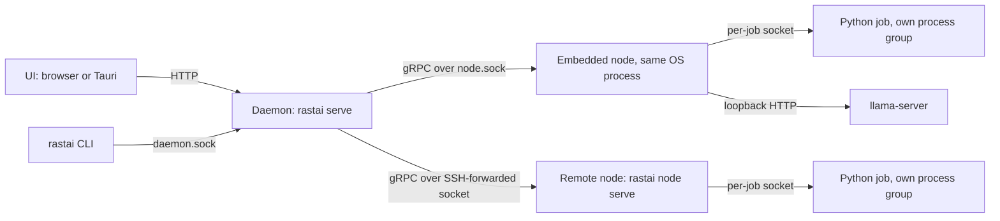

# ADR-0001: One binary, an embedded node, jobs in their own process groups

**Status:** Accepted, 2026-10-10. Decision 5 superseded in part by [ADR-0034](0034-login-codes-loopback-host-owner-token.md), 2026-10-10.

**Superseded in part:** decision 5's reattach order. Only the job token's BLAKE3 hash is on disk (`job_token_hash`), so on restart the node waits for the worker's `WorkerHostService.Register`, checks BLAKE3(token) against `job_token_hash` (with the pid, `boot_id` and `process_start_ticks` in `job.json`), and only then calls `WorkerService.Hello` (ADR-0034 decision 9). The rest of decision 5 stands.

## Context

- Rastai has three kinds of work: a control plane (API, gateway, storage, commands, plugin host), per-machine work (GPU telemetry, VRAM, Python environments, job supervision, sandboxes), and GPU compute in Python.
- "Nothing the user did is ever lost to a crash" (§2). A daemon crash must not kill a training run, and must not orphan one either.
- Remote boxes over SSH are in the prototype. If the local machine takes a shortcut path that remote boxes don't, the remote path rots.
- Python jobs die in ways Rust can't prevent: CUDA OOM, kernel faults, segfaults in native extensions. They must not take the control plane with them.
- One person reviews everything (§28 risk 1), so fewer moving parts is a requirement, not a preference.

## Decision

1. **One Rust binary, `rastai`** (crate `rastai-cli`), with these modes:
   - CLI verbs (generated from the command registry, ADR-0005);
   - `rastai serve [--headless]`: the daemon plus the embedded node;
   - `rastai node serve`: a node only, on remote machines;
   - `rastai mcp`: the MCP stdio bridge.
2. **The daemon** (`rastai-server`) is the control plane. Exactly one runs per user, guarded by a flock on `<runtime>/daemon.lock`.
3. **The embedded node** runs in the daemon's OS process on its own tokio runtime. It serves `NodeService` and `SandboxService` on `<runtime>/node.sock`. The daemon reaches it through that socket exactly as it reaches a remote node. No direct function calls between daemon code and node code.
4. **Every Python job is its own process:** `<env>/bin/python -m rastai_worker run --job-file runs/<run_id>/job.json`.
   - It starts in its own process group (`setsid`), so signals reach the whole job and nothing else.
   - It serves `WorkerService` on `<runtime>/jobs/<job_id>.sock` and calls the node on `worker-host.sock`.
5. **Jobs outlive the daemon and the node.** The node writes `runs/<run_id>/job.json` (pid, process group id, socket, start time). On restart it reads every `job.json`, checks that the pid still has the same start time, calls `WorkerService.Hello`, and moves the job `lost → running`. If the process is gone: `lost → failed`, with the cause. *(The order of the reattach steps is superseded by ADR-0034 decision 9: `Register` and the token-hash check come before `Hello`.)*
6. Other child processes are supervised by the node the same way: `llama-server` (ADR-0010), sandbox containers through the engine (ADR-0031), plugin Python modules (job kind `plugin_module`, ADR-0015).
7. **CI runs the local node over the real transport.** A second CI test starts `rastai node serve` on the same machine and drives it through the SSH path (ADR-0011).

**Checked by** (`tests/crash/`):
- kill -9 the daemon during a TextCNN run, restart, and the job reattaches with zero lost durable events (§32 weeks 3–4 exit criterion);
- kill -9 a worker: the job ends `failed` with a `RRS-J1xxx` cause in its last `job.state_changed`;
- start a second daemon: it exits with a coded error naming the running one.

- The embedded node shares the daemon's process but not its code path: every call goes through `node.sock`.
- What persists across a crash: `job.json` and `events.log` in the run folder (ADR-0002). Reattach needs nothing else.
- Failure branches: daemon dies → jobs keep running and logging; node restarts → reattach from `job.json`; job dies → the node records the exit cause.

## Consequences

**Good**
- One artifact to build, ship, sign and self-update. The daemon pushes the same binary to paired nodes.
- Local and remote share one code path, so remote is tested on every CI run.
- A Python crash, OOM or hang costs one job, never the control plane.
- Restarting or updating the daemon doesn't stop training.

**Costs**
- Every local node call pays a serialize and a socket hop. That is small next to GPU work, but it isn't free.
- Reattach logic (pid reuse checks, socket reconnect, event-log resume) must be written and kill -9 tested.
- A panic in the embedded node takes the daemon down with it. Jobs survive and reattach, the same as after a daemon crash.
- The binary grows as crates are added.

## Alternatives considered

| Alternative | Why not |
|---|---|
| Separate daemon and node processes on the local machine | Two things to install, start and update for no gain. Going through `node.sock` already gives the separation that matters. |
| Embed Python in the daemon (PyO3 running torch in-process) | A CUDA fault or OOM kills the control plane. The GIL serializes jobs. Training can't be restarted on its own. |
| One long-lived Python worker running all jobs as threads | One crash kills every job. A per-process memory fraction can't be set per job (ADR-0010). |
| Separate services for gateway, store and scheduler | More processes, ports and failure modes for one reviewer. Nothing needs to scale apart. |

## Links

- Spec: [§16](../spec/rastai_spec_v5.md#16-architecture-overview), [§19](../spec/rastai_spec_v5.md#19-storage-and-durability-new), [§32](../spec/rastai_spec_v5.md#32-first-90-days)
- Contracts: [§3 processes](../architecture/contracts.md#3-processes-and-boundaries), [§9.1 job states](../architecture/contracts.md#9-state-machines)
- Related: [ADR-0002](0002-durability-worker-event-logs.md), [ADR-0010](0010-gpu-sharing-vram-leases.md), [ADR-0011](0011-remote-transport-ssh-first.md), [ADR-0016](0016-backend-language-rust.md), [ADR-0034](0034-login-codes-loopback-host-owner-token.md)
