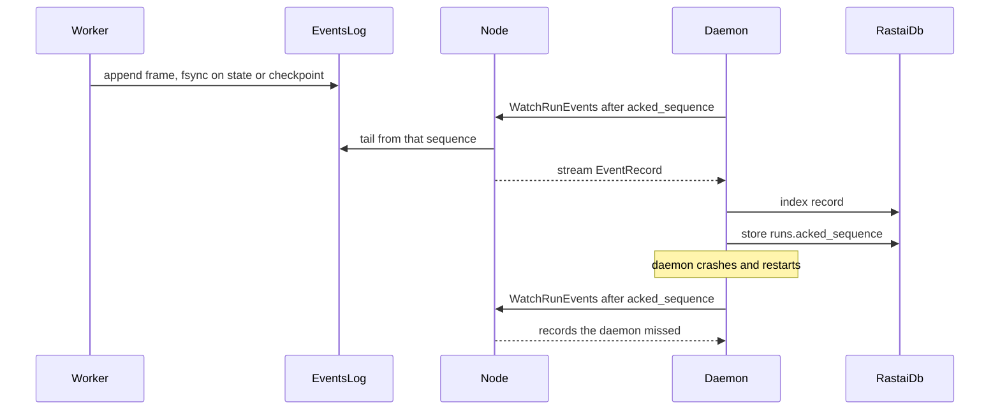

# ADR-0002: Workers own their event logs; the database is an index

**Status:** Accepted, 2026-10-10. Decision 7 amended by [ADR-0035](0035-mysql-long-term-archive.md), 2026-10-10.

**Amended:** decision 7's rebuild. When a long-term archive is configured, `rastai storage rebuild-index` gains a last step that pulls the rows of pruned runs from the archive (ADR-0035 decision 8). With no archive, the decision is unchanged.

## Context

- Training and gym runs last hours. The daemon can crash, be updated or lose its SSH link to a remote node at any point.
- If jobs wrote straight to the daemon (over gRPC or into SQLite), a daemon outage would either block the job or lose events.
- Remote jobs can't write to a database on another machine.
- Per-token streams are heavy (a live packet is 8.3 KB, at up to ~150 tokens/s; spike 02) and losing some is fine. Metrics and state changes must never be lost.

## Decision

1. **Each job is the only writer of `runs/<run_id>/events.log`.** Format (contracts §7.1):
   - an 8-byte header, ASCII `RRSEVLG1`;
   - then frames: `body_length: u32 LE` | `checksum: u32 LE` (CRC-32/IEEE of the body) | `body` (protobuf `rastai.events.v1.EventRecord`);
   - `sequence` starts at 1 and has no gaps.
   - *Note since acceptance (2026-10-10): a chain run's log (Teach it, RLHF, sweeps) has one writer too, the daemon's chain driver, and the daemon keeps its own durable records in `<data>/daemon/events.log` with the same frames (contracts §7.1, §16 row 18). The rule "one writer per log" is unchanged.*
2. **Two event classes.**
   - Durable (metrics, state changes, checkpoints, artifacts, rollouts, eval results) go into the log.
   - Ephemeral (tokens, live packets, progress, peek steps, log lines) go over `WatchLive` only and may be dropped under backpressure.
3. **fsync** after every state-change and checkpoint event. Metrics are batched and fsynced at least once a second.
4. **Large payloads go to the blob store.** The event carries a `BlobRef` (hash, size, media type).
5. **The node tails, the daemon acks.**
   - The node serves `WatchRunEvents(run_id, after_sequence)`.
   - The daemon indexes each record into `rastai.db`, then stores `runs.acked_sequence`.
   - After any restart or reconnect, it resumes from `acked_sequence`.
   - For remote runs the daemon also keeps its own byte copy of the log. Local runs share `<data>/runs/`, so there is one file.
6. **Recovery when a log is opened:**
   - a torn or bad-checksum frame at the end is truncated (the writer died mid-write);
   - a bad frame anywhere else is corruption: `RRS-S2002`. The run is flagged and the file is kept for inspection.
7. **`rastai.db` is an index.** Every table except `tokens`, `nodes`, `plugins` and `projects` can be rebuilt from event logs, run records and the blob store (`rastai storage rebuild-index`).
   - *Amended by ADR-0035 (2026-10-10): when a long-term archive is configured, the rebuild gains a last step that pulls the rows of pruned runs from the archive. `archive_cursors` is reset by a rebuild, and the next sync re-sends from the start (the upserts are idempotent).*
   - *Note since acceptance (2026-10-10): `settings` is removed from the list because there is no settings table. Settings live only in files (spec v5.4 §19, contracts §11.1). The rule is unchanged.*
8. **Node-side state** (job states, leases, loaded models, sandboxes) isn't logged by the node. It rides in every `Heartbeat` as a snapshot, and the daemon reconciles against it.

- The worker never waits on the node or the daemon. It only appends to a local file.
- Persisted: the log on the job's machine, `acked_sequence` and the index in `rastai.db`, and large data in the blob store.
- Failure branches: daemon down → the log grows and the daemon catches up later; node down → same, the node re-tails on restart; torn tail → truncated on open; corrupt middle → `RRS-S2002`.

**Checked by:** `fixtures/event-logs/` (good, torn-tail and corrupt-middle logs) read by the Rust reader and written by the Python writer; kill -9 of daemon, node and worker at random points of a run; a rebuild test that deletes `rastai.db`, rebuilds it and compares.

## Consequences

**Good**
- A daemon crash, update or network drop loses no durable event, and jobs never block on the control plane.
- A broken `rastai.db` is recoverable.
- The same mechanism works for local and remote runs.

**Costs**
- Framing code exists twice: a Python writer (`zlib.crc32`) and a Rust reader (an in-house CRC table). The golden fixtures keep them in step.
- The daemon's index lags the log by one round trip, so the UI shows "catching up" after a reconnect.
- Rebuild-index has to be maintained as tables are added.

## Alternatives considered

| Alternative | Why not |
|---|---|
| Jobs write to `rastai.db` directly | Writer contention, and impossible for remote jobs. Makes the database the source of truth. |
| Jobs stream events to the daemon only | A daemon outage blocks the job or loses events. |
| A message broker (NATS, Kafka, an embedded queue) | Not on the §27 allowlist, and heavy for one user. A file per run is enough. |
| JSON-lines log | No checksums, so a torn line can't be told apart from a corrupt one. Larger. Payloads are protobuf anyway. |

## Links

- Spec: [§19](../spec/rastai_spec_v5.md#19-storage-and-durability-new), [§20](../spec/rastai_spec_v5.md#20-schemas-protocols-and-versioning)
- Contracts: [§7 events](../architecture/contracts.md#7-events), [§8 storage](../architecture/contracts.md#8-storage)
- Related: [ADR-0001](0001-process-layout.md), [ADR-0003](0003-storage-sqlite-vault-blobs.md), [ADR-0024](0024-no-pickle-checkpoints.md), [ADR-0035](0035-mysql-long-term-archive.md)
