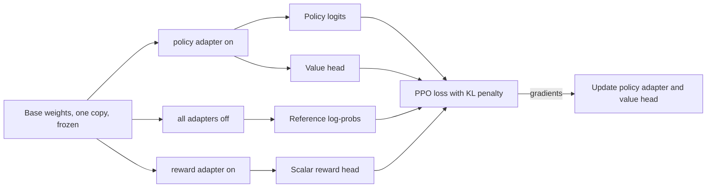

# ADR-0022: PPO keeps one base model in VRAM; everything else is an adapter or a head

**Status:** Accepted, 2026-10-10

## Context

- Textbook PPO for language models holds four models: the policy, a frozen reference, a value model and a reward model. On a 1B model in bf16 that's about 8 GB of weights before activations and optimizer state, and four times over on every larger model.
- Rastai targets 8–16 GB consumer GPUs that also keep a chat model loaded (ADR-0010).
- LoRA is native to ModelSpec (`train_mode: lora`). A LoRA adapter can be switched off per forward pass.
- Spike 03:
  - an adapter switched off reproduced the base model exactly;
  - a rank-16 LoRA on all 7 projections × 26 layers of Gemma 3 1B was 13.0 M trainable parameters and a 52.2 MB file;
  - training it beside the resident chat model peaked at 4.7 GiB.

## Decision

1. **One copy of the base weights.**
   - **Policy** = the base with the `policy` LoRA adapter on.
   - **Reference** = the same base with every adapter off. It runs under `torch.no_grad()`.
   - **Value head** = a small head reading the policy pass's final hidden state, so policy logits and values come from one forward pass.
   - **Reward model** on the same base = a second LoRA adapter (`reward`) plus a scalar head, trained earlier by the reward-model recipe.
2. **Exactly one adapter is active per forward pass.** `rastai_models` supports several named adapters per graph node and switches them with one call.
3. **A PPO step** in `rastai_train/recipes/ppo.py`:
   1. generate rollouts with the policy;
   2. score them with the reward adapter, or with a reward-function plugin;
   3. compute reference log-probs with adapters off;
   4. compute generalized advantages from the values;
   5. take the PPO loss with a per-token KL penalty against the reference;
   6. update only the policy adapter and the value head.
4. **When this layout can't apply,** recipe availability says so before launch (the capability matrix and the Designer's memory estimate):
   - A reward model on a **different** base can't share VRAM. It runs as a separate job with its own lease, and is called through the node-local gateway.
   - **Full fine-tuning PPO** (no LoRA) needs a real reference copy. It's offered only when the memory estimate fits.
5. **GRPO and GSPO use the same reference trick:** the KL term's reference is the base with adapters off.
6. **Checkpoints** hold only the adapters and heads (`adapter.safetensors`) plus optimizer state, never a second copy of the base (ADR-0024).

```python
# python/rastai_models/lora.py
def set_active_adapter(model: torch.nn.Module, adapter_name: str | None) -> None:
    """Turn on one named LoRA adapter on every graph node that has it. None means base weights only (the reference)."""

# python/rastai_train/recipes/ppo.py
POLICY_ADAPTER = "policy"
REWARD_ADAPTER = "reward"

def reference_log_probs(model: torch.nn.Module, rollouts: RolloutBatch) -> torch.Tensor:
    set_active_adapter(model, None)  # same weights as the policy minus the adapter: no second copy in VRAM
    with torch.no_grad():
        return token_log_probs(model, rollouts)
```



- Each arrow out of the base is a separate forward pass over the same weights with a different adapter active. Passes run one after another, never concurrently.
- Persisted per checkpoint: the policy adapter, the value head, optimizer state and `resume.json`. The reward adapter is an input artifact, not updated.
- Failure branches: if the memory estimate doesn't fit, the run is refused before launch with `RRS-T0xxx`; an OOM mid-run checkpoints and fails with `RRS-H3xxx`.

## Consequences

**Good**
- PPO fits wherever LoRA fits, not four times over. RLHF runs on a single consumer GPU next to the chat model.
- Checkpoints are megabytes, not gigabytes.
- The reference is exactly the base model, with no drift from a separately loaded copy.

**Costs**
- Three to four forward passes per batch over the same weights, run one after another. That trades compute time for memory.
- The value head shares the policy's backbone, so value-loss gradients flow into the policy adapter. A separate `value` adapter is the fallback if this proves unstable (one more forward pass).
- Adapter switching must be correct everywhere, including CUDA-graph decode during rollouts. One graph is captured per adapter state.

## Alternatives considered

| Alternative | Why not |
|---|---|
| Four separate models | ~4× the VRAM. Doesn't fit the target GPUs next to a chat model. |
| Reference on CPU or on another GPU | Slow transfers every step, and it needs a second GPU most users don't have. |
| An external RL library (TRL) | Dropped (§27), and it doesn't use our observation points or leases. |
| No value model (GRPO only) | GRPO is offered too. PPO stays because it's the standard RLHF step and works with dense rewards. |

## Links

- Spec: [§10](../spec/rastai_spec_v5.md#10-training-and-evaluation) (RLHF end to end), [§12](../spec/rastai_spec_v5.md#12-agent-gym), [§17](../spec/rastai_spec_v5.md#17-unified-model-runtime-new)
- Contracts: [§5.2 ModelSpec node `train_mode` and `lora`](../architecture/contracts.md#5-documents-owned-by-rastai-formats), [§8.4 checkpoints](../architecture/contracts.md#8-storage), [§12.3 Recipe](../architecture/contracts.md#12-naming-and-code-conventions)
- Spike: [03 Teach it](../../spike/results/03_teach_it_lora.md)
- Related: [ADR-0010](0010-gpu-sharing-vram-leases.md), [ADR-0021](0021-technique-coverage.md), [ADR-0024](0024-no-pickle-checkpoints.md)
