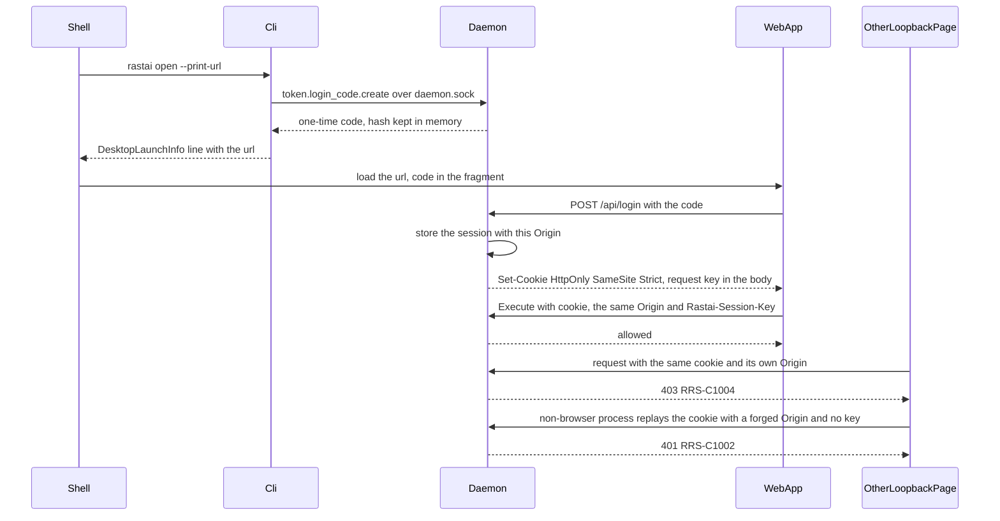

# ADR-0034: Sign-in with one-time login codes and origin-bound sessions; the loopback Host rule; a too-open owner token stops the daemon; Register before Hello

**Status:** Accepted, 2026-10-10. Supersedes in part [ADR-0001](0001-process-layout.md) decision 5, [ADR-0006](0006-ui-transport-http-only.md) decision 4 and [ADR-0007](0007-local-api-security.md) decisions 3 and 4.

## Context

- ADR-0007 had the Tauri shell read `owner.token` and build the start URL. That puts a secret reader and crypto in the shell, which ADR-0006 says is "just a shell" (plan §10 row 2).
- ADR-0007's Host rule (`127.0.0.1:<port>` or `localhost:<port>`, the daemon's own port) breaks the remote UI: an SSH tunnel to a headless box usually forwards a different local port, and the browser sends that port in Host (plan §10 row 22).
- **Browsers don't isolate cookies by port.** A cookie set by `127.0.0.1:47820` is sent to every port on `127.0.0.1`, and SameSite treats all those ports as one site. Once any loopback port is accepted, "Origin equals `http://` plus Host" alone can't tell the page that signed in from another loopback page (a tunnel to a second daemon, a dev server, a notebook) whose requests reach a daemon through a forwarder.
- Browsers omit Origin on some same-origin GETs (images, downloads), so "no Origin" can't simply be refused or accepted.
- The drafts disagreed on a too-open `owner.token`: rotate it, or refuse to start (plan §10 row 36).
- Only BLAKE3 of a job's token is on disk (`job.json` `job_token_hash`). ADR-0001 decision 5 had the node call `Hello` first on reattach, before it could prove which worker it was talking to (plan §10 rows 5 and 6).

## Decision

1. **Sign-in uses one-time login codes.**
   - `rastai open` (and `rastai serve` with `daemon.open_browser`) starts the daemon if needed, then runs `token.login_code.create` over `daemon.sock`, where the peer uid proves the owner.
   - A code is 32 random bytes, single use, valid for `LOGIN_CODE_LIFETIME_SECONDS` (60). The daemon keeps only its hash, in memory.
   - The URL carries the code in the fragment, `http://127.0.0.1:<port>/#login=<code>`, which browsers never send to servers or put in a Referer header.
   - The web app reads it (`readLoginCode`), removes it from the address bar (`removeLoginCodeFromUrl`) and posts it to `POST /api/login` (`exchangeLoginCode`). The answer is the session cookie `rastai_session_<daemon id prefix>`: HttpOnly, SameSite=Strict, Path=/.
   - Sessions live in daemon memory and expire after `SESSION_IDLE_EXPIRY_HOURS` (24) idle. A daemon restart signs everyone out (`RRS-U0003`). A used or expired code is `RRS-C1007`.
   - Tokens and codes never go in `localStorage`.
2. **The Tauri shell only runs `rastai open --print-url`.** It parses the one `DesktopLaunchInfo` JSON line, loads its `url`, and reruns the command when its 5 s check finds `daemon.lock` free. It never reads `owner.token`, makes no HTTP request and does no crypto. File associations reach the web app as a `#/open?path=<file>` fragment, and the web app runs `file.open`. `rastai tunnel <user@host>` mints the remote box's code with `rastai token login-code create` over SSH.
3. **Host rule.** Any loopback host name (`127.0.0.1`, `localhost`, `::1`) on any port is accepted; anything else is `RRS-C1003` (DNS rebinding). Origin, when present, must equal `http://` plus Host, else `RRS-C1004`. Origin `null` (a sandboxed iframe) is refused.
4. **Sessions are bound to the origin that redeemed the code.** `POST /api/login` stores the request's Origin with the session. A cookie request whose Origin differs from it is `RRS-C1004`, whatever its Host.
5. **A cookie request without Origin** is accepted only for `GET` and `HEAD` with `Sec-Fetch-Site` equal to `same-origin` or `none` (blob downloads, images, the app's own static files). Any other cookie request without Origin is `RRS-C1004`. GET endpoints never change state; every action is `POST .../Execute`.
6. **Bearer requests** (curl, Navi, scripts, MCP) may omit Origin. If they send one, rule 3 applies.
7. **Cross-origin browser clients are refused in v1.** There is no CORS and no origin allowlist. The two future routes, both Phase 2 and neither built now:
   - **daemon-hosted alternative UIs**, served by the daemon on its own origin, so they are same-origin and use rules 1–5 unchanged;
   - **an origin allowlist with pairing**: the owner pairs a named origin once, and the daemon answers CORS for that origin only (built only on demand).
   Non-browser frontends use a bearer token (`token.create` now, `token.pair` in Phase 2) and the generated client with `credential: {kind: "bearer", token}`.
8. **A too-open `owner.token` stops the daemon.** If `<config>/auth/owner.token` is readable by group or others, the daemon refuses to start with `RRS-C1008` and the fix `chmod 600 <path>`, before binding any listener. It never rotates or rewrites the file. A missing file is created 0600 on first run.
9. **Reattach order.** On restart the node waits for the worker's `WorkerHostService.Register`, checks BLAKE3(token) against `job.json` `job_token_hash` (with the pid, `boot_id` and `process_start_ticks`), and only then calls `WorkerService.Hello` and moves the job `lost → running`. The token itself travels only in `RASTAI_JOB_TOKEN`. No `Register` within `HOST_RECONNECT_TIMEOUT_SECONDS` (300) is `lost → failed` with `RRS-J3003`.
10. **Cookie requests also need a per-session request key.** Cookies are sent to every loopback port, and Origin and Fetch Metadata are enforced by browsers only, so a non-browser process on another loopback port that receives the cookie could replay it with a forged `Origin` and `Sec-Fetch-Site`. To close that:
    - `POST /api/login` also returns a request key, 32 random bytes, in the response body. The daemon keeps its hash with the session.
    - The web app holds the key in memory only (never a cookie, `localStorage` or `sessionStorage`) and sends it as the header `Rastai-Session-Key` on every non-GET request (`Execute`, `Subscribe`, `PUT /api/blobs`).
    - A cookie request without a matching key is `RRS-C1002`. The cookie alone authorizes only `GET` and `HEAD` of the app's static files and of blobs (rule 5).
    - A page reload loses the key; the web app signs in again with a new login code from `rastai open`, or the desktop shell reruns `rastai open --print-url`. Bearer requests don't use the key.

- The shell never touches a secret: the CLI mints the code over the socket, and the web app redeems it.
- The cookie leaks to other loopback ports by browser design (Context). A browser page on another port gets `RRS-C1004` (rule 4). A non-browser process on another loopback port receives the cookie but not the in-memory key (rule 10), so it can only fetch content-addressed blobs it already knows the hash of.
- **Residual risk:** blob `GET`s by hash (and the app's static files) need the cookie alone. A hash is 256 bits, so it can't be guessed. It is recorded in the threat-model row named in M1-56.
- **Persisted:** only `owner.token` (0600). Codes and sessions are in memory, so a restart drops them, and the shell signs in again.
- **Failure branches:** reused or late code → `RRS-C1007`, shown as `RRS-U0002`; restart → `RRS-U0003`; foreign Host → `RRS-C1003`; wrong or missing Origin → `RRS-C1004`; cookie without the request key → `RRS-C1002`; too-open `owner.token` → `RRS-C1008`, no listener bound.

**Checked by:**
- the request-gate table test (platform flow 4.2, plan M1-26): Host `attacker.test` → `RRS-C1003`; Origin `null` → `RRS-C1004`; Host `127.0.0.1:47900` with Origin `http://127.0.0.1:47900` and a session redeemed there → allowed; a session redeemed at `:47820` used with Origin `http://127.0.0.1:47900` → `RRS-C1004`; a cookie `GET` with no Origin and `Sec-Fetch-Site: same-origin` → allowed, with `same-site` → `RRS-C1004`; a cookie `POST` with no Origin → `RRS-C1004`; a request with a valid cookie, a forged matching Origin and no `Rastai-Session-Key` → `RRS-C1002`; the same with a wrong key → `RRS-C1002`; a cookie `GET` of a blob with no key → allowed;
- the `request_gate` fuzz target (header parsing never panics);
- Playwright: valid code → signed in; reused code and a 61 s old code → `RRS-C1007`; daemon restart → `RRS-U0003`; a page on another origin can't call `Execute`;
- `owner.token` at 0644 → start refused with `RRS-C1008` and no listener bound;
- `rastai open --print-url` prints exactly one JSON line that parses as `DesktopLaunchInfo`;
- a grep check that `apps/desktop` has no HTTP client and never opens `owner.token`;
- kill -9 the daemon mid-run: the node gets `Register` before it calls `Hello`; a worker with a wrong token is refused.

## Consequences

**Good**
- The shell holds no secret and no HTTP code, so a bug in it can't leak the owner token.
- The remote UI works through an SSH tunnel on any free local port.
- A cookie that reaches another loopback port is useless to a browser page there (`RRS-C1004`) and to a non-browser process, which lacks the in-memory request key (`RRS-C1002`).
- Reattach proves the worker's identity before any call trusts it.

**Costs**
- Every daemon restart signs the user out. The desktop shell hides it; a browser tab shows the `rastai open` hint.
- A page reload loses the in-memory request key, so the browser tab signs in again with a new code. The desktop shell does this on its own.
- Blob `GET`s by hash need only the cookie; a non-browser process on a loopback port that got the cookie could fetch a blob if it already knew its hash. Hashes are unguessable, and the risk is in the threat model.
- A browser that sends no Fetch Metadata headers can't fetch blobs by cookie without Origin; it fails closed. Current Chrome, Firefox and WebKitGTK send them.
- Third-party browser UIs on their own origin can't use the daemon at all in v1. Scripts and other non-browser clients are unaffected.
- A shared or too-open config folder stops the daemon instead of quietly fixing itself. The fix text says exactly what to run.

## Alternatives considered

| Alternative | Why not |
|---|---|
| The shell reads `owner.token` (ADR-0007 as accepted) | A secret reader and crypto in the shell; two places mint codes. |
| Accept only the daemon's own port in Host | Breaks SSH tunnels that forward another local port. |
| Host and Origin checks without origin binding | Cookies reach every loopback port; a forwarder on another port passes "Origin equals Host". |
| Cookie plus Origin checks only | Origin and Fetch Metadata are enforced by browsers; a non-browser process holding the cookie can forge them. Rule 10 adds a key it never sees. |
| Accept any cookie request without Origin | Lets a same-site page on another port trigger GETs with the cookie. |
| CORS with an allowlist now | No first-party need yet; more attack surface. Phase 2, on demand. |
| Rotate a too-open `owner.token` | Hides a misconfiguration and breaks every script holding the old token. |
| `Hello` before `Register` on reattach | The node would talk to a process it hasn't identified; PID reuse makes that unsafe. |

## Links

- Spec: [§0](../spec/rastai_spec_v5.md#0-decisions) items 19 and 21, [§16](../spec/rastai_spec_v5.md#16-architecture-overview), [§21](../spec/rastai_spec_v5.md#21-command-layer-and-local-api-security), [§30](../spec/rastai_spec_v5.md#30-adrs-to-write-now)
- Contracts: [§3.2 sign-in and the request gate](../architecture/contracts.md#32-who-talks-to-whom), [§3.3 daemon HTTP surface](../architecture/contracts.md#33-daemon-http-surface), [§8.4 `job.json`](../architecture/contracts.md#84-blob-store-runs-and-checkpoints), [§9.1 job states](../architecture/contracts.md#91-job), [§16 rows 2, 5, 6, 22, 36](../architecture/contracts.md#16-plan-10-conflicts-the-answers-in-v11)
- Flows: platform 2.3 (reattach), 4.1 (signing in), 4.2 (the request gate)
- Plan: M1-01 (writes this ADR), M1-26 (the gate), M1-55 (the desktop shell, deferred by ADR-0040)
- Related: [ADR-0001](0001-process-layout.md), [ADR-0006](0006-ui-transport-http-only.md), [ADR-0007](0007-local-api-security.md), [ADR-0011](0011-remote-transport-ssh-first.md)
