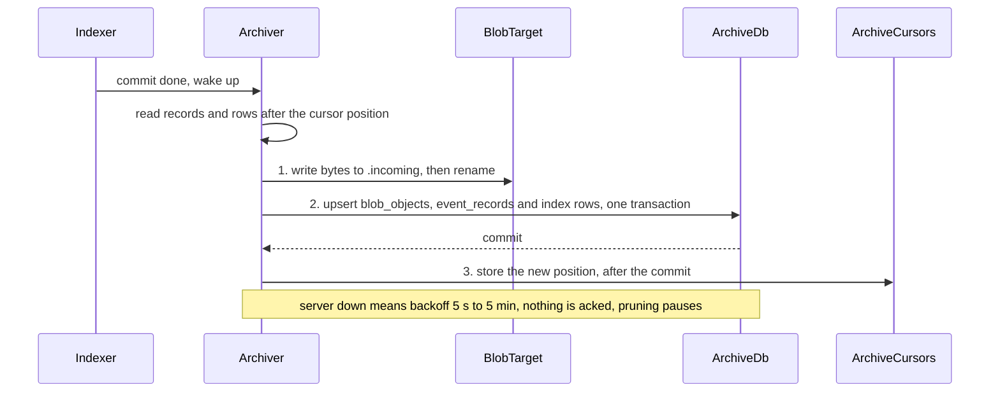

# ADR-0035: An optional long-term archive in the owner's MySQL or MariaDB; SQLite stays the live store

**Status:** Accepted, 2026-10-10. Supersedes in part [ADR-0003](0003-storage-sqlite-vault-blobs.md) decision 6 and amends [ADR-0002](0002-durability-worker-event-logs.md) decision 7.

## Context

- The owner wants MySQL "really for long term storage": years of runs, metrics and eval results across several machines, queryable in one place, while each laptop or GPU box frees its own disk.
- The live store must keep what ADR-0002 and ADR-0003 bought: no server to run, works offline, one writer thread per file (spike 07), and an index rebuildable from event logs.
- Several daemons (a laptop, a GPU box) would write to one archive. Their run ids never collide (ids are random), but their rows must say where they came from.
- Conversations are the most sensitive data Rastai holds (§24). The default data policy is `local-only` (owner decision 13).
- MySQL server and MariaDB are GPL-2.0. Rastai can talk to them but must never ship them.
- Client libraries: `sqlx` carries RUSTSEC-2023-0071 through `rsa`; Oracle's connectors and `mysqlclient` bring license or build problems. `mysql_async` (MIT OR Apache-2.0) and PyMySQL (MIT) are clean.
- The owner also wants to import training data from MySQL and to see runs and metrics in MySQL (option C).

## Decision

1. **SQLite stays the live store on every machine.** The archive is optional and one way: each daemon replicates to it, idempotently, from its event logs and its index. Nothing ever reads the archive to serve a live request, except restore and the rebuild step in decision 8.
2. **Where and who.** The owner's own MySQL or MariaDB on the LAN or a NAS (the same code serves both; MySQL 8.4 and 9.x, MariaDB LTS), written only by the owner's machines. Each daemon has its own revocable MySQL user, password in the keychain account `archive.mysql`. Every row carries `source_id` = `daemon_<base32 of the daemon key>`. **Nodes never get archive credentials;** only the daemon talks to the archive.
3. **What is archived** (contracts §8.7):
   - durable event records of run logs and the daemon log, keyed (`source_id`, `log_id`, `sequence`), with the protobuf body and its CRC;
   - `runs`, `run_tags`, job final states, checkpoint metadata, `run_metrics`, eval results, `artifacts` and `lineage` (metadata and hashes only), the redacted `command_journal`;
   - never: `tokens`, `nodes`, `plugins`, `projects`, settings, `undo_steps`, `transfers`, secrets, HF weights (only `model_ref` and hash).
4. **Conversations are opt-in and encrypted at rest.** `conversations`, `messages`, `annotations` and `gateway_log` are off by default. A project opts in with `archive.include_conversations` (project layer only); a `local-only` project never can. They go only into tables that report encryption (MySQL `ENCRYPTION='Y'`, MariaDB `ENCRYPTED=YES`), else `RRS-S5004`. The `vault_changes` outbox (vault migration `0001`, written only while an archive is configured, in the same transaction as its row) feeds them.
5. **Blobs: bytes in a blob target, metadata in MySQL.** MySQL holds no bytes, only `blob_objects` (content hash, size, media type, target, verified time). A folder target comes first (NAS, USB, NFS, SMB; the blob store's `ab/<hash>` layout; `.incoming/` then rename); S3-compatible later, with in-house SigV4 signing over `rastai-transport` HTTPS (keychain account `archive.objects`). Archived: pinned checkpoints, LoRA adapters, dataset snapshots; never intermediate checkpoints. Vault-class blobs go under `vault/<source_id>/`. **Object first, row second**, and BLAKE3 is verified on restore.
6. **Sync is at-least-once with idempotent upserts.**
   - Triggers: the indexer's commit, a timer (`archive.interval_seconds`, 60), `rastai archive sync`, and a catch-up at daemon start.
   - All write SQL is built by one function, `build_upsert`, tested against MySQL and MariaDB.
   - `archive_cursors` in `rastai.db` advance only after the MySQL commit, through the store's writer thread.
   - `archive_meta` holds `schema_version` and `min_writer_version` (an older daemon stops writing, `RRS-S5002`). Migrations are additive and idempotent, under `GET_LOCK('rastai_archive_migrate')`.
   - Server down: backoff from 5 s to 5 min, `archive.status` shows the lag, a warning after 24 h (`RRS-S5006`), and local pruning pauses.
7. **Prune is not delete.**
   - **Prune** frees local space only, and only for items the archive acknowledged and verified, never pinned items or running jobs (`RRS-S5009`). It leaves stub rows (`runs.archive_state = pruned`); opening a pruned run restores it. Local pruning is **off** until `archive.prune_after_days` is set.
   - **Delete** is user intent and reaches the archive: `conversation.delete` adds the archive to its "every copy" set (queued in `vault_changes` if the archive is down); `run.delete` writes a tombstone; `archive.purge`, with admin credentials passed once and never stored, removes rows and objects physically.
8. **Restore and rebuild.** `archive.restore` (a run, a conversation, an artifact, or a `source_id` with `all`) rewrites frames into `events.log`, checks every CRC (`RRS-S5008`) and indexes them through `apply_event_record`, the live indexing path. `rastai storage rebuild-index` gains a last step that pulls the rows of pruned runs from the archive. `archive_cursors` is reset by a rebuild; the next sync re-sends from the start, which the upserts absorb.

    *Note since acceptance (2026-10-10):* the offline rebuild makes the stubs; the daemon pulls each stub's rows (every index row but `run_metrics`) at its next start, before the first sync (control-plane layout §13.2). The CLI rebuild never reads the archive: the store never imports it, and the credentials live only in the daemon.
9. **Security.** The archive is a remote destination under the data policy (§24): a project's rows go only when its policy is `trusted-remote` or `any`; rows with no project follow `privacy.data_policy`; a skipped project shows `RRS-C1009` with its one-click fix. TLS is required except over loopback or a Unix socket (`RRS-S5003`). The egress badge shows `egress.active` (purpose `archive`) while a sync runs.
10. **Code.** A new crate, `crates/rastai-archive`, run only by the daemon. `src/mysql.rs` is the only file that imports `mysql_async` (feature `default-rustls-ring`, default features off); `deny.toml` `wrappers` enforces it. The store never imports the archive; the archive reads through `rastai-store`'s reader API. Commands `archive.configure | status | sync | restore | verify | purge`, settings section `archive`, events `archive.*`, error range `RRS-S5xxx`, and kill -9 rows 20–24.
11. **Option C: a MySQL dataset reader, and runs in MySQL.**
    - A `.rrsdata` source of kind `mysql` is read by `rastai_data/readers/mysql_reader.py`, the only file importing PyMySQL. It streams a server-side cursor into the snapshot path (a JSONL or Parquet blob), inside a `data_import` job on the node, with network allowed only to that host and a short-lived credential from `NodeHubService.GetSecret` (purpose `mysql:<connection_name>`).

    *Note since acceptance (2026-10-10):* "network allowed only to that host" means the daemon releases the credential only for the host in `JobSpec.network_hosts`. Ordinary worker jobs have no packet filter (node layout §7.9).
    - "Export runs and metrics to MySQL" is the archive's typed tables plus the stable views `v_runs` and `v_metrics`, whose columns change only additively.
    - Shared by both: the `MysqlConnection` type in `rastai-formats`, one type-mapping table with golden fixtures checked in Rust and Python (`fixtures/mysql/type-mapping/`), one TLS policy, one CI MySQL service.
12. **Never bundled.** MySQL server and MariaDB are never bundled or distributed; the user runs their own. Clients are `mysql_async` and PyMySQL only: not `sqlx`, not Oracle's connectors, not `mysqlclient`.

- **The numbered order is the crash contract.** A kill between 2 and 3 re-sends rows the archive already has, and the upserts absorb them (kill -9 row 20). A kill between 1 and 2 leaves an object with no row; the cursor didn't move, so the next sync writes the same object again (same name) and then its row.
- Nothing is pruned locally before step 3 and a verified `blob_objects` row exists.
- **Persisted:** the archive's rows and objects; `archive_cursors` and `runs.archive_state` locally; `archive.*` durable events in the daemon log, so a rebuild restores the stubs.
- **Failure branches:** server down → backoff and lag, `RRS-S5001`; credentials rejected → `RRS-S5005`; schema too new → `RRS-S5002`, writes stop; blob target unwritable → `RRS-S5012`; a bad blob on restore → `RRS-S5007`; a bad frame on restore → `RRS-S5008`, restore stops.

**Checked by:**
- kill -9 rows 20–24 of the crash matrix (platform flow 6.5): the archiver killed between the MySQL commit and the local ack; mid blob upload; a prune between the row delete and the file delete; a restore mid-write; a migration mid-statement;
- `build_upsert` tests against MySQL 8.4 and 9.7, MariaDB and MinIO in the `mysql-archive` CI job (`just test-archive`, M11-E07): sending one batch twice leaves identical rows;
- restore then rebuild equals the original index; prune refuses a pinned, running or unverified item with `RRS-S5009`;
- refusals: a non-loopback connection without TLS → `RRS-S5003`; conversations into an unencrypted table → `RRS-S5004`; a `local-only` project → skipped with `RRS-C1009`;
- the type-mapping goldens in Rust and Python; the `archived_frame` fuzz target; `check-imports` and `deny.toml` for `mysql_async` and PyMySQL.

## Consequences

**Good**
- Years of runs from every machine, queryable in one database the owner already runs, with stable views for other tools.
- Local disks can be pruned safely: nothing goes before the archive has it and has verified it.
- The live store keeps every property it had. With no archive configured, nothing changes.
- Restore uses the live indexing path, so it can't drift from it.

**Costs**
- A new crate, a new error range, six commands and five crash rows to maintain (M11, about 21 size-days after the 90-day plan, plus 3 days earlier for names, the outbox and the reader).
- Two SQL dialects behind one builder: MySQL and MariaDB differ in places, so CI runs both.
- Delete now spans two systems. A delete while the archive is down sits in the outbox until it comes back.
- Conversation archiving depends on the server's encryption settings, which the owner must configure.

## Alternatives considered

| Alternative | Why not |
|---|---|
| MySQL as the live store (option A) | A server to run before the app works, no offline use, and the measured one-writer SQLite design and rebuild-from-logs are lost. |
| Two-way sync | Conflicts, and the archive would become a second source of truth. |
| Copy SQLite files to the NAS | Not queryable across machines, and no safe prune. |
| Bytes in MySQL BLOB columns | Bloats the database and its backups; a folder or S3 target is cheaper and verifiable by hash. |
| `sqlx` | RUSTSEC-2023-0071 through `rsa`. |
| Oracle's connectors, `mysqlclient` | License and native-build problems. |
| Nodes write to the archive directly | Archive credentials would spread to rented boxes. |

## Links

- Spec: [§0](../spec/rastai_spec_v5.md#0-decisions) item 20, [§14](../spec/rastai_spec_v5.md#14-import--export), [§19](../spec/rastai_spec_v5.md#19-storage-and-durability-new), [§24](../spec/rastai_spec_v5.md#24-trust-and-privacy), [§27](../spec/rastai_spec_v5.md#27-build-in-house-policy-and-dependency-register-new), [§30](../spec/rastai_spec_v5.md#30-adrs-to-write-now)
- Contracts: [§8.7 long-term archive](../architecture/contracts.md#87-long-term-archive-mysql-or-mariadb-optional-m11), [§8.2 `archive_cursors` and the rebuild rule](../architecture/contracts.md#82-rastaidb-sqlite-wal-one-writer-thread), [§8.3 `vault_changes`](../architecture/contracts.md#83-vaultdb-sqlite-wal-one-writer-thread-sqlcipher-in-phase-2-with-the-same-schema), [§9.9 run archive state](../architecture/contracts.md#99-run-archive-state-m11), [§11.2 `archive` settings](../architecture/contracts.md#112-top-level-keys)
- Plan: M1-01 (names), M3-E02 (the outbox), M5-E07 (the MySQL reader), M11 Long-term storage (E01–E07; depends on M3-E02, M5-E04, M9-E03; doesn't gate M10)
- Related: [ADR-0002](0002-durability-worker-event-logs.md), [ADR-0003](0003-storage-sqlite-vault-blobs.md), [ADR-0012](0012-build-in-house-policy.md), [ADR-0015](0015-plugins-and-licensing.md)
