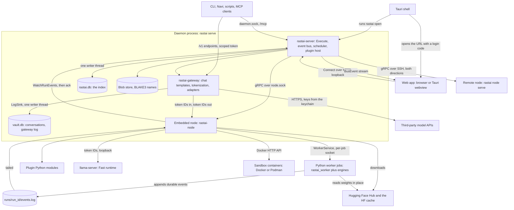

# Rastai Research Studio: Design Docs

**Status:** v1, 2026-10-10. Pre-build. The entry point to the design: what to read, in what order, and where each kind of decision lives. Nothing here is new; every rule below points to the doc that owns it.

The design is about 22,000 lines across 13 documents and 32 ADRs. Nobody needs all of it for one task. Read the core once (section 1), then only the layout and flow docs for the part you're building.

---

## 1. Reading order

**Once, before any task** (new engineer or coding agent):

| Step | Read | What you take away |
|---|---|---|
| 1 | Root `CLAUDE.md` | The hard rules and the owner's code style. Two minutes. |
| 2 | Spec `docs/spec/rastai_spec_v5.md` §0, §3, §5, then Part II (§16–§30) | What is decided, the core loop, the L0–L3 bar, the architecture, the §27 dependency allowlist, the §29 repo layout |
| 3 | `spike/README.md` (verdict table and "Spec changes") | The measured numbers the design rests on: parity, live-panel cost, token parity, Teach it, canvas, Rust vs Java |
| 4 | `contracts.md` §1–§3 and §12 | The repo tree, every component and its allowed imports, the processes and who talks to whom, the naming and code rules |
| 5 | `docs/adr/README.md`, then ADR-0023, 0012, 0004, 0001, 0002, 0013 | Code style, in-house policy, schema ownership, process layout, durability, the unified runtime |
| 6 | Plan `docs/plan/implementation-plan.md` §1–§3 and §10 | Milestones, the two-lane workflow, the definition of done per PR, and the 37 cross-doc conflicts with their defaults |

**Per task:**

| Step | Read |
|---|---|
| 7 | The plan's task entry (§4.8 for M1, §5.8 for M2, §6 epics for later) and its issue in `backlog.json` |
| 8 | The layout doc section for the crate or package you touch (section 2 below) |
| 9 | The flow doc section for the feature you build: its diagram, failure table and "persisted" notes |
| 10 | `contracts.md` §4–§11 as reference for every wire message, document, command, event, table, state, code or setting you use |
| 11 | The ADRs the layout or flow section cites, before changing anything they decide |

## 2. The documents

| Document | Covers | Read it when |
|---|---|---|
| `CLAUDE.md` (repo root) | Map of the repo, hard rules, code style, DCO sign-off | Always first |
| `docs/spec/rastai_spec_v5.md` | Product and technical scope v5.3: Part I product (§0–§15), Part II architecture (§16–§30), Part III plan (§31–§38) | You need to know *what* and *why* at product level. `rastai_spec_v4.md` is history; never build from it. |
| `spike/README.md`, `spike/results/` | Seven measured experiments and the spec changes they caused; the prototype code to port | You port spike code, or a design choice cites "(spike)" |
| `architecture/contracts.md` | Every shared name: repo tree, components and layering, processes, protobuf services, documents, commands (about 150), events, tables, ids, state machines, error catalog ranges, settings, conventions, glossary, open questions | You name anything that crosses a crate, package or process boundary |
| `layout/rust-control-plane.md` | Workspace root, `rastai-diag`, `rastai-formats` (WASM + PyO3), `rastai-core`, `rastai-store`, `rastai-mcp`, `rastai-server`, `rastai-cli`; command surfaces, HTTP API versioning, plugin host, event indexing | You work on the daemon, documents, storage, commands, CLI or MCP |
| `layout/rust-node-gateway-proto.md` | `proto/`, `rastai-transport`, `rastai-sandbox`, `rastai-gateway`, `rastai-node` | You work on the wire, SSH, sandboxes, tokenization, adapters, jobs, leases, environments or llama-server |
| `layout/python.md` | `rastai_models`, `rastai_lens`, `rastai_data`, `rastai_train`, `rastai_rl`, `rastai_worker`, `rastai`, `rastai_eval`, `python/envs/` | You work on compute: the runtime, readouts, data, training, RL, the job runtime or the SDK |
| `layout/frontend-and-plugins.md` | `apps/web`, `apps/desktop`, the TS packages, the three plugin SDKs, plugin templates, the iframe bridge, the Psychology and Evaluation plugins | You work on UI, the Tauri shell, or anything a plugin touches |
| `flows/platform.md` | Install and First Run, daemon start and reattach, the `Execute` path, local API security, job lifecycle, event-log durability and the kill -9 matrix, plugins, storage housekeeping, self-update, projects, crash reports | You build infrastructure every section relies on |
| `flows/inference-psychology.md` | Chat turns through the gateway, runtime toggle and replay twins, API chats and proxy replay, model loading and VRAM leases, the decode step and live panel, replay and analyses, interventions and branching, remote models, conversation flags | You build Inference or Psychology |
| `flows/training-evaluation.md` | Data import, recipe selection, a training run, checkpoints and preemption, chains, Teach it, Evaluation suites and metrics, auto-run and Elo, RLHF, model diff and SAE fit check, export, log import | You build Training or Evaluation |
| `flows/designer-gym-remote.md` | A: HF import, compile and parity, edits and live stats, Eject, ONNX, `rastai.load()`, layer placement. B: harnesses, gym runs, rollouts, peek, step mode, sandboxes. C: SSH pairing, handshake, remote jobs, drops, transfers, headless, node update | You build the Designer, the Agent Gym or remote nodes |
| `docs/adr/README.md` + ADR-0001–0032 | Why each architectural decision was made, alternatives rejected, the tests that check it; notes since acceptance | You're about to change or question a decision |
| `docs/plan/implementation-plan.md` | M1–M10, tasks for M1 and M2, epics for M3–M10, the L0–L3 feature table, GitHub setup, schedule risks, conflicts (§10), open questions | You pick, size or review work |
| `docs/plan/backlog.json` | One GitHub issue per M1/M2 task and per later epic, generated from the plan's tables | You open an issue (M1-07 syncs it to GitHub) |

Planned, not yet written: ADR-0033 (`unsafe` for `statvfs`, task M1-02), ADR-0034 (sign-in, loopback Host rule, reattach order, task M1-01), `docs/security/threat-model.md` (M1-56), and the generated `docs/reference/` (commands, error catalog, extension points, settings).

## 3. How the docs relate

- **Spec → contracts → layouts → flows → plan.** Each layer only refines the one before it.
  - The **spec** says what the product does and which architecture it uses.
  - **contracts.md** fixes the names and boundaries every other doc uses.
  - **Layout docs** say where code lives: the tree, public API signatures, dependencies, tests and build-order step of each crate and package. One doc owns each component.
  - **Flow docs** say how components cooperate at run time: sequence diagrams, state machines, what is persisted where, and the failure branches. They cross component lines; they don't redefine components.
  - The **plan** turns layouts and flows into ordered, sized tasks with exit gates.
- **ADRs record why.** A doc applies a decision; the ADR is where it is argued and checked. Accepted ADRs are never edited to change a decision (`docs/adr/README.md`).
- **The spike is evidence.** Numbers marked "(spike)" come from `spike/results/`. Spike code is ported, never imported (contracts §1 port map).
- **Every layout and flow doc ends with "New names" and "Open questions".** New names are proposals; they become real when M1-01 folds them into contracts.md. Open questions carry a default that the docs follow until the owner decides.

**When two sources disagree:**

| Disagreement about | Winner |
|---|---|
| Scope: what the product does | The spec. Docs that need a spec edit say so (contracts §14 rows 12 and 16); the owner makes it in spec v5.4. |
| A measured number | `spike/results/` |
| A decision an ADR records | The ADR. ADR-0034 (pending) supersedes parts of ADR-0001, 0006 and 0007. |
| A name, or anything listed in plan §10 | Plan §10's default until M1-01 merges, then contracts.md v1.1 |
| Something inside one crate or package (file, function, constant, catalog number in its range) | That component's layout doc (plan §10 rows 7 and 8) |
| Anything else | Nobody yet. Add a row to the end of plan §10 (rows are append-only) and follow its default. |

**Known gaps M1-01 must close** (found while writing this file): blind A/B votes are a project document in `layout/python.md` §9.2 but `votes.jsonl` plugin data in contracts §8.1 and training-evaluation §7.1 and §10.3; the node layout §7.8 builds a managed vLLM engine that plan §12 question 13 defers past the prototype; platform §8.4 lists a `settings` table in `rastai.db` that contracts §14 row 16 removed.

## 4. The system on one screen

Processes and the main data paths. contracts §3 has the full process table and the auth on every arrow.

**Processes.** One binary, `rastai`, is the CLI, the daemon and the node (ADR-0001). The embedded node runs in the daemon process but is reached over `node.sock`, exactly like a remote node, so local and remote can't drift. Each Python job runs in its own process group and survives daemon and node restarts. A remote node has the same arrows to its own workers, llama-server, containers and HF cache.

**The five data paths:**
1. **Commands.** Every action is `CommandService.Execute(command_id, arguments_json)` from the UI, CLI, MCP or a plugin. The daemon parses the arguments with `rastai-formats`, checks the principal's scope, dispatches, and records a `command_journal` row. Sync commands return a result; job commands return a `job_id` at once (platform §3).
2. **Chat.** The gateway renders the chat template and tokenizes; runtimes only see token IDs (ADR-0008). The node routes to the Inspectable worker or llama-server. Tokens stream back as ephemeral `chat.token` events. The assistant message and its `gateway_log` row are written to `vault.db` in one transaction after generation; incognito chats are never written (inference §1).
3. **Durable events.** A job is the only writer of its `events.log` (CRC-framed, fsync on every state change). The node tails it; the daemon indexes each record into `rastai.db` and stores `acked_sequence`. `rastai.db` can be rebuilt from the logs and the blob store (ADR-0002, platform §6).
4. **Live readouts.** The live panel's packet (about 8.3 KB per token) is built inside the CUDA-graph decode step (ADR-0026), sent over `WatchLive`, and fanned out as an ephemeral bus event on one Connect stream per window. Ephemeral events may be dropped under load (frontend §2.2).
5. **Weights and files.** Weights stay in the HF cache and are never copied. Everything else large is a blob named by its BLAKE3 hash; events carry only hashes. Remote nodes pull from the source; only private local data is uploaded; LoRA adapters always sync back (ADR-0003, designer-gym-remote C7).

**Failure branches:**
- **Daemon crash:** jobs keep running. On restart the node waits for each worker's `Register`, checks the token hash in `job.json`, calls `Hello`, and the daemon replays events from `acked_sequence`. Nothing durable is lost; a half-streamed chat reply is (plan §10 rows 5 and 23).
- **Worker crash or OOM:** the node classifies the exit cause; the job's last `job.state_changed` carries a coded `Diagnostic`, and the traceback goes to `stderr.log` (platform §5.5).
- **Node unreachable:** three missed 5 s heartbeats mark it `unreachable` and its jobs `lost`. On reconnect the daemon reconciles from `ListJobs` and the replayed log (designer-gym-remote C6).
- **UI disconnect:** the client resumes from its last `bus_sequence` if it's still in the daemon's 10,000-event buffer; otherwise `RRS-C0401` and it refetches state (contracts §7.2).
- **Torn log tail:** truncated on open. A bad frame mid-file is corruption, `RRS-S2002` (contracts §7.1).

## 5. Where is X decided?

| Question | Look in |
|---|---|
| What is this thing called? | contracts.md (glossary §13); plan §10 if it's a listed conflict |
| Which folder or file does this code go in? | contracts §1 tree, then the owning layout doc's "Tree" subsection |
| Which crate or package may import which? | contracts §2.4 layering rules; each layout's "Boundary rules" |
| Can I add this dependency? | Spec §27; pending additions in contracts §14 row 1 and plan M1-02; the one wrapper file per library (contracts §2.4 rule 8) |
| Which process runs it, and how do processes talk? | contracts §3.1–§3.3; ADR-0001, 0006 |
| What does this protobuf message hold? | contracts §4; additions in node layout §3.2 |
| What does this document type hold, and how is it validated? | contracts §5; control-plane layout §4; ADR-0032 |
| Which commands exist, their scope and kind? | contracts §6; surfaces generated as in control-plane layout §10 |
| Which events exist, durable or ephemeral? | contracts §7; ADR-0002 |
| Where is it stored, which table, which path? | contracts §8; ADR-0003; control-plane layout §6 |
| What states can a job, run, model, lease, node, plugin or sandbox be in? | Names in contracts §9; diagrams in platform §5.2 and §7.2, inference §4.1–§4.2, training-evaluation §4.2 and §8.2, designer-gym-remote B6 and C2 |
| Which error code do I raise? | Ranges in contracts §10; numbers in the owning layout's catalog list; M1-13 renumbers collisions |
| What is this setting's default? | contracts §11 |
| What is this timeout or limit? | The owning layout doc; platform §12 and inference §0.3 collect the cross-cutting ones |
| How should the code look? | ADR-0023, contracts §12, `CLAUDE.md` |
| How does the live panel stay fast? | ADR-0026; Python layout §2.3 and §3; inference §5 |
| How do GPU memory and evictions work? | ADR-0010; node layout §7.7; inference §4 |
| How does the plugin API work? | ADR-0015; frontend layout §10–§13; control-plane layout §12; platform §7 |
| How is the local API secured? | ADR-0007 (with ADR-0034 pending); platform §4; contracts §3.2 |
| What survives a kill -9? | ADR-0002; platform §6.2 and the §6.5 matrix |
| Where does this spike file go? | contracts §1 port map; Python layout §13; each layout's "Ported from the spike" |
| Where do its tests go, and which test proves it? | contracts §1 (`tests/`) and §12.5 (fixtures); each layout's "Tests"; plan §7.3 feature level table |
| What do I build next, and how big is it? | Plan §2 and the task tables (§4.5, §5.5); `backlog.json` |
| When is a feature done? | ADR-0017 (L0–L3); plan §3.3 (per PR) and §7 (per feature) |
| Why was it decided this way? | The ADR index, by topic |

## 6. Changing the design

- **A new shared name** goes into contracts.md first, in its own PR, before any doc or code uses it (spec §29).
- **A new decision** that someone would otherwise reopen gets an ADR (`docs/adr/README.md`, "Writing a new ADR"). An example or path fix in an accepted ADR is a "Note since acceptance", not a new decision.
- **A conflict between docs** gets a row at the end of plan §10 with a default, then a fix in the docs that lose.
- **A scope change** is a spec edit by the owner. Docs never change scope on their own; they raise an open question with a default.
- **Diagrams** use only Mermaid `flowchart`, `sequenceDiagram` and `stateDiagram-v2`, with quoted labels, and are followed by prose: the non-obvious steps, what is persisted where, and the failure branches.
