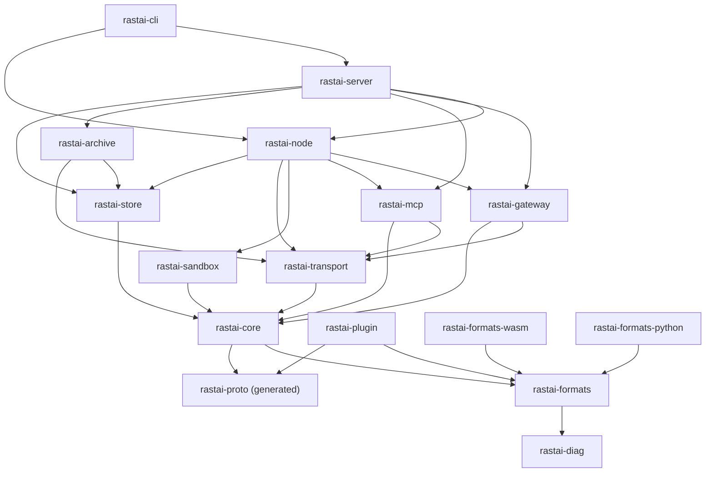
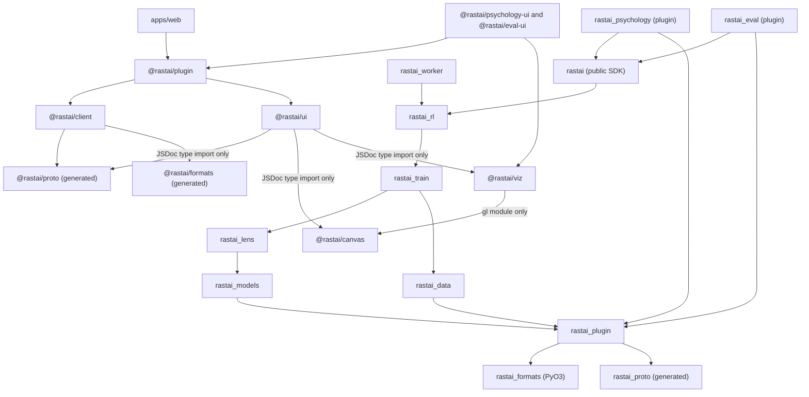
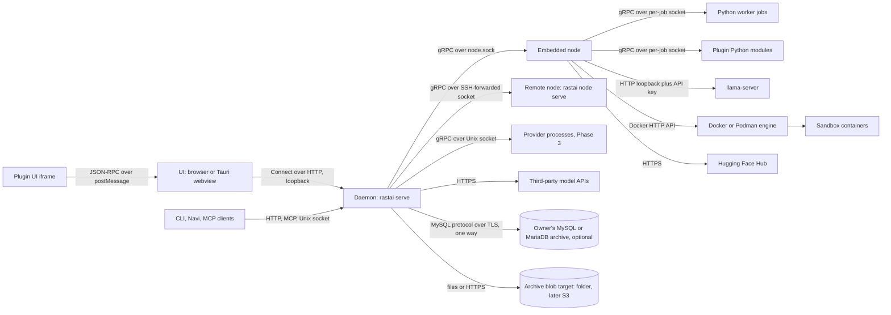
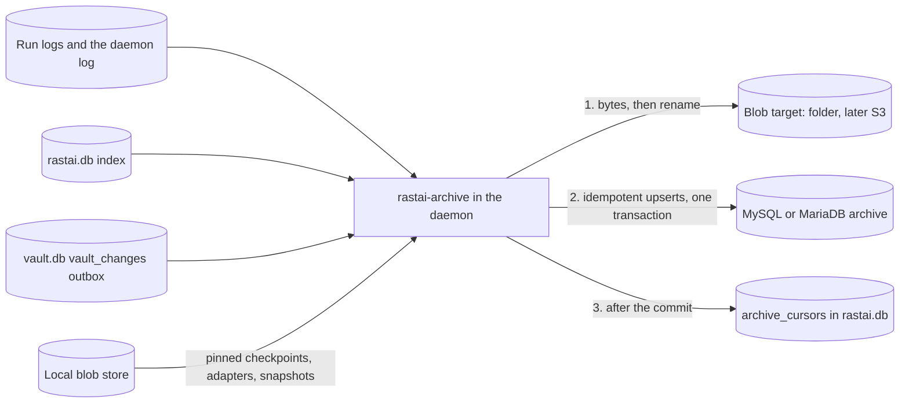

# Rastai Research Studio: Shared Contracts

**Status:** v1.2, 2026-10-11. Pre-build. Built on spec v5.4 (`docs/spec/rastai_spec_v5.md`), the spike (`spike/README.md`) and the owner decisions of 2026-10-10 and 2026-10-11. v1.1 was the M1-01 reconcile; v1.2 adds the naming and schema checks to M1 and records the owner approvals of 2026-10-11.

This file holds the shared names for every other design doc: crates, packages, processes, protobuf services, documents, commands, events, tables, states, error codes, settings and the code-level names that cross a crate, package or process boundary. Layout docs, flow docs, ADRs and the implementation plan use these names exactly. **Since v1.1 this is the only list of names:** the layout and flow docs no longer keep "New names" sections. If a name you need isn't here, add it here:
- **A wire, document or command shape** (a proto message, a document field, a command's arguments or result, an event payload, a catalog error code) lands here first, in its own contract PR, before any code uses it (spec §29: contracts land first).
- **Any other new name** (a function, a file, a constant, a table column) is added here in the same PR as the code that introduces it.

**Since v1.2 CI enforces this** (12.6): `check-names` compares the names the code actually has (`schemas/names.json`, generated) with this file in both directions, and `check-schema-diff` refuses a change to a generated command or event schema that doesn't come with a change here.

Conventions in this file:
- `code` is a literal name, used exactly as written.
- "Phase 2" or "Phase 3" marks something designed now and built later. Everything else is in the prototype.
- **"(L2)"** marks a name designed now but built only after the core loop reaches L2 (ADR-0017). Build the minimal durable path first: event logs, reattach, atomic writes.
- "(M8)", "(M11)" and so on mark a name first built in that milestone (plan §2).
- **Milestone markers are read by `check-names`.** A name listed here but not yet in the code must carry one of these markers: `(M<n>)`, `(L2)`, `(Phase 2)` or `(Phase 3)`. A marker covers the name it follows, the table row it sits in, or the whole section when it is in the heading; one in the notes of a list cell covers nothing (12.6). When markers nest, the nearest one is the name's milestone: its own, then its row's, then its heading's (`plugin.list` (M1) / `plugin.permissions` (M8) in one cell). An unmarked name that the code doesn't have fails as stale (12.6).
- "(spike)" marks a decision that comes from a measured spike result.
- Spec section numbers are written as §n.

### Changes in v1.2

Items 1–10 owner-approved on 2026-10-11. Entries after item 10 are keyed by task id, newest last, so parallel PRs don't collide on a number; each PR adds one entry at the end, for the owner's review in its PR.

1. **`check-schema-diff` moves from Phase 2 into M1** (4, 12.6). Codegen writes `schemas/commands/` and the new `schemas/events/`; CI diffs them against the base branch. Every change needs a matching change to this file in the same PR. A breaking change to a `stable` command or event fails; `preview` items may break, with the contracts change.
2. **`check-names` in M1** (12.6, 15). A new codegen binary, `rastai-names-codegen`, writes `schemas/names.json` from the code: command ids, event types, error codes, `rastai.db` and `vault.db` tables and columns, settings keys, document schema ids, crate, package and module names, and CLI verbs. CI compares it with section 15 and the tables of sections 2.1–2.3, 5.2, 6, 7, 8, 10 and 11, both ways. Names here but not yet in code need a milestone marker (conventions above).
3. **Tables codegen reads live where codegen can reach them:** the core event-type table is `rastai_core::event_types::EVENT_TYPES` (file `rastai-core/src/event_types.rs`; it was internal to `rastai-server`), and the CLI's `ALIASES` and process-mode words are in `rastai-core`'s naming module. Table and column names come from the store's migration `.sql` files, read by `tools/codegen/src/sql_names.rs` (12.6), so `rastai-codegen` has no `rastai-store` dependency.
4. **Agent build protocol** (12.6): every build task's agent prompt carries this file, the generated schemas and the owning layout section; agents use only registered names; every PR gets a separate reviewer agent with a naming and schema lens; `just check` runs `check-names` and `check-schema-diff`. A task closes only after independent verification (plan definition of done).
5. **Section 15 is accepted.** The names v1.1 introduced are the owner's names, no longer provisional.
6. **Open questions 19–23** record the small contract gaps deliberately left to the tasks that build them, each with its owning backlog task (section 14).
7. **`node-over-ssh` runs nightly** in `nightly.yml`, not as a required PR job (15.9; confirms section 16 row 44).
8. **Theme token group key is `typography` everywhere**; no `type` group remains in any document, token file or example (5.2, 5.6, 15.11).
9. **Small fixes so `check-names` can read this file:** the desktop crate is named by its Cargo package, `rastai-desktop` (2.1, 15.1, 15.11); `apps/web` rows lead with `@rastai/web` (15.3); 8.2 and 8.3 list every column, and 8.3 gains the vault's `schema_migrations`; the `archive.objects` settings cell is valid markup (11.2).
10. **§27 approvals noted where this file lists them** (2.5): `@vitest/browser`, axe-core and the Tauri CLI as dev tooling, the Tauri updater plugin as foundation, MinIO as a test-only CI service, and named license entries in `deps/allowlist-python.json` for pillow (MIT-CMU/HPND) and torch (`Apache-2.0 WITH LLVM-exception`, owner approval of 2026-10-11, M1-04).

- **M1-01:** Every registered name carries its milestone (12.6 "Landing"). No code exists yet, so each name `check-names` reads has a marker: the crates and packages of 2.1–2.3 and 15.1–15.3, the schema ids of 5.2, the commands of 6.4, the event types of 7.3, the tables of 8.2 and 8.3, the 10.3 codes (the heading's "(M1)", with the plugin ranges `RRS-L` (M4) and `RRS-V` (M5)) and the settings sections of 11.2. Each milestone is the one whose task builds or registers the name. When markers nest, the nearest wins (conventions).
- **M1-01:** Fixes found while marking. Tutorials and assistant skills are Phase 2 (plan §10 row 45: `tutorial.list`, `tutorial.check`, `rastai.tutorial/1`). `vault_changes` is built in M3 by M3-E02, not M11 (8.3). `archive_cursors` arrives with M11's migration, as plan M1-23 says; the control-plane layout follows. The settings example is `RASTAI_DAEMON__PORT` (11.1), because `gateway.port` isn't a key. 15.6 registers the settings page id `psychology.settings`. 2.5 cites ADR-0037 beside `miniz_oxide` and `torchvision.io.decode_image`. The node layout's build table puts the egress proxy at step 7 (plan §10 row 27).
- **M1-01:** Review fixes (PR #164). `sandbox.list`, `sandbox.kill` and `sandbox.cleanup` are (M5): M5-E10 builds them and M5-E01 registers them, so M7-E01 no longer claims `sandbox.*` (6.4). `checkpoint.resumed` is (M5) with `train.preempted`, because `train.resume` and M5-E14 are M5 (7.3). Row 45 reaches every tutorial and assistant-skill name: the `assistant_skills` key, `assistant.skill@1` (now unsupported until Phase 2, refused with `RRS-P1002`), `core.assistant`, `assistant-skills.js` and `templates/tutorials/` carry "(Phase 2)" (§1, 5.2, 5.5, 15.3, 15.6, 15.8), and its reasoning cites ADR-0017 and spec §31 rather than spec §7. The plugin permission names of spec §24 and ADR-0015 decision 5 get their own table beside the scopes (6.3). A marker in a list cell's notes covers nothing (conventions, 12.6). `gateway.port` is recorded as replaced by `daemon.port` (15.11). Round 2: `gpu` is marked sensitive with `weights.read` and `conversations.read`, reading spec §24's "(sensitive)" as covering its whole line (6.3).
- **M1-01a:** Frontend-contract check. The session key of ADR-0034 decision 10 (3.2) reaches the client: the cookie credential is `{kind: "cookie", sessionKey}`, and `exchangeLoginCode` returns the key (12.4, 15.3). `POST /api/login` answers `{"session_key": "<64 lowercase hex>"}`, and the daemon keeps only the BLAKE3 hash of that hex text (3.3, 15.4). The `Credential` and `ConnectOptions` typedefs that carry it are registered (15.3). The layout and flow docs follow: the request gate checks the key (control-plane 8.3a, platform flow 4.1–4.2), a reload signs the window out and the desktop shell signs in again (frontend 2.1, 8.3, 9.3). Open question 24 asks how a second window gets the key; until it is settled, docs follow its default, the opener's `postMessage` (14; frontend 8.4). `TypographyTokens`, `ThemeOptions` and `Renderer`, already in the frontend layout's `@rastai/ui` API, are registered (15.3).
- **M1-14 (contract):** Codes and hash rules for the JSON core. Three codes whose titles are true for the errors that use them, where M1-14's first draft borrowed codes that misled the user: `RRS-E1006` (a value can't be written as JSON; a bug), `RRS-E5006` (JSON has more values than the import limit; a value costs memory whatever its size in the text, so the reader caps the count as well as the bytes) and `RRS-S3005` (a write failed for a reason other than a full disk, which keeps `RRS-S3002`) (10.3). The content hash's canonical JSON is now written out exactly, with its two differences from RFC 8785 (5.1).
- **M1-09:** The command and event wire. `rastai.commands.v1` and `rastai.events.v1` are fixed field by field, for the owner's review in its PR (4.2, 4.3). New wire names: `CommandKind` as an enum, `ListCommandsResponse.commands`, `EventPayload` (the one `oneof` of payloads that `EventRecord` and `BusEvent` share, 7.1, 7.2), `ListEventTypesRequest` (empty) and `ListEventTypesResponse.event_types`, the M1 payload messages with `ArtifactParent` and `LogStream`. `node.heartbeat`'s payload is `NodeTelemetry` itself. State changes say `from_state` and `to_state` (`from` is a Python keyword). `checkpoint.saved` gains `checkpoint_id`, so `rebuild-index` restores the checkpoint's id and its `checkpoint_of` row (7.3, 8.2). Rust gets no tonic code for these two Connect services; tonic arrives with `NodeService` (M1-10). A oneof comes last in its message and maps are written in key order, so the goldens are byte-identical in all three languages (4.3).
- **M1-20 (contract):** Codes for rastai-core's process environment. Two codes whose titles are true for the errors that use them, where M1-20's first draft borrowed codes that misled the user: `RRS-C0501` (no home folder to put the data folders in; it borrowed `RRS-S0004`, "Data directory not writable") and `RRS-C0502` (the operating system's random source can't be read; it borrowed `RRS-D3001`, a data-import code, so a daemon start would have shown a data-source error). They sit in a new `RRS-C` range, 0500–0599, for the process's environment (10.1, 10.3).
- **M1-20:** A plugin's own scope as text, and the Linux runtime folder. `Scope::Plugin(<plugin_id>)` is written `plugin:<plugin_id>` wherever a scope is text (`CommandDescriptor.scope`, token and manifest scope lists). The colon can't occur in a fixed scope or a plugin id, so the two kinds never read as each other (6.3). Without `XDG_RUNTIME_DIR`, `<runtime>` is `/tmp/rastai-<uid>`, which keeps every socket path within the 107 bytes a Unix socket address holds (8.1). `rastai-core` gets the fuzz targets `base32_decode` and `rfc3339_parse` (12.5, ADR-0037), and path functions for the database copies and the daemon log's rolled segments (15.1).
- **M1-10:** The node and worker skeleton wire. `rastai.node.v1` and `rastai.worker.v1` get the RPCs of the M1 skeleton only, fixed field by field (4.4, 4.5): `NodeService` Handshake, GetHardware, StartJob, SignalJob, ListJobs, WatchRunEvents, WatchLive; `NodeHubService` Heartbeat, ExecuteCommand; `WorkerService` Hello, Control, WatchLive; `WorkerHostService` Register. Every other RPC arrives with the milestone that uses it, in its own contract PR (node layout 3.6). New wire names: `JobSpec.resources` (the field that holds the `ResourceRequest`), `HandshakeResponse` (`node_id`, the node's `protocol_version`, `app_version` and `capabilities`, `hardware`, `session_token`, `node_signature`, `diagnostic`), `GetHardwareResponse`, `SignalJobResponse`, `ControlResponse`, `RegisterRequest` (`job_id`, `job_socket_path`) and `RegisterResponse`, each refusal carrying a `Diagnostic` as section 4 requires; `ListJobsRequest`, `GetHardwareRequest`, `WatchLiveRequest`, `HelloRequest` and `HeartbeatResponse` are empty for now. `ControlRequest.action` is a `JobSignal`, so the worker protocol has one signal enum. `WorkerService.WatchLive` reuses `WatchLiveRequest` and `LiveEvent` from `node.v1`, and `NodeHubService.ExecuteCommand` reuses the `commands.v1` messages. The tonic code needs two things the docs didn't list: `tonic-prost`, tonic 0.14's own prost codec, which the generated code calls (2.5, part of the tonic row of spec §27); and `async-trait`, which tonic's generated server traits use, so `deny.toml` lets tonic be its one parent while our own crates still never depend on it (2.5, 12.2). The tonic code sits behind `rastai-proto`'s `grpc` feature, off by default, which only the crates that serve or call a gRPC service turn on, so `rastai-core` gets the prost messages alone and never depends on tonic (2.1; control-plane layout 5.4).
- **M1-16:** Formats codegen. `rastai-formats-codegen` lands: `schemas/` (document and command schemas, `index.json`), the `@rastai/formats` JSDoc types, the typed wrappers in `@rastai/client`'s `src/generated/commands.js` and the `rastai_formats.generated` dataclasses, with the code-level names of 15.1–15.3 and the output paths of 15.8. `rastai_formats`, `@rastai/formats`, `rastai-formats-codegen`, `x-rastai-stability` and `x-rastai-since-version` lose their (M1) markers. Command rows arrive with rastai-core (M1-21, M1-22); event schemas with the descriptor-set reader.
- **M1-21:** Registry, naming and settings names. The command layer's functions that the layout already used but 15.1 didn't list: `COMMANDS`, `load_core_commands`, `add_plugin_commands`, `remove_plugin_commands` and `check_scope`; the settings layer's `SettingsSource`, `SettingsLayer`, `ResolvedSettings`, `default_settings`, `settings_from_environment`, `settings_from_flags`, `resolve_settings` and the getters `setting_bool`, `setting_u64`, `setting_text`. One new name: `javascript_wrapper_name`, so the typed JavaScript wrapper's camelCase rule (6.1) has one implementation in `naming.rs` beside the CLI and MCP rules, and `rastai-codegen` calls it (control-plane layout 10.3): `rastai-codegen` now depends on `rastai-core` (as layout 4.9 already listed), its `render_wrapper` calls `javascript_wrapper_name`, and M1-16's `wrapper_function_name`, the same rule written a second time, is gone from `javascript_commands.rs` and from 15.1. Registry refusals use registered codes: `RRS-P0004` for a plugin command outside its namespace or in a core area, `RRS-E1004` for a malformed id or scope, `RRS-E2005` for an id a plugin lists twice, `RRS-C1005` for a missing scope; a malformed `--set` is `RRS-C0002`. The settings example stays `RASTAI_DAEMON__PORT` (M1-01, fixes found while marking; the GitHub issue body still says `gateway.port`, 15.11). `GatewaySettings` waits for the proto `SamplingSettings` it holds. The plugin id rule of 6.1 is tightened from `[a-z][a-z0-9_]*` to one command-id segment (no trailing or doubled underscore), the form the command and MCP naming rules already needed; `check_command_id`, `add_plugin_commands` and the `plugin:<plugin_id>` scope text share that one check, and `add_plugin_commands` refuses the empty id that core commands carry.
- **M1-23 (contract):** A read-failure code for the databases. `RRS-S0006` (a database read failed on a file that passed its integrity check: an I/O error, or the writer held the file past the busy timeout; SQLite's reason is attached), where M1-23's first draft borrowed `RRS-S3005`, "Write failed for a reason other than a full disk", so a failing `run.list` or token lookup would have told the user a write failed. It sits in the databases range, 0001–0999, beside the codes for opening a database (10.3). A damaged file keeps `RRS-S0003` (`rastai.db`) and `RRS-S0005` (`vault.db`).
- **M1-23:** `rastai.db` and its writer thread. Migration 1 creates every table of 8.2 but `archive_cursors`, which M11's migration adds, so the 8.2 rows lose their (M1) markers and `archive_cursors` keeps (M11); there is no `settings` table. `runs.archive_state` starts `local` by its column default and no M1 write changes it. `rastai-store` loses its (M1) marker (2.1, 15.1); its names not built yet carry their milestones, and 15.1 registers the code names M1-23 adds: the row structs and read functions of `index/`, `close_store`, `IndexWriter`, `IndexReader`, `DaemonLock`, `StoreError`, the migration types of `sqlite.rs` and `store.rs`, `writer_batch_count` (the convoy test reads it, so a writer that stops batching fails deterministically), `list_table_columns` and `read_index_schema_version`. The store's errors use `RRS-S0001`–`S0004`, `RRS-S3002` and `RRS-S3005` for a failed write, and the `RRS-S0006` of the M1-23 (contract) entry for a failed read on a reader's connection, including a reader that can't open its file (10.3). One new code, `RRS-S0007`: the runtime folder or its `daemon.lock` isn't private to this user. `take_daemon_lock` refuses an existing runtime folder that is a symbolic link, another user's or open to group or others, and a `daemon.lock` that is a symbolic link or not a regular file, so another user can't plant `/tmp/rastai-<uid>` or a link that makes the daemon overwrite a file (8.1, 10.3). The migration types (`INDEX_MIGRATIONS` and `INDEX_DATABASE_SETTINGS` in `store.rs`, `Migration` and `DatabaseSettings` in `sqlite.rs`), `open_database_for_writing` and `set_log_cursor`, which takes the writer's transaction, are crate-private, so no other crate runs SQL or opens a second write connection (15.1). `rastai-store`'s external libraries gain serde_json, for the JSON list columns (2.1).

### Changes in v1.1

1. **Names merged.** Every "New names" list of the four layout docs, the four flow docs and plan §11 is folded in: wire additions (4.9), documents (5.2), commands (6.4–6.5), events (7.3), storage (8), settings (11.2), catalog codes (10.3) and code-level names (section 15). Names rejected in favour of an existing one are in 15.11.
2. **Conflicts settled.** Plan §10 rows 1–44 (38–44: votes, managed vLLM, the settings table, catalog collisions, when the safetensors header check lands, sessions across a restart, `node-over-ssh`) and two more contradictions (branch-pick rows, where the analysis math lives) each have one answer (section 16).
3. **Spec v5.4.** UI transport is Connect (§16); settings live in files only (§19); generated Python types are plain dataclasses (§20); an in-house JSON-lines logger in `rastai-diag` (§25); first-party plugins in `plugins/` (§29). The §27 additions are approved, each behind one wrapper file (2.5).
4. **Sign-in (ADR-0034, accepted).** One-time login codes for an HttpOnly cookie; **sessions are bound to the origin that redeemed the code**; a cookie request without Origin passes only for GET/HEAD with `Sec-Fetch-Site` `same-origin` or `none`; every other cookie request also carries the per-session key `Rastai-Session-Key`; any loopback Host on any port; a too-open `owner.token` refuses the start; `Register` before `Hello` on reattach (3.2, 3.3).
5. **`unsafe`** is allowed for one `statvfs` call in `crates/rastai-store/src/disk_space.rs` only (ADR-0033).
6. **Fewer in-house parsers.** `miniz_oxide` (behind `zip/inflate.rs`) and `torchvision.io.decode_image` (behind `rastai_data/image_decode.py`) replace the in-house DEFLATE and PNG/JPEG decoders. Every remaining in-house parser of untrusted input has a fuzz target: 17 Rust targets, plus seeded mutation tests for the Python and JavaScript parsers (12.5, ADR-0037).
7. **Long-term archive (ADR-0035, M11).** Optional one-way replication to the owner's MySQL or MariaDB: crate `rastai-archive`, `archive.*` commands and events, settings section `archive`, keychain accounts, source ids, `archive_cursors` and `runs.archive_state`, the `vault_changes` outbox, the archive tables (8.7), the `MysqlConnection` type, the MySQL dataset reader and error range `RRS-S5xxx`.
8. **Plain JavaScript frontend (ADR-0036).** All hand-written frontend, plugin-UI and SDK code is JavaScript ES modules with React and JSX, typed with short JSDoc and checked by `tsc --noEmit` in checkJs mode at dev time only. "TS packages" are now JS packages; `tsconfig` is `jsconfig`; `.ts`/`.tsx` are `.js`/`.jsx` (12.4).
9. **Theme token contract** (5.6): fixed role keys, `--rr-*` CSS variables as the public surface, the full `rastai.theme/1` row, `canvasColors`, `setColors`, locked security-UI tokens no theme can change, `ui.theme` `system`, `ui.density`.
10. **Capabilities** for every manifest contribution key, including `icon_sets`, `locales`, `macros` and `chat_templates` (5.5).
11. **Stability** (`preview`, `stable`, `deprecated`) on every command and event type; all `preview` until Phase 2 (4.2, 4.3).
12. **`CommandExecutor`**, satisfied by `DaemonClient` and `PluginHost`; generated typed wrappers take it; the client takes a cookie or bearer credential (12.4).
13. **`apps/web` holds no domain logic** (2.4 rule 9).
14. **Out of the prototype:** the managed vLLM engine (an external vLLM is reached through `OpenAiAdapter`). **Votes** are a project document, `evals/votes.rrsdata`. **Settings** are never stored in `rastai.db`.
15. **One owner per algorithm:** safetensors header validation in `rastai-formats` (Python calls the wheel), layer placement planned only in Rust, one golden fixture per op for Rust live stats and the Python compiler (2.4 rule 10).
16. **User namespaces:** the `.deb` ships an AppArmor profile; without namespaces, trusted first-party modules run without the network namespace and warn, and only third-party modules without network permission are refused (8.8).
17. **(L2) tags** on daily database snapshots and salvage, the node update watchdog, plugin-data downgrade guards, crash-report rate limits and handler deliveries beyond Evaluation auto-run.
18. **Catalog:** collisions resolved (10.2); every code the docs assign is listed (10.3); new ranges `RRS-S5xxx` (archive) and `RRS-D4xxx` (run-log import).
19. **Open questions:** decided rows removed (section 14).
20. **Review fixes in the same wave:** the theme token group is `typography`, not `type` (5.2); argument fields marked `content` are redacted from the journal like `secret` ones (5.1, 6.5); vault-class blobs follow the conversation opt-in and are listed in `vault_blob_links` (8.7); `delete` outbox rows are recorded while the archive is disabled (8.3); a project's data policy lives only in its `settings.json` (11.1); the MySQL reader's credential arrives in `RASTAI_SOURCE_SECRET`, and its host list is a permission, not a network sandbox (3.2, 8.7); `GetSecret` has fields (4.9); `RRS-E3003`, `RRS-D1004` and `RRS-D3005`–`D3009` are assigned (10.3); the archive-path and node-layout code names are in 15.1.

---

## 1. Repository Tree

This extends spec §29. It shows the top level and the second level. Generated code is checked in and marked; CI fails if regenerating it changes anything.

```
RASTAI/
  CLAUDE.md                  architecture map, hard rules, the owner's code style (§29)
  README.md  LICENSE  NOTICE  DCO  CONTRIBUTING.md  SECURITY.md  TRADEMARKS.md (Phase 2, ADR-0018)
  justfile                   every build, test, codegen and release task goes through `just`
  Cargo.toml  Cargo.lock     Rust workspace: crates/*, the two rastai-formats binding crates, tools/codegen,
                             tests/crash, apps/desktop/src-tauri
  rust-toolchain.toml  rustfmt.toml  clippy.toml
  deny.toml                  cargo-deny: license allowlist, advisories, the §27 crate allowlist, one owning crate per library
  package.json  pnpm-workspace.yaml  pnpm-lock.yaml   JS workspace: apps/*, packages/*, plugins/*/ui
  jsconfig.base.json         checkJs settings for the dev-only checker; each JS package has a jsconfig.json extending it
  jsconfig.json              extends the base over the whole JS workspace: what `just check-js` checks
  vitest.config.js           the list of JS test files for `just test-js` (unit tests next to their source)
  .prettierrc.json           prettier settings (dev tooling); ruff settings live in python/pyproject.toml
  .prettierignore            what prettier skips: prose (*.md, docs/), generated folders, spike/, build output
  .gitattributes             `* -text`: no end-of-line conversion, so every OS checks out the bytes git stores
  buf.yaml  buf.gen.yaml     protobuf lint, `buf breaking`, codegen for Rust, JS (protobuf-es, target js+dts) and Python
  .github/workflows/         ci.yml, nightly.yml, nightly-gpu.yml, release.yml (thin: each step calls a `just` recipe)

  proto/rastai/              the wire contracts (section 4)
    common/v1/               shared messages: Diagnostic, BlobRef, HardwareProfile, enums
    commands/v1/             CommandService (UI, CLI, MCP bridge -> daemon)
    events/v1/               EventService, EventRecord (event-log record), event payloads
    node/v1/                 NodeService, SandboxService (served by the node), NodeHubService (served by the daemon)
    worker/v1/               WorkerService (served by a Python job), WorkerHostService (served by the node)
    provider/v1/             ProviderService (compute-target provider processes, Phase 3)
  proto/third_party/         vendored subsets buf compiles but that aren't Rastai's wire: onnx/, tensorboard/, wandb/
                             (excluded from `buf breaking`)

  crates/                    Rust (section 2 has one row per crate)
    rastai-diag/             error and term catalog (generated tables), Diagnostic renderer, JSON-lines logger
    rastai-proto/            generated prost + tonic code from proto/ (never edited by hand)
    rastai-formats/          every document type, validation, migrations, safetensors, GGUF, zip; fuzz/;
                             bindings/wasm/ (crate rastai-formats-wasm), bindings/python/ (crate rastai-formats-python)
    rastai-core/             command registry, ids, principals, scopes, shared state enums, settings, paths
    rastai-plugin/           Rust plugin SDK (provider processes; later WASM)
    rastai-store/            rastai.db, vault.db, blob store, event-log reader/writer, SQLite writer threads; fuzz/
    rastai-transport/        local sockets, SSH (OpenSSH child process), HTTP client, (later) QUIC
    rastai-sandbox/          Docker/Podman HTTP API client, caps, labels, orphan cleanup, egress proxy; fuzz/
    rastai-gateway/          OpenAI/Anthropic endpoints, adapters, chat templates, tokenization, token logging; fuzz/
    rastai-mcp/              in-house MCP server and client (JSON-RPC), generated from the command registry; fuzz/
    rastai-node/             node agent: jobs, uv environments, VRAM leases, telemetry, hardware, downloads, llama-server; fuzz/
    rastai-archive/          optional long-term archive (M11): one-way MySQL/MariaDB replication, blob targets, prune, restore
    rastai-server/           daemon: HTTP API (Connect), scheduling, plugin host, import/export, ModelSpec analysis; fuzz/
    rastai-cli/              the `rastai` binary: CLI verbs, `serve`, `node serve`, `mcp`, `open`, `tunnel`

  python/                    Python 3.12 (uv workspace root: python/pyproject.toml)
    rastai/                  public SDK on PyPI: load(), observe(), log(), connect(); the public Python API for plugins
    rastai_formats/          PyO3 wheel (module rastai_formats._native) + generated dataclasses
    rastai_proto/            generated protobuf + grpcio code (never edited by hand)
    rastai_plugin/           Python plugin SDK: extension-point base classes, registry, host client
    rastai_worker/           job runtime: entry point, worker protocol server, event-log writer
    rastai_models/           ModelSpec compiler, blocks, model families, tensor I/O, KV cache, decoding, LoRA, placement (apply only)
    rastai_data/             task detection, converters, readers (JSONL, CSV, Parquet, image folders, MySQL), MinHash, leakage, PII
    rastai_lens/             observation readouts: logit lens, attention capture, entropy, SAE runtime, steering, live packets
    rastai_train/            trainer loop, checkpoint/resume, recipes (SFT, DPO, GRPO, GSPO, RM, PPO, LoRA, QLoRA, SAE, JEPA, ...)
    rastai_rl/               RL engine: rollout manager, group advantages, Harbor task importer
    envs/                    one uv project + uv.lock per backend: cpu/, cuda13/, cuda126/, rocm/ (mps/ later); environments.json;
                             tests/ (the cpu environment's smoke test)

  apps/
    web/                     the React app in plain JavaScript + JSX (all sections; served by the daemon, opened by Tauri or a browser)
    desktop/                 Tauri 2 shell: window, file associations, updater; runs `rastai open --print-url`
    viewer/                  static read-only viewer for .rrsreplay and .rrsmodel (no daemon, no install)

  packages/                  JavaScript packages (npm scope @rastai): ES modules, .js and .jsx, JSDoc types
    ui/                      @rastai/ui: the design system (§7), theme tokens
    proto/                   @rastai/proto: generated protobuf-es + connect-es code (.js + .d.ts)
    formats/                 @rastai/formats: generated document types + the rastai-formats WASM build
    catalog/                 @rastai/catalog: generated error and term catalog
    client/                  @rastai/client: thin daemon client (Connect transport, credentials, event subscription,
                             CommandExecutor and the generated typed command wrappers)
    canvas/                  @rastai/canvas: in-house WebGL2 graph renderer (Designer)
    viz/                     @rastai/viz: charts, vector-space view, 3D data-flow view
    plugin/                  @rastai/plugin: JS plugin SDK (sections, panels, iframe bridge); declarations generated for authors

  plugins/                   first-party plugins, built only on the public plugin API, shipped preinstalled
    psychology/              rastai-plugin.json, ui/ (@rastai/psychology-ui), python/ (rastai_psychology), catalog/, tests/
    evaluation/              rastai-plugin.json, ui/ (@rastai/eval-ui), python/ (rastai_eval), catalog/, tests/

  templates/                 declarative built-in content, loaded through the same paths as plugin contributions
    designs/                 TextCNN, Transformer (decoder/encoder/enc-dec), CNN, MLP, RNN/LSTM, ViT, JEPA (.rrsmodel)
    harnesses/               starter .rrsharness files
    evals/                   starter .rrseval suites, the fixed drift prompt set, the default anchor set
    projects/                starter .rrsproj folders
    tutorials/               built-in rastai.tutorial/1 documents (first-run.tutorial.json first); Phase 2,
                             plan §10 row 45
    plugins/                 `rastai plugin new` templates (UIs are .jsx): panel, section, converter, recipe,
                             designer-node, lens, metric, reward, adapter, importer, exporter, theme

  schemas/                   generated, checked in: one JSON Schema per document type and version, index.json,
                             commands/ (one per command's arguments and result), events/ (one per event type),
                             names.json (the names registry the code really has; 12.6)
  catalog/
    errors/                  one JSON file per error prefix: RRS-E.json, RRS-P.json, ... (section 10); README.md maps retired numbers
    terms/                   plain-English term definitions (the glossary the UI shows)
  fixtures/                  shared test inputs (12.5)
  tests/
    parity/                  model-family parity against HF transformers (fp32 + bf16)
    e2e/                     Playwright tests against the web build (*.spec.js)
    gpu/                     GPU-only tests (nightly on the self-hosted runner)
    crash/                   Rust crate rastai-crash-tests: the kill -9 matrix for daemon, node, jobs and the archiver
    loop/                    the full CPU loop in under 10 minutes (design -> train -> eval -> ONNX -> re-import)
    workspace/               smoke tests (vitest): checker settings, the pinned Node.js, the CI workflows
  tools/                     dev tooling only, never shipped
    codegen/                 Rust crate rastai-codegen (bins rastai-formats-codegen, rastai-catalog-codegen,
                             rastai-names-codegen); also runs buf
    checks/                  check-deps, check-unsafe, check-no-pickle, check-imports, check-generated, check-dco,
                             check-colors, check-no-typescript, check-names, check-schema-diff
    github/                  sync_backlog.py (labels, milestones and issues from docs/plan/backlog.json)
    ci/                      install-dev-tools (the pinned just, uv, Node.js, cargo-deny, buf and protoc plugins for CI)
    fixtures/                render_chat_templates.py (regenerates chat-template goldens with HF transformers)
    bench/                   gateway-load/, tokenizer/
    release/                 packaging (AppImage, .deb), apparmor/ (the userns profile the .deb installs), version bumps
  deps/
    engines/                 llama-server.json (pinned build per backend, URL, SHA-256), uv.json (pinned uv)
    allowlist-python.json    Python packages allowed by §27, with versions and reasons
    allowlist-npm.json       npm packages allowed by §27, with versions and reasons
  docs/
    spec/                    the product and technical scope
    architecture/            README.md, contracts.md (this file), layout/, flows/
    adr/                     ADRs 0001–0037 (§30)
    plan/                    implementation plan, backlog.json
    security/                threat-model.md (M1-56)
    reference/               generated: commands, events, error catalog, extension points, settings
  spike/                     history: the spike's prototype code and results. Read-only. Nothing imports it.
```

Decisions in this tree:
- **First-party plugins live in `plugins/`** (spec v5.4 §29), not in `python/` or `apps/web/`. Each one is a complete plugin folder, packed into a `.rrsplugin` at build time and preinstalled from `<install prefix>/share/rastai/plugins/`. The Evaluation package keeps its name, `rastai_eval`, and lives in `plugins/evaluation/python/`.
- **`rastai_lens` stays in `python/`** as the core readout engine. The live panel must run inside the Inspectable runtime's decode step (fused logit lens, CUDA graph; spike), so readouts are a runtime feature exposed through the public API. The math of the offline analyses (probes, projections, model diff, SAE fit check, attribution graphs, routing stats) is in `rastai_lens` too; the Psychology plugin (`plugins/psychology/`) owns their commands, jobs and UI in `rastai_psychology` and calls `rastai.lens`.
- **Plugin SDKs sit next to their language peers:** `crates/rastai-plugin`, `packages/plugin` (`@rastai/plugin`), `python/rastai_plugin`.
- **Core sections** (Home, Inference, Training, Designer, Agent Gym, Data, Plugins, Remote, Settings) live in `apps/web/src/sections/<section>/`. Each has a `section.json` that uses the plugin manifest schema, and each imports only the public API (`@rastai/plugin`, `@rastai/ui`, `@rastai/canvas`, `@rastai/viz`). `tools/checks/check-imports` enforces this.
- **No TypeScript source.** Hand-written frontend code is `.js` and `.jsx` only. `.d.ts` files exist only in generated folders (`src/generated/`, including `packages/proto/src/generated/`, and `packages/catalog/`), are never edited by hand and are not reviewed. `tools/checks/check-no-typescript` fails on any other `.ts`, `.tsx` or `.d.ts` file (ADR-0036).
- **`spike/` stays as history.** Code is ported out of it, never imported. The port map:

| Spike file | Ported to |
|---|---|
| `spike/src/rastai_spike/gemma3.py` | `python/rastai_models`: `blocks/` (RMSNorm, attention, feed-forward, RoPE, KV cache) + `families/gemma3.py` (HF config and name mapping) |
| `safetensors_reader.py`, `safetensors_writer.py` | Header validation: `crates/rastai-formats/src/safetensors/reader.rs` (from `spike/bakeoff/rust/src/safetensors.rs`), the one owner, which Python calls through the wheel's `check_safetensors_header`. Python keeps `python/rastai_models/io/safetensors_reader.py` (tensor bytes only, after the wheel accepted the header) and `safetensors_writer.py`. |
| `decoding.py` (`StaticDecoder`, lens modes) | `python/rastai_models/decoding.py` (static decode, CUDA graph, one capture stream per device); sessions, sampling and generation in sibling files |
| `lenses.py`, `sae.py` | `python/rastai_lens/` (`live_packet.py`, `logit_lens.py`, `attention.py`, `sae.py`) |
| `lora.py` | `python/rastai_models/lora.py` (LoRA is a ModelSpec node attribute) |
| `training.py` | `python/rastai_train/loop.py` + `recipes/sft.py` |
| `evaluation.py` | `plugins/evaluation/python/rastai_eval/metrics/` (`keyword.py`, `drift.py`) |
| `generation.py`, `hf_cache.py` | `python/rastai_models/` (used by the standalone SDK; jobs get resolved paths from the node) |
| `llama_server.py` | `crates/rastai-node/src/fast_runtime.rs` (the node manages llama-server) |
| `reporting.py` (`environment_fingerprint`) | `python/rastai_worker/hardware_fingerprint.py` |
| `bakeoff_fixtures.py`, `tokenizer_corpus.py` | `fixtures/safetensors/` (the 33-file corpus), `fixtures/tokenizer/` (the 162-case corpus) |
| `spike/bakeoff/rust/src/gateway.rs` | `crates/rastai-gateway` (endpoints, streaming) + `crates/rastai-store` (the one-writer-thread SQLite pattern) |
| `spike/canvas/canvas_test.js` | `packages/canvas` (graph renderer) + `packages/viz` (3D flow view). The spike's hard-coded `#101318` background is gone from renderer code; it seeds the built-in dark theme's `canvas_background` token (5.6). |

---

## 2. Component Inventory

"Process" is where the code runs. "Internal deps" lists everything it may import; anything not listed is forbidden. "External deps" come from the §27 allowlist (spec v5.4) only, each imported in one wrapper file (2.5).

### 2.1 Rust crates

| Crate | Purpose | Process | Internal deps | External deps (§27) |
|---|---|---|---|---|
| `rastai-diag` | Catalog tables (generated from `catalog/`), `Diagnostic` type, text renderer, JSON-lines logger (`init_logger`, `log_info`) | all Rust processes, WASM | none | serde, serde_json |
| `rastai-proto` | Generated protobuf messages and gRPC stubs (the stubs behind its `grpc` feature) | daemon, node, CLI, provider | none | prost, tonic (`grpc` feature only) |
| `rastai-formats` | Every document type: parse, validate (4 layers), migrate, write; safetensors reader/writer (the one header validator); GGUF header reader and writer; zip reader and writer; content hashing (the one BLAKE3 wrapper); CRC-32 table; type descriptions for codegen | daemon, node, CLI, browser (WASM), Python (PyO3) | `rastai-diag` | serde, serde_json, blake3, miniz_oxide |
| `rastai-formats-wasm` (M4) | `crates/rastai-formats/bindings/wasm/`: cdylib, plain string and byte functions for the browser | browser | `rastai-formats`, `rastai-diag` | wasm-bindgen |
| `rastai-formats-python` (M1) | `crates/rastai-formats/bindings/python/`: cdylib, module `rastai_formats._native` | Python | `rastai-formats`, `rastai-diag` | pyo3 |
| `rastai-core` | Command registry (`CommandRow` table + dispatch), ids, principals, scopes, shared state enums, settings resolution, paths, versions, protobuf JSON for wire types stored in documents (section 4) | daemon, node, CLI | `rastai-diag`, `rastai-formats`, `rastai-proto` | serde, serde_json |
| `rastai-plugin` (M8) | Rust plugin SDK: provider-process skeleton, manifest helpers | provider processes | `rastai-diag`, `rastai-formats`, `rastai-proto` | tokio, tonic |
| `rastai-store` | `rastai.db` and `vault.db` (one writer thread each), blob store, event-log reader/writer, migrations, rebuild, daemon lock, free disk space | daemon, node, CLI (offline rebuild) | `rastai-core`, `rastai-formats`, `rastai-proto`, `rastai-diag` | rusqlite, serde_json, prost, tokio (`sync` only), libc (one file, ADR-0033) |
| `rastai-transport` (M1) | Local IPC (Unix socket; named pipe later), SSH via the OpenSSH binary, HTTP(S) client, tonic channels over these, resumable transfers | daemon, node, CLI | `rastai-core`, `rastai-formats` (hashing), `rastai-proto`, `rastai-diag` | tokio, tonic, tower, hyper, hyper-util, rustls, tokio-rustls, webpki-roots |
| `rastai-sandbox` (M5) | Docker-API client over the engine socket: create, exec, pause, remove, caps, labels, orphan sweep; the HTTP CONNECT egress proxy | node | `rastai-core`, `rastai-proto`, `rastai-diag` | tokio, hyper, hyper-util, serde_json |
| `rastai-gateway` (M3) | OpenAI and Anthropic endpoints, adapters, chat templates, tokenization, token logging through a `LogSink` | daemon (user endpoints), node (rollout and judge gateway) | `rastai-core`, `rastai-formats`, `rastai-proto`, `rastai-transport`, `rastai-diag` | axum, tokio, tonic (node-runtime and daemon-forward adapters), tokenizers, minijinja, serde, serde_json |
| `rastai-mcp` (M1) | MCP server (tools generated from the command registry) and MCP client (harness tools) | daemon, CLI (`rastai mcp` stdio bridge), node (gym tools) | `rastai-core`, `rastai-formats`, `rastai-proto`, `rastai-transport`, `rastai-diag` | tokio, serde_json |
| `rastai-node` (M1) | Node agent: job supervisor, uv environments, VRAM leases, telemetry, hardware detection, HF downloads, transfers, llama-server management, NodeService server, the one Ed25519 wrapper | daemon (embedded node), `rastai node serve` | `rastai-core`, `rastai-formats`, `rastai-proto`, `rastai-store`, `rastai-transport`, `rastai-sandbox`, `rastai-gateway`, `rastai-mcp`, `rastai-diag` | tokio, tonic, ed25519-dalek |
| `rastai-archive` (M11) | Long-term archive (M11): one-way, idempotent replication of event records, index rows and blob metadata to MySQL or MariaDB; blob copies to archive targets; prune, restore, verify, purge (8.7) | daemon | `rastai-core`, `rastai-formats`, `rastai-proto`, `rastai-store`, `rastai-transport`, `rastai-diag` | mysql_async (`default-rustls-ring`, default features off), tokio |
| `rastai-server` (M1) | Daemon: Connect HTTP API, request gate and sessions, scheduling and chain driver, plugin host, import/export, ModelSpec analysis (live stats, memory, the one layer-placement planner), data-policy check, NodeHubService, MCP endpoint, static web app | daemon | every crate above except `rastai-plugin` and the two binding crates | axum, tokio, tonic, prost, serde_json, keyring |
| `rastai-cli` (M1) | The `rastai` binary: argument parsing (in-house), process modes, generated CLI verbs, offline `storage rebuild-index` | CLI, daemon, node | `rastai-server`, `rastai-node`, `rastai-mcp`, `rastai-store`, `rastai-core`, `rastai-transport`, `rastai-formats`, `rastai-proto`, `rastai-diag` | tokio, prost |
| `rastai-codegen` (dev) | `tools/codegen/`: bins `rastai-formats-codegen`, `rastai-catalog-codegen` and `rastai-names-codegen` (12.6) | dev only | `rastai-formats`, `rastai-core`, `rastai-diag` | serde_json |
| `rastai-crash-tests` (dev) (M1) | `tests/crash/`: the kill -9 matrix | dev only | `rastai-store`, `rastai-core`, `rastai-proto`, `rastai-diag` | tokio |
| `rastai-desktop` (`apps/desktop/src-tauri`) (M1) | Tauri shell: window, file associations, updater; starts or finds the daemon by running `rastai open --print-url` | desktop shell | none (spawns `rastai`, loads a URL; no HTTP) | tauri, tauri-build, Tauri updater plugin, serde, serde_json |

### 2.2 Python packages

| Package | Purpose | Process | Internal deps | External deps (§27) |
|---|---|---|---|---|
| `rastai_proto` | Generated protobuf and grpcio stubs | worker jobs | none | grpcio, protobuf runtime |
| `rastai_formats` | PyO3 wheel of `rastai-formats` + generated dataclasses for every document type; the safetensors header validator for Python | worker jobs, notebooks | none | none (native wheel) |
| `rastai_plugin` | Extension-point base classes, the in-process registry, the WorkerHost client, plugin test host | worker jobs, plugin modules | `rastai_proto`, `rastai_formats` | grpcio |
| `rastai_models` (M1) | ModelSpec compiler, blocks (attention variants, MoE, MLA, ALiBi, AttnRes), families, tensor I/O (header checks through `rastai_formats`), KV caches, static decode, LoRA, `apply_placement` (never plans) | worker jobs, notebooks | `rastai_formats`, `rastai_plugin` | torch; transformers only for the compat runtime (optional); onnx and onnxscript through `torch.onnx` (export jobs only) |
| `rastai_data` | Task detection, preview, converters (declarative + Python fallback), readers, MinHash, leakage, PII, loaders, image decoding | worker jobs | `rastai_formats`, `rastai_plugin` | tokenizers (HF, for token counts), pyarrow (Parquet), torchvision (`decode_image`), PyMySQL (the MySQL reader) |
| `rastai_lens` (M4) | Observation readouts, logit lens (fused), attention capture, entropy, SAE runtime, probes, steering/ablation hooks, live packets, summary layer, offline analysis math | worker jobs | `rastai_models`, `rastai_formats`, `rastai_plugin` | torch |
| `rastai_train` (M1) | Trainer loop, resume contract, checkpoints, anchors, all recipes | worker jobs | `rastai_models`, `rastai_data`, `rastai_lens`, `rastai_formats`, `rastai_plugin` | torch, torch.distributed; bitsandbytes (optional, QLoRA) |
| `rastai_rl` (M5) | Rollout manager, group advantages, GRPO/GSPO/PPO glue, Harbor task importer | worker jobs | `rastai_train`, `rastai_models`, `rastai_data`, `rastai_formats`, `rastai_plugin` | torch |
| `rastai_worker` (M1) | Job entry point (`python -m rastai_worker`), WorkerService server, event-log writer, hardware fingerprint, job-kind dispatch | worker jobs | everything above | grpcio |
| `rastai` (M4) | Public SDK: `load()`, `observe()`, `log()`, `connect()`, the wandb-compatible tracking surface, and the stable facades plugins use (`rastai.runtime`, `rastai.data`, `rastai.lens`, `rastai.train`) | notebooks, plugin modules | everything above except `rastai_worker` | torch |
| `rastai_psychology` (M4) | Psychology plugin module: command handlers, offline analysis jobs | plugin module, worker jobs | `rastai`, `rastai_plugin` only | torch |
| `rastai_eval` (M5) | Evaluation plugin module: suites, metrics, judges, Pass@k, Elo, perplexity, drift, benchmarks | plugin module, worker jobs | `rastai`, `rastai_plugin` only | torch |

### 2.3 Apps and JavaScript packages

All hand-written code here is plain JavaScript (`.js`, `.jsx`) with JSDoc types (12.4).

| Package | Purpose | Process | Internal deps | External deps (§27) |
|---|---|---|---|---|
| `@rastai/proto` | Generated protobuf-es messages and connect-es service stubs (`.js` + `.d.ts`) | browser | none | connect-es, protobuf-es runtime |
| `@rastai/formats` | Generated document types (JSDoc `@typedef` modules or `.d.ts`) + WASM validator | browser | none | none |
| `@rastai/catalog` | Generated error and term catalog | browser | none | none |
| `@rastai/ui` (M1) | Design system: theme tokens (5.6), locked security-UI tokens and components, components, Basic/Advanced primitives, diagnostics view | browser, iframes, viewer | `@rastai/catalog`; `@rastai/proto`, `@rastai/canvas`, `@rastai/viz` (JSDoc type imports only: `Diagnostic`, `CanvasColors`, `VizColors`) | react, react-dom |
| `@rastai/client` (M1) | Daemon client: Connect transport, credential (cookie or bearer), login, event subscription with resume, `CommandExecutor`, generated typed command wrappers | browser | `@rastai/proto`, `@rastai/formats` | connect-es, protobuf-es runtime |
| `@rastai/canvas` (M4) | WebGL2 graph renderer (nodes, edges, glyph atlas, hierarchy collapse); colors through `setColors` | browser, iframes, viewer | none | none |
| `@rastai/viz` (M4) | Charts, vector-space view, 3D data-flow view (WebGL2); colors through `setColors` | browser, iframes, viewer | `@rastai/canvas` (`gl` module only) | none |
| `@rastai/plugin` (M1) | JS plugin SDK: register sections/panels/commands, `PluginHost` (a `CommandExecutor`), event subscription, iframe bridge; generated declarations for authors | browser, iframes | `@rastai/client`, `@rastai/ui`, `@rastai/formats`, `@rastai/proto`, `@rastai/catalog` | react |
| `@rastai/psychology-ui` (M4) | Psychology section (in-process, first-party) | browser | `@rastai/plugin`, `@rastai/ui`, `@rastai/canvas`, `@rastai/viz` | react |
| `@rastai/eval-ui` (M5) | Evaluation section (in-process, first-party) | browser | `@rastai/plugin`, `@rastai/ui`, `@rastai/viz` | react |
| `@rastai/web` (`apps/web`) (M1) | The app: shell, plugin host (UI side), core sections. No domain logic (2.4 rule 9). | browser / Tauri webview | all packages above | react, react-dom |
| `@rastai/viewer` (`apps/viewer`) (M4) | Read-only viewer for replays and designs | browser (static) | `@rastai/formats`, `@rastai/ui`, `@rastai/canvas`, `@rastai/viz` | react |
| `@rastai/desktop` (`apps/desktop`) (M1) | Tauri front config; loads the URL `rastai open --print-url` prints | Tauri | none | Tauri 2, Tauri updater plugin |

### 2.4 Layering rules

1. A component imports only from its "Internal deps" column. Same-layer components never import each other. `@rastai/canvas` sits one layer below `@rastai/viz`, not beside it: viz imports canvas's `gl` module only (context, programs, buffers, frame loop, self-check), so the WebGL helpers exist once.
2. **Generated code is the bottom layer** (`rastai-proto`, `rastai_proto`, `@rastai/proto`, `@rastai/formats`, `@rastai/catalog`, `schemas/`, every `src/generated/` folder). It is never edited by hand and isn't part of review.
3. **Schema types are defined once** (§20): wire types in `proto/`, document and command-argument types in `rastai-formats`. Every other language gets generated types. No component re-declares them.
   - A document field that holds a wire type stores its protobuf JSON and never re-declares its fields (section 4, "Wire types inside documents").
   - **Allowed in-process twins of wire types**, and only these: `rastai-diag`'s `Diagnostic` and `Severity` (`rastai-diag` must not depend on `rastai-proto`, because it builds to WASM and sits under everything), and `rastai-core`'s static `CommandRow` (a `const` table can't hold `String`s). A test in `rastai-core/tests/wire_round_trip.rs` checks that each twin's fields equal the proto message's fields. `CommandRow` may leave out only what registration fills in: `plugin_id`, `arguments_type`, `result_type`, `arguments_schema_json` and `result_schema_json`. Every other component uses the generated proto type.
   - **Settled in v1.1:** the registry stores the generated `CommandDescriptor` (`find_command`, `list_commands` return it; `descriptor_from_row` builds it from a `CommandRow`); there is no `RegisteredCommand`. There is no `JobRequest`: `submit_job(server: &Server, spec: JobSpec, node_id: &str) -> Result<String, Vec<Diagnostic>>` takes the generated `JobSpec`, fills `spec.job_id` and returns it. `CommandRow` uses the generated `CommandKind` and `Stability` enums.
4. **The UI talks to the daemon only through `@rastai/client`.** No JS package reads files or opens other sockets.
5. **Sections and plugins use only the public API:** in JS, `@rastai/plugin`, `@rastai/ui`, `@rastai/canvas` and `@rastai/viz`; in Python, `rastai` and `rastai_plugin`. This holds for first-party plugins too (§13).
6. **Engines never import plugins.** An engine that needs plugin behavior (a metric, a recipe, a reward) looks it up by name in the `rastai_plugin` registry. Registry names are namespaced by the contributing plugin: `rastai_rl` gets `eval.pass_at_k` from the registry, never by importing `rastai_eval`.
7. **The gateway never imports the store.** It logs through a `LogSink` (vault sink in the daemon, event-log sink in the node). **The store never imports the archive**; `rastai-archive` reads through `rastai-store`'s reader API and writes its cursors through the store's writer thread.
8. **External libraries are wrapped** in one module of the crate or package that owns them (2.5). `deny.toml` (`wrappers`) and `check-deps` enforce the owning crate; `check-imports` enforces the file for Python and JS.
9. **`apps/web` holds no domain logic.** Anything stateful or computed (a validation, a statistic, a plan, a filter that decides what a run is) is a command, so the CLI, MCP and scripts get it too. The UI renders, routes and keeps view state only: drafts, selection, open panels, layout, scroll. M1-49's three-surfaces test (`tests/e2e/three_surfaces/`) grows each milestone, and M10-E02 adds an API-only run of the core loop.
10. **One owner per algorithm.** When Rust and Python both need a result, one side computes it and the other calls it or reads its output:
    - **Safetensors header validation:** `rastai-formats` only. Python calls `rastai_formats.check_safetensors_header` and reads tensor bytes only after it accepts the header; both see the same `RRS-E60xx` code because there is one implementation.
    - **Layer placement across GPUs:** planned only by `plan_layer_placement` in `rastai-server/src/modelspec_analysis/layer_placement.rs`, which writes the ModelSpec `placement{}` field. `rastai_models/placement.py` has `apply_placement` only; the standalone SDK applies the field it finds (or one device when it is empty).
    - **Per-op shapes, parameter counts and FLOPs:** Rust live stats (`compute_design_stats`) and the Python compiler both match one golden file per op, `fixtures/ops/<op>.json`.
    - **GGUF byte encoding** is in `rastai-formats`; `rastai_models/io/gguf_writer.py` does the tensor side through the wheel. **BLAKE3** is in `rastai-formats` (`hashing.rs`; Python through the wheel).
11. **Plain JavaScript only** for hand-written frontend, plugin-UI and SDK code (ADR-0036). No TypeScript syntax anywhere outside generated folders.
12. **Psychology's interactive controls call core commands directly from the UI** (`chat.settings.set`, `chat.regenerate`, ...), never through the plugin's Python module. The module path is for validation and offline jobs. M4 has a latency budget test: p95 under 50 ms for the local UI → daemon → node → worker round trip of a slider change.



Arrows mean "may depend on". `rastai-server` also reaches the lower crates directly (it is the composition root); the diagram leaves out those edges and the edges to `rastai-proto` and `rastai-diag` to stay readable. `rastai-plugin` sits beside `rastai-core`, not under it, because provider processes must not pull in the daemon. `rastai-archive` sits beside the gateway and MCP crates: only the daemon runs it, and nodes never hold archive credentials.



The Python half reads bottom-up: `rastai_plugin` (base classes and registry) is low so engines can define their extension points on it. The public facade `rastai` is high so plugins get engine features without importing engines. In JS, plugin UIs and core sections reach the daemon only through `@rastai/plugin` → `@rastai/client`. The JS edges to note:
- `@rastai/viz` → `@rastai/canvas` is the only edge between the renderers. It reaches the `gl` module and nothing else in canvas.
- `@rastai/ui` names the `Diagnostic` type from `@rastai/proto` in a JSDoc `@typedef {import("@rastai/proto").Diagnostic} Diagnostic` line, so `DiagnosticView` doesn't re-declare it. In the same way `canvasColors` and `vizColors` return `CanvasColors` (owned by `@rastai/canvas`) and `VizColors` (owned by `@rastai/viz`) through `@typedef {import(...)}` lines. A JSDoc import is erased at build time, so it adds no runtime code to the static viewer or to iframes, and it creates no cycle: neither renderer imports `@rastai/ui` (they take colors through `setColors`). `check-imports` allows these three type-only edges and no others.

### 2.5 External libraries and their one wrapper file

Every §27 dependency (spec v5.4) and the one place that imports it. "Direct" means a foundation used throughout its owning component, as the spec allows.

| Library | §27 category | Owning component | Only imported in |
|---|---|---|---|
| serde, serde_json | Foundation | the crates in 2.1 | direct |
| tokio, axum | Foundation | the crates in 2.1 | direct (axum handlers only under `rastai-server/src/http/` and the gateway's endpoint files) |
| prost, tonic (with `tonic-prost`, tonic 0.14's prost codec, which the generated code calls) | Compatibility: protobuf | the crates in 2.1 (`tonic-prost`: `rastai-proto` only) | direct |
| hyper, hyper-util | Foundation: HTTP | `rastai-transport`, `rastai-sandbox` | `rastai-transport/src/http_client.rs`; `rastai-sandbox/src/engine_http.rs` |
| rustls, tokio-rustls, webpki-roots | Security: TLS | `rastai-transport` | `http_client.rs`. SHA-256 and HMAC for HF files, llama-server builds and (later) SigV4 come from the rustls crypto provider through this file; no new crate. |
| tower | Foundation: HTTP | `rastai-transport` | `grpc_channel.rs` (the connector tonic needs on Unix sockets) |
| rusqlite (bundled SQLite) | Foundation | `rastai-store` | `sqlite.rs` |
| libc | Foundation | `rastai-store` | `disk_space.rs`: one `statvfs` call, the only `unsafe` in the workspace (ADR-0033). `rastai_store::free_bytes` serves the store and the node. |
| blake3 | Security | `rastai-formats` | `hashing.rs` |
| miniz_oxide | Compatibility: zip | `rastai-formats` | `zip/inflate.rs` (DEFLATE instead of an in-house decoder, ADR-0037) |
| ed25519-dalek | Security | `rastai-node` | `identity.rs` (daemon and node keys, release and update signatures) |
| tokenizers (HF) | Compatibility | `rastai-gateway` | `tokenizer.rs` |
| minijinja | Compatibility | `rastai-gateway` | the chat-template module: `chat_template.rs` and `template_methods.rs` |
| keyring | Security: OS keychain | `rastai-server` | `secrets.rs` |
| mysql_async (`default-rustls-ring`) | Compatibility: MySQL client (MIT OR Apache-2.0) | `rastai-archive` | `mysql.rs` |
| wasm-bindgen | Foundation: bindings | `rastai-formats-wasm` | `bindings/wasm/src/lib.rs` |
| pyo3 | Foundation: bindings | `rastai-formats-python` | `bindings/python/src/lib.rs` |
| tauri, Tauri updater plugin (`tauri-plugin-updater`) | Foundation | `rastai-desktop` (`apps/desktop/src-tauri`) | direct |
| PyTorch (`torch`) | Foundation | Python engines | direct (its compound license includes `Apache-2.0 WITH LLVM-exception`, from vendored LLVM code, which has a named license entry in `deps/allowlist-python.json`) |
| `torch.onnx` with `onnx`, `onnxscript` | Foundation | `rastai_models` | `onnx_export.py` (export jobs only) |
| `torch.distributed` | Foundation | `rastai_train`, `rastai_worker` | `rastai_train/distributed.py`, `rastai_worker/distributed.py` |
| torchvision (`torchvision.io.decode_image`) | Foundation: PyTorch row | `rastai_data` | `image_decode.py` (PNG and JPEG instead of in-house decoders, ADR-0037; brings pillow and numpy into each lock as transitive packages; pillow has a named license entry, MIT-CMU/HPND, in `deps/allowlist-python.json`) |
| HF `transformers` (optional) | Engine (optional) | `rastai_models`, tests | `compat/transformers_runtime.py`; `tests/parity/hf_reference.py` |
| HF `tokenizers` (Python) | Compatibility | `rastai_data` | `tokenization.py` |
| bitsandbytes (optional) | Kernel | `rastai_train` | `kernels/four_bit_linear.py` |
| grpcio | Compatibility: protobuf | `rastai_worker`, `rastai_plugin` | `rastai_worker/worker_server.py`; `rastai_plugin`'s host client; the generated `rastai_proto` code and its own tests (`check-imports` lets a package's tests use a library the package may use throughout) |
| Python `protobuf` | Compatibility: protobuf | generated code | generated code, `rastai_worker/event_payloads.py`, the ONNX importer's generated module |
| pyarrow | Compatibility: Parquet | `rastai_data` | `readers/parquet.py` |
| PyMySQL | Compatibility: MySQL client (MIT) | `rastai_data` | `readers/mysql_reader.py` |
| react, react-dom | Foundation | JS packages | direct |
| connect-es, protobuf-es | Compatibility: protobuf | `@rastai/proto`, `@rastai/client` | generated code; `packages/client/src/connection.js` |
| OS tools `setsid`, `kill`, `unshare` | Foundation: the OS | `rastai-node` | `spawn.rs`, `signals.rs`, `plugin_modules.rs` |
| OS tools `nvidia-smi`, `rocm-smi` | Foundation: GPU drivers | `rastai-node` | `hardware.rs`, `telemetry.rs` (read-only) |
| OS tool `df` | Foundation: the OS | `rastai-store` | approved; used only if ADR-0033 is ever withdrawn (`free_bytes` fallback) |
| uv, llama-server, OpenSSH, Docker/Podman | Foundation, Engine | `rastai-node`, `rastai-transport`, `rastai-sandbox` | `environments.rs`; `fast_runtime.rs`; `ssh.rs`; `engine_http.rs` (external binaries, never linked) |
| typescript (the package) | Dev tooling: checker only | `just check-js` | runs `tsc --noEmit -p jsconfig.json` in checkJs mode; never ships, nobody writes TS syntax |
| vite, vitest, `@vitest/browser`, pnpm, prettier, Playwright, axe-core, Tauri CLI | Dev tooling | JS workspace | build, tests, formatting, packaging |
| pytest, ruff | Dev tooling | Python workspace | tests, lint and format |
| buf, cargo-deny, cargo-fuzz, maturin, wasm-bindgen-cli, dist, release-please, just | Dev tooling | repo | build, codegen, release. buf's plugins (node layout 3.4): `protoc-gen-prost` and `protoc-gen-tonic` (cargo install), `protoc-gen-es` (`package.json`), grpcio-tools (the cpu environment's dev group) |

**Never bundled:** MySQL server and MariaDB are GPL-2.0. Rastai never bundles or distributes them; the user runs their own. The clients are `mysql_async` and PyMySQL only: not sqlx (RUSTSEC-2023-0071 through `rsa`), not Oracle's connectors, not mysqlclient. MinIO is a test-only CI service (the `mysql-archive` job's S3 target), never shipped.

**Enforced owners:** `deny.toml` `wrappers` pins each single-owner crate to its owner (`tokenizers` and `minijinja` to `rastai-gateway`; `rusqlite` and `libc` to `rastai-store`, with `cpufeatures` (under `blake3`) as libc's one allowed third-party parent so far; `pyo3` and `wasm-bindgen` to the binding crates; `keyring` to `rastai-server`; `blake3` and `miniz_oxide` to `rastai-formats`; `ed25519-dalek` to `rastai-node`; `mysql_async` to `rastai-archive`), and `check-imports` checks the file inside the owner.

**Never carried over from the spike:** `reqwest`, `futures-util`, `memmap2`. `deny.toml` bans `anyhow`, `thiserror`, `reqwest`, `memmap2`, `openssl`, `openssl-sys`, `async-trait`, `schemars` and `sqlx`. `schemars` comes back only by the rule in 5.4. Two banned crates have one allowed third-party parent each, at build time: `anyhow` under `prost-derive` and `async-trait` under `tonic`, whose generated service traits are `#[async_trait]` traits (12.2).

---

## 3. Processes and Boundaries

### 3.1 Processes

| Process | Started by | Binary / entry | Lifetime | Notes |
|---|---|---|---|---|
| **Daemon** | `rastai` or `rastai open` (the Tauri shell runs `rastai open --print-url`), `rastai serve`, systemd user unit | `rastai serve [--headless]` | until stopped | Control plane. Holds `rastai.db`, `vault.db`, the gateway, plugin host, scheduler and, when configured, the archiver. Single instance per user (flock on `daemon.lock`). |
| **Embedded node** | daemon | same process, own tokio runtime | with the daemon | Serves NodeService on `node.sock` and the daemon reaches it over that socket, like a remote node. In-process only means same OS process. |
| **Standalone node** | `rastai node pair --ssh` installs it; a systemd user unit (`rastai-node.service`) runs it | `rastai node serve` | until stopped | Same code as the embedded node. `rastai node init --daemon-key <key>` creates its identity on a box. |
| **Python worker job** | node | `<env>/bin/python -m rastai_worker run --job-file runs/<run_id>/job.json` | one job | Own process group (`setsid`). Survives daemon and node restarts; the node reattaches. Extra ranks: `python -m rastai_worker rank --job-file <path> --rank <n>`. |
| **Plugin Python module** | node, when a plugin with a `python` entry is enabled | `python -m rastai_worker plugin --plugin <plugin_id> --job-file <path>` | while the plugin is enabled | A worker job of kind `plugin_module`. Network off by default, enforced by a network namespace (8.8). |
| **llama-server** | node | pinned build from `deps/engines/llama-server.json` | while a Fast-runtime model is loaded | Loopback only, random port, random `--api-key` per launch, saved (mode 0600) in the `serve_fast` job's `job.json` so a restarted node re-adopts a live server (plan §10 row 26). |
| **Sandbox container** | node via the Docker/Podman engine | OCI image from the harness | one rollout or one Pass@k sample | Labeled `rastai.node_id`, `rastai.run_id`, `rastai.job_id`, `rastai.sandbox_id`; network off, or only the harness's hosts through the egress proxy on network `rastai-egress-<run_id>`. |
| **UI** | Tauri or the user's browser | `apps/web` served by the daemon at `/` | per window | HTTP only. |
| **Plugin UI iframe** | UI | `/plugins/<plugin_id>/<version>/ui/<entry>` (`/plugins/<plugin_id>/dev/ui/*` under `plugin.dev`) | per panel | `sandbox="allow-scripts"`; no same-origin, no cookie. Third-party plugins only. |
| **Provider process** (Phase 3) | daemon | binary from the plugin's `provider` entry | while the plugin is enabled | gRPC compute-target provider. |
| **MCP stdio bridge** | an MCP client (Claude Desktop, etc.) | `rastai mcp` | per client session | Forwards MCP JSON-RPC to the daemon's `/mcp` with the scoped token in `RASTAI_TOKEN`. |
| **Viewer** | user | static `apps/viewer` | per tab | Reads files locally with WASM; no daemon. |

There is **no managed vLLM process** in the prototype (owner decision 8). An external vLLM server is reached through `OpenAiAdapter` as an OpenAI-compatible endpoint, and its chats replay at `proxy` fidelity. A managed vLLM engine is planned after the prototype.

CLI process modes (`rastai-cli` `modes.rs`): `rastai open [--print-url] [--replace-older-daemon]`, `rastai serve [--headless]`, `rastai node serve`, `rastai node init --daemon-key <key>`, `rastai node check-update` (L2), `rastai mcp`, `rastai tunnel <user@host>`, `rastai storage rebuild-index` (offline, daemon stopped, outside the command registry), `rastai validate <file>` (local, daemon-free). Every other verb is generated from the command registry (6.1).



Not obvious from the picture:
- A remote node has the same arrows to its own workers, llama-server, engine and HF as the embedded node.
- Node-originated calls (heartbeats, plugin modules running commands, judges using an API model) go node → daemon on `NodeHubService`, through a reverse-forwarded socket on SSH.
- Nothing listens on a non-loopback interface by default. The remote UI uses an SSH tunnel to the headless daemon (`rastai tunnel`).
- Only the daemon talks to the archive. Nodes never get archive credentials. A MySQL **dataset** reader (`rastai_data/readers/mysql_reader.py`) is a different path: it runs inside a `data_import` job with a short-lived credential (3.2).

### 3.2 Who talks to whom

| From → To | Transport | Protocol | Auth |
|---|---|---|---|
| UI → daemon | HTTP/1.1 on `127.0.0.1:47820` | Connect (protobuf binary by default, JSON accepted) for `CommandService`; `EventService` binary only in the prototype; plain GETs for blobs and static files | Session cookie (HttpOnly, SameSite=Strict) from a one-time login code, **bound to the origin that redeemed it**; Host and Origin checked on every request (rules below) |
| Tauri shell → daemon | none directly | the shell runs `rastai open --print-url` | The CLI starts the daemon if needed, mints a one-time code with `token.login_code.create` over `daemon.sock` (peer credentials), and prints one `DesktopLaunchInfo` JSON line. The shell opens that URL, which carries `#login=<code>` in the fragment, and passes file paths to the web app as a `#/open?path=` fragment (the web app runs `file.open`). The shell never reads `owner.token`, computes a code or makes an HTTP request. |
| CLI → daemon | Unix socket `daemon.sock` | Connect (JSON, plus binary for `Subscribe`), plain HTTP over the local socket | Peer credentials (`SO_PEERCRED`, same uid); the socket directory is 0700 |
| Navi, scripts → gateway | HTTP on loopback, `/v1/*` | OpenAI and Anthropic HTTP APIs | Bearer scoped token (`chat` scope, optionally `gateway.spend`) |
| MCP client → daemon | `rastai mcp` stdio bridge, or HTTP `/mcp` | MCP JSON-RPC (Streamable HTTP on `/mcp`) | Bearer scoped token |
| Daemon → embedded node | Unix socket `node.sock` | gRPC (tonic), `NodeService` + `SandboxService` | Peer credentials + handshake token |
| Daemon → remote node | OpenSSH child process forwarding `<runtime>/remote/<node_id>/node.sock` to the remote `node.sock` (`ssh -N -L`) | gRPC, same services | SSH with the host key pinned in `<data>/node/ssh_known_hosts`; the handshake proves the node's Ed25519 identity (signed challenge) and the daemon's |
| Node → daemon | the embedded node calls `node-hub.sock` directly; a remote node calls a fresh `<runtime>/node-hub-<session_id>.sock` on its side, reverse-forwarded (`-R`) in the same SSH session | gRPC, `NodeHubService` | Socket peer + node session token from the handshake |
| Node → worker job | per-job Unix socket `jobs/<job_id>.sock` | gRPC, `WorkerService` (worker serves, grpcio) | `RASTAI_JOB_TOKEN` (32 random bytes) in gRPC metadata; socket dir 0700; only BLAKE3(token) is on disk (`job.json` `job_token_hash`) |
| Worker job → node | per-node Unix socket `worker-host.sock` | gRPC, `WorkerHostService` (node serves) | the same job token; the node maps token → job → permissions |
| Worker job → event log | file `runs/<run_id>/events.log` | append-only frames (section 7) | file ownership (one writer) |
| Node → llama-server | HTTP on `127.0.0.1:<random>` | llama-server `/completion`, `/health`, `/tokenize` (checks only) | `--api-key`, random per launch |
| Node → container engine | `/run/user/<uid>/podman/podman.sock` or `/var/run/docker.sock` | Docker Engine HTTP API | socket permissions |
| Rollout worker → sandbox | through the node (`WorkerHostService.ExecInSandbox`, `ListTools`, `CallTool`) | Docker exec streams, proxied; MCP through the node's `rastai-mcp` client | containers never see a Rastai socket |
| UI → plugin iframe | `window.postMessage` | JSON-RPC 2.0, MCP Apps compatible (4.8) | host checks `event.source`; calls limited by the plugin's `commands:[scopes]` permission |
| Daemon → plugin Python module | via node → `WorkerService.HandleCommand` | gRPC | job token; the plugin principal is attached to every follow-up call |
| Daemon → provider process | Unix socket path given in `RASTAI_PROVIDER_SOCKET` | gRPC, `ProviderService` | socket dir 0700 + token in metadata; credentials fetched from the keychain per call |
| Gateway → third-party APIs | HTTPS (rustls) | OpenAI / Anthropic / OpenAI-compatible HTTP (an external vLLM included) | API keys from the OS keychain, read per request |
| Node → Hugging Face Hub | HTTPS (rustls) | HF Hub HTTP API (in-house client) | HF token as a short-lived value from `NodeHubService.GetSecret` (`hf_download`, `hf_upload`) |
| Daemon → archive database (M11) | TCP with TLS (required), or a loopback / Unix-socket connection without TLS | MySQL protocol (`mysql_async`), one way, idempotent upserts | the daemon's own revocable MySQL user; password in the keychain account `archive.mysql`; `archive.purge` takes separate admin credentials per call |
| Daemon → archive blob target (M11) | a mounted folder (NAS, USB, NFS, SMB); later S3-compatible HTTPS through `rastai-transport` | file writes (`.incoming/` then rename); later S3 with in-house SigV4 signing | folder permissions; keychain account `archive.objects` for S3 |
| Data-import job → MySQL server (dataset source) | TCP with TLS (same policy as the archive) | MySQL protocol (PyMySQL, server-side cursor) | the node calls `NodeHubService.GetSecret` (purpose `mysql:<connection_name>`) just before it spawns the `data_import` worker and passes the value in `RASTAI_SOURCE_SECRET`, an environment variable of that one process; never in `job.json`, logs or events; `rastai_worker` reads it once at start and removes it from `os.environ`. `JobSpec.network_hosts` holds the one MySQL host; the daemon releases the credential only for that host and the reader connects only there. Ordinary worker jobs have no packet filter, so this is a permission, not a network sandbox (node layout §7.9). |

**Sign-in and the request gate (ADR-0034, accepted; it supersedes in part ADR-0007 decisions 3 and 4, ADR-0006 decision 4 and ADR-0001 decision 5):**
- **Host.** Any loopback host name (`127.0.0.1`, `localhost`, `::1`) on any port; anything else is `RRS-C1003` (DNS rebinding). An SSH tunnel often forwards a different local port, so the port isn't checked.
- **Origin.** When present, Origin must equal `http://` plus Host, else `RRS-C1004`. Origin `null` (a sandboxed iframe) is refused.
- **Sessions are bound to the origin that redeemed the login code.** `POST /api/login` records that origin with the session. Browsers don't isolate cookies by port, so a page served from another loopback port receives the same cookie; its requests carry its own Origin and are refused with `RRS-C1004`.
- **A cookie request with no Origin** is accepted only for `GET` and `HEAD` with `Sec-Fetch-Site` equal to `same-origin` or `none` (blob downloads, images, the app's own static files). Any other cookie request without Origin is `RRS-C1004`.
- **Cookie requests other than `GET`/`HEAD` also carry `Rastai-Session-Key`** (ADR-0034 decision 10), the per-session key `POST /api/login` returns. The web app holds it in memory only (never a cookie, `localStorage` or `sessionStorage`). A missing or wrong key is `RRS-C1002`. This closes the replay gap that Origin and Fetch Metadata leave: they are enforced only by browsers, so a non-browser process on another loopback port that receives the cookie could forge both. A page reload loses the key and signs in again with a new login code. Bearer requests don't use the key.
- **Bearer requests** may omit Origin (curl, Navi, scripts). If they send one, the Origin rule applies.
- **Cross-origin browser clients are refused in v1.** The two future routes, both Phase 2: daemon-hosted alternative UIs on the daemon's own origin, and an origin allowlist with pairing (CORS only on demand).
- **`owner.token`** readable by group or others: the daemon refuses to start with `RRS-C1008` and the fix `chmod 600 <path>`; it never rotates or rewrites the file.
- **Reattach order:** on restart the node waits for the worker's `WorkerHostService.Register`, checks BLAKE3(token) against `job.json` `job_token_hash` (with pid, `boot_id` and `process_start_ticks`), and only then calls `Hello`.
- **Plugin UIs** get no principal of their own: the UI bridge sends the call with the owner's cookie and sets `ExecuteRequest.acting_plugin_id`, which only narrows the principal to the plugin's grant (plan §10 row 3; no header).

### 3.3 Daemon HTTP surface

One axum server serves both `127.0.0.1:47820` (falling back to the next free port in 47820–47829, written to `<runtime>/daemon.port`) and `daemon.sock`.

| Path | Purpose |
|---|---|
| `POST /rastai.commands.v1.CommandService/Execute`, `/ListCommands` | Connect unary |
| `POST /rastai.events.v1.EventService/Subscribe` | Connect server-streaming (binary only in the prototype) |
| `POST /rastai.events.v1.EventService/ListEventTypes` | Connect unary: the event-type registry with stability (4.3) |
| `POST /api/login` | exchange a one-time login code for the session cookie `rastai_session_<daemon id prefix>`, bound to the request's Origin, and the session key that later non-GET requests send as `Rastai-Session-Key`. The response body is `{"session_key": "<64 lowercase hex>"}`: 32 random bytes encoded as hex, and that hex text is the key. The daemon keeps only the BLAKE3 hash of the hex text (`hash_bytes`), and the gate hashes the header's text the same way, without decoding it. The web app reads the code from the `#login=<code>` URL fragment, which browsers never send to servers or put in a Referer header. Codes are single use and expire after 60 s. |
| `GET /api/health` | `{"status", "version", "apis", "plugin_api", "node_protocol"}`; no auth |
| `GET /api/blobs/<hash>` | blob download with HTTP Range |
| `PUT /api/blobs` | upload (drag-drop files, up to `MAX_BROWSER_UPLOAD_BYTES`, 256 MiB); returns `BlobRef` |
| `/v1/chat/completions`, `/v1/completions`, `/v1/models` | OpenAI-compatible gateway; model-name suffixes `:inspectable`, `:fast`; header `X-Rastai-Incognito: 1` |
| `/v1/messages` | Anthropic-compatible gateway |
| `/mcp` | MCP Streamable HTTP |
| `/plugins/<plugin_id>/<version>/ui/*`, `/plugins/<plugin_id>/dev/ui/*` | plugin UI assets (static) |
| `/` | the web app (embedded in the binary) |

Clients identify themselves with the header `Rastai-Client: <name>/<version>`. The web app's URL fragment grammar is `#[/<section_id>/<segments>][?<query>]`, with the reserved keys `login` and `path` (`#/open?path=<file>` from the desktop shell).

---

## 4. Wire Contracts

All wire types live in `proto/rastai/<package>/v1/*.proto`, one file per service or message group (file names in the node layout §3.1). Rules:
- Times are `int64 <name>_unix_ms`. Sizes are `uint64 <name>_bytes`. No `google.protobuf.Timestamp`.
- Ids are `string` in the formats from section 8.6. Hashes are `string` `blake3:<64 hex>`.
- Document and command-argument payloads cross the wire as `string <name>_json`, validated by `rastai-formats` at both ends. That keeps one owner per schema (§20).
- **Wire types inside documents** (the reverse case). A document field that holds a wire type stores the protobuf JSON mapping of the generated message. Proto field names stay `snake_case`; 64-bit integers are strings and enums are names, as the mapping says. `rastai-formats` describes the field as `FieldKind::Proto("rastai.common.v1.HardwareFingerprint")` and never re-declares its fields. The fields under this rule are `HardwareFingerprint` (run record, replay), `JobSpec` (run record) and `SamplingSettings` (conversation messages).
  - Layer 2 checks only that the value is a JSON object, because `rastai-formats` must not depend on `rastai-proto` (it builds to WASM). The component that reads the field decodes it into the generated message, which checks it: `fromJson` from `@rastai/proto` in JS, `json_format.ParseDict` into the `rastai_proto` message in Python, and `rastai-core/src/proto_json.rs` into the `rastai-proto` struct in Rust. A decode failure is an `RRS-E1xxx` structure diagnostic at the field's path.
  - Generated document types give the field as a plain JSON object, with a doc comment that names the message. That way `@rastai/formats` and `rastai_formats` don't depend on the proto packages.
  - `proto_json.rs` is hand-written, one encode and one decode function per message under this rule (nested messages included): `job_spec_to_json`, `job_spec_from_json`, and the same pair for `HardwareFingerprint` and `SamplingSettings`. prost has no proto3 JSON mapping and §27 lists no crate for one. This is the same approach as the daemon's Connect JSON codec (`rastai-server/src/http/connect_json.rs`, six messages). Both are checked against protobuf-es goldens in `fixtures/proto-golden/`.
- Every failure carries a `rastai.common.v1.Diagnostic` with a catalog code. gRPC status is `OK` whenever the call itself ran; transport-level failures use gRPC status codes.
- Field numbers are never reused; `buf breaking` runs in CI; golden messages live in `fixtures/proto-golden/`.
- **What `buf breaking` can't see:** `arguments_json`, `result_json` and every other `_json` payload are strings to protobuf, and it doesn't know an event type's name, class or stability. `tools/checks/check-schema-diff` covers that gap from M1 (12.6): it diffs the generated `schemas/commands/` and `schemas/events/` against the base branch, fails a breaking change to a `stable` or `deprecated` command or event type, and requires a change to this file for any change at all. Every command and event type stays `preview` until the stable commands API 1.0 subset (Phase 2), so in the prototype the check mostly enforces the contracts update.
- **JSON for `EventService`** is not in the prototype. If a client that can't use protobuf needs the stream, a generated proto-JSON codec is added (M9 if needed, else Phase 2).

### 4.1 `rastai.common.v1`

Files `diagnostic.proto`, `blob.proto`, `hardware.proto`, `resources.proto` and `states.proto` (node layout 3.1). Enum values carry their enum's name as a prefix and start at `<ENUM>_UNSPECIFIED = 0` (buf's STANDARD lint): `SEVERITY_ERROR`, `JOB_STATE_QUEUED`, `LEASE_CLASS_PINNED`. Golden messages: `fixtures/proto-golden/common/`.

| Message / enum | One line |
|---|---|
| `Diagnostic` | `code`, `severity` (`Severity`: ERROR/WARNING/INFO), `message`, `path`, `fix_text`, `fix_command_id`, `fix_arguments_json`. `path` grammar: `[<file>[:<line>:<column>]][#<json pointer>]` |
| `BlobRef` | `hash`, `size_bytes`, `media_type` |
| `HardwareProfile` | `cpu_model`, `cpu_count`, `ram_total_bytes`, `disk_free_bytes`, `repeated GpuInfo gpus`, `driver_version`, `backend` (the environment the node picked: `cuda13`, `cuda126`, `rocm` or `cpu`). The self-test result joins with M2's contract task |
| `GpuInfo` | `index`, `name`, `architecture` (e.g. `sm_120`, `gfx1100`), `vram_bytes`, `vendor`, `driver_version` |
| `HardwareFingerprint` | `environment_hash`, `repeated GpuInfo gpus`, `driver_version`, `backend_version`, `torch_version`, `dtype`, `quantization`, `attention_kernel`, `uint64 seed`, `deterministic` |
| `ResourceRequest` | `gpu_indices`, `vram_bytes`, `vram_bytes_per_gpu[]` (per-GPU sizes for a placed model, parallel to `gpu_indices`), `lease_class`, `cpu_count`, `ram_bytes`, `sandbox_count`, `optional bool may_reclaim_evictable` (unset reads as `true`; auto-run evals and analysis jobs set `false`) |
| `NodeTelemetry` | `sampled_unix_ms`, `repeated GpuTelemetry gpus`, `ram_used_bytes`, `ram_total_bytes`, `disk_free_bytes` |
| `GpuTelemetry` | `gpu_index`, `utilization_percent` (`uint32`), `vram_used_bytes`, `vram_total_bytes`, `temperature_celsius` and `power_watts` (`float`), `repeated ProcessVram processes` |
| `ProcessVram` | `pid`, `vram_bytes` |
| `JobState`, `RunState`, `ModelState`, `LeaseState`, `NodeState`, `SandboxState`, `PluginState`, `EvalRunState` | enums mirroring section 9 |
| `EventClass` | `DURABLE`, `EPHEMERAL` |
| `Stability` | `PREVIEW`, `STABLE`, `DEPRECATED`. Every command and event type is `PREVIEW` until Phase 2 (owner decision N3). `check-schema-diff` reads it from the generated schemas (12.6). |
| `RuntimeKind` | `INSPECTABLE`, `FAST`, `COMPAT`, `API` |
| `LeaseClass` | `EVICTABLE`, `PINNED` |

### 4.2 `rastai.commands.v1`, served by the daemon

| Service.RPC | Direction | Purpose |
|---|---|---|
| `CommandService.Execute` | unary | run one command: `ExecuteRequest` → `ExecuteResponse` |
| `CommandService.ListCommands` | unary | the registry: `ListCommandsRequest` → `ListCommandsResponse` |

| Message | One line |
|---|---|
| `ExecuteRequest` | `command_id`, `arguments_json`, `project_id`, `idempotency_key`, `dry_run`, `acting_plugin_id` (set only by a UI plugin host; narrows the principal to that plugin's grant and journals it as `plugin:<plugin_id>`) |
| `ExecuteResponse` | `ok`, `result_json`, `job_id` (set for job commands), `repeated Diagnostic diagnostics`, `journal_id` |
| `CommandDescriptor` | `command_id`, `title`, `summary`, `section`, `scope`, `undoable`, `kind` (SYNC/JOB/STREAM), `stability` (`Stability`), `arguments_type`, `result_type`, `arguments_schema_json` (JSON Schema of the arguments: palette forms, CLI flags, MCP `inputSchema`), `result_schema_json` (MCP `outputSchema`), `default_shortcut`, `basic` (shown in Basic mode), `plugin_id`, `experimental` (gated behind `plugins.experimental_apis`), `since_version` |
| `ListCommandsRequest` / `Response` | `section` (a filter; empty lists every section) / `repeated CommandDescriptor commands` |
| `CommandKind` | `SYNC`, `JOB`, `STREAM` (values `COMMAND_KIND_SYNC` …, 4.1's prefix rule) |

File `command_service.proto`. Golden messages: `fixtures/proto-golden/commands/`, plus `without_stability/CommandDescriptor` (a descriptor from a daemon that predates `stability`: it decodes as `STABILITY_UNSPECIFIED`, which readers treat as `PREVIEW`). **Rust gets no tonic code for `CommandService` or `EventService`:** the daemon serves both as Connect with prost alone (control-plane layout 8.4, 11.3), so `buf.gen.yaml` leaves them out of the tonic plugin; Python and JavaScript get their usual service stubs and descriptors.

The principal is never in the request. The daemon derives it from the cookie, token, socket peer or plugin job token. `acting_plugin_id` can only remove rights.

### 4.3 `rastai.events.v1`

| Service.RPC | Direction | Purpose |
|---|---|---|
| `EventService.Subscribe` (daemon) | server stream | `SubscribeRequest{after_bus_sequence, event_types[], subject_ids[]}` → `stream BusEvent` |
| `EventService.ListEventTypes` (daemon) | unary | → `repeated EventTypeDescriptor`, core and plugin event types |

| Message | One line |
|---|---|
| `EventRecord` | one event-log record (section 7.1) |
| `BusEvent` | the daemon's fan-out envelope to UIs (section 7.2) |
| `EventPayload` | `oneof payload`: one field per event type, named after it with the dot as an underscore (`job_state_changed`), plus `plugin_event` (`PluginEventPayload`). `EventRecord.payload` and `BusEvent.payload` are both this message, so a new event type is added once and the daemon passes a logged payload to the bus as is. A new payload takes the next free field number |
| `EventTypeDescriptor` | `event_type`, `event_class`, `payload_type` (the payload message's full name: `rastai.events.v1.JobStateChanged`, `rastai.common.v1.NodeTelemetry`, `rastai.events.v1.PluginEventPayload`), `emitter`, `stability`, `since_version`, `plugin_id` |
| `ListEventTypesRequest` / `Response` | no fields yet (an empty request, so fields can be added without a breaking change; node layout 3.3) / `repeated EventTypeDescriptor event_types` |
| payloads | one message per event type in section 7.3 (`JobStateChanged`, `RunMetrics`, `CheckpointSaved`, `ChatToken`, `LivePacket`, `GatewayRequestLogged`, `EgressActive`, ...), plus `PluginEventPayload{plugin_id, schema, payload_json}` for plugin-defined events. The M1 payloads are in the table below; each later milestone's contract PR adds its own |

Files `event_service.proto`, `event_record.proto` and `payloads.proto`. Golden messages: `fixtures/proto-golden/events/`, plus `without_stability/EventTypeDescriptor`. The ids of an event's subject are on the envelope (`EventRecord.run_id` and `job_id`, `BusEvent.subject_id`); a payload repeats an id only where it is listed below. A state change names its two states `from_state` and `to_state`, never `from` and `to`, because `from` is a Python keyword.

**M1 payloads** (`payloads.proto`):

| Event type | Payload message | Fields |
|---|---|---|
| `job.state_changed` | `JobStateChanged` | `job_id`, `from_state`, `to_state` (`JobState`), `reason` (e.g. `preempted`), `optional int32 exit_code` (set only once the process exited, since 0 is a real code), `Diagnostic diagnostic` |
| `job.progress` | `JobProgress` | `float fraction` (0 to 1), `message`. Also a `LiveEvent` payload (4.9) |
| `job.log_line` | `JobLogLine` | `stream` (`LogStream`: `LOG_STREAM_STDOUT`, `LOG_STREAM_STDERR`), `text` (one line without its ending). Also a `LiveEvent` payload (4.9) |
| `run.state_changed` | `RunStateChanged` | `reason` (e.g. `stopped`), then `oneof state { RunState run_state; EvalRunState eval_run_state }`: a training-style run moves through 9.5, an eval run through 9.6 |
| `run.metrics` | `RunMetrics` | `uint64 step`, `map<string, double> values` (metric names in 15.7) |
| `run.tags_changed` | `RunTagsChanged` | `run_id`, `repeated string tags` (the whole set after the change) |
| `checkpoint.saved` | `CheckpointSaved` | `checkpoint_id` (chosen by the worker, so `rebuild-index` restores the same id and its `checkpoint_of` row, 8.2), `uint64 step`, `folder` (relative to the run folder), `map<string, string> file_hashes` (file name → `blake3:<hex>`), `is_best` |
| `artifact.created` | `ArtifactCreated` | `artifact_id`, `kind` (15.7), `content_hash`, `uint64 size_bytes`, `home_node_id`, `repeated ArtifactParent parents` |
| (part of `artifact.created`) | `ArtifactParent` | `id` (the lineage row's `from_id`), `relation` (8.2) |
| `pin.changed` | `PinChanged` | `subject_kind` (`run`, `checkpoint`, `artifact`), `subject_id`, `pinned` |
| `node.heartbeat` | `rastai.common.v1.NodeTelemetry` | the telemetry sample as it is (4.1); no message of its own |
| `node.state_changed` | `NodeStateChanged` | `node_id`, `from_state`, `to_state` (`NodeState`) |
| `document.changed` | `DocumentChanged` | `document_id`, `content_hash`, `uint64 undo_position` (`undo_steps.position`) |
| `command.finished` | `CommandFinished` | `journal_id`, `command_id`, `principal` (`<kind>:<id>`, 6.3), `ok`, `code` (the first error's catalog code; empty when `ok`) |
| `plugin.state_changed` | `PluginStateChanged` | `plugin_id`, `from_state`, `to_state` (`PluginState`), `Diagnostic diagnostic` |
| `diagnostic.reported` | `DiagnosticReported` | `Diagnostic diagnostic`, `subject_id` |
| a plugin's event type | `PluginEventPayload` | `plugin_id`, `schema` (the payload's type name in the plugin's `types.json`), `payload_json` |

**A oneof comes last in its message, field numbers included.** prost writes a oneof after the message's other fields; buf, Python and protobuf-es write in field-number order. Only with the oneof last do all three give the same bytes, which the goldens require (`RunStateChanged`). Map entries are written in key order: Python and buf sort them, and `buf.gen.yaml` gives prost `BTreeMap` (`btree_map`).

### 4.4 `rastai.node.v1`

**`NodeService`**, served by every node; the daemon is the client.

| RPC | Direction | Purpose |
|---|---|---|
| `Handshake` | unary | `protocol_version` (integer, starts at 1), `capabilities[]` (8.6), `app_version`, signed challenge both ways (`daemon_id`, `daemon_nonce`, `sent_unix_ms`, `daemon_signature`; response `node_signature`), `hub_socket_path`, `tokenization_overrides[]`; returns `node_id`, `HardwareProfile`, session token |
| `GetHardware` | unary | current `HardwareProfile` and `NodeTelemetry` |
| `EnsureEnvironment` | server stream | `uv sync` an environment from its lockfile (`plugin_id`, `plugin_version` for a plugin env); streams `EnvironmentProgress`, ends with `EnvironmentInfo` |
| `StartJob` | unary | `JobSpec` → `JobInfo` (Python jobs and node-native jobs) |
| `SignalJob` | unary | `SignalJobRequest{job_id, signal, sandbox_id, arguments_json}`; one meaning per signal (`JobSignal` table below); `sandbox_id` + `{"action": "hold" \| "step" \| "release"}` target one sandbox with `STEP` |
| `ListJobs` | unary | snapshot of all jobs, for reconciliation after a reconnect |
| `WatchRunEvents` | server stream | `run_id`, `after_sequence` → `stream EventRecord` (tails `events.log`; the daemon's `after_sequence` is the ack) |
| `WatchLive` | server stream | `stream LiveEvent`: tokens, live packets, peek steps, log lines, progress, egress reports |
| `RequestLease` / `ReleaseLease` / `ListLeases` | unary | VRAM leases (section 9.4); `RequestLeaseRequest{gpu_index, vram_bytes, lease_class, holder_job_id, optional bool may_reclaim_evictable}` |
| `LoadModel` | server stream | `model_ref`, `runtime`, `gpu_indices`, `dtype`, `lease_class` → `stream ModelLoadProgress` |
| `UnloadModel` | unary | release the model and its lease |
| `Generate` | server stream | `GenerateRequest` → `stream GenerateEvent`; the node routes to the Inspectable worker or llama-server |
| `ForkSession` / `CloseSession` | unary | branch a generation session at a token index / free its cache |
| `SetInterventions` | unary | `SetInterventionsRequest{session_id, interventions_json}` (an `InterventionSet`, section 5.2) |
| `FetchTensor` | server stream | full tensor for an observation point and token range (Psychology zoom), as `TensorChunk`s, capped at 64 MiB per request |
| `HandleCommand` | unary | `HandleCommandRequest{plugin_id, CommandCall call}`: forward a plugin command to that plugin's Python module |
| `PutFile` | client stream | resumable upload: `FileChunk{path, offset, bytes}` → `FileStat{hash}` |
| `GetFile` | server stream | resumable download from `offset` |
| `StatFile` | unary | size and BLAKE3 hash |
| `UpdateNode` | client stream | signed binary for self-update |

**`SandboxService`**, served by the node.

| RPC | Direction | Purpose |
|---|---|---|
| `CreateSandbox` | unary | `SandboxSpec{image, caps (SandboxCaps), network_hosts[], labels}` → `SandboxInfo` |
| `ExecInSandbox` | bidi stream | `ExecFrame`s for one command |
| `PauseSandbox` / `ResumeSandbox` | unary | step mode |
| `RemoveSandbox` | unary | stop and delete (`SandboxIdRequest`) |
| `ListSandboxes` | unary | includes orphans found by label |

**`NodeHubService`**, served by the daemon; nodes are clients.

| RPC | Direction | Purpose |
|---|---|---|
| `Heartbeat` | unary, every 5 s and at once on any job, lease or model change | `node_id`, `NodeTelemetry`, `JobInfo[]`, `Lease[]`, `ModelInfo[]`, `SandboxInfo[]`, `tokenization_overrides_hash`; the response carries `tokenization_overrides[]` when the hash differs; three missed → `unreachable` |
| `ExecuteCommand` | unary | a plugin module or job runs a command; the daemon applies the plugin principal and its scopes |
| `GatewayGenerate` | server stream | `GatewayGenerateRequest`: generation through the daemon's gateway (API adapters, models on other nodes) |
| `GetSecret` | unary | short-lived value for a named purpose (`hf_download`, `hf_upload`, `adapter:<name>`, `mysql:<connection_name>`); cloud and archive credentials never leave the daemon |

| Message | One line |
|---|---|
| `JobSpec` | `job_id`, `run_id`, `kind` (`JobKind`, section 9.1 list), `environment_id`, `entry` (`<module>:<function>` for a plugin module, if any), `arguments_json`, `ResourceRequest`, `network_hosts[]`, `data_policy`, `checkpoint_policy_json`, `plugin_id` |
| `JobInfo` | `job_id`, `run_id`, `kind`, `state`, `pid`, `process_group_id`, `started_unix_ms`, `exit_code`, `Diagnostic last_error` |
| `JobKind` | the kinds of 9.1 as an enum, `SERVE_INSPECTABLE` … `SERVE_FAST`, plus `DAEMON_TASK` (runs inside the daemon, never reaches a node) |
| `Lease` | `lease_id`, `gpu_index`, `vram_bytes`, `lease_class`, `holder_job_id`, `state`, `granted_unix_ms` |
| `GenerateRequest` | `session_id`, `model_ref`, `runtime`, `prompt_token_ids[]`, `SamplingSettings`, `max_new_tokens` (0 = prefill only), `stop_token_ids[]`, `LensRequest` (`mode` OFF/SUMMARY/ALL_POSITIONS; layers; SAE ids; top-k), `interventions_json` (an `InterventionSet`; empty for none), `pin_attention_kernel`, `return_logprobs` |
| `SamplingSettings` | `temperature`, `top_k`, `top_p`, `repetition_penalty`, `seed` |
| `GenerateEvent` | oneof `TokenEvent{token_id, logprob, top_alternatives[] (TokenAlternative)}`, `LivePacket`, `GenerateFinished{reason, token_count, tokens_per_second, baseline_tokens_per_second, gateway_log (GatewayLogEntry), Diagnostic}` |
| `LivePacket` | per token: `token_index`, `entropy`, top-k final guesses, per-layer logit lens top-k, top attended positions per head and layer, top-k SAE features per SAE, `expert_choices[]{layer, expert_indices[], gate_weights[]}` (about 8.3 KB; spike) |
| `ModelLoadProgress` | `state`, `fraction`, `message`, `Diagnostic` |
| `ModelInfo` | the loaded model's ref, runtime, state, GPUs, lease, `engine_build` (`llama-server <build>`; empty for Inspectable) |

**`InterventionSet` is not a proto message.** It is a `rastai-formats` type (section 5.2), because users write it, steering presets store it and plugin `types.json` files refer to it (`core:InterventionSet`). It crosses the wire as `interventions_json` and is validated at both ends like any `_json` payload. `GenerateRequest` carries it as well as `SetInterventions`. A worker that has lost the session (evicted or restarted) therefore still applies the right interventions, just as the full `prompt_token_ids` let it rebuild the KV cache.

**`JobSignal`**: one meaning per value. The worker acts on Control values at the next step boundary.

| Signal | Node sends | Worker does | Exit | Job ends | Run ends | Used by |
|---|---|---|---|---|---|---|
| `CANCEL` | `WorkerService.Control(CANCEL)`; if the RPC fails, SIGINT to the group (sets the same flag) | stops at the next step boundary, writes no checkpoint | 3 | `cancelled` | `cancelled` | `job.cancel` |
| `STOP` | `WorkerService.Control(STOP)` | writes a final checkpoint (kinds with nothing to save skip it), records the run `completed` with reason `stopped` | 0 | `succeeded` | `completed`, reason `stopped` | `train.stop`; cancelling a Teach it, RLHF or sweep chain (sent to its running child) |
| `CHECKPOINT_NOW` | `WorkerService.Control` | checkpoints, keeps running | none | `running` | `running` | `train.checkpoint` |
| `PAUSE`, `RESUME`, `STEP` | `WorkerService.Control` | pauses; resumes; runs one step, then pauses | none | `paused`; `running`; `paused` | unchanged | step mode |
| `TERMINATE` | SIGTERM to the process group | preemption: writes a checkpoint if it fits the preemption budget (kinds with nothing to save skip it), emits `train.preempted`, exits | 75 (every kind, even with nothing to save) | `cancelled`, reason `preempted` | `preempted` (resumable) | the version-independent stop, e.g. a worker the node can't speak to after an update. The OS sends the same SIGTERM on shutdown or a spot notice. |
| `KILL` | SIGKILL to the process group at once | nothing; it writes no final records | killed by signal | `cancelled` | `cancelled`, no checkpoint (the daemon writes it, because the worker can't) | the node's last resort, for a job still alive after `STOP_GRACE_SECONDS` (120) |

- `STOP` is a Control value, not a signal, because SIGTERM must keep meaning preemption in every version (any version can stop any older worker with it).
- A `CANCEL`, `STOP` or `TERMINATE` that hasn't ended the job by the node's grace period is followed by `KILL` (`RRS-J1003`).
- Exit codes and job states are also listed in section 9.1.

**The M1 skeleton** (M1-10). Files `node_service.proto`, `jobs.proto`, `live.proto` and `node_hub_service.proto` hold only the RPCs and messages below; every other RPC and message of this section arrives with the milestone that uses it, in its own contract PR (node layout 3.6). Golden messages: `fixtures/proto-golden/node/`. A refusal comes back as a `Diagnostic` in the response with gRPC status `OK` (section 4). An RPC with no arguments yet takes its own empty request, so fields can be added without a breaking change.

| Message | File | Fields |
|---|---|---|
| `JobKind` | `jobs.proto` | `JOB_KIND_SERVE_INSPECTABLE` = 1, `TRAIN`, `EVAL`, `GYM`, `LENS`, `DATA_IMPORT`, `DATA_CHECK`, `COMPILE`, `EXPORT`, `DOCTOR_SELFTEST`, `PLUGIN_MODULE`, `DOWNLOAD`, `TRANSFER`, `SERVE_FAST`, `DAEMON_TASK` = 15, in the order of 9.1 |
| `JobSignal` | `jobs.proto` | `JOB_SIGNAL_CANCEL` = 1, `STOP`, `PAUSE`, `RESUME`, `CHECKPOINT_NOW`, `STEP`, `TERMINATE`, `KILL` = 8 |
| `JobSpec` | `jobs.proto` | `job_id`, `run_id`, `JobKind kind`, `environment_id`, `entry`, `arguments_json`, `ResourceRequest resources`, `repeated string network_hosts`, `data_policy`, `checkpoint_policy_json`, `plugin_id` |
| `JobInfo` | `jobs.proto` | `job_id`, `run_id`, `JobKind kind`, `JobState state`, `uint32 pid`, `uint32 process_group_id`, `started_unix_ms`, `optional int32 exit_code` (set only once the process exited, since 0 is a real code), `Diagnostic last_error` |
| `SignalJobRequest` / `SignalJobResponse` | `jobs.proto` | `job_id`, `JobSignal signal` (`sandbox_id` and `arguments_json` join with step mode, M7) / `Diagnostic diagnostic` |
| `ListJobsRequest` / `ListJobsResponse` | `jobs.proto` | no fields yet / `repeated JobInfo jobs` |
| `WatchRunEventsRequest` | `jobs.proto` | `run_id`, `uint64 after_sequence`; the stream is `rastai.events.v1.EventRecord` |
| `WatchLiveRequest` | `live.proto` | no fields yet |
| `LiveEvent` | `live.proto` | `job_id`, `session_id`, `emitted_unix_ms`, then `oneof payload { JobProgress job_progress; JobLogLine job_log_line }` (the `events.v1` messages). The later payloads of 4.9 join the oneof with the next free numbers, so it stays last |
| `HandshakeRequest` | `node_service.proto` | `uint32 protocol_version`, `repeated string capabilities`, `app_version`, `daemon_id`, `bytes daemon_nonce`, `sent_unix_ms`, `bytes daemon_signature`, `hub_socket_path` (`tokenization_overrides` joins in M3) |
| `HandshakeResponse` | `node_service.proto` | `node_id`, `uint32 protocol_version` and `app_version` (the node's own, for the decision in designer flow C3b), `repeated string capabilities`, `HardwareProfile hardware`, `session_token`, `bytes node_signature`, `Diagnostic diagnostic` |
| `GetHardwareRequest` / `GetHardwareResponse` | `node_service.proto` | no fields yet / `HardwareProfile hardware`, `NodeTelemetry telemetry` |
| `HeartbeatRequest` / `HeartbeatResponse` | `node_hub_service.proto` | `node_id`, `NodeTelemetry telemetry`, `repeated JobInfo jobs` (leases, models, sandboxes and `tokenization_overrides_hash` join in M3 and M5) / no fields yet (`tokenization_overrides` joins in M3) |

`NodeHubService.ExecuteCommand` takes `rastai.commands.v1.ExecuteRequest` and returns `ExecuteResponse`, so a command looks the same from a node as from any other client.

### 4.5 `rastai.worker.v1`

**`WorkerService`**, served by each Python job on `jobs/<job_id>.sock`; the node is the client.

| RPC | Direction | Purpose |
|---|---|---|
| `Hello` | unary | `WorkerInfo{job_id, pid, kind, protocol_version, rastai_version, environment_id}`; used on start and, after `Register`, on reattach |
| `Control` | unary | `ControlRequest{action, sandbox_id, arguments_json}`: CANCEL, STOP, PAUSE, RESUME, CHECKPOINT_NOW, STEP (meanings in the `JobSignal` table, 4.4) |
| `Generate` | server stream | serve jobs: same `GenerateRequest` / `GenerateEvent` as the node |
| `ForkSession` / `CloseSession` | unary | branch / free a session's KV cache |
| `SetInterventions` | unary | apply `interventions_json` (an `InterventionSet`) to a session; the worker parses it with `rastai_formats` |
| `FetchTensor` | server stream | raw `TensorChunk`s for zoom |
| `WatchLive` | server stream | `LiveEvent`s (progress, peek, log lines) |
| `HandleCommand` | unary | plugin modules: `CommandCall{command_id, arguments_json, principal}` → `CommandReply{result_json, Diagnostic[], document_edits[] (DocumentEdit), follow_up_jobs[]}` |

**`WorkerHostService`**, served by the node on `worker-host.sock`; jobs are clients.

| RPC | Direction | Purpose |
|---|---|---|
| `Register` | unary | job announces its socket; node checks the token (first, also on reattach) |
| `ResizeLease` | unary | ask for more or less VRAM |
| `GatewayGenerate` | server stream | node-local gateway (rollouts, judges on local models); a local model that isn't loaded is loaded first under an evictable lease, as `model.load` does. The node returns the log record in `GenerateFinished.gateway_log`; the job appends `gateway.request_logged` (7.3). |
| `TokenizeChat` | unary | `TokenizeChatRequest{model_ref, conversations_json[], add_generation_prompt, render_only}` → `TokenizeChatResponse{results[]{token_ids[], target_mask (bytes, 1 = target)}, Diagnostic[]}`; training and benchmark templates go through the gateway's tokenizer. Loads the model's tokenizer like `GatewayGenerate`. |
| `CreateSandbox` / `ExecInSandbox` / `RemoveSandbox` / `PauseSandbox` / `ResumeSandbox` | as SandboxService | proxied with the job's sandbox cap; a rollout pauses its own sandbox |
| `ListTools` / `CallTool` | unary | `ListToolsRequest{sandbox_id}` → `tools[]{name, description, input_schema_json}`; `CallToolRequest{sandbox_id, tool_name, arguments_json}` → `{result_json, is_error, Diagnostic}`: gym tools through the node's `rastai-mcp` client |
| `PutBlob` / `GetBlob` | client / server stream | blob store access in `BlobChunk`s (`GetBlobRequest`) |
| `ExecuteCommand` | unary | forwarded to `NodeHubService.ExecuteCommand` |

A plugin module starts jobs only through `CommandReply.follow_up_jobs`; the daemon starts them as the plugin principal, so scheduling and the journal stay in the daemon. There is no `WorkerHostService.StartJob` in the prototype (plan §10 row 31).

**The M1 skeleton** (M1-10, worker protocol v0). Files `worker_service.proto` (`Hello`, `Control`, `WatchLive`) and `worker_host_service.proto` (`Register`); every other RPC above arrives with the milestone that uses it (node layout 3.6). Golden messages: `fixtures/proto-golden/worker/`. The job token is never a field: it travels in gRPC metadata (3.2).

| Message | File | Fields |
|---|---|---|
| `HelloRequest` / `WorkerInfo` | `worker_service.proto` | no fields yet / `job_id`, `uint32 pid`, `rastai.node.v1.JobKind kind`, `uint32 protocol_version` (`WORKER_PROTOCOL_VERSION`), `rastai_version`, `environment_id` |
| `ControlRequest` / `ControlResponse` | `worker_service.proto` | `rastai.node.v1.JobSignal action` (only the six Control values; `TERMINATE` and `KILL` are OS signals; `sandbox_id` and `arguments_json` join with step mode, M7) / `Diagnostic diagnostic` |
| `RegisterRequest` / `RegisterResponse` | `worker_host_service.proto` | `job_id`, `job_socket_path` / `Diagnostic diagnostic` (a wrong token is `RRS-J2002`) |

`WorkerService.WatchLive` takes `rastai.node.v1.WatchLiveRequest` and streams `rastai.node.v1.LiveEvent`, the same messages as `NodeService.WatchLive`, so the node passes a worker's events on unchanged.

### 4.6 `rastai.provider.v1` (Phase 3)

`ProviderService`, served by a provider process: `Offers` (unary: GPU types, prices, regions), `Provision` (server stream: progress until the machine is up and `rastai node` is started), `Status`, `Stop`, `Terminate`, `ListBillable` (all unary). Messages: `Offer`, `ProvisionRequest`, `MachineInfo`, `BillableResource`.

### 4.7 Non-protobuf wire formats

| Boundary | Format | Owner |
|---|---|---|
| OpenAI / Anthropic endpoints | their published HTTP JSON + SSE | `rastai-gateway` |
| MCP | JSON-RPC 2.0 | `rastai-mcp` |
| llama-server | its HTTP API, pinned build | `rastai-node/src/fast_runtime.rs` |
| Docker Engine API | HTTP JSON, pinned API version | `rastai-sandbox` |
| Plugin iframe bridge | JSON-RPC 2.0 over postMessage | `@rastai/plugin` (bridge) |
| Archive database | MySQL protocol, SQL built in one function (`build_upsert`) | `rastai-archive` |
| Archive blob target | files in the `ab/<hash>` layout; later S3 HTTP with SigV4 | `rastai-archive` |
| `DesktopLaunchInfo` | one JSON line on stdout: `{url, cli_version, daemon_version, runtime_dir, config_dir, updates: {channel, auto_check}}`, `url` = `http://127.0.0.1:<port>/#login=<code>` | `rastai-cli` |

### 4.8 Plugin iframe bridge methods

MCP Apps method names are used where MCP Apps defines one. Rastai additions use the `rastai/` prefix.

| Method | Direction | Purpose |
|---|---|---|
| `ui/initialize` | iframe → host | handshake; host returns the resolved theme tokens (5.6), mode (Basic/Advanced), locale, granted permissions |
| `tools/list` | iframe → host | commands this plugin may call |
| `tools/call` | iframe → host | execute a command (maps to `Execute` with `acting_plugin_id`); the result carries `_meta["rastai/outcome"] = {job_id, diagnostics, journal_id}` |
| `resources/read` | iframe → host | read a `ui://` resource of this plugin |
| `rastai/subscribe` / `rastai/unsubscribe` | iframe → host | event types to receive |
| `rastai/event` | host → iframe | params `{ "events": BusEvent[] }` (as JSON), batched per animation frame, at most 256 per message |
| `rastai/theme_changed` | host → iframe | new resolved theme tokens or mode |
| `ui/open-link` | iframe → host | open a URL after host confirmation |

### 4.9 Wire messages named by the layout docs

The fields of the messages below are fixed here; the node layout §3.2 explains why each exists.

| Message | Package | Fields |
|---|---|---|
| `TokenizationOverride` | `node/v1` | `model_hash`; `template_source` (`user` or `plugin:<plugin_id>/<template_id>`), `template_text`, `template_hash`; `tokenizer_source` (`plugin:<plugin_id>/<tokenizer_id>`), `tokenizer_folder` (under `<cache>/tokenizers/`). Empty means "the model's own files". |
| `EnvironmentInfo` | `node/v1` | `environment_id`, `lock_hash`, `path`, `python_version`, `torch_version`, `size_bytes`, `ready` |
| `GatewayLogEntry` | `node/v1` | the `gateway_log` row of 8.3 with `prompt_ids` and `generated_ids` as `repeated uint32`, plus `run_id`, `finish_reason`, `stop_kind`, and for a chat turn `conversation_id`, `message_id`, the assistant `parts_json` |
| `GatewayGenerateRequest` | `node/v1` (also `WorkerHostService`) | `model_ref` or `served_model_name`, `messages_json` or `prompt_token_ids`, `prior_token_ids`, `SamplingSettings`, `max_new_tokens`, `stop_token_ids`, `return_logprobs`, `LensRequest lens`, `pin_attention_kernel`, `session_id`, `run_id`, `purpose` (`rollout`, `judge`, `command`, `replay`) |
| `LiveEvent` | `node/v1` | `job_id`, `session_id`, `emitted_unix_ms`, oneof `JobProgress`, `JobLogLine`, `LivePacket`, `GymPeekStep`, `TransferProgress`, `DownloadProgress`, `EgressActive` |
| `SandboxCaps` | `node/v1` | `cpu_count`, `ram_bytes`, `time_seconds`, `pids_limit`, `disk_bytes` |
| `ExecFrame` | `node/v1` | oneof `start{command[], environment[], working_directory}`, `stdin`, `stdout`, `stderr`, `exit{exit_code, timed_out}` |
| `TensorChunk` | `node/v1` | `point`, `shape[]`, `dtype`, `offset_bytes`, `bytes`, `last` |
| `TokenAlternative` | `node/v1` | `token_id`, `logprob` |
| `WatchRunEventsRequest`, `SandboxIdRequest`, `HandleCommandRequest`, `WatchLiveRequest`, `SetInterventionsRequest`, `SignalJobRequest`, `ControlRequest`, `RequestLeaseRequest` | `node/v1`, `worker/v1` | per-RPC requests as in 4.4–4.5 |
| `BlobChunk`, `GetBlobRequest` | `worker/v1` | `hash` (first chunk), `offset_bytes`, `bytes`, `last` |
| `DocumentEdit` | `worker/v1` | `document_id`, `forward_patch_json` (an edit a plugin command asks the daemon to apply and journal) |
| `GatewayRequestLogged` | `events/v1` | `request_id`, `run_id`, `model_ref`, `model_hash`, `runtime`, `finish_reason`, `prompt_token_count`, `generated_token_count`, `started_unix_ms`, `finished_unix_ms`, `prompt_ids_hash`, `generated_ids_hash`, `record` (`BlobRef` of the proto-encoded `GatewayLogEntry`). No conversation content in run logs: the daemon writes the `gateway_log` row from the record blob, then deletes the blob. |
| `EgressActive` | `events/v1` | `purpose`, `host`, `subject_id` |
| `GetSecretRequest`, `GetSecretResponse` | `node/v1` | request `purpose` (15.7), `job_id`; response `value`, `expires_unix_ms`, `Diagnostic`. The daemon answers only for a purpose the job's `JobSpec` allows (for `mysql:<connection_name>`, a host in its `network_hosts`). |

---

## 5. Documents Owned by `rastai-formats`

### 5.1 Shared rules

- Every definition document is JSON (§15). Zip containers hold a JSON document at a fixed path.
- **Schema id:** `<type>/<schema_version>`, e.g. `rastai.model/1`. `schema_version` is an integer per type, starting at 1.
- **`$schema` URL:** `https://schemas.<domain>/<type>/<schema_version>.json` (domain open; section 14). The same files are generated into `schemas/<type>/<schema_version>.json`.
- **Content hash:** BLAKE3 of the canonical JSON (keys sorted, no insignificant whitespace, UTF-8) with `content_hash` itself removed. Written as `blake3:<64 hex>`.
- **Canonical JSON** (`rastai-formats` `json/canonical.rs`, the only implementation; every content hash depends on it, so a change to these rules changes every hash):
  - no whitespace between tokens;
  - object keys sorted by Unicode code point, which is the byte order of their UTF-8, at every level;
  - strings as UTF-8, escaping only `"`, `\` and the control characters U+0000–U+001F: `\b \t \n \f \r` in short form, the others as `\u00xx` with lowercase hex; nothing else is escaped (`/`, U+007F and U+2028 are written as they are);
  - `null`, `true` and `false` as they are;
  - a number the reader holds as an integer (no fraction and no exponent in the text, not `-0`, and it fits u64 or i64) as plain decimal digits, exactly;
  - any other number as JavaScript's `Number.prototype.toString` writes the f64: the shortest digits that read back to the same f64, plain decimal while the decimal point is within 21 digits of the first digit and down to `0.000001`, exponent form outside that (`1e+21`, `1.5e-7`), and `-0` as `0`. So `1.0`, `1e0` and `10e-1` all become `1`.
  - **Differences from RFC 8785** (the JSON Canonicalization Scheme), deliberate because only this crate computes hashes: keys are sorted by code point, where RFC 8785 sorts by UTF-16 code unit (the orders differ only between keys that hold characters above U+FFFF and keys that hold U+E000–U+FFFF at the same place); and an integer outside ±2^53 is written exactly, where RFC 8785 first rounds every number to an f64. So the integer `1152921504606846976` (2^60) and the float `1152921504606846976.0` have different canonical text (`1152921504606846976` and `1152921504606847000`) and different hashes.
- **Timestamps** inside documents are RFC 3339 UTC strings (`2026-10-10T12:00:00Z`).
- **Migrations:** `schema_version` drives an upgrade chain (`migrate_<type>_v1_to_v2`, ...). Files from a newer version open read-only (§23).
- **Secrets are never fields.** A field that names a secret holds a keychain account name (`password_secret`), never the value.
- **Journal redaction.** Command-argument fields marked `secret` or `content` in `describe_<type>()` are written to the journal as `"<redacted>"`. `secret` marks a credential passed once (`ArchivePurgeArgs.admin_password`); `content` marks conversation or user-written text (6.5). The journal never holds either, so the archived `command_journal` carries no conversation content.

**Shared header (§15)**, on every definition document:

| Field | Type | Meaning |
|---|---|---|
| `$schema` | string | schema URL |
| `type` | string | e.g. `rastai.model` |
| `schema_version` | integer | per type |
| `created_with` | string | `rastai <app version>` |
| `id` | string | stable id (section 8.6), kept across edits |
| `content_hash` | string | BLAKE3 of canonical content |
| `derived_from` | string[] | `<id>@<content_hash>` of parents (remix, import source) |
| `authors` | string[] | free text names |
| `license` | string | SPDX id |
| `source_url` | string | where it came from, if anywhere |
| `requires` | object | `{plugin_id: semver range}` |

### 5.2 Document types

Each type is defined once in `crates/rastai-formats/src/documents/` (the file is named in the last column where other docs refer to it).

| Document | Type / schema id | Container | Main fields (after the header) |
|---|---|---|---|
| **ModelSpec** `.rrsmodel` | `rastai.model/1` (M1) | JSON | `graph{nodes[], edges[]}`; `blocks{block_id: graph}` (reusable definitions); `inputs[]` (input map: `name`, `range`, `encoder_node`); `outputs[]` (heads); `objective{kind, settings}`; `defaults{dtype, sequence_length, batch_size}`; `weights[]{source (hf:/blob:/ckpt:), family, name_mapping, prefix}` (a list, so a design can compose several pretrained parts; plan §10 row 11); `placement{graph_node_id: gpu_index}` (written only by `plan_layer_placement`, 2.4 rule 10) |
| ModelSpec graph node | (part of `rastai.model`) | | `node_id`, `op` (section 5.3), `label`, `attributes{}`, `train_mode` (`freeze`/`lora`/`train`), `lora{rank, alpha}`, `block_ref` (instance of a block), `repeat` (stamp N copies), `observe` (default true), `opaque{input_shapes, output_shapes, compat_class}`, `layout{x, y, collapsed}` (canvas position and collapse state; plan §10 row 10) |
| **Harness** `.rrsharness` | `rastai.harness/1` (M7) | JSON | `system_prompt`; `tools[]{name, mcp_ref (command/url/server.json ref), enabled, network_hosts[], env_secret_names[]}`; `environment{image, caps{cpu, ram_bytes, time_seconds, pids_limit, disk_bytes}, files[]}`; `reward{kind (metric/reward_function/reward_model), name, settings}`; `tasks[]{task_id, prompt, files[], check}`; `task_sources[]` (Harbor dirs as data) |
| **Dataset** `.rrsdata` | `rastai.data/1` (M5) (`DatasetSpec`, `data.rs`) | JSON | `sources[]{kind, ...}` with kinds `path`, `hf`, `url` (`location`, `revision`, `content_hash`), `blob` (an uploaded file), `inline` (`rows[]` stored in the document), `mysql` (`connection` (`MysqlConnection`, below), `query`, `snapshot_format` `jsonl`/`parquet`); `task` (`classification` (text, or an `image` column), `sft`, `dpo`, `pretraining`, `synthetic_qa`); `converter{kind (declarative/python), ref}`; `columns{}`; `splits{train, validation, test}` (ratios or explicit); `checks{dedupe, leakage, pii}` + last results; `examples[]{example_id, kind (dpo/sft), conversation_id, chosen_message_id, rejected_message_id, target_text}` (references, used only by `dataset.from_conversations`, materialized by `dataset.snapshot`); `snapshot{artifact_id, content_hash, row_count}`; `croissant{}` |
| `.rrsdata` preference row | (an `inline` row) | | `source` (`branch_pick` or `blind_vote`), `prompt{messages[], token_ids[]}`, `chosen{text, token_ids[], model_ref}`, `rejected{text, token_ids[], model_ref}` (absent for SFT), `chosen_side` (`a`/`b`, blind votes only), `edited`, `conversation_id`, `chosen_message_id`, `rejected_message_id` (lineage only). Prefer this branch appends one (default `data/preferences.rrsdata`); a blind A/B vote appends one to `evals/votes.rrsdata`. |
| **Eval suite** `.rrseval` | `rastai.eval/1` (M5) | JSON | `tests[]{test_id, input (messages or conversation ref), expectation{kind (text/keywords/pattern/reference/check_command/held_out_text/none), value}, metric, pass_threshold}`; `pinned_conversations[]`; `judges[]{judge_id, model_ref, rubric, reference_answer, pairwise, calibration{examples[], min_agreement}}`; `benchmarks[]{source, tasks}`; `metrics[]`; `drift{prompt_set_ref, max_kl}`; `pass_rule` (`all` default, `min_fraction`) |
| **Eval result** | `rastai.eval_result/1` (M5) (`EvalResult`, `eval_result.rs`) | JSON blob (artifact kind `eval_result`) | answers, token ids, scores, pass flags, judge transcript hashes, per test and checkpoint |
| **Replay** `.rrsreplay` | `rastai.replay/1` (M4) | Zip | `replay.json` (header, `model_hash`, `model_ref`, `settings`, `branches[]`, `annotations[]`, `hardware_fingerprint` (proto JSON of `HardwareFingerprint`), `fidelity` exact/approximate/proxy); `conversation.jsonl`; `summary/summary.safetensors` + `summary/features.json` (summary layer, always present); `activations/*.safetensors` (optional) |
| **Model diff** | `rastai.model_diff/1` (M4) (`ModelDiffReport`, `model_diff.rs`) | JSON blob | feature-frequency, lens and routing shifts, eval deltas |
| **SAE fit check** | `rastai.sae_fit_check/1` (M4) (`SaeFitCheckReport`) | JSON blob | per-SAE reconstruction quality before and after, stale-label flags |
| **Plugin manifest** (inside `.rrsplugin`) | `rastai.plugin/1` (M1) | `rastai-plugin.json` in a Zip | `plugin_id`, `display_name`, `version`, `engines{rastai: semver}`, `requires_capabilities[]` (`designer.node@1`; table 5.5), `contributes{...}` (keys in 5.5, rules below), `permissions[]` (names in 6.3), `ui{entry, kind (in_process/iframe)}`, `python{module, lockfile}`, `provider{binaries{platform: path}}`, `dependencies{plugin_id: semver}`, `catalog`, `experimental` |
| Plugin command types | `types.json` beside the manifest | JSON | a list of `TypeDescription` records (5.4) for the plugin's own command arguments and results; `x-rastai-cli-position` hints; core types referred to as `core:<Type>` |
| **Converter** | `rastai.converter/1` (M5) (`ConverterDocument`, `converter.rs`) | JSON in `data/converters/` | column mapping, templates, filters (declarative; the Python fallback is a plugin `Converter`) |
| **Project** `.rrsproj` | `rastai.project/1` (M1) | Folder `<name>.rrsproj/` or Zip | `project.json` (header, `name`, `default_node`); folders `designs/ harnesses/ data/ data/converters/ evals/ replays/ presets/ layouts/ runs/` (run records only); `evals/pinned.rrseval` (created on the first pin), `evals/votes.rrsdata` (blind A/B votes), `evals/teach-<run_id>.rrseval` (generated Verify suites); `rastai.lock`; `settings.json` (the project settings layer, 11.1; it holds the project's data policy as `privacy.data_policy`, `local-only`/`trusted-remote`/`any`); `weights/` only in offline bundles |
| **Lock file** | `rastai.lock/1` (M1) | JSON `rastai.lock` | `environment{environment_id, lock_hash}`, `plugins{plugin_id: {version, content_hash}}`, `models{model_ref: {revision, model_hash}}`, `datasets{id: content_hash}` |
| **Conversation** | `rastai.conversation/1` (M3) | JSONL | line 1: header (`conversation_id`, `title`, `model_ref`, `model_hash`, `chat_template_hash`, `fidelity`); then one message per line: `message_id`, `parent_id`, `role`, `parts[]{kind (text/image/audio/tool_call/tool_result), ...}`, `token_ids[]` (optional; for assistant rows the full context), `settings` (proto JSON of `SamplingSettings`), `max_new_tokens`, `created_at`, `branch_label`, `starred`, `pinned` |
| **Run record** | `rastai.run_record/1` (M1) | JSON `runs/<run_id>/run.json` | `run_id`, `kind` (9.5 list), `job_spec` (proto JSON of `JobSpec`), `recipe{name, settings}`, `dataset_hashes[]`, `base_model{model_ref, model_hash}`, `plugin_versions{}`, `environment_lock_hash`, `seed`, `hardware_fingerprint` (proto JSON of `HardwareFingerprint`), `git_commit`, `app_version`, `parent_run_id`, `chain{steps[]}` (chain runs: steps with their child run ids), `source{kind, location, original_run_id}` (imported runs), `created_at` |
| **Resume state** | `rastai.resume/1` (M1) | JSON `resume.json` in a checkpoint folder | `run_id`, `step`, `epoch`, `samples_seen`, `dataloader{dataset_hash, split, shuffle_seed, epoch, position}`, `rng_file` (`rng.safetensors`), `weights_file`, `optimizer_file`, `scheduler{}`, `recipe_state{}`, `created_at` |
| **Steering preset** | `rastai.steering_preset/1` (M4) | JSON in `presets/` | `model_hash`, `interventions` (an `InterventionSet`, next row), `served_model_name`, `notes` |
| Intervention set | `InterventionSet` (shared type, no header) | inside other documents and command arguments | `steering[]{point, vector_ref, strength}`, `ablations[]{point, head}`, `feature_edits[]{sae_id, feature_index, strength}`, `expert_overrides[]{layer, expert, action}`. Defined once in `rastai-formats/src/documents/steering_preset.rs`. It crosses the wire as `interventions_json` (4.4), and a plugin's `types.json` names it `core:InterventionSet`. |
| MySQL connection | `MysqlConnection` (shared type, no header; `mysql_connection.rs`) | inside `settings.json` (`archive.connection`) and `.rrsdata` `mysql` sources | `name`, `host`, `port` (3306), `socket_path`, `database`, `user`, `password_secret` (a keychain account, never the password), `tls{mode (required/verify_identity/disabled), ca_file}`. `disabled` validates only for a loopback host or a Unix socket (one TLS policy for the archive and the reader). Golden type-mapping fixtures in `fixtures/mysql/type-mapping/` are checked by both Rust and Python. |
| **Workspace layout** | `rastai.layout/1` (M6) | JSON in `layouts/` | `root` tree: `{kind: split/tabs/panel, direction, sizes[], children[], panel_id, section_id, mode_override, theme_override (M8 or Phase 2)}` |
| **Keybindings** | `rastai.keybindings/1` (M6) | JSON | `bindings[]{keys, command_id, arguments_json, when}`; `when` is empty or one `<key>=<value>` test on a context key (15.6) |
| **Theme** | `rastai.theme/1` (M1) (`ThemeDocument`, `theme.rs`) | JSON (`<plugin>/themes/<name>.theme.json`; built-ins in `@rastai/ui`) | `name`, `base` (`light`/`dark`), `colors{role: "#rrggbb"}`, `typography{font_family_ui, font_family_mono, font_weights{regular, medium, bold}, font_sizes_px{xs, sm, md, lg, xl}, line_heights{body, heading, code}}`, `density{comfortable{spacing_px[]}, compact{spacing_px[]}}`, `radius_px{small, medium, large}`, `motion{fast_ms, slow_ms, easing}`, `focus_ring{width_px, offset_px}` (its color is the `focus_ring` role), `elevation{level_1, level_2, level_3}`. Keys and rules in 5.6. |
| **Tutorial** | `rastai.tutorial/1` (Phase 2) | JSON in `templates/tutorials/` | `title`, `summary`, `steps[]{step_id, text, check_command_id, check_arguments_json, expected{path (JSON Pointer into the check result), test (equals/not_empty/at_least/contains), value}, show_me_command_id, show_me_arguments_json}` |
| **Settings** | `rastai.settings/1` (M1) | JSON `settings.json` | the keys in section 11 |
| **Command arguments** | `rastai.command.<command_id>/1` | JSON in `ExecuteRequest.arguments_json` | one `<Name>Args` and `<Name>Result` type per core command (e.g. `ModelLoadArgs`) in `rastai-formats/src/commands/`; plugin commands use their `types.json` |

Later (plan, not M1): `rastai.icon_set/1` (M8) for icon-set plugins.

**Plugin manifest `contributes{}` rules.** Each list is one spec §13 extension point (table 5.5).
- **Every id is checked.** `plugin lint` and the plugin host check the ids in every list against what the module and the UI register (`RRS-P0101`–`RRS-P0103`). A contribution that isn't in the manifest doesn't exist.
- **Declarative lists** (data only, no code): `themes[]{theme_id, title, tokens_file}`, `icon_sets`, `locales`, `layouts`, `keybindings`, `macros` (palette actions: a titled sequence of command calls), `templates`, `chat_templates[]{template_id, match{family, model_ref_glob}, file}`, `tokenizers[]{tokenizer_id, match, files[]}` (files only). Every other list needs the plugin's `python` module or `ui` entry.
- **`recipes[].requirements{}`** holds a third-party recipe's needs as data: `min_compute_capability`, `dtypes[]`, `kernels[]`, `min_gpu_count`, `platforms[]`, `needs_sandbox`, `needs_reward`. The doctor job evaluates them with the same rules as built-in recipes (`rastai_train/capability.py`).
- **`event_handlers[]{event_type, command_id}`**: when the daemon indexes a durable event of `event_type`, it runs `command_id` as the plugin principal with `HandlerEventArgs`. `command_id` must be one of the plugin's own `commands[]`. Deliveries are tracked in `plugin_event_deliveries` (8.2).
- **`samplers[]`** is the sampler/logits-processor point (`rastai_plugin` `Sampler`). A session that uses one decodes eagerly, without the CUDA graph.
- **`sandbox_images[]{image, digest}`**: OCI images, always pinned by digest.
- **`assistant_skills[]{skill_id, title, prompt, command_ids[]}`** (Phase 2, plan §10 row 45): listed and runnable by the user; nothing interprets free text. Until then the host refuses the key (`assistant.skill@1`, 5.5).
- **Two plugins matching one model** with `chat_templates` or `tokenizers`: neither is used, and `RRS-G1007` names both.
- **Experimental, because the feature is deferred:** `data_sources[]` (streaming data, spec §33) and `tokenizers[]` with code (the gateway tokenizes in Rust with HF `tokenizers`). The host loads experimental keys only when `plugins.experimental_apis` is on (`RRS-P1003` otherwise), and registry plugins can't use them (spec §13).

### 5.3 ModelSpec op vocabulary (initial)

`embedding`, `rms_norm`, `layer_norm`, `linear`, `attention` (attribute `variant`: `mha`/`gqa`/`sliding`/`mla`), `rope`, `alibi`, `feed_forward` (`dense`/`gated`), `moe_router`, `moe_expert`, `moe` (container of router + experts + shared experts), `residual_add`, `attn_res` (experimental), `unembed`, `conv1d`, `conv2d`, `pool`, `rnn` (`lstm`/`gru`), `dropout`, `activation`, `concat`, `cross_attention`, `fusion` (`concat`/`cross_attention`/`late`), `classifier_head`, `block` (instance), `opaque`.

Each op has one golden file `fixtures/ops/<op>.json`: input shapes and attributes → output shapes, parameter count and FLOPs per token. Rust live stats and the Python compiler both must match it (2.4 rule 10).

**Observation point names** keep the spike's convention: `<node path>.<output>`. For a decoder family: `embedding`, `blocks.<i>.attention_out`, `blocks.<i>.attention_pattern`, `blocks.<i>.last_token_attention`, `blocks.<i>.head_outputs` (per-head outputs before the output projection, for head ablation), `blocks.<i>.feedforward_out`, `blocks.<i>.residual_out`, `final_norm_out`. MoE adds `blocks.<i>.router_logits`, `blocks.<i>.expert_choice`, `blocks.<i>.expert_gate_weights`; MLA adds `blocks.<i>.latent_cache`; AttnRes adds `blocks.<i>.depth_attention`. `rastai.observe()` on a model ModelSpec can't import uses `<module path>.output` (edge views).

### 5.4 How the types are generated

Each document type in `rastai-formats` is a plain Rust struct with serde derives plus one hand-written `describe_<type>() -> TypeDescription` function next to it (plain data: `FieldDescription` rows with field name, `FieldKind`, required, doc string, `secret`, `content`, `cli_position`; `secret` and `content` drive journal redaction, 5.1). A test fills a fixture and checks that the struct and its description list the same fields. The codegen binary (`rastai-formats-codegen`) walks the descriptions and writes `schemas/`, `schemas/commands/`, `schemas/events/` (from `rastai_core::event_types::EVENT_TYPES` and the payload fields in the `buf build` descriptor set, read by `tools/codegen/src/descriptor_set.rs`, 12.6), `packages/formats/src/generated/` (JSDoc `@typedef` modules), the typed command wrappers in `packages/client/src/generated/commands.js`, and `python/rastai_formats/rastai_formats/generated/` (plain `@dataclass` classes). No proc macros of our own, no schema library. A field that holds a wire type is described as `FieldKind::Proto("<package>.<Message>")` and stored as protobuf JSON (section 4). `FieldKind` adds `Json`, `Enum` and `Proto` to the plain kinds.

**When to switch to `schemars`** (owner decision 6): if more than about 20 document types make the hand-written tables a recurring review cost, the owner may allowlist `schemars` and remove it from `deny.toml`'s ban list. Until then the tables stay.

### 5.5 Extension-point capabilities

A manifest's `requires_capabilities` lists `"<name>@<major>"`. Each contribution key maps to one capability, and a plugin must require the capability of every key it uses (`plugin lint` checks it; the host refuses with `RRS-P0006` otherwise). A capability the host doesn't provide yet is refused with `RRS-P1002`. The host's table is `HOST_CAPABILITIES` and `FIRST_PARTY_CAPABILITIES` in `rastai-server/src/plugin_host/capabilities.rs`.

| Capability | Contribution key | Provided by | Status in the prototype |
|---|---|---|---|
| `commands@1` | `commands` | host | supported |
| `ui.section@1`, `ui.panel@1`, `ui.settings_page@1` | `sections`, `panels`, `settings_pages` | host | supported |
| `ui.theme@1` | `themes` | host | theme plugins end to end, with the accessibility check, from M8; refused before (`RRS-P1002`) |
| `ui.icon_set@1` | `icon_sets` | host | unsupported until M8 (`rastai.icon_set/1`) |
| `ui.locale@1` | `locales` | host | unsupported (prototype strings are English; catalog text is keyed); Phase 2 |
| `ui.macro@1` | `macros` | host | supported from M8 (M8-E05) |
| `ui.layout@1`, `ui.keybindings@1` | `layouts`, `keybindings` | host | supported |
| `templates@1` | `templates` | host | supported |
| `file.type@1`, `file.importer@1`, `file.exporter@1` | `file_types`, `importers`, `exporters` | host | supported |
| `data.converter@1` | `converters` | host | supported |
| `data.source@1` | `data_sources` | host | experimental (spec §33) |
| `train.recipe@1` | `recipes` | host | supported |
| `rl.reward_function@1` | `reward_functions` | host | supported |
| `designer.node@1` | `node_types` | host | supported |
| `events.handler@1` | `event_handlers` | host | supported (Evaluation auto-run and pins need it) |
| `inference.chat_template@1` | `chat_templates` | host | supported from M8 (files only) |
| `inference.tokenizer@1` | `tokenizers` | host | experimental (files only; code tokenizers wait for the WASM tier, Phase 2) |
| `inference.sampler@1` | `samplers` | host | supported (eager decode) |
| `sandbox.image@1` | `sandbox_images` | host | supported |
| `psychology.lens@1`, `psychology.sae_loader@1` | `lenses`, `sae_loaders` | first-party `psychology`, only while it is enabled | supported |
| `eval.metric@1`, `eval.benchmark_loader@1` | `metrics`, `benchmark_loaders` | first-party `eval`, only while it is enabled | supported |
| `inference.adapter@1` | `adapters` | host | experimental: gateway adapters are a closed Rust enum today |
| `assistant.skill@1` | `assistant_skills` | host | unsupported; Phase 2 with the tutorials (plan §10 row 45), refused with `RRS-P1002` until then |
| `compute.target@1` | `compute_targets` | host | experimental until providers arrive (Phase 3) |

That is 31 capabilities. A major version is added when an extension point changes incompatibly; the host keeps serving the previous major for 12 months after plugin API 1.0 (§13).

### 5.6 Theme tokens

The theme contract every section, plugin UI, renderer and the static viewer follows (owner decision N1). `@rastai/ui/src/tokens/` is the only place that holds color values.

**Color role keys** (fixed; a theme may set any of them, missing ones come from its `base`):

| Group | Keys |
|---|---|
| Surfaces | `background`, `surface`, `surface_raised`, `surface_sunken`, `overlay` |
| Text | `text`, `text_muted`, `text_disabled`, `text_on_accent` |
| Lines | `border`, `border_strong`, `divider` |
| Accent | `accent`, `accent_hover`, `accent_active`, `selection`, `focus_ring`, `success` |
| Data | `series_1` … `series_8`, `sequential_low`, `sequential_high`, `diverging_negative`, `diverging_zero`, `diverging_positive` |
| Canvas | `canvas_background`, `canvas_grid`, `canvas_node`, `canvas_node_border`, `canvas_node_selected`, `canvas_edge`, `canvas_edge_active`, `canvas_label`, `canvas_port` |

**Other tokens:** typography (font families, weights, sizes, line heights; the key is `typography` everywhere: theme files, `ThemeTokens` and `builtInTheme` in `@rastai/ui`, plugin themes and examples. No token group is called `type`, because `type` is the shared header field), density (two spacing scales), radius, motion (two durations and an easing; `ui.reduced_motion` sets both durations to 0), focus ring (width and offset) and elevation (three shadow levels), as in the `rastai.theme/1` row of 5.2.

**CSS variables are the public surface.** `applyThemeTokens(root, tokens)` sets them on the root element; components and plugin UIs read only these:
- colors `--rr-color-<role>` (underscores become hyphens: `--rr-color-surface-raised`);
- `--rr-font-ui`, `--rr-font-mono`, `--rr-font-weight-<regular|medium|bold>`, `--rr-font-size-<xs…xl>`, `--rr-line-height-<body|heading|code>`;
- `--rr-space-<n>` (from the active density), `--rr-radius-<small|medium|large>`;
- `--rr-motion-fast`, `--rr-motion-slow`, `--rr-motion-easing`;
- `--rr-focus-ring-width`, `--rr-focus-ring-offset`;
- `--rr-elevation-<1|2|3>`;
- `--rr-locked-*` (below), which no theme sets.

**Locked security-UI tokens** (owner decision N7). The egress badge, the trust prompt, the permission list, the signed-out screen and the error severity colors use fixed tokens that no theme, plugin or override can change: `--rr-locked-severity-error`, `--rr-locked-severity-warning`, `--rr-locked-severity-info`, `--rr-locked-egress`, `--rr-locked-egress-text`, `--rr-locked-security-surface`, `--rr-locked-security-text`, `--rr-locked-security-danger`. They live in `@rastai/ui/src/tokens/locked.js`, one light and one dark set chosen by the theme's `base`. Only the app shell renders `EgressBadge`, `TrustPrompt`, `PermissionList` and `SignedOutScreen`; plugin UIs can't. A `rastai.theme/1` file that names a locked key fails validation (`RRS-E1003`, unknown field). `docs/security/threat-model.md` has a row for themes and plugin UIs that hide or disguise security UI.

**Renderers never pick colors.**
- `canvasColors(tokens)` returns `CanvasColors` (plain RGBA arrays) for the graph renderer; `vizColors(tokens)` returns `VizColors` for the charts.
- `GraphRenderer.setColors(colors)` and `setColors(colors)` on every viz class (`LineChart`, `BarChart`, `Heatmap`, `Histogram`, `Scatter2d`, `DataFlowView`, `VectorSpaceView`) update uniforms and buffers in place, so a theme switch never recreates a WebGL context.
- The glyph atlas takes its font from the tokens (`createGlyphAtlas(gl, font)` with `{family, weight, sizePx}`); a font change rebuilds the atlas texture only.
- `tools/checks/check-colors` fails CI on a color literal (`#rgb`, `#rrggbb`, `rgb(`, `rgba(`, `hsl(`, a named CSS color in a style) in hand-written frontend source (`apps/*/src/`, `packages/*/src/`, `plugins/*/ui/src/`) outside `packages/ui/src/tokens/`.

**Settings:** `ui.theme` is `system` (default: follow the OS light or dark preference), `light`, `dark`, or a plugin theme id (M8). `ui.density` is `comfortable` (default) or `compact`. `ui.colorblind_palette` swaps `series_*` for the colorblind-safe set.

**Later, in the plan (not M1):** theme plugins end to end with an accessibility checker in `rastai-formats` (WCAG 2.2 AA: contrast 4.5:1 for text, 3:1 for UI parts and the focus ring, 24 px targets) and a theme picker, follow-OS and high-contrast built-in themes, a font assets path (M8); icon sets `rastai.icon_set/1` (M8); per-panel `theme_override` (M8 or Phase 2); an unsupported user stylesheet with closed shadow roots around the security UI (Phase 2).

---

## 6. Commands

### 6.1 Id convention

- **Form:** `<area>.<verb>` or `<area>.<noun>.<verb>`. Lowercase, `snake_case` segments, the last segment is a verb. Examples: `model.load`, `conversation.star`, `eval.suite.edit`.
- **Core areas** (reserved; no plugin may use them as its id): `system`, `settings`, `token`, `secret`, `storage`, `archive`, `artifact`, `project`, `file`, `document`, `workspace`, `command`, `job`, `hf`, `model`, `chat`, `conversation`, `adapter`, `gateway`, `train`, `teach`, `rlhf`, `sweep`, `recipe`, `run`, `checkpoint`, `design`, `harness`, `gym`, `sandbox`, `plugin`, `node`, `transfer`, `dataset`, `converter`, `tutorial`, `view`, `core`.
  - `view` holds UI-only view actions (`view.section.open`, `view.panel.open`, `view.window.open`, `view.palette.repeat_last`) that never reach the daemon.
  - `core` is the pseudo plugin id core sections and core panels register under in the UI (`core.lineage`; `core.assistant` in Phase 2, plan §10 row 45); never an installable plugin.
- **Plugin commands** start with the plugin id: `psychology.replay.open`, `eval.test`. Plugin ids are one id segment, `[a-z][a-z0-9]*(_[a-z0-9]+)*`: no leading, trailing or doubled underscore (`acme_tools`, never `acme_` or `my__tools`), because the plugin id is the first segment of its command ids and a `__` in it would make the MCP tool name ambiguous. They are unique among installed plugins (`RRS-P0002`; `RRS-P0004` for a command outside the plugin's namespace).
- **Generated surfaces:** CLI verb = the segments as words with `_` turned into `-` (`rastai eval suite add-conversation`), flags likewise; MCP tool name = dots replaced with `__` (`eval__suite__add_conversation`); palette entry = `title`; typed JS wrapper = camelCase of the segments (`evalSuiteAddConversation(executor, args)`, 12.4); typed Python call = `client.execute(command_id, arguments)`.
- **Kinds:** `sync` returns the result (target under 2 s); `job` returns a `job_id` at once and reports through events; `stream` returns at once and streams ephemeral events for the result (generation).
- **Stability:** every command carries `stability` (`preview`, `stable`, `deprecated`). All are `preview` until the stable commands API 1.0 subset in Phase 2. From M1, `check-schema-diff` ties every change of a command's generated schema to a change in this file (12.6). A retired command stays in `RETIRED_COMMANDS` and answers `RRS-C0007` with its replacement.
- **Undo** covers document edits only (§21). An undoable command records a forward and inverse JSON Patch on the document; `document.undo` / `document.redo` replay them.

### 6.2 Implementation shape

The registry is a plain table plus a `match`. No macros, no reflection.

```rust
// crates/rastai-core/src/commands/table.rs
pub const COMMANDS: &[CommandRow] = &[
    CommandRow { command_id: "model.load", title: "Load model", section: "inference", scope: Scope::InferenceManage, kind: CommandKind::Job, undoable: false, stability: Stability::Preview },
    // one line per core command; plugin commands come from manifests and types.json at runtime, not from this table
];

// crates/rastai-server/src/commands/dispatch.rs
// Failures are always catalog diagnostics, so there is no separate CommandError type.
pub fn dispatch(context: &CommandContext, command_id: &str, arguments_json: &str) -> Result<CommandOutput, Vec<Diagnostic>> {
    match command_id {
        "model.load" => model_commands::load(context, parse_arguments(command_id, arguments_json)?),
        "chat.send" => chat_commands::send(context, parse_arguments(command_id, arguments_json)?),
        // plugin commands fall through to the plugin host
        _ => plugin_host::forward_command(context, command_id, arguments_json),
    }
}
```

```python
# plugins/evaluation/python/rastai_eval/commands.py
def handle_command(call: CommandCall, host: PluginHost) -> CommandReply:
    if call.command_id == "eval.test":
        return start_suite_run(call, host)
    if call.command_id == "eval.result.diff":
        return diff_results(call, host)
    return unknown_command(call)
```

### 6.3 Permission scopes and principals

**Principal** = `{kind: owner | token | plugin | node, id}`, recorded on every journal entry (team mode later; §21).

| Scope | Grants |
|---|---|
| `read` | list and get non-sensitive state (models, runs, designs, nodes, settings, archive status) |
| `chat` | create conversations, send messages, use `/v1/*` endpoints with local models |
| `conversations.read` | read conversation history and gateway logs (sensitive) |
| `gateway.spend` | calls to paid third-party APIs |
| `inference.manage` | download, load, unload models; configure adapters |
| `psychology` | all `psychology.*` commands |
| `training` | `train.*`, `teach.*`, `rlhf.*`, `sweep.*`, `run.*`, `checkpoint.*` |
| `eval` | all `eval.*` commands |
| `designer` | `design.*` |
| `gym` | `gym.*`, `harness.*` |
| `sandbox.spawn` | create and remove sandboxes |
| `data` | `dataset.*`, `converter.*` |
| `project` | `project.*`, `file.*`, `document.*`, `workspace.*` |
| `plugins.manage` | install, remove, enable, disable plugins; `plugin.codegen` |
| `remote` | `node.*`, `transfer.*` |
| `secrets` | `secret.*`, `hf.login` |
| `system.admin` | settings, tokens, storage GC and recovery, archive configuration and maintenance, updates, doctor, crash reports |

The owner (cookie, socket peer, `owner.token`) has every scope. A plugin's `commands:[scopes]` permission is the upper bound for any command its UI or module runs (the Psychology manifest includes `inference.manage` so `psychology.sae.load` can run `model.download`). A third-party plugin also holds its own scope, `Scope::Plugin(<plugin_id>)`, written `plugin:<plugin_id>` wherever a scope is text. Scoped-token presets: `chat-only` = `chat`; `mcp-default` = `read`, `chat`, `project`.

**Plugin permissions** (the manifest's `permissions[]`, 5.2; spec §24, ADR-0015 decision 5). A plugin declares them; the trust prompt lists them in plain English with the sensitive ones marked (spec §24 lists the permissions in three lines and puts "(sensitive)" on the whole second line, so `gpu`, `weights.read` and `conversations.read` are the sensitive three); what the user granted is `plugins.granted_permissions` (8.2) and `PluginInstallArgs.granted_permissions` (6.5). Any network or data permission triggers the trust prompt, even for a declarative plugin, and an update that adds a permission asks again (back to `awaiting_trust`, 9.7). `check-names` doesn't read this table; the markers say when the host first checks each permission.

| Permission | Grants | Checked from |
|---|---|---|
| `commands:[scopes]` (M1) | the scopes (table above) of the commands its UI or module may run; the upper bound of the plugin principal, so a plugin can't escalate | M1: the plugin host and the in-process UI host (M1-32, M1-52) |
| `network:[hosts]` (M4) | network for its Python module, to the listed hosts only | M4: a module without it runs with network off (8.8, M4-E02) |
| `fs:project\|ro` (M8) | its Python module may read the open project's files (read-only) | M8: permission enforcement (M8-E02) |
| `secrets` (M8) | the `secrets` scope (above) for the plugin's own calls | M8 (M8-E02) |
| `gpu` (M8) | its jobs may hold GPU leases (`ResourceRequest.gpu_indices`, 4.1); sensitive | M8 (M8-E02) |
| `weights.read` (M8) | read a loaded model's weights and tensors (`FetchTensor`, SAE loading); sensitive | M8 (M8-E02) |
| `conversations.read` (M8) | the `conversations.read` scope (above); sensitive | M8 (M8-E02) |
| `gateway.spend` (M8) | the `gateway.spend` scope (above): calls to paid third-party APIs | M8 (M8-E02) |
| `sandbox.spawn` (M8) | the `sandbox.spawn` scope (above): create and remove sandboxes | M8 (M8-E02) |

First-party plugins (Psychology from M4, Evaluation from M5) declare their permissions from the start; they are preinstalled and granted, so the host checking them from M8 changes nothing for them.

### 6.4 Initial command catalog

Columns: **Scope**; **Undo** (U = undoable); **Kind**. Every command is `preview` (6.1). Job commands whose work runs inside the daemon use job kind `daemon_task` (9.1). The marker after each id is the milestone that registers its row, usually as an L0 stub in that milestone's contract task (M1-22, M2-12, M3-E01, M4-E01, M5-E01, M6-E01, M7-E01, M8-E01, M9-E01, M11-E01); `check-names` reads it (12.6).

**System, project and files**

| Command | Purpose | Scope | Undo | Kind |
|---|---|---|---|---|
| `system.status` (M1) | daemon, nodes, versions, protocol versions | read | | sync |
| `system.doctor` (M2) | hardware detection + 20 s numerical self-test (CPU reference); CLI alias `rastai doctor` | system.admin | | job |
| `system.bundle` (M2) | pack logs, hardware profile, versions into one file (never `plugin-data/`) | system.admin | | job |
| `system.hardware` (M2) | hardware profile of a node | read | | sync |
| `system.env.list` (M2) | uv environments and their lock hashes (`EnvironmentInfo`) | read | | sync |
| `system.env.install` (M2) | create or sync an environment for a backend | system.admin | | job |
| `system.update.check` / `system.update.apply` (M9) | self-update | system.admin | | sync / job |
| `system.shutdown` (M1) | stop the daemon gracefully; jobs keep running in their process groups and are reattached on the next start | system.admin | | sync |
| `system.crash_report.list` / `system.crash_report.get` (M6) | local crash reports: summaries with `issue_url` / every file as text and the zip as a `BlobRef` | read | | sync |
| `system.crash_report.record` / `system.crash_report.delete` (M6) | record a UI crash (`PanelFrame` on `RRS-U1004`) / delete a report | system.admin | | sync |
| `settings.get` (M1) | effective settings with the source of each key | read | | sync |
| `settings.set` (M1) | set one key at user or project level; writes the layer's `settings.json` (11.1) | system.admin | | sync |
| `token.create` / `token.list` / `token.revoke` (M1) | scoped API tokens | system.admin | | sync |
| `token.login_code.create` (M1) | a single-use login code (expires after 60 s) for the UI start URL's `#login=<code>` fragment; called by `rastai open` over `daemon.sock` and by `rastai tunnel` over SSH (as the generated verb `rastai token login-code create`). Result `TokenLoginCodeCreateResult{code, expires_unix_ms, http_port}` | system.admin | | sync |
| `secret.set` / `secret.delete` / `secret.list` (M2) | keychain entries (names only on list) | secrets | | sync |
| `hf.login` (M2) | store and verify an HF token | secrets | | sync |
| `hf.license.check` (M2) | is a gated model's license accepted | inference.manage | | sync |
| `storage.usage` (M5) | disk use by category | read | | sync |
| `storage.gc` (M5) | delete unpinned blobs, old checkpoints, expired logs, plugin version folders no installed plugin uses; never `plugin-data/` (8.1) | system.admin | | job |
| `storage.vault.recover` (L2) | rebuild `vault.db` from the newest good snapshot plus every row the damaged file still reads; the fix on `RRS-S0005`; result `VaultRecoveryReport` | system.admin | | job |
| `archive.configure` (M11) | set or change the archive connection and blob target; checks TLS, the server's encryption report, and runs the archive migrations | system.admin | | sync |
| `archive.status` (M11) | state, lag per stream, last error, pending outbox rows, projects skipped by their data policy | read | | sync |
| `archive.sync` (M11) | sync now (also run by the timer, the indexer's commit and daemon start); CLI `rastai archive sync` | system.admin | | job |
| `archive.restore` (M11) | bring back a run, conversation or artifact, or `source_id` + `all`, from the archive into this daemon | system.admin | | job |
| `archive.verify` (M11) | re-hash archived blobs (BLAKE3) and compare row counts with the local index | system.admin | | job |
| `archive.purge` (M11) | physically remove tombstoned or chosen rows and objects from the archive; takes admin credentials as a `secret` argument, used once, never stored or journaled | system.admin | | job |
| `artifact.list` / `artifact.lineage` (M5) | artifact catalog, lineage graph | read | | sync |
| `artifact.pin` / `artifact.unpin` (M5) | protect from GC (emits `pin.changed`) | system.admin | | sync |
| `project.create` / `project.open` / `project.close` (M3) | project lifecycle | project | | sync |
| `project.export` / `project.import` (M3) | `.rrsproj` zip (artifact kind `project_export`) | project | | job |
| `file.open` (M3) | route a file to its handler by extension | project | | sync |
| `file.browse` (M3) | list a directory on a node (names, sizes, kinds) to open large files by path | project | | sync |
| `file.validate` (M3) | four validation layers, all diagnostics (`rastai file validate`; the daemon-free check is `rastai validate <file>`) | read | | sync |
| `file.migrate` (M3) | write an upgraded copy at the current schema version | project | | sync |
| `document.undo` / `document.redo` (M4) | undo stack of one document | project | | sync |
| `workspace.layout.save` / `workspace.layout.apply` (M6) | layouts | project | | sync |
| `workspace.keybindings.get` / `workspace.keybindings.set` (M6) | read and write the user's `<config>/keybindings.json` | project | | sync |
| `command.list` (M1) | the registry (also `ListCommands`) | read | | sync |
| `job.list` / `job.get` / `job.cancel` (M1) | jobs | read / scope of the job | | sync |
| `tutorial.list` (Phase 2) | the built-in tutorials: id, title, step count | read | | sync |
| `tutorial.check` (Phase 2) | run one tutorial step's check command with the caller narrowed to `read` and `conversations.read`; returns `{passed, actual_json}` | read | | sync |

**Inference**

| Command | Purpose | Scope | Undo | Kind |
|---|---|---|---|---|
| `model.list` (M2) | local, HF-cache and API models | read | | sync |
| `model.inspect` (M2) | config, family, size, license, replay twin, fits per GPU | read | | sync |
| `model.vocabulary` (M3) | `BlobRef` of a model's token piece table, built by the gateway's tokenizer | read | | sync |
| `model.download` (M2) | resumable HF download into the HF cache (or `url` + `hash` file entries, e.g. Neuronpedia labels); disk check first | inference.manage | | job |
| `model.load` (M3) | load on a node and GPU under a lease, runtime inspectable/fast | inference.manage | | job |
| `model.unload` (M3) | unload and release the lease | inference.manage | | sync |
| `model.twin.set` (M3) | map a quantized Fast model to its full-precision weights | inference.manage | | sync |
| `chat.create` (M3) | new conversation with model and settings (incognito flag) | chat | | sync |
| `chat.send` (M3) | append a user message and generate; tokens stream as `chat.token` | chat | | stream |
| `chat.continue` (M3) | extend an assistant message by `max_new_tokens` on its session (step mode, resume after a stop) | chat | | stream |
| `chat.stop` (M3) | stop generation | chat | | sync |
| `chat.regenerate` (M3) | new branch from a message (optionally from a token index, with interventions) | chat | | stream |
| `chat.settings.set` (M3) | sampling, plus the conversation's `lens` (`LensRequest`) and `interventions` (`InterventionSet`), applied to its live session; the only way interventions reach a session | chat | | sync |
| `chat.runtime.set` (M3) | Inspectable/Fast toggle (optionally which GGUF or twin) | chat | | sync |
| `chat.tensor.fetch` (M3) | `FetchTensor` for a conversation's context; returns a `BlobRef` | conversations.read | | sync |
| `conversation.list` (M3) | titles and flags | read | | sync |
| `conversation.get` (M3) | full tree | conversations.read | | sync |
| `conversation.rename` / `conversation.archive` (M3) | | chat | | sync |
| `conversation.star` (M3) | mark for datasets | chat | | sync |
| `conversation.pin` (M3) | mark as a behavior test (Evaluation picks it up) | chat | | sync |
| `conversation.delete` (M3) | permanent, from every copy: local rows, derived replays and analyses (found through lineage), remote nodes and, when configured, the archive. Result `{removed[], kept[], pending_nodes[]}`; the dry run fills the confirm dialog | chat | | sync |
| `conversation.import` (M3) | ChatGPT, Claude, OpenAI JSONL, ShareGPT, `rastai.conversation/1` | chat | | job |
| `conversation.export` (M3) | JSONL formats | conversations.read | | job |
| `adapter.list` / `adapter.configure` / `adapter.test` (M3) | third-party API adapters (an external vLLM is an OpenAI-compatible adapter) | inference.manage | | sync |
| `gateway.status` (M3) | endpoints, port, active tokens | read | | sync |
| `gateway.log.list` (M3) | gateway log rows | conversations.read | | sync |

**Psychology** (plugin `psychology`; all scope `psychology`). Sliders and toggles call the core `chat.*` commands directly from the UI (2.4 rule 12); `psychology.branch.create` reaches the gateway as `chat.regenerate`.

| Command | Purpose | Undo | Kind |
|---|---|---|---|
| `psychology.replay.open` (M4) | recompute a conversation's full view from token IDs (a `message_id`, a `/v1` `request_id`, or a rollout `trace_ref`; `observer_model_ref` for proxy replays) | | job |
| `psychology.replay.export` (M4) | write `.rrsreplay` with the summary layer | | job |
| `psychology.replay.import` (M4) | open a `.rrsreplay` | | sync |
| `psychology.live.start` / `psychology.live.stop` (M4) | per-token packets beside a chat | | sync |
| `psychology.step` (M4) | generate one token and pause | | stream |
| `psychology.tensor.fetch` (M4) | full tensor for one point and token range | | sync |
| `psychology.intervention.set` / `psychology.intervention.clear` (M4) | resolve and validate steering, concept boost, head ablation, expert force/block/swap, then call `chat.settings.set` | | sync |
| `psychology.branch.create` (M4) | rewind, intervene, regenerate | | stream |
| `psychology.branch.prefer` (M4) | save a branch pair as a DPO pair or SFT target (an inline row in `document_id`, default `data/preferences.rrsdata`; `kind`, `target_text`) | U | sync |
| `psychology.preset.save` (M4) | save interventions as a steering preset | U | sync |
| `psychology.preset.serve` (M4) | expose a preset as a gateway model name | | sync |
| `psychology.preset.distill` (M4) | train a LoRA that reproduces a preset (recipe `psychology.steering_distill`) | | job |
| `psychology.diff.run` (M4) | model diff (feature frequency, lens shifts, routing shifts, eval deltas) | | job |
| `psychology.sae.load` (M4) | load SAE weights for layers | | job |
| `psychology.sae.fit_check` (M4) | reconstruction quality after fine-tuning | | job |
| `psychology.attribution.run` (M4) | attribution graph | | job |
| `psychology.projection.run` (M4) | 2D/3D projection per layer (fit once) | | job |
| `psychology.probe.train` (M4) | linear probe | | job |
| `psychology.feature.search` (M4) | labeled features by text | | sync |
| `psychology.routing.stats` (M4) | MoE expert usage over a conversation or dataset | | job |

**Training**

| Command | Purpose | Scope | Undo | Kind |
|---|---|---|---|---|
| `recipe.list` (M5) | recipes and their availability on each node (capability matrix from the doctor job) | read | | sync |
| `train.start` (M1) | start a run: recipe + model/design + dataset (`eval_suite_ids[]` auto-run; result `plan` is a `TrainingPlan`) | training | | job |
| `train.stop` (M5) | stop with a final checkpoint (`SignalJob STOP`); the run ends `completed`, reason `stopped`. On a chain it sends `STOP` to the running child and ends the chain `cancelled`. | training | | sync |
| `train.resume` (M5) | resume from a checkpoint (also `failed` and `cancelled` runs with a complete checkpoint) | training | | job |
| `train.checkpoint` (M5) | checkpoint now | training | | sync |
| `teach.start` (M5) | Teach it: preferred branches/SFT targets + anchors → LoRA → Verify (`TeachStartArgs`) | training | | job |
| `rlhf.start` (M5) | preference pairs → reward model → PPO chain (`RlhfStartArgs`) | training | | job |
| `sweep.start` (M5) | grid or random sweep | training | | job |
| `run.list` / `run.get` / `run.compare` (M5) | runs table, config diff, metric overlay; a pruned run shows as a stub until restored | read | | sync |
| `run.tag` (M5) | tags (emits `run.tags_changed`) | training | | sync |
| `run.rerun` (M5) | reproduce a run record | training | | job |
| `run.notebook` (M5) | write the run as a script or notebook | training | | sync |
| `run.delete` (M5) | delete an unpinned run; emits `run.deleted`, which the archive records as a tombstone | training | | sync |
| `run.import_logs` (M5) | W&B, TensorBoard, Trackio, the SDK's offline spool (`rastai_spool`) | training | | job |
| `run.external.start` / `run.external.log` / `run.external.finish` (M5) | a notebook's `rastai.init()` run: create it (the daemon writes its event log), append a batch of metric records, close it with a final state | training | | sync |
| `checkpoint.list` (M5) | per run | read | | sync |
| `checkpoint.export` (M5) | GGUF, safetensors, Ollama Modelfile (`CheckpointExportArgs`) | training | | job |
| `checkpoint.push` (M5) | HF Hub push (`CheckpointPushArgs`) | training | | job |

**Evaluation** (plugin `eval`; all scope `eval`)

| Command | Purpose | Undo | Kind |
|---|---|---|---|
| `eval.test` (M5) | run a suite on a model or checkpoint (`baseline_model` optional); CLI exits 0 passed, 1 failed, 2 errored, cancelled or refused (ADR-0020) | | job |
| `eval.checkpoint.evaluate` (M5) | run by the plugin's `checkpoint.saved` handler (auto-run; coalesces to the newest checkpoint) | | job |
| `eval.suite.create` / `eval.suite.edit` (M5) | suites | U | sync |
| `eval.suite.add_conversation` (M5) | pinned conversation → test (also from the `conversation.changed` handler) | U | sync |
| `eval.judge.calibrate` (M5) | judge agreement against hand labels | | job |
| `eval.benchmark.import` (M5) | lm-eval-harness task definitions as data | | job |
| `eval.benchmark.run` (M5) | run benchmarks, side by side | | job |
| `eval.result.list` / `eval.result.diff` (M5) | results per checkpoint; regression diff | | sync |
| `eval.vote` (M5) | record a blind A/B preference as an inline row in the project's `evals/votes.rrsdata` (journaled, undoable) | U | sync |
| `eval.elo.fit` (M5) | Bradley-Terry fit, bootstrap CIs; reads `evals/votes.rrsdata` like any preference dataset | | job |
| `eval.perplexity.run` (M5) | perplexity + bits per byte | | job |
| `eval.drift.run` (M5) | KL from base on the fixed prompt set | | job |

**Designer** (scope `designer`)

| Command | Purpose | Undo | Kind |
|---|---|---|---|
| `design.create` (M6) | blank or from a template | U | sync |
| `design.edit` (M6) | edit ops: add/remove/move node (writes `layout{}`), connect, set attribute, set train_mode | U | sync |
| `design.block.define` (M6) | turn a selection into a reusable block | U | sync |
| `design.validate` (M6) | four-layer diagnostics | | sync |
| `design.stats` (M6) | params, FLOPs/token, memory, fits per target, time estimate, layer placement | | sync |
| `design.import` (M6) | HF config.json, torch.export, ONNX → ModelSpec (opaque fallback); job kind `compile` | | job |
| `design.compile` (M6) | compile to modules, load/init weights, smoke forward (`parity_check` `off`/`smoke`/`reference`) | | job |
| `design.eject` (M6) | readable PyTorch + safetensors | | job |
| `design.export_onnx` (M6) | ONNX via `torch.onnx` (`opset`, `verify`) | | job |
| `design.diff` (M6) | diff two versions | | sync |
| `design.template.list` (M6) | templates | | sync |

**Agent Gym** (scope `gym` unless noted)

| Command | Purpose | Undo | Kind |
|---|---|---|---|
| `harness.create` / `harness.edit` (M7) | harnesses | U | sync |
| `harness.tool.toggle` (M7) | enable or disable a tool | U | sync |
| `harness.import` (M7) | MCP configs, server.json, .mcpb, Agent Skills | U | sync |
| `harness.export` (M7) | MCP config formats | | sync |
| `gym.task.import` (M7) | Harbor task directories | | job |
| `gym.start` (M7) | RL run (GRPO, GSPO, PPO) on a harness | | job |
| `gym.stop` (M7) | stop with checkpoint | | sync |
| `gym.peek.start` / `gym.peek.stop` (M7) | live peek | | sync |
| `gym.step` (M7) | hold, step or release one sandbox (`action`) | | sync |
| `sandbox.list` (M5) | sandboxes per node (scope read) | | sync |
| `sandbox.kill` / `sandbox.cleanup` (M5) | remove one / remove orphans (scope sandbox.spawn) | | sync / job |

**Plugins** (scope `plugins.manage` unless noted)

| Command | Purpose | Undo | Kind |
|---|---|---|---|
| `plugin.list` (M1) / `plugin.permissions` (M8) | installed plugins, requested and granted permissions (scope read) | | sync |
| `plugin.install` (M8) | install a `.rrsplugin` (trust prompt; `granted_permissions`, `expected_content_hash`) | | job |
| `plugin.uninstall` (M8) | remove the plugin's version folders; its `plugin-data/` folder stays unless the argument `delete_data` is `true` (8.1) | | job |
| `plugin.enable` / `plugin.disable` (M8) | | | sync |
| `plugin.suggest` (M8) | plugins that handle an unknown file or missing node (scope read) | | sync |
| `plugin.new` (M8) | scaffold from a template (UIs are `.jsx`) | | sync |
| `plugin.dev` (M8) | load unpacked, hot reload | | sync |
| `plugin.codegen` (M8) | generate JS wrappers (with JSDoc and declarations) and Python dataclasses from the plugin's `types.json` | | sync |
| `plugin.test` (M8) | headless host + mock worker + fixtures | | job |
| `plugin.lint` / `plugin.pack` (M8) | | | sync |
| `plugin.publish` (Phase 2) | Phase 2 | | job |

**Remote** (scope `remote` unless noted)

| Command | Purpose | Undo | Kind |
|---|---|---|---|
| `node.list` / `node.status` (M1) | nodes, heartbeat, telemetry, jobs (scope read) | | sync |
| `node.pair` (M9) | SSH pairing: install binary, exchange keys, start node | | job |
| `node.unpair` (M9) | forget keys; wipe unpinned remote data (`force`) | | job |
| `node.update` (M9) | push the matching binary (`force` stops running jobs with a checkpoint) | | job |
| `node.cache.list` / `node.cache.wipe` (M9) | per-node cache | | sync / job |
| `transfer.list` / `transfer.cancel` (M9) | resumable transfers | | sync |

**Data** (scope `data`)

| Command | Purpose | Undo | Kind |
|---|---|---|---|
| `dataset.import` (M5) | detect task, build `.rrsdata` (also from a MySQL query) | | job |
| `dataset.preview` (M5) | rows, token counts, splits | | sync |
| `dataset.edit` (M5) | splits, filters, converter choice | U | sync |
| `dataset.check` (M5) | MinHash dedupe, leakage, PII | | job |
| `dataset.from_conversations` (M5) | starred conversations → dataset (`examples[]` references) | U | sync |
| `dataset.snapshot` (M5) | freeze into the blob store (JSONL or Parquet); a `mysql` source streams through a server-side cursor | | job |
| `dataset.export` (M5) | JSONL / Parquet with PII redaction, plus `croissant.json` | | job |
| `converter.list` (M5) | | | sync |
| `converter.generate` (M5) | declarative converter from the preview | U | sync |
| `converter.test` (M5) | run a converter on a sample | | job |

**Not commands:** `chat.lens.set`, `chat.interventions.set` and `gateway.tokenize` don't exist (15.11). `rastai storage rebuild-index` is CLI-only and offline.

### 6.5 Argument and result types named across docs

Types live in `rastai-formats/src/commands/`; this table lists the fields other docs rely on.

| Type | Fields other docs use |
|---|---|
| `ChatSendArgs` | `text`, `parts` (both `content`), `max_new_tokens` (per-turn override; step mode uses 1) |
| `ChatRegenerateArgs` | `from_token_index`, `interventions`; any replacement text (`content`) |
| `ChatSettingsSetArgs` | `lens`, `interventions` (plus the sampling fields) |
| `ChatRuntimeSetArgs` | `model_ref` |
| `ModelDownloadArgs` | `files` (optional list, e.g. SAE layers; entries may carry `url` and `hash`), `headers_only` |
| `ModelDownloadPlan`, `EnvironmentInstallPlan`, `PluginInstallPlan`, `StorageGcPlan`, `UpdatePlan` | returned in `result_json` by a dry run |
| `PluginInstallArgs` | `granted_permissions`, `expected_content_hash` |
| `PsychologyReplayOpenArgs` | `message_id` or `request_id` or `trace_ref`, `observer_model_ref` |
| `PsychologyBranchPreferArgs` | `document_id`, `kind` (`dpo`/`sft`), `target_text` (`content`) |
| `DesignCompileArgs` | `parity_check` (`off`, `smoke` default, `reference`) |
| `DesignExportOnnxArgs` | `opset`, `verify` (default true) |
| `GymStepArgs` | `action` (`hold`, `step`, `release`) |
| `NodeUnpairArgs`, `NodeUpdateArgs` | `force` |
| `TokenLoginCodeCreateResult` | `code`, `expires_unix_ms`, `http_port` |
| `TrainStartArgs` / `TrainStartResult` | `eval_suite_ids[]` / `plan` (`TrainingPlan`: recipe, method, dtype, GPU, micro-batch, accumulation, sequence length, memory and time estimates) |
| `TeachStartArgs` | `model_ref`, `dataset_id` or picked examples (their text is `content`), `suite_ids[]`, `anchors`, `recipe` (`auto`/`sft`/`dpo`) |
| `RlhfStartArgs` | `model_ref`, `preference_dataset_id` or `reward_model_checkpoint_id`, `prompt_dataset_id`, `reward_function`, `ppo_settings`, `accept_weak_reward_model` |
| `EvalTestArgs` | `baseline_model` |
| `CheckpointExportArgs` | `checkpoint_id`, `format` (`gguf`/`safetensors`/`ollama`), `merge_adapter`, `gguf_type` (`f32`/`f16`/`bf16`/`q8_0` or a K-quant such as `q4_k_m`) |
| `CheckpointPushArgs` | `checkpoint_id`, `repo_id`, `private`, `include`, `confirm_license` |
| `RunImportLogsArgs` | `source_kind` (`wandb`/`tensorboard`/`trackio`/`rastai_spool`), `location` |
| `ConversationDeleteResult` | `removed[]`, `kept[]`, `pending_nodes[]`; items `{kind (run/artifact/dataset/eval_run/archive), id, node_id, pinned}` |
| `HandlerEventArgs` | the arguments every plugin event handler takes (`core:HandlerEventArgs` in `types.json`): `event_type`, `log_name`, `sequence`, `run_id`, `subject_id`. The handler reads details through ordinary commands, so no payload needs a JSON codec. |
| `VaultRecoveryReport` (L2) | per table: rows salvaged, skipped and kept from the snapshot; conversations to check |
| `CrashReportSummary` | `name`, `kind`, `code`, time, version, `issue_url` |
| `ArchiveConfigureArgs` | `connection` (`MysqlConnection`), `password` (`secret`; written to the keychain account `archive.mysql` only after the connection works), `objects` (target), `object_access_key`, `object_secret_key` (both `secret`; S3 only, later; keychain account `archive.objects`), `interval_seconds`, `prune_after_days` |
| `ArchiveStatusResult` | `state` (`off`, `ok`, `lagging`, `unreachable`, `misconfigured`), `lag_seconds` per stream, `pending_outbox_rows`, `last_error`, `skipped_projects[]` |
| `ArchiveRestoreArgs` | one of `run_id`, `conversation_id`, `artifact_id`, or `source_id` with `all: true` |
| `ArchivePurgeArgs` | `targets[]` (tombstoned items, or chosen ids), `admin_user`, `admin_password` (`secret`) |

**`content` fields** (5.1): every argument field that carries conversation or user-written text is marked `content` and journaled as `"<redacted>"`. That covers the `chat.send`, `chat.continue` and `chat.regenerate` text fields, `PsychologyBranchPreferArgs.target_text`, the picked-example text in `TeachStartArgs`, the inputs `eval.suite.add_conversation` copies from a conversation, and any field a plugin's `types.json` marks `content`. A new argument type that holds such text marks it in the same PR. `crates/rastai-server/tests/journal_redaction.rs` puts a marker string in every `content` field of every core command and asserts it appears nowhere in `rastai.db` or in the archive's `command_journal`.

---

## 7. Events

### 7.1 Event-log record (`runs/<run_id>/events.log`)

- **One writer:** the job, or the daemon's chain driver for a chain run (Teach it, RLHF, sweeps), which has no job of its own (`record_chain_event`). The node tails the file. For the embedded node the daemon and the worker share one `events.log`; a remote run gets a daemon mirror, written before indexing.
- **The daemon's own log** is `<data>/daemon/events.log`, same frame format, rolled into `events-<n>.log` segments at 256 MiB. It holds every durable record the daemon makes (`lineage.linked`, `run.tags_changed`, `pin.changed`, `run.deleted`, `conversation.deleted`, `chain.*`, `archive.*`, ...), so `rebuild-index` restores them. Its ack is `log_cursors.acked_sequence` (8.2).
- **Only durable events are written to a log.** Ephemeral events go over `WatchLive` and the bus and may be dropped under backpressure.
- **File header:** 8 bytes, ASCII `RRSEVLG1`.
- **Frame:** `body_length: u32 LE` | `checksum: u32 LE` (CRC-32/IEEE of the body, the same as Python's `zlib.crc32`; one in-house table in `rastai-formats/src/crc32.rs`, shared with zip) | `body` (protobuf `rastai.events.v1.EventRecord`).
- **Recovery:** a torn or bad-checksum frame at the end of the file is truncated (the writer died mid-write; `RRS-S2001`, info). A bad frame anywhere else is corruption: `RRS-S2002`.
- **fsync:** after every state change and checkpoint event; metrics are batched and fsynced at least once a second.
- **Full disk:** the worker keeps `runs/<run_id>/events.log.reserve` (1 MiB of zeros) and frees it on ENOSPC, so the records that pause the run still fit; a log it can't write at all ends the job with exit 4 (`RRS-S3002`).
- **The archive copies frames verbatim** (8.7): key `source_id`, `log_id`, `sequence`; the protobuf body and its CRC. A restore rewrites the frames, checks every CRC and indexes them through the normal path.

| `EventRecord` field | Type | Meaning |
|---|---|---|
| `format_version` | uint32 | 1 |
| `sequence` | uint64 | 1, 2, 3 … per log, no gaps (`RRS-S2003` on a gap) |
| `run_id`, `job_id` | string | |
| `emitted_unix_ms` | int64 | writer's clock |
| `event_type` | string | name from 7.3 |
| `event_class` | EventClass | always DURABLE in a log |
| `payload` | `EventPayload` | the typed payload, or `PluginEventPayload` (one `oneof`, 4.3) |
| `blobs` | repeated BlobRef | large data lives in the blob store; events carry the hash |

**Ack:** the daemon stores `runs.acked_sequence` (run logs) or `log_cursors.acked_sequence` (its own log) in `rastai.db` after it indexes a record, in batches of `INDEX_BATCH_RECORDS` (256) or `INDEX_BATCH_MS` (100). After any reconnect it calls `WatchRunEvents(run_id, after_sequence = acked_sequence)`.

### 7.2 Bus event (daemon → UI)

| `BusEvent` field | Meaning |
|---|---|
| `bus_sequence` | uint64, daemon-wide, increasing; the first after a daemon start is the start time in ms × 1,000 |
| `event_type`, `event_class` | as above |
| `subject_id` | run, job, node, conversation, document or plugin id |
| `source` | `daemon`, `node:<node_id>`, `job:<job_id>`, `plugin:<plugin_id>` |
| `emitted_unix_ms` | |
| `payload` | `EventPayload`, the same message as the log's (4.3) |

The daemon keeps the last 10,000 bus events in memory (`daemon.bus_buffer_events`). A client that reconnects with an `after_bus_sequence` still in the buffer gets the gap replayed. Otherwise it gets `RRS-C0401` and refetches state with the `*.list` / `*.get` commands.

### 7.3 Event types

Names are `<area>.<what_happened>` in past tense or noun form. Every event type carries `stability` in its `EventTypeDescriptor` (4.3); all are `preview` until Phase 2. The core event types are one `const` table, `rastai_core::event_types::EVENT_TYPES` (file `rastai-core/src/event_types.rs`; rows of `EventTypeRow`: type, class, emitter, payload message, stability, since version). `rastai-server` serves `ListEventTypes` from it, and codegen writes `schemas/events/<event_type>.json` and the `event_types` list of `schemas/names.json` from it (12.6). Durable events from a node are not logged by the node; they are also carried as state in every `Heartbeat`, so the daemon reconciles by snapshot after a disconnect. The payload messages of the (M1) rows, field by field, are in 4.3; each later milestone's contract PR fixes its own.

| Event type | Class | Emitter | Main payload |
|---|---|---|---|
| `job.state_changed` (M1) | durable | node | job_id, from_state, to_state, reason, exit_code, Diagnostic |
| `job.progress` (M1) | ephemeral | worker | fraction, message |
| `job.log_line` (M1) | ephemeral | node | stream (stdout/stderr), text |
| `run.state_changed` (M1) | durable | worker, chain driver | reason, run state (9.5) or eval run state (9.6) |
| `run.metrics` (M1) | durable | worker | step, `values{name: f64}` (names in 15.7) |
| `run.tags_changed` (M1) | durable | daemon | run_id, tags |
| `run.imported` (M5) | durable | worker (`data_import`, mode `run_logs`) | source kind, source id, imported run id, config and metrics blob refs |
| `run.deleted` (M5) | durable | daemon | run_id (the archive's tombstone) |
| `chain.step_started` (M5) | durable | daemon chain driver | chain run id, step index and name, child run id |
| `chain.step_finished` (M5) | durable | daemon chain driver | step index, child outcome, gate result |
| `checkpoint.saved` (M1) | durable | worker | checkpoint_id, step, folder, file hashes, is_best |
| `checkpoint.resumed` (M5) | durable | worker | step, from checkpoint |
| `train.preempted` (M5) | durable | worker | signal, checkpoint step |
| `artifact.created` (M1) | durable | worker, daemon | artifact_id, kind, content_hash, size_bytes, home_node_id, parents[]{id, relation} (one `lineage` row each, 8.2) |
| `lineage.linked` (M5) | durable | daemon | from_id, to_id, relation: a lineage link whose child isn't an artifact (8.2) |
| `pin.changed` (M1) | durable | daemon | subject kind and id, pinned |
| `model.state_changed` (M3) | durable | node | model_ref, runtime, state, gpu_indices, lease_id |
| `lease.state_changed` (M3) | durable | node | lease, from, to |
| `node.heartbeat` (M1) | ephemeral | node | `NodeTelemetry` (GPU util, VRAM, temps, RAM, disk) |
| `node.state_changed` (M1) | durable | daemon | node_id, from_state, to_state |
| `sandbox.state_changed` (M5) | durable | node | sandbox_id, run_id, from, to |
| `transfer.progress` (M9) | ephemeral | node | transfer_id, bytes_done, bytes_total |
| `transfer.finished` (M9) | durable | node | transfer_id, hash, ok, Diagnostic |
| `download.progress` (M2) | ephemeral | node | model_ref, bytes_done, bytes_total |
| `download.finished` (M2) | durable | node | model_ref, revision, ok, model_hash, size_bytes |
| `egress.active` (M2) | ephemeral | daemon, node (from an `EgressReport`) | `EgressActive{purpose, host, subject_id}`; the egress badge reads nothing else. Purposes include `api_adapter`, `hf_download`, `hf_upload`, `remote_node` (an SSH node's link while it carries data) and `archive` (during sync). |
| `chat.token` (M3) | ephemeral | gateway (daemon) | conversation_id, message_id, token_id, text, logprob |
| `conversation.changed` (M3) | durable | daemon | conversation_id, message_ids added, flags changed |
| `conversation.deleted` (M3) | durable | daemon | conversation_id, node_id, run_ids[], blob_hashes[] (ids and hashes only): a removal that waits for an unreachable node |
| `gateway.request_logged` (M3) | durable | worker (from the node gateway's `GenerateFinished.gateway_log`) | `GatewayRequestLogged` (4.9): content-free; the record itself is a blob the daemon writes into `gateway_log`, then deletes |
| `psychology.packet` (M4) | ephemeral | Inspectable worker via node | `LivePacket` |
| `gym.peek_step` (M7) | ephemeral | worker | sandbox_id, rollout_id, step_index, kind (thought/action/observation), text |
| `gym.rollout_finished` (M7) | durable | worker | rollout_id, group_id, reward, outcome (`done`, `max_turns`, `time_cap`, `sandbox_oom`, `infra_failure`), detached, policy_step, trace blob |
| `gym.group_finished` (M7) | durable | worker | group_id, advantages, partial flag |
| `eval.test_result` (M5) | durable | eval plugin job | test_id, checkpoint ref, passed, score, judge verdict blob |
| `eval.suite_finished` (M5) | durable | eval plugin job | passed, counts, changed tests |
| `dataset.check_finished` (M5) | durable | worker | duplicates, leakage, PII counts, report blob |
| `design.stats_updated` (M6) | ephemeral | daemon | document_id, params, FLOPs/token, memory, fits[] |
| `document.changed` (M1) | durable | daemon | document_id, content_hash, undo position |
| `command.finished` (M1) | durable | daemon | journal_id, command_id, principal, ok, code |
| `plugin.state_changed` (M1) | durable | daemon | plugin_id, from_state, to_state, Diagnostic |
| `diagnostic.reported` (M1) | durable | any | Diagnostic, subject_id |
| `archive.status_changed` (M11) | durable | daemon | from, to (`off`, `ok`, `lagging`, `unreachable`, `misconfigured`), Diagnostic |
| `archive.synced` (M11) | durable | daemon | stream, acked position, rows and objects written |
| `archive.progress` (M11) | ephemeral | daemon | stream, items done, items total |
| `archive.pruned` (M11) | durable | daemon | run_ids[], blob hashes freed (so `rebuild-index` restores the stubs) |
| `archive.restored` (M11) | durable | daemon | kind, ids, frames restored, Diagnostic |
| `archive.purged` (M11) | durable | daemon | ids removed from the archive |

---

## 8. Storage

### 8.1 Data directories

`<config>`, `<data>`, `<cache>`, `<state>` and `<runtime>` below are resolved once, in `rastai-core/src/paths.rs` (`resolve_paths`, `DataPaths`). No other code builds paths (§4: no hard-coded paths). `RASTAI_HOME` overrides all of them to subfolders of one directory (tests, portable installs). The Python SDK reads only `RASTAI_DAEMON_SOCKET` and `RASTAI_URL` (no `RASTAI_HOME`, no `XDG_*`).

| Name | Linux (XDG, prototype) | macOS (later) | Windows (later) |
|---|---|---|---|
| `<config>` | `$XDG_CONFIG_HOME/rastai` (`~/.config/rastai`) | `~/Library/Application Support/Rastai/config` | `%APPDATA%\Rastai` |
| `<data>` | `$XDG_DATA_HOME/rastai` (`~/.local/share/rastai`) | `~/Library/Application Support/Rastai` | `%LOCALAPPDATA%\Rastai\data` |
| `<cache>` | `$XDG_CACHE_HOME/rastai` (`~/.cache/rastai`) | `~/Library/Caches/Rastai` | `%LOCALAPPDATA%\Rastai\cache` |
| `<state>` | `$XDG_STATE_HOME/rastai` (`~/.local/state/rastai`) | `~/Library/Logs/Rastai` | `%LOCALAPPDATA%\Rastai\logs` |
| `<runtime>` | `$XDG_RUNTIME_DIR/rastai` (0700); without `XDG_RUNTIME_DIR`, `/tmp/rastai-<uid>` (0700; see below) | `$TMPDIR/rastai-<uid>` | named pipes `\\.\pipe\rastai-<user>-<name>` |

| Path | Holds |
|---|---|
| `<config>/settings.json` | user settings (`rastai.settings/1`), their only store; written atomically (11.1) |
| `<config>/keybindings.json`, `<config>/layouts/` | user keybindings and layouts; written atomically (11.1) |
| `<config>/chat-templates/<model_hash12>.jinja` | the user's chat template override for one model |
| `<config>/desktop-window.json` | the desktop shell's window geometry |
| `<config>/auth/owner.token` | owner token, mode 0600; a looser mode refuses the daemon start (`RRS-C1008`) |
| `<config>/auth/secrets.enc` | encrypted fallback secret store on headless Linux (8.5) |
| `<data>/rastai.db` | index database (WAL) |
| `<data>/vault.db` | conversations and gateway logs |
| `<data>/blobs/` | blob store (8.4) |
| `<data>/runs/<run_id>/` | run folders (8.4) |
| `<data>/daemon/events.log`, `<data>/daemon/events-<n>.log` | the daemon's durable event log and its rolled segments (7.1) |
| `<data>/identity/daemon.key`, `<data>/identity/node.key` | Ed25519 identities (0600) |
| `<data>/node/paired_daemons.json`, `<data>/node/known_nodes.json`, `<data>/node/ssh_known_hosts` | pinned keys; OpenSSH known-hosts file with pinned host keys |
| `<data>/node/hardware_profile.json` | cached profile, fingerprint and self-test verdicts |
| `<data>/node/rastai.previous`, `<data>/node/update-attempt.json`, `<data>/node/rastai-<version>.partial` | (L2) node self-update: the previous binary run by `ExecStartPre`, the unproven-update record (`from_version`, `to_version`, `starts`, `first_start_unix_ms`, `state`); the update download |
| `<data>/envs/<environment_id>-<lock_hash12>/` | uv environments; `.rastai-ready` is written last and marks a complete one |
| `<data>/python/` | uv-managed CPython 3.12 |
| `<data>/bin/` | the node bundle on a box (`rastai`, `uv`, environment projects, wheels); `rastai-<version>` is the AppImage's daemon copy |
| `<data>/plugins/<plugin_id>/<version>/` | unpacked plugin code and `env/` (plugin venv layered on the base env with a `.pth`). Replaceable: an update unpacks into `<version>.installing/`, then renames; GC or uninstall deletes old versions. Holds no user data. |
| `<data>/plugin-data/<plugin_id>/` | the plugin's private files (its own SQLite and caches), kept across versions (rules below). Blind A/B votes are **not** here: they are a project document (5.2). |
| `<data>/engines/llama-server/<build>/` | verified llama-server builds |
| `<data>/projects/` | default location for new projects |
| `<data>/backups/rastai.db.<yyyymmdd>`, `<data>/backups/vault.db.<yyyymmdd>`, `<data>/backups/.incoming/` | (L2) daily `VACUUM INTO` snapshots and their temp folder |
| `<data>/rastai.db.pre-<version>`, `<data>/vault.db.pre-<version>`, `<data>/rastai.db.broken-<unix_ms>`, `<data>/vault.db.damaged-<unix_ms>` | database copies before an update and during a rebuild; the damaged vault kept after `storage.vault.recover` (L2) until the user deletes it |
| `<cache>/torch/`, `<cache>/uv/` | compile and package caches (safe to delete) |
| `<cache>/tokenizers/<model_hash12>/`, `<cache>/tokenizers/plugins/<plugin_id>/<tokenizer_id>/` | tokenizer files for models on other nodes; plugin tokenizer files on every node |
| `<cache>/hf-headers/<org>--<name>/<revision>/<file>.json` | cached safetensors headers |
| `<cache>/uploads/` | private data uploaded to a node |
| `<cache>/updates/` | downloaded update packages |
| `<cache>/commands-<app version>.json` | the CLI's help cache |
| `<cache>/.locks/<repo folder>/<etag>.lock` | huggingface_hub's own per-file download lock, shared with HF tools |
| `<state>/logs/daemon.jsonl`, `<state>/logs/node.jsonl` | structured logs from the in-house JSON-lines logger, rotated |
| `<state>/logs/llama-server/<job_id>.log` | llama-server output |
| `<state>/daemon.session.json` | pid, version, `boot_id` and start time of the running daemon; deleted on a clean stop, so finding one at start means a crash |
| `<state>/crash-reports/crash-<yyyymmdd-hhmmss>.zip`, `<state>/crash-reports/panic-<unix_ms>.json` | local crash reports and the panic hook's output; never uploaded |
| `<runtime>/daemon.sock`, `node.sock`, `node-hub.sock`, `worker-host.sock`, `jobs/<job_id>.sock`, `daemon.lock`, `daemon.port` | sockets, lock and the chosen port |
| `<runtime>/remote/<node_id>/node.sock`; remote `<runtime>/node-hub-<session_id>.sock` | the two SSH-forwarded sockets (fresh per SSH session) |
| `<runtime>/desktop.lock`, `<runtime>/desktop.sock` | the single-instance desktop shell |
| `<install prefix>/share/rastai/plugins/` | preinstalled first-party `.rrsplugin` archives |
| `~/.config/systemd/user/rastai-node.service` | the standalone node's unit: `ExecStartPre=-<data>/node/rastai.previous node check-update` (L2), `Restart=on-failure`, `RestartSec=5`, `KillMode=process` |

**Runtime folder without `XDG_RUNTIME_DIR`** (containers, `su`, some SSH sessions; M1-20, for the owner's review). The sockets go in `/tmp/rastai-<uid>`, as on macOS, not under `<state>`: a Unix socket path holds at most 107 bytes, and `<state>/runtime/remote/<node_id>/node.sock` is 113 bytes already under `/home/snub` (a node id is 57 characters). Under `/tmp/rastai-<uid>` the longest socket path is 97 bytes for any user id, and under `/run/user/<uid>/rastai` 102; a test in `paths.rs` checks both. `bind_local_socket` creates the folder 0700 and refuses one that another user owns or that is group- or world-accessible, so a folder planted in the shared `/tmp` can't catch the sockets. `take_daemon_lock` creates it the same way and refuses, with `RRS-S0007`, a folder that is a symbolic link, another user's or open to group or others, and a `daemon.lock` that is a symbolic link or not a regular file, so a planted link can't make the daemon lock or overwrite another file (M1-23). The user id is the owner of `/proc/self`; only without `/proc`, where it can't be read, `<runtime>` falls back to `<state>/runtime`. With `RASTAI_HOME` the sockets are under `RASTAI_HOME/runtime`, so a portable or test folder needs a short path (24 bytes or fewer keeps every socket within the limit).

**Plugin data** (`<data>/plugin-data/<plugin_id>/`). It holds a plugin's private state, so a routine update must never lose it.
- **One folder per plugin, not per version.** It survives update, downgrade, disable and enable. Only `plugin.uninstall` with `delete_data: true` removes it. `storage.gc` never touches it.
- **The plugin host passes the path.** It creates the folder before the module's first start, and the node sets `RASTAI_PLUGIN_DATA_DIR` when it starts the plugin's module or a job for the plugin (`JobSpec.plugin_id`). The plugin writes its private files nowhere else.
- **(L2) Newer data, older code.** The host keeps `plugin-data.json` in the folder with `last_version`, the highest plugin version that opened it read-write. When the installed version is older (a downgrade), the node also sets `RASTAI_PLUGIN_DATA_READ_ONLY=1`, and the host reports `RRS-P3005` with the fix "update the plugin".
- **`system.bundle` excludes** `<data>/plugin-data/`: user data never goes into a support bundle.
- **kill -9:** the crash matrix kills a plugin update mid-unpack and checks that `plugin-data/<plugin_id>/` is byte-identical afterwards.

**Hugging Face cache:** read in place from `$HF_HUB_CACHE`, else `$HF_HOME/hub`, else `~/.cache/huggingface/hub` (spike `hf_cache.py`; `hf_cache_dir` in `rastai-core`). Downloads write the standard layout (`models--<org>--<name>/blobs`, `snapshots/<revision>`, `refs/`) so other HF tools see them. Weights are never copied (§19). `HF_HUB_OFFLINE=1` is honored.

### 8.2 `rastai.db` (SQLite, WAL, one writer thread)

Every table and every column is listed here and in 8.3, because `check-names` compares these two tables with the migrated databases (12.6).

| Table | Columns |
|---|---|
| `schema_migrations` | `version`, `applied_unix_ms` |
| `projects` | `project_id`, `path`, `name`, `opened_unix_ms` (no `data_policy`: a project's policy is a setting, read from its `settings.json`, 11.1) |
| `documents` | `document_id`, `type`, `path`, `project_id`, `content_hash`, `updated_unix_ms` |
| `undo_steps` | `document_id`, `position`, `forward_patch_json`, `inverse_patch_json`, `journal_id` |
| `command_journal` | `journal_id`, `command_id`, `principal`, `arguments_json` (`secret` and `content` fields redacted, 5.1), `ok`, `code`, `idempotency_key`, `result_json`, `job_id`, `started_unix_ms`, `finished_unix_ms` |
| `tokens` | `token_id`, `name`, `token_hash` (BLAKE3), `scopes`, `created_unix_ms`, `revoked_unix_ms` |
| `nodes` | `node_id`, `name`, `transport` (local/ssh), `address`, `state`, `protocol_version`, `capabilities`, `last_heartbeat_unix_ms` |
| `runs` | `run_id`, `kind`, `state`, `project_id`, `node_id`, `parent_run_id`, `record_hash`, `acked_sequence`, `created_unix_ms`, `finished_unix_ms`, `pinned`, `archive_state` (`local`, `archived`, `pruned`; 9.9) |
| `run_metrics` | `run_id`, `sequence`, `step`, `name`, `value`, `emitted_unix_ms` |
| `run_tags` | `run_id`, `tag` |
| `jobs` | `job_id`, `run_id`, `node_id`, `kind`, `state`, `pid`, `process_group_id`, `exit_code`, `error_code` |
| `checkpoints` | `checkpoint_id`, `run_id`, `step`, `folder`, `node_id`, `is_best`, `pinned` |
| `artifacts` | `artifact_id`, `kind` (15.7), `content_hash`, `size_bytes`, `home_node_id`, `pinned`, `created_unix_ms` |
| `artifact_copies` | `artifact_id`, `node_id`, `path`, `verified_unix_ms` |
| `lineage` | `from_id`, `to_id`, `relation` (the list below) |
| `models` | `model_ref`, `model_hash`, `family`, `license`, `gated`, `twin_of`, `twin_same_weights`, `format_info_json` (GGUF or safetensors header facts), `size_bytes` |
| `plugins` | `plugin_id`, `version`, `state`, `content_hash`, `granted_permissions`, `source` |
| `transfers` | `transfer_id`, `node_id`, `direction`, `path`, `hash`, `bytes_done`, `bytes_total`, `state` |
| `log_cursors` | `log_name`, `acked_sequence`: the daemon log's ack, like `runs.acked_sequence` |
| `plugin_event_deliveries` | `plugin_id`, `handler_id`, `command_id`, `event_type`, `log_name`, `sequence`, `run_id`, `subject_id`, `queued_unix_ms`, `delivered_unix_ms`, `journal_id`, `code`; key `plugin_id`, `handler_id`, `log_name`, `sequence`. M5 builds only what Evaluation auto-run and pins need (queue, deliver once, retry on restart); backlog views, per-plugin limits and redelivery tools are L2 work. |
| `archive_cursors` (M11) | `stream` (`log:<log_name>`, `run_log:<run_id>`, `table:<name>`, `vault_changes`, `blobs`), `position`, `acked_unix_ms`. Written only after the MySQL commit for that position. |

**There is no `settings` table.** Settings, keybindings and layouts live only in the files of 11.1; `rastai.db` keeps no copy (spec v5.4 §19). Platform flow §8.4 and any other doc must not name a settings table.

**Rebuild rule:** `rastai storage rebuild-index` (CLI-only, offline) rebuilds every table from the event logs (run logs and the daemon log), run records, project folders, the HF cache and the blob store, except:
- `tokens`, `nodes`, `plugins`, `projects`: copied from the old file when it is readable;
- `undo_steps`, `transfers`, `plugin_event_deliveries` and `archive_cursors`: start empty. An empty `archive_cursors` makes the next sync re-send from the start, which is safe because every archive write is an idempotent upsert.

**Pruned runs after a rebuild.** The offline rebuild never talks to the archive: the store never imports it (2.4 rule 7) and only the daemon holds archive credentials (8.5). It recreates pruned runs as stubs from their `archive.pruned` records. When an archive is configured, the daemon fills each stub with every index row but `run_metrics` from the archive at its next start, before the first sync (ADR-0035, amending ADR-0002 decision 7).

**Lineage.** `from_id` is the input and `to_id` is what was made from it, so arrows read in the §26 order: replay → pair → dataset → run → checkpoint → diff.

| Relation | `from_id` → `to_id` |
|---|---|
| `branch_of` | the message a branch rewound from → the branch message |
| `pair_from` | a chosen or rejected message → the dataset that holds the pair |
| `dataset_of` | a conversation → the dataset built from it |
| `trained_on` | a dataset or base model → the run |
| `checkpoint_of` | a run → its checkpoint |
| `diff_of` | a checkpoint → its model diff |
| `replay_of` | a conversation → its replay or replay summary |
| `analysis_of` | a model or conversation → an analysis artifact (projection, probe, attribution graph, tensor fetch, ...) |
| `evaluated_by` | a checkpoint or model → its eval result or eval run |
| `exported_as` | a checkpoint or design → an exported file (GGUF, safetensors, ONNX, eject) |

Every row comes from a durable event, so `rebuild-index` restores all of them:
- **The child is an artifact:** one row per entry of `artifact.created.parents[]`, with `from_id` = the parent's `id` and `to_id` = `artifact_id`.
- **`checkpoint_of`:** from `checkpoint.saved` (the record's `run_id` → the checkpoint).
- **Any other child** (a branch message, a dataset document, a run the daemon creates): the daemon appends `lineage.linked` to its own event log, then indexes it, like any daemon-made durable record.
- `conversation.delete` finds derived data through `replay_of` and `analysis_of`.

### 8.3 `vault.db` (SQLite, WAL, one writer thread; SQLCipher in Phase 2 with the same schema)

| Table | Columns |
|---|---|
| `schema_migrations` (M3) | `version`, `applied_unix_ms` (the vault's own migrations) |
| `conversations` (M3) | `conversation_id`, `project_id`, `title`, `model_ref`, `archived`, `starred`, `pinned`, `settings_json` (current sampling, runtime, lens and interventions), `created_unix_ms`, `updated_unix_ms` |
| `messages` (M3) | `message_id`, `conversation_id`, `parent_id`, `role`, `parts_json`, `token_ids` (blob, little-endian u32; for assistant rows the full context, prompt then generated), `model_hash`, `chat_template_hash`, `settings_json` (`prompt_token_count`, `rewind_from{message_id, token_index}`, `lens`, `interventions`, `interventions_changed_mid_answer`, `runtime`, `engine`), `fidelity`, `finish_reason`, `created_unix_ms` |
| `annotations` (M3) | `annotation_id`, `message_id`, `kind`, `body_json` |
| `gateway_log` (M3) | `request_id`, `conversation_id`, `run_id`, `principal`, `adapter`, `model_ref`, `model_hash`, `runtime`, `prompt_ids`, `generated_ids`, `logprobs` (blob), `sampling_json` (with `template_source`, `engine_build`), `text` (API adapters), `finish_reason`, `stop_kind`, `started_unix_ms`, `finished_unix_ms` |
| `vault_changes` (M3) | `change_id` (increasing), `table_name`, `row_id`, `op` (`upsert`/`delete`), `project_id`, `changed_unix_ms`. The archive outbox, created by vault migration `0001` (M3-E02 builds it; the archiver that reads it is M11), written in the same transaction as the row it describes. `upsert` rows are written only while `archive.enabled` is true. `delete` rows are written whenever an archive connection has ever been configured (`archive.connection` set), even while `archive.enabled` is false, and are sent on the next enabled pass; only an explicit archive removal (forgetting the connection) stops delete recording. Rows of projects without `archive.include_conversations` are dropped by the archiver, except `delete`, which is always sent. Retention (`gateway.retention_days`) is housekeeping, not user intent: it writes no outbox row, so archived `gateway_log` rows stay until `archive.purge`. User deletes (`conversation.delete`) always write a `delete` row. |

- **Finish reasons** (the gateway's `FinishReason`): `stop`, `length`, `cancelled`, `client_disconnected`, `error`, `evicted`.
- Incognito conversations never reach any table. Retention deletes `gateway_log` rows by age (`gateway.retention_days`).
- **One transaction per reply:** the assistant row and its `gateway_log` row are written together after generation. After a daemon kill mid-stream the user row survives and the half-streamed reply doesn't; the serve worker is reattached and Regenerate works (plan §10 row 23).

### 8.4 Blob store, runs and checkpoints

```
<data>/blobs/
  ab/abcdef…(64 hex)          one file per blob, named by its BLAKE3 hash
  .incoming/<random>          writes land here, fsync, then rename into place
  .incoming/<hash>.partial    resumable partial files of transfers
  .quarantine/                blobs that failed their hash check (RRS-S1001)
<data>/runs/<run_id>/
  run.json                    run record (rastai.run_record/1)
  job.json                    live job info for reattach (fields below)
  events.log                  durable event log (section 7.1)
  events.log.reserve          1 MiB the worker frees on a full disk
  distributed.store           the torch.distributed FileStore for multi-GPU runs
  stdout.log  stderr.log      files, not pipes: a dead node sends no SIGPIPE
  checkpoints/
    step-00001200/            one folder per checkpoint
      weights.safetensors     full weights, or adapter.safetensors for LoRA/frozen-base runs
      optimizer.safetensors   optimizer state as tensors
      rng.safetensors         torch CPU and per-device CUDA RNG states (byte tensors)
      resume.json             rastai.resume/1
    step-00001200.partial/    in-progress write; renamed when complete
  outputs/                    files a job produced before they are registered as artifacts
```

- **`job.json` fields** (written by the node): `job_spec`, `job_socket_path`, `worker_host_socket_path`, `run_folder`, `cache_folder`, `environment_id`, `environment_lock_hash`, `hardware_profile`, `granted_leases[]`, `resolved_models{}`, `plugins[]`, `resume_from`, `pid`, `process_group_id`, `process_start_ticks`, `boot_id`, `job_token_hash` (BLAKE3 of the job token; the token itself is never on disk), `final_state`; for `serve_fast` jobs also the llama-server port and `--api-key` (file mode 0600). Start ticks, process group and boot id together guard against PID reuse.
- A checkpoint becomes visible only by the rename from `.partial`. `checkpoint.saved` is emitted after the rename.
- Checkpoint policy default: keep the last 3 plus the best plus any pinned. GC deletes the rest.
- Pinning or exporting a checkpoint registers each file as a blob (hard link when on the same filesystem).
- Remote runs keep their folders on the node. LoRA adapters always sync back; full checkpoints are fetched on demand (§22).
- A project import unpacks into `<target>.importing/` and renames when complete.

### 8.5 Secrets

OS keychain (through `keyring`, `rastai-server/src/secrets.rs`), service `rastai`, accounts:

| Account | Holds |
|---|---|
| `hf_token` | the Hugging Face token |
| `adapter.<adapter_name>.api_key` | a third-party API key |
| `provider.<plugin_id>.<name>` | a provider plugin's credential (Phase 3) |
| `archive.mysql` (M11) | the password of this daemon's own MySQL user for the archive |
| `archive.objects` (M11) | the S3-compatible access key and secret for the archive blob target (later) |
| `mysql.<connection_name>` | the password of a MySQL dataset source (`MysqlConnection.password_secret`) |

Headless Linux falls back to the kernel keyring, then an encrypted file `<config>/auth/secrets.enc` (section 14). Secrets never enter `.rrsproj`, logs, events, the journal or the archive. Nodes get short-lived values through `NodeHubService.GetSecret`, never archive credentials.

### 8.6 Ids and hashes

| Thing | Format | Example |
|---|---|---|
| Generated ids | `<prefix>_<26 Crockford base32>` (48-bit ms time + 80 random bits; sorts by time) | `run_01JA2B3C4D5E6F7G8H9J0K1M2N` |
| Prefixes | `run`, `job`, `ckpt`, `art`, `conv`, `msg`, `req`, `lease`, `sbx`, `xfer`, `prj`, `doc`, `jrn`, `tok`, `ses` (generation session), `ro` (rollout), `grp` (group) | |
| Node id | `node_<base32 of the Ed25519 public key>` | |
| Archive source id | `daemon_<base32 of the daemon's Ed25519 public key>` (from `daemon.key`); on every archive row | |
| Hash | `blake3:<64 lowercase hex>` | |
| Model ref | `hf:<org>/<name>@<revision>`, `ckpt:<checkpoint_id>`, `blob:<hash>`, `design:<document_id>`, `api:<adapter>/<model>`, `job:<job_id>` (a policy served live by an RL or gym job, reachable through the gateway) | `hf:google/gemma-3-1b-it@main` |
| Model hash | BLAKE3 over the sorted list of `<file name> <file hash>` lines of the weight files | |
| Environment id | `cpu`, `cuda13`, `cuda126`, `rocm` (later `mps`; `rocm-<gfx arch>` only if wheels differ per arch). Each backend lock has a `compat` dependency group holding `transformers`. | |
| Node capability flags | `generate.inspectable`, `generate.fast`, `lens.live`, `sandbox.engine`, `transfer.resume`, `self_update`, `gym` | |
| Container labels | `rastai.node_id`, `rastai.run_id`, `rastai.job_id`, `rastai.sandbox_id` | |
| Session cookie | `rastai_session_<daemon id prefix>` | |
| Hash prefixes in file names | `<hash12>`: the first 12 hex digits | |

### 8.7 Long-term archive (MySQL or MariaDB, optional; M11)

SQLite stays the live store on every machine. The archive is an optional **long-term** copy (ADR-0035): each daemon replicates to it one way and idempotently, fed from its event logs and its index. It supersedes ADR-0003 decision 6 in part (no server database for the live store, but an optional archive) and amends ADR-0002 decision 7 (after a rebuild, the daemon fills pruned-run stubs from the archive, 8.2). MySQL 8.4 and 9.x and MariaDB are supported by the same code.

**Who writes it.** The owner's own MySQL or MariaDB on the LAN or a NAS, written only by the owner's machines. Each daemon has its own revocable MySQL user (password in the keychain account `archive.mysql`). Every row carries `source_id` (8.6). Nodes never get archive credentials.

**Data classes:**

| Class | What | Archived |
|---|---|---|
| Durable events | raw event records of run logs and the daemon log | always (when the project's data policy allows, below) |
| Index rows | `runs`, `run_tags`, job final states, checkpoint metadata, `run_metrics`, eval results, `artifacts` and `lineage` (metadata and hashes only), `command_journal` (redacted: it holds no conversation content, because `content` fields are redacted before the row is written, 5.1) | always (same policy rule) |
| Conversation data | `conversations`, `messages`, `annotations`, `gateway_log` | off by default; opt-in per project with `archive.include_conversations`; never for `local-only` projects; only into tables that report encryption (MySQL `ENCRYPTION='Y'`, MariaDB `ENCRYPTED=YES`), else `RRS-S5004` |
| Blobs | bytes in the blob target; metadata in `blob_objects` | pinned checkpoints, LoRA adapters, dataset snapshots (vault-class ones only under the opt-in, next row); never intermediate checkpoints |
| Vault-class blobs | any archivable blob whose lineage reaches a conversation (`pair_from`, `dataset_of`, `replay_of`, `analysis_of`), e.g. snapshots of datasets with inline preference rows or `examples[]` from conversations (`data/preferences.rrsdata`, `evals/votes.rrsdata`, a `dataset.from_conversations` dataset) | only when the project sets `archive.include_conversations` (the same rule as conversation rows); stored under `vault/<source_id>/ab/<hash>`; listed by conversation id in `vault_blob_links`, so `conversation.delete` can find them |
| Never | `tokens`, `nodes`, `plugins`, `projects`, settings, `undo_steps`, `transfers`, secrets, HF weights (only `model_ref` and hash) | never |

**Data policy.** The archive is a remote destination for the data policy (§24). A project's rows go only when its policy is `trusted-remote` or `any`; rows with no project follow the user-level `privacy.data_policy`. A project's policy is `privacy.data_policy` in its own `settings.json` (the project layer, 11.1); a project whose file can't be read counts as `local-only`. A `local-only` project is skipped and listed in `archive.status` with `RRS-C1009`, whose fix sets the policy in one click (`settings.set privacy.data_policy` at the project level). The egress badge shows `egress.active` (purpose `archive`) while a sync runs. TLS is required except over loopback or a Unix socket (`RRS-S5003`).

**Archive tables.** Every key starts with `source_id`. Created by additive, idempotent migrations under `GET_LOCK('rastai_archive_migrate')`.

| Table | Key | Other columns |
|---|---|---|
| `archive_meta` | (single row) | `schema_version`, `min_writer_version` (a daemon older than this refuses to write, `RRS-S5002`) |
| `event_records` | `source_id`, `log_id` (`run:<run_id>` or `daemon:<log_name>`), `sequence` | `event_type`, `run_id`, `emitted_unix_ms`, `body` (the protobuf `EventRecord` bytes), `crc32` |
| `runs` | `source_id`, `run_id` | `kind`, `state`, `project_id`, `node_id`, `parent_run_id`, `record_json`, `created_unix_ms`, `finished_unix_ms`, `pinned`, `deleted_unix_ms` (tombstone) |
| `run_tags` | `source_id`, `run_id`, `tag` | |
| `jobs` | `source_id`, `job_id` | `run_id`, `kind`, final `state`, `exit_code`, `error_code` |
| `checkpoints` | `source_id`, `checkpoint_id` | `run_id`, `step`, `is_best`, `pinned`, file hashes |
| `run_metrics` | `source_id`, `run_id`, `sequence`, `name` | `step`, `value`, `emitted_unix_ms` |
| `eval_results` | `source_id`, `eval_run_id`, `test_id` | `suite_id`, `model_ref`, `checkpoint_id`, `passed`, `score`, `result_hash` |
| `artifacts` | `source_id`, `artifact_id` | `kind`, `content_hash`, `size_bytes`, `created_unix_ms` |
| `lineage` | `source_id`, `from_id`, `to_id`, `relation` | |
| `command_journal` | `source_id`, `journal_id` | as 8.2, with `secret` and `content` fields redacted (no conversation content) |
| `tombstones` | `source_id`, `kind`, `id` | `deleted_unix_ms` (a `run.delete` hides the run; `archive.purge` removes it physically) |
| `blob_objects` | `content_hash`, `target` | `size_bytes`, `media_type`, `verified_unix_ms`, `source_id` (first writer) |
| `vault_blob_links` | `source_id`, `conversation_id`, `content_hash` | which vault-class blobs derive from a conversation; written with the blob's `blob_objects` row; `conversation.delete` removes the objects and the rows it lists |
| `conversations`, `messages`, `annotations`, `gateway_log` | `source_id` + the vault key | as 8.3; opt-in, encrypted tables only |
| views `v_runs`, `v_metrics` | | stable views for "export runs and metrics to MySQL"; their columns change only additively |

**Blob targets.** A folder target first (NAS, USB, NFS, SMB mount) with the blob store's `ab/<hash>` layout and `.incoming/` then rename; vault-class blobs (the data-class row above) go under `vault/<source_id>/ab/<hash>`. An S3-compatible target follows (M11-E04) with in-house SigV4 signing over `rastai-transport` HTTPS. **Object first, row second:** a `blob_objects` row exists only for bytes already in place. A restore checks BLAKE3 before it uses a byte.

**Sync.**
- Triggers: the indexer's commit, a timer (`archive.interval_seconds`, 60), `rastai archive sync`, and a catch-up at daemon start.
- At-least-once delivery with idempotent upserts. All SQL for writes is built in one function, `build_upsert`, tested against MySQL and MariaDB. `archive_cursors` (8.2) advance only after the MySQL commit.
- MySQL down: backoff from 5 s to 5 min; `archive.status` shows the lag; a warning after 24 h (`RRS-S5006`); local pruning pauses.

**Prune and delete are different.**
- **Prune** frees local space only. It touches only items the archive acknowledged and verified (cursor past them, `blob_objects.verified_unix_ms` set), never pinned items or running jobs. It leaves stub rows (`runs.archive_state = pruned`), and opening a pruned run restores it. Local pruning is **off** until `archive.prune_after_days` is set.
- **Delete** is user intent and reaches the archive. `conversation.delete` adds the archive to its "every copy" set: its archived rows and the vault-class blobs `vault_blob_links` lists for it (queued in `vault_changes` if the archive is down or disabled, 8.3). `run.delete` writes a tombstone. `archive.purge` with admin credentials removes rows and objects physically.

**Restore.** `archive.restore` (a run, a conversation, an artifact, or `source_id` with `all`) rewrites frames into `events.log`, checks every CRC (`RRS-S5008`) and indexes them through `apply_event_record`, the same path as live events.

**Crash safety.** kill -9 rows 20–24 of the crash matrix (platform flow 6.5): the archiver killed between the MySQL commit and the local ack; mid blob upload; a prune between the row delete and the file delete; a restore mid-write; a migration mid-statement.

**Option C, the MySQL dataset reader.** A `.rrsdata` source of kind `mysql` (5.2) is read by `rastai_data/readers/mysql_reader.py`, the only file importing PyMySQL. It streams a server-side cursor into the snapshot path (a JSONL or Parquet blob) and runs in a `data_import` job on the node.
- **Credential.** The node calls `NodeHubService.GetSecret` (purpose `mysql:<connection_name>`, 4.9) just before it spawns the `data_import` worker and passes the value in `RASTAI_SOURCE_SECRET`, an environment variable of that one process; never in `job.json`, logs or events. `rastai_worker` reads it once at start and removes it from `os.environ`.
- **Network.** `JobSpec.network_hosts` holds the one MySQL host; the daemon releases the credential only for that host and the reader connects only there. Ordinary worker jobs have no packet filter, so this is a permission, not a network sandbox (node layout §7.9).
- **Errors.** `RRS-D3005`–`RRS-D3009` (10.3); the message names the host and database, never the password or the full query.

The archive and the reader share the `MysqlConnection` type, one type-mapping table with golden fixtures in both languages (`fixtures/mysql/type-mapping/`), one TLS policy and one CI MySQL service.



Not obvious: the numbered order is the crash contract. A kill between 2 and 3 re-sends rows the archive already has, which the upserts absorb (kill -9 row 20). Nothing is ever pruned locally before step 3 and a verified `blob_objects` row.

### 8.8 Network isolation for plugin modules

- A plugin Python module runs with the network off unless its manifest declares a network permission: the node starts it in a new user and network namespace (`unshare`), so only its job socket works.
- **Ubuntu 23.10 and later restrict unprivileged user namespaces.** The `.deb` ships an AppArmor profile (`tools/release/apparmor/rastai`, installed as `/etc/apparmor.d/rastai`) that grants `userns` to the installed `rastai` binary.
- **Where namespaces are still unavailable** (AppImage, other distributions, a removed profile): trusted, preinstalled first-party plugin modules (from `<install prefix>/share/rastai/plugins/`, content hash matching the release) run without the network namespace, with the warning `RRS-P2005`. A third-party module without network permission is refused with `RRS-P2001` and the fix text. A third-party module that declares network permission runs as before.

---

## 9. State Machines

Names only; the flow docs draw them. Terminal states are in **bold**.

### 9.1 Job

Job kinds: `serve_inspectable`, `train`, `eval`, `gym`, `lens`, `data_import`, `data_check`, `compile` (also `design.import`), `export`, `doctor_selftest`, `plugin_module` (Python); `download`, `transfer`, `serve_fast` (node-native); `daemon_task` (job commands whose work runs inside the daemon: `plugin.install`, `storage.gc`, `system.update.apply`, `project.export`, `project.import`, `archive.*` jobs, ...). There is no managed-vLLM kind in the prototype.

States: `queued`, `starting`, `running`, `paused`, `stopping`, **`succeeded`**, **`failed`**, **`cancelled`**, `lost`.

| Transition | Trigger |
|---|---|
| queued → starting | resources and lease granted |
| queued → cancelled | `job.cancel` before the job starts (no process, so no signal) |
| queued → failed | `StartJob` refused for good: a request that can never fit (more sandboxes than `compute.sandbox_cap`, `RRS-R1009`), or a job kind, backend or environment the node can't provide (`RRS-N0004`). A job that only has to wait (environment still installing, `RRS-H2006`; GPUs or sandbox slots busy) stays `queued`. |
| starting → running | worker `Register` + `Hello` |
| starting → failed | spawn error (`RRS-J0001`), env missing, no `Register` within `WORKER_REGISTER_TIMEOUT_SECONDS` (60, `RRS-J0002`) |
| running ↔ paused | `SignalJob PAUSE / RESUME` (step mode, gym step) |
| running or paused → stopping | `SignalJob CANCEL`, `STOP` or `TERMINATE` (meanings in 4.4); a paused worker still answers `Control` |
| running or stopping → succeeded | exit 0 with a final record (after `STOP`, the run is `completed` with reason `stopped`) |
| running or stopping → cancelled | exit 3 (`CANCEL` honored) |
| running or stopping → cancelled, reason `preempted` | exit 75 (SIGTERM honored, from `TERMINATE` or the OS); the run is `preempted` and resumable |
| any live state → cancelled | killed by a SIGKILL the node sent (`KILL`, or a `CANCEL`, `STOP` or `TERMINATE` past `STOP_GRACE_SECONDS`; `RRS-J1003`) |
| running or stopping → failed | exit 1, 2 or 4, any other code, a crash, OOM (`RRS-J1002`), or a SIGKILL the node didn't send (`RRS-J1001`); exit 0 without a final `completed` record, exit 1 without a logged diagnostic and unknown codes give `RRS-J1004` |
| running → lost | node unreachable or process gone without an exit record |
| lost → running | node reconnects and the job is still alive (reattach: `Register`, token-hash check, then `Hello`) |
| lost → succeeded, failed or cancelled | node reconnects and reports the terminal state it recorded while unreachable; the daemon takes it from `ListJobs` and the replayed `events.log` |
| lost → failed | node back, the process is gone and nothing recorded its end (`RRS-J3002`); a worker that didn't re-register within `HOST_RECONNECT_TIMEOUT_SECONDS` (300, `RRS-J3003`); a `daemon_task` job lost with the daemon (`RRS-J3005`, never resubmitted on its own) |

**Worker exit codes** (`rastai_worker/exit_codes.py`): `0` OK, `1` failed (diagnostic in the log), `2` bad launch, `3` cancelled, `4` event log unwritable (`EXIT_EVENT_LOG_UNWRITABLE`, `RRS-S3002`), `75` preempted (SIGTERM, every kind). `WORKER_PROTOCOL_VERSION` = 1.

### 9.2 Node connection

States: `unpaired`, `pairing`, `connecting`, `handshaking`, `connected`, `unreachable`, `incompatible`.

unpaired → pairing (`node.pair`) → connecting → handshaking → connected. connected → unreachable (3 missed heartbeats, `RRS-N2001`) → connecting (retry with backoff, `NODE_RECONNECT_BACKOFF_SECONDS` 1 doubling to 30) → connected (`RRS-N2003`). handshaking → incompatible (protocol version or capability mismatch) → connecting after `node.update`. pairing → unpaired on failure. Any state → unpaired on `node.unpair`. `NodeService.Handshake`, `NodeService.UpdateNode`, `WorkerService.Hello` and SIGTERM-as-preemption never change, so any version can update or stop any older one.

### 9.3 Model load

States: `unloaded`, `downloading`, `waiting_for_lease`, `loading`, `warming` (CUDA-graph capture, one capture stream per device; spike), `ready`, `evicting`, `failed`.

unloaded → downloading (missing weights) → waiting_for_lease → loading → warming → ready. ready → evicting (lease reclaimed or `model.unload`) → unloaded. Any state → failed (with code) → unloaded.

### 9.4 VRAM lease

Classes: `evictable` (chat, Psychology), `pinned` (training, gym, analyses). States: `requested`, `granted`, `reclaim_requested`, **`released`**, **`denied`**.

requested → granted / denied. granted → reclaim_requested → released (holder unloaded). granted → released (holder done). The worker applies `set_per_process_memory_fraction` from the granted bytes.
- **Only pinned requests reclaim**, and only evictable leases, after `EVICTION_GRACE_SECONDS` (10) for the holder to finish its answer, then `KILL`. A pinned request with `may_reclaim_evictable = false` never reclaims (auto-run evals, analyses).
- An evictable request that doesn't fit is denied with `RRS-H3001`; the daemon may unload an idle model first (the runtime toggle's swap).
- After a chain (Teach it, RLHF) ends, the daemon reloads whatever it evicted.

### 9.5 Training run

Run kinds: `train`, `teach`, `rlhf`, `sweep`, `eval`, `lens`, `data_import`, `data_check`, `export`, `imported`, `external` (a notebook's `rastai.init()`).

States: `created`, `preparing` (environment, data snapshot, transfers, model load), `running`, `checkpointing`, `paused`, `preempted`, `resuming`, `verifying` (Teach it and RLHF chains only), **`completed`**, `failed`, `cancelled`.

`failed` and `cancelled` end the run but are terminal only when no complete checkpoint exists: `train.resume` reopens either one from its last complete checkpoint. `completed` is the only state that is always terminal.

- created → preparing → running ↔ checkpointing. preparing → failed (data, model or probe step failed).
- running → paused (`PAUSE`, or a full disk: a checkpoint write `RRS-T2001` or an event-log append `RRS-S3002`) → running (`RESUME`, after `storage.gc` or freed space). On a full disk the job stays `running` and keeps its lease, and the training state stays in memory.
- running → preempted (SIGTERM, checkpoint written, exit 75) → resuming (auto-resume when `training.auto_resume`, or `train.resume`) → running. resuming → failed (no valid checkpoint, `RRS-T2004`).
- failed → resuming and cancelled → resuming (`train.resume`, only with a complete checkpoint). The new job runs under the same `run_id` and continues the same `events.log`.
- running → verifying → completed. running → completed / failed / cancelled. `STOP` (`train.stop`) gives `completed` with reason `stopped`; `CANCEL` (`job.cancel`) gives `cancelled` (4.4).
- Chain runs (Teach it, RLHF, sweeps) are sequenced by the daemon's chain driver, one Python job per step (`chain.step_started`, `chain.step_finished`).

### 9.6 Eval run

States: `created`, `resolving` (suite, model, judges), `generating`, `judging`, `scoring`, **`passed`**, **`failed`**, **`errored`**, **`cancelled`**.

created → resolving → generating → judging (skipped when no judge) → scoring → passed / failed. Any → errored (could not run) or cancelled. `failed` means tests failed; `errored` means the suite could not be evaluated. A judge counts only after calibration reaches `eval.judge_min_agreement` (0.8) on at least `eval.judge_min_labels` (10) hand-labeled examples (`RRS-V1001`, `RRS-V1002`).

### 9.7 Plugin install

States: `discovered`, `resolving` (engines, capabilities, plugin deps), `awaiting_trust`, `installing` (unpack, verify hashes, `uv sync` from the plugin lockfile), `installed`, `enabled`, `disabled`, `incompatible`, `failed`, **`uninstalled`**.

discovered → resolving → awaiting_trust → installing → installed → enabled. resolving → incompatible (with a diagnostic, never a crash). enabled → incompatible (an update of the app removed a capability) → resolving (after a plugin update). enabled ↔ disabled. awaiting_trust → uninstalled (trust prompt declined, `RRS-P2002`). Any → failed. installed/disabled → uninstalled. An update that adds permissions goes back to awaiting_trust.

### 9.8 Sandbox

States: `requested`, `pulling`, `creating`, `running`, `paused` (step mode), `stopping`, **`removed`**, `failed`, `orphaned`.

requested → pulling → creating → running ↔ paused. running → stopping → removed. Any → failed → removed. A container with Rastai labels but no live owner → orphaned → removed (orphan sweep).

### 9.9 Run archive state (M11)

`runs.archive_state`: `local`, `archived`, `pruned`.

local → archived (the archiver's cursor passed the run's log and rows, and its archived blobs are verified). archived → pruned (`archive.prune_after_days` set, the run not pinned and not running; `archive.pruned`). pruned → archived (opening the run restores it; `archive.restored`). A `run.delete` removes the local run in any state and leaves a tombstone in the archive; `archive.purge` removes the tombstoned rows physically.

---

## 10. Error Catalog

- **Format:** `RRS-<letter><4 digits>`, e.g. `RRS-E1003`. Codes are never reused. A retired code stays in the catalog marked `retired`.
- **Third-party plugin codes:** `PLG-<plugin_id>-<4 digits>`, from the plugin's own `catalog/errors.json`, shown by the same renderer (`RuntimeCatalog`, `add_plugin_catalog`).
- **Source:** `catalog/errors/RRS-<letter>.json`, first-party plugin catalogs in `plugins/<name>/catalog/`. Codegen (`rastai-catalog-codegen`) writes Rust constants (`rastai-diag`), `@rastai/catalog` and `rastai_plugin.catalog`. `catalog/README.md` maps draft numbers that were withdrawn (10.2).
- **Entry fields:** `code`, `severity` (error/warning/info), `title`, `message` (with `{placeholders}`), `basic_text` (plain English), `fix_text`, `fix_command_id` (optional; drives the fix button), `docs_anchor`, `retired`.
- **New numbers are added to 10.3 first** (this file), inside the owner's range. A layout doc may name a code only after it is here.

### 10.1 Ranges

| Prefix | Area | Owner | Ranges |
|---|---|---|---|
| `RRS-E` | Formats and validation | `rastai-formats` | 0001–0999 syntax · 1000–1999 structure · 2000–2999 meaning (shapes, references, ranges, cycles) · 3000–3999 environment warnings · 4000–4999 versions and migrations · 5000–5999 untrusted-import limits (size, depth, zip bomb, zip slip) · 6000–6499 safetensors (strict contract) · 6500–6999 GGUF · 7000–7999 importers (HF config, torch.export, ONNX, conversations) |
| `RRS-P` | Plugins | plugin host, SDKs | 0001–0999 manifest · 1000–1999 engines and capability negotiation · 2000–2999 permissions, trust and isolation · 3000–3999 install, dependencies, lockfiles, plugin data · 4000–4099 plugin module runtime · 4100–4199 iframe bridge and plugin UI · 5000–5999 SDK tooling (new, dev, test, lint, pack, codegen) · 6000–6999 registry and signing (Phase 2) · 7000–7999 licensing |
| `RRS-C` | Commands and API | `rastai-core`, `rastai-server`, `rastai-mcp` | 0001–0399 dispatch, arguments and settings files · 0400–0499 event stream · 0500–0599 the process's environment (home folder, random source) · 1000–1999 auth, scopes, Host/Origin, sessions, data policy · 2000–2999 undo · 3000–3999 MCP |
| `RRS-S` | Storage and durability | `rastai-store`, `rastai-archive` | 0001–0999 databases · 1000–1999 blob store · 2000–2999 event logs · 3000–3999 disk, quotas, GC, snapshots · 4000–4999 secrets and keychain · 5000–5999 long-term archive |
| `RRS-N` | Nodes, transport, remote | `rastai-node`, `rastai-transport` | 0001–0999 handshake and versions · 1000–1999 pairing and SSH · 2000–2999 heartbeat and reachability · 3000–3999 downloads and transfers · 4000–4999 self-update |
| `RRS-H` | Hardware and environments | `rastai-node` | 0001–0999 detection · 1000–1999 numerical self-test · 2000–2999 uv environments · 3000–3999 VRAM leases and OOM · 4000–4999 drivers and backends |
| `RRS-J` | Jobs and worker protocol | `rastai-node`, `rastai_worker` | 0001–0999 lifecycle · 1000–1999 crash and exit causes · 2000–2999 worker protocol · 3000–3999 reattach |
| `RRS-G` | Gateway and inference | `rastai-gateway` | 0001–0999 endpoints and requests · 1000–1999 tokenization and chat templates · 2000–2999 API adapters · 3000–3999 Fast runtime (llama-server) and twins · 4000–4999 logging, retention, incognito |
| `RRS-M` | Model runtime | `rastai_models` | 0001–0999 compiler (0600–0699 Eject and ONNX) · 1000–1999 families and import mapping · 2000–2999 weight loading · 3000–3999 parity · 4000–4999 decode and CUDA graphs · 5000–5999 placement across GPUs |
| `RRS-T` | Training | `rastai_train` | 0001–0999 recipe config (0200–0299 RLHF gate) · 1000–1999 data loading · 2000–2999 checkpoint and resume · 3000–3999 numerical (NaN, divergence) · 4000–4999 export |
| `RRS-D` | Data | `rastai_data` | 0001–0999 task detection · 1000–1999 converters · 2000–2999 checks (dedupe, leakage, PII) · 3000–3999 sources (HF, URL, MySQL) · 4000–4999 run-log import |
| `RRS-R` | Agent Gym and sandboxes | `rastai_rl`, `rastai-sandbox` | 0001–0999 harness · 1000–1999 sandbox manager · 2000–2999 rollouts · 3000–3999 MCP tools |
| `RRS-L` | Psychology plugin | `rastai_psychology`, `rastai_lens` | 0001–0999 replay · 1000–1999 live panel · 2000–2999 SAEs · 3000–3999 interventions · 4000–4999 offline analyses |
| `RRS-V` | Evaluation plugin | `rastai_eval` | 0001–0999 suites and tests · 1000–1999 judges · 2000–2999 metrics · 3000–3999 benchmarks |
| `RRS-U` | UI client and desktop | `@rastai/client`, `apps/web`, `apps/desktop` | 0001–0099 connection and session · 0100–0199 desktop shell · 1000–1999 rendering (WebGL2 unavailable, etc.) |

Rules:
- Every user-facing error has a code. Library code returns typed errors; the edge (command dispatch, HTTP handler, CLI main, worker main) maps them to a `Diagnostic`.
- A Python worker reports failure as a `Diagnostic` in its last `job.state_changed`, never as a bare traceback. The traceback goes to `stderr.log`.
- **One data-policy refusal:** `RRS-C1009`, raised by `rastai-server`'s `check_data_policy` before anything starts, for API chats, remote nodes, judges, transfers and the archive alike (plan §10 row 37).

### 10.2 Collisions settled in v1.1

Earlier drafts gave some numbers two meanings. Each number below keeps one; the other meaning moves.

| Number | Keeps | The other meaning moves to |
|---|---|---|
| `RRS-P2001` | third-party plugin module refused: no user namespaces (node layout, 8.8) | iframe called a command outside its granted scopes → `RRS-P2004` |
| `RRS-P4001`–`P4003` | plugin module crashed, didn't answer, crashed repeatedly (platform flow, control-plane layout) | bridge: malformed message → `RRS-P4101`, too many calls in flight → `P4102`, message too large → `P4103`; iframe didn't initialize (was `P4004`) → `P4104`; plugin UI threw (was `P4005`) → `P4105` |
| `RRS-N3010` | waiting for another program's download (node layout) | transfer cancelled → `RRS-N3012` |
| `RRS-N2002` | the connection to a node dropped; its streams ended (designer-gym-remote) | node reconnected → `RRS-N2003` |
| `RRS-N3007`, `RRS-N3009` | HF token missing or rejected; download retries used up (platform flow) | transfer cancelled → `RRS-N3012`; data policy → `RRS-C1009` |
| `RRS-C1002` | not signed in, or unknown credential | missing scope → `RRS-C1005` |
| `RRS-H3005` | process uses more GPU memory than its lease | host out-of-memory killer → `RRS-J1002` |
| `RRS-H3007` | out of GPU memory inside any job step (the wider text) | none |
| `RRS-H3004` | info (not error): model being evicted | none |

**Withdrawn draft numbers** (never in a catalog; `catalog/README.md` lists them for readers of old drafts):
- data-policy meanings of `RRS-G0006` (inference v1; the number now means "node unreachable"), `RRS-G0008`, `RRS-D3004`, `RRS-N3009` (designer draft; the number now means "download retries used up") and `RRS-V1003` → `RRS-C1009`;
- `RRS-G3011` (vLLM unavailable): the managed vLLM engine left the prototype;
- `RRS-V0002` → `RRS-V0101`; `RRS-J3001` → `RRS-J3002`; `RRS-J0003` → `RRS-J1003`;
- inference flow drafts: `G0003` → `G0005`; `G0007` (stall) and `G0008` (busy) → `G0009`; `G0009` (no twin) → `G3009`; `G1001`/`G1002` (template, prompt length) → `G1002`/`G1005`; `G1003` (twin mismatch) → `G3010`; `G2005` → `G2002`; `G2006` → `C1005`; `G3001` → `G3005`; `G3002`–`G3004` (startup) → `G3002`; `G3005` (died serving) → `G3003`; `G3006` (no GGUF) → `G3008`; `G4001` (incognito) → `L0006`; `H3002` → `H3006`; `H3003` → `H3007`; `S3001` (disk full while writing) → `S3002`; `L0004`–`L0006` → `L0003`–`L0005`; `L1001`, `L3001` (needs Inspectable) → `G3004`; `L1002`, `L1003` → `L1001`, `L1002`; `L3002`, `L3003`, `L3005`, `L3006` → `L3001`, `L3002`, `L3003`, `L3004`; `L3004` (preset for other weights) → `G0010`.

### 10.3 Codes assigned so far (M1)

The seed for `catalog/errors/` (M1-13 writes the JSON files from this list). The heading's "(M1)" covers every core range; the `RRS-L` rows are marked (M4) and the `RRS-V` rows (M5), because those codes live in the plugins' own catalogs, written by M4-E01 (`plugins/psychology/catalog/`) and M5-E01 (`plugins/evaluation/catalog/`). Titles only; the catalog adds messages, plain-English text and fixes.

**`RRS-E`**

| Code | Severity | Meaning |
|---|---|---|
| `RRS-E0001` | error | JSON syntax error at a line and column |
| `RRS-E0002` | error | File is not valid UTF-8 |
| `RRS-E0003` | error | Duplicate key in a JSON object |
| `RRS-E0004` | error | NaN or Infinity is not valid JSON |
| `RRS-E1001` | error | Required field missing |
| `RRS-E1002` | error | Field has the wrong kind |
| `RRS-E1003` | error | Unknown field |
| `RRS-E1004` | error | Value is not one of the allowed values |
| `RRS-E1005` | error | The `type` field doesn't match the file extension |
| `RRS-E1006` | error | A value can't be written as JSON (a bug: a map whose keys aren't strings) |
| `RRS-E2001` | error | Reference doesn't resolve |
| `RRS-E2002` | error | Shapes don't match along a graph edge |
| `RRS-E2003` | error | Graph has a cycle with no recurrent node |
| `RRS-E2004` | error | Input ranges overlap |
| `RRS-E2005` | error | Duplicate id (graph node, test, tool, task) |
| `RRS-E3001` | warning | File requires a plugin that isn't installed or enabled (error when an action needs it) |
| `RRS-E3002` | warning | No handler for this file type |
| `RRS-E3003` | warning | Model has more parameters than the dataset has tokens (from-scratch objective; the live-stats data warning) |
| `RRS-E4001` | info | File from a newer schema version; opened read-only |
| `RRS-E4002` | error | Migration step failed |
| `RRS-E5001` | error | Zip entry escapes its folder (zip slip) |
| `RRS-E5002` | error | Zip exceeds size or ratio caps (zip bomb) |
| `RRS-E5003` | error | File is larger than the import limit |
| `RRS-E5004` | error | JSON nested deeper than the import limit |
| `RRS-E5005` | error | Graph has more nodes or parameters than the import limit |
| `RRS-E5006` | error | JSON has more values than the import limit |
| `RRS-E6001` | error | Safetensors: file is shorter than the 8-byte header length |
| `RRS-E6002` | error | Safetensors: header length points past the end of the file |
| `RRS-E6003` | error | Safetensors: header is over the 100 MB limit |
| `RRS-E6004` | error | Safetensors: header is not valid UTF-8 JSON (includes NaN and trailing bytes) |
| `RRS-E6005` | error | Safetensors: header is not a JSON object |
| `RRS-E6006` | error | Safetensors: header has duplicate keys |
| `RRS-E6007` | error | Safetensors: a tensor entry is not an object |
| `RRS-E6008` | error | Safetensors: unsupported dtype |
| `RRS-E6009` | error | Safetensors: shape is not a list of non-negative integers |
| `RRS-E6010` | error | Safetensors: `data_offsets` is not two integers |
| `RRS-E6011` | error | Safetensors: `data_offsets` fall outside the data section (reversed, past the end, or beyond 64 bits) |
| `RRS-E6012` | error | Safetensors: the shape's byte size overflows 64 bits |
| `RRS-E6013` | error | Safetensors: the shape's byte size doesn't match the offsets |
| `RRS-E6014` | error | Safetensors: tensors overlap |
| `RRS-E6015` | error | Safetensors: gap in the data section |
| `RRS-E6016` | error | Safetensors: bytes at the end belong to no tensor |
| `RRS-E6017` | error | Safetensors: `__metadata__` must map strings to strings |
| `RRS-E6501` | error | GGUF: not a GGUF file (bad magic) |
| `RRS-E6502` | error | GGUF: unsupported version (only 3 is read) |
| `RRS-E6503` | error | GGUF: header ends before its declared key-values or tensor infos |
| `RRS-E6504` | error | GGUF: a count, string or array length is over the import limit |
| `RRS-E6505` | error | GGUF: unknown value type or tensor type |
| `RRS-E6506` | error | GGUF: a tensor's data lies outside the file |
| `RRS-E7001` | warning | `config.json` has no `model_type` or `architectures`; imported as one opaque graph node |
| `RRS-E7002` | warning | Unsupported config feature or unmapped tensors; the owning block is opaque |
| `RRS-E7003` | warning | The repo declares remote code (`auto_map`); Rastai never runs it |
| `RRS-E7004` | error | The `.pt2` archive holds pickled data; refused |
| `RRS-E7005` | warning | An ONNX op has no ModelSpec mapping; imported as opaque |
| `RRS-E7006` | error | Weight shapes don't match the config; compile refused |

**`RRS-P`**

| Code | Severity | Meaning |
|---|---|---|
| `RRS-P0001` | error | Plugin manifest invalid |
| `RRS-P0002` | error | Plugin id reserved or already installed |
| `RRS-P0004` | error | Plugin command id outside the plugin's namespace or in a reserved area |
| `RRS-P0005` | error | Plugin command type missing from `types.json` |
| `RRS-P0006` | error | Plugin contributes to an extension point it doesn't require |
| `RRS-P0101` | error | Manifest declares a panel, section or view that the UI didn't register |
| `RRS-P0102` | error | The UI registered an id the manifest doesn't declare |
| `RRS-P0103` | error | Python `register()` names differ from the manifest's ids |
| `RRS-P1001` | error | Plugin's engines range excludes this plugin API |
| `RRS-P1002` | error | Required capability not provided |
| `RRS-P1003` | error | Experimental API used without the flag |
| `RRS-P2001` | error | User namespaces unavailable: a third-party plugin module without network permission can't be isolated; refused (fix: install the AppArmor profile or grant network) |
| `RRS-P2002` | info | Trust prompt declined |
| `RRS-P2003` | error | Plugin archive (`.rrsplugin`) changed since the trust prompt |
| `RRS-P2004` | error | Iframe called a command outside the plugin's granted scopes |
| `RRS-P2005` | warning | User namespaces unavailable: a first-party plugin module runs without network isolation |
| `RRS-P3001` | error | Plugin dependency missing or unsatisfiable |
| `RRS-P3003` | error | Plugin lockfile conflicts with the base environment |
| `RRS-P3004` | error | Plugin install interrupted |
| `RRS-P3005` | warning | (L2) Plugin data from a newer version of this plugin; opened read-only (fix: update the plugin) |
| `RRS-P4001` | error | Plugin module crashed |
| `RRS-P4002` | error | Plugin module didn't answer in time |
| `RRS-P4003` | error | Plugin module crashed repeatedly; plugin disabled |
| `RRS-P4101` | error | Malformed bridge message |
| `RRS-P4102` | error | Too many bridge calls in flight |
| `RRS-P4103` | error | Bridge message too large |
| `RRS-P4104` | error | Iframe didn't initialize in time |
| `RRS-P4105` | error | Plugin UI threw while loading or registering |
| `RRS-P5001` | error | Unknown template |
| `RRS-P5002` | error | Target folder for `plugin new` is not empty |
| `RRS-P5003` | error | Generated plugin types are out of date |
| `RRS-P5004` | error | `types.json` is invalid |

**`RRS-C`**

| Code | Severity | Meaning |
|---|---|---|
| `RRS-C0001` | error | Unknown command |
| `RRS-C0002` | error | Invalid command arguments |
| `RRS-C0003` | error | Command belongs to a disabled or missing plugin |
| `RRS-C0004` | error | Idempotency key reused with different arguments |
| `RRS-C0005` | warning | Command interrupted by a daemon restart |
| `RRS-C0006` | warning | The daemon is running a different app version; restart it |
| `RRS-C0007` | error | Command retired; use its replacement |
| `RRS-C0008` | error | Update in progress; try again in a moment |
| `RRS-C0009` | error | A settings file doesn't parse; fix the file first (it is never overwritten) |
| `RRS-C0401` | warning | Events missed outside the daemon's bus buffer; the client refetches state |
| `RRS-C0501` | error | No home folder for the data folders (set `RASTAI_HOME`, or `HOME` on Linux and macOS and `USERPROFILE` on Windows) |
| `RRS-C0502` | error | The operating system's random source can't be read |
| `RRS-C1001` | error | No free port in 47820–47829 |
| `RRS-C1002` | error | Not signed in, or unknown credential |
| `RRS-C1003` | error | Host header not allowed |
| `RRS-C1004` | error | Origin not allowed |
| `RRS-C1005` | error | Scope not granted |
| `RRS-C1006` | error | Token revoked |
| `RRS-C1007` | error | Login code expired or already used |
| `RRS-C1008` | error | Owner token is readable by group or others; the daemon refuses to start (fix: `chmod 600 <path>`) |
| `RRS-C1009` | error | The project's data policy forbids this (fix: `settings.set privacy.data_policy` at the project level, or the user level outside a project; one click) |
| `RRS-C2001` | info | Nothing to undo or redo |
| `RRS-C2002` | info | Document changed outside Rastai; undo history cleared |
| `RRS-C3001` | error | Malformed MCP request |
| `RRS-C3002` | error | MCP bridge has no token |

**`RRS-S`**

| Code | Severity | Meaning |
|---|---|---|
| `RRS-S0001` | error | Another daemon owns this data directory |
| `RRS-S0002` | error | Database schema is newer than this app |
| `RRS-S0003` | error | `rastai.db` integrity check failed (fix: `rastai storage rebuild-index`) |
| `RRS-S0004` | error | Data directory not writable |
| `RRS-S0005` | error | `vault.db` integrity check failed; chat is off until it is recovered (fix: `storage.vault.recover`, L2) |
| `RRS-S0006` | error | Database read failed (an I/O error, or the database stayed busy past the timeout; SQLite's reason is attached; a damaged file is `RRS-S0003` or `RRS-S0005`) |
| `RRS-S0007` | error | The runtime folder or its `daemon.lock` isn't private to this user (a symbolic link, another user's, or open to group or others); refused before anything is written (fix: remove it, or set `XDG_RUNTIME_DIR`) |
| `RRS-S1001` | error | Blob hash mismatch; quarantined |
| `RRS-S1002` | error | Referenced blob missing |
| `RRS-S2001` | info | Torn tail in an event log ignored |
| `RRS-S2002` | error | Event log corrupt: a bad frame before the end of the file |
| `RRS-S2003` | error | Event sequence gap |
| `RRS-S3001` | error | Not enough free disk space |
| `RRS-S3002` | error | Disk full during a write |
| `RRS-S3003` | error | Storage quota exceeded |
| `RRS-S3004` | warning | (L2) Database snapshot skipped or failed (not enough space, or the copy failed its check); older snapshots kept |
| `RRS-S3005` | error | Write failed for a reason other than a full disk (the operating system's reason is attached; a full disk is `RRS-S3002`) |
| `RRS-S4001` | warning | OS keychain unavailable; fallback store in use |
| `RRS-S5001` | error | Archive database unreachable; retrying with backoff |
| `RRS-S5002` | error | Archive schema needs a newer Rastai (`min_writer_version`); this daemon stops writing to it |
| `RRS-S5003` | error | Archive connection without TLS refused (only loopback or a Unix socket may skip TLS) |
| `RRS-S5004` | error | Archive table doesn't report encryption; conversations are not archived there |
| `RRS-S5005` | error | Archive credentials missing or rejected |
| `RRS-S5006` | warning | Archive more than 24 hours behind; local pruning paused |
| `RRS-S5007` | error | Archived blob failed its BLAKE3 check |
| `RRS-S5008` | error | Archived event frame failed its CRC check; restore stopped |
| `RRS-S5009` | error | Prune refused: the item is pinned, running, or not yet acknowledged and verified by the archive |
| `RRS-S5010` | error | Archive purge needs admin credentials |
| `RRS-S5011` | info | Archive migration waiting for another daemon's migration lock |
| `RRS-S5012` | error | Archive blob target unavailable or not writable |

**`RRS-N`**

| Code | Severity | Meaning |
|---|---|---|
| `RRS-N0001` | error | Node protocol version not supported |
| `RRS-N0002` | error | Daemon key not paired with this node |
| `RRS-N0003` | error | A node is already running on this machine |
| `RRS-N0004` | error | The node lacks a capability this job needs |
| `RRS-N1001` | error | SSH authentication failed |
| `RRS-N1002` | error | SSH host key changed; refused |
| `RRS-N1003` | info | Unknown SSH host key; confirm the fingerprint |
| `RRS-N1004` | error | Remote OS or CPU architecture not supported |
| `RRS-N1005` | warning | Linger unavailable; the node stops when you log out |
| `RRS-N1006` | error | `ssh` binary not found |
| `RRS-N1007` | error | Rastai isn't installed on the host |
| `RRS-N1008` | error | SSH connection timed out or the host is unreachable |
| `RRS-N1009` | error | No free local port for the tunnel |
| `RRS-N2001` | warning | Node unreachable (three missed heartbeats) |
| `RRS-N2002` | warning | Connection to the node dropped; its streams ended |
| `RRS-N2003` | info | Node reconnected; jobs reattached |
| `RRS-N3001` | error | Transfer path outside the allowed folders |
| `RRS-N3002` | error | Transfer chunk at the wrong offset |
| `RRS-N3003` | error | Transferred file hash mismatch |
| `RRS-N3004` | error | Model repository or file not found |
| `RRS-N3005` | error | Gated model: license not accepted or no access |
| `RRS-N3006` | error | Offline mode: download refused |
| `RRS-N3007` | error | Hugging Face token missing or rejected |
| `RRS-N3008` | error | Outbound HTTPS request without an egress tag (bug) |
| `RRS-N3009` | error | Download interrupted; retries used up (resumable) |
| `RRS-N3010` | info | Waiting for another program's download of this file |
| `RRS-N3011` | error | Another program held this file's download lock for 10 minutes |
| `RRS-N3012` | info | Transfer cancelled; partial file kept |
| `RRS-N4001` | error | Update signature or hash invalid |
| `RRS-N4002` | error | Update download failed |
| `RRS-N4003` | warning | Update would make installed plugins incompatible |
| `RRS-N4004` | info | Update waiting for running jobs |
| `RRS-N4005` | error | The new version failed its health check; the previous version was restored |

**`RRS-H`**

| Code | Severity | Meaning |
|---|---|---|
| `RRS-H0001` | info | No usable GPU; running on CPU |
| `RRS-H0002` | warning | A detection tool failed or timed out; profile is partial |
| `RRS-H1001` | error | Numerical self-test mismatch against the CPU reference; GPU not used |
| `RRS-H1002` | error | Self-test could not run a kernel |
| `RRS-H1003` | error | Self-test exceeded its time budget |
| `RRS-H1004` | warning | Self-test: decode graph capture failed on this GPU; eager decode used there |
| `RRS-H2001` | error | Uv missing or its hash is wrong |
| `RRS-H2002` | error | Environment lockfile can't be installed on this platform |
| `RRS-H2003` | error | Environment import check failed |
| `RRS-H2004` | error | Environment sync failed (network or package index) |
| `RRS-H2005` | error | A package's hash doesn't match the lockfile |
| `RRS-H2006` | error | Environment not installed or incomplete |
| `RRS-H3001` | error | Not enough GPU memory for this lease (holders listed) |
| `RRS-H3004` | info | Model is being evicted; generation stopped |
| `RRS-H3005` | warning | Process uses more GPU memory than its lease |
| `RRS-H3006` | error | Out of GPU memory while loading |
| `RRS-H3007` | error | Out of GPU memory inside a job step (training, eval, analysis, generation) |
| `RRS-H4001` | warning | NVIDIA driver too old for CUDA 13; using cuda126 |
| `RRS-H4002` | warning | `HSA_OVERRIDE_GFX_VERSION` removed from a job |
| `RRS-H4003` | error | No permission to use the AMD GPU (render and video groups) |
| `RRS-H4004` | warning | GPU architecture not supported by this backend; GPU not used |

**`RRS-J`**

| Code | Severity | Meaning |
|---|---|---|
| `RRS-J0001` | error | Job process could not be started |
| `RRS-J0002` | error | Worker didn't register in time |
| `RRS-J1001` | error | Job killed by a signal |
| `RRS-J1002` | error | Job killed by the kernel's out-of-memory killer |
| `RRS-J1003` | error | Job killed by the node |
| `RRS-J1004` | error | Worker exited with no final record or diagnostic (exit code shown) |
| `RRS-J2001` | error | Worker couldn't start (bad launch) |
| `RRS-J2002` | error | Job token rejected |
| `RRS-J2003` | error | Worker protocol version not supported by this node; stopped with a checkpoint |
| `RRS-J3002` | error | Job ended while no node was watching; no final state |
| `RRS-J3003` | error | Job didn't reconnect after a node restart |
| `RRS-J3004` | info | Job lost with the daemon; resubmitted |
| `RRS-J3005` | error | Job ran inside the daemon and stopped with it; run it again |

**`RRS-G`**

| Code | Severity | Meaning |
|---|---|---|
| `RRS-G0001` | error | Invalid request |
| `RRS-G0002` | error | Unknown model name |
| `RRS-G0004` | error | Steering preset needs its model on the Inspectable runtime |
| `RRS-G0005` | error | Model not ready (fix `model.load`) |
| `RRS-G0006` | error | The model's node is unreachable (also mid-stream) |
| `RRS-G0007` | error | Tool calls not supported for this model family |
| `RRS-G0009` | error | Generation timed out or stalled |
| `RRS-G0010` | error | Steering preset was made for different weights |
| `RRS-G1001` | error | Tokenizer couldn't be loaded |
| `RRS-G1002` | error | Chat template error |
| `RRS-G1003` | error | No tokenizer files for this model |
| `RRS-G1004` | error | Tokenizer mismatch between the gateway and llama-server |
| `RRS-G1005` | error | Prompt longer than the model's context (never truncated) |
| `RRS-G1006` | error | Template can't produce a training mask for this conversation |
| `RRS-G1007` | warning | Two plugins contribute a chat template or tokenizer for this model; neither is used |
| `RRS-G2001` | error | API key missing (fix `adapter.configure`) |
| `RRS-G2002` | error | API provider returned an error (incl. a rejected key) |
| `RRS-G2003` | error | API provider rate limit; wait time shown |
| `RRS-G2004` | error | API connection failed or dropped |
| `RRS-G3002` | error | Llama-server didn't become healthy (out of memory named when its log says so) |
| `RRS-G3003` | error | Llama-server stopped unexpectedly |
| `RRS-G3004` | error | Needs the Inspectable runtime (fix `chat.runtime.set`) |
| `RRS-G3005` | error | Llama-server build hash mismatch |
| `RRS-G3006` | error | Fast runtime busy |
| `RRS-G3007` | error | Malformed event from llama-server |
| `RRS-G3008` | error | No GGUF for the Fast runtime (fix `model.download` of a GGUF, or `checkpoint.export`) |
| `RRS-G3009` | error | No full-precision twin for this GGUF (fix `model.twin.set`) |
| `RRS-G3010` | error | Twin doesn't match the GGUF (family, vocabulary or shapes) |
| `RRS-G4001` | error | Gateway log write failed |

**`RRS-M`**

| Code | Severity | Meaning |
|---|---|---|
| `RRS-M0001` | error | A graph node has no implementation; the design is view only |
| `RRS-M0002` | error | Smoke forward shape differs from the inferred shape (compiler bug) |
| `RRS-M0003` | warning | Compiled parameter count differs from live stats (stats bug) |
| `RRS-M0601` | error | Graph nodes without Eject or ONNX support |
| `RRS-M0602` | error | ONNX lowering failed for a graph node |
| `RRS-M0603` | warning | ONNX round trip differs beyond tolerance; file kept as unverified |
| `RRS-M0604` | error | Ejected code doesn't reproduce the compiled model, or imports `rastai` |
| `RRS-M1001` | info | No in-house family; the compat runtime can run this model |
| `RRS-M1002` | error | The compat runtime isn't installed in this environment |
| `RRS-M1003` | error | The model needs remote code; refused |
| `RRS-M2001` | error | Weights not found in the HF cache or the blob store; nothing is downloaded |
| `RRS-M2002` | error | The weights lack tensors the ModelSpec needs |
| `RRS-M2003` | error | The weights hold tensors the ModelSpec doesn't use |
| `RRS-M2004` | error | Tensor shape mismatch |
| `RRS-M2005` | error | Weights exist only in pickle format; refused |
| `RRS-M3001` | error | Non-finite logits in the smoke forward |
| `RRS-M3002` | error | Reference parity outside tolerance |
| `RRS-M3003` | warning | Reference parity skipped; the compat group isn't installed |
| `RRS-M4001` | warning | CUDA graph capture failed; eager decode in use |
| `RRS-M5001` | error | Doesn't fit the chosen GPUs |
| `RRS-M5002` | error | One placement unit is larger than any GPU |
| `RRS-M5003` | error | The dtype isn't supported on every chosen GPU |
| `RRS-M5004` | error | Out of memory loading a placement unit on GPU n |

**`RRS-T`**

| Code | Severity | Meaning |
|---|---|---|
| `RRS-T0001` | info | Recipe not available on this node (reason attached) |
| `RRS-T0002` | error | Recipe, reward-function or required plugin not installed |
| `RRS-T0003` | error | No usable rows for this recipe |
| `RRS-T0004` | error | No method fits the memory budget |
| `RRS-T0005` | error | Dataset task doesn't match the recipe |
| `RRS-T0201` | error | Reward model accuracy below the RLHF gate |
| `RRS-T0202` | warning | Reward model base differs from the policy base (extra VRAM) |
| `RRS-T2001` | error | Checkpoint write failed: disk full; run paused (or failed during preemption) |
| `RRS-T2002` | warning | Checkpoint files don't match their recorded hashes; falling back to an older one |
| `RRS-T2003` | warning | Resuming on a different environment or hardware |
| `RRS-T2004` | error | No complete checkpoint to resume from |
| `RRS-T2005` | error | Checkpoint belongs to a different run (recipe, dataset or base model differ) |
| `RRS-T3001` | error | Non-finite loss or gradients, repeatedly |
| `RRS-T3002` | error | Policy KL above `max_kl`; stopped early |
| `RRS-T4001` | error | No GGUF mapping for this family, or opaque nodes |
| `RRS-T4002` | warning | Dataset license needs confirmation before publishing |
| `RRS-T4003` | warning | Export check failed (tokens or logits differ) |
| `RRS-T4004` | error | HF token can't write this repo |
| `RRS-T4005` | error | HF push failed after retries |
| `RRS-T4006` | warning | No Ollama template for this family; Ollama falls back to the GGUF's chat template |

**`RRS-D`**

| Code | Severity | Meaning |
|---|---|---|
| `RRS-D0001` | error | No task matches the columns |
| `RRS-D1001` | error | File format not recognized; no converter (also an image that isn't PNG or JPEG, ADR-0037) |
| `RRS-D1002` | error | More than 1% of rows failed conversion |
| `RRS-D1003` | error | Python converter raised |
| `RRS-D1004` | error | Image larger than the decode limit (encoded bytes or decoded pixels; ADR-0037). A format other than PNG or JPEG is `RRS-D1001`; more than 1% of rows failing to decode is `RRS-D1002`. |
| `RRS-D2001` | info | Exact duplicates dropped (count attached) |
| `RRS-D2002` | warning | Train/test leakage found |
| `RRS-D2003` | warning | Possible PII found |
| `RRS-D3001` | error | Source missing or not readable |
| `RRS-D3002` | error | HF dataset gated or download failed |
| `RRS-D3003` | error | Source changed since the check (hash differs) |
| `RRS-D3005` | error | MySQL source unreachable |
| `RRS-D3006` | error | MySQL login rejected |
| `RRS-D3007` | error | MySQL source refused by the TLS policy (no TLS to a host that isn't loopback or a Unix socket) |
| `RRS-D3008` | error | MySQL query failed |
| `RRS-D3009` | error | MySQL column type has no row in the type-mapping table |
| `RRS-D4001` | error | Run-log format version not supported (new range 4000–4999: run log import) |
| `RRS-D4002` | warning | Corrupt run-log record; that source run skipped |

**`RRS-R`**

| Code | Severity | Meaning |
|---|---|---|
| `RRS-R0001` | error | Reward or metric name not found; install the plugin |
| `RRS-R0002` | error | A tool needs network hosts that aren't allowed |
| `RRS-R0003` | warning | Import entry skipped: unsupported transport |
| `RRS-R0004` | warning | Harbor task folder incomplete; task skipped |
| `RRS-R0005` | warning | MCP `env` values not imported; set them as secrets |
| `RRS-R0006` | warning | Harbor task has no prebuilt image; build it and set `environment.image` |
| `RRS-R1001` | error | Sandbox cap reached |
| `RRS-R1002` | error | No container engine found |
| `RRS-R1003` | error | Container engine API version not supported |
| `RRS-R1004` | error | Sandbox image pull failed |
| `RRS-R1005` | error | Sandbox container exited at start |
| `RRS-R1006` | error | Sandbox time cap reached |
| `RRS-R1007` | error | Container engine can't pause sandboxes |
| `RRS-R1008` | error | Not enough RAM for the requested sandboxes |
| `RRS-R1009` | error | Requested sandboxes exceed the node's sandbox cap |
| `RRS-R1010` | error | Sandbox egress network or proxy unavailable; refusing an open network |
| `RRS-R1011` | error | Permission denied on the container engine socket |
| `RRS-R1012` | info | Sandbox killed by its memory cap |
| `RRS-R1013` | error | Container engine failed during the run, or a container can't be removed |
| `RRS-R2001` | info | Infra failure; rollout retried |
| `RRS-R2002` | warning | Group dropped: too few valid members |
| `RRS-R2003` | error | Too many dropped groups in a row; run failed |
| `RRS-R2004` | warning | Reward code raised an error; rollout excluded |
| `RRS-R2005` | info | Held sandbox released after the hold timeout |
| `RRS-R3001` | error | An MCP tool server failed to start in the sandbox |
| `RRS-R3002` | error | A harness tool isn't offered by its server |
| `RRS-R3003` | warning | A tool server crashed twice in one rollout; rollout excluded |

**`RRS-L`**

| Code | Severity | Meaning |
|---|---|---|
| `RRS-L0001` (M4) | error | Replay weights not present (fix `model.download`) |
| `RRS-L0002` (M4) | warning | Weights differ from the conversation's; replay is approximate |
| `RRS-L0003` (M4) | warning | Replay diverged from the logged tokens at token N |
| `RRS-L0004` (M4) | error | Replay file has no readable summary layer |
| `RRS-L0005` (M4) | info | API conversation: pick a local observer model |
| `RRS-L0006` (M4) | error | Incognito conversations are never saved, so replay, export and Prefer are refused |
| `RRS-L1001` (M4) | warning | Live panel overhead above `psychology.overhead_budget_percent` |
| `RRS-L1002` (M4) | error | Tensor request over 64 MiB; pick a smaller range |
| `RRS-L2001` (M4) | error | SAE weights missing (fix `psychology.sae.load`) |
| `RRS-L2002` (M4) | error | SAE doesn't match the model (hook point or width) |
| `RRS-L2003` (M4) | warning | SAE labels stale after fine-tuning (training-evaluation §12.2's `RRS-L2xxx`) |
| `RRS-L2004` (M4) | error | No published SAEs for this model (fix `train.start` recipe `sae`) |
| `RRS-L3001` (M4) | error | Not an intervention point |
| `RRS-L3002` (M4) | error | Expert override on a dense model or an unknown expert |
| `RRS-L3003` (M4) | error | Steering vector size differs from the model |
| `RRS-L3004` (M4) | error | The two branches don't share a prompt |
| `RRS-L4001` (M4) | info | Model diff ran without SAE features (training-evaluation §12.1's `RRS-L4xxx`) |
| `RRS-L4002` (M4) | error | No transcoders for this model (fix `train.start` recipe `sae`, transcoder mode) |
| `RRS-L4003` (M4) | error | Routing stats need an MoE model |

**`RRS-V`**

| Code | Severity | Meaning |
|---|---|---|
| `RRS-V0001` (M5) | error | Suite has no tests |
| `RRS-V0003` (M5) | error | Model or checkpoint not found |
| `RRS-V0101` (M5) | warning | Suite checks generated text only with keyword or regex metrics |
| `RRS-V1001` (M5) | warning | Judge uncalibrated or not configured |
| `RRS-V1002` (M5) | error | Judge agreement below the bar |
| `RRS-V1004` (M5) | error | Judge timed out or gave no parseable verdict |
| `RRS-V2001` (M5) | error | Metric plugin not installed |
| `RRS-V2002` (M5) | error | Sandbox engine unavailable |
| `RRS-V2003` (M5) | info | Test needs logits the model under test can't give (API model) |
| `RRS-V2004` (M5) | warning | Elo comparison graph is disconnected |
| `RRS-V3001` (M5) | warning | Benchmark task uses an unsupported YAML feature, field, `!function` or Jinja; task skipped |

**`RRS-U`**

| Code | Severity | Meaning |
|---|---|---|
| `RRS-U0001` | error | Daemon not reachable |
| `RRS-U0002` | error | Login code rejected or expired |
| `RRS-U0003` | error | Session expired or rejected (signed out) |
| `RRS-U0004` | error | The web app's version differs from the daemon's (reload to update) |
| `RRS-U0005` | info | Live stream fell behind; some tokens' readouts are missing |
| `RRS-U0006` | error | File too large to upload from the browser; open it by path |
| `RRS-U0101` | error | Desktop: bundled `rastai` binary not found |
| `RRS-U0102` | error | Desktop: the daemon failed to start |
| `RRS-U0103` | error | Desktop: launch line from the CLI is invalid |
| `RRS-U0104` | error | Desktop: update check or install failed |
| `RRS-U0105` | error | Desktop: update signature invalid; nothing installed |
| `RRS-U0106` | error | Desktop: the window or webview could not be created |
| `RRS-U1001` | error | WebGL2 unavailable |
| `RRS-U1002` | error | WebGL context lost and could not be restored |
| `RRS-U1003` | error | Renderer self-check drew a blank frame (fix: `--disable-dmabuf`) |
| `RRS-U1004` | error | A panel crashed |
| `RRS-U1005` | error | Too many graph nodes visible; collapse blocks |

Every safetensors file in `fixtures/safetensors/` gives the same verdict and code from Rust and from Python, because Python calls the Rust validator through the wheel. `offset_beyond_64_bits.safetensors` gives `RRS-E6011`.

---

## 11. Configuration

### 11.1 Files and precedence

Lowest to highest. A later layer overrides individual keys, not whole sections.

| Layer | Source |
|---|---|
| defaults | compiled into `rastai-core` (`settings_defaults.rs`), documented in `docs/reference/settings.md` (generated) |
| user | `<config>/settings.json` |
| project | `<project>.rrsproj/settings.json` |
| environment | `RASTAI_<SECTION>__<KEY>`, double underscore for nesting (`RASTAI_DAEMON__PORT=8899` sets `daemon.port`) |
| flags | `--set <section>.<key>=<value>` on any `rastai` command, plus dedicated flags (`--port`, `--headless`, `--data-dir`) |

An environment or `--set` value reads as JSON when it parses as JSON (`8899`, `true`, `[0, 1]`, `null`), else as plain text (`dark`, `/data/hf`); quote a text that would read as JSON (`--set ui.locale='"1"'`). `settings.get` returns each key with the layer it came from. Secrets are never settings; a setting that needs one names a keychain account.

**The files are the only store** (spec v5.4 §19). User and project settings live in the two `settings.json` files above, keybindings in `<config>/keybindings.json`, and layouts in `<config>/layouts/` or a project's `layouts/`. `rastai.db` has no settings table and keeps no copy.
- **Atomic writes.** `settings.set` (the user or project `settings.json`), `workspace.keybindings.set` (`<config>/keybindings.json`) and `workspace.layout.save` (`<config>/layouts/` or the project's `layouts/`) write through `rastai-store`'s `write_config_file(path, bytes)`: write a temp file in the same folder, fsync it, rename it over the target, fsync the folder. A crash leaves the old file or the new one, never a truncated one.
- **Journaled.** Each change is a command, so `command_journal` records it with its arguments.
- **Hand edits win.** On `settings.get` the daemon checks each file's mtime and re-reads a file that changed, so an edit made outside Rastai shows up without a restart. A file that fails validation is reported with its `RRS-E` diagnostics, and the daemon keeps the values it last read. A file that doesn't parse loads as an empty layer and is never overwritten: writes to it are refused with `RRS-C0009` until it parses.
- **Project-only keys:** `archive.include_conversations` is read only from the project layer.
- **The data policy has one store per layer.** A project's policy is `privacy.data_policy` in its `settings.json`; outside a project the user layer's value applies. `project.json` has no `data_policy` field and `rastai.db` keeps no copy. `check_data_policy` reads the resolved value, and the `RRS-C1009` fix writes that same key with `settings.set` at the project level (or the user level outside a project).
- Resolved views for other crates: `NodeSettings` (`node_settings`), `GatewaySettings` (`gateway_settings`) in `rastai-core`. Workers never read settings files; settings arrive resolved in `arguments_json`.

### 11.2 Top-level keys

| Section | Main keys (defaults) |
|---|---|
| `ui` (M1) | `mode` (`advanced` in the prototype), `theme` (`system`; also `light`, `dark`, or a plugin theme id from M8), `density` (`comfortable`; also `compact`), `locale`, `reduced_motion`, `colorblind_palette` |
| `daemon` (M1) | `port` (47820), `listen` (`127.0.0.1`), `open_browser` (true), `bus_buffer_events` (10000) |
| `gateway` (M1) | `enabled` (true), `retention_days` (30), `incognito_default` (false), `redact_pii_on_export` (true), `default_adapter` |
| `inference` (M1) | `default_runtime` (`inspectable`), `default_model`, `sampling{temperature 0.7, top_k 64, top_p 0.95, repetition_penalty 1.0, max_tokens 1024, seed null}`, `pin_attention_kernel_for_replay` (true) |
| `psychology` (M1) | `live_panel` (false), `overhead_budget_percent` (35: the live panel may cost at most +35% at CUDA-graph speed; shown in the UI, `RRS-L1001` above it, and a nightly GPU test fails above it), `sae_layers_default`, `top_k` (16), `summary_layer_top_k`, `sae_fit_max_fvu_increase` (0.05) |
| `training` (M1) | `anchors_default` (true, for SFT and for DPO, where anchors are an SFT term beside the DPO loss), `answer_only_loss` (true), `gradient_checkpointing` (true), `lora{rank 16, alpha 32}`, `checkpoint{keep_last 3, interval_minutes 15, preemption_budget_seconds 25}`, `memory_cap_bytes`, `auto_resume` (true), `rlhf_reward_model_min_accuracy` (0.65) |
| `eval` (M1) | `drift_prompt_set`, `run_on_new_checkpoint` (true), `judge_default`, `judge_min_agreement` (M5) (0.8), `judge_min_labels` (M5) (10) |
| `compute` (M1) | `default_node` (`local`), `gpu_assignment{chat, training}`, `vram_reserve_bytes`, `sandbox_cap` (8) |
| `nodes` (M1) | `heartbeat_seconds` (5), `missed_heartbeats_unreachable` (3), `ssh_binary` (`ssh`) |
| `storage` (M1) | `data_dir`, `quota_bytes` (unset: no quota), `gc_interval_hours` (24), `free_space_margin_bytes` (5 GiB), `db_snapshot_days` (7, L2), `db_snapshot_hour` (3, L2) |
| `archive` (M11) | `enabled` (false), `connection` (a `MysqlConnection`, 5.2), `objects{target, folder_path, s3{endpoint, bucket, region, prefix}}` (`target` is `folder`; `s3` later), `interval_seconds` (60), `prune_after_days` (unset: local pruning off), `include_conversations` (false; project layer only), `backoff_min_seconds` (5), `backoff_max_seconds` (300), `lag_warning_hours` (24) |
| `hf` (M1) | `cache_dir` (HF default), `offline` (false) |
| `plugins` (M1) | `dev_paths[]`, `experimental_apis` (false), `sources[]` (Phase 2) |
| `privacy` (M1) | `data_policy` (`local-only`; a project sets its own in its `settings.json`; the first refusal's `RRS-C1009` fix sets it in one click), `crash_reports` (false: whether to show the review prompt after a crash; reports are written locally either way and never uploaded), `show_egress_badge` (true) |
| `sandbox` (M1) | `engine_socket` (auto: Podman, then Docker), `default_caps{cpu 2, ram_bytes 4 GiB, time_seconds 600, pids_limit 512, disk_bytes 10 GiB}` |
| `logging` (M1) | `level` (`info`), `max_file_bytes`, `keep_files` |
| `updates` (M1) | `channel` (`stable`), `auto_check` (true) |

---

## 12. Naming and Code Conventions

These apply to every language and every API in the design docs. They restate the owner's style (§29, ADR-0023) and make it concrete.

### 12.1 All languages

- **Constants at the top of each file**, `SCREAMING_SNAKE_CASE`, with a comment when the value came from a measurement (`# 8.3 KB per token measured in the spike`).
- **Readable names:** `embedding_size`, `layer_count`, `head_size`, `vocabulary_size` — never `n_embd`, `n_layer`, `d_k`. Units in names: `_bytes`, `_ms`, `_seconds`, `_count`, `_unix_ms`.
- **Small functions** that do one thing, named verb-first (`load_config`, `check_exact_tiling`).
- **A thin main**: a sequence of calls, no logic.
- **Comments explain why**, not what.
- **Plain data in, plain data out.** Structs, dataclasses, plain JS objects described by a JSDoc `@typedef`. No builder chains, no dependency-injection frameworks, no deep generic hierarchies, no macro or metaprogramming tricks, no type-level tricks, no clever one-liners.
- **Polymorphism is fine** where there are several real implementations: a Rust trait or enum, a Python base class or Protocol, a JS object shape that several modules satisfy (`CommandExecutor`).
- **One error type per crate or package.** It maps to a catalog code at the edge.
- **External libraries are imported in one wrapper module** per owning component (2.5).
- **Formatting is automatic:** rustfmt and clippy for Rust, ruff for Python, prettier for JS, all inside `just check` (M1).
- **Names come from this file.** Code uses only names registered here; `just check` runs `check-names` and `check-schema-diff` (12.6).

### 12.2 Rust

- Crates `rastai-<name>`; modules and files `snake_case`; types `UpperCamelCase` with full words (`VramLease`, not `VL`).
- **Closed sets use an enum and a `match`** (adapters known at compile time, transports, job kinds). **Open sets cross a process boundary** (plugins, providers). Traits are for small sync interfaces with a few implementations.
- No `async fn` in traits behind `dyn`. When an async interface has a few implementations, use an enum:

```rust
pub enum Adapter {
    OpenAi(OpenAiAdapter),
    Anthropic(AnthropicAdapter),
    NodeRuntime(NodeRuntimeAdapter),
    DaemonForward(DaemonForwardAdapter),
}

pub async fn generate(adapter: &Adapter, request: GenerateRequest, sink: &TokenSink) -> Result<GenerateSummary, GatewayError> {
    match adapter {
        Adapter::OpenAi(openai) => openai.generate(request, sink).await,
        Adapter::Anthropic(anthropic) => anthropic.generate(request, sink).await,
        Adapter::NodeRuntime(node) => node.generate(request, sink).await,
        Adapter::DaemonForward(daemon) => daemon.generate(request, sink).await,
    }
}

// The gateway awaits the commit, as the spike did (plan §10 row 20).
pub trait LogSink {
    fn log_request(&self, record: GatewayLogEntry) -> LogCommit;
}
```

- **gRPC handlers are the one async-trait exception.** tonic generates each service as an `#[async_trait]` trait (`rastai_proto::node::v1::node_service_server::NodeService`, ...), and the crate that serves it implements that trait with tonic's re-export, `#[tonic::async_trait]`. No crate depends on `async-trait` itself or declares an async trait of its own (2.5).
- Errors: a hand-written enum per crate (`StoreError`, `GatewayError`, `ArchiveError`) with a `fn code(&self) -> &'static str`. No `anyhow`, no `thiserror`.
- SQLite: one writer thread per database file; callers send a record and await the commit (spike lesson). Readers open their own connections. MySQL (archive only): every write goes through `build_upsert`.
- Streaming HTTP sockets set `TCP_NODELAY` (spike).
- `unsafe` is forbidden unless an ADR allows it for a named file. The only one: `crates/rastai-store/src/disk_space.rs` (ADR-0033). `tools/checks/check-unsafe` enforces the list.
- Workspace lints: `unsafe_code`, `unwrap_used`, `print_stdout`, `dbg_macro` denied; `too_many_lines` warns at 60. `rastai-cli/src/output.rs` is the only file that prints.
- Tests: small unit tests in a `#[cfg(test)] mod tests` at the bottom of the file; larger tests in `crates/<crate>/tests/<topic>.rs`; fuzz targets in `crates/<crate>/fuzz/fuzz_targets/` (12.5).

### 12.3 Python

- Packages `rastai_<name>`; modules `snake_case.py`; classes `UpperCamelCase`; functions `snake_case`.
- Data is `@dataclass` (frozen where possible). Generated document types are dataclasses too. No pydantic, no metaclasses, no decorators that change behavior (except `@dataclass`, `@torch.inference_mode()`, `@torch.no_grad()`).
- Extension points are base classes with a few methods. They are defined in `rastai_plugin` (low in the stack), engines import them from there, and engines find implementations by name in the `rastai_plugin` registry (`PluginRegistry.register(kind, name, implementation)`, `find(kind, name)`).

```python
class Recipe:
    """A training method. The trainer calls these in order: prepare, then training_step per batch."""
    name: str = ""

    def prepare(self, context: TrainingContext) -> None: ...
    def training_step(self, batch: Batch) -> StepResult: ...
    def resume_state(self) -> dict: ...
    def restore_state(self, state: dict) -> None: ...


class Metric:
    """One evaluation metric. Judges, Pass@k, perplexity and drift are all Metrics."""
    name: str = ""

    def prepare(self, context: EvalContext) -> None: ...
    def score(self, case: EvalCase, output: ModelOutput) -> MetricResult: ...


def run_job(job: JobSpec, host: WorkerHost, events: JobEvents, control: JobControl) -> None:
    """Entry point every job kind implements. JobEvents and JobControl are rastai_plugin types,
    so plugin jobs never import rastai_worker (plan §10 row 19)."""
```

- No pickle, ever: no `torch.load`, no `torch.save`, no `pickle` import, no `torch.distributed.checkpoint`, no `.bin` weights. `tools/checks/check-no-pickle` greps for all of them.
- No runtime installs: no `pip`, no `uv pip` from a running process.
- **Never re-implement a Rust-owned check** (2.4 rule 10): safetensors headers, BLAKE3, GGUF bytes and document validation go through `rastai_formats`.
- Type hints on every public function.
- Tests: `python/<package>/tests/test_<module>.py` (pytest); GPU-only tests carry `@pytest.mark.gpu` and live under `tests/gpu/`; tests that need Unix sockets, flock or `setsid` carry `@pytest.mark.posix_only`; seeded mutation tests of in-house parsers carry `@pytest.mark.fuzz` (12.5).

### 12.4 JavaScript (React, JSX, JSDoc)

All hand-written frontend, plugin-UI and SDK code is plain JavaScript ES modules (ADR-0036). The owner reviews every line and doesn't read TypeScript, so there is no TypeScript syntax anywhere outside generated folders.
- **Files:** `.js` for modules, `.jsx` for React components. Packages `@rastai/<name>`; files `kebab-case.js`; React components `UpperCamelCase.jsx`, one component per file; functions `camelCase`; JSDoc type names `UpperCamelCase`. Each package exports its source (`"exports": { ".": "./src/index.js" }`); Vite builds it with esbuild's JSX transform.
- **Types live in short JSDoc comments**: `@typedef` with `@property` lines, `@param`, `@returns`, `@callback` for a function shape. Keep them minimal and readable. No JSDoc type gymnastics: no conditional or mapped types, no long generic templates, no `@template` chains. A function that needs a complicated type is split or takes a plain object instead.
- **Checking:** `just check-js` runs the TypeScript compiler as a checker only, `tsc --noEmit -p jsconfig.json`, with `checkJs` on (settings in `jsconfig.base.json`). It never emits or ships code.
- **Generated code** may be `.d.ts` declarations or JSDoc `@typedef` `.js` modules. It lives in generated folders (`src/generated/`, including `packages/proto/src/generated/`, and `packages/catalog/`), is never hand-edited and isn't part of review. protobuf-es generates with target `js+dts`; connect-es is used from JS. `@rastai/plugin` ships generated declarations so plugin authors' editors complete names.
- Function components and plain functions. Classes only where a browser API demands one (a renderer that owns a WebGL context: `GraphRenderer`, the viz classes).
- **Polymorphism through a shared object shape**, documented with `@typedef`: a `Panel` is any object with `id` and `render`; a `CommandExecutor` is any object with `execute`.
- No global state library: React state and context, plus `@rastai/client` for server state. No domain logic in `apps/web` (2.4 rule 9).
- Generated types are imported, never re-declared. Generated document and command types keep the JSON's `snake_case` fields; protobuf messages use protobuf-es's camelCase; hand-written objects use camelCase.
- **Colors only from theme tokens** (5.6); `check-colors` enforces it.
- Tests: `<file>.test.js` next to the source (vitest; `@vitest/browser` for renderers); `tests/e2e/*.spec.js` (Playwright, axe-core checks).
- Plugin authors may use any language inside their own iframe; the SDK and the templates are JS.
- **Later (Phase 2):** publish built packages to npm and move `PacketStore` and token decoding into a shared package; a reference TUI client in CI; `token.pair` for non-browser clients.

```js
// packages/client/src/command-executor.js

/**
 * Runs one command. DaemonClient and PluginHost both provide it.
 * @callback ExecuteFunction
 * @param {string} commandId
 * @param {object} args
 * @param {ExecuteOptions} [options]
 * @returns {Promise<ExecuteOutcome>}
 */

/**
 * @typedef {object} CommandExecutor
 * @property {ExecuteFunction} execute
 */

// packages/client/src/connection.js
// The credential is a cookie in the browser and a bearer token anywhere else. With the cookie, the client
// also sends the session key from exchangeLoginCode on every request other than GET or HEAD (3.2).
const client = connectToDaemon({ baseUrl: location.origin, credential: { kind: "cookie", sessionKey } });

// packages/client/src/generated/commands.js (generated from the registry; not reviewed)
/**
 * @param {CommandExecutor} executor
 * @param {ModelLoadArgs} args
 * @returns {Promise<ExecuteOutcome>}
 */
export function modelLoad(executor, args) {
  return executor.execute("model.load", args);
}
```

- **`CommandExecutor`** is defined once in `@rastai/client`. `DaemonClient` and `PluginHost` both satisfy it, so a typed wrapper (`modelLoad(executor, args)`) works in the app, in a plugin panel and in a script. `@rastai/plugin` re-exports the wrappers. Plugins get the same wrappers for their own commands from `plugin.codegen`.
- **`connectToDaemon(options)`** takes `credential: {kind: "cookie", sessionKey}` or `{kind: "bearer", token}`. `sessionKey` is the key `exchangeLoginCode` returns; the client keeps it in memory only and sends it as `Rastai-Session-Key` on every cookie request other than `GET` or `HEAD` (3.2, ADR-0034 decision 10). The browser app always uses the cookie; a bearer token is for scripts and future non-browser clients (`token.pair`, Phase 2).

### 12.5 Fixtures and fuzzing

| Folder | Holds |
|---|---|
| `fixtures/safetensors/` | the spike's 33-file corpus (6 valid, 27 malformed) with expected codes |
| `fixtures/documents/<type>/valid/`, `.../invalid/`, `.../v<n>/`, `fixtures/documents/import/invalid/` | one file per case; each invalid file has `<name>.expected.json` listing the expected codes and paths; old versions for migrations |
| `fixtures/ops/<op>.json` | one golden file per ModelSpec op: shapes, parameter count, FLOPs (2.4 rule 10) |
| `fixtures/proto-golden/` | golden messages, round-tripped in Rust, JS and Python |
| `fixtures/models/<family>/` | tiny random-weight configs per family (weights generated at test time, never committed), `expected_counts.json` |
| `fixtures/tokenizer/` | the 162-case tokenizer corpus |
| `fixtures/chat-templates/<family>/<case>.json` | rendered-prompt goldens |
| `fixtures/conversations/` | sample exports: ChatGPT, Claude, OpenAI JSONL, ShareGPT |
| `fixtures/event-logs/` | good, torn-tail and corrupt-middle logs |
| `fixtures/plugins/` | minimal plugins per extension point; `fixtures/plugins/iframe-panel/` |
| `fixtures/mysql/type-mapping/` | MySQL ↔ Rastai type mapping goldens, checked by Rust and Python |
| `fixtures/gguf/`, `fixtures/hardware/`, `fixtures/sandbox/`, `fixtures/harness-import/`, `fixtures/harbor/`, `fixtures/sae/`, `fixtures/benchmarks/`, `fixtures/teach_it/`, `fixtures/run-logs/`, `fixtures/projects/`, `fixtures/diagnostics/`, `fixtures/data-dirs/`, `fixtures/mcp/server/`, `fixtures/mcp/e2e/`, `fixtures/hf-server/`, `fixtures/jobs/textcnn_train/job.json` | as their names say (15.8) |
| `fixtures/datasets/` (with `textcnn_tiny.jsonl`, `croissant/`, `images_tiny/`), `fixtures/images/` | datasets; the image decoder's corpus with expected pixels |
| `fixtures/ui/` (`graphs/`, `live-packets/`, `eval/`, `fragments.json`), `fixtures/command-golden/copy-as.json` | UI and renderer fixtures |

**Every in-house parser of untrusted input has a fuzz target** (owner decision 5, ADR-0037): 19 Rust targets, run nightly for 10 minutes each, plus seeded mutation tests for the Python and JavaScript parsers. A new parser lands with its target in the same PR.

| Crate | Targets |
|---|---|
| `rastai-formats` | `json_reader`, `read_document`, `safetensors_header`, `gguf_header`, `zip_reader`, `inflate` (the `miniz_oxide` wrapper), `conversation_import` |
| `rastai-core` | `base32_decode` (ids and node ids arrive in files and requests), `rfc3339_parse` (timestamps in documents) |
| `rastai-store` | `event_frame` (`read_next_frame` never panics or reads past a frame) |
| `rastai-server` | `request_gate` (header parsing), `connect_json` |
| `rastai-transport` | `sse_reader` |
| `rastai-mcp` | `jsonrpc_decode` |
| `rastai-node` | `handshake` (M9-E02) |
| `rastai-archive` | `archived_frame` (frames read back from the archive on restore) |
| `rastai-sandbox` | `connect_request` (the egress proxy's HTTP CONNECT parsing; the bytes come from sandboxed code), `exec_stream` (Docker multiplexed exec frames) |
| `rastai-gateway` | `tool_call_parse` (tool calls parsed from model output) |
| Python (no fuzzing dependency) | seeded mutation tests marked `fuzz`: `rastai_eval` `yaml_subset.py`, the run-log readers (TensorBoard, W&B, Trackio, spool), `rastai_data` CSV and JSONL readers |
| JavaScript (no fuzzing dependency) | seeded mutation tests in vitest: `packages/ui/src/markdown/parse-markdown.js` (renders model output), the bridge host's message validation in `packages/plugin` (untrusted plugin iframes; `RRS-P4101`–`P4103`) |

### 12.6 Contract checks and the agent build protocol

Two M1 checks keep the code and this file in step (owner, 2026-10-11). Both run in `just check` and in the `checks` job of `ci.yml`.

**`schemas/names.json`** is the list of names the code really has. `rastai-names-codegen` writes it during `just codegen`; it is checked in, and `check-generated` fails if it is out of date. Each key is read from one source:

| Key | Read from |
|---|---|
| `command_ids` | `rastai_core::commands::COMMANDS` and the `commands[]` of each first-party manifest (`plugins/*/rastai-plugin.json`) |
| `cli_verbs` | `cli_words` of every command id, plus `CLI_MODE_WORDS` and `ALIASES` (both in `rastai-core`'s naming module) |
| `event_types` | `rastai_core::event_types::EVENT_TYPES` (7.3) and the event types each first-party manifest declares (`plugins/*/rastai-plugin.json`) |
| `error_codes` | `catalog/errors/*.json` and `plugins/*/catalog/` |
| `tables` | the store's migration files (`rastai-store/src/index/migrations/*.sql`, `vault/migrations/*.sql`), read by `tools/codegen/src/sql_names.rs`; `rastai-store/tests/index_migrations.rs` checks the reader against `PRAGMA table_info` after the real migrations |
| `settings_keys` | the `rastai.settings/1` type description, flattened to `<section>.<key>` (nested objects stop at the key: `training.lora`) |
| `document_schema_ids` | `rastai_formats::describe::describe_all_types()`, document types only (command argument and result types are covered by `command_ids`) |
| `crates`, `js_packages`, `python_packages` | `cargo metadata --no-deps --format-version 1`; the `name` of each `package.json` in the pnpm workspace; the import packages (folders with `__init__.py`) directly under `python/` and `plugins/*/python/` (the "module names" of the owner's rule are these Python import packages) |

```json
{
  "format_version": 1,
  "command_ids": ["model.load", "eval.test"],
  "cli_verbs": ["model load", "eval test", "serve", "doctor"],
  "event_types": ["job.state_changed"],
  "error_codes": ["RRS-E1003"],
  "tables": { "rastai.db": { "runs": ["run_id", "state"] }, "vault.db": { "conversations": ["conversation_id"] } },
  "settings_keys": ["ui.theme"],
  "document_schema_ids": ["rastai.model/1"],
  "crates": ["rastai-core"],
  "js_packages": ["@rastai/client"],
  "python_packages": ["rastai_worker"]
}
```

**`check-names`** (`tools/checks/check-names`, `just check-names`):
- **Where it reads this file.** Backticked names in fixed places: the first name in the first column of 2.1–2.3 (crates and packages), the schema-id column of 5.2 (ids of the form `rastai.<type>/<n>` only), the first column of the 6.4 tables, the first column of 7.3, the two table-and-columns tables of 8.2 and 8.3 (the first column is the table, the second its columns), the first column of 10.3, the section and key names of 11.2, and section 15. In a list cell, only backticked names outside parentheses and before the first `:`, `;` or full stop (outside backticks and parentheses) count (`archive_state` counts, its values `local`, `archived` don't; the notes after a column list don't). A marker in those notes is prose too: it covers no name and isn't the row's marker, so it can't hide a dropped column. `lora{rank 16, alpha 32}` counts as `lora`, so `settings_keys` stops at that depth too. A heading or table that moves so the parser can't find it fails the check, so the parser and this file change together.
- **Code → contracts.** Every name in `names.json` must appear in its place here. A CLI verb matches when it is the words of a registered command id (6.1) or is listed under `CLI_MODE_WORDS` or `ALIASES` in 15.1. A miss fails with the name, its key and the section to add it to.
- **Contracts → code.** Every name in those places must be in `names.json`, unless a milestone marker covers it (`(M<n>)`, `(L2)`, `(Phase 2)`, `(Phase 3)`; conventions at the top). An unmarked missing name fails as stale: remove it, or mark it with the milestone that builds it. The PR that lands a marked name removes its marker (the reviewer's naming lens checks it); a `(L2)`, `(Phase 2)` or `(Phase 3)` tag that describes scope, not build state, may stay on a name that is already in code. In section 15 this direction covers the crate and package names in the first column of 15.1–15.3; the code-level names there (functions, types, files) aren't in `names.json`, and the reviewer agent checks them.
- **Renames** show up as one stale name and one unknown name; the PR fixes both here and adds the old name to 15.11 when any doc used it.
- **Landing.** M1-01 adds the marker to every name not yet in code, taking each milestone from the backlog task that builds it ((M1) included). If `check-names` finds a missing or wrong marker when M1-57 first runs, the fix is a contracts PR before M1-57 merges (plan 4.6), never an allowlist in the check. From then the rule holds on every PR.

**`check-schema-diff`** (`tools/checks/check-schema-diff`, `just check-schema-diff`):
- **What it compares.** `schemas/commands/` and `schemas/events/` against the merge base with the PR's base branch (`origin/main` when run locally). Each command schema carries `x-rastai-stability` and `x-rastai-since-version`. Each event file `schemas/events/<event_type>.json` holds `event_type`, `event_class`, `emitter`, `payload_type`, `x-rastai-stability`, `x-rastai-since-version` and the payload's fields (name, number, type, `repeated` or `optional`) from the `buf build` descriptor set (read by `tools/codegen/src/descriptor_set.rs`).
- **Any change needs a contracts change.** An added, removed or changed schema file requires that this file changes in the same PR on a line that names the command id, the event type, or its argument, result or payload type. Otherwise the check fails.
- **Breaking changes.** A removed or renamed field, a changed field type, a newly required field, a removed or renamed command or event type, a changed command `kind` or event class, and a stability downgrade are breaking. Breaking a `stable` or `deprecated` item fails. A `preview` item may break, with the contracts change.

**Agent build protocol** (owner, 2026-10-11):
1. **Context.** Every build task's agent prompt includes this file, the generated schemas the task touches (`schemas/commands/`, `schemas/events/`, `schemas/names.json`, the document schemas) and the owning layout section named in the task body.
2. **Registered names only.** Agents use only names registered here. A new name follows the two rules at the top of this file: a contract PR first for wire, document and command shapes; the same PR for any other name. Never a name that exists only in code.
3. **Checks before review.** `just check`, including `check-names` and `check-schema-diff`, passes before a PR asks for review.
4. **A separate reviewer agent on every PR**, never the author, with three lenses: naming and schema (every new name is here and in `names.json`, every schema diff matches a contracts change, no hand-written twin of a generated type, 2.4 rule 3), style (section 12) and tests.
5. **Closing.** A task or issue closes only after independent verification: CI green (`just check`, including both checks) and a reviewer agent that isn't the author confirming each acceptance criterion against the code and command output, with that evidence posted as the closing comment (plan definition of done; `CONTRIBUTING.md`).

---

## 13. Glossary

| Term | Meaning |
|---|---|
| **ModelSpec** | The JSON graph (`.rrsmodel`, `rastai.model/1`) that describes a model. The in-house compiler turns it into PyTorch modules; that compiled model *is* the Inspectable runtime. |
| **Graph node** | A node in a ModelSpec graph. Always written "graph node" where "node" could mean a machine. |
| **Node** | A machine running the node agent (embedded in the daemon or `rastai node serve`). |
| **Daemon** | `rastai serve`: the control plane with the API, gateway, store and plugin host. |
| **Job** | One supervised process (or node-native task) on a node, with a kind and a state. |
| **Run** | A unit of work with a run record and an event log; one or more jobs belong to it. |
| **Run record** | `run.json`: everything needed to reproduce a run (§26). |
| **Hardware fingerprint** | Environment hash, GPUs, driver, dtype, quantization, attention kernel, seed. In every run record and replay. |
| **Observation point** | A named output of a graph node that readouts, steering and ablation attach to (`blocks.3.residual_out`). |
| **Readout** | A computation on observation points: logit lens, attention, entropy, SAE features. |
| **Logit lens** | Unembedding each layer's residual stream to see what the model "would say" there. **Fused logit lens:** the last row is the model's own output, so the unembedding is read once (spike). |
| **Live packet** | The per-token summary streamed to the live panel (~8.3 KB; spike). |
| **Summary layer** | The per-token entropy, top-k lens and top-k features stored in every `.rrsreplay`, so it opens without the model. |
| **Replay** | Recomputing a conversation's full view from its token IDs with one forward pass. |
| **Replay twin** | The full-precision weights used to inspect a quantized Fast-runtime model, labeled with fidelity ("approximate: Q4 → bf16"). |
| **Fidelity** | `exact`, `approximate` (twin, retokenized text) or `proxy` (API chat replayed through a local observer model). |
| **Inspectable runtime** | Rastai's own runtime (compiled ModelSpec); every layer observable. |
| **Fast runtime** | A managed external engine: `llama-server` in the prototype. A managed vLLM engine comes after the prototype; an external vLLM is reached as an OpenAI-compatible API adapter. |
| **Compat runtime** | HF `transformers` for unsupported architectures; Psychology only at the opaque node's edges. |
| **Opaque node** | An imported part Rastai can't map: shapes known, internals sealed, observable at its edges. |
| **Family** | A mapping from an HF `config.json` and weight names to ModelSpec blocks (Gemma 3, Llama, ...). |
| **Parity suite** | Per-family test: logits match HF within tolerance in fp32 and bf16, skipping template-forced positions. |
| **Template-forced position** | A position whose next token the chat template forces; the model's guess there is noise (spike). |
| **Static decode step** | One decode step with fixed shapes, captured once as a CUDA graph and replayed (spike). |
| **Session** | A generation context (KV cache) in a serve job; branches fork sessions. |
| **Branch** | An alternative continuation from a rewind point. **Prefer this branch** saves a pair as DPO or SFT data. |
| **Intervention** | Steering vector, concept boost, head ablation, feature edit or expert override applied during generation. |
| **Steering preset** | A saved intervention set, servable through the gateway or distillable into a LoRA. |
| **SAE** | Sparse autoencoder over an observation point; its features get labels. **SAE fit check:** reconstruction quality after fine-tuning; labels marked stale below a threshold. |
| **Model diff** | Base vs checkpoint: feature frequencies, lens shifts, routing shifts, eval deltas. |
| **Teach it** | The one-button loop: preferred branches/SFT targets + anchors → LoRA → Verify. The First Run default model is 1B, and offline analyses keep it too; if a job's lease pauses chat, the UI says so plainly. Read-only CUDA IPC sharing of the frozen base is on M5's completion list behind a measurement gate. |
| **Anchor** | The base model's own answer to an unrelated question, mixed into training to stop drift (cut drift 83–87%; spike). |
| **Drift** | KL from the base model on a fixed general prompt set. The default model-diff metric. |
| **Verify** | The last loop stage: behavior tests + drift + model diff. |
| **Suite / test** | An `.rrseval` file / one input, expectation and pass threshold in it. |
| **Judge** | A model grading answers against a rubric; checked against hand labels before it is trusted. |
| **Pass@k** | Unbiased estimate that at least one of k samples passes. |
| **Elo** | Ratings from pairwise preferences, fit with Bradley-Terry, shown with bootstrap CIs. |
| **Bits per byte** | Perplexity normalized by bytes so it compares across tokenizers. |
| **Recipe** | A training method plugin on the trainer (SFT, DPO, GRPO, GSPO, RM, PPO, ...). |
| **Resume contract** | Weights, optimizer state, RNG state and dataloader position, all without pickle. |
| **Preemption** | SIGTERM (`TERMINATE`, or the OS) → checkpoint → exit 75 → run `preempted`; resumes on relaunch. |
| **Converter** | A data-format plugin: declarative file or Python fallback. |
| **Harness** | System prompt, tools, environment, reward and tasks for an agent (`.rrsharness`). |
| **Rollout / group** | One agent episode / the set of rollouts whose rewards form GRPO advantages. |
| **Sandbox** | A container for one rollout or sample, created by the sandbox manager. |
| **Live peek / step mode** | Read-only stream of an agent's steps / pausing one sandbox and removing it from the batch. |
| **VRAM lease** | A node-granted reservation of GPU memory: `evictable` (interactive) or `pinned` (training). |
| **Environment** | A uv-managed Python environment per backend (`cuda13`, `rocm`, ...), pinned by lockfile. |
| **Adapter** | A gateway backend: third-party API, OpenAI-compatible endpoint, or a node runtime. |
| **Compute target** | Where work runs: local, SSH box, provider. **Provider:** a plugin process that provisions machines (Phase 3). |
| **Pairing** | Exchanging and pinning daemon and node Ed25519 keys (SSH now, codes in Phase 2). |
| **Command** | An action with an id, typed arguments, scope and principal; the source of every UI, CLI and MCP surface. |
| **Principal** | Who is acting: owner, token, plugin or node. |
| **Scope** | A permission group a principal holds (section 6.3). |
| **Durable / ephemeral event** | Must be delivered and indexed / may be dropped (tokens, packets, progress). |
| **Bus sequence** | The daemon-wide event number UIs resume from. |
| **Artifact** | A produced file tracked in the artifact catalog with its home node and copies. |
| **Blob** | A file in the blob store, named by its BLAKE3 hash. |
| **Lineage** | Links replay → pair → dataset → run → checkpoint → diff. |
| **Section / panel** | A top-level area of the app / a dockable view inside one. |
| **First-party plugin** | Psychology and Evaluation: built by us on the public API only, preinstalled from `<install prefix>/share/rastai/plugins/`. |
| **Extension point** | A named place plugins contribute to (metric, recipe, lens, ...), versioned as a capability (`designer.node@1`). |
| **Capability (plugin)** | A versioned host feature a plugin requires. **Capability flag (node):** a feature a node announces in the handshake. |
| **Trust prompt** | The install dialog listing a plugin's permissions. |
| **Data policy** | Per project: `local-only`, `trusted-remote`, `any`; the setting `privacy.data_policy` in the project's `settings.json` (11.1). |
| **Diagnostic** | A coded, located message with severity and fix (section 10). |
| **Catalog** | The one source of error codes and term definitions for UI, docs and plugin authors. |
| **Basic / Advanced** | The global UI depth setting, overridable per panel. |
| **Eject** | Export a design as plain PyTorch source + safetensors with no rastai import. |
| **Architecture map** | An imported model shown as an editable ModelSpec graph; Psychology navigates through it. |
| **Input map** | Ranges of the input, each with its own encoder, combined by a **fusion** graph node. |
| **Chain driver** | The daemon component that sequences Teach it, RLHF and sweep runs, one Python job per step, and is the one writer of a chain run's log. |
| **Long-term archive** | The optional MySQL or MariaDB database (plus a blob target) each daemon replicates to one way, for long-term storage (8.7). Not a live store. |
| **Source id** | `daemon_<base32 of the daemon key>`: which daemon wrote an archive row. |
| **Prune** | Freeing local space for a run the archive acknowledged and verified, leaving a stub that restores on open. Never a delete. |
| **Tombstone** | The archive's record that a run was deleted; `archive.purge` removes the rows physically. |
| **Outbox** | `vault_changes`: the vault rows waiting to reach the archive, written in the same transaction as the change. |
| **Theme token** | A named design value (color role, font, spacing, motion, focus ring, elevation) exposed as a `--rr-*` CSS variable (5.6). |
| **Locked token** | A `--rr-locked-*` color for security UI (egress badge, trust prompt, permission list, signed-out screen, severities) that no theme can change. |
| **Stability** | `preview`, `stable` or `deprecated` on a command or event type; everything is `preview` until Phase 2. |
| **Names registry** | `schemas/names.json`: the names the code really has, generated by `rastai-names-codegen` and compared with this file by `check-names` (12.6). |
| **Milestone marker** | `(M<n>)`, `(L2)`, `(Phase 2)` or `(Phase 3)` after a name, in its row or in its heading: the name is designed but not built yet, so `check-names` doesn't expect it in the code. |
| **CommandExecutor** | The JS object shape with `execute(commandId, args, options)` that `DaemonClient` and `PluginHost` both satisfy; typed command wrappers take it. |
| **Origin-bound session** | A session cookie valid only for requests from the origin that redeemed its login code. |
| **JSDoc** | Type comments in plain JavaScript (`@typedef`, `@param`, `@returns`), checked at dev time by `tsc --noEmit` in checkJs mode. |
| **MoE / MLA / ALiBi / AttnRes** | Mixture of experts / multi-head latent attention / attention with linear biases / attention residuals (experimental depth attention). |

---


## 14. Open Questions

Each has the default to use until the owner decides. Docs and code follow the default. Row numbers are stable; decided rows are removed, not renumbered.

**Decided on 2026-10-10 and removed:** row 1 (§27 additions: approved, 2.5), row 2 (logging: the in-house JSON-lines logger in `rastai-diag`, spec v5.4 §25), row 3 (generated Python types: dataclasses, §20), row 4 (JSON Schema from hand-written `describe_<type>()` tables, with the `schemars` rule in 5.4), row 6 (network-off enforcement: 8.8), row 12 (Evaluation lives in `plugins/evaluation/`, spec v5.4 §29), row 15 (pnpm, dev tooling), row 16 (settings live only in files, spec v5.4 §19).

| # | Question | Recommended default |
|---|---|---|
| 5 | **"Nodes always dial out" (§22) vs SSH**, where the daemon starts the SSH session. | Under SSH the daemon dials, and one SSH session carries both directions (`-L` to `NodeService`, `-R` to `NodeHubService`). With iroh (Phase 2) the node dials; the same two services run over the QUIC connection. |
| 7 | **Encrypted-file fallback for secrets on headless Linux** needs an AEAD cipher. | Use the AEAD that rustls's crypto provider already ships (no new crate); key derived from a file in `<config>/auth/` (0600). Confirm in the storage ADR. |
| 8 | **Schema URL domain** (`schemas.<domain>`) and the desktop app id. | `schemas.rastai.dev` once the domain is claimed (§34); app id `dev.rastai.studio` until then. Until Phase 2 the URLs aren't served; the files exist in `schemas/`. |
| 9 | **Default daemon port.** | `47820`, falling back to the next free port in `47820–47829`; the chosen port is written to `<runtime>/daemon.port`. |
| 10 | **ROCm environments per GPU architecture** (§22). | One `rocm` environment while there is one card; add `rocm-<gfx arch>` ids only if wheels differ per arch. Decide when the owner's discrete RDNA3+ card arrives, before M10's AMD parity gate. |
| 11 | **Live-packet transport size.** Connect binary over HTTP/1.1 streaming. | Use it as is (8.3 KB × ~150 tok/s ≈ 1.3 MB/s). Move the live stream to a WebSocket only if the nightly `live-stream-jitter` measurement in WebKitGTK shows p95 inter-arrival jitter above one frame (16 ms). |
| 13 | **Remote full-tensor zoom** on slow links. | `FetchTensor` streams chunks on demand with a per-request size cap (64 MiB); larger requests return `RRS-L1002` with a suggestion to recompute on the node. |
| 14 | **Third-party plugin ids** collide without a registry (Phase 1). | Local installs reject an id already installed; reserved core areas (6.1) are rejected always (`RRS-P0002`). The Phase 2 registry assigns ids. |
| 17 | **Archive rows with no project** (daemon-level runs, the command journal) under the data policy. | Follow the user-level `privacy.data_policy`; with the default `local-only` they stay local until the owner changes it (8.7). |
| 18 | **MariaDB version in the archive CI matrix** (M11-E07). | The current MariaDB LTS (11.4) beside MySQL 8.4 and 9.7, plus MinIO for the S3 target. |
| 24 | **How a second window gets the session key** (ADR-0034 decision 10). A window from `view.window.open` shares the cookie but not the opener's memory, so without the key it can't run commands. | The opener hands the key to the window it opened with `postMessage`, targeting its own origin only; the key never goes into a URL. Settled when second windows are built (frontend layout 8.4 "Second window", 8.9 step 5 and 9.8 step 5); the desktop shell's second `WebviewWindow` must keep `window.opener`, or that window signs in again with a new code as a reload does (9.3). |

**Gaps left to the tasks that build them** (owner, 2026-10-11). Each is small and is settled in its owning task's contract PR, not now. Each owning task lists its gap in its backlog body so it isn't lost. Until then `check-names` needs the milestone marker on any draft name below.

| # | Gap | Owning task | Until the task settles it |
|---|---|---|---|
| 19 | **`GetSecretRequest` and `GetSecretResponse` fields, and the environment variable that hands a job its secret.** | M5-E07 (data import) | The draft in 4.9 (`purpose`, `job_id` → `value`, `expires_unix_ms`, `Diagnostic`) and `RASTAI_SOURCE_SECRET` (15.9). M2-12 writes the fields M2 uses (`purpose`, `job_id` → `value`, `expires_unix_ms`, `Diagnostic`) for `hf_download` (plan §12 question 15). M5-E07 adds the `mysql:<connection_name>` purpose and `RASTAI_SOURCE_SECRET`, and closes the gap. |
| 20 | **The environment variables that give the archive tests their CI services** (MySQL 8.4 and 9.7, MariaDB, MinIO). | M11-E07 | The draft `RASTAI_TEST_MYSQL_URL`, `RASTAI_TEST_MARIADB_URL`, `RASTAI_TEST_S3_URL` (15.9); the archive tests skip when they are unset. |
| 21 | **MySQL source error codes** beyond those already assigned. | M5-E07 | `RRS-D3005`–`D3009` (10.3); new MySQL source failures take the next free numbers in `RRS-D3xxx`. |
| 22 | **The Designer's layer-4 warning "parameters exceed dataset tokens"** (from-scratch objectives): confirm that layer 4 emits `RRS-E3003` and settle its message and fix text. | M6-E02 (live stats) | `RRS-E3003` (10.3) is the draft; the designer-gym-remote flow's open question 13 is stale. |
| 23 | **`ConversationDeleteResult` has no field that says "queued for the archive"** (6.5). | M11-E03 | The archive copy is listed in `removed[]` as an item of kind `archive` once its outbox row commits; `archive.status` counts it in `pending_outbox_rows`. |

---

## 15. Names Folded In From the Layout and Flow Docs

**Status: accepted** (owner, 2026-10-11). The names v1.1 introduced here are the project's names, not provisional ones.

The layout and flow docs, and plan §11, proposed these names in "New names" sections, which are now gone (M1-01). Each name is owned by the component in its row; the layout doc for that component explains it. A name not listed here or in sections 1–13 doesn't exist yet. `check-names` compares this section and the tables of sections 2.1–2.3, 5.2, 6, 7, 8, 10 and 11 with the generated `schemas/names.json` in both directions; a name here that the code doesn't have yet needs a milestone marker (12.6).

### 15.1 Rust names by crate

| Crate | Names |
|---|---|
| `rastai-diag` | `Diagnostic`, `Severity`, `diagnostic`, `diagnostic_at`, `has_errors`; `DiagnosticPath`, `format_path`, `parse_path` (the 4.1 path grammar); `CatalogEntry`, `find_entry`, `fill_placeholders`, `CATALOG` (`generated/catalog_table.rs`), `TermEntry`, `find_term`, `TERMS` (`generated/terms_table.rs`); `RuntimeCatalog` (M8), `PluginCatalogEntry` (M8), `add_plugin_catalog` (M8), `remove_plugin_catalog` (M8), `plugin_diagnostic` (M8) (third-party `PLG-` codes, built with the plugin host, layout 3.7); `render_text`, `render_text_with_title`, `RenderStyle` (`Plain`, `Color`), `render_basic`, `render_basic_with_text` (the `_with_` pair renders a code the compiled catalog doesn't hold), `render_json`; `init_logger`, `LoggerSettings`, `LogLevel`, `log_info`, `log_warn`, `log_error`, `log_diagnostic` (the JSON-lines logger) |
| `rastai-formats` | byte access: `ByteSource`, `SliceSource`, `FileSource`, `ByteSink`, `VecSink`, `FileSink`, `read_all_bytes` (reads a whole source after checking `ImportLimits`). Errors: `FormatsError` (the crate's one error enum, 12.2). JSON core: `read_json`, `ParsedJson`, `PositionMap`, `TextPosition`, `position_of`, `find_position` (the nearest recorded parent's position), `escape_pointer_token`, `join_pointer`, `lookup_pointer`, `canonical_json` (the content-hash input, 5.1), `pretty_json` (the stable writer for files on disk). Semver: `Version`, `parse_version`, `compare_versions`, `version_matches`. Four-layer API: `ImportLimits`, `ReadOutcome`, `read_document`, `Document`, `EnvironmentFacts`, `check_environment`, `write_document` (M1); `check_document` and `CheckedDocument` (layers 1 and 2 and the migration chain over a given table of document types, before a typed struct is built; `read_document` passes the built-in table, tests their own), `check_requirements` (layer 4 for a header's `requires`), `read_raw_json` and `syntax_diagnostic` (layer 1), `identify_document_type`, `structure_description` and `check_structure` (layer 2). Document types: `DocumentType` (a row: `type_name`, `schema_version`, `file_extensions`, `description_name`), `DOCUMENT_TYPES`, `find_document_type`, `document_type_for_file`, `document_header`. Shared header (5.1): `SharedHeader`, `describe_shared_header`, `header_fields` (every document's description starts with them), `SHARED_HEADER_TYPE_NAME`, `TYPE_KEY`, `SCHEMA_VERSION_KEY`. Migrations: `MigrationStep`, `MIGRATION_STEPS` (`migrate/chain_table.rs`, empty until a v2 exists), `find_step`, `migrate_to_current`, `MigrationInput`, `MigrationResult`. Types: `DatasetSpec` (M5), `ConverterDocument` (M5), `ThemeDocument` (M1), `EvalResult` (M5), `ModelDiffReport` (M4), `SaeFitCheckReport` (M4), `MysqlConnection` (M5), `InterventionSet` (M4), `SteeringPreset` (M4), `ConversationMessage` (M3); `check_connection_tls` (M5) (the one TLS rule for `MysqlConnection`, used by the MySQL reader through the wheel, by `rastai-archive` and by the `archive.configure` handler). Descriptions: `TypeDescription`, `FieldDescription`, `FieldKind` (`Json`, `Enum`, `Proto` plus the plain kinds), the `secret` and `content` flags (5.1), `cli_position` (`x-rastai-cli-position` in `types.json`); `field`, `list_of`, `enum_of`, `REQUIRED`, `OPTIONAL`, `describe_kind`; `describe_all_types`, `find_description` (`describe/registry.rs`); the layer-2 walk `find_mismatches`, `StructureCheck`, `StructureMismatch`, `MismatchKind` (`describe/structure_check.rs`). Commands: `parse_arguments` (M1), `describe_arguments` (M1), `describe_result` (M1), `json_schema_for`, `read_plugin_types` (M4), `HandlerEventArgs` (M5). Byte formats: `plan_safetensors` (M2), `read_safetensors_header` (M2), `check_safetensors_header` (M1), `plan_gguf` (M5), `encode_gguf_tensor` (M5), `read_gguf_header` (M3), `GgufHeader` (M3), `GgufTensorInfo` (M3), `gguf_tensor_bytes` (M3), `write_zip_stored` (M2), `ZipSource` (M2), `copy_zip_entry` (M2), `write_small_zip` (M2), `zip/inflate.rs` (M2), `crc32.rs` (M1). Hashing: `hash_bytes`, `StreamHasher` (`new_stream_hasher`, `update_stream_hasher`, `finish_stream_hasher`), `content_hash_of_value`, `model_hash`. Undo: `apply_patch`, `diff_values`, `JsonPatchOperation`, `PatchOp`. Wheel: module `rastai_formats._native` (M1), exception `FormatsValidationError` (M1) (carries diagnostics JSON). |
| `rastai-core` | `CommandRow`, `descriptor_from_row`, `COMMANDS`, `CommandRegistry`, `CommandFilter`, `CommandOutput`, `load_core_commands`, `add_plugin_commands`, `remove_plugin_commands`, `find_command`, `list_commands`, `check_scope`, `RETIRED_COMMANDS`, `RetiredCommand`; naming: `cli_words`, `command_id_from_cli_words`, `flag_name`, `mcp_tool_name`, `command_id_from_mcp_tool_name`, `javascript_wrapper_name` (the typed JavaScript wrapper's name, which `rastai-codegen` calls), `check_command_id`, `ALIASES` (`doctor` → `system.doctor`, `rerun` → `run.rerun`) and `CLI_MODE_WORDS` (`open`, `serve`, `node serve`, `node init`, `node check-update` (L2), `tunnel`, `mcp`, `validate`, `version`, `storage rebuild-index`, `help`): the CLI's fixed words, moved here in v1.2 so codegen can read them; `rastai-cli`'s `modes.rs` uses them; event types (`event_types.rs`): `EVENT_TYPES` (M1), `EventTypeRow` (M1) (the core event-type table, moved here from `rastai-server` in v1.2, 7.3); errors: `CoreError` (the crate's one error enum, 12.2); principals and scopes: `Principal`, `PrincipalKind`, `owner_principal`, `principal_label`, `Scope` (with `Scope::Plugin(String)`), `FIXED_SCOPES`, `scope_name`, `parse_scope`, `token_preset_scopes`, `scopes_allow`; wire (`wire.rs`): `diagnostic_to_proto`, `diagnostic_from_proto`; states (`states.rs`, 9): for each of job, run, model, lease, node, sandbox, plugin and eval run, a name, a parse, a transition check and a terminal check: `job_state_name`, `parse_job_state`, `job_transition_allowed`, `is_terminal_job_state`, `run_state_name`, `parse_run_state`, `run_transition_allowed`, `is_terminal_run_state`, `model_state_name`, `parse_model_state`, `model_transition_allowed`, `is_terminal_model_state`, `lease_state_name`, `parse_lease_state`, `lease_transition_allowed`, `is_terminal_lease_state`, `node_state_name`, `parse_node_state`, `node_transition_allowed`, `is_terminal_node_state`, `sandbox_state_name`, `parse_sandbox_state`, `sandbox_transition_allowed`, `is_terminal_sandbox_state`, `plugin_state_name`, `parse_plugin_state`, `plugin_transition_allowed`, `is_terminal_plugin_state`, `eval_run_state_name`, `parse_eval_run_state`, `eval_run_transition_allowed`, `is_terminal_eval_run_state`; proto JSON: `job_spec_to_json` (M1), `job_spec_from_json` (M1) and the same pair for `HardwareFingerprint` and `SamplingSettings` (M1); settings (`settings.rs`, `settings_defaults.rs`): `SettingsSource`, `SettingsLayer`, `ResolvedSettings`, `default_settings`, `settings_from_environment`, `settings_from_flags`, `resolve_settings`, `setting_bool`, `setting_u64`, `setting_text`, `NodeSettings`, `node_settings`, `GatewaySettings` (M1), `gateway_settings` (M1); paths (`paths.rs`, one function per row of 8.1): `PathEnvironment`, `DataPaths`, `read_path_environment`, `resolve_paths`, `hf_cache_dir`, `user_settings_path`, `keybindings_path`, `layouts_dir`, `chat_template_override_path`, `desktop_window_path`, `owner_token_path`, `encrypted_secrets_path`, `rastai_db_path`, `vault_db_path`, `rastai_db_pre_update_path`, `vault_db_pre_update_path`, `rastai_db_broken_path`, `blobs_dir`, `run_dir`, `run_events_log_path`, `daemon_events_log_path`, `daemon_events_segment_path`, `daemon_key_path`, `node_key_path`, `paired_daemons_path`, `known_nodes_path`, `ssh_known_hosts_path`, `hardware_profile_path`, `environment_dir`, `python_dir`, `bin_dir`, `plugin_dir`, `plugin_data_dir`, `llama_server_build_dir`, `projects_dir`, `torch_cache_dir`, `uv_cache_dir`, `tokenizer_cache_dir`, `plugin_tokenizer_cache_dir`, `hf_header_cache_path`, `uploads_dir`, `updates_dir`, `command_help_cache_path`, `hf_lock_path`, `daemon_log_path`, `node_log_path`, `llama_server_log_path`, `daemon_session_path`, `crash_reports_dir`, `daemon_socket_path`, `daemon_lock_path`, `daemon_port_path`, `node_socket_path`, `node_hub_socket_path`, `worker_host_socket_path`, `job_socket_path`, `remote_node_socket_path`, `remote_node_hub_socket_path`, `desktop_lock_path`, `desktop_socket_path` (rows without a function get one with the code that first needs them: `vault.db.damaged-<unix_ms>`, `backups/` and the node self-update files (L2); the crash and panic report files in `crash-reports/` (M6-E05); and two paths outside the five roots, the preinstalled plugins under the install prefix (M4-E02) and the node's systemd unit (M9-E02)); ids and randomness: `IdPrefix`, `id_prefix_text`, `new_id(prefix)` (8.6), `id_has_prefix`, `node_id_from_public_key`, `random_bytes(count)` (from `/dev/urandom`), `encode_base32`, `decode_base32`, `base32_length` (`crockford.rs`); time (`time.rs`): `now_unix_ms`, `format_rfc3339`, `parse_rfc3339`; versions: `APP_VERSION`, `PLUGIN_API_VERSION`, `NODE_PROTOCOL_VERSION`, `WORKER_PROTOCOL_VERSION`, `API_PACKAGES` |
| `rastai-store` | `Store`, `open_store`, `close_store`, `IndexWrite`, `VaultWrite` (M3), `write_index`, `write_vault` (M3), `queue_vault_write` (M3), `VaultCommit` (M3), `wait_for_commit` (M3), `IndexWriter`, `writer_batch_count` (batches the writer thread has applied, each one transaction; the convoy test reads it), `ReaderPool`, `open_index_reader`, `open_vault_reader` (M3), `IndexReader`, `IndexReaderGuard`, `VaultReaderGuard` (M3); migrations and SQLite, crate-private so no other crate runs SQL or opens a second write connection: `INDEX_MIGRATIONS` and `INDEX_DATABASE_SETTINGS` (`store.rs`), `Migration`, `DatabaseSettings` and `open_database_for_writing` (`sqlite.rs`, the one rusqlite file); public only as opaque handles in the crate's signatures: `SqliteConnection`, `SqliteTransaction`; public reads: `read_index_schema_version`, `list_table_columns`, `TableColumns`; index rows and reads (`index/`, one read function per query, each taking a row struct, id or filter): `RunRow` (with `archive_state`, read back only), `JobRow`, `RunFilter`, `get_run`, `list_runs`, `get_job`, `JournalStartedRow`, `JournalRow`, `find_journal_by_idempotency_key`, `get_journal`, `DocumentRow`, `UndoStepRow`, `get_document`, `list_undo_steps`, `ProjectRow`, `TokenRow`, `NodeRow`, `PluginRow`, `get_project`, `find_token_by_hash`, `get_node`, `get_plugin`, `get_log_cursor`, and the crate-private `set_log_cursor` (it takes the writer's `SqliteTransaction`; the indexer calls it, M1-25); errors: `StoreError` (the crate's one error enum, 12.2); `HandlerCall` (M5), `list_pending_handler_calls` (M5), `vault_writes_for_records` (M3); `EventLogWriter` (M1), `EventLogReader` (M1), `SyncPolicy` (M1), `append_raw_frame` (M1), `read_next_frame` (M1), `apply_event_record` (M1) (the one indexing path, also for restored frames), `rebuild_index` (M1), `RebuildOptions` (M1), `RebuildReport` (M1); `take_daemon_lock`, `DaemonLock`, `free_bytes` (M1), `check_free_space` (M1), `write_config_file` (M1); `delete_gateway_log_older_than(cutoff_unix_ms)` (M3) (retention, local only, writes no outbox row, 8.3); archive path (M3-E02 for the outbox switch, M11 for the rest): `set_vault_change_recording`, `RawFrame`, `RawFrameRead`, `read_next_raw_frame`, `frame_bytes_from_body`, `list_archive_cursors`, `list_journal_rows_after`, `list_vault_changes_after`, `list_prune_candidates`, `IndexWrite::SetArchiveCursor`, `IndexWrite::MarkRunsArchived`, `IndexWrite::ResetArchiveCursors`, `VaultWrite::DeleteConversation`, `VaultWrite::RestoreConversation`, `VaultWrite::TrimVaultChanges`; `WRITER_BATCH_MAX` (256, equal to `INDEX_BATCH_RECORDS`); (L2) `backups.rs` snapshots and salvage |
| `rastai-transport` (M1) | `LocalListener`, `LocalStream`, `bind_local_socket`, `PeerIdentity`, `NodeTarget`, `NodeConnection`, `open_node_connection`, `SshSession`, `SshOptions`, `SshForwards`, `RemoteOutput`, `run_remote_command`, `upload_over_ssh`, `start_ssh_forwarding`, `HttpTarget`, `HttpRequest`, `HttpResponse`, `HttpStream`, `EgressReport` (every outbound HTTPS request carries an egress tag, else `RRS-N3008`), `SseEvent`, `SseReader`, `PartialFile`, `TRANSFER_CHUNK_BYTES`; `sha256_digest`, `hmac_sha256` (in `http_client.rs`, from the rustls crypto provider: HF file checks, llama-server builds, SigV4 later; 2.5) |
| `rastai-sandbox` (M5) | `DockerEngine`, `SandboxManager`, `SandboxTable`, `SandboxRecord`, `SandboxReservation`, `reserve_sandboxes`, `release_reservation`, `remove_job_sandboxes`, `adopt_existing_containers`, `stop_egress_network`; files `manager.rs`, `container_spec.rs`, `deadlines.rs`, `orphan_sweep.rs`, `egress_proxy.rs` (the HTTP CONNECT proxy on network `rastai-egress-<run_id>`, M7-E02), `engine_http.rs` |
| `rastai-gateway` (M3) | `Gateway`, `GatewayPlace`, `ChatRequest`, `CompletionRequest`, `PromptTokens`, `PreparedPrompt` (`route`), `RouteTarget`, `route_model`, `prepare_chat` (route, render, encode, BOS rule, context check, seed; no I/O), `run_chat` (generate, stream, log), `generate_chat` (both, for `/v1`), `set_served_presets`, `set_served_models`, `set_tokenization_overrides`, `gateway_routes` (the axum router `rastai-server` mounts), `GenerateSummary`, `StopKind` (`StopToken`, `StopString`), `retention_cutoff_unix_ms` (`privacy.rs`), `StreamItem`, `StreamedToken`, `TokenSink`, `FinishReason`, `TokenizedChat`, `ServedModel`, `ServedPreset`, `TokenizerFiles`, `TokenizerCache`, `check_tokenizer_parity`, `target_mask.rs`, `NamedAdapter`, `AdapterRequest`, `AdapterResult`, `Adapter`, `DaemonForwardAdapter`, `SecretReader`, `LogSink`, `LogCommit`, `ToolCallFormat` |
| `rastai-mcp` (M1) | `McpStep`, `McpTool`, `ToolOutcome`, `McpSession`, `McpConnection`, `LineChannel`, `run_stdio_bridge`, `tool_from_command`, `MAX_MESSAGE_BYTES` (4 MiB), `SUPPORTED_PROTOCOL_VERSIONS` |
| `rastai-node` (M1) | `NodeOptions`, `NodeMode`, `NodeState`, `JobTable`, `JobRecord`, `WorkerLink`, `RunEventPositions`, `LiveHub`, `LeaseTable`, `LeaseDecision`, `decide_lease`, `ModelTable`, `FastEngine`, `NodeIdentity` (`load_or_create_identity`, `sign_challenge`, `verify_challenge`; also used for `daemon.key`), `LlamaServerLaunch`, `LlamaServerProcess`, `FastQueue`, `EngineBuild`, `EnvironmentChoice`, `JobPermissions`, `HubConnection`, `JobEventLogSink`; files `identity.rs`, `fast_runtime.rs`, `downloads.rs`, `transfers.rs`, `gym_tools.rs`, `hf_upload.rs`, `plugin_modules.rs`, `spawn.rs`, `signals.rs`, `hardware.rs`, `telemetry.rs`, `environments.rs`, `self_update.rs` |
| `rastai-archive` (M11) | `ArchiveError`, `ArchiveTarget` (`Folder`, later `S3`), `build_upsert` (all write SQL, in `upsert.rs`), `sync_archive`, `prune_archived_runs`, `restore_from_archive`, `verify_archive`, `purge_archive`, `run_archive_migrations`, `ArchiveSettings`, `archive_settings`, `ArchiveCredentials`, `SyncScope`, `ProjectRule`, `ArchiveState`, `ArchiveStatus`, `SyncReport`, `PrunePlan`, `plan_prune`, `RestoreRequest`, `PurgeSelection`, `AdminCredentials`; files `mysql.rs` (the only `mysql_async` import), `objects/folder.rs`, `objects/s3.rs` and `sigv4.rs` (later) |
| `rastai-server` (M1) | `Server`, `run_daemon`, `DaemonOptions`, `CommandContext` (`context.server.gateway`), `execute_command`, `check_arguments`, `record_daemon_event`, `submit_job`, `NodeLink`, `NodeTransport`; request gate: `check_request_gate`, `RequestHead`, `Listener`, `AuthState`, `sessions.rs` (login codes, origin-bound sessions, idle expiry), `auth_files.rs`; chains: `record_chain_event`, `resume_chains`, `ChainStep`, `ChainAction`, `next_chain_action`, `start_next_chain_step`; policy: `check_data_policy`, `PolicyTarget` (with `PolicyTarget::ArchiveDatabase`), `policy_target_for_route` (`policy.rs`); plugin host: `HostCapability`, `FirstPartyCapability`, `HOST_CAPABILITIES`, `FIRST_PARTY_CAPABILITIES`, `negotiate_capabilities`, `NegotiationResult`, `LoadedPlugin`, `PluginSource`, `match_event_handlers`, `deliver_handler_calls`, `deliver_pending_handler_calls`; `VaultLogSink`; ModelSpec analysis: `DesignStats`, `compute_design_stats`, `estimate_memory_bytes`, `check_fits`, `estimate_time_seconds`, `TrainingMemoryEstimate`, `estimate_training_memory`, `largest_micro_batch`, `plan_layer_placement`, `PlacementUnit`, `GpuBudget`, `LayerPlacement`; files `commands/handlers/chat.rs`, `gateway_glue/routing.rs`, `nodes/node_links.rs`, `nodes/pairing.rs`, `scheduler/chains.rs`, `scheduler/launch.rs`, `scheduler/placement.rs` (which node and GPUs a job gets; not layer placement), `modelspec_analysis/memory.rs`, `modelspec_analysis/layer_placement.rs`, `storage_tasks.rs`, `crash_reports.rs`, `http/connect.rs`, `http/connect_json.rs`, `secrets.rs` |
| `rastai-cli` (M1) | `Mode` (with `Tunnel`, `NodeInit`; its words and `ALIASES` come from `rastai-core`), `EXIT_OK` … `EXIT_ERRORED`, `modes.rs`, `output.rs`; global flags `--json`, `--detach`, `--no-start`, `--node`, `--project`, `--set`, `--verbose`, `--dry-run`, `--idempotency-key`, `--arguments-json`, `--arguments-file`, `--help`; `rastai open --replace-older-daemon` (stop an older daemon with `system.shutdown`, take the database copies, start this version) |
| `rastai-plugin` (M8) | `Provider`, `serve_provider`, `read_manifest`, `PluginSdkError` |
| `rastai-codegen` (dev) | bins `rastai-formats-codegen`, `rastai-catalog-codegen` (both take `--output <folder>`, which writes into another tree laid out like the repository, for `check-generated`), `rastai-names-codegen` (M1) (writes `schemas/names.json`, 12.6); schema keywords `x-rastai-stability`, `x-rastai-since-version` (in `schemas/commands/` and `schemas/events/`) beside `x-rastai-cli-position`. Library: `CodegenError` (the crate's one error type: a file and a sentence, no catalog code, because the catalog is what it generates), `codegen_error`, `find_repo_root`, `repo_root_from`, `write_if_changed`, `remove_unwritten_files`; catalog sources (`catalog_source.rs`): `read_catalog`, `CatalogSource`, `ErrorRecord`, `TermRecord`, `parse_error_file`, `read_error_codes`, `parse_terms_file`, `list_error_files`, `list_term_files`; owners (`catalog_ranges.rs`, contracts 10.1 as data): `CATALOG_PREFIXES`, `CatalogPrefix`, `CodeRange`, `split_code`, `find_prefix`, `find_range`; outputs: `write_catalog_rust`, `render_catalog_table`, `render_terms_table`, `render_generated_mod`, `write_catalog_javascript`, `render_catalog_javascript`, `write_catalog_python`, `render_catalog_python`, `constant_name`, `write_errors_reference`, `render_errors_reference`; shared text (`literals.rs`): `GENERATED_NOTICE`, `CATALOG_SOURCE_NOTE`, `FORMATS_SOURCE_NOTE`, `rust_string_literal`, `json_string_literal`, `severity_word`; the `--output` option (`output_root.rs`): `read_output_root`, `OUTPUT_FLAG`, `EXIT_USAGE`. Formats sources: `CommandDescription` (`command_id`, `title`, `kind`, `stability`, `since_version`, `arguments_type`, `result_type`) and `command_descriptions` (`command_source.rs`; empty until `rastai_core::commands::COMMANDS` exists, M1-21 and M1-22); generated modules (`type_modules.rs`, one per schema id: `rastai.run_record/1` is `run_record`, an empty schema id is `shared`): `TypeModule`, `module_name_for`, `group_types_into_modules`, `module_of_type`, `referenced_type_names`, `holds_a_described_type`, `SHARED_MODULE_NAME`, `DESCRIPTIONS_SOURCE_FILE`. Formats outputs: `write_json_schema_files`, `document_schema_files`, `command_schema_files`, `schema_index`, `SchemaFile`; `write_javascript_types`, `render_type_module`, `render_types_index`, `javascript_file_name`, `javascript_type`, `jsdoc_text`, `is_javascript_identifier`; `write_javascript_commands`, `render_javascript_commands` (each wrapper named by `rastai_core::commands::naming::javascript_wrapper_name`); `write_python_dataclasses`, `render_python_module`, `render_python_init`, `python_field_name`, `python_type`, `snake_case`; `write_commands_reference`, `render_commands_reference` |
| `rastai-desktop` (`apps/desktop/src-tauri`) (M1) | package and binary `rastai-desktop`, `allow_navigation`, `open_second_window`, `DesktopError`; flags `--disable-dmabuf`, `--devtools`, `--open-url <url>` (debug builds only) |

### 15.2 Python names by package

| Package | Names |
|---|---|
| `rastai_formats` | `rastai_formats.generated` (`generated/<module>.py` and `__init__.py`, written by `rastai-formats-codegen`, one module per schema id as in 15.1): one frozen keyword-only dataclass per described type (`SharedHeader`, ...) with `<type>_from_json` and `<type>_to_json` (`shared_header_from_json`); a JSON key that isn't a Python name is renamed (`$schema` is `schema`, a reserved word gets a trailing `_`: `from_`); an optional field is `None` when absent and left out by `to_json`. The wheel's functions arrive with M1-19 |
| `rastai_plugin` | `PluginRegistry` (M1) (`register(kind, name, implementation)`, `find(kind, name)`, `names(kind)`), `REGISTRY_KINDS` (M1) (the manifest keys); `PluginHost` (M1) (`execute_command`, `put_blob`, `get_blob`, `gateway_generate`); `WorkerHost(PluginHost)` (M1) (`register`, `resize_lease`, `tokenize_chat`, the sandbox calls, `list_tools`, `call_tool`, `resolve_model`), `connect_worker_host` (M1); `JobEvents` (M1) (`emit_durable`, `emit_ephemeral`), `JobControl` (M1) (`stop_requested`, `cancel_requested`, `preempt_requested`; SIGTERM sets only `preempt_requested`), `PluginError` (M1); base classes `Recipe` (M1) (with `restore_state`), `Metric` (M1) (with `prepare(EvalContext)`), `Lens` (M1), `Converter` (M1), `RewardFunction` (M1), `NodeType` (M1), `Importer` (M1), `Exporter` (M1), `Sampler` (M1), `BenchmarkLoader` (M1), `SaeLoader` (M1), `DataSource` (M1); `EvalContext` (M1); `reply_ok` (M1), `reply_with_jobs` (M1), `reply_error` (M1), `unknown_command` (M1); module convention `register(registry)` (M1) and `handle_command(call, host)` (M1); `rastai_plugin.testing.TestHost` (M1), `RecordingEvents` (M1); `rastai_plugin.catalog` (`catalog/generated.py`, written by `rastai-catalog-codegen`: the frozen dataclasses `CatalogEntry` and `TermEntry`, the tuples `CATALOG` and `TERMS`, and one constant per code named after it, `RRS_E1003`; M1-37 adds the lookups) |
| `rastai` (SDK) (M4) | `load`, `observe`, `log`, `connect` (returns a `DaemonClient` with `execute(command_id, arguments)`; "Copy as Python" and macros use it), `init`, `finish`, `config` (the wandb-compatible tracking surface), `Design`, `RastaiError`; facades `rastai.runtime`, `rastai.data`, `rastai.lens`, `rastai.train` (re-exports only); re-exported engine functions `load_model_by_ref`, `next_token_log_probs`, `kl_divergence`, `load_feature_labels`, `search_feature_labels`, `read_dataset`, `load_tokenizer`, `count_tokens`; `python/rastai/public_api.txt` (the public-name snapshot); offline spool `./rastai-runs/<run_id>.jsonl` |
| `rastai_worker` (M1) | `python -m rastai_worker run --job-file`, `plugin --plugin <id> --job-file`, `rank --job-file --rank <n>`, `python -I -m rastai_worker check` (one JSON line: torch version, backend, CUDA or HIP version, visible devices); `EventLogWriter`, `LiveStream`, `exit_codes.py`, `event_payloads.py`, `proto_convert.py`, `hardware_fingerprint.py`, `vram.py` (visible order is ascending physical index), `diagnostics.py` |
| `rastai_models` (M1) | `Family`, `find_family`, `import_hf_config`, `import_onnx`, `import_exported_program`, `ImportResult`, `ImportReport`, `check_import_limits`, `mark_unsupported_features_opaque`, `check_weight_names`, `read_cached_headers`; `compile_model`, `init_weights`, `bind_weights`, `BindReport`, `smoke_forward`, `SmokeResult`, `load_compat_module`, `CompiledModel`, `ForwardContext`, `PointHook`, `DecodeReadout`; `apply_placement` (no planner); `export_onnx`, `eject/` (`source_writer.py`, `loader_source.py`); `SessionPool`, `DecodeSlot`, `StaticDecoder`, `DECODE_SLOT_COUNT` (2); `io/safetensors_reader.py` (tensor bytes after the wheel's header check), `io/safetensors_writer.py`, `io/gguf_writer.py`; `importers/onnx_proto/` (generated from `proto/third_party/onnx/onnx.proto`), `importers/torch_export` (live sessions only; `.pt2` files refused, `RRS-E7004`) |
| `rastai_lens` (M4) | `LivePanelReadout`, `TensorRecorder`, `InterventionHook` (`interventions.py`: steering, feature edits, head ablation, expert overrides), `prefill_packets`, `SparseAutoencoder`, `load_feature_labels`, `search_feature_labels` |
| `rastai_data` | `TrainingExample`, `PreferencePair`, `LabeledExample`, `ImageExample` (M6), `PromptExample`, `tokenize_chat_rows` (M5), `epoch_order`, `make_loader`, `BatchLoader` (`next_batch`, `position`: the loader's part of `resume.json`'s `dataloader{}`; the trainer adds `dataset_hash` and `split`), `assign_split` (`splits.py`), `WordVocabulary`, `build_word_vocabulary`, `split_words`, `encode_text`, `UNKNOWN_ID` (0), `PADDING_ID` (1) (`word_vocabulary.py`, TextCNN's vocabulary without torchtext), `read_dataset` (M5), `decode_image` (M6) (`image_decode.py`), readers `readers/jsonl.py` (`read_jsonl_rows`), `readers/csv_reader.py` (`read_csv_rows`), `readers/parquet.py` (M5), `readers/image_folder.py` (M6), `readers/mysql_reader.py` (M5) |
| `rastai_train` (M1) | `train`, `optimizer_step`, `write_checkpoint`, `preempt_at_step_boundary`, `recipe_availability`, `capability.py`, `export_checkpoint`, `kl_divergence`, `distributed.py`, `kernels/four_bit_linear.py` |
| `rastai_rl` (M5) | `PolicyServer`, `run_rl_training`, `RolloutBatch`, `import_harbor_tasks`, `rollout_manager.py`, `agent_loop.py`, `policy_server.py`, `rewards.py`, `peek.py`, `PEEK_EVENTS_PER_SECOND` |
| `rastai_eval` (M5) | `pass_at_k`, `bits_per_byte`, `fit_bradley_terry`, `elo_with_intervals`, `pairwise_verdict`, `diff_results`, `yaml_subset.py` (lm-eval-harness task subset) |
| error classes | `ModelError` (RRS-M), `LensError` (RRS-L), `DataError` (RRS-D), `TrainError` (RRS-T), `RlError` (RRS-R), `WorkerError` (RRS-J), `EvalError` (RRS-V), `RastaiError` (any code, SDK edge) |

### 15.3 JavaScript names by package

| Package | Names |
|---|---|
| `@rastai/formats` | `src/generated/<module>.js` (one JSDoc `@typedef` module per schema id, kebab-case: `run-record.js`, `shared.js`) and `src/generated/index.js`, written by `rastai-formats-codegen`; `src/index.js` re-exports them, so a type is named `import("@rastai/formats").SharedHeader`. Fields keep the JSON's snake_case; enums are string-literal unions; a protobuf field is a plain `object` whose doc names its message |
| `@rastai/catalog` | `CATALOG`, `TERMS` (arrays of entries), `CatalogEntry`, `TermEntry` (JSDoc `@typedef`s, fields in the catalog JSON's snake_case), all in `src/generated/catalog.js` from `rastai-catalog-codegen`; `src/index.js` re-exports them |
| `@rastai/client` (M1) | `DaemonClient`, `connectToDaemon` (`credential` option), `ConnectOptions` (`baseUrl`, `credential`, `useJsonWire`), `Credential` (`kind` `cookie` with `sessionKey`, or `bearer` with `token`), `CommandExecutor`, `ExecuteFunction`, `execute`, `listCommands`, `ExecuteOutcome`, `ExecuteOptions`, `openEventStream`, `EventStream`, `EventStreamStatus`, `uploadBlob`, `blobUrl`, `readBlobBytes`, `readLoginCode`, `removeLoginCodeFromUrl`, `exchangeLoginCode` (returns the session key, kept in memory; the cookie credential sends it as `Rastai-Session-Key` on every non-GET request), `checkHealth`, `clientDiagnostic`; `src/generated/commands.js` (one typed wrapper per core command); `MAX_BROWSER_UPLOAD_BYTES` (256 MiB) |
| `@rastai/ui` (M1) | `UiMode`, `ModeProvider`, `useMode`, `AdvancedOnly`; `ThemeTokens`, `TypographyTokens`, `ThemeOptions`, `builtInTheme`, `applyThemeTokens`, `canvasColors`, `vizColors`, `LOCKED_TOKENS` (`tokens/locked.js`); `EgressBadge`, `TrustPrompt`, `PermissionList`, `SignedOutScreen` (shell-only security UI); `FieldSpec`, `FieldForm`, `ChartFrame`, `DiagnosticView`, `useRenderer`, `Renderer` (the `setColors` and `destroy` shape `useRenderer` takes) |
| `@rastai/plugin` (M1) | `PluginHost` (a `CommandExecutor`), `PluginUi`, `Section`, `Panel`, `LensView`, `MetricView`, `SettingsPage`, `registerPluginUi`, `usePluginHost`, `useQuery`, `useCommand`, `createStore`, `useStore`, `createLiveBuffer`, `useLiveBuffer`, `loadDraft`, `saveDraft`, `clearDraft`, `CommandForm`, `JobProgress`, `ModelPicker`, `FileBrowser`, `FileDrop`, `createBridgeHost`, `connectToHost`, `createMockHost`; plugin codegen output `ui/src/generated/commands.js` |
| `@rastai/canvas` (M4) | `GraphRenderer` (`setColors`), `createGraphRenderer`, `GraphScene`, `CanvasColors`, `createGlyphAtlas`, `layoutLayered`, `attachInteraction`, `MAX_GRAPH_NODES` (50,000, measured) |
| `@rastai/viz` (M4) | `LineChart`, `BarChart`, `Heatmap`, `Histogram`, `Scatter2d`, `DataFlowView`, `VectorSpaceView` (each with `setColors`), `TableData`, `VizColors` |
| first-party UIs | `psychologyUi`, `evalUi`, `PacketStore`, `summarizeVerify`; `MAX_TOKENS_PER_STORE` (8192) |
| `@rastai/web` (`apps/web`) (M1) | `PanelFrame` (records `RRS-U1004` crashes), `StatusBar` (the egress badge), `macro-recorder.js`, `assistant-skills.js` (Phase 2, plan §10 row 45); `DRAFT_MAX_AGE_DAYS` (30) |

### 15.4 Desktop shell, CLI and HTTP details

- **Desktop:** app identifier `dev.rastai.studio` (until the domain is settled, section 14 row 8); the shell watches `daemon.lock` every 5 s and reruns `rastai open --print-url` when the daemon died; window geometry in `<config>/desktop-window.json`; when `$APPIMAGE` is set the CLI copies itself to `<data>/bin/rastai-<version>` and runs the daemon from there.
- **MIME types:** `application/vnd.rastai.model+json` (.rrsmodel), `application/vnd.rastai.harness+json` (.rrsharness), `application/vnd.rastai.data+json` (.rrsdata), `application/vnd.rastai.eval+json` (.rrseval), `application/vnd.rastai.replay+zip` (.rrsreplay), `application/vnd.rastai.plugin+zip` (.rrsplugin), `application/vnd.rastai.project+zip` (.rrsproj). The `.deb` registers them; AppImage doesn't self-register in the prototype.
- **`rastai tunnel <user@host>`:** runs `rastai token login-code create --json` on the box over SSH, opens `ssh -N -L` from a free local port in 47830–47839 to the box's `http_port`, and opens the browser at `http://127.0.0.1:<local port>/#login=<code>` (`RRS-N1009` when no port is free).
- **HTTP headers:** `Rastai-Client: <name>/<version>`; `Rastai-Session-Key: <64 lowercase hex>` on cookie requests other than `GET`/`HEAD` (3.2, ADR-0034 decision 10), the `session_key` field of the `POST /api/login` response body (3.3); `X-Rastai-Incognito: 1` on `/v1`. There is no plugin-principal header (`ExecuteRequest.acting_plugin_id` instead).
- **Release:** `release.json` and `release.json.sig` (signed release manifest with the compatibility-matrix row and package hashes); `rastai.previous` (the previous daemon binary kept for a headless rollback); `UPDATE_HEALTH_WAIT_SECONDS` (30).

### 15.5 Provenance and stored metadata keys

- **Provenance keys** written into safetensors `__metadata__`, GGUF key-values and ONNX `metadata_props`: `rastai.run_id`, `rastai.recipe`, `rastai.derived_from`, `rastai.created_with`, `rastai.licenses`.
- **Tensor names** in a reward model's `adapter.safetensors`: `reward_head.weight`, `reward_head.bias`.
- **`croissant.json`**: the Croissant metadata `dataset.export` writes beside exported files; also detected on import.
- **`gateway_log.sampling_json` keys:** `template_source`, `engine_build`.

### 15.6 UI ids and keys

- **Section ids:** `home`, `inference`, `training`, `designer`, `gym`, `data`, `plugins`, `remote`, `settings`; plugin sections `psychology`, `eval`.
- **Panel ids:** `core.lineage`, `core.assistant` (Phase 2, plan §10 row 45), `psychology.live`, `psychology.steer`, `psychology.branches`, `eval.verify`, `eval.vote`.
- **Lens ids:** `psychology.entropy`, `psychology.logit_lens`, `psychology.attention`, `psychology.sae_features`, `psychology.moe_routing`, `psychology.depth_attention`, `psychology.latent_cache`.
- **SAE loader ids:** `psychology.gemma_scope`, `psychology.llama_scope`.
- **Settings page ids** (`settings_pages[]{page_id, title}`): `psychology.settings` (the `psychology.*` settings keys).
- **View actions** (UI only, never sent to the daemon): `view.section.open`, `view.panel.open`, `view.window.open`, `view.palette.repeat_last`. A second window opens at `/?new_window=1#<route>` when the webview has no new-window hook.
- **Context keys** for palette prefill and keybinding `when`: `section`, `focus` (`chat`, `canvas`, `timeline`, `document`, `table`, `palette`), `conversation_id`, `document_id`, `run_id`, `checkpoint_id`, `model_ref`, `session_id`.
- **Connection statuses:** `connecting`, `connected`, `reconnecting`, `resyncing`, `offline`, `signed_out`, `paused`.
- **localStorage keys:** `draft:<section>:<subject_id>` (unsent drafts), the palette's recent entries, the last route per section. localStorage is per origin, so a daemon on another port starts with no drafts.
- **URL fragment:** `#[/<section_id>/<segments>][?<query>]`, reserved key `login`; `#/open?path=<file>` from the desktop shell.

### 15.7 Kinds, ids and metric names

| Kind | Values |
|---|---|
| Artifact kinds (`artifacts.kind`) | `adapter`, `checkpoint_export`, `gguf`, `onnx`, `eject`, `design_import`, `compile_report`, `dataset_snapshot`, `dataset_report`, `eval_result`, `judge_transcript`, `judge_calibration`, `elo_fit`, `anchor_answers`, `rollout_trace`, `sae`, `replay`, `replay_summary`, `tensor_fetch`, `steering_vector`, `projection`, `probe`, `attribution_graph`, `routing_stats`, `model_diff`, `sae_fit_check`, `project_export` |
| Recipe ids | `classification`, `pretraining`, `sft`, `dpo`, `grpo` (setting `sequence_level_ratio`; GSPO is `true`), `reward_model`, `ppo`, `sae`, `jepa`, `synthetic_qa`; method `full`/`lora`/`qlora` is a setting; plugin recipe `psychology.steering_distill` |
| Gym recipe settings | `group_size` (8), `max_turns` (32), `infra_retry_limit` (1), `min_valid_group_members` (2), `max_dropped_groups_in_a_row` (3), `partial_group_rule` (`recompute`, `mark_partial`), `step_hold_timeout_seconds` (1800) |
| Metric ids (registry, namespaced) | `eval.exact_match`, `eval.keyword`, `eval.regex`, `eval.judge`, `eval.pairwise_judge`, `eval.pass_at_k`, `eval.perplexity`, `eval.bits_per_byte`, `eval.drift`, `eval.reward_model_score`, `eval.choice_loglikelihood`, `psychology.model_diff` |
| Training metric names (`run.metrics`) | `train.loss`, `train.learning_rate`, `train.grad_norm`, `train.tokens_per_second`, `train.samples_seen`, `train.vram_peak_bytes`, `validation.loss`, `validation.pairwise_accuracy`; recipe metrics as `<recipe>.<name>` |
| Gym metric names | `logprob_mismatch_mean`, `zero_variance_group_fraction`, `pass_at_1`, `pass_at_k`, `peek_overhead_percent` |
| `GetSecret` purposes | `hf_download`, `hf_upload`, `adapter:<name>`, `mysql:<connection_name>` |
| `GatewayGenerateRequest.purpose` | `rollout`, `judge`, `command`, `replay` |
| Data-import modes | dataset (default), `run_logs` (log import) |

### 15.8 Paths, files and fixtures

| Name | What |
|---|---|
| `[workspace.metadata.rastai.allowlist]` in `Cargo.toml` | the §27 crate table as data, read by `check-deps` |
| `deps/engines/uv.json` | pinned uv version and hashes; the pinned uv ships next to the `rastai` binary and is pushed to paired nodes |
| `python/envs/environments.json` | per environment: selection rule, supported AMD gfx targets, expected download size |
| `python/conftest.py`, `tests/conftest.py` | shared pytest fixtures. `python/conftest.py`: `repo_root`, `fixtures_folder` (`fixtures/`); skips `gpu` tests without a device and `posix_only` tests on Windows; `import_workspace_packages` imports each `python/<name>/<name>/` package before collection, so pytest's importlib mode never stands a namespace package in for it |
| `cache_folder` files (node-local) | `anchors/<base_model_hash12>-<anchor_set_hash12>-<template_hash12>.safetensors`, `drift/<model_hash12>-<prompt_set_hash12>.safetensors`, `tokenized/<dataset_hash12>-<template_hash12>.safetensors`, `images/<dataset_hash12>-<side>.safetensors` |
| `tools/codegen/rewrite_python_imports`, `tools/fixtures/render_chat_templates.py`, `tools/fixtures/make_textcnn_tiny.py`, `tools/bench/gateway-load/`, `tools/bench/tokenizer/` | dev tooling, never shipped. `rewrite_python_imports` is buf's Python plugin: it runs grpcio-tools' generators and rewrites `rastai.` imports to `rastai_proto.` (node layout 3.4) |
| `tools/fixtures/pyproject.toml`, `tools/fixtures/tests/` | the fixture generators' ruff and pytest settings (ruff extends `python/pyproject.toml`); `test_make_textcnn_tiny.py` checks that `make_textcnn_tiny.py` writes the committed `fixtures/datasets/textcnn_tiny.*` bytes |
| `tools/codegen/pyproject.toml`, `tools/codegen/tests/` | the Python codegen tools' ruff and pytest settings (ruff extends `python/pyproject.toml`); `test_rewrite_python_imports.py` |
| `crates/rastai-proto/src/generated/`, `python/rastai_proto/rastai_proto/`, `packages/proto/src/generated/`, `packages/proto/src/index.js` | the three folders `buf generate` writes from `buf.gen.yaml` and `check-generated` compares; `@rastai/proto`'s hand-written entry, one re-export line per `.proto` file |
| `catalog/errors/RRS-<letter>.json`, `catalog/terms/terms.json`, `plugins/<name>/catalog/errors.json`, `plugins/<name>/catalog/terms.json` | the catalog sources (10): each file is a JSON array of entries; a source that doesn't exist yet holds none |
| `crates/rastai-diag/src/generated/` (`mod.rs`, `catalog_table.rs`, `terms_table.rs`), `packages/catalog/src/generated/catalog.js`, `python/rastai_plugin/rastai_plugin/catalog/generated.py`, `docs/reference/errors.md` | the four outputs `rastai-catalog-codegen` writes and `check-generated` compares (a folder it owns whole, or a single file); `packages/catalog/src/index.js` and `python/rastai_plugin/rastai_plugin/catalog/__init__.py` are hand-written |
| `schemas/<type>/<version>.json`, `schemas/commands/rastai.command.<command_id>/1.json`, `schemas/index.json`, `packages/formats/src/generated/`, `packages/client/src/generated/commands.js`, `python/rastai_formats/rastai_formats/generated/`, `docs/reference/commands.md` | the outputs `rastai-formats-codegen` writes and `check-generated` compares (`schemas/` as one folder until `schemas/names.json` joins it). A schema's `$id` is `https://schemas.rastai.dev/` plus its path under `schemas/`; a command schema holds `$defs` `arguments` and `result` beside the types they refer to. `index.json` holds `format_version` (1) and `schemas[]{schema_id, file, content_hash}` (the canonical-JSON BLAKE3 hash, as for documents, 5.1). `packages/formats/src/index.js`, `packages/formats/src/index.test.js`, `python/rastai_formats/rastai_formats/__init__.py` and `python/rastai_formats/tests/test_generated.py` are hand-written |
| `tools/codegen/tests/catalog_checks.rs`, `tools/codegen/tests/outputs_check.rs` | the catalog rules (codes well formed, unique, in the owner's file and range, never deleted since the merge base; `catalog_ranges.rs` equals the 10.1 table) and the outputs checks (generated catalog JavaScript passes `tsc` and the catalog's JavaScript and Python read back the entries; the formats type modules and command wrappers pass `tsc` against the JSON rastai-formats writes, run in Node, and the formats Python round-trips that JSON); the merge-base and outputs tests are `#[ignore]`d in a plain `cargo test` and run by `just codegen-check` |
| `fixtures/proto-golden/<package>/<MessageName>.json`, `.binpb`, `fixtures/proto-golden/README.md` | one filled golden per message: protobuf JSON with proto field names, and its binary form from `buf convert`; read by `crates/rastai-proto/tests/golden.rs`, `python/rastai_proto/tests/test_golden.py` and `packages/proto/src/golden.test.js` |
| `crates/rastai-proto/tests/services.rs`, `python/rastai_proto/tests/test_services.py` | the gRPC services build from the generated code: a tonic server stub per service (Rust), and per service its RPC list, a grpcio servicer on a server, and a `WorkerService` call over a Unix socket (Python) (node layout 3.5) |
| `fixtures/proto-golden/commands/without_stability/`, `fixtures/proto-golden/events/without_stability/` | a `CommandDescriptor` and an `EventTypeDescriptor` without `stability`, as a daemon that predates the field sends them; the three golden tests check that they decode as `STABILITY_UNSPECIFIED` (read as `PREVIEW`) and round-trip (node layout 3.5) |
| `tools/checks/check-deps`, `tools/checks/check-imports`, `tools/checks/check-generated`, `tools/checks/check-colors`, `tools/checks/check-no-typescript`, `tools/checks/check-unsafe`, `tools/checks/check-no-pickle`, `tools/checks/check-dco`, `tools/checks/check-names`, `tools/checks/check-schema-diff` | CI checks (the last two in M1, 12.6) |
| `tools/checks/repo_files.py`, `tools/checks/pyproject.toml`, `tools/checks/tests/` | the checks' shared helpers (tree walk, `--root`, the report format, the JavaScript and Rust string and comment splitters); their ruff and pytest settings (ruff extends `python/pyproject.toml`); one test file per check, each running it on passing and failing fixture trees, and `test_repo_files.py` for the shared splitters |
| `schemas/names.json`, `schemas/events/<event_type>.json` | generated by codegen, checked in (12.6) |
| `tools/github/sync_backlog.py` | syncs labels, milestones and issues from `backlog.json` (M1-07) |
| `tools/release/apparmor/rastai` | the AppArmor profile granting `userns` (8.8) |
| `.dev/envs/cpu` | (dev only, git-ignored) the M1 stopgap environment until M2-16 |
| `templates/tutorials/first-run.tutorial.json` (Phase 2) | the first tutorial (plan §10 row 45) |
| `fixtures/documents/any/invalid/` | document corpus cases every type shares (syntax, import limits, the shared header, an unknown `type`); their `type` names no real type, so the verdicts hold as types are added (`fixtures/documents/README.md`) |
| `fixtures/datasets/textcnn_tiny.jsonl`, `fixtures/datasets/textcnn_tiny.csv` | synthetic 4-label dataset written by us (2,000 rows), and its first 200 rows as CSV; both are the seeds of `rastai_data`'s reader mutation test (`fixtures/datasets/README.md`) |
| `fixtures/jobs/textcnn_train/job.json` | a launch file for the worker's train job test |
| `fixtures/hf-server/` | a local fake of the HF endpoints the download client uses |
| `fixtures/mcp/e2e/` | the three-surfaces golden MCP transcript |
| `docs/adr/0033-unsafe-statvfs.md` | ADR-0033: `unsafe` for one `statvfs` call in `crates/rastai-store/src/disk_space.rs` |
| `docs/adr/0034-login-codes-loopback-host-owner-token.md` | ADR-0034: login codes and origin-bound sessions, the loopback Host rule, the `owner.token` refusal, the reattach order |
| `docs/adr/0035-mysql-long-term-archive.md` | ADR-0035: the optional long-term archive in the owner's MySQL or MariaDB; supersedes ADR-0003 decision 6 in part and amends ADR-0002 decision 7 |
| `docs/adr/0036-frontend-plain-javascript.md` | ADR-0036: plain JavaScript + React, JSDoc checked by checkJs; supersedes ADR-0023's TypeScript section and ADR-0019 decision 5 ("a renderer is a TS class") in part |
| `docs/adr/0037-borrowed-decoders-and-parser-fuzzing.md` | ADR-0037: `miniz_oxide` and torchvision decoders, one implementation per parser, the fuzz rule; supersedes ADR-0029 decision 1 in part |
| `docs/security/threat-model.md` | assets, trust boundaries, attackers, mitigations and the test for each (M1-56), including the row for themes and plugin UIs that hide or disguise security UI |

### 15.9 CI, recipes, tests and environment variables

| Name | Kind | Meaning |
|---|---|---|
| `.github/workflows/ci.yml` | CI | pull requests and pushes to main: jobs `checks` (runs `just check`, including `check-names` and `check-schema-diff` against the PR's base branch), `dco`, `test-rust-linux`, `test-rust-macos`, `test-rust-windows`, `test-python`, `test-python-macos`, `test-python-windows`, `test-js`, `test-js-macos` |
| `.github/workflows/nightly.yml` | CI | schedule, main only: fuzz targets (10 minutes each), `node-over-ssh` (the local suites against `rastai node serve` in an sshd container; nightly only, never a required PR job, owner 2026-10-11) |
| `.github/workflows/nightly-gpu.yml` | CI | schedule and manual triggers on main only, on the self-hosted runner (labels `gpu-nvidia`; `gpu-amd` from M10), run as a separate OS user `rastai-runner`; secret `HF_READ_TOKEN` (read-only) for gated real-weight parity once the repo is public |
| `.github/workflows/release.yml` | CI | packaging and signing |
| `tools/ci/install-dev-tools` | CI | installs the pinned dev tools a CI job names: `just`, `uv`, `node` (with pnpm through corepack), `cargo-deny` and `buf` into `~/.local/bin`, each download checked against its SHA-256; `protoc-gen-prost` and `protoc-gen-tonic` with `cargo install --locked` into `~/.cargo/bin`, skipped when the one on PATH already has the pinned version (the `checks` job restores them from its cache). The versions match the justfile, `package.json` and `python/pyproject.toml` (`tests/workspace/ci-workflows.test.js`) |
| `mysql-archive` (M11-E07) | CI job | the archive and the MySQL reader against MySQL 8.4 and 9.7, MariaDB and MinIO |
| `just check`, `check-names`, `check-schema-diff`, `build`, `test-rust`, `fmt-check`, `lint`, `deny`, `test-python`, `test-python-portable`, `test-js`, `check-js`, `env-cpu`, `env-js`, `env-locks`, `parity`, `test-gpu`, `e2e-surfaces`, `e2e-web`, `dev-web`, `serve-dev`, `test-archive`, `test-crash`, `test-templates`, `loop-cpu`, `codegen`, `codegen-check [base]`, `proto-check`, `wasm`, `wheel`, `check-deps`, `check-unsafe`, `check-no-pickle`, `check-imports`, `check-colors`, `check-no-typescript`, `check-dco [range]`, `web-embed`, `release-linux`, `fuzz <crate> <target> [seconds]` | `just` recipes | `check` is the gate every PR passes (format, lint, tests, codegen and repo checks, `check-names` and `check-schema-diff` included; 12.6); `check-js` runs `tsc --noEmit` over `jsconfig.json`; `env-cpu` syncs `.dev/envs/cpu` from the cpu lock with `uv sync --frozen`; `env-js` installs the JS dev tools from `pnpm-lock.yaml`; `test-python-portable` runs the pure-compute packages with `-m 'not posix_only'`; `test-crash` runs the kill -9 matrix (`tests/crash/`); `test-templates` checks the `rastai plugin new` templates; `loop-cpu` runs `tests/loop/` (the full CPU loop under 10 minutes); `codegen` regenerates every generated folder (`buf generate`, then `rastai-catalog-codegen`) and `codegen-check` fails if that changes anything (it runs `tools/checks/check-generated`), then runs `rastai-codegen`'s `#[ignore]`d tests: the catalog's merge-base check against `base` and the outputs check; `check-deps`, `check-unsafe`, `check-no-pickle`, `check-imports`, `check-colors` and `check-no-typescript` each run the `tools/checks` script of the same name, all in `check`; `check-dco` checks the sign-offs of a commit range (default `origin/main..HEAD`) for the `dco` CI job; `proto-check` runs buf lint and `buf breaking`; two private helper recipes (`[private]`, hidden from `just --list`, never called directly) serve the proto recipes: `require-version` is the one exact-version check of a tool, and `proto-tools` runs it for buf and the Rust protoc plugins before `codegen` and `codegen-check`; `wasm` builds `rastai-diag` for `wasm32-unknown-unknown` (M1, in `check`) and, from M4, the `rastai-formats` WASM binding; `wheel` builds the `rastai-formats` Python binding; `web-embed` builds `apps/web` for embedding in the binary; `release-linux` builds the AppImage and `.deb` |
| `gpu`, `posix_only`, `fuzz` | pytest markers | GPU-only; needs Unix sockets, flock or `setsid` (skipped on Windows); seeded mutation tests |
| `tests/e2e/three_surfaces/` | test | M1-49: one action through UI, CLI and MCP; grows each milestone |
| `tests/e2e/reconnect.spec.js`, `tests/e2e/training-view.spec.js`, `tests/e2e/psychology-latency.spec.js` | tests | resync and Regenerate after a daemon kill; M4-E12; the M4 p95 < 50 ms round trip |
| `tests/crash/chat_daemon_kill` | test | daemon killed mid-stream (8.3) |
| `crates/rastai-server/tests/journal_redaction.rs` | test | a marker string in every `content` field appears nowhere in `rastai.db` or the archive's `command_journal` (5.1, 6.5) |
| `tests/gpu/test_real_weight_parity.py`, `tests/gpu/test_live_panel_overhead.py`, `tests/gpu/test_dpo_anchor_drift.py`, `tests/gpu/test_gym_peek_overhead.py` | GPU tests | M2-10; the +35% live-panel budget (nightly, fails above it); DPO anchors before L2; peek overhead |
| `rastai-bot` | GitHub machine account | pushes agent branches and opens their PRs |
| `lane-a/<id>-<slug>`, `lane-b/<id>-<slug>` | branch names | the two work lanes |
| Labels and milestone titles | GitHub | the exact strings in plan 8.2–8.3 and `backlog.json`; milestones M1–M11 |
| `RASTAI_HOME`, `RASTAI_<SECTION>__<KEY>` | environment | data-directory override; settings layer |
| `RASTAI_BASE_REF` | environment (dev and CI) | the branch a change merges into (default `origin/main`); the catalog's merge-base check (`just codegen-check`) and `check-schema-diff` compare against its merge base |
| `RASTAI_JOB_TOKEN`, `RASTAI_RUN_ID`, `RASTAI_PLUGIN_DATA_DIR`, `RASTAI_PLUGIN_DATA_READ_ONLY` (L2), `RASTAI_PROVIDER_SOCKET`, `RASTAI_SOURCE_SECRET` | environment (set by the node or daemon) | job token; run id for logs; plugin data folder; downgrade guard; provider socket; a `data_import` job's MySQL source credential from `GetSecret`, read once at start and removed from the environment (8.7) |
| `RASTAI_DAEMON_SOCKET`, `RASTAI_URL`, `RASTAI_TOKEN` | environment (set by the user) | how the SDK and the MCP bridge find and authenticate to a daemon |
| `RASTAI_TEST_PAUSE_AT`, `RASTAI_TEST_NODE`, `RASTAI_TEST_SSH`, `RASTAI_TEST_MYSQL_URL`, `RASTAI_TEST_MARIADB_URL`, `RASTAI_TEST_S3_URL` | environment (tests only) | pause at a named point for the kill -9 matrix; `ssh` pairs the test daemon with the sshd-container node; enables the real-SSH test; the addresses of the `mysql-archive` job's MySQL, MariaDB and MinIO services (M11-E07; the archive tests skip when unset) |

### 15.10 Constants other docs depend on

Each lives at the top of the file that owns it, with a comment saying why.

| Constant | Value | Owner |
|---|---|---|
| `STOP_GRACE_SECONDS` | 120 | `rastai-node` |
| `EVICTION_GRACE_SECONDS` | 10 | `rastai-node` |
| `WORKER_REGISTER_TIMEOUT_SECONDS` | 60 | `rastai-node` |
| `HOST_RECONNECT_TIMEOUT_SECONDS` | 300 | `rastai_worker` (the node waits as long) |
| `TAIL_POLL_MS` | 50 | `rastai-node` |
| `LIVE_QUEUE_CAPACITY` | 4096 | `rastai-node` |
| `RAM_RESERVE_BYTES` | 4 GiB | `rastai-node` |
| `FAST_RUNTIME_SLOTS`, `FAST_QUEUE_LIMIT` | 1, 16 | `rastai-node` |
| `HF_LOCK_WAIT_SECONDS` | 600 | `rastai-node` |
| `DETECTION_TOOL_TIMEOUT_SECONDS`, `SELF_TEST_JOB_TIMEOUT_SECONDS` | 5, 60 | `rastai-node` |
| `SELF_TEST_BUDGET_SECONDS` | 20 | `rastai_worker` |
| `PLUGIN_MODULE_RESTART_DELAYS_SECONDS` | 1, 5, 30 (a fourth crash in 5 minutes disables the plugin) | `rastai-node` |
| `DOWNLOAD_RETRY_LIMIT` | 10 tries, 1 s doubling to 60 s | `rastai-node` |
| `NODE_UPDATE_HEALTH_SECONDS`, `NODE_UPDATE_MAX_STARTS` | 60, 3 (L2) | `rastai-node` |
| `PLUGIN_COMMAND_TIMEOUT_SECONDS` | 30 | `rastai-server` |
| `LOGIN_CODE_LIFETIME_SECONDS` | 60 | `rastai-server` |
| `SESSION_IDLE_EXPIRY_HOURS` | 24 | `rastai-server` |
| `IDEMPOTENCY_KEY_LIFETIME_HOURS` | 24 | `rastai-server` |
| `UNDO_STEPS_PER_DOCUMENT` | 1000 | `rastai-server` |
| `INDEX_BATCH_RECORDS`, `INDEX_BATCH_MS` | 256, 100 | `rastai-server` |
| `INDEX_DISK_FULL_RETRY_SECONDS` | 10 | `rastai-server` |
| `NODE_RECONNECT_BACKOFF_SECONDS` | 1 doubling to 30 | `rastai-server` |
| `UPDATE_HEALTH_WAIT_SECONDS` | 30 | `rastai-server`, `rastai-cli` |
| `DB_SNAPSHOT_MAX_AGE_HOURS` | 24 (L2) | `rastai-server` |
| `CRASH_REPORTS_KEPT`, `CRASH_REPORT_STDERR_TAIL_LINES` | 10, 50 | `rastai-server` |
| `CRASH_REPORT_MIN_INTERVAL_MINUTES` | 60 (L2: the per-kind rate limit) | `rastai-server` |
| `CRASH_REPORT_ISSUE_URL` | the project's GitHub new-issue page | `rastai-server` |
| `BLOB_GC_GRACE_HOURS`, `STALE_TEMP_AGE_HOURS`, `QUOTA_WARNING_FRACTION` | 24, 1, 0.9 | `rastai-store` |
| `SALVAGE_WINDOW_ROWS` | 256 (L2) | `rastai-store` |
| `DAEMON_LOCK_WAIT_SECONDS` | 10 | `rastai-cli` |
| `EVENT_LOG_RESERVE_BYTES` | 1 MiB | `rastai_worker` |
| `METRICS_FSYNC_INTERVAL_SECONDS` | 1 | `rastai_worker` |
| `DECODE_SLOT_COUNT` | 2 | `rastai_models` |
| `ARCHIVE_BACKOFF_MIN_SECONDS`, `ARCHIVE_BACKOFF_MAX_SECONDS`, `ARCHIVE_LAG_WARNING_HOURS` | 5, 300, 24 (defaults of the `archive` settings) | `rastai-archive` |

### 15.11 Names rejected or replaced

| Proposed name | Where | Replaced by, or why rejected |
|---|---|---|
| `system.login_code.create`, `rastai ui`, `rastai login-code` | frontend, designer-gym-remote drafts | `token.login_code.create`, `rastai open [--print-url]`, the generated verb `rastai token login-code create` |
| `X-Rastai-Plugin` header | platform draft | `ExecuteRequest.acting_plugin_id` |
| `position{x, y}` on graph nodes | frontend | `layout{x, y, collapsed}` |
| `WorkerHostService.Tokenize`, `gateway.tokenize` | training-evaluation, inference v1 | `WorkerHostService.TokenizeChat` |
| `WorkerHostService.StartJob`, `host.start_job` | Python, frontend, contracts v1 | `CommandReply.follow_up_jobs` |
| `chat.lens.set`, `chat.interventions.set` | inference v1 | `chat.settings.set` with `lens` and `interventions` |
| `prepare_turn`, `run_turn` | inference v1 | `prepare_chat`, `run_chat` |
| `InterventionBuffers`, `MAX_DECODE_SLOTS`, `RECLAIM_GRACE_SECONDS`, `LEASE_RECLAIM_WAIT_SECONDS`, `CANCEL_GRACE_SECONDS` | inference, platform drafts | `InterventionHook`, `DECODE_SLOT_COUNT`, `EVICTION_GRACE_SECONDS`, `STOP_GRACE_SECONDS` |
| `TOKEN_PARITY_CHECK_STRINGS`, `SERVE_WATCH_INTERVAL_SECONDS`, `LLAMA_SERVER_*` (inference) | inference | the node layout's parity probe and `fast_runtime.rs` constants |
| `check_data_policy` in the gateway's `privacy.rs`; `crates/rastai-server/src/handlers/chat.rs`; `context.gateway` | inference v1.1 | `check_data_policy` in `rastai-server/src/policy.rs`; `commands/handlers/chat.rs`; `context.server.gateway` |
| `gateway.request_logged` carrying the full record | node layout v1 | the content-free `GatewayRequestLogged` plus a record blob (4.9) |
| `RegisteredCommand`, `JobRequest`, `CommandError` | contracts v1, control-plane drafts | the generated `CommandDescriptor` with `CommandRow`; the generated `JobSpec`; `Vec<Diagnostic>` |
| `GatewayLogRecord` | contracts v1 | `GatewayLogEntry` (proto, 4.9) |
| `run_job(job, host, events)` with three arguments and `EventLogWriter` | contracts v1 | `run_job(job, host, events, control)` with `JobEvents`, `JobControl` |
| `SamplerPlugin` | Python layout | `Sampler` |
| `plan_placement` (Python), `tests/parity/test_placement_parity.py` | Python, designer-gym-remote | `plan_layer_placement` in Rust only; Python has `apply_placement` (2.4 rule 10) |
| Python strict safetensors header checks in `rastai_models/io/safetensors_reader.py` ("deliberate twin") | Python layout | `rastai_formats.check_safetensors_header` (2.4 rule 10) |
| `rastai.client.connect()` | frontend | `rastai.connect()` returning `DaemonClient` |
| `votes.jsonl` in `<data>/plugin-data/eval/` | contracts v1, training-evaluation | `evals/votes.rrsdata`, a project document (decision 9) |
| `fast_runtime_vllm.rs`, `VllmLaunch`, `VllmProcess`, `VLLM_MAX_SEQUENCES`, `VLLM_STARTUP_TIMEOUT_SECONDS`, environment `vllm-cuda13`, `python/envs/vllm-cuda13/`, capability flag `generate.fast.vllm`, `<state>/logs/vllm/<job_id>.log`, `RRS-G3011`, `ModelInfo.engine_build` value `vllm <version>` | node layout | out of the prototype (decision 8); an external vLLM is an `OpenAiAdapter` endpoint with `proxy` replays |
| `settings` table in `rastai.db` | spec v5.3 §19, platform §8.4 | the files of 11.1 only |
| `STOP` sent as SIGTERM; exit codes "0–4"; "kinds with nothing to save exit 0 on SIGTERM" | platform drafts | the `JobSignal` table (4.4) and exit codes 0, 1, 2, 3, 4, 75 (9.1) |
| `design_import` job kind | designer-gym-remote | job kind `compile` (`design_import` stays an artifact kind) |
| `rastai-env-ok.json`; `<data>/node/known_hosts` | designer-gym-remote | `.rastai-ready`; `<data>/node/ssh_known_hosts` |
| `pass_at_k` as a bare registry name | contracts v1 | `eval.pass_at_k` |
| In-house DEFLATE (~400 lines) and in-house PNG/JPEG decoders | control-plane, Python | `miniz_oxide` behind `zip/inflate.rs`; `torchvision.io.decode_image` behind `image_decode.py` (decision 5) |
| `tracing` (Rust), pydantic | spec v5.3 §25, §20 | the in-house JSON-lines logger; dataclasses |
| REST + SSE/WebSocket for the UI | spec v5.3 §16 | Connect (protobuf over HTTP) |
| TypeScript source: `.ts`/`.tsx` files, `tsconfig.json`, `tsconfig.base.json` (strict), "TS packages", "TS plugin SDK", `test-ts`, `test-ts-macos`, `just test-ts`, `*.spec.ts`, `*.test.ts`, `macro-recorder.ts` and every other `.ts` name in the frontend layout | frontend, plan | `.js`/`.jsx`, `jsconfig.json`, `jsconfig.base.json` (checkJs), "JS packages", "JS plugin SDK", `test-js`, `test-js-macos`, `just test-js`, `*.spec.js`, `*.test.js` (ADR-0036) |
| `vizColors` as the canvas's color source | frontend | `canvasColors(tokens)` for the graph renderer; `vizColors` stays for charts |
| `rastai.theme/1` with only `name`, `colors`, `spacing_px`, `font_sizes_px`, `radius_px` | frontend | the full row in 5.2 and 5.6 |
| A managed sandbox network allowlist only in Phase 2 (node §12 Q3) | node layout | the in-house egress proxy at §31 step 7 (M7-E02) |
| `rotate` a too-open `owner.token` | control-plane `auth_files.rs` draft | refuse to start, `RRS-C1008` |
| `type{}` as the theme token group key, and "type" as the token group's name anywhere | contracts v1.1 draft §5.2, plan M1-01a | `typography{}` everywhere (owner, 2026-10-11), because it collided with the shared header's `type` (5.2, 5.6); the `--rr-font-*` and `--rr-line-height-*` variables don't change |
| `data_policy` in `project.json`; `projects.data_policy` in `rastai.db` | contracts v1.1 draft, platform 10.1 | `privacy.data_policy` in the project's `settings.json` only (11.1) |
| `apps/desktop/src-tauri` as the crate's name | contracts v1.1 §2.1, 15.1 | the Cargo package `rastai-desktop` (the binary's name), so `check-names` can match it |
| `RRS-D3001` for every MySQL source failure; `RRS-D1003` for a non-PNG/JPEG image | training-evaluation, Python drafts | `RRS-D3005`–`D3009`; `RRS-D1001` (format), `RRS-D1002` (more than 1% failed), `RRS-D1004` (too large); `RRS-D1003` stays "Python converter raised" |
| `InterventionHook` in `rastai_models` | contracts v1.1 draft | `rastai_lens/interventions.py` |
| `gateway.port`, `RASTAI_GATEWAY__PORT` (the settings-precedence example) | contracts 11.1, plan and backlog M1-21, control-plane layout | `daemon.port`, `RASTAI_DAEMON__PORT`: the 11.2 `gateway` section has no `port`, so `gateway.port` was never a key |

---

## 16. Plan §10 Conflicts: The Answers in v1.1

Every row of plan §10 (1–45) has one answer: rows 1–37 in the first table, rows 38–45 in the second. "Default" means the owner accepted the row's default on 2026-10-10. The fixes in the docs that lost go in the same M1-01 wave as one-line pointers.

| Row | Answer | Where in this file |
|---|---|---|
| 1 | `token.login_code.create` | 6.4 |
| 2 | Default: `rastai open [--print-url] [--replace-older-daemon]`; `DesktopLaunchInfo`; the shell never reads `owner.token` and makes no HTTP request; file paths reach the web app as `#/open?path=`; `rastai tunnel` mints the box's code with `rastai token login-code create` over SSH (ADR-0034 restates ADR-0006 decision 4) | 3.1, 3.2, 4.7 |
| 3 | `ExecuteRequest.acting_plugin_id` only; no header | 4.2 |
| 4 | Exit codes 0, 1, 2, 3, 4, 75; 4 is `EXIT_EVENT_LOG_UNWRITABLE` → job `failed`, `RRS-S3002` | 9.1 |
| 5 | `Register` first, token-hash check, then `Hello` (ADR-0034 restates ADR-0001 decision 5) | 3.2, 9.1 |
| 6 | Only `job_token_hash` on disk; the token travels in `RASTAI_JOB_TOKEN` | 3.2, 8.4 |
| 7 | The owning crate's values and names: `EVICTION_GRACE_SECONDS` 10, `STOP_GRACE_SECONDS` 120 | 15.10 |
| 8 | Collisions resolved here; the owning layout's numbers kept where they didn't collide | 10.2, 10.3 |
| 9 | `WorkerHostService.TokenizeChat` with a render-only mode | 4.5 |
| 10 | `layout{x, y, collapsed}` | 5.2 |
| 11 | `weights` is a list of `{source, family, name_mapping, prefix}` | 5.2 |
| 12 | `.rastai-ready`; `<data>/node/ssh_known_hosts` | 8.1 |
| 13 | `design.import` runs as job kind `compile` | 9.1 |
| 14 | Plain HTTP over local sockets in M1-41; HTTPS in M2-14 (no new names) | 3.2 |
| 15 | One function, `rastai_store::free_bytes` (`statvfs`), used by the store and the node; ADR-0033 accepted, so `df` is not used | 2.5 |
| 16 | `zip/reader.rs` in M2-22 and `jobs/doctor_selftest.py` in M2-20 (plan only) | none |
| 17 | Namespaced registry ids: `eval.pass_at_k` | 2.4 rule 6, 15.7 |
| 18 | One writer of a run log: the job, or the chain driver for chain runs | 7.1 |
| 19 | `run_job(job, host, events, control)` | 12.3 |
| 20 | `LogSink::log_request` returns `LogCommit` | 12.2 |
| 21 | All crate dependency edits adopted; new crates `rastai-formats-wasm`, `rastai-formats-python`, `rastai-codegen`, `rastai-crash-tests` (and `rastai-archive`, decision 17) | 2.1 |
| 22 | Any loopback Host on any port; Origin equals `http://` plus Host; plus origin-bound sessions and the `Sec-Fetch-Site` rule (decision N4) | 3.2 |
| 23 | The assistant row and its `gateway_log` row in one transaction after generation; a daemon kill keeps the user row only | 8.3 |
| 24 | The `JobSignal` table; every kind exits 75 on SIGTERM | 4.4 |
| 25 | Only pinned requests reclaim evictable leases; `may_reclaim_evictable` is an `optional bool` (unset = true) | 4.1, 9.4 |
| 26 | llama-server's key saved in the `serve_fast` job's `job.json` (0600); a restarted node re-adopts a live server | 3.1, 8.4 |
| 27 | The in-house HTTP CONNECT egress proxy on a per-run network, at §31 step 7 (M7-E02) | 3.1, 15.1 |
| 28 | `prepare_chat`, then `chat.send` commits the user row, then `run_chat`; `generate_chat` for `/v1` | 15.1 |
| 29 | Recapture only when the set of hooked points changes; value changes are buffer writes in `InterventionHook`; two graph variants per slot, `off` and `summary` | 15.2 |
| 30 | `psychology.intervention.set` resolves and validates, then calls `chat.settings.set` (`lens`, `interventions`); sliders call `chat.settings.set` directly | 6.4, 2.4 rule 12 |
| 31 | `follow_up_jobs`; no `WorkerHostService.StartJob` in the prototype | 4.5 |
| 32 | The server plans layer placement and writes `placement{}`; Python only applies it (strengthened: no Python planner at all) | 2.4 rule 10 |
| 33 | The node gateway returns the record in `GenerateFinished.gateway_log`; the job appends `gateway.request_logged` (content-free payload plus record blob); the daemon writes `gateway_log` with `run_id` and `finish_reason` | 4.9, 7.3, 8.3 |
| 34 | `WorkerHostService.ListTools` and `CallTool` through the node's `rastai-mcp` client | 4.5 |
| 35 | ADR-0020: 0 passed, 1 failed, 2 errored, cancelled or refused | 6.4 |
| 36 | Refuse to start with `RRS-C1008`; never rotate | 3.2 |
| 37 | One `RRS-C1009`, raised by `check_data_policy` | 10.1 |

**Other contradictions settled in v1.1 and v1.2.** Rows 38–45 are plan §10's own numbers; row 45 is a v1.2 default, open to the owner. The last two rows have no plan §10 row; they were settled while folding in names.

| # | Topic | Disagreement | Answer |
|---|---|---|---|
| 38 | Blind A/B votes | a project document (Python layout §9.2) vs `votes.jsonl` plugin data (contracts v1 §8.1, training-evaluation §7.1, §10.3) | `evals/votes.rrsdata`, inline preference rows with `source = blind_vote` and `chosen_side`; `eval.vote` is undoable and journaled; Elo reads it like any preference dataset (decision 9) |
| 39 | Managed vLLM | the node layout §7.8 builds one; plan §12 Q13 defers it | out of the prototype; every vLLM name in 15.11 is withdrawn (decision 8) |
| 40 | Settings table | platform §8.4 lists a `settings` table in `rastai.db` | no settings table; files only (decision 2, 8.2) |
| 41 | Catalog numbers | the collisions of 10.2 | 10.2 |
| 42 | When the Rust safetensors header check lands | control-plane §4.13 (step 2) vs Python §2.9 (the wheel's `check_safetensors_header` must exist in M1) | M1: M1-34 ports the header check into `rastai-formats` and exposes it through the wheel; M2-13 keeps the `ByteSource` reader, the writer's planner and `model_hash` (2.4 rule 10) |
| 43 | Sessions across a daemon restart | frontend §19 Q5 assumed they survive; platform 4.1 drops them | sessions live in daemon memory; a restart signs everyone out (`RRS-U0003`); the desktop shell reruns `rastai open --print-url` |
| 44 | `node-over-ssh` | a required PR job in `ci.yml` (plan v1.2 8.7) vs a nightly job | `nightly.yml`, on schedule and `main` only (15.9); the PR-level `ssh-loopback` and `remote-network-drop` jobs stay required |
| 45 | Tutorials and assistant skills | the frontend layout builds them from step 2 and step 8, the control-plane layout writes `tutorial.rs` at step 1. ADR-0017 decision 3, spec §31's Phase 2 list ("guided tutorials ... the L3 work") and the plan's level table make them Phase 2, and no backlog task builds them. Spec §4 and §7 on their own say only that tutorials are polished in Phase 2, which would leave room for a basic tutorial in the prototype | Default, for the owner to accept or override: Phase 2, following ADR-0017. `tutorial.list`, `tutorial.check` (6.4), `rastai.tutorial/1` (5.2), the `assistant_skills` key and `assistant.skill@1` (5.2, 5.5, unsupported until then), `core.assistant` (15.6), `assistant-skills.js` (15.3) and `templates/tutorials/` (§1, 15.8) are marked "(Phase 2)"; the layouts keep the design and point to plan §10 row 45 |
| none | Branch picks | `.rrsdata` `examples[]` references vs inline rows (training-evaluation §15 asked for a plan row) | Prefer this branch writes inline rows with copied token IDs; `examples[]` references are only for `dataset.from_conversations` (5.2) |
| none | Psychology analyses | contracts v1 put the math in `rastai_psychology` | the math is in `rastai_lens`; the plugin owns commands, jobs and UI (section 1) |
