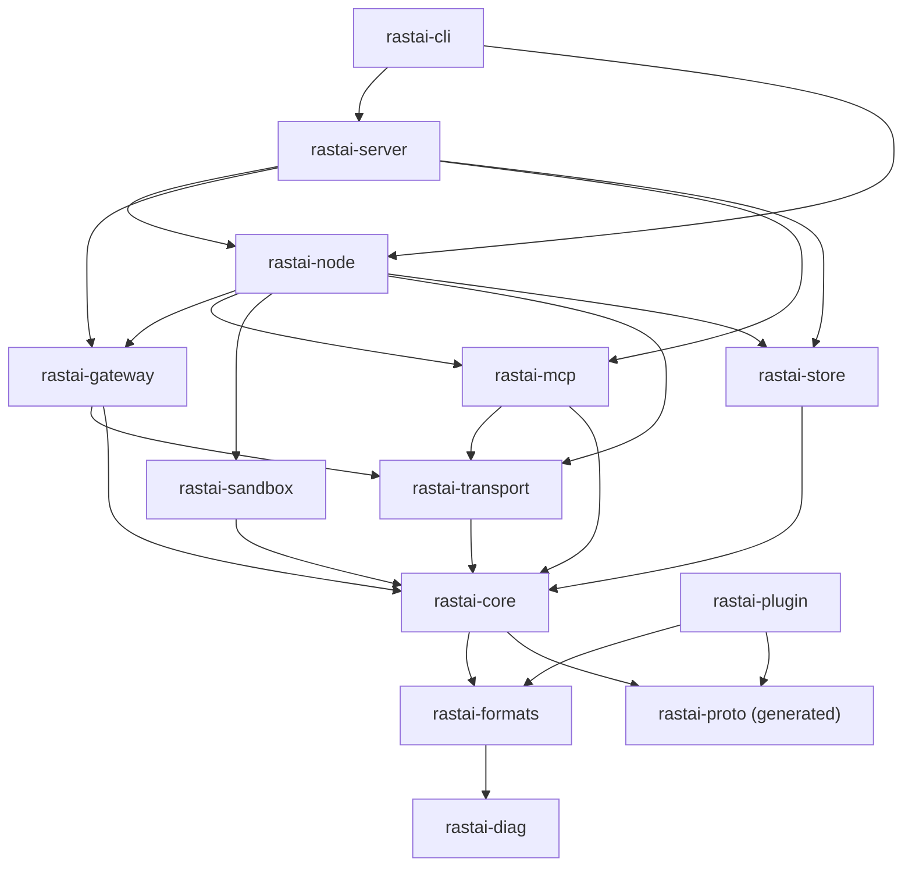
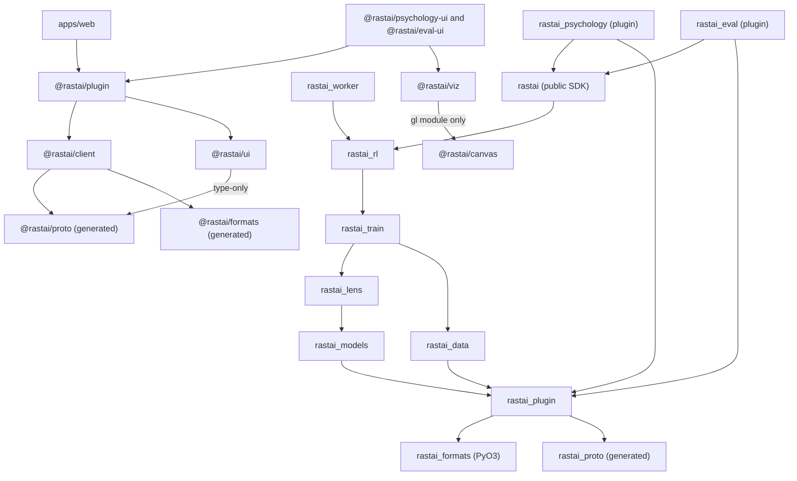
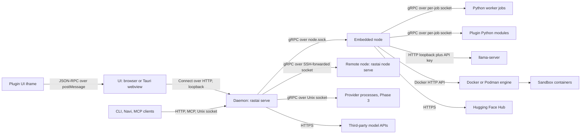

# Rastai Research Studio: Shared Contracts

**Status:** v1, 2026-10-10. Pre-build. Built on spec v5.3 (`docs/spec/rastai_spec_v5.md`) and the spike (`spike/README.md`).

This file holds the shared names for every other design doc: crates, packages, processes, protobuf services, documents, commands, events, tables, states, error codes and settings. Layout docs, flow docs, ADRs and the implementation plan use these names exactly. If a name you need isn't here, add it here first, in its own PR, before any doc or code uses it (spec §29: contracts land first).

Conventions in this file:
- `code` is a literal name, used exactly as written.
- "Phase 2" or "Phase 3" marks something designed now and built later. Everything else is in the prototype.
- "(spike)" marks a decision that comes from a measured spike result.
- Spec section numbers are written as §n.

---

## 1. Repository Tree

This extends spec §29. It shows the top level and the second level. Generated code is checked in and marked; CI fails if regenerating it changes anything.

```
RASTAI/
  CLAUDE.md                  architecture map, hard rules, the owner's code style (§29)
  README.md  LICENSE  NOTICE  DCO  CONTRIBUTING.md  SECURITY.md  TRADEMARKS.md (Phase 2, ADR-0018)
  justfile                   every build, test, codegen and release task goes through `just`
  Cargo.toml  Cargo.lock     Rust workspace: crates/*, apps/desktop/src-tauri
  deny.toml                  cargo-deny: license allowlist, advisories, the §27 crate allowlist
  package.json  pnpm-workspace.yaml  pnpm-lock.yaml   TS workspace: apps/*, packages/*, plugins/*/ui
  buf.yaml  buf.gen.yaml     protobuf lint, `buf breaking`, codegen for Rust, TS and Python
  .github/workflows/         CI pipelines (thin: each step calls a `just` recipe)

  proto/rastai/              the wire contracts (section 4)
    common/v1/               shared messages: Diagnostic, BlobRef, HardwareProfile, enums
    commands/v1/             CommandService (UI, CLI, MCP bridge -> daemon)
    events/v1/               EventService, EventRecord (event-log record), event payloads
    node/v1/                 NodeService, SandboxService (served by the node), NodeHubService (served by the daemon)
    worker/v1/               WorkerService (served by a Python job), WorkerHostService (served by the node)
    provider/v1/             ProviderService (compute-target provider processes, Phase 3)

  crates/                    Rust (section 2 has one row per crate)
    rastai-diag/             error and term catalog (generated tables), Diagnostic renderer, JSON logger
    rastai-proto/            generated prost + tonic code from proto/ (never edited by hand)
    rastai-formats/          every document type, validation, migrations, safetensors, GGUF; WASM + PyO3 builds
    rastai-core/             command registry, ids, principals, scopes, shared state enums
    rastai-plugin/           Rust plugin SDK (provider processes; later WASM)
    rastai-store/            rastai.db, vault.db, blob store, event-log reader/writer, SQLite writer threads
    rastai-transport/        local sockets, SSH (OpenSSH child process), HTTP client, (later) QUIC
    rastai-sandbox/          Docker/Podman HTTP API client, caps, labels, orphan cleanup
    rastai-gateway/          OpenAI/Anthropic endpoints, adapters, chat templates, tokenization, token logging
    rastai-mcp/              in-house MCP server and client (JSON-RPC), generated from the command registry
    rastai-node/             node agent: jobs, uv environments, VRAM leases, telemetry, hardware, downloads, llama-server
    rastai-server/           daemon: HTTP API (Connect), scheduling, plugin host, import/export, ModelSpec analysis
    rastai-cli/              the `rastai` binary: CLI verbs, `serve`, `node serve`, `mcp`

  python/                    Python 3.12 (uv workspace root: python/pyproject.toml)
    rastai/                  public SDK on PyPI: load(), observe(), log(); the public Python API for plugins
    rastai_formats/          PyO3 wheel built from crates/rastai-formats + generated dataclasses
    rastai_proto/            generated protobuf + grpcio code (never edited by hand)
    rastai_plugin/           Python plugin SDK: extension-point base classes, registry, host client
    rastai_worker/           job runtime: entry point, worker protocol server, event-log writer
    rastai_models/           ModelSpec compiler, blocks, model families, safetensors I/O, KV cache, decoding, LoRA
    rastai_data/             task detection, converters, MinHash dedupe, leakage, PII flags, data loaders
    rastai_lens/             observation readouts: logit lens, attention capture, entropy, SAE runtime, steering, live packets
    rastai_train/            trainer loop, checkpoint/resume, recipes (SFT, DPO, GRPO, GSPO, RM, PPO, LoRA, QLoRA, SAE, JEPA, ...)
    rastai_rl/               RL engine: rollout manager, group advantages, Harbor task importer
    envs/                    one uv project + uv.lock per backend: cpu/, cuda13/, cuda126/, rocm/ (mps/ later)

  apps/
    web/                     the React app (all sections; served by the daemon, opened by Tauri or a browser)
    desktop/                 Tauri 2 shell: window, file associations, updater, starts the daemon
    viewer/                  static read-only viewer for .rrsreplay and .rrsmodel (no daemon, no install)

  packages/                  TypeScript packages (npm scope @rastai)
    ui/                      @rastai/ui: the design system (§7)
    proto/                   @rastai/proto: generated protobuf-es + connect-es code
    formats/                 @rastai/formats: generated TS document types + the rastai-formats WASM build
    catalog/                 @rastai/catalog: generated error and term catalog
    client/                  @rastai/client: thin daemon client (Connect transport, auth, event subscription)
    canvas/                  @rastai/canvas: in-house WebGL2 graph renderer (Designer)
    viz/                     @rastai/viz: charts, vector-space view, 3D data-flow view
    plugin/                  @rastai/plugin: TS plugin SDK (sections, panels, iframe bridge, typed commands)

  plugins/                   first-party plugins, built only on the public plugin API, shipped preinstalled
    psychology/              rastai-plugin.json, ui/ (@rastai/psychology-ui), python/ (rastai_psychology), catalog/, tests/
    evaluation/              rastai-plugin.json, ui/ (@rastai/eval-ui), python/ (rastai_eval), catalog/, tests/

  templates/                 declarative built-in content, loaded through the same paths as plugin contributions
    designs/                 TextCNN, Transformer (decoder/encoder/enc-dec), CNN, MLP, RNN/LSTM, ViT, JEPA (.rrsmodel)
    harnesses/               starter .rrsharness files
    evals/                   starter .rrseval suites, the fixed drift prompt set, the default anchor set
    projects/                starter .rrsproj folders
    plugins/                 `rastai plugin new` templates: panel, section, converter, recipe, designer-node, lens,
                             metric, reward, adapter, importer, exporter, theme

  schemas/                   generated JSON Schemas, one per document type and version (checked in)
  catalog/
    errors/                  one JSON file per error prefix: RRS-E.json, RRS-P.json, ... (section 10)
    terms/                   plain-English term definitions (the glossary the UI shows)
  fixtures/                  shared test inputs (section 12): tiny models, safetensors corpus, documents, golden messages
  tests/
    parity/                  model-family parity against HF transformers (fp32 + bf16)
    e2e/                     Playwright tests against the web build
    gpu/                     GPU-only tests (nightly on the owner's box)
    crash/                   kill -9 tests for daemon, node and jobs
    loop/                    the full CPU loop in under 10 minutes (design -> train -> eval -> ONNX -> re-import)
  tools/                     dev tooling only, never shipped
    codegen/                 runs buf, rastai-formats codegen and catalog codegen in one step
    checks/                  check-imports (public-API rule), check-deps (allowlists), check-generated
    release/                 packaging (AppImage, .deb), version bumps
  deps/
    engines/                 llama-server.json: pinned llama.cpp build per backend, URL, SHA-256
    allowlist-python.json    Python packages allowed by §27, with versions and reasons
    allowlist-npm.json       npm packages allowed by §27, with versions and reasons
  docs/
    spec/                    the product and technical scope
    architecture/            contracts.md (this file), layout/, flows/
    adr/                     ADRs (§30)
    plan/                    implementation plan
    reference/               generated: command reference, error catalog, extension points
  spike/                     history: the spike's prototype code and results. Read-only. Nothing imports it.
```

Decisions in this tree:
- **First-party plugins live in `plugins/`**, not in `python/` or `apps/web/`. Each one is a complete plugin folder, packed into a `.rrsplugin` at build time and preinstalled. This replaces spec §29's `python/rastai_eval`: the Evaluation package keeps its name, `rastai_eval`, but lives in `plugins/evaluation/python/`.
- **`rastai_lens` stays in `python/`** as the core readout engine. The live panel must run inside the Inspectable runtime's decode step (fused logit lens, CUDA graph; spike), so readouts are a runtime feature exposed through the public API. The Psychology plugin (`plugins/psychology/`) holds the UI, the commands and the offline analysis jobs (attribution graphs, projections, probes, model diff, SAE fit check) in `rastai_psychology`.
- **Plugin SDKs sit next to their language peers:** `crates/rastai-plugin`, `packages/plugin` (`@rastai/plugin`), `python/rastai_plugin`.
- **Core sections** (Inference, Training, Designer, Agent Gym, Data, Plugins, Remote, Settings) live in `apps/web/src/sections/<section>/`. Each has a `section.json` that uses the plugin manifest schema, and each imports only the public API (`@rastai/plugin`, `@rastai/ui`, `@rastai/canvas`, `@rastai/viz`). `tools/checks/check-imports` enforces this.
- **`spike/` stays as history.** Code is ported out of it, never imported. The port map:

| Spike file | Ported to |
|---|---|
| `spike/src/rastai_spike/gemma3.py` | `python/rastai_models`: `blocks/` (RMSNorm, attention, feed-forward, RoPE, KV cache) + `families/gemma3.py` (HF config and name mapping) |
| `safetensors_reader.py`, `safetensors_writer.py` | `python/rastai_models/io/` (Python); the Rust twin is `crates/rastai-formats/src/safetensors/reader.rs` from `spike/bakeoff/rust/src/safetensors.rs` |
| `decoding.py` (`StaticDecoder`, lens modes) | `python/rastai_models/decoding.py` (static decode, CUDA graph, one capture stream per device) |
| `lenses.py`, `sae.py` | `python/rastai_lens/` (`live_packet.py`, `logit_lens.py`, `attention.py`, `sae.py`) |
| `lora.py` | `python/rastai_models/lora.py` (LoRA is a ModelSpec node attribute) |
| `training.py` | `python/rastai_train/loop.py` + `recipes/sft.py` |
| `evaluation.py` | `plugins/evaluation/python/rastai_eval/metrics/` (`keyword.py`, `drift.py`) |
| `generation.py`, `hf_cache.py` | `python/rastai_models/` (used by the standalone SDK; jobs get resolved paths from the node) |
| `llama_server.py` | `crates/rastai-node/src/fast_runtime.rs` (the node manages llama-server) |
| `reporting.py` (`environment_fingerprint`) | `python/rastai_worker/hardware_fingerprint.py` |
| `bakeoff_fixtures.py`, `tokenizer_corpus.py` | `fixtures/safetensors/` (the 33-file corpus), `fixtures/tokenizer/` (the 162-case corpus) |
| `spike/bakeoff/rust/src/gateway.rs` | `crates/rastai-gateway` (endpoints, streaming) + `crates/rastai-store` (the one-writer-thread SQLite pattern) |
| `spike/canvas/canvas_test.js` | `packages/canvas` (graph renderer) + `packages/viz` (3D flow view) |

---

## 2. Component Inventory

"Process" is where the code runs. "Internal deps" lists everything it may import; anything not listed is forbidden. "External deps" come from the §27 allowlist only; items marked † are not yet in §27 and are raised in section 14.

### 2.1 Rust crates

| Crate | Purpose | Process | Internal deps | External deps (§27) |
|---|---|---|---|---|
| `rastai-diag` | Catalog tables (generated from `catalog/`), `Diagnostic` type, text renderer, JSON-lines logger | all Rust processes, WASM | none | serde, serde_json |
| `rastai-proto` | Generated protobuf messages and gRPC stubs | daemon, node, provider | none | prost, tonic |
| `rastai-formats` | Every document type: parse, validate (4 layers), migrate, write; safetensors reader/writer; GGUF writer; content hashing; type descriptions for codegen | daemon, node, CLI, browser (WASM), Python (PyO3) | `rastai-diag` | serde, serde_json, blake3; PyO3† and wasm-bindgen† for the two builds |
| `rastai-core` | Command registry (descriptor table + dispatch), ids, principals, scopes, shared state enums, settings resolution, protobuf JSON for wire types stored in documents (section 4) | daemon, node, CLI | `rastai-diag`, `rastai-formats`, `rastai-proto` | serde, serde_json |
| `rastai-plugin` | Rust plugin SDK: provider-process skeleton, manifest helpers | provider processes | `rastai-diag`, `rastai-formats`, `rastai-proto` | tokio, tonic |
| `rastai-store` | `rastai.db` and `vault.db` (one writer thread each), blob store, event-log reader/writer, migrations | daemon, node | `rastai-core`, `rastai-formats`, `rastai-diag` | rusqlite, blake3 |
| `rastai-transport` | Local IPC (Unix socket; named pipe later), SSH via the OpenSSH binary, HTTPS client, tonic channels over these | daemon, node, CLI | `rastai-core`, `rastai-formats` (transfer hashes), `rastai-proto`, `rastai-diag` | tokio, tonic, rustls, hyper† (HTTP client) |
| `rastai-sandbox` | Docker-API client over the engine socket: create, exec, pause, remove, caps, labels, orphan sweep | node | `rastai-core`, `rastai-diag` | tokio, hyper† |
| `rastai-gateway` | OpenAI and Anthropic endpoints, adapters, chat templates, tokenization, token logging through a `LogSink` | daemon (user endpoints), node (rollout and judge gateway) | `rastai-core`, `rastai-formats`, `rastai-proto`, `rastai-transport`, `rastai-diag` | axum, tokio, tonic (node-runtime and daemon-forward adapters), tokenizers, minijinja, serde, serde_json |
| `rastai-mcp` | MCP server (tools generated from the command registry) and MCP client (harness tools) | daemon, CLI (`rastai mcp` stdio bridge), node (gym tools) | `rastai-core`, `rastai-formats`, `rastai-transport`, `rastai-diag` | tokio, serde_json |
| `rastai-node` | Node agent: job supervisor, uv environments, VRAM leases, telemetry, hardware detection, HF downloads, transfers, llama-server management, NodeService server | daemon (embedded node), `rastai node serve` | `rastai-core`, `rastai-formats`, `rastai-proto`, `rastai-store`, `rastai-transport`, `rastai-sandbox`, `rastai-gateway`, `rastai-mcp`, `rastai-diag` | tokio, tonic, ed25519-dalek (hashing goes through `rastai-formats`, rule 8) |
| `rastai-server` | Daemon: Connect HTTP API, scheduling, plugin host, import/export, ModelSpec analysis, NodeHubService, MCP endpoint, static web app | daemon | every crate above except `rastai-plugin` | axum, tokio, tonic, keyring† (OS keychain bindings), ed25519-dalek |
| `rastai-cli` | The `rastai` binary: argument parsing (in-house), process modes, generated CLI verbs | CLI, daemon, node | `rastai-server`, `rastai-node`, `rastai-core`, `rastai-transport`, `rastai-formats`, `rastai-diag` | tokio |
| `apps/desktop/src-tauri` | Tauri shell: window, file associations, updater; starts or finds the daemon by running `rastai open --print-url` | desktop shell | none (talks to the daemon over HTTP only) | tauri |

### 2.2 Python packages

| Package | Purpose | Process | Internal deps | External deps (§27) |
|---|---|---|---|---|
| `rastai_proto` | Generated protobuf and grpcio stubs | worker jobs | none | grpcio, protobuf runtime |
| `rastai_formats` | PyO3 wheel of `rastai-formats` + generated dataclasses for every document type | worker jobs, notebooks | none | none (native wheel) |
| `rastai_plugin` | Extension-point base classes, the in-process registry, the WorkerHost client, plugin test host | worker jobs, plugin modules | `rastai_proto`, `rastai_formats` | grpcio |
| `rastai_models` | ModelSpec compiler, blocks (attention variants, MoE, MLA, ALiBi, AttnRes), families, safetensors I/O, KV caches, static decode, LoRA, layer placement | worker jobs, notebooks | `rastai_formats`, `rastai_plugin` | torch; transformers only for the compat runtime (optional) |
| `rastai_data` | Task detection, preview, converters (declarative + Python fallback), MinHash, leakage, PII, loaders | worker jobs | `rastai_formats`, `rastai_plugin` | tokenizers (HF, for token counts), pyarrow† (Parquet) |
| `rastai_lens` | Observation readouts, logit lens (fused), attention capture, entropy, SAE runtime, probes, steering/ablation hooks, live packets, summary layer | worker jobs | `rastai_models`, `rastai_formats`, `rastai_plugin` | torch |
| `rastai_train` | Trainer loop, resume contract, checkpoints, anchors, all recipes | worker jobs | `rastai_models`, `rastai_data`, `rastai_lens`, `rastai_formats`, `rastai_plugin` | torch, torch.distributed; bitsandbytes (optional, QLoRA) |
| `rastai_rl` | Rollout manager, group advantages, GRPO/GSPO/PPO glue, Harbor task importer | worker jobs | `rastai_train`, `rastai_models`, `rastai_data`, `rastai_formats`, `rastai_plugin` | torch |
| `rastai_worker` | Job entry point (`python -m rastai_worker`), WorkerService server, event-log writer, hardware fingerprint, job-kind dispatch | worker jobs | everything above | grpcio |
| `rastai` | Public SDK: `load()`, `observe()`, `log()`, and the stable facade plugins use (`rastai.runtime`, `rastai.data`) | notebooks, plugin modules | everything above except `rastai_worker` | torch |
| `rastai_psychology` | Psychology plugin module: command handlers, offline analysis jobs | plugin module, worker jobs | `rastai`, `rastai_plugin` only | torch |
| `rastai_eval` | Evaluation plugin module: suites, metrics, judges, Pass@k, Elo, perplexity, drift, benchmarks | plugin module, worker jobs | `rastai`, `rastai_plugin` only | torch |

### 2.3 Apps and TypeScript packages

| Package | Purpose | Process | Internal deps | External deps (§27) |
|---|---|---|---|---|
| `@rastai/proto` | Generated protobuf-es messages and connect-es service stubs | browser | none | connect-es (+ protobuf-es runtime) |
| `@rastai/formats` | Generated document types + WASM validator | browser | none | none |
| `@rastai/catalog` | Generated error and term catalog | browser | none | none |
| `@rastai/ui` | Design system: tokens, components, Basic/Advanced primitives, diagnostics view | browser | `@rastai/catalog`, `@rastai/proto` (type-only, for `Diagnostic`) | react |
| `@rastai/client` | Daemon client: Connect transport, login, event subscription with resume | browser | `@rastai/proto`, `@rastai/formats` | connect-es |
| `@rastai/canvas` | WebGL2 graph renderer (nodes, edges, glyph atlas, hierarchy collapse) | browser | none | none |
| `@rastai/viz` | Charts, vector-space view, 3D data-flow view (WebGL2) | browser | `@rastai/canvas` (`gl` module only) | none |
| `@rastai/plugin` | TS plugin SDK: register sections/panels/commands, typed `execute()`, event subscription, iframe bridge | browser | `@rastai/client`, `@rastai/ui`, `@rastai/formats`, `@rastai/proto`, `@rastai/catalog` | react |
| `@rastai/psychology-ui` | Psychology section (in-process, first-party) | browser | `@rastai/plugin`, `@rastai/ui`, `@rastai/canvas`, `@rastai/viz` | react |
| `@rastai/eval-ui` | Evaluation section (in-process, first-party) | browser | `@rastai/plugin`, `@rastai/ui`, `@rastai/viz` | react |
| `@rastai/web` (`apps/web`) | The app: shell, plugin host (UI side), core sections | browser / Tauri webview | all packages above | react |
| `@rastai/viewer` (`apps/viewer`) | Read-only viewer for replays and designs | browser (static) | `@rastai/formats`, `@rastai/ui`, `@rastai/canvas`, `@rastai/viz` | react |
| `@rastai/desktop` (`apps/desktop`) | Tauri front config; loads the daemon URL | Tauri | none | Tauri 2 |

### 2.4 Layering rules

1. A component imports only from its "Internal deps" column. Same-layer components never import each other. `@rastai/canvas` sits one layer below `@rastai/viz`, not beside it: viz imports canvas's `gl` module only (context, programs, buffers, frame loop, self-check), so the WebGL helpers exist once.
2. **Generated code is the bottom layer** (`rastai-proto`, `rastai_proto`, `@rastai/proto`, `@rastai/formats`, `@rastai/catalog`, `schemas/`). It is never edited by hand.
3. **Schema types are defined once** (§20): wire types in `proto/`, document and command-argument types in `rastai-formats`. Every other language gets generated types. No component re-declares them.
   - A document field that holds a wire type stores its protobuf JSON and never re-declares its fields (section 4, "Wire types inside documents").
   - **Allowed in-process twins of wire types**, and only these: `rastai-diag`'s `Diagnostic` and `Severity` (`rastai-diag` must not depend on `rastai-proto`, because it builds to WASM and sits under everything), and `rastai-core`'s static `CommandDescriptor` table row (a `const` table can't hold `String`s). A test in `rastai-core/tests/wire_round_trip.rs` checks that each twin's fields equal the proto message's fields. The static row may leave out only what registration fills in: `plugin_id`, `arguments_type`, `result_type`, `arguments_schema_json` and `result_schema_json`. Every other component uses the generated proto type.
   - **Violations to fix:**
     - `rastai-server`'s `JobRequest` copies most of `JobSpec`. Pass the generated type instead: `submit_job(server: &Server, spec: JobSpec, node_id: &str) -> Result<String, Vec<Diagnostic>>`. It fills `spec.job_id` and returns it.
     - `rastai-core`'s registry stores the generated `CommandDescriptor` (schemas included); it defines no `RegisteredCommand` copy. At startup `rastai-server` turns each static row into a generated `CommandDescriptor` and fills the five fields above; the plugin host builds plugin rows from the manifest and `types.json`.
     - The static row uses the generated `CommandKind` enum, not one of its own.
4. **The UI talks to the daemon only through `@rastai/client`.** No TS package reads files or opens other sockets.
5. **Sections and plugins use only the public API:** in TS, `@rastai/plugin`, `@rastai/ui`, `@rastai/canvas` and `@rastai/viz`; in Python, `rastai` and `rastai_plugin`. This holds for first-party plugins too (§13).
6. **Engines never import plugins.** An engine that needs plugin behavior (a metric, a recipe, a reward) looks it up by name in the `rastai_plugin` registry. For example, `rastai_rl` gets `pass_at_k` from the registry, never by importing `rastai_eval`.
7. **The gateway never imports the store.** It logs through a `LogSink` (vault sink in the daemon, event-log sink in the node).
8. **External libraries are wrapped** in one module of the crate or package that owns them (for example `rastai-gateway/src/tokenizer.rs` is the only file that imports `tokenizers`).



Arrows mean "may depend on". `rastai-server` also reaches the lower crates directly (it is the composition root); the diagram leaves out those edges to stay readable. `rastai-plugin` sits beside `rastai-core`, not under it, because provider processes must not pull in the daemon.



The Python half reads bottom-up: `rastai_plugin` (base classes and registry) is low so engines can define their extension points on it. The public facade `rastai` is high so plugins get engine features without importing engines. In TS, plugin UIs and core sections reach the daemon only through `@rastai/plugin` → `@rastai/client`. The two TS edges to note:
- `@rastai/viz` → `@rastai/canvas` is the only edge between the renderers. It reaches the `gl` module and nothing else in canvas.
- `@rastai/ui` imports the `Diagnostic` type from `@rastai/proto` as a type-only import, so `DiagnosticView` doesn't re-declare it. Because the import is type-only, it adds no runtime code to the static viewer or to iframes.

---

## 3. Processes and Boundaries

### 3.1 Processes

| Process | Started by | Binary / entry | Lifetime | Notes |
|---|---|---|---|---|
| **Daemon** | `rastai` or `rastai open` (the Tauri shell runs `rastai open --print-url`), `rastai serve`, systemd user unit | `rastai serve [--headless]` | until stopped | Control plane. Holds `rastai.db`, `vault.db`, the gateway, plugin host, scheduler. Single instance per user (flock on `daemon.lock`). |
| **Embedded node** | daemon | same process, own tokio runtime | with the daemon | Serves NodeService on `node.sock` and the daemon reaches it over that socket, like a remote node. In-process only means same OS process. |
| **Standalone node** | `rastai node pair --ssh` installs it; a systemd user unit runs it | `rastai node serve` | until stopped | Same code as the embedded node. |
| **Python worker job** | node | `<env>/bin/python -m rastai_worker run --job-file runs/<run_id>/job.json` | one job | Own process group (`setsid`). Survives daemon and node restarts; the node reattaches. |
| **Plugin Python module** | node, when a plugin with a `python` entry is enabled | `python -m rastai_worker plugin --plugin <plugin_id>` | while the plugin is enabled | A worker job of kind `plugin_module`. Network off by default. |
| **llama-server** | node | pinned build from `deps/engines/llama-server.json` | while a Fast-runtime model is loaded | Loopback only, random port, random `--api-key`. |
| **Sandbox container** | node via the Docker/Podman engine | OCI image from the harness | one rollout or one Pass@k sample | Labeled `rastai.node_id`, `rastai.run_id`, `rastai.sandbox_id`; network off unless the harness allows hosts. |
| **UI** | Tauri or the user's browser | `apps/web` served by the daemon at `/` | per window | HTTP only. |
| **Plugin UI iframe** | UI | `/plugins/<plugin_id>/<version>/ui/<entry>` | per panel | `sandbox="allow-scripts"`; no same-origin, no token. Third-party plugins only. |
| **Provider process** (Phase 3) | daemon | binary from the plugin's `provider` entry | while the plugin is enabled | gRPC compute-target provider. |
| **MCP stdio bridge** | an MCP client (Claude Desktop, etc.) | `rastai mcp` | per client session | Forwards MCP JSON-RPC to the daemon's `/mcp` with a scoped token. |
| **Viewer** | user | static `apps/viewer` | per tab | Reads files locally with WASM; no daemon. |



Not obvious from the picture:
- A remote node has the same arrows to its own workers, llama-server, engine and HF as the embedded node.
- Node-originated calls (heartbeats, plugin modules running commands, judges using an API model) go node → daemon on `NodeHubService`, through a reverse-forwarded socket on SSH.
- Nothing listens on a non-loopback interface by default. The remote UI uses an SSH tunnel to the headless daemon.

### 3.2 Who talks to whom

| From → To | Transport | Protocol | Auth |
|---|---|---|---|
| UI → daemon | HTTP/1.1 on `127.0.0.1:47820` | Connect (protobuf binary by default, JSON accepted) for `CommandService` and `EventService`; plain GETs for blobs and static files | Session cookie (HttpOnly, SameSite=Strict) from a one-time login code; Host and Origin checked on every request |
| Tauri shell → daemon | same as UI | same | The shell runs `rastai open --print-url`. The CLI starts the daemon if needed, mints a one-time code with `token.login_code.create` over `daemon.sock` (peer credentials), and prints one `DesktopLaunchInfo` JSON line. The shell opens that URL, which carries `#login=<code>` in the fragment. The shell never reads `owner.token`, computes a code or makes an HTTP request. |
| CLI → daemon | Unix socket `daemon.sock` | Connect (JSON) | Peer credentials (`SO_PEERCRED`, same uid); the socket directory is 0700 |
| Navi, scripts → gateway | HTTP on loopback, `/v1/*` | OpenAI and Anthropic HTTP APIs | Bearer scoped token (`chat` scope, optionally `gateway.spend`) |
| MCP client → daemon | `rastai mcp` stdio bridge, or HTTP `/mcp` | MCP JSON-RPC (Streamable HTTP on `/mcp`) | Bearer scoped token |
| Daemon → embedded node | Unix socket `node.sock` | gRPC (tonic), `NodeService` + `SandboxService` | Peer credentials + handshake token |
| Daemon → remote node | OpenSSH child process forwarding a local Unix socket to the remote `node.sock` (`ssh -N -L`) | gRPC, same services | SSH with pinned host key; the handshake proves the node's Ed25519 identity (signed challenge) and the daemon's |
| Node → daemon | the embedded node calls `node-hub.sock` directly; a remote node calls it through the same SSH session's reverse forward (`-R`) | gRPC, `NodeHubService` | Socket peer + node session token from the handshake |
| Node → worker job | per-job Unix socket `jobs/<job_id>.sock` | gRPC, `WorkerService` (worker serves, grpcio) | `RASTAI_JOB_TOKEN` (32 random bytes) in gRPC metadata; socket dir 0700 |
| Worker job → node | per-node Unix socket `worker-host.sock` | gRPC, `WorkerHostService` (node serves) | the same job token; the node maps token → job → permissions |
| Worker job → event log | file `runs/<run_id>/events.log` | append-only frames (section 7) | file ownership (one writer) |
| Node → llama-server | HTTP on `127.0.0.1:<random>` | llama-server `/completion`, `/health`, `/tokenize` (checks only) | `--api-key` random per launch |
| Node → container engine | `/run/user/<uid>/podman/podman.sock` or `/var/run/docker.sock` | Docker Engine HTTP API | socket permissions |
| Rollout worker → sandbox | through the node (`WorkerHostService.ExecInSandbox`) | Docker exec streams, proxied | containers never see a Rastai socket |
| UI → plugin iframe | `window.postMessage` | JSON-RPC 2.0, MCP Apps compatible (section 4.8) | host checks `event.source`; calls limited by the plugin's `commands:[scopes]` permission |
| Daemon → plugin Python module | via node → `WorkerService.HandleCommand` | gRPC | job token; the plugin principal is attached to every follow-up call |
| Daemon → provider process | Unix socket path given in `RASTAI_PROVIDER_SOCKET` | gRPC, `ProviderService` | socket dir 0700 + token in metadata; credentials fetched from the keychain per call |
| Gateway → third-party APIs | HTTPS (rustls) | OpenAI / Anthropic / OpenAI-compatible HTTP | API keys from the OS keychain, read per request |
| Node → Hugging Face Hub | HTTPS (rustls) | HF Hub HTTP API (in-house client) | HF token passed as a short-lived value from `NodeHubService.GetSecret` |

### 3.3 Daemon HTTP surface

One axum server serves both `127.0.0.1:47820` and `daemon.sock`.

| Path | Purpose |
|---|---|
| `POST /rastai.commands.v1.CommandService/Execute`, `/ListCommands` | Connect unary |
| `POST /rastai.events.v1.EventService/Subscribe` | Connect server-streaming |
| `POST /api/login` | exchange a one-time login code for the session cookie. The web app reads the code from the `#login=<code>` URL fragment, which browsers never send to servers or put in a Referer header. Codes are single use and expire after 60 s. |
| `GET /api/health` | `{"status":"ok","version":"..."}`; no auth |
| `GET /api/blobs/<hash>` | blob download with HTTP Range |
| `PUT /api/blobs` | upload (drag-drop files); returns `BlobRef` |
| `/v1/chat/completions`, `/v1/completions`, `/v1/models` | OpenAI-compatible gateway |
| `/v1/messages` | Anthropic-compatible gateway |
| `/mcp` | MCP Streamable HTTP |
| `/plugins/<plugin_id>/<version>/ui/*` | plugin UI assets (static) |
| `/` | the web app (embedded in the binary) |

---

## 4. Wire Contracts

All wire types live in `proto/rastai/<package>/v1/*.proto`. Rules:
- Times are `int64 <name>_unix_ms`. Sizes are `uint64 <name>_bytes`. No `google.protobuf.Timestamp`.
- Ids are `string` in the formats from section 8.6. Hashes are `string` `blake3:<64 hex>`.
- Document and command-argument payloads cross the wire as `string <name>_json`, validated by `rastai-formats` at both ends. That keeps one owner per schema (§20).
- **Wire types inside documents** (the reverse case). A document field that holds a wire type stores the protobuf JSON mapping of the generated message. Proto field names stay `snake_case`; 64-bit integers are strings and enums are names, as the mapping says. `rastai-formats` describes the field as `FieldKind::Proto("rastai.common.v1.HardwareFingerprint")` and never re-declares its fields. The fields under this rule are `HardwareFingerprint` (run record, replay), `JobSpec` (run record) and `SamplingSettings` (conversation messages).
  - Layer 2 checks only that the value is a JSON object, because `rastai-formats` must not depend on `rastai-proto` (it builds to WASM). The component that reads the field decodes it into the generated message, which checks it: `fromJson` from `@rastai/proto` in TS, `json_format.ParseDict` into the `rastai_proto` message in Python, and `rastai-core/src/proto_json.rs` into the `rastai-proto` struct in Rust. A decode failure is an `RRS-E1xxx` structure diagnostic at the field's path.
  - Generated document types give the field as a plain JSON object, with a doc comment that names the message. That way `@rastai/formats` and `rastai_formats` don't depend on the proto packages.
  - `proto_json.rs` is hand-written, one encode and one decode function per message under this rule (nested messages included), because prost has no proto3 JSON mapping and §27 lists no crate for one. This is the same approach as the daemon's Connect JSON codec. Its output is checked against protobuf-es goldens in `fixtures/proto-golden/`.
- Every failure carries a `rastai.common.v1.Diagnostic` with a catalog code. gRPC status is `OK` whenever the call itself ran; transport-level failures use gRPC status codes.
- Field numbers are never reused; `buf breaking` runs in CI; golden messages live in `fixtures/proto-golden/`.

### 4.1 `rastai.common.v1`

| Message / enum | One line |
|---|---|
| `Diagnostic` | `code`, `severity` (ERROR/WARNING/INFO), `message`, `path` (JSON pointer or file:line:col), `fix_text`, `fix_command_id`, `fix_arguments_json` |
| `BlobRef` | `hash`, `size_bytes`, `media_type` |
| `HardwareProfile` | CPU, RAM, disk, `repeated GpuInfo`, driver, backend, self-test result |
| `GpuInfo` | `index`, `name`, `architecture` (e.g. `sm_120`, `gfx1100`), `vram_bytes`, `vendor`, `driver_version` |
| `HardwareFingerprint` | `environment_hash`, `gpus`, `driver_version`, `backend_version`, `torch_version`, `dtype`, `quantization`, `attention_kernel`, `seed`, `deterministic` |
| `ResourceRequest` | `gpu_indices`, `vram_bytes`, `lease_class`, `cpu_count`, `ram_bytes`, `sandbox_count` |
| `JobState`, `RunState`, `ModelState`, `LeaseState`, `NodeState`, `SandboxState`, `PluginState`, `EvalRunState` | enums mirroring section 9 |
| `EventClass` | `DURABLE`, `EPHEMERAL` |
| `RuntimeKind` | `INSPECTABLE`, `FAST`, `COMPAT`, `API` |
| `LeaseClass` | `EVICTABLE`, `PINNED` |

### 4.2 `rastai.commands.v1`, served by the daemon

| Service.RPC | Direction | Purpose |
|---|---|---|
| `CommandService.Execute` | unary | run one command: `ExecuteRequest` → `ExecuteResponse` |
| `CommandService.ListCommands` | unary | the registry: `ListCommandsRequest` → `ListCommandsResponse` |

| Message | One line |
|---|---|
| `ExecuteRequest` | `command_id`, `arguments_json`, `project_id`, `idempotency_key`, `dry_run` |
| `ExecuteResponse` | `ok`, `result_json`, `job_id` (set for job commands), `repeated Diagnostic diagnostics`, `journal_id` |
| `CommandDescriptor` | `command_id`, `title`, `summary`, `section`, `scope`, `undoable`, `kind` (SYNC/JOB/STREAM), `arguments_type`, `result_type`, `arguments_schema_json` (JSON Schema of the arguments: palette forms, CLI flags, MCP `inputSchema`), `result_schema_json` (MCP `outputSchema`), `default_shortcut`, `basic` (shown in Basic mode), `plugin_id`, `experimental`, `since_version` |
| `ListCommandsRequest` / `Response` | optional `section` filter / `repeated CommandDescriptor` |

The principal is never in the request. The daemon derives it from the cookie, token, socket peer or plugin job token.

### 4.3 `rastai.events.v1`

| Service.RPC | Direction | Purpose |
|---|---|---|
| `EventService.Subscribe` (daemon) | server stream | `SubscribeRequest{after_bus_sequence, event_types[], subject_ids[]}` → `stream BusEvent` |

| Message | One line |
|---|---|
| `EventRecord` | one event-log record (section 7.1) |
| `BusEvent` | the daemon's fan-out envelope to UIs (section 7.2) |
| payloads | one message per event type in section 7.3 (`JobStateChanged`, `RunMetrics`, `CheckpointSaved`, `ChatToken`, `LivePacket`, ...), plus `PluginEventPayload{plugin_id, schema, payload_json}` for plugin-defined events |

### 4.4 `rastai.node.v1`

**`NodeService`**, served by every node; the daemon is the client.

| RPC | Direction | Purpose |
|---|---|---|
| `Handshake` | unary | `protocol_version` (integer, starts at 1), `capabilities[]`, `app_version`, signed challenge both ways; returns `node_id`, `HardwareProfile`, session token |
| `GetHardware` | unary | current `HardwareProfile` and telemetry |
| `EnsureEnvironment` | server stream | `uv sync` an environment from its lockfile; streams `EnvironmentProgress` |
| `StartJob` | unary | `JobSpec` → `JobInfo` (Python jobs and node-native jobs) |
| `SignalJob` | unary | `job_id`, `signal` (CANCEL, STOP, PAUSE, RESUME, CHECKPOINT_NOW, STEP, TERMINATE, KILL; one meaning each, in the `JobSignal` table below) |
| `ListJobs` | unary | snapshot of all jobs, for reconciliation after a reconnect |
| `WatchRunEvents` | server stream | `run_id`, `after_sequence` → `stream EventRecord` (tails `events.log`; the daemon's `after_sequence` is the ack) |
| `WatchLive` | server stream | ephemeral events for a job or session: tokens, live packets, peek steps, log lines, progress |
| `RequestLease` / `ReleaseLease` / `ListLeases` | unary | VRAM leases (section 9.4) |
| `LoadModel` | server stream | `model_ref`, `runtime`, `gpu_indices`, `dtype`, `lease_class` → `stream ModelLoadProgress` |
| `UnloadModel` | unary | release the model and its lease |
| `Generate` | server stream | `GenerateRequest` → `stream GenerateEvent`; the node routes to the Inspectable worker or llama-server |
| `ForkSession` / `CloseSession` | unary | branch a generation session at a token index / free its cache |
| `SetInterventions` | unary | `session_id`, `interventions_json` (an `InterventionSet`, section 5.2): steering, ablation, feature edits, expert overrides |
| `FetchTensor` | server stream | full tensor for an observation point and token range (Psychology zoom) |
| `HandleCommand` | unary | forward a plugin command to that plugin's Python module |
| `PutFile` | client stream | resumable upload: `FileChunk{path, offset, bytes}` → `FileStat{hash}` |
| `GetFile` | server stream | resumable download from `offset` |
| `StatFile` | unary | size and BLAKE3 hash |
| `UpdateNode` | client stream | signed binary for self-update |

**`SandboxService`**, served by the node.

| RPC | Direction | Purpose |
|---|---|---|
| `CreateSandbox` | unary | `SandboxSpec{image, caps, network_hosts[], labels}` → `SandboxInfo` |
| `ExecInSandbox` | bidi stream | stdin/stdout/stderr frames for one command |
| `PauseSandbox` / `ResumeSandbox` | unary | step mode |
| `RemoveSandbox` | unary | stop and delete |
| `ListSandboxes` | unary | includes orphans found by label |

**`NodeHubService`**, served by the daemon; nodes are clients.

| RPC | Direction | Purpose |
|---|---|---|
| `Heartbeat` | unary, every 5 s | `node_id`, telemetry, `JobInfo[]`, `Lease[]`, `ModelInfo[]`, `SandboxInfo[]`; three missed → `unreachable` |
| `ExecuteCommand` | unary | a plugin module or job runs a command; the daemon applies the plugin principal and its scopes |
| `GatewayGenerate` | server stream | generation through the daemon's gateway (API adapters, models on other nodes) |
| `GetSecret` | unary | short-lived value for a named purpose (`hf_download`, `adapter:<name>`); cloud credentials never leave the daemon |

| Message | One line |
|---|---|
| `JobSpec` | `job_id`, `run_id`, `kind` (section 9.1 list), `environment_id`, `entry` (plugin module path, if any), `arguments_json`, `ResourceRequest`, `network_hosts[]`, `data_policy`, `checkpoint_policy_json`, `plugin_id` |
| `JobInfo` | `job_id`, `run_id`, `kind`, `state`, `pid`, `process_group_id`, `started_unix_ms`, `exit_code`, `Diagnostic last_error` |
| `Lease` | `lease_id`, `gpu_index`, `vram_bytes`, `lease_class`, `holder_job_id`, `state`, `granted_unix_ms` |
| `GenerateRequest` | `session_id`, `model_ref`, `runtime`, `prompt_token_ids[]`, `SamplingSettings`, `max_new_tokens`, `stop_token_ids[]`, `LensRequest` (off/summary; layers; SAE ids; top-k), `interventions_json` (an `InterventionSet`; empty for none), `pin_attention_kernel`, `return_logprobs` |
| `SamplingSettings` | `temperature`, `top_k`, `top_p`, `repetition_penalty`, `seed` |
| `GenerateEvent` | oneof `TokenEvent{token_id, logprob, top_alternatives[]}`, `LivePacket`, `GenerateFinished{reason, token_count, tokens_per_second, Diagnostic}` |
| `LivePacket` | per token: `token_index`, `entropy`, top-k final guesses, per-layer logit lens top-k, top attended positions per head and layer, top-k SAE features per SAE (about 8.3 KB; spike) |
| `ModelLoadProgress` | `state`, `fraction`, `message`, `Diagnostic` |

**`InterventionSet` is not a proto message.** It is a `rastai-formats` type (section 5.2), because users write it, steering presets store it and plugin `types.json` files refer to it (`core:InterventionSet`). It crosses the wire as `interventions_json` and is validated at both ends like any `_json` payload. `GenerateRequest` carries it as well as `SetInterventions`. A worker that has lost the session (evicted or restarted) therefore still applies the right interventions, just as the full `prompt_token_ids` let it rebuild the KV cache.

**`JobSignal`**: one meaning per value. The worker acts on Control values at the next step boundary.

| Signal | Node sends | Worker does | Exit | Job ends | Run ends | Used by |
|---|---|---|---|---|---|---|
| `CANCEL` | `WorkerService.Control(CANCEL)`; if the RPC fails, SIGINT to the group (sets the same flag) | stops at the next step boundary, writes no checkpoint | 3 | `cancelled` | `cancelled` | `job.cancel` |
| `STOP` | `WorkerService.Control(STOP)` | writes a final checkpoint (kinds with nothing to save skip it), records the run `completed` with reason `stopped` | 0 | `succeeded` | `completed`, reason `stopped` | `train.stop`; cancelling a Teach it, RLHF or sweep chain (sent to its running child) |
| `CHECKPOINT_NOW` | `WorkerService.Control` | checkpoints, keeps running | none | `running` | `running` | `train.checkpoint` |
| `PAUSE`, `RESUME`, `STEP` | `WorkerService.Control` | pauses; resumes; runs one step, then pauses | none | `paused`; `running`; `paused` | unchanged | step mode |
| `TERMINATE` | SIGTERM to the process group | preemption: writes a checkpoint if it fits the preemption budget (kinds with nothing to save skip it), emits `train.preempted`, exits | 75 | `cancelled`, reason `preempted` | `preempted` (resumable) | the version-independent stop, e.g. a worker the node can't speak to after an update. The OS sends the same SIGTERM on shutdown or a spot notice. |
| `KILL` | SIGKILL to the process group at once | nothing; it writes no final records | killed by signal | `cancelled` | `cancelled`, no checkpoint (the daemon writes it, because the worker can't) | the node's last resort, for a job still alive after its grace period |

- `STOP` is a Control value, not a signal, because SIGTERM must keep meaning preemption in every version (any version can stop any older worker with it).
- A `CANCEL` or `TERMINATE` that hasn't ended the job by the node's grace period is followed by `KILL`.
- Exit codes and job states are also listed in section 9.1.

### 4.5 `rastai.worker.v1`

**`WorkerService`**, served by each Python job on `jobs/<job_id>.sock`; the node is the client.

| RPC | Direction | Purpose |
|---|---|---|
| `Hello` | unary | `WorkerInfo{job_id, pid, kind, protocol_version, rastai_version, environment_id}`; used on start and on reattach |
| `Control` | unary | CANCEL, STOP, PAUSE, RESUME, CHECKPOINT_NOW, STEP (meanings in the `JobSignal` table, 4.4) |
| `Generate` | server stream | serve jobs: same `GenerateRequest` / `GenerateEvent` as the node |
| `ForkSession` / `CloseSession` | unary | branch / free a session's KV cache |
| `SetInterventions` | unary | apply `interventions_json` (an `InterventionSet`) to a session; the worker parses it with `rastai_formats` |
| `FetchTensor` | server stream | raw tensor chunks for zoom |
| `WatchLive` | server stream | ephemeral events (progress, peek, log lines) |
| `HandleCommand` | unary | plugin modules: `CommandCall{command_id, arguments_json, principal}` → `CommandReply{result_json, Diagnostic[], document_edits[], follow_up_jobs[]}` |

**`WorkerHostService`**, served by the node on `worker-host.sock`; jobs are clients.

| RPC | Direction | Purpose |
|---|---|---|
| `Register` | unary | job announces its socket; node checks the token |
| `ResizeLease` | unary | ask for more or less VRAM |
| `GatewayGenerate` | server stream | node-local gateway (rollouts, judges on local models); token IDs logged to the run's event log |
| `CreateSandbox` / `ExecInSandbox` / `RemoveSandbox` | as SandboxService | proxied with the job's sandbox cap |
| `PutBlob` / `GetBlob` | client / server stream | blob store access |
| `StartJob` | unary | a plugin module launches a job (permission-checked) |
| `ExecuteCommand` | unary | forwarded to `NodeHubService.ExecuteCommand` |

### 4.6 `rastai.provider.v1` (Phase 3)

`ProviderService`, served by a provider process: `Offers` (unary: GPU types, prices, regions), `Provision` (server stream: progress until the machine is up and `rastai node` is started), `Status`, `Stop`, `Terminate`, `ListBillable` (all unary). Messages: `Offer`, `ProvisionRequest`, `MachineInfo`, `BillableResource`.

### 4.7 Non-protobuf wire formats

| Boundary | Format | Owner |
|---|---|---|
| OpenAI / Anthropic endpoints | their published HTTP JSON + SSE | `rastai-gateway` |
| MCP | JSON-RPC 2.0 | `rastai-mcp` |
| llama-server | its HTTP API, pinned build | `rastai-node/src/fast_runtime.rs` |
| Docker Engine API | HTTP JSON, pinned API version | `rastai-sandbox` |
| Plugin iframe bridge | JSON-RPC 2.0 over postMessage | `@rastai/plugin` (bridge) |

### 4.8 Plugin iframe bridge methods

MCP Apps method names are used where MCP Apps defines one. Rastai additions use the `rastai/` prefix.

| Method | Direction | Purpose |
|---|---|---|
| `ui/initialize` | iframe → host | handshake; host returns theme tokens, mode (Basic/Advanced), locale, granted permissions |
| `tools/list` | iframe → host | commands this plugin may call |
| `tools/call` | iframe → host | execute a command (maps to `Execute`) |
| `resources/read` | iframe → host | read a `ui://` resource of this plugin |
| `rastai/subscribe` / `rastai/unsubscribe` | iframe → host | event types to receive |
| `rastai/event` | host → iframe | notification carrying a `BusEvent` (as JSON) |
| `rastai/theme_changed` | host → iframe | new theme tokens or mode |
| `ui/open-link` | iframe → host | open a URL after host confirmation |

---

## 5. Documents Owned by `rastai-formats`

### 5.1 Shared rules

- Every definition document is JSON (§15). Zip containers hold a JSON document at a fixed path.
- **Schema id:** `<type>/<schema_version>`, e.g. `rastai.model/1`. `schema_version` is an integer per type, starting at 1.
- **`$schema` URL:** `https://schemas.<domain>/<type>/<schema_version>.json` (domain open; section 14). The same files are generated into `schemas/<type>/<schema_version>.json`.
- **Content hash:** BLAKE3 of the canonical JSON (keys sorted, no insignificant whitespace, UTF-8) with `content_hash` itself removed. Written as `blake3:<64 hex>`.
- **Timestamps** inside documents are RFC 3339 UTC strings (`2026-10-10T12:00:00Z`).
- **Migrations:** `schema_version` drives an upgrade chain (`migrate_<type>_v1_to_v2`, ...). Files from a newer version open read-only (§23).

**Shared header (§15)**, on every definition document:

| Field | Type | Meaning |
|---|---|---|
| `$schema` | string | schema URL |
| `type` | string | e.g. `rastai.model` |
| `schema_version` | integer | per type |
| `created_with` | string | `rastai <app version>` |
| `id` | string | stable id (section 8.6), kept across edits |
| `content_hash` | string | BLAKE3 of canonical content |
| `derived_from` | string[] | `<id>@<content_hash>` of parents (remix, import source) |
| `authors` | string[] | free text names |
| `license` | string | SPDX id |
| `source_url` | string | where it came from, if anywhere |
| `requires` | object | `{plugin_id: semver range}` |

### 5.2 Document types

| Document | Type / schema id | Container | Main fields (after the header) |
|---|---|---|---|
| **ModelSpec** `.rrsmodel` | `rastai.model/1` | JSON | `graph{nodes[], edges[]}`; `blocks{block_id: graph}` (reusable definitions); `inputs[]` (input map: `name`, `range`, `encoder_node`); `outputs[]` (heads); `objective{kind, settings}`; `defaults{dtype, sequence_length, batch_size}`; `weights{source (hf:/blob:/ckpt:), family, name_mapping}`; `placement{node_id: gpu_index}` |
| ModelSpec graph node | (part of `rastai.model`) | | `node_id`, `op` (section 5.3), `label`, `attributes{}`, `train_mode` (`freeze`/`lora`/`train`), `lora{rank, alpha}`, `block_ref` (instance of a block), `repeat` (stamp N copies), `observe` (default true), `opaque{input_shapes, output_shapes, compat_class}` |
| **Harness** `.rrsharness` | `rastai.harness/1` | JSON | `system_prompt`; `tools[]{name, mcp_ref (command/url/server.json ref), enabled, network_hosts[]}`; `environment{image, caps{cpu, ram_bytes, time_seconds}, files[]}`; `reward{kind (metric/reward_function/reward_model), name, settings}`; `tasks[]{task_id, prompt, files[], check}`; `task_sources[]` (Harbor dirs as data) |
| **Dataset** `.rrsdata` | `rastai.data/1` | JSON | `sources[]{kind (path/hf/url), location, revision, content_hash}`; `task` (classification/sft/dpo/pretraining/synthetic_qa); `converter{kind (declarative/python), ref}`; `columns{}`; `splits{train, validation, test}` (ratios or explicit); `checks{dedupe, leakage, pii}` + last results; `croissant{}` |
| **Eval suite** `.rrseval` | `rastai.eval/1` | JSON | `tests[]{test_id, input (messages or conversation ref), expectation{kind, value}, metric, pass_threshold}`; `pinned_conversations[]`; `judges[]{judge_id, model_ref, rubric, reference_answer, pairwise}`; `benchmarks[]{source, tasks}`; `metrics[]`; `drift{prompt_set_ref, max_kl}`; `pass_rule` |
| **Replay** `.rrsreplay` | `rastai.replay/1` | Zip | `replay.json` (header, `model_hash`, `model_ref`, `settings`, `branches[]`, `annotations[]`, `hardware_fingerprint` (proto JSON of `HardwareFingerprint`), `fidelity` exact/approximate/proxy); `conversation.jsonl`; `summary/summary.safetensors` + `summary/features.json` (summary layer, always present); `activations/*.safetensors` (optional) |
| **Plugin manifest** (inside `.rrsplugin`) | `rastai.plugin/1` | `rastai-plugin.json` in a Zip | `plugin_id`, `display_name`, `version`, `engines{rastai: semver}`, `requires_capabilities[]` (`designer.node@1`), `contributes{commands[], sections[], panels[], file_types[], importers[], exporters[], converters[], recipes[]{recipe_id, requirements{}}, metrics[], reward_functions[], lenses[], sae_loaders[], node_types[], adapters[], compute_targets[], samplers[], tokenizers[], data_sources[], sandbox_images[]{image, digest}, event_handlers[]{event_type, command_id}, themes[], icon_sets[], locales[], layouts[], keybindings[], macros[], templates[], chat_templates[], settings_pages[], assistant_skills[]}` (rules below the table), `permissions[]`, `ui{entry, kind (in_process/iframe)}`, `python{module, lockfile}`, `provider{binaries{platform: path}}`, `dependencies{plugin_id: semver}`, `catalog`, `experimental` |
| **Project** `.rrsproj` | `rastai.project/1` | Folder `<name>.rrsproj/` or Zip | `project.json` (header, `name`, `data_policy` local-only/trusted-remote/any, `default_node`); folders `designs/ harnesses/ data/ evals/ replays/ presets/ layouts/ runs/` (run records only); `rastai.lock`; `settings.json`; `weights/` only in offline bundles |
| **Lock file** | `rastai.lock/1` | JSON `rastai.lock` | `environment{environment_id, lock_hash}`, `plugins{plugin_id: {version, content_hash}}`, `models{model_ref: {revision, model_hash}}`, `datasets{id: content_hash}` |
| **Conversation** | `rastai.conversation/1` | JSONL | line 1: header (`conversation_id`, `title`, `model_ref`, `model_hash`, `chat_template_hash`, `fidelity`); then one message per line: `message_id`, `parent_id`, `role`, `parts[]{kind (text/image/audio/tool_call/tool_result), ...}`, `token_ids[]` (optional), `settings` (proto JSON of `SamplingSettings`), `max_new_tokens`, `created_at`, `branch_label`, `starred`, `pinned` |
| **Run record** | `rastai.run_record/1` | JSON `runs/<run_id>/run.json` | `run_id`, `kind`, `job_spec` (proto JSON of `JobSpec`), `recipe{name, settings}`, `dataset_hashes[]`, `base_model{model_ref, model_hash}`, `plugin_versions{}`, `environment_lock_hash`, `seed`, `hardware_fingerprint` (proto JSON of `HardwareFingerprint`), `git_commit`, `app_version`, `parent_run_id`, `created_at` |
| **Resume state** | `rastai.resume/1` | JSON `resume.json` in a checkpoint folder | `run_id`, `step`, `epoch`, `samples_seen`, `dataloader{dataset_hash, split, shuffle_seed, epoch, position}`, `rng_file` (`rng.safetensors`), `weights_file`, `optimizer_file`, `scheduler{}`, `recipe_state{}`, `created_at` |
| **Steering preset** | `rastai.steering_preset/1` | JSON in `presets/` | `model_hash`, `interventions` (an `InterventionSet`, next row), `served_model_name`, `notes` |
| Intervention set | `InterventionSet` (shared type, no header) | inside other documents and command arguments | `steering[]{point, vector_ref, strength}`, `ablations[]{point, head}`, `feature_edits[]{sae_id, feature_index, strength}`, `expert_overrides[]{layer, expert, action}`. Defined once in `rastai-formats/src/documents/steering_preset.rs`. It crosses the wire as `interventions_json` (4.4), and a plugin's `types.json` names it `core:InterventionSet`. |
| **Workspace layout** | `rastai.layout/1` | JSON in `layouts/` | `root` tree: `{kind: split/tabs/panel, direction, sizes[], children[], panel_id, section_id, mode_override}` |
| **Keybindings** | `rastai.keybindings/1` | JSON | `bindings[]{keys, command_id, arguments_json, when}` |
| **Settings** | `rastai.settings/1` | JSON `settings.json` | the keys in section 11 |
| **Command arguments** | `rastai.command.<command_id>/1` | JSON in `ExecuteRequest.arguments_json` | one `<Name>Args` and `<Name>Result` type per command (e.g. `ModelLoadArgs`) in `rastai-formats/src/commands/` |

**Plugin manifest `contributes{}` rules.** Each list is one spec §13 extension point.
- **Every id is checked.** `plugin lint` and the plugin host check the ids in every list against what the module and the UI register (`RRS-P0101`–`RRS-P0103`). A contribution that isn't in the manifest doesn't exist.
- **Declarative lists** (data only, no code): `themes`, `icon_sets`, `locales`, `layouts`, `keybindings`, `macros` (palette actions: a titled sequence of command calls), `templates`, `chat_templates`. Every other list needs the plugin's `python` module or `ui` entry.
- **`recipes[].requirements{}`** holds a third-party recipe's needs as data: `min_compute_capability`, `dtypes[]`, `kernels[]`, `min_gpu_count`, `platforms[]`, `needs_sandbox`, `needs_reward`. The doctor job evaluates them with the same rules as built-in recipes (`rastai_train/capability.py`, training-evaluation §3).
- **`event_handlers[]{event_type, command_id}`**: when the daemon indexes a durable event of `event_type`, it runs `command_id` as the plugin principal (training-evaluation §16). `command_id` must be one of the plugin's own `commands[]`.
- **`samplers[]`** is the sampler/logits-processor point (`rastai_plugin` `Sampler`). A session that uses one decodes eagerly, without the CUDA graph.
- **`sandbox_images[]{image, digest}`**: OCI images, always pinned by digest.
- **Experimental, because the feature is deferred:** `data_sources[]` (streaming data, spec §33) and `tokenizers[]` (the gateway tokenizes in Rust with HF `tokenizers`, so plugin tokenizer code can't produce its token IDs yet). The host loads them only when `plugins.experimental_apis` is on (`RRS-P1003` otherwise), and registry plugins can't use them (spec §13).

### 5.3 ModelSpec op vocabulary (initial)

`embedding`, `rms_norm`, `layer_norm`, `linear`, `attention` (attribute `variant`: `mha`/`gqa`/`sliding`/`mla`), `rope`, `alibi`, `feed_forward` (`dense`/`gated`), `moe_router`, `moe_expert`, `moe` (container of router + experts + shared experts), `residual_add`, `attn_res` (experimental), `unembed`, `conv1d`, `conv2d`, `pool`, `rnn` (`lstm`/`gru`), `dropout`, `activation`, `concat`, `cross_attention`, `fusion` (`concat`/`cross_attention`/`late`), `classifier_head`, `block` (instance), `opaque`.

**Observation point names** keep the spike's convention: `<node path>.<output>`. For a decoder family: `embedding`, `blocks.<i>.attention_out`, `blocks.<i>.attention_pattern`, `blocks.<i>.last_token_attention`, `blocks.<i>.feedforward_out`, `blocks.<i>.residual_out`, `final_norm_out`. MoE adds `blocks.<i>.router_logits`, `blocks.<i>.expert_choice`; MLA adds `blocks.<i>.latent_cache`.

### 5.4 How the types are generated

Each document type in `rastai-formats` is a plain Rust struct with serde derives plus one hand-written `describe_<type>() -> TypeDescription` function next to it (plain data: field name, kind, required, doc string). A test fills a fixture and checks that the struct and its description list the same fields. The codegen binary (`rastai-formats-codegen`) walks the descriptions and writes `schemas/`, `packages/formats/src/generated/` and `python/rastai_formats/generated/` (plain `@dataclass` classes). No proc macros of our own, no schema library. A field that holds a wire type is described as `FieldKind::Proto("<package>.<Message>")` and stored as protobuf JSON (section 4, "Wire types inside documents").

---

## 6. Commands

### 6.1 Id convention

- **Form:** `<area>.<verb>` or `<area>.<noun>.<verb>`. Lowercase, `snake_case` segments, the last segment is a verb. Examples: `model.load`, `conversation.star`, `eval.suite.edit`.
- **Core areas** (reserved; no plugin may use them as its id): `system`, `settings`, `token`, `secret`, `storage`, `artifact`, `project`, `file`, `document`, `workspace`, `command`, `job`, `hf`, `model`, `chat`, `conversation`, `adapter`, `gateway`, `train`, `teach`, `rlhf`, `sweep`, `recipe`, `run`, `checkpoint`, `design`, `harness`, `gym`, `sandbox`, `plugin`, `node`, `transfer`, `dataset`, `converter`.
- **Plugin commands** start with the plugin id: `psychology.replay.open`, `eval.test`. Plugin ids are `[a-z][a-z0-9_]*`, unique in the registry.
- **Generated surfaces:** CLI verb = the segments as words (`rastai eval suite edit`); MCP tool name = dots replaced with `__` (`eval__suite__edit`); palette entry = `title`.
- **Kinds:** `sync` returns the result (target under 2 s); `job` returns a `job_id` at once and reports through events; `stream` returns at once and streams ephemeral events for the result (generation).
- **Undo** covers document edits only (§21). An undoable command records a forward and inverse JSON Patch on the document; `document.undo` / `document.redo` replay them.

### 6.2 Implementation shape

The registry is a plain table plus a `match`. No macros, no reflection.

```rust
// crates/rastai-core/src/commands/table.rs
pub const COMMANDS: &[CommandDescriptor] = &[
    CommandDescriptor { id: "model.load", title: "Load model", section: "inference", scope: Scope::InferenceManage, kind: CommandKind::Job, undoable: false },
    // one line per command; plugin commands come from manifests at runtime, not from this table
];

// crates/rastai-server/src/commands/dispatch.rs
// Failures are always catalog diagnostics, so there is no separate CommandError type.
pub fn dispatch(context: &CommandContext, command_id: &str, arguments_json: &str) -> Result<CommandOutput, Vec<Diagnostic>> {
    match command_id {
        "model.load" => model_commands::load(context, parse_arguments(command_id, arguments_json)?),
        "chat.send" => chat_commands::send(context, parse_arguments(command_id, arguments_json)?),
        // plugin commands fall through to the plugin host
        _ => plugin_host::forward_command(context, command_id, arguments_json),
    }
}
```

```python
# plugins/evaluation/python/rastai_eval/commands.py
def handle_command(call: CommandCall, host: PluginHost) -> CommandReply:
    if call.command_id == "eval.test":
        return start_suite_run(call, host)
    if call.command_id == "eval.result.diff":
        return diff_results(call, host)
    return unknown_command(call)
```

### 6.3 Permission scopes and principals

**Principal** = `{kind: owner | token | plugin | node, id}`, recorded on every journal entry (team mode later; §21).

| Scope | Grants |
|---|---|
| `read` | list and get non-sensitive state (models, runs, designs, nodes, settings) |
| `chat` | create conversations, send messages, use `/v1/*` endpoints with local models |
| `conversations.read` | read conversation history and gateway logs (sensitive) |
| `gateway.spend` | calls to paid third-party APIs |
| `inference.manage` | download, load, unload models; configure adapters |
| `psychology` | all `psychology.*` commands |
| `training` | `train.*`, `teach.*`, `rlhf.*`, `sweep.*`, `run.*`, `checkpoint.*` |
| `eval` | all `eval.*` commands |
| `designer` | `design.*` |
| `gym` | `gym.*`, `harness.*` |
| `sandbox.spawn` | create and remove sandboxes |
| `data` | `dataset.*`, `converter.*` |
| `project` | `project.*`, `file.*`, `document.*`, `workspace.*` |
| `plugins.manage` | install, remove, enable, disable plugins |
| `remote` | `node.*`, `transfer.*` |
| `secrets` | `secret.*`, `hf.login` |
| `system.admin` | settings, tokens, storage GC, updates, doctor |

The owner (cookie, socket peer, `owner.token`) has every scope. A plugin's `commands:[scopes]` permission is the upper bound for any command its UI or module runs. Scoped-token presets: `chat-only` = `chat`; `mcp-default` = `read`, `chat`, `project`.

### 6.4 Initial command catalog

Columns: **Scope**; **Undo** (U = undoable); **Kind**.

**System, project and files**

| Command | Purpose | Scope | Undo | Kind |
|---|---|---|---|---|
| `system.status` | daemon, nodes, versions, protocol versions | read | | sync |
| `system.doctor` | hardware detection + 20 s numerical self-test (CPU reference) | system.admin | | job |
| `system.bundle` | pack logs, hardware profile, versions into one file | system.admin | | job |
| `system.hardware` | hardware profile of a node | read | | sync |
| `system.env.list` | uv environments and their lock hashes | read | | sync |
| `system.env.install` | create or sync an environment for a backend | system.admin | | job |
| `system.update.check` / `system.update.apply` | self-update | system.admin | | sync / job |
| `system.shutdown` | stop the daemon gracefully; jobs keep running in their process groups and are reattached on the next start | system.admin | | sync |
| `settings.get` | effective settings with the source of each key | read | | sync |
| `settings.set` | set one key at user or project level; writes the layer's `settings.json` (11.1) | system.admin | | sync |
| `token.create` / `token.list` / `token.revoke` | scoped API tokens | system.admin | | sync |
| `token.login_code.create` | a single-use login code (expires after 60 s) for the UI start URL's `#login=<code>` fragment; called by `rastai open` over `daemon.sock` | system.admin | | sync |
| `secret.set` / `secret.delete` / `secret.list` | keychain entries (names only on list) | secrets | | sync |
| `hf.login` | store and verify an HF token | secrets | | sync |
| `hf.license.check` | is a gated model's license accepted | inference.manage | | sync |
| `storage.usage` | disk use by category | read | | sync |
| `storage.gc` | delete unpinned blobs, old checkpoints, expired logs, plugin version folders no installed plugin uses; never `plugin-data/` (8.1) | system.admin | | job |
| `artifact.list` / `artifact.lineage` | artifact catalog, lineage graph | read | | sync |
| `artifact.pin` / `artifact.unpin` | protect from GC | system.admin | | sync |
| `project.create` / `project.open` / `project.close` | project lifecycle | project | | sync |
| `project.export` / `project.import` | `.rrsproj` zip | project | | job |
| `file.open` | route a file to its handler by extension | project | | sync |
| `file.validate` | four validation layers, all diagnostics | read | | sync |
| `file.migrate` | write an upgraded copy at the current schema version | project | | sync |
| `document.undo` / `document.redo` | undo stack of one document | project | | sync |
| `workspace.layout.save` / `workspace.layout.apply` | layouts | project | | sync |
| `workspace.keybindings.get` / `workspace.keybindings.set` | read and write the user's `<config>/keybindings.json` | project | | sync |
| `command.list` | the registry (also `ListCommands`) | read | | sync |
| `job.list` / `job.get` / `job.cancel` | jobs | read / scope of the job | | sync |

**Inference**

| Command | Purpose | Scope | Undo | Kind |
|---|---|---|---|---|
| `model.list` | local, HF-cache and API models | read | | sync |
| `model.inspect` | config, family, size, license, replay twin, fits per GPU | read | | sync |
| `model.download` | resumable HF download into the HF cache; disk check first | inference.manage | | job |
| `model.load` | load on a node and GPU under a lease, runtime inspectable/fast | inference.manage | | job |
| `model.unload` | unload and release the lease | inference.manage | | sync |
| `model.twin.set` | map a quantized Fast model to its full-precision weights | inference.manage | | sync |
| `chat.create` | new conversation with model and settings (incognito flag) | chat | | sync |
| `chat.send` | append a user message and generate; tokens stream as `chat.token` | chat | | stream |
| `chat.stop` | stop generation | chat | | sync |
| `chat.regenerate` | new branch from a message | chat | | stream |
| `chat.settings.set` | temperature, top_k, top_p, repetition_penalty, max_tokens, seed | chat | | sync |
| `chat.runtime.set` | Inspectable/Fast toggle | chat | | sync |
| `conversation.list` | titles and flags | read | | sync |
| `conversation.get` | full tree | conversations.read | | sync |
| `conversation.rename` / `conversation.archive` | | chat | | sync |
| `conversation.star` | mark for datasets | chat | | sync |
| `conversation.pin` | mark as a behavior test (Evaluation picks it up) | chat | | sync |
| `conversation.delete` | permanent | chat | | sync |
| `conversation.import` | ChatGPT, Claude, OpenAI JSONL, ShareGPT, `rastai.conversation/1` | chat | | job |
| `conversation.export` | JSONL formats | conversations.read | | job |
| `adapter.list` / `adapter.configure` / `adapter.test` | third-party API adapters | inference.manage | | sync |
| `gateway.status` | endpoints, port, active tokens | read | | sync |
| `gateway.log.list` | gateway log rows | conversations.read | | sync |

**Psychology** (plugin `psychology`; all scope `psychology`)

| Command | Purpose | Undo | Kind |
|---|---|---|---|
| `psychology.replay.open` | recompute a conversation's full view from token IDs | | job |
| `psychology.replay.export` | write `.rrsreplay` with the summary layer | | job |
| `psychology.replay.import` | open a `.rrsreplay` | | sync |
| `psychology.live.start` / `psychology.live.stop` | per-token packets beside a chat | | sync |
| `psychology.step` | generate one token and pause | | stream |
| `psychology.tensor.fetch` | full tensor for one point and token range | | sync |
| `psychology.intervention.set` / `psychology.intervention.clear` | steering, concept boost, head ablation, expert force/block/swap | | sync |
| `psychology.branch.create` | rewind, intervene, regenerate | | stream |
| `psychology.branch.prefer` | save a branch pair as DPO pair or SFT target into a dataset | U | sync |
| `psychology.preset.save` | save interventions as a steering preset | U | sync |
| `psychology.preset.serve` | expose a preset as a gateway model name | | sync |
| `psychology.preset.distill` | train a LoRA that reproduces a preset | | job |
| `psychology.diff.run` | model diff (feature frequency, lens shifts, routing shifts, eval deltas) | | job |
| `psychology.sae.load` | load SAE weights for layers | | job |
| `psychology.sae.fit_check` | reconstruction quality after fine-tuning | | job |
| `psychology.attribution.run` | attribution graph | | job |
| `psychology.projection.run` | 2D/3D projection per layer (fit once) | | job |
| `psychology.probe.train` | linear probe | | job |
| `psychology.feature.search` | labeled features by text | | sync |
| `psychology.routing.stats` | MoE expert usage over a conversation or dataset | | job |

**Training**

| Command | Purpose | Scope | Undo | Kind |
|---|---|---|---|---|
| `recipe.list` | recipes and their availability on each node (capability matrix) | read | | sync |
| `train.start` | start a run: recipe + model/design + dataset | training | | job |
| `train.stop` | stop with a final checkpoint (`SignalJob STOP`); the run ends `completed`, reason `stopped`. On a chain it sends `STOP` to the running child and ends the chain `cancelled`. | training | | sync |
| `train.resume` | resume from a checkpoint | training | | job |
| `train.checkpoint` | checkpoint now | training | | sync |
| `teach.start` | Teach it: preferred branches/SFT targets + anchors → LoRA → Verify | training | | job |
| `rlhf.start` | preference pairs → reward model → PPO chain | training | | job |
| `sweep.start` | grid or random sweep | training | | job |
| `run.list` / `run.get` / `run.compare` | runs table, config diff, metric overlay | read | | sync |
| `run.tag` | tags | training | | sync |
| `run.rerun` | reproduce a run record | training | | job |
| `run.notebook` | write the run as a script or notebook | training | | sync |
| `run.delete` | delete an unpinned run | training | | sync |
| `run.import_logs` | W&B, TensorBoard, Trackio | training | | job |
| `checkpoint.list` | per run | read | | sync |
| `checkpoint.export` | GGUF, safetensors, Ollama Modelfile | training | | job |
| `checkpoint.push` | HF Hub push | training | | job |

**Evaluation** (plugin `eval`; all scope `eval`)

| Command | Purpose | Undo | Kind |
|---|---|---|---|
| `eval.test` | run a suite on a model or checkpoint; CLI exits non-zero on failure | | job |
| `eval.suite.create` / `eval.suite.edit` | suites | U | sync |
| `eval.suite.add_conversation` | pinned conversation → test | U | sync |
| `eval.judge.calibrate` | judge agreement against hand labels | | job |
| `eval.benchmark.import` | lm-eval-harness task definitions as data | | job |
| `eval.benchmark.run` | run benchmarks, side by side | | job |
| `eval.result.list` / `eval.result.diff` | results per checkpoint; regression diff | | sync |
| `eval.vote` | record a blind A/B preference | | sync |
| `eval.elo.fit` | Bradley-Terry fit, bootstrap CIs | | job |
| `eval.perplexity.run` | perplexity + bits per byte | | job |
| `eval.drift.run` | KL from base on the fixed prompt set | | job |

**Designer** (scope `designer`)

| Command | Purpose | Undo | Kind |
|---|---|---|---|
| `design.create` | blank or from a template | U | sync |
| `design.edit` | edit ops: add/remove/move node, connect, set attribute, set train_mode | U | sync |
| `design.block.define` | turn a selection into a reusable block | U | sync |
| `design.validate` | four-layer diagnostics | | sync |
| `design.stats` | params, FLOPs/token, memory, fits per target, time estimate | | sync |
| `design.import` | HF config.json, torch.export, ONNX → ModelSpec (opaque fallback) | | job |
| `design.compile` | compile to modules, load/init weights, smoke forward | | job |
| `design.eject` | readable PyTorch + safetensors | | job |
| `design.export_onnx` | ONNX via torch.onnx | | job |
| `design.diff` | diff two versions | | sync |
| `design.template.list` | templates | | sync |

**Agent Gym** (scope `gym` unless noted)

| Command | Purpose | Undo | Kind |
|---|---|---|---|
| `harness.create` / `harness.edit` | harnesses | U | sync |
| `harness.tool.toggle` | enable or disable a tool | U | sync |
| `harness.import` | MCP configs, server.json, .mcpb, Agent Skills | U | sync |
| `harness.export` | MCP config formats | | sync |
| `gym.task.import` | Harbor task directories | | job |
| `gym.start` | RL run (GRPO, GSPO, PPO) on a harness | | job |
| `gym.stop` | stop with checkpoint | | sync |
| `gym.peek.start` / `gym.peek.stop` | live peek | | sync |
| `gym.step` | pause one sandbox and step it | | sync |
| `sandbox.list` | sandboxes per node (scope read) | | sync |
| `sandbox.kill` / `sandbox.cleanup` | remove one / remove orphans (scope sandbox.spawn) | | sync / job |

**Plugins** (scope `plugins.manage` unless noted)

| Command | Purpose | Undo | Kind |
|---|---|---|---|
| `plugin.list` / `plugin.permissions` | installed plugins, requested and granted permissions (scope read) | | sync |
| `plugin.install` | install a `.rrsplugin` (trust prompt) | | job |
| `plugin.uninstall` | remove the plugin's version folders; its `plugin-data/` folder stays unless the argument `delete_data` is `true` (8.1) | | job |
| `plugin.enable` / `plugin.disable` | | | sync |
| `plugin.suggest` | plugins that handle an unknown file or missing node (scope read) | | sync |
| `plugin.new` | scaffold from a template | | sync |
| `plugin.dev` | load unpacked, hot reload | | sync |
| `plugin.test` | headless host + mock worker + fixtures | | job |
| `plugin.lint` / `plugin.pack` | | | sync |
| `plugin.publish` | Phase 2 | | job |

**Remote** (scope `remote` unless noted)

| Command | Purpose | Undo | Kind |
|---|---|---|---|
| `node.list` / `node.status` | nodes, heartbeat, telemetry, jobs (scope read) | | sync |
| `node.pair` | SSH pairing: install binary, exchange keys, start node | | job |
| `node.unpair` | forget keys; wipe unpinned remote data | | job |
| `node.update` | push the matching binary | | job |
| `node.cache.list` / `node.cache.wipe` | per-node cache | | sync / job |
| `transfer.list` / `transfer.cancel` | resumable transfers | | sync |

**Data** (scope `data`)

| Command | Purpose | Undo | Kind |
|---|---|---|---|
| `dataset.import` | detect task, build `.rrsdata` | | job |
| `dataset.preview` | rows, token counts, splits | | sync |
| `dataset.edit` | splits, filters, converter choice | U | sync |
| `dataset.check` | MinHash dedupe, leakage, PII | | job |
| `dataset.from_conversations` | starred conversations → dataset | U | sync |
| `dataset.snapshot` | freeze into the blob store | | job |
| `dataset.export` | JSONL / Parquet with PII redaction | | job |
| `converter.list` | | | sync |
| `converter.generate` | declarative converter from the preview | U | sync |
| `converter.test` | run a converter on a sample | | job |

---

## 7. Events

### 7.1 Event-log record (`runs/<run_id>/events.log`)

- **One writer:** the job. The node tails the file; the daemon mirrors the bytes into its own `runs/<run_id>/events.log` as records arrive.
- **Only durable events are written to the log.** Ephemeral events go over `WatchLive` and may be dropped under backpressure.
- **File header:** 8 bytes, ASCII `RRSEVLG1`.
- **Frame:** `body_length: u32 LE` | `checksum: u32 LE` (CRC-32/IEEE of the body, the same as Python's `zlib.crc32`; in-house table in Rust) | `body` (protobuf `rastai.events.v1.EventRecord`).
- **Recovery:** a torn or bad-checksum frame at the end of the file is truncated (the writer died mid-write). A bad frame anywhere else is corruption: `RRS-S2002`.
- **fsync:** after every state change and checkpoint event; metrics are batched and fsynced at least once a second.

| `EventRecord` field | Type | Meaning |
|---|---|---|
| `format_version` | uint32 | 1 |
| `sequence` | uint64 | 1, 2, 3 … per log, no gaps |
| `run_id`, `job_id` | string | |
| `emitted_unix_ms` | int64 | worker clock |
| `event_type` | string | name from 7.3 |
| `event_class` | EventClass | always DURABLE in the log |
| `payload` | oneof | the typed payload, or `PluginEventPayload` |
| `blobs` | repeated BlobRef | large data lives in the blob store; events carry the hash |

**Ack:** the daemon stores `runs.acked_sequence` in `rastai.db` after it indexes a record. After any reconnect it calls `WatchRunEvents(run_id, after_sequence = acked_sequence)`.

### 7.2 Bus event (daemon → UI)

| `BusEvent` field | Meaning |
|---|---|
| `bus_sequence` | uint64, daemon-wide, increasing |
| `event_type`, `event_class` | as above |
| `subject_id` | run, job, node, conversation, document or plugin id |
| `source` | `daemon`, `node:<node_id>`, `job:<job_id>`, `plugin:<plugin_id>` |
| `emitted_unix_ms` | |
| `payload` | same payload messages as the log |

The daemon keeps the last 10,000 bus events in memory. A client that reconnects with an `after_bus_sequence` still in the buffer gets the gap replayed. Otherwise it gets `RRS-C0401` and refetches state with the `*.list` / `*.get` commands.

### 7.3 Event types

Names are `<area>.<what_happened>` in past tense or noun form. Durable events from a node are not logged by the node; they are also carried as state in every `Heartbeat`, so the daemon reconciles by snapshot after a disconnect.

| Event type | Class | Emitter | Main payload |
|---|---|---|---|
| `job.state_changed` | durable | node | job_id, from, to, reason, exit_code, Diagnostic |
| `job.progress` | ephemeral | worker | fraction, message |
| `job.log_line` | ephemeral | node | stream (stdout/stderr), text |
| `run.state_changed` | durable | worker | run state (9.5 / 9.6), reason |
| `run.metrics` | durable | worker | step, `values{name: f64}` |
| `checkpoint.saved` | durable | worker | step, folder, file hashes, is_best |
| `checkpoint.resumed` | durable | worker | step, from checkpoint |
| `train.preempted` | durable | worker | signal, checkpoint step |
| `artifact.created` | durable | worker, daemon | artifact_id, kind, content_hash, size_bytes, home_node_id, parents[]{id, relation} (one `lineage` row each, 8.2) |
| `lineage.linked` | durable | daemon | from_id, to_id, relation: a lineage link whose child isn't an artifact (8.2) |
| `model.state_changed` | durable | node | model_ref, runtime, state, gpu_indices, lease_id |
| `lease.state_changed` | durable | node | lease, from, to |
| `node.heartbeat` | ephemeral | node | telemetry (GPU util, VRAM, temps, RAM, disk) |
| `node.state_changed` | durable | daemon | node_id, from, to |
| `sandbox.state_changed` | durable | node | sandbox_id, run_id, from, to |
| `transfer.progress` | ephemeral | node | transfer_id, bytes_done, bytes_total |
| `transfer.finished` | durable | node | transfer_id, hash, ok, Diagnostic |
| `download.progress` | ephemeral | node | model_ref, bytes_done, bytes_total |
| `download.finished` | durable | node | model_ref, revision, ok |
| `chat.token` | ephemeral | gateway (daemon) | conversation_id, message_id, token_id, text, logprob |
| `conversation.changed` | durable | daemon | conversation_id, message_ids added, flags changed |
| `psychology.packet` | ephemeral | Inspectable worker via node | `LivePacket` |
| `gym.peek_step` | ephemeral | worker | sandbox_id, kind (thought/action/observation), text |
| `gym.rollout_finished` | durable | worker | rollout_id, group_id, reward, trace blob |
| `gym.group_finished` | durable | worker | group_id, advantages, partial flag |
| `eval.test_result` | durable | eval plugin job | test_id, checkpoint ref, passed, score, judge verdict blob |
| `eval.suite_finished` | durable | eval plugin job | passed, counts, changed tests |
| `dataset.check_finished` | durable | worker | duplicates, leakage, PII counts, report blob |
| `design.stats_updated` | ephemeral | daemon | document_id, params, FLOPs/token, memory, fits[] |
| `document.changed` | durable | daemon | document_id, content_hash, undo position |
| `command.finished` | durable | daemon | journal_id, command_id, principal, ok, code |
| `plugin.state_changed` | durable | daemon | plugin_id, from, to, Diagnostic |
| `diagnostic.reported` | durable | any | Diagnostic, subject_id |

---

## 8. Storage

### 8.1 Data directories

`<config>`, `<data>`, `<cache>`, `<state>` and `<runtime>` below are resolved once, in `rastai-core/src/paths.rs`. No other code builds paths (§4: no hard-coded paths). `RASTAI_HOME` overrides all of them to subfolders of one directory (tests, portable installs).

| Name | Linux (XDG, prototype) | macOS (later) | Windows (later) |
|---|---|---|---|
| `<config>` | `$XDG_CONFIG_HOME/rastai` (`~/.config/rastai`) | `~/Library/Application Support/Rastai/config` | `%APPDATA%\Rastai` |
| `<data>` | `$XDG_DATA_HOME/rastai` (`~/.local/share/rastai`) | `~/Library/Application Support/Rastai` | `%LOCALAPPDATA%\Rastai\data` |
| `<cache>` | `$XDG_CACHE_HOME/rastai` (`~/.cache/rastai`) | `~/Library/Caches/Rastai` | `%LOCALAPPDATA%\Rastai\cache` |
| `<state>` | `$XDG_STATE_HOME/rastai` (`~/.local/state/rastai`) | `~/Library/Logs/Rastai` | `%LOCALAPPDATA%\Rastai\logs` |
| `<runtime>` | `$XDG_RUNTIME_DIR/rastai` (0700) | `$TMPDIR/rastai-<uid>` | named pipes `\\.\pipe\rastai-<user>-<name>` |

| Path | Holds |
|---|---|
| `<config>/settings.json` | user settings (`rastai.settings/1`), their only store; written atomically (11.1) |
| `<config>/keybindings.json`, `<config>/layouts/` | user keybindings and layouts; written atomically (11.1) |
| `<config>/auth/owner.token` | owner token, mode 0600 |
| `<data>/rastai.db` | index database (WAL) |
| `<data>/vault.db` | conversations and gateway logs |
| `<data>/blobs/` | blob store |
| `<data>/runs/<run_id>/` | run folders (8.4) |
| `<data>/identity/daemon.key`, `<data>/identity/node.key` | Ed25519 identities (0600) |
| `<data>/node/paired_daemons.json`, `<data>/node/known_nodes.json` | pinned keys |
| `<data>/envs/<environment_id>-<lock_hash12>/` | uv environments |
| `<data>/plugins/<plugin_id>/<version>/` | unpacked plugin code and `env/` (plugin venv layered on the base env with a `.pth`). Replaceable: an update unpacks a new version folder, and GC or uninstall deletes the old one. Holds no user data. |
| `<data>/plugin-data/<plugin_id>/` | the plugin's private files (its own SQLite, Evaluation's `votes.jsonl`), kept across versions (rules below) |
| `<data>/engines/llama-server/<build>/` | verified llama-server builds |
| `<data>/projects/` | default location for new projects |
| `<cache>/torch/`, `<cache>/uv/` | compile and package caches (safe to delete) |
| `<state>/logs/daemon.jsonl`, `<state>/logs/node.jsonl` | structured logs, rotated |
| `<runtime>/daemon.sock`, `node.sock`, `node-hub.sock`, `worker-host.sock`, `jobs/<job_id>.sock`, `daemon.lock` | sockets and locks |

**Plugin data** (`<data>/plugin-data/<plugin_id>/`). It holds user actions, such as blind A/B votes, so a routine update must never lose it.
- **One folder per plugin, not per version.** It survives update, downgrade, disable and enable. Only `plugin.uninstall` with `delete_data: true` removes it. `storage.gc` never touches it.
- **The plugin host passes the path.** It creates the folder before the module's first start, and the node sets `RASTAI_PLUGIN_DATA_DIR` when it starts the plugin's module or a job for the plugin (`JobSpec.plugin_id`). The plugin writes its private files nowhere else.
- **Newer data, older code.** The host keeps `plugin-data.json` in the folder with `last_version`, the highest plugin version that opened it read-write. When the installed version is older (a downgrade), the node also sets `RASTAI_PLUGIN_DATA_READ_ONLY=1`, and the host reports `RRS-P3005` (warning: "plugin data from a newer version of this plugin; opened read-only") with the fix "update the plugin".
- **`system.bundle` excludes** `<data>/plugin-data/`: user data never goes into a support bundle.
- **kill -9:** the crash matrix (`tests/crash/`, platform flow 6.5) kills a plugin update mid-unpack and checks that `plugin-data/<plugin_id>/` is byte-identical afterwards.

**Hugging Face cache:** read in place from `$HF_HUB_CACHE`, else `$HF_HOME/hub`, else `~/.cache/huggingface/hub` (spike `hf_cache.py`). Downloads write the standard layout (`models--<org>--<name>/blobs`, `snapshots/<revision>`, `refs/`) so other HF tools see them. Weights are never copied (§19). `HF_HUB_OFFLINE=1` is honored.

### 8.2 `rastai.db` (SQLite, WAL, one writer thread)

| Table | Key columns |
|---|---|
| `schema_migrations` | `version`, `applied_unix_ms` |
| `projects` | `project_id`, `path`, `name`, `data_policy`, `opened_unix_ms` |
| `documents` | `document_id`, `type`, `path`, `project_id`, `content_hash`, `updated_unix_ms` |
| `undo_steps` | `document_id`, `position`, `forward_patch_json`, `inverse_patch_json`, `journal_id` |
| `command_journal` | `journal_id`, `command_id`, `principal`, `arguments_json`, `ok`, `code`, `started_unix_ms`, `finished_unix_ms` |
| `tokens` | `token_id`, `name`, `token_hash` (BLAKE3), `scopes`, `created_unix_ms`, `revoked_unix_ms` |
| `nodes` | `node_id`, `name`, `transport` (local/ssh), `address`, `state`, `protocol_version`, `capabilities`, `last_heartbeat_unix_ms` |
| `runs` | `run_id`, `kind`, `state`, `project_id`, `node_id`, `parent_run_id`, `record_hash`, `acked_sequence`, `created_unix_ms`, `finished_unix_ms`, `pinned` |
| `run_metrics` | `run_id`, `sequence`, `step`, `name`, `value`, `emitted_unix_ms` |
| `run_tags` | `run_id`, `tag` |
| `jobs` | `job_id`, `run_id`, `node_id`, `kind`, `state`, `pid`, `process_group_id`, `exit_code`, `error_code` |
| `checkpoints` | `checkpoint_id`, `run_id`, `step`, `folder`, `node_id`, `is_best`, `pinned` |
| `artifacts` | `artifact_id`, `kind`, `content_hash`, `size_bytes`, `home_node_id`, `pinned`, `created_unix_ms` |
| `artifact_copies` | `artifact_id`, `node_id`, `path`, `verified_unix_ms` |
| `lineage` | `from_id`, `to_id`, `relation` (the list below) |
| `models` | `model_ref`, `model_hash`, `family`, `license`, `gated`, `twin_of`, `size_bytes` |
| `plugins` | `plugin_id`, `version`, `state`, `content_hash`, `granted_permissions`, `source` |
| `transfers` | `transfer_id`, `node_id`, `direction`, `path`, `hash`, `bytes_done`, `bytes_total`, `state` |

Rebuild rule: every table except `tokens`, `nodes`, `plugins` and `projects` can be rebuilt from the event logs, run records and the blob store (`rastai storage rebuild-index`, a dev command). Settings are not in `rastai.db`: the files in 11.1 are their only store.

**Lineage.** `from_id` is the input and `to_id` is what was made from it, so arrows read in the §26 order: replay → pair → dataset → run → checkpoint → diff.

| Relation | `from_id` → `to_id` |
|---|---|
| `branch_of` | the message a branch rewound from → the branch message |
| `pair_from` | a chosen or rejected message → the dataset that holds the pair |
| `dataset_of` | a conversation → the dataset built from it |
| `trained_on` | a dataset or base model → the run |
| `checkpoint_of` | a run → its checkpoint |
| `diff_of` | a checkpoint → its model diff |
| `replay_of` | a conversation → its replay or replay summary |
| `analysis_of` | a model or conversation → an analysis artifact (projection, probe, attribution graph, ...) |
| `evaluated_by` | a checkpoint or model → its eval result |
| `exported_as` | a checkpoint or design → an exported file (GGUF, safetensors, ONNX, eject) |

Every row comes from a durable event, so `rebuild-index` restores all of them:
- **The child is an artifact:** one row per entry of `artifact.created.parents[]`, with `from_id` = the parent's `id` and `to_id` = `artifact_id`.
- **`checkpoint_of`:** from `checkpoint.saved` (the record's `run_id` → the checkpoint).
- **Any other child** (a branch message, a dataset document, a run the daemon creates): the daemon appends `lineage.linked` to its own event log (`<data>/daemon/events.log`, same frame format as 7.1; platform flow 6), then indexes it, like any daemon-made durable record.

### 8.3 `vault.db` (SQLite, WAL, one writer thread; SQLCipher in Phase 2 with the same schema)

| Table | Key columns |
|---|---|
| `conversations` | `conversation_id`, `project_id`, `title`, `model_ref`, `archived`, `starred`, `pinned`, `created_unix_ms`, `updated_unix_ms` |
| `messages` | `message_id`, `conversation_id`, `parent_id`, `role`, `parts_json`, `token_ids` (blob, little-endian u32), `model_hash`, `chat_template_hash`, `settings_json`, `fidelity`, `created_unix_ms` |
| `annotations` | `annotation_id`, `message_id`, `kind`, `body_json` |
| `gateway_log` | `request_id`, `conversation_id`, `principal`, `adapter`, `model_ref`, `model_hash`, `runtime`, `prompt_ids`, `generated_ids`, `logprobs` (blob), `sampling_json`, `text` (API adapters), `started_unix_ms`, `finished_unix_ms` |

Incognito conversations never reach either table. Retention deletes `gateway_log` rows by age.

### 8.4 Blob store, runs and checkpoints

```
<data>/blobs/
  ab/abcdef…(64 hex)          one file per blob, named by its BLAKE3 hash
  .incoming/<random>          writes land here, fsync, then rename into place
<data>/runs/<run_id>/
  run.json                    run record (rastai.run_record/1)
  job.json                    live job info for reattach: job_id, pid, process_group_id, socket, start time
  events.log                  durable event log (section 7.1)
  stdout.log  stderr.log
  checkpoints/
    step-00001200/            one folder per checkpoint
      weights.safetensors     full weights, or adapter.safetensors for LoRA/frozen-base runs
      optimizer.safetensors   optimizer state as tensors
      rng.safetensors         torch CPU and per-device CUDA RNG states (byte tensors)
      resume.json             rastai.resume/1
    step-00001200.partial/    in-progress write; renamed when complete
  outputs/                    files a job produced before they are registered as artifacts
```

- A checkpoint becomes visible only by the rename from `.partial`. `checkpoint.saved` is emitted after the rename.
- Checkpoint policy default: keep the last 3 plus the best plus any pinned. GC deletes the rest.
- Pinning or exporting a checkpoint registers each file as a blob (hard link when on the same filesystem).
- Remote runs keep their folders on the node. LoRA adapters always sync back; full checkpoints are fetched on demand (§22).

### 8.5 Secrets

OS keychain, service `rastai`, accounts `hf_token`, `adapter.<adapter_name>.api_key`, `provider.<plugin_id>.<name>`. Headless Linux falls back to the kernel keyring, then an encrypted file `<config>/auth/secrets.enc` (section 14). Secrets never enter `.rrsproj`, logs or events.

### 8.6 Ids and hashes

| Thing | Format | Example |
|---|---|---|
| Generated ids | `<prefix>_<26 Crockford base32>` (48-bit ms time + 80 random bits; sorts by time) | `run_01JA2B3C4D5E6F7G8H9J0K1M2N` |
| Prefixes | `run`, `job`, `ckpt`, `art`, `conv`, `msg`, `req`, `lease`, `sbx`, `xfer`, `prj`, `doc`, `jrn`, `tok`, `ses` (generation session), `ro` (rollout), `grp` (group) | |
| Node id | `node_<base32 of the Ed25519 public key>` | |
| Hash | `blake3:<64 lowercase hex>` | |
| Model ref | `hf:<org>/<name>@<revision>`, `ckpt:<checkpoint_id>`, `blob:<hash>`, `design:<document_id>`, `api:<adapter>/<model>` | `hf:google/gemma-3-1b-it@main` |
| Model hash | BLAKE3 over the sorted list of `<file name> <file hash>` lines of the weight files | |
| Environment id | `cpu`, `cuda13`, `cuda126`, `rocm` (later `mps`) | |

---

## 9. State Machines

Names only; the flow docs draw them. Terminal states are in **bold**.

### 9.1 Job

Job kinds: `serve_inspectable`, `train`, `eval`, `gym`, `lens`, `data_import`, `data_check`, `compile`, `export`, `doctor_selftest`, `plugin_module` (Python); `download`, `transfer`, `serve_fast` (node-native).

States: `queued`, `starting`, `running`, `paused`, `stopping`, **`succeeded`**, **`failed`**, **`cancelled`**, `lost`.

| Transition | Trigger |
|---|---|
| queued → starting | resources and lease granted |
| queued → cancelled | `job.cancel` before the job starts (no process, so no signal) |
| queued → failed | `StartJob` refused for good: a request that can never fit (more sandboxes than `compute.sandbox_cap`, `RRS-R1009`), or a job kind, backend or environment the node can't provide (`RRS-N0004`). A job that only has to wait (environment still installing, `RRS-H2006`; GPUs or sandbox slots busy) stays `queued`. |
| starting → running | worker `Register` + `Hello` |
| starting → failed | spawn error, env missing, no `Register` within 60 s |
| running ↔ paused | `SignalJob PAUSE / RESUME` (step mode, gym step) |
| running or paused → stopping | `SignalJob CANCEL`, `STOP` or `TERMINATE` (meanings in 4.4); a paused worker still answers `Control` |
| running or stopping → succeeded | exit 0 (after `STOP`, the run is `completed` with reason `stopped`) |
| running or stopping → cancelled | exit 3 (`CANCEL` honored) |
| running or stopping → cancelled, reason `preempted` | exit 75 (SIGTERM honored, from `TERMINATE` or the OS); the run is `preempted` and resumable |
| any live state → cancelled | killed by a SIGKILL the node sent (`KILL`, or a `CANCEL` or `TERMINATE` past its grace period) |
| running or stopping → failed | exit 1, 2 or any other code, a crash, OOM, or a SIGKILL the node didn't send (cause recorded) |
| running → lost | node unreachable or process gone without an exit record |
| lost → running | node reconnects and the job is still alive (reattach) |
| lost → succeeded, failed or cancelled | node reconnects and reports the terminal state it recorded while unreachable; the daemon takes it from `ListJobs` and the replayed `events.log` |
| lost → failed | node back, the process is gone and nothing recorded its end (`RRS-J3002`) |

### 9.2 Node connection

States: `unpaired`, `pairing`, `connecting`, `handshaking`, `connected`, `unreachable`, `incompatible`.

unpaired → pairing (`node.pair`) → connecting → handshaking → connected. connected → unreachable (3 missed heartbeats) → connecting (retry with backoff). handshaking → incompatible (protocol version or capability mismatch) → connecting after `node.update`. pairing → unpaired on failure. Any state → unpaired on `node.unpair`.

### 9.3 Model load

States: `unloaded`, `downloading`, `waiting_for_lease`, `loading`, `warming` (CUDA-graph capture, one capture stream per device; spike), `ready`, `evicting`, `failed`.

unloaded → downloading (missing weights) → waiting_for_lease → loading → warming → ready. ready → evicting (lease reclaimed or `model.unload`) → unloaded. Any state → failed (with code) → unloaded.

### 9.4 VRAM lease

Classes: `evictable` (chat, Psychology), `pinned` (training, gym). States: `requested`, `granted`, `reclaim_requested`, **`released`**, **`denied`**.

requested → granted / denied. granted → reclaim_requested (a pinned request needs the memory; only for evictable leases) → released (holder unloaded). granted → released (holder done). The worker applies `set_per_process_memory_fraction` from the granted bytes.

### 9.5 Training run

States: `created`, `preparing` (environment, data snapshot, transfers, model load), `running`, `checkpointing`, `paused`, `preempted`, `resuming`, `verifying` (Teach it and RLHF chains only), **`completed`**, `failed`, `cancelled`.

`failed` and `cancelled` end the run but are terminal only when no complete checkpoint exists: `train.resume` reopens either one from its last complete checkpoint. `completed` is the only state that is always terminal.

- created → preparing → running ↔ checkpointing. preparing → failed (data, model or probe step failed).
- running → paused (`PAUSE`, or a full disk: a checkpoint write `RRS-T2001` or an event-log append `RRS-S3002`) → running (`RESUME`, after `storage.gc` or freed space). On a full disk the job stays `running` and keeps its lease, and the training state stays in memory.
- running → preempted (SIGTERM, checkpoint written, exit 75) → resuming (auto-resume or `train.resume`) → running. resuming → failed (no valid checkpoint).
- failed → resuming and cancelled → resuming (`train.resume`, only with a complete checkpoint). The new job runs under the same `run_id` and continues the same `events.log`.
- running → verifying → completed. running → completed / failed / cancelled. `STOP` (`train.stop`) gives `completed` with reason `stopped`; `CANCEL` (`job.cancel`) gives `cancelled` (4.4).

### 9.6 Eval run

States: `created`, `resolving` (suite, model, judges), `generating`, `judging`, `scoring`, **`passed`**, **`failed`**, **`errored`**, **`cancelled`**.

created → resolving → generating → judging (skipped when no judge) → scoring → passed / failed. Any → errored (could not run) or cancelled. `failed` means tests failed; `errored` means the suite could not be evaluated.

### 9.7 Plugin install

States: `discovered`, `resolving` (engines, capabilities, plugin deps), `awaiting_trust`, `installing` (unpack, verify hashes, `uv sync` from the plugin lockfile), `installed`, `enabled`, `disabled`, `incompatible`, `failed`, **`uninstalled`**.

discovered → resolving → awaiting_trust → installing → installed → enabled. resolving → incompatible (with a diagnostic, never a crash). enabled ↔ disabled. Any → failed. installed/disabled → uninstalled. An update that adds permissions goes back to awaiting_trust.

### 9.8 Sandbox

States: `requested`, `pulling`, `creating`, `running`, `paused` (step mode), `stopping`, **`removed`**, `failed`, `orphaned`.

requested → pulling → creating → running ↔ paused. running → stopping → removed. Any → failed → removed. A container with Rastai labels but no live owner → orphaned → removed (orphan sweep).

---

## 10. Error Catalog

- **Format:** `RRS-<letter><4 digits>`, e.g. `RRS-E1003`. Codes are never reused. A retired code stays in the catalog marked `retired`.
- **Third-party plugin codes:** `PLG-<plugin_id>-<4 digits>`, from the plugin's own `catalog/errors.json`, shown by the same renderer.
- **Source:** `catalog/errors/RRS-<letter>.json`, first-party plugin catalogs in `plugins/<name>/catalog/`. Codegen writes Rust constants (`rastai-diag`), `@rastai/catalog` and `rastai_plugin.catalog`.
- **Entry fields:** `code`, `severity` (error/warning/info), `title`, `message` (with `{placeholders}`), `basic_text` (plain English), `fix_text`, `fix_command_id` (optional; drives the fix button), `docs_anchor`, `retired`.

| Prefix | Area | Owner | Ranges |
|---|---|---|---|
| `RRS-E` | Formats and validation | `rastai-formats` | 0001–0999 syntax · 1000–1999 structure · 2000–2999 meaning (shapes, references, ranges, cycles) · 3000–3999 environment warnings · 4000–4999 versions and migrations · 5000–5999 untrusted-import limits (size, depth, zip bomb, zip slip) · 6000–6499 safetensors (strict contract) · 6500–6999 GGUF · 7000–7999 importers (HF config, torch.export, ONNX, conversations) |
| `RRS-P` | Plugins | plugin host, SDKs | 0001–0999 manifest · 1000–1999 engines and capability negotiation · 2000–2999 permissions and trust · 3000–3999 install, dependencies, lockfiles · 4000–4999 runtime (module crash, bridge) · 5000–5999 SDK tooling (new, dev, test, lint, pack) · 6000–6999 registry and signing (Phase 2) · 7000–7999 licensing |
| `RRS-C` | Commands and API | `rastai-core`, `rastai-server`, `rastai-mcp` | 0001–0399 dispatch and arguments · 0400–0499 event stream · 1000–1999 auth, scopes, Host/Origin · 2000–2999 undo · 3000–3999 MCP |
| `RRS-S` | Storage and durability | `rastai-store` | 0001–0999 databases · 1000–1999 blob store · 2000–2999 event logs · 3000–3999 disk, quotas, GC · 4000–4999 secrets and keychain |
| `RRS-N` | Nodes, transport, remote | `rastai-node`, `rastai-transport` | 0001–0999 handshake and versions · 1000–1999 pairing and SSH · 2000–2999 heartbeat and reachability · 3000–3999 transfers · 4000–4999 self-update |
| `RRS-H` | Hardware and environments | `rastai-node` | 0001–0999 detection · 1000–1999 numerical self-test · 2000–2999 uv environments · 3000–3999 VRAM leases and OOM · 4000–4999 drivers and backends |
| `RRS-J` | Jobs and worker protocol | `rastai-node`, `rastai_worker` | 0001–0999 lifecycle · 1000–1999 crash and exit causes · 2000–2999 worker protocol · 3000–3999 reattach |
| `RRS-G` | Gateway and inference | `rastai-gateway` | 0001–0999 endpoints and requests · 1000–1999 tokenization and chat templates · 2000–2999 API adapters · 3000–3999 Fast runtime (llama-server) · 4000–4999 logging, retention, incognito |
| `RRS-M` | Model runtime | `rastai_models` | 0001–0999 compiler · 1000–1999 families and import mapping · 2000–2999 weight loading · 3000–3999 parity · 4000–4999 decode and CUDA graphs · 5000–5999 placement across GPUs |
| `RRS-T` | Training | `rastai_train` | 0001–0999 recipe config · 1000–1999 data loading · 2000–2999 checkpoint and resume · 3000–3999 numerical (NaN, divergence) · 4000–4999 export |
| `RRS-D` | Data | `rastai_data` | 0001–0999 task detection · 1000–1999 converters · 2000–2999 checks (dedupe, leakage, PII) · 3000–3999 sources (HF, URL) |
| `RRS-R` | Agent Gym and sandboxes | `rastai_rl`, `rastai-sandbox` | 0001–0999 harness · 1000–1999 sandbox manager · 2000–2999 rollouts · 3000–3999 MCP tools |
| `RRS-L` | Psychology plugin | `rastai_psychology`, `rastai_lens` | 0001–0999 replay · 1000–1999 live panel · 2000–2999 SAEs · 3000–3999 interventions · 4000–4999 offline analyses |
| `RRS-V` | Evaluation plugin | `rastai_eval` | 0001–0999 suites and tests · 1000–1999 judges · 2000–2999 metrics · 3000–3999 benchmarks |
| `RRS-U` | UI client | `@rastai/client`, `apps/web` | 0001–0999 connection and session · 1000–1999 rendering (WebGL2 unavailable, etc.) |

Rules:
- Every user-facing error has a code. Library code returns typed errors; the edge (command dispatch, HTTP handler, CLI main, worker main) maps them to a `Diagnostic`.
- A Python worker reports failure as a `Diagnostic` in its last `job.state_changed`, never as a bare traceback. The traceback goes to `stderr.log`.

---

## 11. Configuration

### 11.1 Files and precedence

Lowest to highest. A later layer overrides individual keys, not whole sections.

| Layer | Source |
|---|---|
| defaults | compiled into `rastai-core` (`settings_defaults.rs`), documented in `docs/reference/settings.md` (generated) |
| user | `<config>/settings.json` |
| project | `<project>.rrsproj/settings.json` |
| environment | `RASTAI_<SECTION>__<KEY>`, double underscore for nesting (`RASTAI_GATEWAY__PORT=8899`) |
| flags | `--set <section>.<key>=<value>` on any `rastai` command, plus dedicated flags (`--port`, `--headless`, `--data-dir`) |

`settings.get` returns each key with the layer it came from. Secrets are never settings.

**The files are the only store.** User and project settings live in the two `settings.json` files above, keybindings in `<config>/keybindings.json`, and layouts in `<config>/layouts/` or a project's `layouts/`. `rastai.db` keeps no copy.
- **Atomic writes.** `settings.set` (the user or project `settings.json`), `workspace.keybindings.set` (`<config>/keybindings.json`) and `workspace.layout.save` (`<config>/layouts/` or the project's `layouts/`) write through `rastai-store`'s `write_config_file(path, bytes)`: write a temp file in the same folder, fsync it, rename it over the target, fsync the folder. A crash leaves the old file or the new one, never a truncated one.
- **Journaled.** Each change is a command, so `command_journal` records it with its arguments.
- **Hand edits win.** On `settings.get` the daemon checks each file's mtime and re-reads a file that changed, so an edit made outside Rastai shows up without a restart. A file that fails validation is reported with its `RRS-E` diagnostics, and the daemon keeps the values it last read.

### 11.2 Top-level keys

| Section | Main keys (defaults) |
|---|---|
| `ui` | `mode` (`advanced` in the prototype), `theme`, `locale`, `reduced_motion`, `colorblind_palette` |
| `daemon` | `port` (47820), `listen` (`127.0.0.1`), `open_browser` (true), `bus_buffer_events` (10000) |
| `gateway` | `enabled` (true), `retention_days` (30), `incognito_default` (false), `redact_pii_on_export` (true), `default_adapter` |
| `inference` | `default_runtime` (`inspectable`), `default_model`, `sampling{temperature 0.7, top_k 64, top_p 0.95, repetition_penalty 1.0, max_tokens 1024, seed null}`, `pin_attention_kernel_for_replay` (true) |
| `psychology` | `live_panel` (false), `overhead_budget_percent` (35), `sae_layers_default`, `top_k` (16), `summary_layer_top_k` |
| `training` | `anchors_default` (true), `answer_only_loss` (true), `gradient_checkpointing` (true), `lora{rank 16, alpha 32}`, `checkpoint{keep_last 3, interval_minutes 15}`, `memory_cap_bytes` |
| `eval` | `drift_prompt_set`, `run_on_new_checkpoint` (true), `judge_default` |
| `compute` | `default_node` (`local`), `gpu_assignment{chat, training}`, `vram_reserve_bytes`, `sandbox_cap` (8) |
| `nodes` | `heartbeat_seconds` (5), `missed_heartbeats_unreachable` (3), `ssh_binary` (`ssh`) |
| `storage` | `data_dir`, `quota_bytes`, `gc_interval_hours` (24), `free_space_margin_bytes` |
| `hf` | `cache_dir` (HF default), `offline` (false) |
| `plugins` | `dev_paths[]`, `experimental_apis` (false), `sources[]` (Phase 2) |
| `privacy` | `data_policy` (`local-only`), `crash_reports` (false), `show_egress_badge` (true) |
| `sandbox` | `engine_socket` (auto: Podman, then Docker), `default_caps{cpu 2, ram_bytes 4 GiB, time_seconds 600}` |
| `logging` | `level` (`info`), `max_file_bytes`, `keep_files` |
| `updates` | `channel` (`stable`), `auto_check` (true) |

---

## 12. Naming and Code Conventions

These apply to every language and every API in the design docs. They restate the owner's style (§29) and make it concrete.

### 12.1 All languages

- **Constants at the top of each file**, `SCREAMING_SNAKE_CASE`, with a comment when the value came from a measurement (`# 8.3 KB per token measured in the spike`).
- **Readable names:** `embedding_size`, `layer_count`, `head_size`, `vocabulary_size` — never `n_embd`, `n_layer`, `d_k`. Units in names: `_bytes`, `_ms`, `_seconds`, `_count`, `_unix_ms`.
- **Small functions** that do one thing, named verb-first (`load_config`, `check_exact_tiling`).
- **A thin main**: a sequence of calls, no logic.
- **Comments explain why**, not what.
- **Plain data in, plain data out.** Structs, dataclasses, TS object types. No builder chains, no dependency-injection frameworks, no deep generic hierarchies, no macro or metaprogramming tricks, no clever one-liners.
- **Polymorphism is fine** where there are several real implementations: a Rust trait or enum, a Python base class or Protocol, a TS interface.
- **One error type per crate or package.** It maps to a catalog code at the edge.
- **External libraries are imported in one wrapper module** per owning component.

### 12.2 Rust

- Crates `rastai-<name>`; modules and files `snake_case`; types `UpperCamelCase` with full words (`VramLease`, not `VL`).
- **Closed sets use an enum and a `match`** (adapters known at compile time, transports, job kinds). **Open sets cross a process boundary** (plugins, providers). Traits are for small sync interfaces with a few implementations.
- No `async fn` in traits behind `dyn`. When an async interface has a few implementations, use an enum:

```rust
pub enum Adapter {
    OpenAi(OpenAiAdapter),
    Anthropic(AnthropicAdapter),
    NodeRuntime(NodeRuntimeAdapter),
}

pub async fn generate(adapter: &Adapter, request: GenerateRequest, sink: &TokenSink) -> Result<GenerateSummary, GatewayError> {
    match adapter {
        Adapter::OpenAi(openai) => openai.generate(request, sink).await,
        Adapter::Anthropic(anthropic) => anthropic.generate(request, sink).await,
        Adapter::NodeRuntime(node) => node.generate(request, sink).await,
    }
}

pub trait LogSink {
    fn log_request(&self, record: GatewayLogRecord);
}
```

- Errors: a hand-written enum per crate (`StoreError`, `GatewayError`) with a `fn code(&self) -> &'static str`. No `anyhow`, no `thiserror`.
- SQLite: one writer thread per database file; callers send a record and await the commit (spike lesson). Readers open their own connections.
- Streaming HTTP sockets set `TCP_NODELAY` (spike).
- `unsafe` is forbidden unless an ADR allows it for a named file.
- Tests: small unit tests in a `#[cfg(test)] mod tests` at the bottom of the file; larger tests in `crates/<crate>/tests/<topic>.rs`; fuzz targets in `crates/rastai-formats/fuzz/`.

### 12.3 Python

- Packages `rastai_<name>`; modules `snake_case.py`; classes `UpperCamelCase`; functions `snake_case`.
- Data is `@dataclass` (frozen where possible). Generated document types are dataclasses too. No pydantic, no metaclasses, no decorators that change behavior (except `@dataclass`, `@torch.inference_mode()`, `@torch.no_grad()`).
- Extension points are base classes with a few methods. They are defined in `rastai_plugin` (low in the stack), engines import them from there, and engines find implementations by name in the `rastai_plugin` registry.

```python
class Recipe:
    """A training method. The trainer calls these in order: prepare, then training_step per batch."""
    name: str = ""

    def prepare(self, context: TrainingContext) -> None: ...
    def training_step(self, batch: Batch) -> StepResult: ...
    def resume_state(self) -> dict: ...


class Metric:
    """One evaluation metric. Judges, Pass@k, perplexity and drift are all Metrics."""
    name: str = ""

    def score(self, case: EvalCase, output: ModelOutput) -> MetricResult: ...


def run_job(job: JobSpec, host: WorkerHost, events: EventLogWriter) -> None:
    """Entry point every job kind implements."""
```

- No pickle, ever: no `torch.load` on untrusted or pickled files, no `pickle` import. CI greps for both.
- No runtime installs: no `pip`, no `uv pip` from a running process.
- Type hints on every public function.
- Tests: `python/<package>/tests/test_<module>.py` (pytest); GPU-only tests carry `@pytest.mark.gpu` and live under `tests/gpu/`.

### 12.4 TypeScript

- Packages `@rastai/<name>`; files `kebab-case.ts`; React components `UpperCamelCase.tsx` with one component per file; functions `camelCase`; types and interfaces `UpperCamelCase`.
- Function components and plain functions. Classes only where a browser API demands one (a renderer that owns a WebGL context).
- Interfaces for polymorphism (`interface Panel { id: string; render(props: PanelProps): JSX.Element }`).
- No global state library: React state and context, plus `@rastai/client` for server state.
- Generated types are imported, never re-declared.
- Tests: `<file>.test.ts` next to the source (unit); `tests/e2e/` (Playwright).

### 12.5 Fixtures

| Folder | Holds |
|---|---|
| `fixtures/safetensors/` | the spike's 33-file corpus (6 valid, 27 malformed) with expected codes |
| `fixtures/documents/<type>/valid/`, `.../invalid/` | one file per case; each invalid file has `<name>.expected.json` listing the expected codes and paths |
| `fixtures/proto-golden/` | golden messages, round-tripped in Rust, TS and Python |
| `fixtures/models/` | tiny random-weight configs per family (weights generated at test time, never committed) |
| `fixtures/tokenizer/` | the 162-case tokenizer corpus |
| `fixtures/conversations/` | sample exports: ChatGPT, Claude, OpenAI JSONL, ShareGPT |
| `fixtures/event-logs/` | good, torn-tail and corrupt-middle logs |
| `fixtures/plugins/` | minimal plugins per extension point |

---

## 13. Glossary

| Term | Meaning |
|---|---|
| **ModelSpec** | The JSON graph (`.rrsmodel`, `rastai.model/1`) that describes a model. The in-house compiler turns it into PyTorch modules; that compiled model *is* the Inspectable runtime. |
| **Graph node** | A node in a ModelSpec graph. Always written "graph node" where "node" could mean a machine. |
| **Node** | A machine running the node agent (embedded in the daemon or `rastai node serve`). |
| **Daemon** | `rastai serve`: the control plane with the API, gateway, store and plugin host. |
| **Job** | One supervised process (or node-native task) on a node, with a kind and a state. |
| **Run** | A unit of work with a run record and an event log; one or more jobs belong to it. |
| **Run record** | `run.json`: everything needed to reproduce a run (§26). |
| **Hardware fingerprint** | Environment hash, GPUs, driver, dtype, quantization, attention kernel, seed. In every run record and replay. |
| **Observation point** | A named output of a graph node that readouts, steering and ablation attach to (`blocks.3.residual_out`). |
| **Readout** | A computation on observation points: logit lens, attention, entropy, SAE features. |
| **Logit lens** | Unembedding each layer's residual stream to see what the model "would say" there. **Fused logit lens:** the last row is the model's own output, so the unembedding is read once (spike). |
| **Live packet** | The per-token summary streamed to the live panel (~8.3 KB; spike). |
| **Summary layer** | The per-token entropy, top-k lens and top-k features stored in every `.rrsreplay`, so it opens without the model. |
| **Replay** | Recomputing a conversation's full view from its token IDs with one forward pass. |
| **Replay twin** | The full-precision weights used to inspect a quantized Fast-runtime model, labeled with fidelity ("approximate: Q4 → bf16"). |
| **Fidelity** | `exact`, `approximate` (twin, retokenized text) or `proxy` (API chat replayed through a local observer model). |
| **Inspectable runtime** | Rastai's own runtime (compiled ModelSpec); every layer observable. |
| **Fast runtime** | A managed external engine (`llama-server`; optional vLLM). |
| **Compat runtime** | HF `transformers` for unsupported architectures; Psychology only at the opaque node's edges. |
| **Opaque node** | An imported part Rastai can't map: shapes known, internals sealed, observable at its edges. |
| **Family** | A mapping from an HF `config.json` and weight names to ModelSpec blocks (Gemma 3, Llama, ...). |
| **Parity suite** | Per-family test: logits match HF within tolerance in fp32 and bf16, skipping template-forced positions. |
| **Template-forced position** | A position whose next token the chat template forces; the model's guess there is noise (spike). |
| **Static decode step** | One decode step with fixed shapes, captured once as a CUDA graph and replayed (spike). |
| **Session** | A generation context (KV cache) in a serve job; branches fork sessions. |
| **Branch** | An alternative continuation from a rewind point. **Prefer this branch** saves a pair as DPO or SFT data. |
| **Intervention** | Steering vector, concept boost, head ablation, feature edit or expert override applied during generation. |
| **Steering preset** | A saved intervention set, servable through the gateway or distillable into a LoRA. |
| **SAE** | Sparse autoencoder over an observation point; its features get labels. **SAE fit check:** reconstruction quality after fine-tuning; labels marked stale below a threshold. |
| **Model diff** | Base vs checkpoint: feature frequencies, lens shifts, routing shifts, eval deltas. |
| **Teach it** | The one-button loop: preferred branches/SFT targets + anchors → LoRA → Verify. |
| **Anchor** | The base model's own answer to an unrelated question, mixed into training to stop drift (cut drift 83–87%; spike). |
| **Drift** | KL from the base model on a fixed general prompt set. The default model-diff metric. |
| **Verify** | The last loop stage: behavior tests + drift + model diff. |
| **Suite / test** | An `.rrseval` file / one input, expectation and pass threshold in it. |
| **Judge** | A model grading answers against a rubric; checked against hand labels before it is trusted. |
| **Pass@k** | Unbiased estimate that at least one of k samples passes. |
| **Elo** | Ratings from pairwise preferences, fit with Bradley-Terry, shown with bootstrap CIs. |
| **Bits per byte** | Perplexity normalized by bytes so it compares across tokenizers. |
| **Recipe** | A training method plugin on the trainer (SFT, DPO, GRPO, GSPO, RM, PPO, ...). |
| **Resume contract** | Weights, optimizer state, RNG state and dataloader position, all without pickle. |
| **Preemption** | SIGTERM (`TERMINATE`, or the OS) → checkpoint → exit 75 → run `preempted`; resumes on relaunch. |
| **Converter** | A data-format plugin: declarative file or Python fallback. |
| **Harness** | System prompt, tools, environment, reward and tasks for an agent (`.rrsharness`). |
| **Rollout / group** | One agent episode / the set of rollouts whose rewards form GRPO advantages. |
| **Sandbox** | A container for one rollout or sample, created by the sandbox manager. |
| **Live peek / step mode** | Read-only stream of an agent's steps / pausing one sandbox and removing it from the batch. |
| **VRAM lease** | A node-granted reservation of GPU memory: `evictable` (interactive) or `pinned` (training). |
| **Environment** | A uv-managed Python environment per backend (`cuda13`, `rocm`, ...), pinned by lockfile. |
| **Adapter** | A gateway backend: third-party API, OpenAI-compatible endpoint, or a node runtime. |
| **Compute target** | Where work runs: local, SSH box, provider. **Provider:** a plugin process that provisions machines (Phase 3). |
| **Pairing** | Exchanging and pinning daemon and node Ed25519 keys (SSH now, codes in Phase 2). |
| **Command** | An action with an id, typed arguments, scope and principal; the source of every UI, CLI and MCP surface. |
| **Principal** | Who is acting: owner, token, plugin or node. |
| **Scope** | A permission group a principal holds (section 6.3). |
| **Durable / ephemeral event** | Must be delivered and indexed / may be dropped (tokens, packets, progress). |
| **Bus sequence** | The daemon-wide event number UIs resume from. |
| **Artifact** | A produced file tracked in the artifact catalog with its home node and copies. |
| **Blob** | A file in the blob store, named by its BLAKE3 hash. |
| **Lineage** | Links replay → pair → dataset → run → checkpoint → diff. |
| **Section / panel** | A top-level area of the app / a dockable view inside one. |
| **First-party plugin** | Psychology and Evaluation: built by us on the public API only, preinstalled. |
| **Extension point** | A named place plugins contribute to (metric, recipe, lens, ...), versioned as a capability (`designer.node@1`). |
| **Capability (plugin)** | A versioned host feature a plugin requires. **Capability flag (node):** a feature a node announces in the handshake. |
| **Trust prompt** | The install dialog listing a plugin's permissions. |
| **Data policy** | Per project: `local-only`, `trusted-remote`, `any`. |
| **Diagnostic** | A coded, located message with severity and fix (section 10). |
| **Catalog** | The one source of error codes and term definitions for UI, docs and plugin authors. |
| **Basic / Advanced** | The global UI depth setting, overridable per panel. |
| **Eject** | Export a design as plain PyTorch source + safetensors with no rastai import. |
| **Architecture map** | An imported model shown as an editable ModelSpec graph; Psychology navigates through it. |
| **Input map** | Ranges of the input, each with its own encoder, combined by a **fusion** graph node. |
| **MoE / MLA / ALiBi / AttnRes** | Mixture of experts / multi-head latent attention / attention with linear biases / attention residuals (experimental depth attention). |

---

## 14. Open Questions

Each has the default to use until the owner decides. Docs and code follow the default.

| # | Question | Recommended default |
|---|---|---|
| 1 | **Dependencies the design needs that §27 doesn't list.** HTTP client for HTTPS calls (adapters, HF Hub, sandbox socket); bindings for the two `rastai-formats` builds; protobuf runtimes; OS keychain; Parquet; test runners and the TS build. | Add to §27: `hyper` + `hyper-util` + `tokio-rustls` + `webpki-roots` (foundation, same family as axum/rustls); `pyo3` and `wasm-bindgen` (foundation: language bindings); `protobuf-es` and Python `protobuf` (compatibility, part of the protobuf row); `keyring` (security: OS keychain bindings); `pyarrow` (compatibility: Parquet) until an in-house reader exists; dev tooling `pytest`, `vitest`, `typescript`, `vite`, `pnpm`. The spike's `reqwest`, `futures-util` and `memmap2` are **not** carried over: the HTTP client wraps hyper, and the Rust safetensors reader uses plain file reads (the daemon only reads headers and streams tensors for export). |
| 2 | **Logging library.** §25 says Rust `tracing`, which isn't in §27. | In-house JSON-lines logger in `rastai-diag` (`log_info(message, fields)`), run ids carried into Python through `RASTAI_RUN_ID`. Revisit if structured spans are needed. |
| 3 | **Generated Python types.** §20 says pydantic, which isn't in §27. | Generated `@dataclass` classes; validation happens in Rust through the PyO3 wheel. |
| 4 | **How JSON Schema is produced from the Rust types** without a schema library. | Hand-written `describe_<type>()` tables next to each struct, checked against the struct by a test (section 5.4). Alternative if it proves tedious: allowlist `schemars`. |
| 5 | **"Nodes always dial out" (§22) vs SSH**, where the daemon starts the SSH session. | Under SSH the daemon dials, and one SSH session carries both directions (`-L` to `NodeService`, `-R` to `NodeHubService`). With iroh (Phase 2) the node dials; the same two services run over the QUIC connection. |
| 6 | **Network-off enforcement for plugin Python modules.** | Linux: start the module in a new user + network namespace (`unshare` semantics through the node), so only the job socket works. If user namespaces are disabled, refuse plugins that don't declare network and show `RRS-P2xxx` with the fix. |
| 7 | **Encrypted-file fallback for secrets on headless Linux** needs an AEAD cipher. | Use the AEAD that rustls's crypto provider already ships (no new crate); key derived from a file in `<config>/auth/` (0600). Confirm in the storage ADR. |
| 8 | **Schema URL domain** (`schemas.<domain>`). | `schemas.rastai.dev` once the domain is claimed (§34). Until Phase 2 the URLs aren't served; the files exist in `schemas/`. |
| 9 | **Default daemon port.** | `47820`, falling back to the next free port in `47820–47829`; the chosen port is written to `<runtime>/daemon.port`. |
| 10 | **ROCm environments per GPU architecture** (§22). | One `rocm` environment while there is one card; add `rocm-<gfx arch>` ids only if wheels differ per arch. Decide when the RDNA3+ card arrives. |
| 11 | **Live-packet transport size.** Connect binary over HTTP/1.1 streaming. | Use it as is (8.3 KB × ~150 tok/s ≈ 1.3 MB/s). Move the live stream to a WebSocket only if measurement in Tauri's WebKitGTK shows stalls. |
| 12 | **Location of Evaluation code** (§29 lists `python/rastai_eval`). | `plugins/evaluation/python/rastai_eval` (section 1), so the plugin is one self-contained folder. Update §29 in the next spec revision. |
| 13 | **Remote full-tensor zoom** on slow links. | `FetchTensor` streams chunks on demand with a per-request size cap (64 MiB); larger requests return `RRS-L1xxx` with a suggestion to recompute on the node. |
| 14 | **Third-party plugin ids** collide without a registry (Phase 1). | Local installs reject an id already installed; reserved core areas (section 6.1) are rejected always. The Phase 2 registry assigns ids. |
| 15 | **TS package manager.** | pnpm workspaces (dev tooling; add to §27). |
| 16 | **Where settings live.** Spec §19 lists settings among `rastai.db`'s contents, but `rastai.db` is an index that can be rebuilt from the logs, and settings can't be. | The files of 11.1 are the only store (8.2 has no `settings` table). Update §19 in the next spec revision. |
