# Flows: Model Designer, Agent Gym and Remote Nodes

**Status:** v3, 2026-10-10. Pre-build design. Built on spec v5.4 (`docs/spec/rastai_spec_v5.md`), the spike (`spike/README.md`) and the shared names in `docs/architecture/contracts.md` v1.1, which is the only list of names: this file keeps none of its own. It follows the layout docs (`layout/python.md`, `layout/rust-control-plane.md`, `layout/rust-node-gateway-proto.md`, `layout/frontend-and-plugins.md`), the sibling flow docs (`flows/platform.md`, `flows/inference-psychology.md`, `flows/training-evaluation.md`) and the settled conflict answers in contracts §16. ADRs used: 0001, 0002, 0007, 0008, 0010, 0011, 0013, 0021, 0022, 0024, 0031, plus 0034 (sign-in and the request gate, C8), 0035 (long-term archive, C5 and C9) and 0036 (plain JavaScript frontend). Frontend files named here are `.js` and `.jsx`.

## Contents

| Part | Flow | Triggered by |
|---|---|---|
| A. Model Designer | [A1. HF model import](#a1-hf-model-import) | `design.import`, drag-drop of a `config.json` folder or an `.onnx` file |
| | [A2. Compile, load weights and parity check](#a2-compile-load-weights-and-parity-check) | `design.compile`; `model.load` and `train.start` reuse the compiler |
| | [A3. Design edit, validation and live stats](#a3-design-edit-validation-and-live-stats) | `design.edit`, `document.undo` / `document.redo` |
| | [A4. Play button: compile then train](#a4-play-button-compile-then-train) | the Designer's play button |
| | [A5. Eject to PyTorch](#a5-eject-to-pytorch) | `design.eject` |
| | [A6. ONNX export](#a6-onnx-export) | `design.export_onnx` |
| | [A7. rastai.load() in plain Python](#a7-rastaiload-in-plain-python) | `rastai.load()` in a notebook or script |
| | [A8. Models bigger than one GPU: layer placement](#a8-models-bigger-than-one-gpu-layer-placement) | `model.load`, `design.compile` or `train.start` on two or more GPUs |
| B. Agent Gym | [B1. Harness editing and import](#b1-harness-editing-and-import) | `harness.import`, `harness.edit`, `harness.tool.toggle`, `gym.task.import` |
| | [B2. Gym run start and preflight](#b2-gym-run-start-and-preflight) | `gym.start` |
| | [B3. One RL iteration: rollouts, rewards, advantages, update](#b3-one-rl-iteration-rollouts-rewards-advantages-update) | the gym job's main loop |
| | [B4. Live peek](#b4-live-peek) | `gym.peek.start` / `gym.peek.stop` |
| | [B5. Step mode and partial groups](#b5-step-mode-and-partial-groups) | `gym.step` |
| | [B6. Sandbox lifecycle and caps](#b6-sandbox-lifecycle-and-caps) | every sandbox the node creates |
| | [B7. Orphan cleanup](#b7-orphan-cleanup) | node start, job end, `sandbox.cleanup` |
| | [B8. Gym crash, stop and resume](#b8-gym-crash-stop-and-resume) | kill -9, OOM, `gym.stop`, `train.resume` |
| | [B9. Psychology on agent traces](#b9-psychology-on-agent-traces) | "Open in Psychology" on a rollout |
| C. Remote nodes | [C1. SSH pairing](#c1-ssh-pairing) | `node.pair` (`rastai node pair --ssh user@host`) |
| | [C2. Node connection lifecycle](#c2-node-connection-lifecycle) | the daemon's node links |
| | [C3. Handshake: protocol version and capability flags](#c3-handshake-protocol-version-and-capability-flags) | every connect and reconnect |
| | [C4. Environment sync and self-test](#c4-environment-sync-and-self-test) | after pairing; before the first job on a new environment |
| | [C5. Remote job: inputs, start, events](#c5-remote-job-inputs-start-events) | any job command aimed at a remote node |
| | [C6. Network drop and reconnect without losing events](#c6-network-drop-and-reconnect-without-losing-events) | SSH session loss |
| | [C7. Resumable BLAKE3 transfers](#c7-resumable-blake3-transfers) | job inputs, adapter sync-back, on-demand fetches |
| | [C8. Headless rastai serve and the UI over an SSH tunnel](#c8-headless-rastai-serve-and-the-ui-over-an-ssh-tunnel) | `rastai serve --headless`, `rastai tunnel` |
| | [C9. Node update, unpair and teardown](#c9-node-update-unpair-and-teardown) | `node.update`, `node.unpair` |
| | [Open questions](#open-questions) | |

**How to read this file**
- Participants are crates, packages and processes from contracts §2–§3. Crates that share a process (for example `rastai-server` and `rastai-store` in the daemon) are drawn apart when ownership matters. A legend under a diagram maps short ids when an alias is abbreviated.
- Worker calls into the node go through `WorkerHostService` on `worker-host.sock`. Diagrams draw them straight to the node part that does the work (`rastai-sandbox`, the node's `rastai-mcp` client, the node gateway).
- **Error codes.** Every code named here is in contracts §10.3, which owns the number and the title; this file defines none. Collisions between docs were settled in contracts §10.2, so the numbers below are final. Codes are cited by number and meaning, for example `RRS-J1001` (killed by a signal).
- **Durable** means in an event log, `rastai.db`, `vault.db`, the blob store, a project file or a container label. **Ephemeral** means it may be dropped.
- Signatures in code blocks are illustrative. They show the house style (plain data, small functions, no builders or frameworks), not final APIs. Frontend samples are plain JavaScript with short JSDoc, never TypeScript syntax.

---

# Part A: Model Designer

## A1. HF model import

Runs when the user imports a model into the Designer: `design.import` with an HF repo, a local model folder or an `.onnx` file, from the Designer section (`import/ImportDialog.jsx`), the CLI, MCP or a drag-drop. A `torch.export` graph comes in only from a live notebook session (`import_exported_program`); a `.pt2` file is refused (A1b).

### A1a. Request path

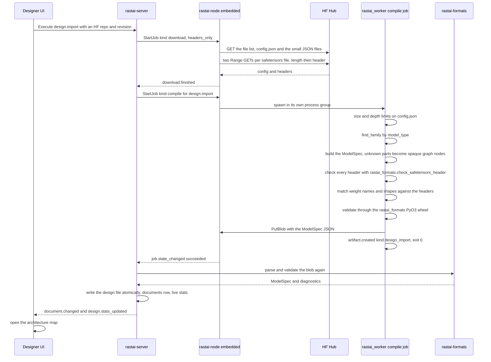

- **Import never downloads weights.** Two HTTP Range requests per safetensors file read the 8-byte length and the JSON header (the in-house HF client in `rastai-node` `downloads.rs`). DeepSeek-V2-Lite (about 31 GB) imports in seconds. Headers are cached as JSON under `<cache>/hf-headers/`; `config.json` and the small JSON files go into the HF cache in its standard layout.
- **Import runs on the embedded node** as job kind `compile` (`rastai_worker/jobs/compile_design.py`, contracts §16 row 13). It needs no GPU and no lease. Local folders, `.pt2` and `.onnx` files skip the download step. A file dropped on a UI that talks to a remote daemon arrives through `PUT /api/blobs` first.
- **The daemon is the only writer of project files.** The job hands back a blob. The daemon parses it again with `rastai-formats` (parse at both ends, contracts §4) and writes `designs/<name>.rrsmodel`.
- **Post-job actions are driven by the indexed event and keyed by `job_id`.** If the daemon crashes between the job's success and the document write, it re-indexes the event after restart and does the write then. Running it twice is harmless.
- **Gated repos:** the node gets the token from `NodeHubService.GetSecret(hf_download)`. A license that isn't accepted fails the download with `RRS-N3005`, whose fix runs `hf.license.check`.

| Failure | What happens | User sees | Persisted |
|---|---|---|---|
| Network drop during the header fetch | The download job retries with backoff, then fails | `RRS-N3009` (download interrupted; retries used up), retry button | Nothing in the project |
| Repo or file missing | Download fails at the file list | `RRS-N3004` | Nothing |
| `config.json` not JSON, too big or too deep | Job fails before mapping | `RRS-E0001` (syntax), `RRS-E5003` (too big) or `RRS-E5004` (too deep) with the path | Nothing |
| Bad safetensors header | `check_safetensors_header` rejects it (one implementation, in `rastai-formats`) | `RRS-E6001` to `RRS-E6017` naming the file and the rule (ADR-0029) | Nothing |
| kill -9 of the import job | Node records the exit by signal; job `failed` | `RRS-J1001` (killed by a signal) | No `.rrsmodel`; a stray draft blob is collected by GC |
| Disk full or permission denied writing the design | Write fails before the rename; the document is unchanged | `RRS-S3002` (disk full) or `RRS-S0004` (not writable) | Draft blob kept; the command can be re-run |

### A1b. Family mapping and opaque nodes

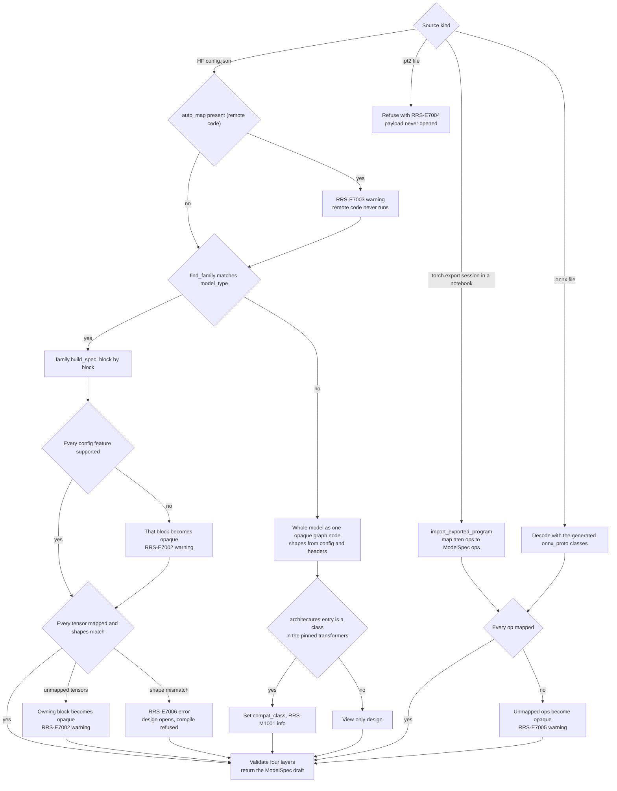

- **Import never fails outright** (spec §11). The only hard stops are unreadable input, the untrusted-import limits (`RRS-E5xxx`), a bad safetensors header and a `.pt2` file.
- **What "opaque" covers:** a config feature the family doesn't support (for example an unknown RoPE scaling type) turns only that block opaque. Unmapped tensors under a block prefix (`model.layers.<i>.`) turn that block opaque; unmapped top-level tensors turn the whole model opaque. The warning lists every tensor it covers. A config with neither `model_type` nor `architectures` takes the whole-model path with `RRS-E7001`.
- **`compat_class`:** every opaque graph node from an HF source gets `opaque.compat_class` = the config's `architectures[0]`, when that class exists in the pinned `transformers`. It means "the compat runtime can run the model that contains this node" (A2b).
- **`.pt2` files are refused.** A `.pt2` archive may hold pickled tensor data, and no loader that never unpickles has been verified yet (`RRS-E7004`; contracts 15.2). `torch.export` graphs come in only from a live session: `importers/torch_export.py` is reached through `import_exported_program` from a notebook, with no file at all. Weights must come as safetensors. The importer never calls `torch.export.load`, which unpickles.
- **ONNX** is decoded with Python classes generated from the vendored `proto/third_party/onnx/onnx.proto` (`importers/onnx_proto/`, protobuf runtime only). The `onnx` package is not imported here; only the export job uses it (A6).

A family is plain data plus a few small methods (`layout/python.md` §2.2), in the style of the spike's name tables:

```python
# python/rastai_models/importers/hf_config.py
def import_hf_config(config: dict, weights_source: str) -> ImportResult:
    report = ImportReport()
    check_import_limits(config, report)
    family = find_family(config)
    if family is None:
        spec = import_as_one_opaque_node(config, weights_source, report)
    else:
        spec = family.build_spec(config)
        mark_unsupported_features_opaque(spec, config, family, report)
        check_weight_names(spec, family, read_cached_headers(weights_source), report)
    return ImportResult(spec=spec, diagnostics=report.diagnostics)
```

**Persisted:**
- Durable: `designs/<name>.rrsmodel` in the project (atomic write); `documents` and `command_journal` rows; a `models` row (model ref, family, license, gated); the import run's `run.json` and `events.log` under `<data>/runs/<run_id>/`; the draft blob (artifact kind `design_import`), kept for lineage.
- Cache (safe to delete): `config.json` and the small files in the HF cache; safetensors headers in `<cache>/hf-headers/`.
- Ephemeral: `job.progress`, `download.progress`, `design.stats_updated`.

**Tests:**
- `python/rastai_models/tests/test_importers.py`: golden tests. Each `fixtures/models/<family>/config.json` produces the expected `.rrsmodel` in `fixtures/documents/model/valid/`. Cases: an unknown `model_type` gives one opaque node with diagnostics, never an exception (plan M6-E04); an unknown RoPE type in a Llama config gives one opaque block; an extra tensor turns its block opaque; `auto_map` gives `RRS-E7003`.
- `fixtures/documents/import/invalid/`: a `.pt2` file (`RRS-E7004`), an oversized config (`RRS-E5003`), the 33-file safetensors corpus (`RRS-E60xx`; Python gets the same verdict as Rust because it calls the wheel).
- Fuzzing: the `json_reader` and `safetensors_header` targets in `rastai-formats` cover this flow's untrusted input (contracts 12.5). ONNX goes through the protobuf runtime, not an in-house parser.
- `crates/rastai-node/tests/headers_only.rs`: against the in-house fake HF server, only Range requests touch weight files.
- `tests/crash/import_kill.rs`: kill -9 the import job, and separately the daemon, at named pause points; no partial `.rrsmodel` ever exists and a re-run completes.

## A2. Compile, load weights and parity check

Runs when the user presses compile or play in the Designer (`design.compile`). `model.load` and `train.start` on a ModelSpec run the same compiler inside their own jobs.

### A2a. Request path

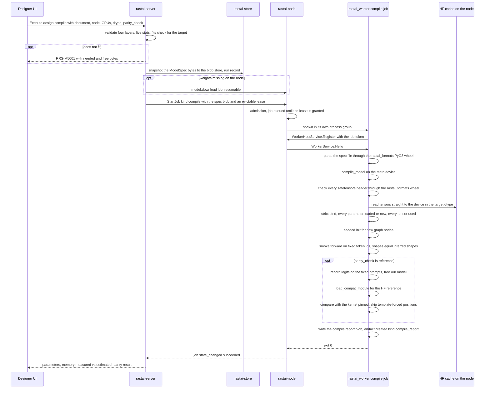

- **Parse at both ends.** The daemon validated the document; the worker parses the same bytes again (`job.json` `resolved_models[...].spec_file`, `layout/python.md` §7.3), so a bad document can't reach the compiler.
- **Meta device first, then straight to the device** (spike `load_model`): no CPU copy of the weights, so peak memory is the model, not twice the model. Python never validates a header itself: `rastai_formats.check_safetensors_header` accepts it first, then Python reads tensor bytes (contracts 2.4 rule 10).
- **Strict bind** (spike `load_state_dict(strict=True)`): every parameter is loaded or explicitly new, and every tensor in the source is used. The rules per graph node are in the table below.
- **`parity_check`** (`DesignCompileArgs`):
  - `smoke` (default): strict bind, smoke forward, finite logits, shapes equal to `rastai-formats` shape inference (`rastai_models/smoke.py`). For a supported family the report also shows the family's CI parity record (version, tolerances, date).
  - `reference`: also runs the HF reference through the compat runtime and applies the ADR-0013 criteria (fp32: max |Δlogit| ≤ 0.005, mean KL ≤ 10⁻⁶, top-1 100%; bf16: our drift from fp32 ≤ 1.25× the reference's own), with the attention kernel pinned and template-forced positions skipped (spike 01b). Our model is freed first, so peak memory is the larger model, not the sum. Needs the `compat` dependency group in the node's environment; without it the check is skipped with `RRS-M3003`.
  - `off`: bind and smoke shapes only, for huge models where the forward pass is the expensive part.
- **Stats parity.** The report compares the compiled parameter count with the daemon's `compute_design_stats` (`RRS-M0003` if they differ, which is a stats bug) and the measured peak memory with `estimate_memory_bytes`. The measured numbers are kept so ADR-0010's lease estimates can be corrected.
- **Per-op golden fixtures.** Shapes, parameter counts and FLOPs are checked one op at a time before any whole design. Every op has one `fixtures/ops/<op>.json` (input shapes and attributes in; output shapes, parameter count and FLOPs per token out). Rust `compute_design_stats` and the Python compiler must both match it (contracts 2.4 rule 10), so a disagreement between live stats and the compiler shows up on one op, with its name, long before `RRS-M0003`.

**Where each graph node's weights come from**

| Graph node | Weights |
|---|---|
| In a `weights[]` entry's `name_mapping` | The named tensor in that entry's `source` (`hf:`, `blob:` or `ckpt:` model ref), through `Family.parameter_name` and `convert_tensor` |
| New: heads, from-scratch designs | Seeded init per op (`init_weights`); the seed is in the run record |
| `train_mode: lora` | Base from the source; LoRA `compress` random, `expand` zero, float32 master weights (spike `lora.py`) |
| Opaque with `compat_class` | The compat runtime (A2b) |
| Placeholder for a missing plugin node type | None: compile refused with `RRS-E3001` (plugin not installed) and a `plugin.suggest` fix |

```python
# python/rastai_models/compiler/compile.py and compiler/weights.py
def compile_model(spec: ModelSpec, device: str, dtype: torch.dtype) -> CompiledModel: ...
def bind_weights(model: CompiledModel, spec: ModelSpec, weight_files: list[SafetensorsFile], family: Family | None) -> BindReport: ...
def smoke_forward(model: CompiledModel, spec: ModelSpec) -> SmokeResult: ...
```

| Failure | What happens | User sees | Persisted |
|---|---|---|---|
| Lease not available | Job stays `queued` with the holder named; `job.cancel` gives `cancelled` | "Waiting for GPU n" | Run record |
| No `Register` within 60 s | `starting → failed` | `RRS-J0002` | Run record, `stderr.log` |
| CUDA OOM while loading | The worker catches it and names the graph node it was loading | `RRS-H3006` (out of GPU memory while loading) with the lease size | Run record; lease released |
| kill -9 or crash | The node records the exit cause and releases the lease | `RRS-J1001` (killed by a signal) | `events.log` up to the last fsync |
| Missing, unused or mis-shaped tensors | Bind stops before any forward | `RRS-M2002` / `RRS-M2003` / `RRS-M2004` with the first 20 names and a count | Report blob |
| Non-finite logits | Smoke forward fails | `RRS-M3001` | Report blob |
| Smoke shape differs from `rastai-formats` shape inference | A compiler or shape-inference bug; the job fails with both shapes | `RRS-M0002` | Report blob |
| Reference parity out of tolerance | The report marks the family unverified for this model | `RRS-M3002` with the worst position and delta | Report blob |

### A2b. Runtime choice

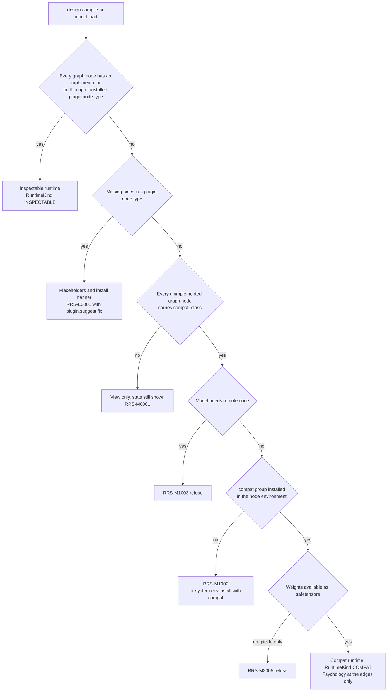

- The compat runtime runs the **whole model** in `transformers`, even when only one block is opaque. The ModelSpec map still shows the known structure for navigation.
- **No pickle, no remote code and no Hub access in the compat path.** `rastai_models/compat/transformers_runtime.py` is the only `transformers` import. `load_compat_module` loads from the local model folder with `use_safetensors=True`, `trust_remote_code=False` and `local_files_only=True`, so the pickle `.bin` loader and downloads are unreachable. CI greps the file for `torch.load`.
- `transformers` is an optional `compat` dependency group in each backend lockfile, installed by `system.env.install`, never at runtime.

**Persisted:**
- Durable: the ModelSpec snapshot blob (referenced from the run record as `<id>@<content_hash>`); the compile run's `run.json` and `events.log`; the report blob (artifact kind `compile_report`).
- Node memory only: the lease, released on job exit.

**Tests:**
- `tests/parity/` per family, fp32 and bf16, tiny random configs in CI and real weights nightly (ADR-0013).
- `tests/parity/test_stats_parity.py`: for every template in `templates/designs/` and every family fixture, `compute_design_stats` equals the compiled parameter count exactly, and the memory estimate is within a stated margin of the measured peak.
- `python/rastai_models/tests/test_op_fixtures.py`: for every op, the compiler's output shapes, parameter count and FLOPs equal `fixtures/ops/<op>.json`, the same files `crates/rastai-server/tests/modelspec_stats.rs` checks.
- `python/rastai_models/tests/test_bind.py`: missing, unused and mis-shaped tensors give `RRS-M2002`–`M2004`; LoRA init matches the spike.
- `python/rastai_models/tests/test_compat_runtime.py`: a fixture repo with only a `.bin` file is refused (`RRS-M2005`); `auto_map` is refused (`RRS-M1003`).
- `tests/crash/compile_kill.rs`: kill -9 during weight loading; the lease is released and the job ends `failed` with `RRS-J1001`.

## A3. Design edit, validation and live stats

Runs on every accepted change on the canvas: a drop, a connect, an attribute commit, a train-mode toggle, and every `document.undo` / `document.redo`. The user triggers it; `canvas/edit-gestures.js` turns gestures into `design.edit` operations.

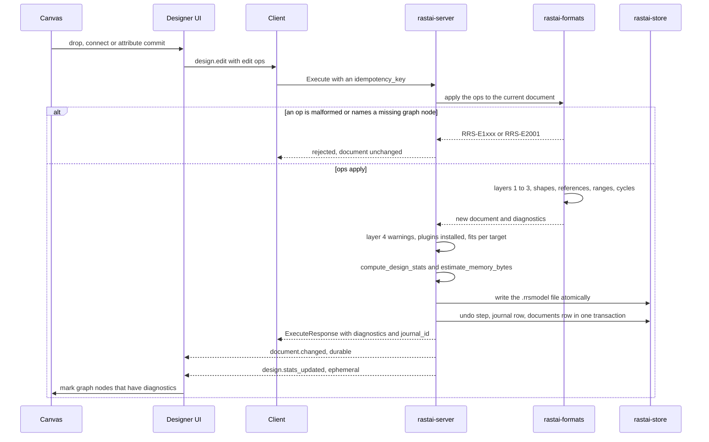

Legend: CV = `@rastai/canvas` (`DesignCanvas.jsx`); UI = the Designer section in `apps/web`; CL = the `CommandExecutor` the section holds (`@rastai/client`), called through the generated wrapper `designEdit(executor, args)`.

- **Nothing crosses the network per frame.** Dragging, panning and zooming are local to `@rastai/canvas`. One `design.edit` goes out on drop; attribute fields send on commit (Enter or blur), not per keystroke. A move writes the graph node's `layout{x, y, collapsed}` (contracts 5.2).
- **Meaning errors don't block an edit.** A shape mismatch (`RRS-E2002`) or an unconnected input is a diagnostic on the saved document, because users pass through invalid states while building. Only ops that can't be applied at all (unknown op, missing graph node, bad JSON Patch) are rejected.
- **Autosave on every accepted edit.** There is no unsaved state.
- **Missing plugin node types:** a file whose header `requires` plugins that aren't installed opens with placeholder graph nodes (shapes known) and the banner "Install N plugins (permissions: ...)", backed by `plugin.suggest` (platform 7.4). Other graph nodes stay editable; compile is refused (A2b).
- **Multi-input designs:** overlapping input-map ranges (`RRS-E2004`) and a fusion node with mismatched inputs (`RRS-E2002`) are layer-3 errors.
- **Blocks and the composer use this same pipeline.** `design.block.define` turns a selection into an entry in `blocks{}` plus `block` instances. Dropping a pretrained backbone (the pretrained-block composer) runs the A1 mapping for that model and inserts it as a `block` instance with its own `train_mode`; its weights bind through its own `weights[]` entry (one entry per pretrained part, so a design can compose several).
- **Basic mode:** a text-generation goal on a from-scratch design shows a notice steering toward fine-tuning an import, with the reason (spec §11). It doesn't block anything.
- **The canvas holds no domain logic** (contracts 2.4 rule 9). Shapes, stats, fits, validation and placement all come from the daemon as commands and events; the section keeps only view state (selection, drafts, zoom, open panels). So the CLI and MCP get the same results.
- **Theme and colors.** Diagnostic marks and node colors come from theme tokens through `canvasColors(tokens)`. Error and warning severity colors are locked tokens no theme can change. A theme switch calls `setColors()` on the `GraphRenderer`; it never recreates the WebGL context.

```js
// apps/web/src/sections/designer/canvas/edit-gestures.js
import { designEdit } from "@rastai/plugin"; // generated wrapper, re-exported by the SDK

/**
 * Send one accepted canvas gesture as one design.edit call.
 * Field names here are illustrative; DesignEditArgs in contracts 6.5 is the source.
 * @param {CommandExecutor} host  the PluginHost from usePluginHost()
 * @param {string} documentId
 * @param {object} operation  one edit op, for example a move that writes layout{x, y}
 * @returns {Promise<object[]>}  the diagnostics of the new document
 */
export async function sendEdit(host, documentId, operation) {
  const outcome = await designEdit(host, { document_id: documentId, operations: [operation] });
  return outcome.diagnostics;
}
```

**Live stats** (`design.stats`, also pushed as `design.stats_updated`). `rastai-server` `modelspec_analysis/` computes them from `rastai-formats` shape inference. Target: under 50 ms for a 1,000-node design. Per-op shapes, parameter counts and FLOPs come from the golden files `fixtures/ops/<op>.json`, which the Python compiler must also match (A2).

| Stat | How it's computed |
|---|---|
| Parameters | Sum of weight shapes; `repeat` multiplies; MoE shows total and active (top-k plus shared experts) |
| Weight bytes | Parameters × dtype bytes; LoRA master weights at float32 |
| FLOPs per token | 2 × active matmul parameters, plus the attention term over the context (sliding layers use their window) |
| Memory for batch × sequence | Weights + KV cache (MLA stores the latent; sliding layers store the window) + training activations with checkpointing + gradients and optimizer state for trainable graph nodes. Each term is shown separately |
| Fits per target | For each connected node and GPU set: memory ≤ VRAM − `compute.vram_reserve_bytes`. "Fits now" also subtracts pinned leases; evictable leases show as "fits if chat is unloaded" |
| Time per target | Training FLOPs ÷ (GPUs × peak FLOPS × MFU). MFU comes from past run records on that GPU, else a default marked as a guess |
| Layer placement | For two or more GPUs, the result carries the map from `plan_layer_placement` (A8). It is computed here only; Python applies it |
| Data warning | For from-scratch objectives, parameters greater than dataset tokens gives a layer-4 warning (`RRS-E3003`, contracts 10.3; its message and fix text are settled by M6-E02, contracts §14 row 22) |
| Shape errors | The layer-3 diagnostics, with graph node paths |

**Versions and diff**
- The file is written with sorted keys, 2-space indent, graph nodes sorted by `node_id` and edges by endpoints, so `git diff` is line-based and stable.
- `content_hash` is updated on every write; `id` never changes.
- Every compile, train and export snapshots the exact bytes into the blob store. The run record and the artifact catalog point at `<id>@<content_hash>`, so every trained model traces back to the exact design version.
- `design.diff` takes two refs (a path, a blob, or `<id>@<hash>`) and returns a structural diff: graph nodes added and removed, attributes changed, edges changed (`diff/DesignDiff.jsx`).
- `document.undo` applies the stored inverse JSON Patch through this same pipeline (platform 3.4), so validation, stats and the file write all run again.
- "Save to a remote server" (spec §11) means the project lives on a headless daemon's machine (C8). The pipeline is the same; only the daemon is elsewhere.

**Persisted:**
- Durable: the `.rrsmodel` file (temp file, fsync, rename); `undo_steps`, `command_journal` and `documents` rows, committed together on the `rastai.db` writer thread after the file rename.
- Ephemeral: `design.stats_updated`.
- Crash between the file rename and the database commit: at the next open the daemon compares the file hash with `documents.content_hash`. The file wins, and the undo stack is cut back to the last consistent step.
- A file changed outside Rastai (git checkout, a text editor) is detected the same way at the next edit: the document reloads and the undo history resets (`RRS-C2002`).
- Write failures (permission denied, disk full) leave the file and the undo stack unchanged and return `RRS-S0004` or `RRS-S3002`.

**Tests:**
- `crates/rastai-server/tests/design_edit.rs`: every edit op; malformed ops are rejected with nothing written; undo and redo round-trip to identical bytes.
- `tests/crash/design_edit_kill.rs`: kill -9 the daemon in a loop of edits; after restart the file is always a valid document and matches the database or is newer.
- `crates/rastai-server/tests/modelspec_stats.rs`: stats for every template against hand-computed values; every `fixtures/ops/<op>.json` matches `compute_design_stats`; a 1,000-node design under 50 ms.
- `tests/e2e/designer.spec.js` (Playwright): drag, connect, see the shape error and the stats update, undo.

## A4. Play button: compile then train

Runs when the user presses play on a design (`actions/CompileAndTrain.jsx`). It chains existing commands; no new work happens in the daemon.

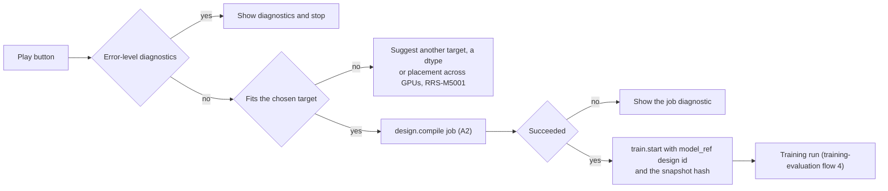

- The compile job is a fast check. The train job compiles again in its own process, which is cheap on the meta device and keeps jobs independent.
- `train.start` uses `model_ref = design:<document_id>` and records the snapshot `<id>@<content_hash>` in the run record, so later edits never change what a run trained.

**Persisted:** the design snapshot blob, the compile run and the training run records. **Tests:** `tests/loop/` (design → train → eval → ONNX export → re-import, CPU, under 10 minutes, spec §29); `tests/e2e/designer.spec.js` second half (design → train → ONNX export from the UI, the §32 week-13 exit).

## A5. Eject to PyTorch

Runs when the user picks "Export to PyTorch" (`design.eject`, `actions/EjectDialog.jsx`). The output is readable PyTorch source plus safetensors with no `rastai` import (spec §11).

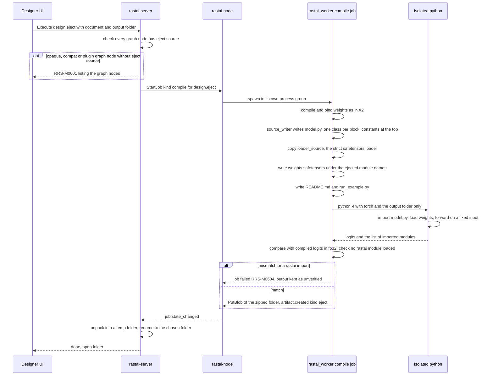

- **Ejected code follows the house style:** constants at the top, readable names (`embedding_size`), one small function or class per op, comments that say why, a thin `main` in `run_example.py`. It passes the same Python lints as our own code.
- **Torch only.** The output carries its own small safetensors loader (`eject/loader_source.py`), so the user needs nothing but PyTorch.
- **The check runs in a separate interpreter** (`python -I`, empty `PYTHONPATH` except the output folder) and fails if any module starting with `rastai` was imported.
- The job runs on the node that holds the weights. From a remote node the zip comes back as a blob through C7.

**Persisted:** the zipped output as a blob (artifact kind `eject`) with lineage to the design snapshot; the unpacked folder at the user's path. **Tests:** `python/rastai_models/tests/test_eject.py` (every template and family fixture; logits equal in fp32 in a subprocess with only `torch`); `tests/crash/eject_kill.rs` (kill -9 leaves no folder at the destination).

## A6. ONNX export

Runs when the user exports a design to ONNX (`design.export_onnx`) and in the CI loop test.

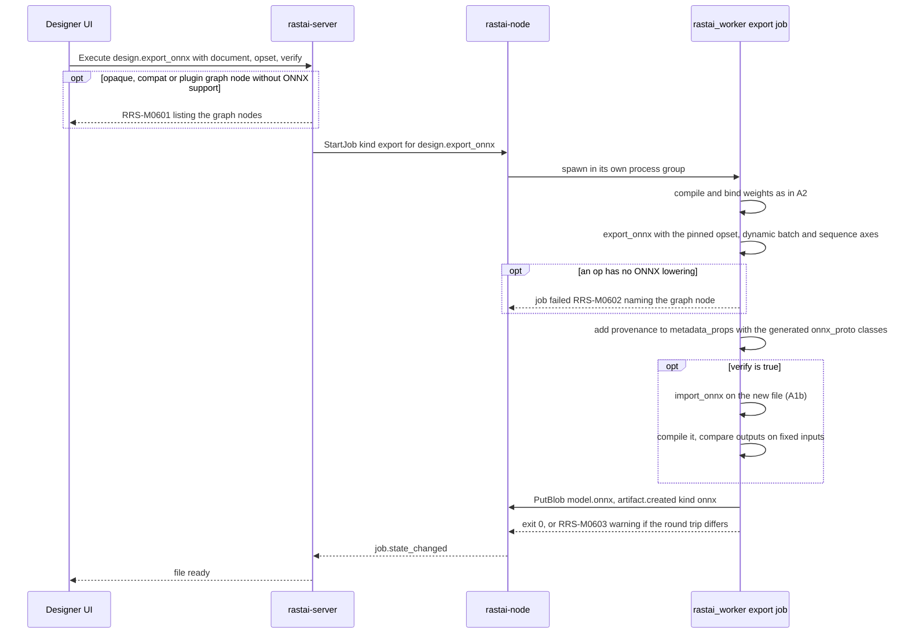

- **The round trip is in-house.** Running ONNX would need onnxruntime, which isn't allowed. Instead the export is re-imported through our own ONNX importer and compiled, which checks the exporter and the importer at once. `verify` defaults to true.
- **Provenance** (spec §13): `metadata_props` gets the provenance keys of contracts 15.5, including `rastai.derived_from` (the design `<id>@<content_hash>`) and `rastai.created_with` (the "Made with Rastai, open recipe" pointer).
- A round-trip mismatch is a warning: the file is kept and labeled unverified.
- `rastai_models/onnx_export.py` is the only `torch.onnx` import. The exporter imports the `onnx` and `onnxscript` packages; both are on the §27 allowlist under the `torch.onnx` row and are used only by `export` jobs (contracts 2.5).

**Persisted:** `model.onnx` as a blob (artifact kind `onnx`) with lineage. **Tests:** `tests/loop/` (export → re-import → outputs match); `python/rastai_models/tests/test_onnx_roundtrip.py` per template.

## A7. rastai.load() in plain Python

Runs when a user calls `rastai.load("x.rrsmodel")` in a notebook or script, with no app required (spec §11, `pip install rastai`).

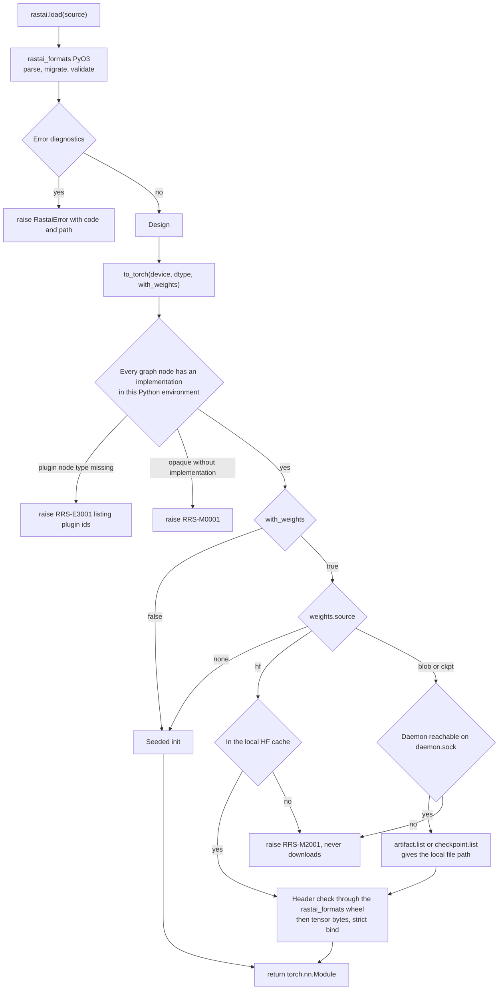

- **Same code as the app:** parsing is the `rastai-formats` PyO3 wheel; compiling is `rastai_models`. A design that compiles in the app compiles here.
- **Files from a newer schema version** open read-only in the app (§23); here they load if every field is understood, else the SDK raises `RRS-E1003` (unknown field).
- **The SDK never downloads.** `RRS-M2001`'s fix text names `rastai model download` and `hf download`. The HF cache is found the same way as in the app (`$HF_HUB_CACHE`, then `$HF_HOME/hub`, then `~/.cache/huggingface/hub`). `blob:` and `ckpt:` sources are asked of a running daemon through `rastai.connect()`; the SDK never reads the data directory on its own.
- **No second header validator.** `rastai_models/io/safetensors_reader.py` calls `rastai_formats.check_safetensors_header` and reads tensor bytes only after it accepts the header, so `RRS-E60xx` means the same thing here and in the app.
- **Several GPUs:** `to_torch` puts the model on one device. If the file's `placement{}` is set, it is applied with `apply_placement`; the SDK never plans a split (A8).
- The returned module is a standard `nn.Module` whose classes live in `rastai_models`. Observation hooks are off; `rastai.observe(model)` turns them on. Eject (A5) is the path with no `rastai` import at all.

```python
# python/rastai/load.py (layout/python.md §8.2)
def load(source: str | Path) -> Design: ...      # a .rrsmodel path or a model ref ("hf:google/gemma-3-1b-it@main")

class Design:
    spec: ModelSpec                                # generated dataclass from rastai_formats
    def to_torch(self, device: str = "cpu", dtype: str = "float32", with_weights: bool = True) -> torch.nn.Module: ...
    def parameter_count(self) -> int: ...
```

**Persisted:** nothing. **Tests:** `python/rastai/tests/test_load.py`, run with no daemon, `HF_HUB_OFFLINE=1` and no network: every template; a tiny family config with weights in a temporary HF cache; a missing-plugin design (`RRS-E3001`); a missing-weights design (`RRS-M2001`); the result equals the app's compiled logits.

## A8. Models bigger than one GPU: layer placement

Runs when `model.load`, `design.compile` or `train.start` targets two or more GPUs, or when live stats show the model only fits across GPUs (spec §17: DeepSeek-V2-Lite, about 31 GB in bf16, across the 5080 and the 3090).

### A8a. Placement planner

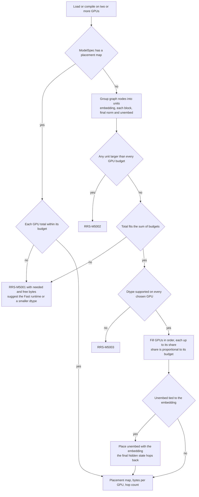

- **One owner: the Rust planner.** `plan_layer_placement` in `rastai-server` is the only code that plans placement (contracts 2.4 rule 10). The node needs bytes per GPU to grant leases before the worker starts, and the daemon already has per-graph-node memory from live stats and each node's `HardwareProfile`. The result is written into the ModelSpec `placement{}` field of the job's spec snapshot. Python has `rastai_models.apply_placement` and nothing else: it reads `placement{}` and puts each unit on its device. There is no Python planner and no parity test between two planners.
- **`rastai.load()` without a daemon** applies the `placement{}` it finds in the file, or uses one device when the field is empty. To split a model in a notebook, ask a running daemon for the plan (`design.stats` returns it) and keep it in the file.
- **The plan is plain data:** `placement{graph_node_id: gpu_index}`, the ModelSpec field of contracts 5.2. It travels in the job's spec snapshot.
- **Budget per GPU** = VRAM − `compute.vram_reserve_bytes` − pinned leases. Evictable leases count as free, and the UI says which model would be unloaded (ADR-0010).
- **Units never split a block.** A unit's memory includes its share of the KV cache for the configured batch and sequence length.
- **GPU order** follows `compute.gpu_assignment`, else index order. Proportional fill keeps hops to one per GPU boundary.
- A map already in `placement{}` (kept from an earlier plan, or edited by hand) is checked against the budgets and never rewritten. Over budget gives `RRS-M5001`.

```rust
// crates/rastai-server/src/modelspec_analysis/layer_placement.rs
pub struct PlacementUnit {
    pub graph_node_ids: Vec<String>,
    pub memory_bytes: u64,
    pub tied_to_embedding: bool,
}

pub struct GpuBudget {
    pub gpu_index: u32,
    pub free_bytes: u64,
}

pub fn plan_layer_placement(units: &[PlacementUnit], gpus: &[GpuBudget]) -> Result<LayerPlacement, Vec<Diagnostic>> {
    check_every_unit_fits_some_gpu(units, gpus)?;
    check_total_fits(units, gpus)?;
    let shares = share_per_gpu(units, gpus);
    let placement = fill_in_order(units, gpus, &shares);
    Ok(keep_tied_unembed_with_embedding(placement, units))
}
```

### A8b. Loading across the 5080 and the 3090

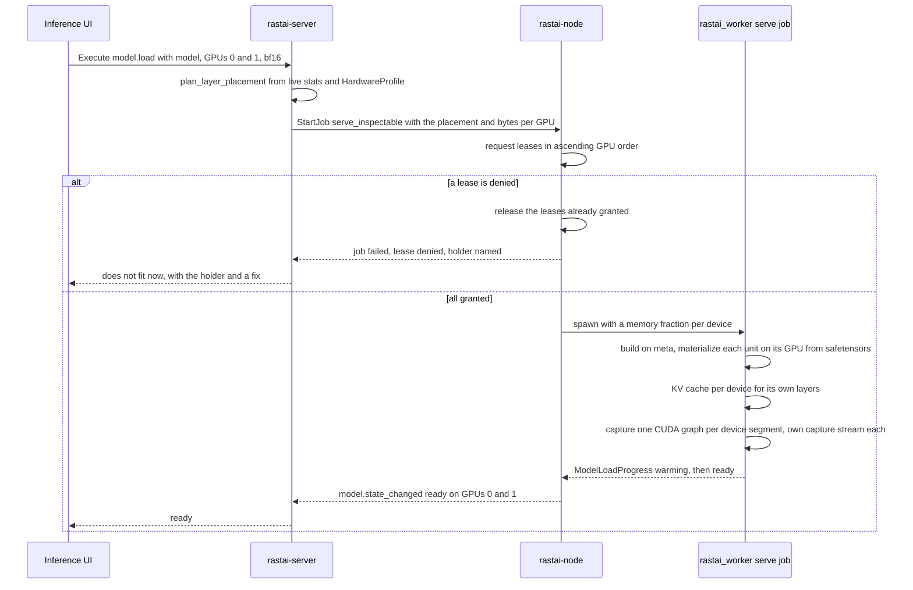

- **All or nothing, in ascending order.** Leases are requested in GPU index order so two multi-GPU loads can't deadlock. If one is denied, the granted ones are released at once. Interactive loads fail fast with `RRS-H3001` (not enough GPU memory for this lease, holders listed); training jobs wait in `queued`. Training-evaluation flow 4.4 grants one `PINNED` lease per GPU; a placed model sends one size per GPU in `ResourceRequest.vram_bytes_per_gpu`.
- **Decode across devices:** one static-shape CUDA graph per device segment, each captured on its own stream (spike 02: the default capture stream broke the second GPU). Between segments the hidden state is copied into the next segment's static input buffer, outside the graphs (`layout/python.md` §2.3). The 5080 and the 3090 have no NVLink, but one token's hidden state is a few KB. A capture failure falls back to eager decode with `RRS-M4001` (warning), never a failed load.
- **Training a placed model:** LoRA and freezing work unchanged, because autograd follows the devices and optimizer state lives with its parameters. Gradient checkpointing runs per segment. DDP and FSDP2 are a different path, for models that fit on each GPU (spec §10).
- **OOM while materializing a unit:** `RRS-M5004` names the GPU and the unit, both leases are released, and the model goes `failed → unloaded`.
- **A GPU disappears mid-run** (driver reset): the worker crashes, the job fails with `RRS-J1001` (killed by a signal) or the worker's own crash diagnostic, and the node releases every lease of the job.

**Persisted:**
- Durable: the placement map in the job's spec snapshot and run record; `model.state_changed` and `lease.state_changed` events; a hand-set placement in the ModelSpec if the user saved one.
- Node memory: the leases (also in every `Heartbeat` and in `job.json` `granted_leases[]` for reattach).

**Tests:**
- `crates/rastai-server/tests/layer_placement.rs`: table tests on fake GPUs (16 GB + 24 GB with the DeepSeek-V2-Lite config; tied embeddings; a unit too big; a dtype gap; a hand-set map over budget).
- `python/rastai_models/tests/test_placement.py` (CPU CI): `apply_placement` with a map splits a tiny config across two `cpu` devices and gives logits identical to the unsplit model; an empty map puts everything on one device; a test greps that no planning code exists in `rastai_models`.
- `tests/gpu/test_placement_two_gpus.py` (nightly): a tiny config split across `cuda:0` and `cuda:1` matches the single-GPU run within the ADR-0013 fp32 tolerance; real-weight DeepSeek-V2-Lite parity on both GPUs (ADR-0021, plan M6-E09).
- `tests/crash/placement_kill.rs`: kill -9 during loading releases both leases.

---

# Part B: Agent Gym

The gym trains a policy by RL on agent tasks. Rollouts run in sandboxes on the node next to the model; only traces and rewards travel back to the daemon. Gym training is Linux only for now (spec §0.6). The engine is `rastai_rl` inside a `gym` job (`rastai_worker/jobs/gym.py`); sandboxes belong to `rastai-sandbox` in the node (ADR-0031).

## B1. Harness editing and import

Runs when the user edits a harness (`harness.edit`, `harness.tool.toggle`), imports one (`harness.import`) or imports Harbor tasks (`gym.task.import`), from `harness/HarnessEditor.jsx`, `harness/HarnessImport.jsx` and `tasks/TaskImport.jsx`.

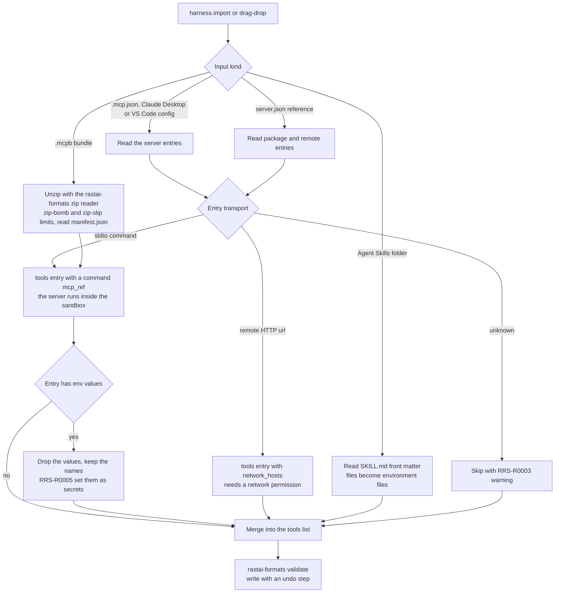

- **Stdio MCP servers run inside the sandbox,** so their side effects stay contained. `.mcpb` bundles are copied into the sandbox as environment files. The image must carry the runtime the server needs; B2's preflight checks it.
- **Remote HTTP MCP servers are network permissions, not sandboxed tools** (spec §12). The node's `rastai-mcp` client calls them over HTTPS, only for hosts in `network_hosts`, and only after the user confirms the host list at `gym.start`. They show as network permissions in `harness/ToolList.jsx`.
- **Secrets never enter a harness.** MCP configs often carry API keys in `env`. The importer keeps the key names (`tools[].env_secret_names`), drops the values, and asks the user to store them with `secret.set`. At sandbox creation the node fetches them through `NodeHubService.GetSecret` (purpose `harness:<name>`) and passes them as container environment variables.
- **Harbor tasks are data.** `gym.task.import` runs as job kind `data_import` (`rastai_rl.import_harbor_tasks`): task folders become `tasks[]` and `task_sources[]`, `task.toml` is read with the standard library, and solution scripts are kept out of anything the policy sees. A folder missing a required file is skipped with `RRS-R0004`.
- **Images are never built.** `rastai-sandbox` never builds images (`layout/rust-node-gateway-proto.md` §5.6) and pulls only images the harness names (ADR-0031). A Harbor task that names a prebuilt image uses it. A task that has only a Dockerfile imports with `RRS-R0006`, whose fix text is the `podman build` / `docker build` command and the `environment.image` to set (see [open question 9](#open-questions)).
- Editing (`harness.edit`, `harness.tool.toggle`) uses the A3 document pipeline: validate, atomic write, undo step, `document.changed`.

**Persisted:** the `.rrsharness` file in `harnesses/` with undo steps; secrets in the OS keychain only; Harbor task folders as blobs referenced from `task_sources[]`. **Tests:** `crates/rastai-formats/tests/harness_import.rs` with fixtures for each input kind (`fixtures/harness-import/`) and the expected `.rrsharness` output, both ways (plan M7-E02); a test that no `env` value appears in any output; zip-slip and zip-bomb `.mcpb` fixtures rejected with `RRS-E5001` and `RRS-E5002` (the zip reader inflates through `miniz_oxide`, and the `zip_reader`, `inflate` and `json_reader` fuzz targets in `rastai-formats` cover these inputs); `python/rastai_rl/tests/test_harbor_import.py` (solutions excluded, Dockerfile-only tasks give `RRS-R0006`).

## B2. Gym run start and preflight

Runs when the user starts training an agent (`gym.start` from `runs/GymRunForm.jsx`: harness, base model, recipe GRPO, GSPO or PPO, group size, target node). Preflight fails fast, before the GPU work starts.

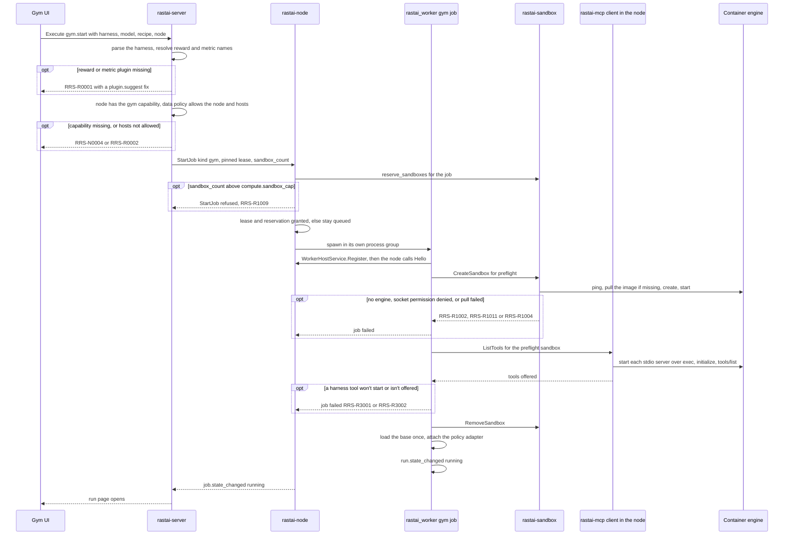

- **Daemon-side checks are free:** names resolve against the plugin registry (engines never import plugins, contracts §2.4 rule 6; metric ids are namespaced, for example `eval.pass_at_k`, contracts 15.7). The `gym` capability comes from the handshake (C3). The base model's family must have a tool-call format, else `RRS-G0007` (tool calls not supported for this model family).
- **Node-side admission is all or nothing** (`layout/rust-node-gateway-proto.md` §5.3): the job asks for `sandbox_count` slots at `StartJob`. More than `compute.sandbox_cap` is refused at once (`RRS-R1009`). Busy slots (`RRS-R1001`) or too little free RAM for the sandboxes' caps (`RRS-R1008`) keep the job `queued` with that reason, so a run never fails halfway through a group.
- **One throwaway sandbox proves the real setup** before the model loads: the image, the caps, the tool servers and `tools/list`.
- **Memory layout** follows ADR-0022: one base model, the `policy` adapter on for rollouts and updates, all adapters off for the reference, a value head for PPO, a `reward` adapter when the reward is a reward model on the same base. A reward model on a different base loads as a second model, and the plan shows the extra memory.
- **GSPO is the default** when the policy contains a `moe` graph node (ADR-0021, training-evaluation flow 11.4: `ratio_level` `sequence`).

**Persisted:** the run record (harness `<id>@<content_hash>`, recipe and settings, base model hash, seed, hardware fingerprint); `run.state_changed` and `job.state_changed` events; the sandbox reservation in node memory only. **Tests:** `tests/loop/test_gym_preflight.py` with a tiny pinned image: missing engine socket (`RRS-R1002`), a socket without permission (`RRS-R1011`), a tool server that exits at once (`RRS-R3001`), a tool not offered (`RRS-R3002`), a missing reward plugin (`RRS-R0001`), `sandbox_count` above the cap (`RRS-R1009`), each failing before the model loads.

## B3. One RL iteration: rollouts, rewards, advantages, update

Runs in a loop inside the gym job after preflight (`rastai_rl.run_rl_training`), until the step budget is spent or the user stops it.

### B3a. Rollouts through the gateway in sandboxes

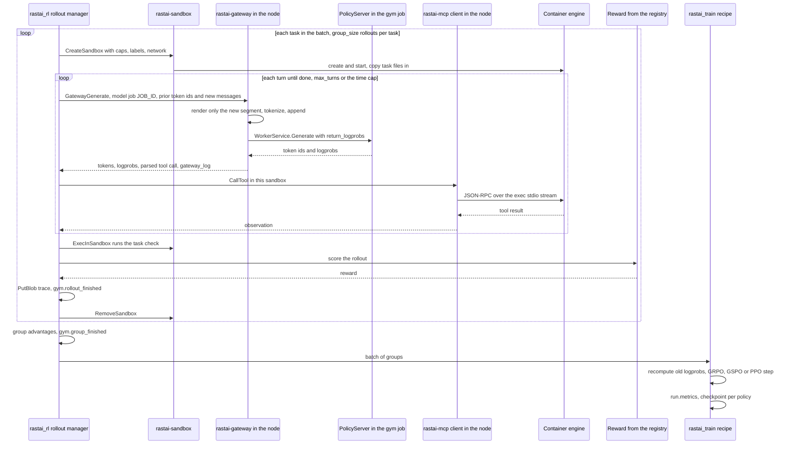

Legend: RL = `rollout_manager.py` and `agent_loop.py`; POL = `policy_server.py`, which answers `WorkerService.Generate` for the model ref `job:<job_id>` on the job's model thread; REW = a reward function, an Evaluation metric or the reward adapter, found by name in the `rastai_plugin` registry (`rewards.py`).

- **Rollouts go through the gateway** (spec §12). The node gateway (`layout/rust-node-gateway-proto.md` §6.6) renders the chat template, tokenizes, parses tool calls, and calls back into the gym job's own policy. All token IDs come from one source (ADR-0008). There is no second copy of the model.
- **Token IDs never round-trip through text.** The rollout keeps its token list. Each turn the gateway renders only the new segment (tool result plus the next assistant header) from `GatewayGenerateRequest.prior_token_ids` and appends its IDs; generated tokens are never re-encoded. A template that can't render a segment on its own fails with `RRS-G1002` (chat template error).
- **One writer per log.** The node gateway returns its log record as `GenerateFinished.gateway_log`; the job appends `gateway.request_logged` and puts long token lists into the rollout's trace blob. The node never writes the run's `events.log`.
- **Concurrency:** up to `sandbox_count` rollouts run at once. At L1 the policy server decodes one request at a time; batched decode across a group's rollouts is the L2 step (`layout/python.md` §6.3).
- **Tools:** `WorkerHostService.CallTool` reaches the node's `gym_tools.rs`, which runs the harness's stdio MCP servers inside the rollout's sandbox through `exec` and connects `rastai-mcp`'s client to them. A tool result with `is_error` is an observation for the agent. A tool server that crashes is restarted once; a second crash makes the rollout an infra failure (`RRS-R3003`).
- **Old log-probs are recomputed** by the training forward before the first update of a batch. The gateway's log-probs come from the CUDA-graph decode path with different kernels; they're kept in the trace and their gap is logged as the metric `logprob_mismatch_mean`.
- **Rewards share one definition with Evaluation** (spec §12). `harness.reward.kind` picks a `metric` (for example `eval.pass_at_k` or a judge), a `reward_function`, or a `reward_model`. Judges on local models go through `WorkerHostService.GatewayGenerate`; API judges go through `NodeHubService.GatewayGenerate` and need `gateway.spend` and a data policy that allows it. The judge's prompt and verdict go into the trace.
- **Pass@k comes from the same groups:** with n valid samples and c passes per task, the unbiased estimator is logged as `run.metrics` (`pass_at_1`, `pass_at_k`). Evaluation's own Pass@k runs through the same sandbox manager (training-evaluation flow 9.4).

### B3b. Rewards and group advantages

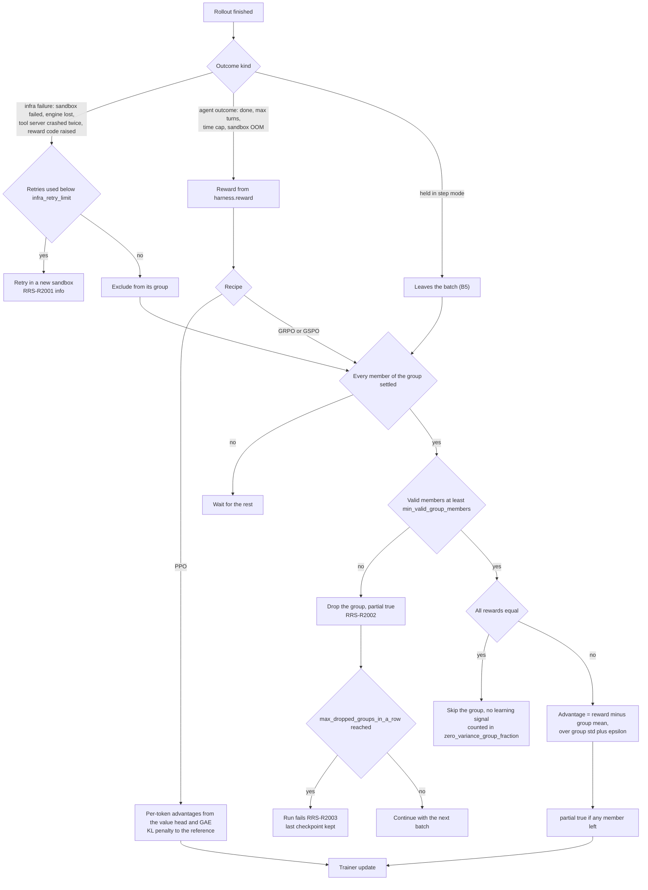

- **Infra failures are not rewards.** Scoring a broken sandbox as 0 would teach the policy that the task is hard. Infra failures are retried, then excluded: a sandbox that failed to start (`RRS-R1004` pull failed, `RRS-R1005` exited at start), a lost engine (`RRS-R1013`), a tool server that crashed twice (`RRS-R3003`), and reward code that raised (`RRS-R2004`, traceback in `stderr.log`). Agent outcomes, including running out of time (`RRS-R1006`) or memory (`RRS-R1012`) inside the sandbox, are real results and get scored. `layout/python.md` §6.3 states the same rule: a failed sandbox is never scored as 0.
- **GSPO uses the same group advantages** as GRPO; it differs in the trainer step, where the importance ratio and clipping are per sequence (training-evaluation flow 11.4).
- **All-equal rewards** carry no signal, so the group is skipped (training-evaluation flow 11.4). The fraction is logged as `zero_variance_group_fraction`, because a high value means the tasks are too easy or too hard.
- Defaults (recipe settings, overridable in `gym.start`): `group_size` 8, `max_turns` 32, `infra_retry_limit` 1, `min_valid_group_members` 2, `max_dropped_groups_in_a_row` 3.

```python
# python/rastai_rl/advantages.py
GROUP_ADVANTAGE_EPSILON = 1e-6  # keeps a near-uniform group from dividing by almost zero


def group_advantages(rewards: list[float]) -> list[float]:
    """GRPO and GSPO: each reward relative to its own group. Callers pass valid members only."""
    mean = sum(rewards) / len(rewards)
    spread = population_standard_deviation(rewards, mean)
    return [(reward - mean) / (spread + GROUP_ADVANTAGE_EPSILON) for reward in rewards]
```

**Persisted:**
- Durable, in the run's `events.log` on the node: `gym.rollout_finished` (rollout id, group id, reward, outcome, `policy_step`, trace `BlobRef`), `gym.group_finished` (advantages, partial flag), `gateway.request_logged`, `run.metrics`, `checkpoint.saved`.
- Blob store on the node: one trace per rollout (artifact kind `rollout_trace`: messages, token IDs, log-probs, tool calls and results, judge verdicts). The daemon fetches a trace on demand (C7); Psychology opens it as a replay (B9).
- Checkpoints: the policy adapter, the value head (PPO), optimizer state and `resume.json` with `recipe_state` (task cursor, group index, KL coefficient).
- Ephemeral: `gym.peek_step`, `job.progress`.

**Tests:**
- `python/rastai_rl/tests/test_advantages.py`: known rewards to known advantages; excluded members; all-equal rewards skip the group, never NaN; a group below `min_valid_group_members`.
- `python/rastai_rl/tests/test_token_append.py`: a multi-turn rollout's token list equals the concatenation of generated and appended segments, never a re-tokenization.
- `python/rastai_rl/tests/test_infra_failure.py`: a fake host that fails one sandbox; the rollout is retried, then excluded, and never scored.
- `tests/loop/test_gym_cpu.py` (CI with Docker): a tiny random-weight policy, two tasks, group size 4, two GRPO updates and one GSPO update; checks the events, the trace blobs and that no labeled container is left (plan M7-E03).

## B4. Live peek

Runs when the user opens the live view of a running gym run (`gym.peek.start`, `gym.peek.stop`, `peek/LivePeek.jsx`). It is read-only.

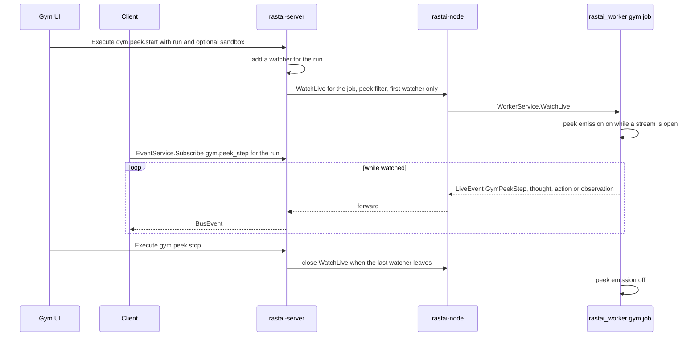

- **Cost only while watched.** The worker emits peek steps only while a `WatchLive` stream is open (`rastai_rl/peek.py`). The text already exists (the gateway detokenizes for tool parsing), so emission is a copy into a bounded queue, rate-limited to `PEEK_EVENTS_PER_SECOND` (20). When the queue is full the oldest event is dropped.
- **Overhead budget:** proposed at most 2% of rollout tokens per second, measured by the gym GPU test with and without a watcher, and shown in the UI as `peek_overhead_percent` (open question 6).
- **Gaps are visible:** each event carries `rollout_id` and `step_index`, so the UI shows "N steps skipped" after drops. The full trace blob is always there once the rollout finishes.
- Over a remote node the stream rides the same SSH session (C5). A network drop ends the stream (`RRS-N2002`); the UI calls `gym.peek.start` again after reconnect.

**Persisted:** nothing durable; peek is ephemeral by design. **Tests:** `tests/gpu/test_gym_peek_overhead.py` (the budget); a `rastai_rl` unit test that no peek events are produced with no watcher; `tests/e2e/gym.spec.js` (peek opens, shows steps, closes).

## B5. Step mode and partial groups

Runs when the user pauses one sandbox to step its agent by hand (`gym.step` with `action` `hold`, `step` or `release`, from `peek/StepControls.jsx`).

### B5a. Hold, step, release

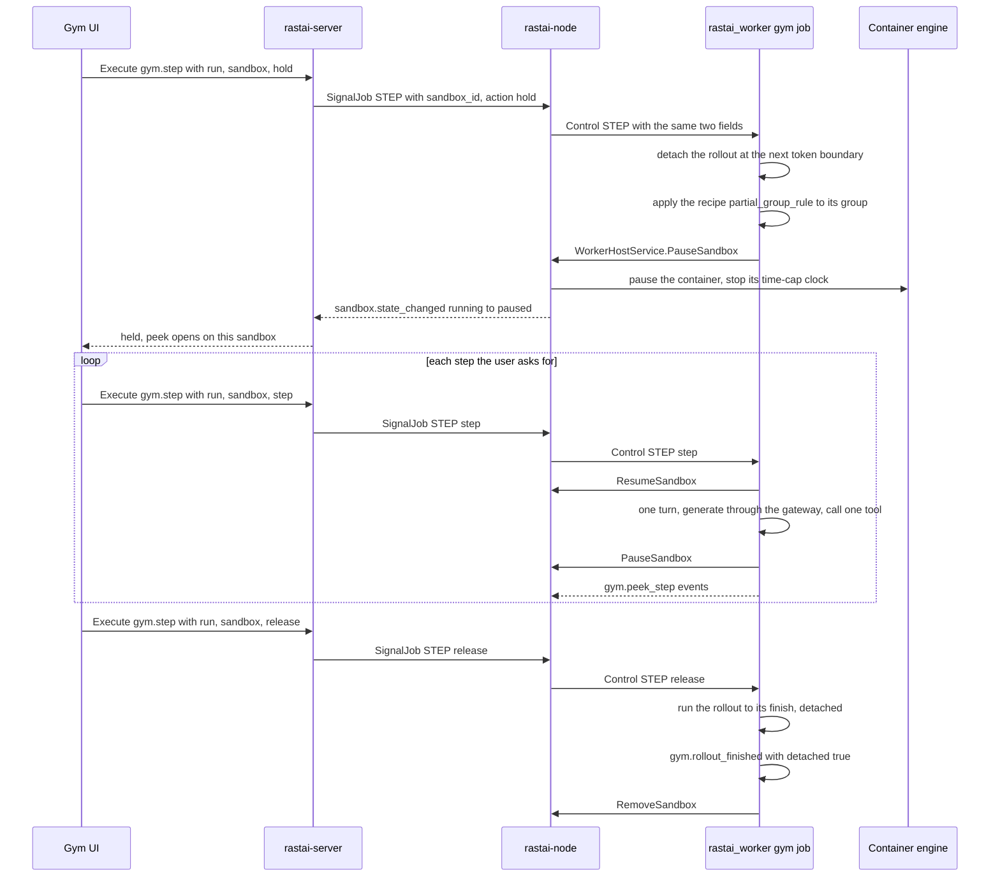

- **Step mode never goes through `SandboxService`.** The worker detaches its rollout before it asks the node to pause, so a container is never frozen with an exec in flight (`layout/rust-node-gateway-proto.md` §5.2).
- **`STEP` with a `sandbox_id` leaves the job `running`.** Only that rollout leaves the batch. The rest of the group, and the run, carry on. The held sandbox still counts toward the cap, because its memory stays in use.
- **A held rollout never enters a gradient.** It is user-steered and off-policy. Its reward is logged with `detached: true` for inspection only.
- **Hold timeout:** a held sandbox untouched for `step_hold_timeout_seconds` (default 1800) is released automatically (`RRS-R2005`).
- **Whole-run pause** (`SignalJob PAUSE` with no `sandbox_id`) is different: no new rollouts start, live rollouts pause at their next turn boundary with their sandboxes paused, and the trainer waits. `RESUME` continues all of them. An engine that can't pause (`RRS-R1007`) disables step mode for the run and says so in `StepControls.jsx`.

### B5b. Partial-group rule

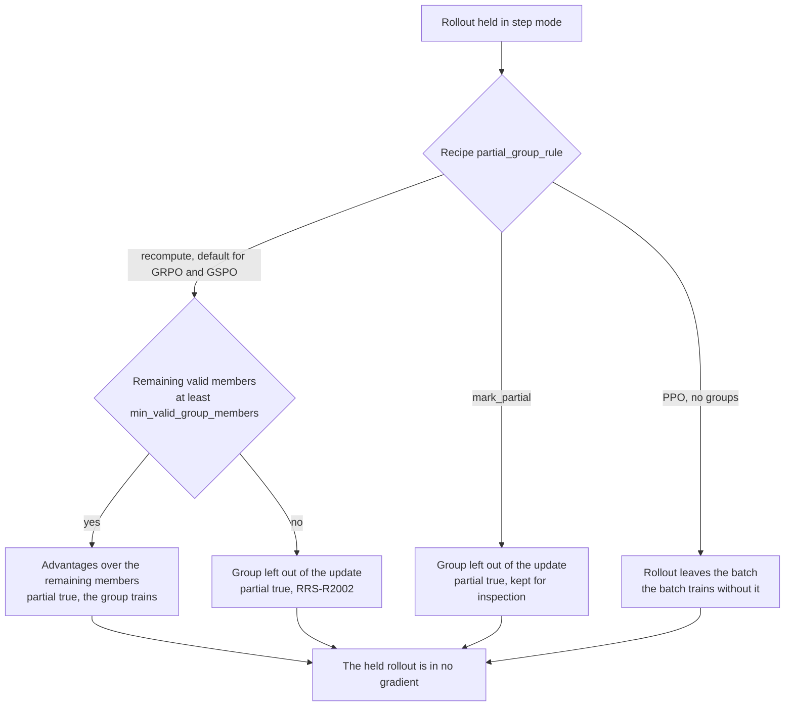

- **Why this keeps GRPO correct** (spec §12): advantages are relative to the group mean. Leaving a user-steered rollout in the group would bias the mean for every other member.
- `recompute` trains on the remaining members. `mark_partial` is for recipes whose normalization assumes a fixed group size; the group is logged but not trained on.

**Persisted:** `sandbox.state_changed` (node, also in `Heartbeat` snapshots); `gym.group_finished` with the partial flag and `gym.rollout_finished` with `detached` in the run's `events.log`. **Tests:** `python/rastai_rl/tests/test_rollout_manager.py` (both rules, PPO, a group that falls below the minimum); `tests/loop/test_gym_step_mode.py` (hold, two steps, release; the run keeps training; the container is paused while held and removed after release); a hold-timeout test with a short timeout (plan M7-E04).

## B6. Sandbox lifecycle and caps

Runs for every sandbox the node creates: gym rollouts, preflight and Evaluation's Pass@k samples. `rastai-sandbox` in the node owns every transition; the worker only asks. States are contracts §9.8.

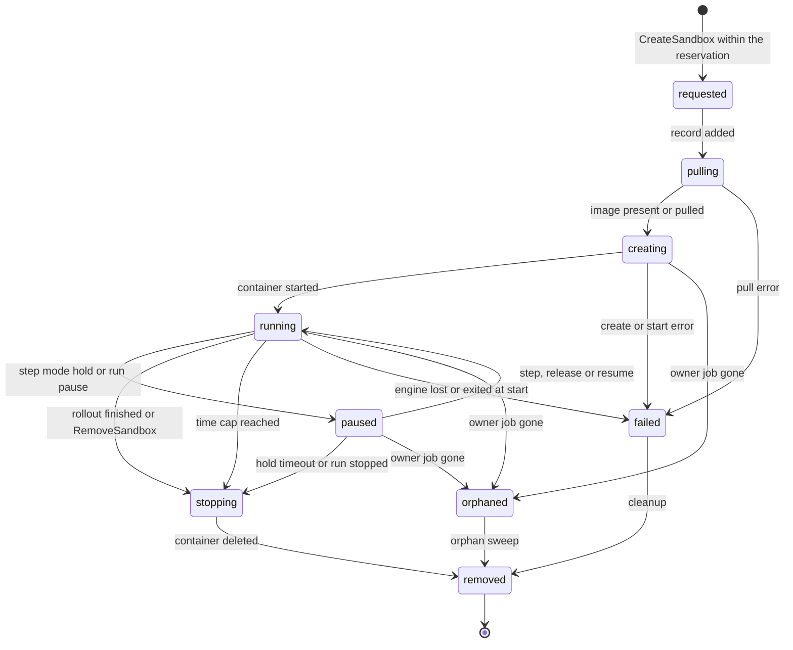

- **`requested` never waits.** The reservation taken at `StartJob` (B2) guarantees the slot. A create beyond the job's reservation or the node cap is refused with `RRS-R1001`, a guard for bugs.
- **`pulling`** checks the image cache first and moves on at once when the image is present. Pulls go only to the registries the harness names (ADR-0031).
- **Time cap:** the node counts running time only (`deadlines.rs`; paused time doesn't count). At the cap it stops the container (SIGTERM, then SIGKILL after 5 s). The rollout's outcome is `time_cap`, an agent outcome (`RRS-R1006`).
- **Memory cap hit inside the container** (`OOMKilled` in the engine's inspect output): the outcome is `sandbox_oom`, an agent outcome (`RRS-R1012`).
- **Engine lost** (engine restart, socket gone): live sandboxes go `failed`, and their rollouts are infra failures (`RRS-R1013`, B3b).

**Caps, as Docker Engine API fields** (`container_spec.rs`, `layout/rust-node-gateway-proto.md` §5.4; the harness can lower them, never raise them past the node's settings)

| Cap | Engine field | Default |
|---|---|---|
| Command | `Cmd: ["sleep", "infinity"]`, `HostConfig.Init: true`; work runs through `exec` | always |
| CPU | `HostConfig.NanoCpus` | `sandbox.default_caps.cpu` = 2 |
| Memory, no swap | `HostConfig.Memory`, `MemorySwap` equal to `Memory` | `sandbox.default_caps.ram_bytes` = 4 GiB |
| Processes | `HostConfig.PidsLimit` | `sandbox.default_caps.pids_limit` = 512 |
| Time | node-side timer on running time | `sandbox.default_caps.time_seconds` = 600 |
| Network | `NetworkMode: none`; with `network_hosts`, the run's internal network `rastai-egress-<run_id>`, whose only way out is the node's HTTP CONNECT proxy for the listed hosts on port 443 | none |
| Privileges | `CapDrop: ["ALL"]`, `SecurityOpt: ["no-new-privileges"]` | always |
| Disk | `HostConfig.StorageOpt.size` where the storage driver supports it, else logged once and skipped | `sandbox.default_caps.disk_bytes` = 10 GiB |
| Labels | `rastai.node_id`, `rastai.run_id`, `rastai.sandbox_id`, `rastai.job_id` | always |
| Mounts | none; task and tool files are copied in through the archive endpoint; no Rastai socket or token ever | always |

- Rootless Podman is preferred (`sandbox.engine_socket` auto: Podman, then Docker). The Docker socket is root-equivalent: the node talks to it and never mounts it into a container.
- A sandbox with `network_hosts` that can't get its internal network and proxy fails with `RRS-R1010`; it never falls back to the engine's normal bridge network.
- Every allowed CONNECT sends an egress report, so the egress badge shows when a sandbox reaches the internet (§24).

```rust
// crates/rastai-sandbox/src/manager.rs
pub async fn create_sandbox(manager: &SandboxManager, job_id: Option<&str>, run_id: &str, spec: SandboxSpec) -> Result<SandboxInfo, SandboxError> {
    let record = add_requested_record(manager, job_id, run_id, &spec)?;     // RRS-R1001 past the reservation
    ensure_image(&manager.engine, &spec.image).await?;                       // RRS-R1004
    let container_id = create_container(&manager.engine, &container_body(&spec, &record)).await?;
    copy_files_in(&manager.engine, &container_id, &spec).await?;
    start_container(&manager.engine, &container_id).await?;                  // RRS-R1005 if it exits at once
    Ok(mark_running(manager, &record, &container_id))
}
```

**Persisted:**
- Durable: the container labels in the engine are the record of which sandboxes exist. The node's in-memory table is rebuilt from them at start (B7). `sandbox.state_changed` events reach the daemon's bus, and `Heartbeat` carries `SandboxInfo[]` as a snapshot. The daemon keeps no sandbox table; `sandbox.list` asks the node.
- The rollout outcome and reason go into the run's `events.log` through `gym.rollout_finished`.

**Tests:** `crates/rastai-sandbox/tests/engine_live.rs` and `cap.rs` against a real engine in CI (Docker) and nightly (rootless Podman): inspect each container's `HostConfig` and labels; network none; a process past the PID limit fails; a memory hog is `OOMKilled` inside its cap (ADR-0031); the time cap stops a `sleep`, and paused time isn't counted (`deadline.rs`); `egress_proxy.rs` (a listed host connects, an unlisted host gets 403, a container without hosts can't resolve or connect). Unit tests against recorded engine bytes in `fixtures/sandbox/` for runs with no engine.

## B7. Orphan cleanup

Runs at node start (after job reattach), on every job's terminal state for that job's sandboxes, and on demand with `sandbox.cleanup` (`sandboxes/SandboxList.jsx`).

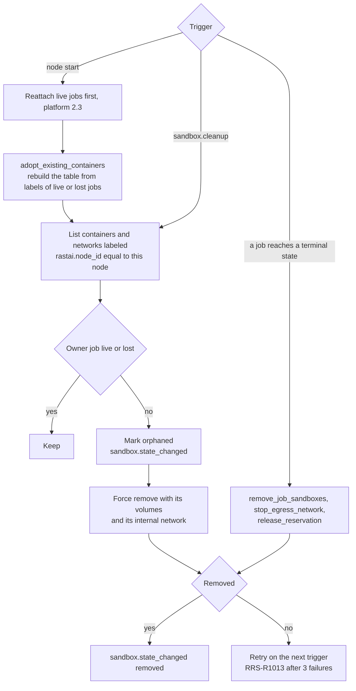

- **Only our containers.** Containers without Rastai labels, or labeled with another node's id (two nodes sharing one engine), are never touched. The sweep filters by label in the API call, then checks again in code.
- **Reattach runs first.** "Owner job live or lost" uses the node's job table, rebuilt from `runs/<run_id>/job.json` and live pids. A `lost` job may still re-register, so its sandboxes are kept. Running the sweep first would kill the sandboxes of a gym run that is still alive. The node reattaches each job in the ADR-0034 order: wait for the worker's `Register`, check the token hash against `job.json`, then call `Hello`.
- **A job's own exit removes its sandboxes at once,** so the sweep is a safety net for node crashes, not the normal path.
- Internal networks created for egress-proxy runs carry the same labels and are swept the same way.

```rust
// crates/rastai-sandbox/src/orphan_sweep.rs
pub async fn sweep_orphans(manager: &SandboxManager, live_job_ids: &[String]) -> Result<Vec<String>, SandboxError> {
    let containers = list_labeled_containers(&manager.engine, &manager.node_id).await?;
    let orphans = find_orphans(&containers, live_job_ids);     // live_job_ids includes lost jobs
    remove_containers(&manager.engine, &orphans).await
}
```

**Persisted:** nothing new; the sweep reads labels and emits `sandbox.state_changed`. **Tests:** `tests/crash/node_kill_with_sandboxes.rs` (a gym-like job with 3 sandboxes, kill -9 the node, restart: the job reattaches, its 3 sandboxes are adopted, a fourth container labeled for a dead job is swept); `tests/crash/gym_worker_kill.rs` (kill -9 the gym job: no labeled container remains once the node records the exit); a unit test that unlabeled and foreign-node containers are never listed for removal.

## B8. Gym crash, stop and resume

Covers what happens to a gym run when something dies or the user stops it.

```mermaid
sequenceDiagram
  participant NODE as rastai-node
  participant W as rastai_worker gym job
  participant ENG as Container engine
  participant SRV as rastai-server
  participant UI as Gym UI
  Note over W: kill -9 or crash
  NODE->>NODE: child exit by SIGKILL observed, not sent by the node
  NODE->>ENG: remove every container labeled with this job
  NODE->>NODE: release the pinned lease and the reservation
  NODE-->>SRV: job.state_changed running to failed
  SRV->>SRV: index the tail of events.log, mark the run failed
  SRV-->>UI: RRS-J1001 killed by a signal, with a Resume button
  UI->>SRV: Execute train.resume from the last checkpoint of the gym run
  SRV->>NODE: StartJob kind gym with resume_from
  NODE->>W: spawn a new job
  W->>W: load adapter, value head, optimizer, RNG and task cursor
  W-->>NODE: checkpoint.resumed, run running
```

| Failure | Detected by | What happens | User sees | What survives |
|---|---|---|---|---|
| kill -9 or crash of the gym job | Node: exit by signal | Sandboxes removed at once, lease and reservation released, job `failed` | `RRS-J1001` (killed by a signal), or `RRS-J1002` if the kernel OOM killer did it; Resume | `events.log` up to the last fsync, finished rollouts' traces, last checkpoint. In-flight rollouts are lost; they were never durable |
| kill -9 of the node | Daemon: missed heartbeats | Job and sandboxes keep running (own process groups). The restarted node reattaches from `job.json` and adopts the sandboxes (B7) | Node unreachable, then running | Everything |
| kill -9 of the daemon | — | Job unaffected; on restart the daemon re-reads events after `acked_sequence` | Brief disconnect | Everything |
| GPU OOM in the trainer | The worker catches the CUDA OOM | Last checkpoint kept; job `failed` | `RRS-H3007` (out of GPU memory inside a job step), fix: smaller `group_size` or batch | Last checkpoint |
| Container engine restart | Exec streams break | Live sandboxes `failed`; rollouts are infra failures and retried. Engine down for over 60 s: the run fails | `RRS-R1013` | Last checkpoint |
| Disk full on the node | An event append fails with ENOSPC | The worker frees its 1 MiB reserve, records `RRS-S3002` and pauses the run with state in memory (platform 6.1); the user frees space and resumes | Run `paused`, `RRS-S3002` with a `storage.gc` fix | Everything; training continues from the same step |
| Network drop to a remote node | C6 | Gym keeps running on the node | Reconnecting | Everything |
| `gym.stop` | User | `SignalJob STOP`: in-flight rollouts aborted, partial groups discarded, a final checkpoint at the last completed update, sandboxes removed; job `succeeded`, run `completed` with reason `stopped` | Stopped, resumable | Checkpoint |
| `job.cancel` | User | `SignalJob CANCEL`: stop at the next step boundary, no new checkpoint, exit 3; run `cancelled` | Cancelled | Last checkpoint |
| SIGTERM (shutdown, `TERMINATE`) | Worker | Preemption: checkpoint, `train.preempted`, exit 75; run `preempted` | Preempted, resumes on relaunch | Checkpoint |

- **Gym runs resume through `train.resume`.** A gym run is a training run whose recipe is GRPO, GSPO or PPO on a harness; the daemon checks the `gym` scope as well as `training` and restarts it as job kind `gym`.
- **Resume restarts at the task cursor** of the last completed update. Rollouts that were in flight at the checkpoint are regenerated, not recovered.

**Persisted:** as B3, plus `checkpoint.resumed` and `train.preempted` events. **Tests:** `tests/crash/gym_worker_kill.rs` (kill -9 mid-rollout; no orphaned containers; `train.resume` continues from the checkpoint with the same task cursor; the metric history has no duplicates); `tests/crash/gym_sigterm.rs`; an engine-restart test in CI that restarts the Podman service mid-run; `tests/e2e/gym.spec.js` with kill -9 of the node (plan M7-E06).

## B9. Psychology on agent traces

Runs when the user picks "Open in Psychology" on a finished rollout (`runs/RolloutList.jsx`). Spec §12: Psychology works on agent traces.

```mermaid
flowchart TD
  PICK["Rollout picked in the Gym UI"] --> TRACE["rastai-server reads gym.rollout_finished<br/>trace BlobRef and policy_step"]
  TRACE --> CK{"A checkpoint at exactly policy_step"}
  CK -->|"yes"| EXACT["Model ref ckpt at that step<br/>fidelity exact"]
  CK -->|"no"| NEAR{"An earlier checkpoint of the run"}
  NEAR -->|"yes"| APPROX["Nearest earlier checkpoint<br/>fidelity approximate, steps named"]
  NEAR -->|"no"| BASE["Base model, adapters off<br/>fidelity approximate"]
  EXACT --> OPEN["psychology.replay.open with trace_ref and model ref"]
  APPROX --> OPEN
  BASE --> OPEN
  OPEN --> WHERE["Lens job on the node that holds the checkpoint<br/>replay from token IDs, inference-psychology 6.1"]
```

- **Replays recompute where the weights live** (§9). The trace already holds every token ID, including tool results as the gateway tokenized them, so only token IDs reach the lens job. Nothing is re-tokenized.
- **The fidelity label is honest.** Checkpoints are written every few updates, so the exact adapter that generated a rollout often isn't saved. The replay says which step it used ("approximate: policy at step 1,200, rollout at step 1,230").
- Tool calls and results show as conversation parts, so the token timeline lines up with the agent's actions.

**Persisted:** the replay summary blob on the node and its local copy (inference-psychology 6.1), with `lineage` from the trace to the replay. **Tests:** `tests/e2e/gym.spec.js` opens a trace from the CPU gym loop in Psychology; a unit test for checkpoint choice and the fidelity label.

---

# Part C: Remote nodes

The prototype pairs the user's own boxes over OpenSSH (ADR-0011). One SSH session carries both directions: `-L` from `<runtime>/remote/<node_id>/node.sock` to the remote `node.sock`, and `-R` from a per-session remote socket back to the daemon's `node-hub.sock` (`layout/rust-node-gateway-proto.md` §4.3). Nothing listens on a network interface.

## C1. SSH pairing

Runs once per box, when the user runs `rastai node pair --ssh user@host` or uses "Add a node" (`PairDialog.jsx`), which run `node.pair`, a job. `rastai-server` `nodes/pairing.rs` drives it through `rastai-transport` `ssh.rs`.

```mermaid
sequenceDiagram
  participant UI as Remote UI
  participant SRV as rastai-server
  participant TR as rastai-transport
  participant SSH as OpenSSH client
  participant RSH as Remote shell
  participant RN as Remote rastai-node
  UI->>SRV: Execute node.pair with user at host
  SRV->>TR: run_remote_command to probe OS, arch, disk, version
  TR->>SSH: ssh BatchMode, ConnectTimeout 10
  alt host key unknown
    SSH-->>TR: host key verification failed
    TR-->>UI: RRS-N1003 with the fingerprint to confirm
    UI->>SRV: Execute node.pair again with the confirmed fingerprint
    TR->>TR: pin the key in ssh_known_hosts
  else host key changed
    TR-->>UI: RRS-N1002, stop, never auto-accept
  else authentication failed
    TR-->>UI: RRS-N1001
  end
  SSH-->>TR: Linux x86_64, free disk, no rastai yet
  TR->>SSH: upload_over_ssh the node bundle as partial files
  SSH->>RSH: write, check BLAKE3, rename into place
  TR->>SSH: rastai node init with the daemon public key
  RSH->>RSH: create node.key, pin the daemon key
  RSH-->>TR: node_id
  TR->>SRV: pin the node key, nodes row in state pairing
  TR->>SSH: install the systemd user unit, enable linger, start
  opt linger not allowed
    RSH-->>TR: RRS-N1005 warning, the node stops at logout
  end
  TR->>SSH: start_ssh_forwarding with both forwards
  SRV->>RN: Handshake, C3
  RN-->>SRV: node_id, HardwareProfile, session token
  SRV->>SRV: nodes row connected
  SRV->>RN: EnsureEnvironment in the background, C4
  SRV-->>UI: node.state_changed connected
```

- **The user's SSH setup is used as is:** keys, agent, `~/.ssh/config`, jump hosts. `rastai-transport` only adds options: `BatchMode=yes` (never prompt), `ConnectTimeout=10`, `ServerAliveInterval=5`, `ServerAliveCountMax=3`, `ExitOnForwardFailure=yes`, `StreamLocalBindUnlink=yes`, and `UserKnownHostsFile=<data>/node/ssh_known_hosts` with `StrictHostKeyChecking=yes`.
- **Host keys are trust-on-first-use with explicit confirmation.** An unknown key is fetched and shown as a fingerprint; the user confirms; it is pinned in Rastai's own known-hosts file. A changed key is a hard stop. The fix is `node.unpair` and a fresh pair, never an automatic accept.
- **The node bundle** is the `rastai` binary for the box's architecture (same version as the daemon), the pinned `uv` binary, the backend environment projects and the first-party `rastai_*` wheels (platform 1.3 lists what the app bundle holds). It goes to `<data>/bin/` on the box. `upload_over_ssh` streams each file into `cat > <path>.partial && mv`, so no `scp` or `sftp` is needed. Third-party wheels (PyTorch) are fetched from their source on the box in C4, never uploaded from the laptop.
- **Plugin modules on the box.** The AppArmor profile that grants user namespaces ships in the `.deb` and covers the installed `rastai` binary (contracts 8.8); the bundle's copy under `<data>/bin/` is not covered. On Ubuntu 23.10 and later a plugin module may therefore not get its network namespace on the box. The node then follows 8.8 as written: a trusted, preinstalled first-party module runs without the namespace and shows `RRS-P2005`; a third-party module without network permission is refused with `RRS-P2001`. Whether a first-party plugin pushed to a box counts as preinstalled is [open question 14](#open-questions).
- **Supported in the prototype:** Linux x86_64 with systemd user sessions. Anything else gives `RRS-N1004`. A box with no GPU is fine; it becomes a CPU node.
- **Linger** lets the node keep running after the user logs out. If `loginctl enable-linger` isn't allowed, pairing still succeeds with a warning. The unit uses `KillMode=process`, so restarting it never kills jobs.
- **One node agent per user per machine.** A second `rastai node serve` (for example a headless daemon's embedded node on the same box) fails at `bind_local_socket` with `RRS-N0003`, because two agents would both lease the same GPUs.

| Failure | User sees | State after |
|---|---|---|
| `ssh` binary not found | `RRS-N1006` naming `nodes.ssh_binary` | `unpaired` |
| Timeout or host unreachable | `RRS-N1008` | `unpaired` |
| Auth failed (often a key with a passphrase not loaded in `ssh-agent`, since `BatchMode` never prompts) | `RRS-N1001` with that fix | `unpaired` |
| Unknown or changed host key | `RRS-N1003` (confirm) / `RRS-N1002` (refused) | `unpaired` |
| Unsupported OS or architecture | `RRS-N1004` | `unpaired` |
| Disk full on the box | `RRS-S3001` (not enough free disk space) with the space needed | `unpaired`, partial files removed |
| kill -9 of the daemon mid-pairing | The pairing job is `failed` after restart; `node.pair` again resumes: the probe sees the installed bundle and reuses the node key | `unpaired` until re-run |

**Persisted:**
- Daemon side: `<data>/node/known_nodes.json` (node id, public key, user, host), `<data>/node/ssh_known_hosts` (SSH host key), `nodes` row (`transport: ssh`, address, state, protocol version, capabilities).
- Box side: `<data>/identity/node.key` (0600), `<data>/node/paired_daemons.json`, `<data>/bin/`, `~/.config/systemd/user/rastai-node.service`.

**Tests:** `crates/rastai-transport/tests/ssh_loopback.rs` and `tests/e2e/remote_pairing.rs` against an sshd container standing in for the box: a fresh pair; an unknown key needs confirmation; a changed key is refused (`RRS-N1002`); re-pairing after a mid-pair kill -9; a second node agent fails with `RRS-N0003` (plan M9-E02). The first remote run, from pairing to training, is timed against the 15-minute target (spec §6, plan M9-E05).

## C2. Node connection lifecycle

The daemon's node links (`rastai-server` `nodes/node_links.rs`) run this state machine for every paired node, from pairing until unpair. It is the same machine as platform 2.2; this section adds what is specific to SSH.

```mermaid
stateDiagram-v2
  [*] --> unpaired
  unpaired --> pairing : node.pair
  pairing --> unpaired : pairing failed
  pairing --> connecting : keys pinned, node started
  connecting --> handshaking : SSH session and forwards up
  handshaking --> connected : versions and keys check out
  handshaking --> incompatible : protocol or capability mismatch
  handshaking --> connecting : identity check failed, retry with backoff
  incompatible --> connecting : after node.update
  connected --> unreachable : 3 missed heartbeats or ssh exited
  unreachable --> connecting : reconnect timer
  connected --> unpaired : node.unpair
  unreachable --> unpaired : node.unpair
  incompatible --> unpaired : node.unpair
```

- **`connecting` retries itself** with backoff: 1 s, doubling to 30 s (platform 2.2). Each attempt starts a new `ssh` child with a new `-R` socket name (C3).
- **An `ssh` child that exits** moves a `connected` node to `unreachable` at once, without waiting for three missed heartbeats. `ServerAliveInterval=5` with 3 misses matches the heartbeat rule, so both layers notice a dead link at the same time.
- **`unreachable` doesn't stop anything on the box.** Jobs keep running; the daemon shows them as `lost` until it can reconcile (C6).
- **An identity failure** (`RRS-N0002`) keeps retrying, because a misrouted connection can cause it, but the daemon never re-pins a key and exchanges no data. Accepting a new key takes `node.unpair` and a fresh pair.
- The embedded node goes through the same states over `node.sock`, without pairing.

**Persisted:** `nodes.state`, `protocol_version`, `capabilities` and `last_heartbeat_unix_ms` in `rastai.db`; `node.state_changed` events. **Tests:** `crates/rastai-server/tests/node_links.rs` drives every transition with a fake transport, including an `ssh` exit while `connected`.

## C3. Handshake: protocol version and capability flags

Runs on every connect and reconnect, right after the SSH forwards are up. The daemon calls `NodeService.Handshake` over the forwarded `node.sock`. `Handshake` and `UpdateNode` never change shape, so any daemon can talk to and update any older node (platform 9.3).

### C3a. Exchange

```mermaid
sequenceDiagram
  participant SRV as rastai-server
  participant TR as rastai-transport
  participant SSH as OpenSSH client
  participant RN as Remote rastai-node
  SRV->>TR: open_node_connection
  TR->>SSH: ssh -N with -L to the node socket and -R to a fresh hub socket
  SSH-->>TR: forwards ready
  SRV->>RN: Handshake with protocol_version, capabilities, app_version, nonce, signature, hub_socket_path
  RN->>RN: verify the daemon signature against paired_daemons.json
  RN->>RN: clock skew within 5 minutes, nonce not reused
  RN-->>SRV: node_id, HardwareProfile, capabilities, session token, node signature
  SRV->>SRV: verify the node signature against known_nodes.json
  SRV->>SRV: decide connected or incompatible
  SRV->>RN: ListJobs
  RN-->>SRV: job snapshot
  SRV->>SRV: reconcile the jobs table, resume run tails
  RN->>SRV: Heartbeat every 5 s on the hub socket
```

- **Signed both ways** (ADR-0011). The daemon signs `("rastai-node-handshake-v1", node_id, daemon_nonce, sent_unix_ms, hub_socket_path)` with `daemon.key`. The node signs `("rastai-node-handshake-v1", daemon_id, daemon_nonce, session_token_hash)` with `node.key`. Both use Ed25519 (`ed25519-dalek`, imported only in `rastai-node` `identity.rs`). The domain string stops a signature from being reused anywhere else. A daemon key that isn't pinned gets `RRS-N0002`.
- **A fresh `-R` socket name per session** (`<runtime>/node-hub-<session_id>.sock` on the box). After an unclean drop, `sshd` can keep the old reverse socket bound for a while; a new name avoids waiting for it. `HandshakeRequest.hub_socket_path` tells the node which path to dial.
- **The session token** authenticates later calls both ways (gRPC metadata). A reconnect issues a new one and drops the old one.

### C3b. Version and capability decision

```mermaid
flowchart TD
  H["Handshake reply"] --> SIG{"Node signature matches the pinned key"}
  SIG -->|"no"| BAD["RRS-N0002, close, never re-pin"]
  SIG -->|"yes"| VER{"Node protocol_version within<br/>the daemon minimum and current"}
  VER -->|"node older"| OLD["incompatible, RRS-N0001<br/>daemon pushes node.update, platform 9.3"]
  VER -->|"node newer"| NEW["incompatible, RRS-N0001<br/>fix system.update.apply here"]
  VER -->|"yes"| APP{"Same app_version"}
  APP -->|"no"| WARN["connected with a warning<br/>offer node.update"]
  APP -->|"yes"| CON["connected"]
  WARN --> CAPS["Store capabilities in the nodes row"]
  CON --> CAPS
  CAPS --> SCHED["Scheduler refuses job kinds whose<br/>capability is missing, RRS-N0004"]
```

**Capability flags** (the node announces what it can do; the scheduler checks before `StartJob`)

| Flag | Meaning | Needed by |
|---|---|---|
| `generate.inspectable` | Can serve the Inspectable runtime | `model.load` inspectable |
| `generate.fast` | A pinned `llama-server` build exists for this backend | `model.load` fast |
| `lens.live` | Live packets from the decode step | the live panel |
| `sandbox.engine` | A Docker-API engine answered on its socket | Pass@k samples, gym |
| `gym` | Linux, `sandbox.engine`, and the engine can pause containers | `gym.start` |
| `transfer.resume` | `PutFile` and `GetFile` resume from an offset | transfers (C7) |
| `self_update` | A standalone node that accepts `UpdateNode` | `node.update` |

The full list is in contracts 8.6; `layout/rust-node-gateway-proto.md` §7.9 explains each. Flags change after an engine restart or a self-test; the daemon re-reads them with `GetHardware`. Environment readiness is not a flag: the scheduler calls `EnsureEnvironment` (C4) before the first job on a new environment, and the self-test result lives in `HardwareProfile`.

**Persisted:** `nodes.protocol_version`, `nodes.capabilities`; the session token in node and daemon memory only. **Tests:** `crates/rastai-node/tests/handshake.rs` (a forged daemon signature, a replayed nonce, clock skew, a node key that doesn't match the pin); `tests/e2e/remote_version_mismatch.rs` (a node built with `protocol_version + 1`, and an older node updated back to compatible); golden handshake messages in `fixtures/proto-golden/`; the `handshake` fuzz target in `rastai-node` (contracts 12.5, plan M9-E02).

## C4. Environment sync and self-test

Runs in the background right after pairing, for the backend the node's hardware selects, and before the first job that needs a different environment. The steps on the box are platform 1.3 and 1.6; this section covers what is different remotely.

```mermaid
sequenceDiagram
  participant SRV as rastai-server
  participant RN as Remote rastai-node
  participant UV as uv on the box
  participant IDX as Package indexes
  participant W as rastai_worker on the box
  SRV->>RN: EnsureEnvironment with environment_id and lock_hash
  RN->>RN: the lock shipped in the node bundle matches lock_hash
  alt folder has .rastai-ready with this lock hash
    RN-->>SRV: EnvironmentProgress ready
  else needs sync
    RN->>RN: free space check for the backend download size
    RN->>UV: uv python install 3.12, then uv sync --frozen
    UV->>IDX: fetch wheels, PyTorch from its own index
    UV-->>RN: progress
    RN-->>SRV: EnvironmentProgress stream
    RN->>W: python -I -m rastai_worker check
    W-->>RN: torch version, backend, visible devices
    RN->>RN: write .rastai-ready last
  end
  SRV->>RN: StartJob kind doctor_selftest
  RN->>W: spawn in its own process group
  W->>W: matmuls and a tiny forward against a CPU reference
  W-->>RN: self-test result
  RN-->>SRV: HardwareProfile with the self-test result
```

- **The app, node and worker ship together** (spec §20), so the node bundle carries its own environment projects and lockfiles. `EnsureEnvironment` only names the environment and the expected hash; a mismatch means the node is the wrong version (C3).
- **Fetch from the source:** the box downloads PyTorch itself (spike: CUDA 5.2 GB in 33 s, ROCm 16.5 GB in 91 s on the owner's link). Nothing is uploaded from the laptop except the small bundle from C1.
- **The marker is written last** (`.rastai-ready`, contracts §16 row 12). A folder without it is deleted and synced again; the uv cache on the box makes the second attempt fast.
- **The numerical self-test gates the backend** (spec §22, spike 05). A failed self-test marks that backend unusable in `HardwareProfile`, so jobs on it are refused instead of returning silently wrong numbers. ROCm is never forced with an override.
- **Plugin environments** follow the same path when a job needs a plugin's Python module: the daemon sends the plugin package as a blob (C7), and the node syncs the plugin's lockfile (`EnsureEnvironmentRequest.plugin_id`, `.plugin_version`). The namespace rules for the module itself are in C1.

| Failure | User sees | State after |
|---|---|---|
| Package index unreachable | `RRS-H2004` (environment sync failed), retry | No marker; resync next time |
| Not enough disk for the backend | `RRS-S3001` with the size needed | Nothing written |
| kill -9 or reboot mid-sync | Next `EnsureEnvironment` resyncs | No marker |
| Driver too old for `cuda13` (below 580) | `RRS-H4001` (warning) with the driver fix | The node uses `cuda126` instead |
| Self-test wrong results | `RRS-H1001` | That backend disabled; CPU stays |

**Persisted:** on the box, `<data>/envs/<environment_id>-<lock_hash12>/` with its marker, and the uv cache; on the daemon, the `HardwareProfile` and capabilities in the `nodes` row. **Tests:** `tests/e2e/remote_env_sync.rs` (cold sync in the sshd container with the CPU backend; kill -9 mid-sync, then resync; a lock-hash mismatch is refused); `crates/rastai-node/tests/env_marker.rs`.

## C5. Remote job: inputs, start, events

Runs whenever a job command (`train.start`, `gym.start`, `eval.test`, `model.load`, ...) targets a remote node. The example is a training run. Chat and Psychology on a remote model are inference-psychology §8.

```mermaid
sequenceDiagram
  participant UI as UI
  participant SRV as rastai-server
  participant ST as rastai-store
  participant RN as Remote rastai-node
  participant HF as HF Hub
  participant W as rastai_worker job
  UI->>SRV: Execute train.start on node X
  SRV->>SRV: project data_policy allows trusted-remote
  opt data_policy is local-only
    SRV-->>UI: RRS-C1009 data policy forbids this, nothing started
  end
  SRV->>ST: artifact_copies for each input on node X
  SRV->>RN: PutFile for private blobs the node lacks, C7
  SRV->>RN: EnsureEnvironment, C4
  SRV->>RN: StartJob with the model ref, blob refs and environment_id
  RN->>SRV: GetSecret hf_download on NodeHubService
  RN->>HF: download missing weights into the node HF cache
  RN->>W: spawn in its own process group
  W->>W: append durable events to events.log on the node
  SRV->>RN: WatchRunEvents after acked_sequence
  RN-->>SRV: EventRecords
  SRV->>ST: mirror the bytes, index, store acked_sequence
  SRV-->>UI: BusEvents
  RN->>SRV: Heartbeat every 5 s with job states
  opt checkpoint.saved for a LoRA run
    SRV->>RN: GetFile adapter.safetensors, C7
    SRV->>ST: blob and artifact_copies row
  end
```

- **Data policy** (spec §24): `check_data_policy` in `rastai-server` raises one refusal, `RRS-C1009`, before any transfer or `StartJob`, the same code the gateway, the scheduler and the archive use (contracts §16 row 37). `local-only` refuses any remote job that needs project data; `trusted-remote` allows paired nodes and the archive; `any` is for Phase 3 providers. The default is `local-only`, so the first remote job in a new project is refused once, and the error's fix sets the policy in one click (`settings.set privacy.data_policy`). The egress badge shows whenever data leaves the machine, and while a job runs on a remote node.
- **The archive is a remote destination for the same policy** (contracts 8.7, ADR-0035, M11). A project's events, runs and metrics are replicated to the owner's MySQL or MariaDB only when its policy is `trusted-remote` or `any`. A `local-only` project never syncs: the archiver skips it and lists it in `archive.status` with `RRS-C1009`. Remote runs need nothing special. The archiver reads the daemon's mirrored `events.log` and its index, never the node's files, and nodes hold no archive credentials. It copies blob bytes only from the daemon's own blob store, so a blob that exists only on a node waits until it has been fetched (C7). While a sync runs the egress badge shows `egress.active` with purpose `archive`.
- **Upload only what exists nowhere else.** Datasets are snapshotted to blobs (`dataset.snapshot`) before they move, so transfers always carry immutable, hash-named files. HF weights and HF datasets are fetched by the node itself, with the HF token as a short-lived value from `GetSecret`.
- **The node's cache persists,** so a second run on the same box starts warm. `artifact_copies` records what the box already has.
- **Events:** the job writes `events.log` on the box. The daemon tails it with `WatchRunEvents`, appends the same bytes to its own mirror before indexing, then stores `runs.acked_sequence` (platform 6.1). Ephemeral events (tokens, live packets at about 8.3 KB per token, peek steps, progress) ride `WatchLive` over the same SSH session.
- **What comes back:** LoRA adapters always sync back after `checkpoint.saved`. Full checkpoints stay on the box and are fetched on demand (`checkpoint.export`, or opening them).

**Persisted:**
- On the box: `<data>/runs/<run_id>/` (run record, `job.json`, `events.log`, checkpoints), the blob store, the HF cache.
- On the daemon: the mirrored `runs/<run_id>/events.log`, `runs` (`node_id`, `acked_sequence`), `run_metrics`, `checkpoints` (with `node_id`), `artifacts` (`home_node_id`), `artifact_copies`, `transfers`; adapters as local blobs.

**Tests:** `tests/e2e/remote_training.rs` (TextCNN on the sshd box; the mirrored log is byte-identical to the box's log; the adapter is synced back and its hash matches); a `local-only` project is refused with `RRS-C1009` and no `transfers` row or `StartJob` happens.

## C6. Network drop and reconnect without losing events

Runs when the SSH session dies (Wi-Fi drop, laptop sleep, box network blip) while jobs run on the box. The node link in `rastai-server` drives it; no user action is needed.

```mermaid
sequenceDiagram
  participant UI as UI
  participant SRV as rastai-server
  participant TR as rastai-transport
  participant RN as Remote rastai-node
  participant W as rastai_worker job
  Note over TR,RN: network drops
  TR->>TR: ssh child exits after ServerAlive misses
  SRV->>SRV: WatchRunEvents and WatchLive streams fail, RRS-N2002
  RN->>RN: Heartbeat calls fail, keep retrying, never stop jobs
  W->>W: keeps working, events.log keeps growing
  SRV->>SRV: node unreachable, its jobs lost
  SRV-->>UI: node.state_changed, RRS-N2001 reconnecting
  loop backoff 1 s doubling to 30 s
    TR->>TR: start ssh again with a new hub socket path
  end
  SRV->>RN: Handshake, C3
  RN-->>SRV: session token, HardwareProfile
  SRV->>RN: ListJobs
  RN-->>SRV: job still running
  SRV->>SRV: job lost to running
  SRV->>RN: WatchRunEvents after acked_sequence
  RN-->>SRV: records written during the drop
  SRV->>SRV: mirror, index, ack, no sequence gaps
  SRV-->>UI: BusEvents for the gap, RRS-N2003 reconnected
```

- **Nothing durable can be lost.** The job only appends to a local file and never waits on the node or the daemon. The log is the buffer, however long the drop lasts.
- **The node never stops jobs because the daemon is gone.** It keeps retrying `Heartbeat` and keeps serving its sockets. Work that needs the daemon (API judges through `NodeHubService.GatewayGenerate`, `GetSecret`) waits and retries up to `HOST_RECONNECT_TIMEOUT_SECONDS`.
- **What `ListJobs` can say after a drop:**

| Job state on the box | Daemon does |
|---|---|
| Still running | `lost → running`, then replays from `acked_sequence` |
| Finished during the drop | `lost →` the terminal state the node recorded (contracts 9.1: lost → the terminal state the node recorded); the log replay ends with the final run state, so the run completes normally |
| Gone with no exit record (box rebooted) | `lost → failed` with `RRS-J3002` (ended while no node was watching); the run is resumable from its last checkpoint with `train.resume` (preemption-safe, spec §10) |

- **Idempotent mirroring:** the daemon appends each record to its mirror, fsyncs, indexes it keyed by `(run_id, sequence)`, then stores `acked_sequence` in the same transaction. After a daemon crash it re-indexes mirrored records past `acked_sequence` and resubscribes after the mirror's last valid sequence. Frames are copied byte for byte, so their checksums still verify (platform 6.2).
- **Ephemeral events during the drop are gone** (tokens, live packets, progress, peek). The UI shows "live stream resumed". A chat stream that broke mid-answer keeps its partial answer (inference-psychology §8).
- **The UI's own stream** (UI ↔ daemon, on loopback) isn't affected. The UI sees the node go unreachable and come back. For a UI on a tunnel, see C8.
- The daemon going down is handled the same way: on restart it reconnects every paired node through this path.

**Persisted:** the box's `events.log` (the source of truth), the daemon's mirror and `runs.acked_sequence`; `node.state_changed` and `job.state_changed` events. **Tests:** the mirror reader is covered by the `event_frame` fuzz target in `rastai-store` (contracts 12.5). `tests/e2e/remote_network_drop.rs`, the §32 weeks 11–12 exit criterion (plan M9-E03): start TextCNN training on the sshd box, cut the connection for 60 s (kill the `ssh` child, and separately drop packets in a network namespace so `ServerAlive` has to notice), restore it, and assert the run completes, the daemon's mirror is byte-identical to the box's log, and every sequence arrives exactly once. Variants: kill -9 the daemon during the drop; reboot the box container during the drop (the job ends `failed` with `RRS-J3002` and `train.resume` continues).

## C7. Resumable BLAKE3 transfers

Runs for every file that crosses between the daemon and a node: private inputs going up (`PutFile`), LoRA adapters coming back and on-demand checkpoint fetches (`GetFile`). The prototype uses whole-file BLAKE3 hashes (spec §22). `rastai-transport` `transfer.rs` holds the logic; `rastai-node` `transfers.rs` serves it.

```mermaid
sequenceDiagram
  participant SRV as rastai-server
  participant ST as rastai-store
  participant RN as Receiving rastai-node
  SRV->>ST: transfers row, state running, blob hash and size
  SRV->>RN: StatFile for the blob hash
  alt the node already has the blob
    RN-->>SRV: size and hash match
    SRV->>ST: artifact_copies row, transfer finished, nothing sent
  else a partial file exists
    RN-->>SRV: bytes_written, rounded down to the last fsync point
    SRV->>RN: PutFile chunks from that offset
  else nothing there
    RN-->>SRV: size 0
    SRV->>RN: PutFile chunks from offset 0
  end
  RN->>RN: path inside an allowed folder, free space check
  loop 1 MiB chunks
    RN->>RN: append at the declared offset, fsync every 64 MiB
    SRV->>SRV: transfer.progress, bytes_done saved every 64 MiB
  end
  RN->>RN: BLAKE3 over the whole partial file
  alt hash matches
    RN->>RN: rename into the blob store
    RN-->>SRV: FileStat with the hash
    SRV->>ST: artifact_copies row, transfer.finished ok
  else hash differs
    RN->>RN: delete the partial file, RRS-N3003
    RN-->>SRV: mismatch, restart once from 0, then fail
  end
```

- **Only blobs move,** so a source can't change mid-transfer and the hash is known before the first byte.
- **Resume trusts the prefix; the final hash is the safety net.** On resume the receiver rounds its partial size down to the last fsync point, because bytes after it may be garbage after a power loss. A mismatch deletes the partial and restarts once from 0. Phase 2's chunked transfers verify each chunk.
- **A chunk at the wrong offset is refused** (`RRS-N3002`), so a retry can never leave a hole. Paths outside `<data>/runs/<run_id>/`, `<data>/blobs/.incoming/` and `<cache>/uploads/` are refused (`RRS-N3001`).
- **Partial files are named by hash** (`<data>/blobs/.incoming/<hash>.partial`), so any later transfer of the same blob finds and continues them.
- **Downloads (`GetFile`) mirror this** with the daemon as the receiver: its own `.incoming/<hash>.partial`, `GetFile` from the offset, verify, rename.
- **Network drop mid-transfer:** the stream breaks and the transfer row stays `running` with its `bytes_done`. After reconnect (C6) the daemon restarts the flow at `StatFile`.
- **`transfer.cancel`** closes the stream and keeps the partial file until GC, so a later transfer can continue it (`RRS-N3012`).
- **Disk full:** checked before the first write (`RRS-S3001` with the space needed). Running out mid-transfer keeps the partial file and fails with `RRS-S3002`.

```rust
// crates/rastai-transport/src/transfer.rs
pub const TRANSFER_CHUNK_BYTES: usize = 1024 * 1024;
pub const FSYNC_INTERVAL_BYTES: u64 = 64 * 1024 * 1024;

fn resume_offset(partial_size_bytes: u64) -> u64 {
    // Bytes after the last fsync may be garbage after a power loss, so resume from the last fsync point.
    partial_size_bytes - partial_size_bytes % FSYNC_INTERVAL_BYTES
}
```

**Persisted:** the `transfers` row (state, `bytes_done`, hash); `artifact_copies` on success; the partial file on the receiver until success or GC; `transfer.finished` (durable), `transfer.progress` (ephemeral). **Tests:** `crates/rastai-transport/tests/transfer_resume.rs` (cut at 50%, resume, the BLAKE3 hash matches and the bytes sent after the cut are about the remainder; an offset mismatch gives `RRS-N3002`; a flipped byte gives `RRS-N3003` and a restart from 0, plan M9-E04); a small tmpfs on the box gives `RRS-S3001` before any write; `crates/rastai-node/tests/transfers.rs` for allowed folders.

## C8. Headless rastai serve and the UI over an SSH tunnel

Runs when the user makes the GPU box the control plane (`rastai serve --headless` on the box, usually from a systemd user unit) and opens its UI from a laptop (`rastai tunnel user@box`). This is the alternative to C1: with pairing, the laptop is in charge and the box executes; with headless, the box is in charge and the laptop is a screen. Headless means no window and no browser launch; the daemon still serves the web app on loopback.

```mermaid
sequenceDiagram
  participant U as User shell
  participant CLI as rastai-cli on the laptop
  participant SSH as OpenSSH client
  participant HD as Headless daemon on the box
  participant BR as Browser
  Note over HD: rastai serve headless, systemd user unit
  U->>CLI: rastai tunnel user at box
  CLI->>SSH: ssh user at box rastai token login-code create --json
  alt rastai not installed on the box
    SSH-->>CLI: command not found, RRS-N1007 with the install hint
  else installed
    SSH->>HD: the box CLI runs token.login_code.create over daemon.sock
    HD-->>CLI: one JSON result line with the code and the box http_port
  end
  CLI->>CLI: pick a free local port in 47830 to 47839
  CLI->>SSH: ssh -N -L the local port to the box http_port
  CLI->>BR: open 127.0.0.1 on the local port, code in the fragment
  BR->>HD: POST /api/login through the tunnel
  HD->>HD: Host is a loopback name, Origin equals http plus Host, code unused
  HD->>HD: bind the session to that Origin
  HD-->>BR: session cookie named for this daemon, and the session key in the body
  BR->>HD: Connect Execute and EventService.Subscribe with the cookie and Rastai-Session-Key
  Note over SSH: tunnel drops
  BR->>BR: RRS-U0001 reconnecting
  CLI->>SSH: restart the tunnel on the same local port
  BR->>HD: Subscribe with after_bus_sequence
  alt still in the 10,000-event buffer
    HD-->>BR: gap replayed
  else too old
    HD-->>BR: RRS-C0401, the client refetches state
  end
```

- **Nothing opens on the network** (spec §21). The headless daemon listens on loopback and `daemon.sock` exactly as on a desktop; the tunnel is the only way in. MCP (`/mcp`) and the gateway (`/v1/*`) work through the same tunnel with scoped tokens.
- **Login without copying tokens:** `rastai tunnel` runs the generated verb `rastai token login-code create --json` on the box over SSH (contracts §16 row 2). Like every generated verb, it starts the box's daemon if none runs (control-plane layout 9.3, unless `--no-start`); the systemd unit is the normal path. It then runs `token.login_code.create` over `daemon.sock`, where peer credentials prove the owner, and prints one JSON result line with `code`, `expires_unix_ms` and `http_port`. `rastai tunnel` forwards a free local port to `127.0.0.1:<http_port>` on the box and opens `http://127.0.0.1:<local port>/#login=<code>`. Nobody copies a token or a URL.
- **The 60 s code lifetime covers the tunnel setup.** `rastai tunnel` mints the code first, then opens the forward and the browser; a slow SSH start that lets the code expire shows `RRS-C1007`, and running `rastai tunnel` again mints a fresh one.
- **The manual path works without `rastai tunnel`:** `HeadlessHelp.jsx` shows platform 4.1's path: `ssh user@box rastai open --print-url`, then `ssh -N -L <local port>:127.0.0.1:<box port> user@box`, then open the printed URL with its port changed to the local one. A person copies a whole URL more easily than a bare code, so the manual path keeps `rastai open --print-url`.
- **Local port:** 47830–47839, so it can't collide with the laptop's own daemon on 47820–47829.
- **Request gate across a tunnel (ADR-0034, which supersedes ADR-0007 rule 4):** the browser's Host is `127.0.0.1:<local port>`, not the box daemon's port. The gate (platform 4.2) therefore accepts any loopback Host name on any port. When Origin is present it must equal `http://` plus that Host, else `RRS-C1004`. A foreign Host is `RRS-C1003`.
- **The session is bound to the origin that redeemed the login code.** Browsers don't isolate cookies by port, so a page on another loopback port would be sent the same cookie. Its requests carry their own Origin and are refused with `RRS-C1004`. A cookie request with no Origin passes only for `GET` and `HEAD` with `Sec-Fetch-Site` of `same-origin` or `none` (blob downloads, images, static files); any other cookie request without Origin is `RRS-C1004`. Cross-origin browser clients are refused in v1. Two routes are planned for Phase 2: alternative UIs hosted by the daemon on its own origin, and an origin allowlist with pairing.
- **Same local port after a drop.** The origin includes the port, so `rastai tunnel` restarts a dropped tunnel on the same local port and the session stays valid. A different port is a different origin and needs a new login code.
- **Cookie name per daemon:** cookies are per host, not per port, so two daemons on 127.0.0.1 would overwrite each other's session. The cookie is named `rastai_session_<daemon id prefix>`.
- **Jobs on the box never notice a tunnel drop.** They're local to the headless daemon. Only the UI reconnects.

| Failure | User sees |
|---|---|
| `rastai` not installed on the box | `RRS-N1007` with the install command |
| SSH fails | `RRS-N1001`, `RRS-N1002`, `RRS-N1006` or `RRS-N1008`, as in C1 |
| Login code expired or reused | `RRS-C1007`; run `rastai tunnel` again |
| No free local port in 47830–47839 | `RRS-N1009` naming the range |
| Foreign Host or Origin | `RRS-C1003` or `RRS-C1004`, no side effect |
| A cookie request with no allowed Origin, or a session used from another origin | `RRS-C1004`, no side effect |
| Daemon on the box restarted | `RRS-U0003` (sessions live in daemon memory, so a restart signs you out); run `rastai tunnel` again |

**Persisted:** everything lives on the box (its `rastai.db`, `vault.db`, blobs, projects). The laptop keeps nothing but the browser cookie. **Tests:** `tests/e2e/headless_tunnel.spec.js` (Playwright through an SSH tunnel on a different local port to the sshd box running `rastai serve --headless`: log in, start a TextCNN run, kill the tunnel, reconnect, see the gap replayed, plan M9-E05); `rastai token login-code create --json` on the box prints one line that parses as `TokenLoginCodeCreateResult` with the daemon's real `http_port`; a login code works once; a second tunnel to another daemon keeps both sessions; a request with a non-loopback Host fails with `RRS-C1003`; a page on another loopback port fails with `RRS-C1004`, and so does a session redeemed on one local port when used from another; a cookie `POST` with no Origin fails with `RRS-C1004`, while a same-origin `GET` of a blob with no Origin works; a daemon restart gives `RRS-U0003`.

## C9. Node update, unpair and teardown

Runs when the handshake reports an older node (`node.update`, pushed by the daemon on its own), or when the user removes a box (`node.unpair`).

**Update** follows platform 9.3: `UpdateNode` streams a header (version, Ed25519 signature by the release key over the binary's BLAKE3) and the bytes into `<data>/node/rastai-<version>.partial`. The node checks the signature (`RRS-N4001` if it's wrong, nothing changes), renames the file over the binary and exits with code 75; systemd restarts it. Jobs keep running in their process groups (`KillMode=process`) and are reattached; a worker whose protocol the new node doesn't support is stopped with a checkpoint and can be resumed (`RRS-J3003`, platform 2.3).

**Unpair:**

```mermaid
flowchart TD
  U["node.unpair"] --> JOBS{"Jobs running on the node"}
  JOBS -->|"yes"| ASK{"force set"}
  ASK -->|"no"| REFUSE["Refuse, list the jobs"]
  ASK -->|"yes"| STOPJ["SignalJob STOP to each job<br/>final checkpoints"]
  JOBS -->|"no"| LIST["List remote data: runs, checkpoints, blobs, cache"]
  STOPJ --> LIST
  LIST --> REACH{"Node reachable"}
  REACH -->|"no"| FORGET["Offer forget locally<br/>remote data left as is, warning"]
  REACH -->|"yes"| CONF{"User confirms the wipe list and sizes"}
  CONF -->|"no"| KEEPALL["Nothing changes"]
  CONF -->|"yes"| FETCH["GetFile pinned artifacts with no local copy"]
  FETCH --> WIPE["node.cache.wipe: delete unpinned runs, blobs and cache"]
  WIPE --> KEYS["Node drops the daemon key, daemon drops the node key"]
  KEYS --> UNIT["Stop and disable the systemd unit"]
  FORGET --> ROWS["Delete the nodes and artifact_copies rows"]
  UNIT --> ROWS
```

- **Teardown wipes unpinned remote data** (spec §22). Pinned artifacts are fetched first, so pinning means "keep this even if the box goes away". The confirm dialog lists every run and checkpoint with its size.
- **The archive is untouched.** Records of runs that ran on the box were mirrored to the daemon (C5) and sit in the archive, if one is configured, under the daemon's `source_id`, not the node's. Unpair removes only the box's own unpinned bytes.
- **Pinned state comes from the daemon.** The node keeps no catalog; the daemon sends the pinned list in the wipe request (`layout/rust-node-gateway-proto.md` §7.9).
- A failed `GetFile` stops the wipe before anything is deleted (`RRS-N3003` or `RRS-S3001`), so a pinned artifact is never lost.

**Persisted:** removal of `nodes`, `artifact_copies` and the pinned keys on both sides; fetched pinned artifacts as local blobs. **Tests:** `tests/e2e/remote_unpair.rs` (pinned checkpoint fetched, unpinned deleted, keys gone, unit disabled; "forget locally" with the box down; a failed fetch deletes nothing); `tests/e2e/remote_node_update.rs` (a tampered binary is refused with `RRS-N4001`; a valid one reconnects as `connected` and a running CPU job is reattached, plan M9-E06).

---

## Open questions

Each has a default that this file follows until the owner decides. As in contracts §14, decided rows are removed, not renumbered.

**Decided on 2026-10-11 and removed:** 13 (the layer-4 data warning is `RRS-E3003`, settled by M6-E02).

**Decided on 2026-10-10 and removed:** 1 (`onnx` and `onnxscript` are on the §27 allowlist, contracts 2.5), 2 (`weights[]` is a list, 5.2), 4 (ADR-0034 accepted), 5 (the egress proxy is built at plan §31 step 7 / M7-E02, 15.11), 7 (`.pt2` files are refused, 15.2), 8 (infra failures are excluded, never scored 0; `layout/python.md` §6.3 agrees), 10 (`lost →` the recorded terminal state, 9.1), 11 (one Rust planner, 2.4 rule 10), 12 (catalog collisions settled, 10.2).

| # | Question | Default |
|---|---|---|
| 3 | **The HF reference for DeepSeek-V2-Lite real-weight parity** across two GPUs would need `accelerate`'s `device_map`, which isn't allowed. | Run the reference on CPU in bf16 on a few short prompts (about 32 GB of RAM), layer by layer if RAM is short. |
| 6 | **The peek overhead budget** has no measurement yet. | Proposed at most 2% of rollout tokens per second; set the real number from `tests/gpu/test_gym_peek_overhead.py`. |
| 9 | **Harbor tasks that ship only a Dockerfile.** The sandbox manager never builds images. | No builds in the prototype: import with `RRS-R0006` and the build command as the fix. Revisit with a "sandbox image" plugin that builds through the engine's build endpoint behind a trust prompt. |
| 14 | **First-party plugins on a paired box** may hit the user-namespace limit (C1). Contracts 8.8 lets a "trusted, preinstalled" first-party module run without the network namespace, but a plugin pushed to a box as a blob isn't installed from `<install prefix>/share/rastai/plugins/`. | Treat a first-party plugin whose content hash matches the release manifest as trusted on the box too, with the same `RRS-P2005` warning. Confirm in the plugin-host ADR work. |
