# Inference and Psychology: Logic Flows

**Status:** v1.2, 2026-10-10. Pre-build design. Sources: spec v5.3 (§8, §9, §17–§19, §21, §22, §24, §26), `spike/README.md` (experiments 01, 02, 04, 07) and `docs/architecture/contracts.md`.

v1.1 reconciles v1 with the docs written beside it and with the defaults in plan §10:
- gateway, node and worker names and constants come from `layout/rust-node-gateway-proto.md` ("node layout") and `layout/python.md` ("Python layout"): `prepare_chat`, `run_chat`, `LogCommit`, `TokenizeChat`, `SessionPool`, `InterventionHook`, `DECODE_SLOT_COUNT`, `EVICTION_GRACE_SECONDS`, one llama-server slot;
- error numbers in `RRS-G`, `RRS-H` and `RRS-J` are the node layout's (plan §10 row 8);
- `GenerateRequest` carries the `InterventionSet` (contracts §4.4), and job signals follow the contracts `JobSignal` table;
- Prefer this branch writes the preference rows that training-evaluation §7.1 defines;
- new flows: SAE loading (5.4) and offline analyses (6.5).

v1.2 applies review fixes:
- one data-policy code, `RRS-C1009`, raised by `rastai-server`'s `check_data_policy` (plan §10 row 37);
- the chat handler sits where the control-plane layout puts it;
- delete reaches every copy of a conversation (0.2, 9.2), and run event logs carry no conversation content.

Every name comes from `contracts.md`, or from the layout doc that owns it (named where first used). Names that neither defines are marked *(new)* at first use and listed in [section 10](#10-new-names). Section 10.6 maps each superseded v1 and v1.1 name to its replacement.

## Contents

0. [Reading these diagrams](#0-reading-these-diagrams): participants, shared rules, constants
1. [A chat turn through the gateway](#1-a-chat-turn-through-the-gateway)
   - 1.1 Chat turn from the UI · 1.2 Turn on the `/v1` endpoints · 1.3 Routing decision · 1.4 Logging, incognito and retention · 1.5 Failure table
2. [Runtime toggle and replay twins](#2-runtime-toggle-and-replay-twins)
   - 2.1 Runtime toggle · 2.2 Twin mapping and the fidelity label
3. [Third-party API chats and proxy replay](#3-third-party-api-chats-and-proxy-replay)
   - 3.1 API chat turn · 3.2 Proxy replay through a local observer model
4. [Model loading and VRAM leases](#4-model-loading-and-vram-leases)
   - 4.1 Model load lifecycle · 4.2 VRAM lease lifecycle · 4.3 Loading an Inspectable model · 4.4 llama-server lifecycle · 4.5 GPU choice and eviction · 4.6 Eviction for a training job · 4.7 OOM diagnostics · 4.8 Daemon crash and reattach
5. [Inspectable decode step and the live Psychology panel](#5-inspectable-decode-step-and-the-live-psychology-panel)
   - 5.1 Turning the live panel on · 5.2 One decode step · 5.3 Token and packet path, step mode · 5.4 Loading SAEs and labels
6. [Replay and offline analyses](#6-replay-and-offline-analyses)
   - 6.1 Opening a conversation for replay · 6.2 The replay forward pass · 6.3 Zoom: full tensors on demand · 6.4 Export and the web viewer · 6.5 Offline analyses
7. [Interventions and branching](#7-interventions-and-branching)
   - 7.1 Setting an intervention, the concept slider · 7.2 Rewind, branch, compare, prefer · 7.3 Steering presets: save, serve, distill
8. [Remote models](#8-remote-models)
9. [Conversation flags and imports](#9-conversation-flags-and-imports)
   - 9.1 Flags and imports · 9.2 Delete reaches every copy
10. [New names](#10-new-names)
11. [Open questions](#11-open-questions)

---

## 0. Reading these diagrams

### 0.1 Participants

| Id in diagrams | Component (contracts name) | Process |
|---|---|---|
| `UI` | `apps/web` through `@rastai/client`; the Psychology panels are `@rastai/psychology-ui` | UI |
| `SRV` | `rastai-server`: command dispatch, scheduler, plugin host, `VaultLogSink` (the daemon's `LogSink`) | Daemon |
| `GW` | `rastai-gateway`: routing, chat templates, tokenization, adapters. One `Gateway` with place `Daemon` serves the user endpoints. Each node has its own with place `Node` (node layout §6.2) | Daemon, or node |
| `VAULT` | `rastai-store`: the `vault.db` writer thread and reader connections | Daemon |
| `NODE` | `rastai-node` (embedded, or a remote `rastai node serve`); `fast_runtime.rs` manages llama-server | Node |
| `W` | Python worker job of kind `serve_inspectable`: `rastai_worker` + `rastai_models` (`SessionPool`, `StaticDecoder`) + `rastai_lens` (`LivePanelReadout`, `InterventionHook`) | Python worker job |
| `LS` | `llama-server`, in a node-native `serve_fast` job | llama-server |
| `PM` | `rastai_psychology`, the Psychology plugin's Python module (job kind `plugin_module`) | Plugin Python module |
| `LJ` | a `rastai_psychology` job of kind `lens` (replay, export, analyses) | Python worker job |
| `API` | OpenAI, Anthropic or any OpenAI-compatible endpoint | external |
| `VIEW` | `apps/viewer` with the `rastai-formats` WASM build | Viewer |

### 0.2 Rules every flow follows

- **One source of token IDs.** The gateway renders and tokenizes. Runtimes receive IDs and return IDs. The node drops llama-server's own text, and the gateway's streaming decoder makes the text for both runtimes. The text shown therefore always matches the logged IDs (§18; node layout §6.5).
- **The full context and the interventions travel with every request.** A `GenerateRequest` always carries every `prompt_token_ids` entry and the session's `interventions_json` (contracts §4.4).
  - A worker's KV cache for a `session_id` is only a speed-up. If the cached prefix matches, the worker skips that part of the prefill; if not (evicted, worker restarted), it prefills from scratch.
  - No flow breaks because a session is gone.
- **Psychology reaches the runtime only through core commands.**
  - `psychology.*` commands run in `PM`. It validates and resolves, then calls core `chat.*` commands (`chat.settings.set`, `chat.regenerate`, `chat.continue`, `chat.tensor.fetch`) through `WorkerHostService.ExecuteCommand` → `NodeHubService.ExecuteCommand`.
  - Only core code calls the session RPCs (`SetInterventions`, `ForkSession`, `CloseSession`, `FetchTensor`).
  - Psychology jobs that need forward passes from a loaded model use the node gateway (`WorkerHostService.GatewayGenerate`, `TokenizeChat`), like rollout and judge jobs.
  - Jobs that need gradients or many forward passes (6.5) load their own model copy.
  - This keeps contracts §2.4 rule 5, and third-party lens plugins get the same path.
  - The manifest's permissions are in frontend layout §14.2: `conversations.read`, `weights.read`, `gpu`, `commands:[...]`. Psychology is first-party and preinstalled, so they are granted.
- **The daemon creates plugin jobs.** A plugin command that needs a job returns it in `CommandReply.follow_up_jobs[]`. `rastai-server` then creates the run (`run.json`, `runs` row, lineage) and calls `StartJob` (platform flow 3.3).
- **Delete reaches every copy.**
  - A conversation's content (text, token IDs, logprobs) lives only in `vault.db`, in artifacts that have a lineage edge to it (`replay_of`, `analysis_of`), and in copies the user made on purpose (preference rows, dataset snapshots, eval results).
  - Run event logs carry ids, counts and hashes, never content. The full gateway record travels as a short-lived record blob that the daemon moves into `vault.db` (9.2).
  - `conversation.delete` removes the rows and every unpinned derived artifact and run, on every node that holds a copy (9.2).
- **Durable vs ephemeral.** `chat.token` and `psychology.packet` may be dropped for a slow subscriber. The panel marks the gap (`RRS-U0005`, info) and offers Recompute, which is a replay (6.1). Vault rows, documents and `*.state_changed` events are never dropped.
- **One generation at a time per loaded model.**
  - A `serve_inspectable` worker runs one `Generate` at a time, from a FIFO queue.
  - llama-server runs one sequence (`FAST_RUNTIME_SLOTS = 1`) behind a node queue of `FAST_QUEUE_LIMIT = 16`. A request beyond that fails with `RRS-G3006` (HTTP 429 on `/v1`).
  - Queue wait counts toward the first-token timeout.
- **One GPU view per job.**
  - The node sets `CUDA_VISIBLE_DEVICES` (`HIP_VISIBLE_DEVICES` on ROCm) to the leased GPUs in ascending physical order, so a single-GPU job always sees `cuda:0`.
  - A model placed across GPUs captures one graph per device segment, on that device's own capture stream (spike 02; Python layout §2.3).

### 0.3 Constants used in these flows

Defined by a layout doc and used here:

| Constant | Value | Owner |
|---|---|---|
| `EVICTION_GRACE_SECONDS` | 10 | `rastai-node`, `vram_leases.rs` (node layout §7.7; plan §10 row 7) |
| `STOP_GRACE_SECONDS` | 120 | `rastai-node`: `CANCEL` or `STOP`, then SIGKILL to the group |
| `STARTUP_TIMEOUT_SECONDS`, `HEALTH_POLL_MS`, `LLAMA_STOP_GRACE_SECONDS` | 120, 500, 30 | `rastai-node/src/fast_runtime.rs` (spike values) |
| `FAST_RUNTIME_SLOTS`, `FAST_QUEUE_LIMIT` | 1, 16 | `fast_runtime.rs` |
| `INSPECTABLE_OVERHEAD_PERCENT`, `FAST_COMPUTE_BUFFER_BYTES` | 15, 512 MiB | `rastai-node/src/models.rs` (lease estimates) |
| `HOST_RECONNECT_TIMEOUT_SECONDS` | 300 | `rastai_worker`: how long a worker retries `Register` after a node restart |
| `DECODE_SLOT_COUNT` | 2 | `rastai_models/decoding.py`: chat plus one branch |
| `SUMMARY_LENS_TOP_K`, `SUMMARY_FEATURE_TOP_K` | 5, 16 | `rastai_lens/summary_layer.py` |

New in this doc:

| Constant | Value | Owner | Why |
|---|---|---|---|
| `GENERATION_FIRST_TOKEN_TIMEOUT_SECONDS` | 120 | `rastai-gateway` | covers queue wait and the prefill of a long context |
| `GENERATION_STALL_TIMEOUT_SECONDS` | 60 | `rastai-gateway` | no token for this long means a hung runtime |
| `API_CONNECT_TIMEOUT_SECONDS` | 10 | `rastai-gateway` | third-party API connect |
| `BASELINE_TIMING_STEPS` | 32 | `rastai_models` | tokens/s with the panel off, measured at warm-up |
| `ROUTER_FORCE_BIAS` | 1.0e4 | `rastai_lens/interventions.py` | wins any top-k but stays finite, so a captured graph never produces NaN |
| `REPLAY_CHUNK_TOKENS` | 512 | `rastai_lens` | keeps replay memory flat |
| `LENS_SCRATCH_BYTES` | 128 MiB | `rastai_lens` | sizes the replay readout groups (6.2) |
| `LIVE_PACKET_BUDGET_BYTES` | 20 KB | `rastai_lens` | spec §9; measured 8.3 KB (spike 02) |
| `SUMMARY_LAYER_BUDGET_BYTES` | 5 MB per 2k tokens | `rastai_lens` | spec §9 |
| `TENSOR_FETCH_CAP_BYTES` | 64 MiB | `rastai_psychology` | contracts §14 #13 |
| `INTERVENTION_UPDATE_INTERVAL_MS` | 50 | `@rastai/psychology-ui` | slider debounce |

---

## 1. A chat turn through the gateway

Runs every time the user sends a message in Inference (`chat.send`), or a client such as Navi calls `/v1/chat/completions` or `/v1/messages`.

### 1.1 Chat turn from the UI

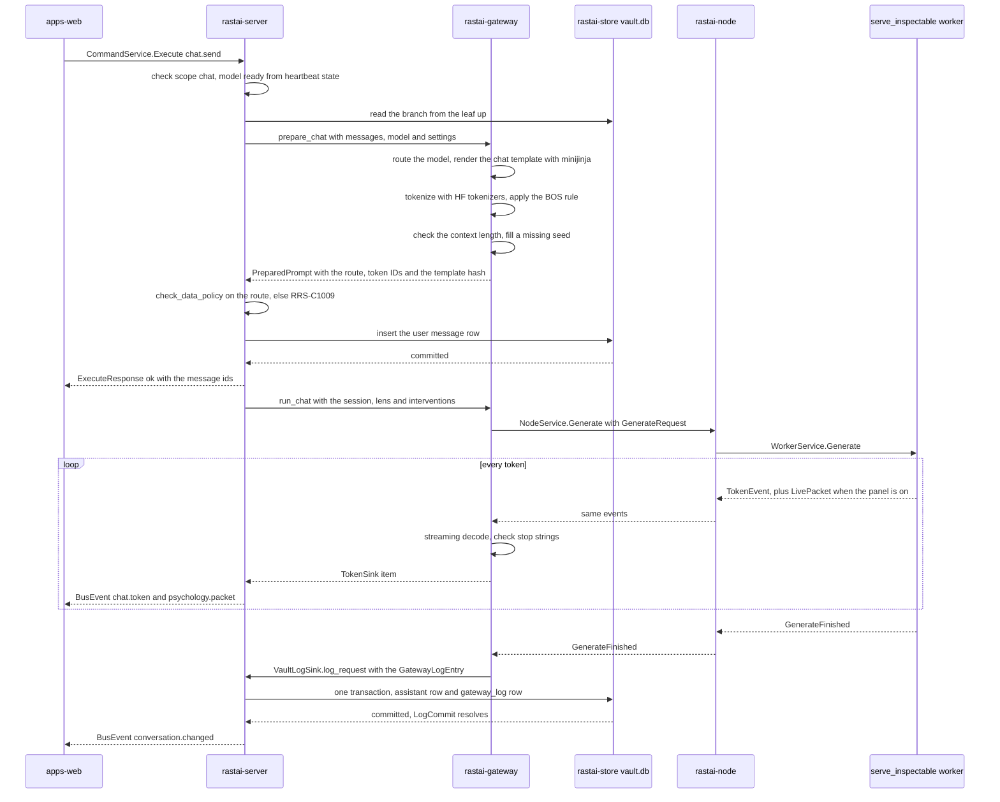

Not obvious from the picture:
- **Who writes.** `rastai-server` reads the branch on a reader connection and hands plain messages to the gateway. The gateway never imports the store (contracts §2.4 rule 7). `VaultLogSink` (in `rastai-server`) writes both rows and emits `conversation.changed` after the commit. Its `LogCommit` lets the gateway await the commit (plan §10 row 20).
- **Tokenize first, then write.** A template error (`RRS-G1002`) or an over-long prompt (`RRS-G1005`) writes nothing, and the composer keeps the user's text.
- **Seed:** when `seed` is null, the gateway draws one and logs it, so every turn can be re-run.
- **Generation belongs to the daemon, not to the HTTP call.** `chat.send` returns once the user row commits. Closing the tab doesn't stop generation; `chat.stop` does. A `chat.send` turn therefore never ends `client_disconnected`.
- **Model version:** the gateway logs `model_hash` and a `model_ref` whose revision is resolved to the commit hash from the HF cache's `refs/`, never `@main`.
- **What an assistant row's `token_ids` hold:** the full sequence the model saw and produced, prompt IDs first, then generated IDs.
  - `settings_json.prompt_token_count` *(new)* marks the split.
  - Replaying a branch is one read of its leaf row. It is exact for any chat template, including templates that re-render earlier turns.
  - The cost is quadratic storage (about 3 MB for 100 turns of 8k tokens), which SQLite handles.
- **`settings_json` on the assistant row** holds:
  - `sampling` (with the seed), `runtime`, `lens`, `interventions` (section 7) and `prompt_token_count`;
  - for Fast turns, `engine` *(new)*: the pinned llama-server build.
- **`finish_reason`** *(new column on `messages`)* uses the gateway's `FinishReason` names (node layout §6.2): `stop`, `length`, `cancelled`, `client_disconnected`, `error`, `evicted`.
- **No conversation text outside `vault.db`.**
  - The command journal stores `chat.*` arguments with the message text removed.
  - Structured logs carry ids, counts and timings only (node layout §6.7, `privacy.rs`).
  - Run event logs carry ids, counts and hashes only: a job's `gateway.request_logged` points at a record blob that the daemon moves into `vault.db` and then deletes (9.2).
  - `vault.db` is the one file SQLCipher will encrypt in Phase 2.
- **Data policy before anything is written:** the handler calls `check_data_policy` on the prepared route before it inserts the user row, so a refusal (`RRS-C1009`) leaves no trace but the journal row (1.3).

The daemon's side, in the house style:

```rust
// crates/rastai-server/src/commands/handlers/chat.rs
pub async fn send(context: &CommandContext<'_>, arguments: ChatSendArgs) -> Result<CommandOutput, Vec<Diagnostic>> {
    let request = build_chat_request(context, &arguments)?;                  // the branch, read from vault.db
    let prepared = prepare_chat(&context.server.gateway, &request)
        .map_err(gateway_error_to_diagnostics)?;                              // render, tokenize, context check, seed
    check_data_policy(project_data_policy(context), &prepared.route)
        .map_err(|diagnostic| vec![diagnostic])?;                             // RRS-C1009, before anything is written
    let message_ids = insert_user_message(context, &arguments, &prepared).await?;  // committed before generation
    start_generation(context, request, prepared, &message_ids);              // run_chat on a daemon task, VaultLogSink
    Ok(chat_send_output(&message_ids))
}
```

**Persisted:**
- durable, before generation: the user `messages` row (`vault.db`); the `command_journal` row with the text removed (`rastai.db`);
- durable, after generation: the assistant `messages` row and the `gateway_log` row, in one transaction; then `conversation.changed`;
- ephemeral: `chat.token`, `psychology.packet`, and the worker's KV cache for the session (GPU memory only).

**Tests:**
- `tests/e2e/chat_turn.spec.ts`: send and watch tokens stream. Then `conversation.get` and `gateway.log.list` show the token IDs, `model_hash`, the resolved revision and a filled seed.
- `crates/rastai-gateway/tests/tokenizer_parity.rs`: the 162-case corpus in `fixtures/tokenizer/` gives the IDs recorded from llama.cpp in spike 04, with 0 mismatches and the whole-spec case not truncated.
- `tests/crash/chat_daemon_kill`: kill -9 the daemon mid-stream. After restart, the user row is intact and no torn assistant row exists. The worker was reattached without a reload, and Regenerate works.
- `tests/crash/chat_worker_kill`: kill -9 the worker mid-stream. The partial reply is saved with `finish_reason = error` and `RRS-J1001`.
- `crates/rastai-server/tests/journal_redaction.rs`: after a chat, a marker string from the message appears nowhere in `rastai.db` or `<state>/logs/`.

### 1.2 Turn on the `/v1` endpoints (Navi, scripts)

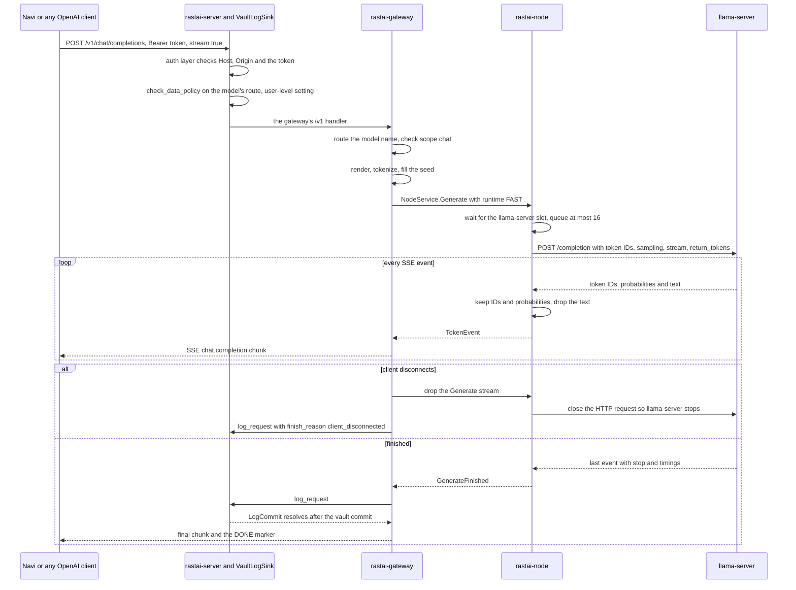

Not obvious:
- **Auth:** a scoped Bearer token with `chat`. API models also need `gateway.spend` (1.3). Host and Origin are checked on every request (§21).
- **Data policy:** `gateway_glue/routing.rs` in `rastai-server` resolves the `model` field with the gateway's `route_model` and calls `check_data_policy` with the user-level setting before the gateway sees the request. A refusal is HTTP 403 with `RRS-C1009` in the error JSON (1.3).
- **Model names** (node layout §6.3):
  - a local model is served under its repo name, on the runtime it is loaded on;
  - a `:inspectable` or `:fast` suffix picks the runtime when the model is loaded on both;
  - API models are `<adapter_name>/<model>`;
  - a steering preset is its `served_model_name` (7.3).
- **Stateless:**
  - `/v1` requests carry the whole message list.
  - No conversation is created, only a `gateway_log` row with an empty `conversation_id`. That row holds the prompt and generated IDs, so Psychology can replay it by `request_id` (6.1).
  - An Inspectable model gets a temporary session, closed when the stream ends.
- **A disconnect cancels** on `/v1`, because nobody is left to receive the answer. On `chat.send` it doesn't (1.1).
- **Anthropic endpoint** `/v1/messages`: the same path. Only the request shape (top-level `system`, content blocks) and the SSE event names (`message_start`, `content_block_delta`, `message_stop`) differ.
- **`/v1/models`** lists ready local models, served steering presets, and configured API models when the token has `gateway.spend`.
- **llama-server request mapping** (node layout §7.8):
  - `return_tokens` is on, so IDs come back (spike 04);
  - `n_probs` is set when `return_logprobs` is;
  - `cache_prompt` is on, except when `pin_attention_kernel` is set;
  - the node watches the stream for any `stop_token_ids` beyond llama-server's own end tokens.
  - Exactness comes from the Inspectable twin, not from the Fast runtime (section 2).
- **Incognito on `/v1`:** the request header `X-Rastai-Incognito: 1` skips all logging (1.4).
- **The final chunk is sent only after the commit,** so a client that has seen `[DONE]` knows the row exists.

**Persisted:** one `gateway_log` row per request (durable), with `finish_reason`; nothing else.

**Tests:**
- `crates/rastai-gateway/tests/openai_endpoint.rs` and `anthropic_endpoint.rs`: golden request/response pairs, streaming and non-streaming, against a mock node runtime.
- `tests/gpu/fast_runtime_stream`: Navi-style streaming through a real llama-server; the logged `generated_ids` equal the IDs llama-server returned.
- `crates/rastai-gateway/tests/disconnect.rs`: closing the client mid-stream cancels the node stream within one token and logs `client_disconnected`.
- `crates/rastai-node/tests/fast_runtime.rs`: a 17th queued request gets `RRS-G3006`.

### 1.3 Routing decision

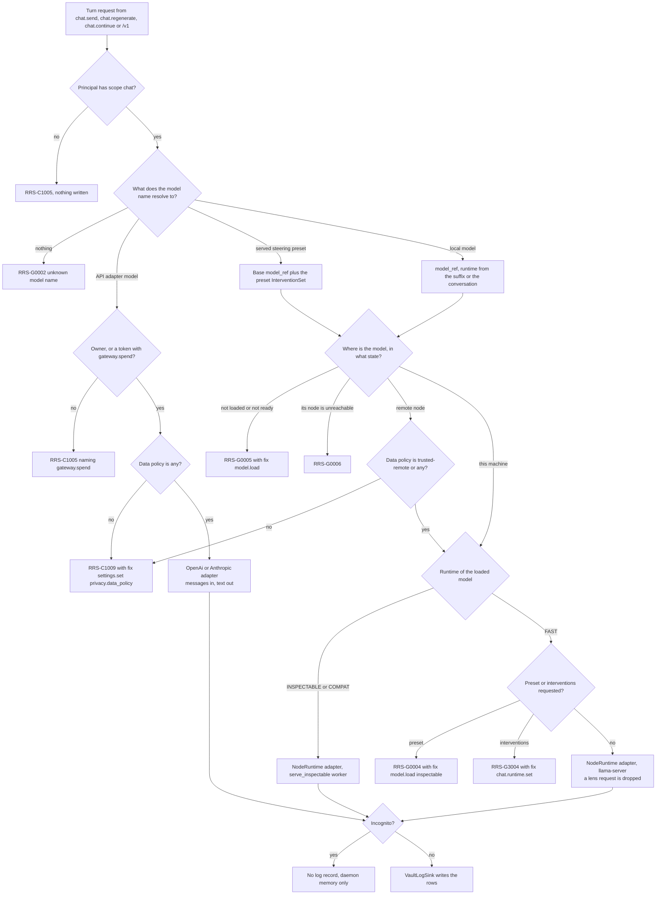

Not obvious:
- **Data policy is one ladder** (§24):
  - `local-only` keeps everything on this machine; `trusted-remote` adds paired nodes; `any` adds third-party APIs.
  - The default is `local-only` (contracts §11.2), so the first API chat or remote-node chat shows `RRS-C1009`, "the project's data policy forbids this" (plan §10 row 37, M1-13). The training and designer flows raise the same code for the same refusal.
  - Its fix button runs `settings.set privacy.data_policy`, at project level (user level for chats outside a project).
  - One function decides both cases: `check_data_policy` in `rastai-server`'s `policy.rs` *(new file)*, the daemon's policy check. It runs before anything starts:
    - for `chat.*`, in the handler, on the `PreparedPrompt.route`, with the project's policy, before the user row is written (1.1);
    - for `/v1`, in `gateway_glue/routing.rs`, with the user-level setting, before the gateway routes the request (1.2).
  - The gateway doesn't check the policy itself. Its `privacy.rs` keeps incognito, log fields and retention (node layout §6.7).
  - The egress badge (`privacy.show_egress_badge`) is on whenever the active model is an API model or sits on a remote node.
- **Scopes** are checked by `rastai-server`'s `check_scope` (control-plane layout), which returns `RRS-C1005` naming the missing scope.
- **Fast with a lens:** the gateway drops the lens rather than failing the chat, and the panel shows `RRS-G3004` with its fix (5.1). Interventions and presets are refused, because silently dropping them would change the answer.
- **COMPAT models** (unsupported architectures on HF `transformers`) are served by the same `serve_inspectable` job kind with `runtime = COMPAT`. Psychology sees only the opaque node's edges.
- **The adapter set is closed** (node layout §6.2): `NodeRuntime`, `OpenAi`, `Anthropic`, plus `DaemonForward` in a node's gateway. OpenAI-compatible endpoints use `OpenAi` with another base URL.

```rust
// crates/rastai-server/src/policy.rs
// policy is the resolved privacy.data_policy value: "local-only", "trusted-remote" or "any".
// A local model passes any policy, a remote node needs trusted-remote or any, an API adapter needs any.
pub fn check_data_policy(policy: &str, route: &RouteTarget) -> Result<(), Diagnostic>   // RRS-C1009 with the settings.set fix
```

**Persisted:** on a refusal, only the `command_journal` row (`ok = false`, with the code).

**Tests:**
- `crates/rastai-gateway/tests/routing.rs`: one table-driven case per gateway branch of this chart, each asserting the code or the adapter chosen. The two policy branches belong to `data_policy.rs` below.
- `crates/rastai-server/tests/data_policy.rs`: each policy against a local, remote and API route, through `chat.send` and `/v1`. A refusal is `RRS-C1009` and writes no `messages` or `gateway_log` row.

### 1.4 Logging, incognito and retention

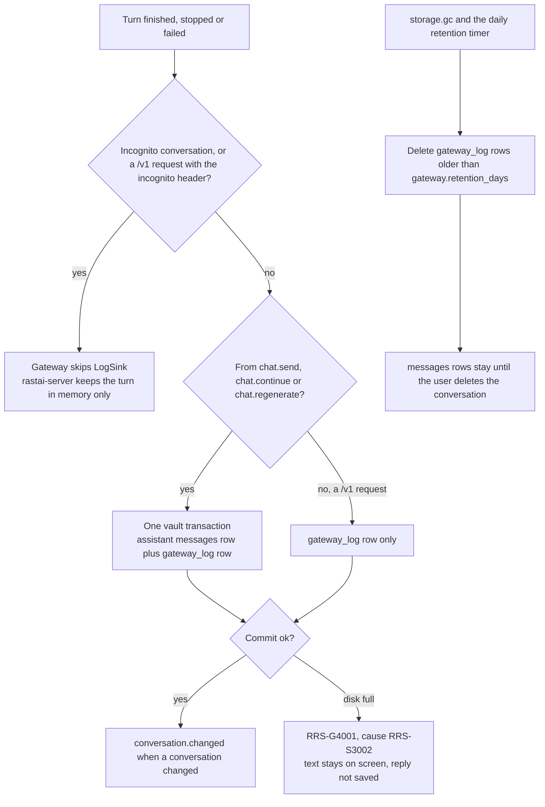

Not obvious:
- **Where incognito comes from:** `chat.create` with its incognito flag (default `gateway.incognito_default`), or the `/v1` header.
  - An incognito conversation lives in an in-memory map in `rastai-server`.
  - It disappears when the user closes it or the daemon restarts. On close, the daemon calls `CloseSession`, so the worker frees the KV cache.
- **Incognito still gets the live panel, interventions and branches**, all in memory. Replay, export and **Prefer this branch** are refused with `RRS-L0006`, because each one writes to disk.
- **Retention** applies to `gateway_log` only (§8, node layout §6.7).
  - Rows older than `gateway.retention_days` (default 30; null keeps them forever) are deleted by `storage.gc` and by a daily timer in `rastai-server`.
  - This includes rows the node gateway logged for jobs (`gateway_log.run_id` set).
  - Retention really removes the content: the job's `events.log` keeps only the request's ids, counts and hashes, and the record blob was deleted when the row was indexed. A re-index or a rebuild finds no record and writes nothing (9.2).
  - Conversations are user-managed: delete or archive (section 9).

**Persisted:** as drawn. Incognito: nothing durable anywhere.

**Tests:**
- `tests/e2e/incognito.spec.ts`: an incognito chat with a marker string and the live panel on. Then grep `vault.db`, `rastai.db`, `<state>/logs/` and `<data>/blobs/` for the marker: no hits. Replay and Prefer return `RRS-L0006`.
- `crates/rastai-server/tests/retention.rs`: with a fake clock, rows older than the setting are deleted, and `messages` rows are untouched. Re-indexing the job's `events.log` afterwards doesn't bring a deleted row back.

### 1.5 Failure table (1.1 and 1.2)

| Failure | Detected by | User sees | Persisted |
|---|---|---|---|
| Template fails to render | `rastai-gateway` (`prepare_chat`) | `RRS-G1002` with the template's message | nothing; the composer keeps the text |
| Tokenizer files missing or unreadable | `prepare_chat` | `RRS-G1003` (fix `model.twin.set` for a GGUF-only model) or `RRS-G1001` | nothing |
| Prompt longer than the context window | `prepare_chat` | `RRS-G1005`. Never truncated silently: spike 07 found DJL truncating silently | nothing |
| Model not loaded or not ready | `rastai-server` (heartbeat state) | `RRS-G0005` with fix `model.load` | nothing |
| Data policy forbids the model's location (API adapter, remote node) | `rastai-server` (`check_data_policy`, before the user row or before the gateway on `/v1`) | `RRS-C1009` with fix `settings.set privacy.data_policy`; HTTP 403 on `/v1` | nothing |
| Queue wait plus prefill over 120 s, or no token for 60 s | `rastai-gateway` | `RRS-G0009` | user row; partial assistant row, `finish_reason = error` |
| Fast queue full | `rastai-node` | `RRS-G3006` | user row only |
| `chat.stop` | UI | the partial answer stays | assistant row, `finish_reason = cancelled` |
| Worker killed (kill -9 or another signal) | `rastai-node` (exit cause) | `RRS-J1001` with the signal, and a Regenerate button | partial row, `finish_reason = error`; `job.state_changed` with the cause |
| Worker exits with its own error (exit 1) | `rastai-node` | the worker's last `diagnostic.reported` | partial row |
| CUDA OOM during a step | worker | `RRS-H3007`; the model stays loaded, the session is closed | partial row |
| llama-server dies | `rastai-node` (process and stream watch) | `RRS-G3003` | partial row; model `failed` → `unloaded` |
| Model evicted for a training job | `rastai-node` | `RRS-H3004` (info) | partial row, `finish_reason = evicted` |
| Daemon kill -9 | nobody, until restart | after restart, the user message has no reply; Regenerate | user row only; workers keep running (4.8) |
| Disk full when logging | vault writer | `RRS-G4001` (cause `RRS-S3002`); the text stays on screen | user row only |
| Network drop to a remote node | `rastai-transport` | `RRS-G0006`; the node shows `RRS-N2001` after 15 s | partial row (section 8) |
| `/v1` client disconnects | `rastai-gateway` | nothing (the client is gone) | `gateway_log` row, `client_disconnected` |
| Malformed `/v1` body | `rastai-gateway` | HTTP 400 with `RRS-G0001` in the error JSON | nothing |

---

## 2. Runtime toggle and replay twins

Runs when the user flips the Inspectable/Fast toggle in chat (`chat.runtime.set`), maps a quantized model to its full-precision weights (`model.twin.set`), or opens a Fast-runtime conversation in Psychology.

### 2.1 Runtime toggle

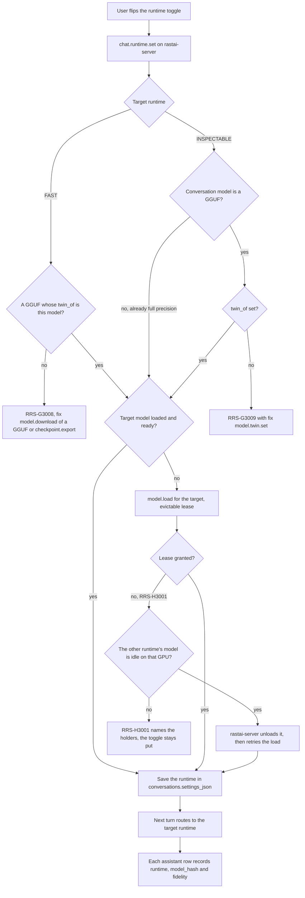

Not obvious:
- **The toggle affects the next turn.** A running turn finishes on its runtime.
- **No conversion is needed.** The context is token IDs from one tokenizer, so the new runtime prefills the whole context: llama-server at 44k tok/s, Inspectable at ~36k tok/s on the 5080 (spike 04).
- **The swap is the daemon's job.** The node never evicts one chat model for another: an evictable request is granted or denied (node layout §7.7).
  - `rastai-server` unloads the other model only when it is idle: no generation running, and no replay job using it.
  - Then it retries the load.
- **The pair comes from `models.twin_of`** in `rastai.db`. If several GGUFs point at the same twin, the one used most recently wins; `chat.runtime.set` takes an optional `model_ref` *(new argument)* to pick another.
- **Both models stay resident when they fit.** Gemma 3 1B as a Q4 GGUF plus bf16 weights fits easily on 16 GB.
- **Fast has no live panel or interventions.** The panel shows `RRS-G3004` with the fix `chat.runtime.set`, plus a button that replays the conversation on the twin (6.1).

**Persisted:**
- `conversations.settings_json` *(new column)* gets the runtime (durable).
- Each assistant row stores `runtime` in `settings_json`, plus `model_hash` and the fidelity known at write time:
  - `exact` for Inspectable output;
  - `exact` or `approximate` for Fast output, by the twin rule in 2.2;
  - `proxy` for API output.

**Tests:**
- `tests/e2e/navi_chat.rs` (the M3 exit test): three turns Inspectable, three Fast, three Inspectable in one conversation through `/v1`. Each row's runtime and fidelity are right, and the context IDs are continuous.
- `crates/rastai-server/tests/toggle.rs`: every refusal branch returns its code and leaves the setting unchanged; the swap unloads only an idle model.

### 2.2 Twin mapping and the fidelity label

`model.twin.set` checks and records the pair. Replay then labels every message by this chart:

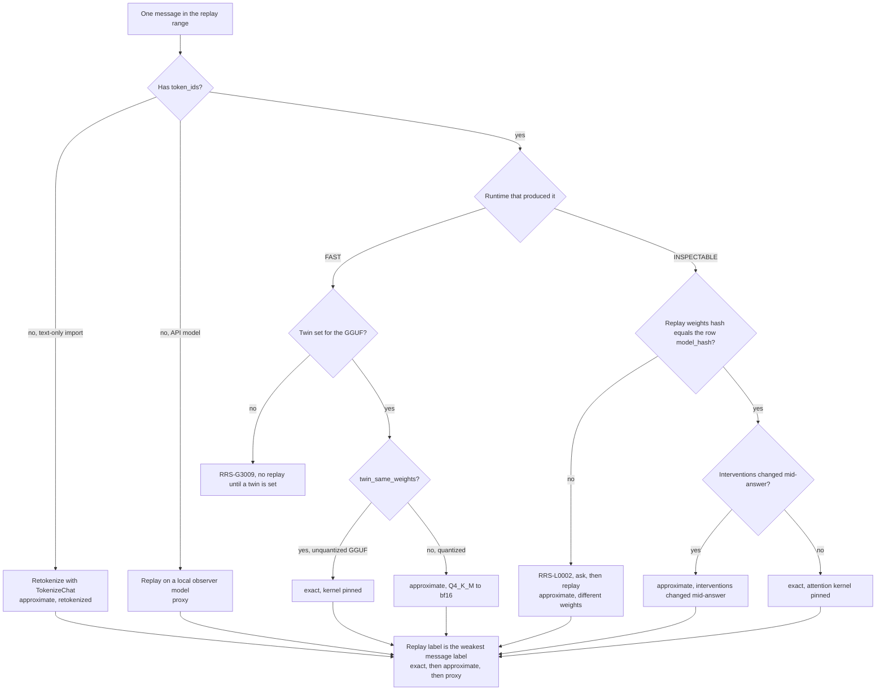

The replay's consistency check (6.1) can still lower `exact` to `approximate`.

`model.twin.set` (owned by `rastai-server`, sync):
1. Reads both models' `models.format_info_json` *(new column)*. The node fills it when a download finishes or a cached model is first scanned, from the GGUF header (`read_gguf_header`, node layout Q9) or `config.json`. It holds architecture, vocabulary size, file type or dtype, and a hash of the tensor names and shapes.
2. Refuses a family, vocabulary-size or shape mismatch with `RRS-G3010`.
3. Sets `models.twin_same_weights` *(new column)* when the GGUF is unquantized (F32, F16 or BF16) and the shapes match. ADR-0025 #5 allows `exact` only for the same tensors.
   - Matching names and shapes don't prove matching values, for example an f16 GGUF of a fine-tune.
   - The replay's consistency check (6.1) catches that case: it lowers the label to `approximate` with `RRS-L0003`.
4. Records `models.twin_of`. From then on the gateway takes the GGUF's tokenizer files from the GGUF repo if present, else from the twin (node layout §6.8). Every llama-server load proves the two tokenizers agree (4.4).
5. Builds the label text from the GGUF file type and the twin's dtype, for example `approximate: Q4_K_M → bf16`.

Not obvious:
- **Why quantized replays are only approximate:** in spike 04 the f16 GGUF matched our fp32 runtime on every token of 4 prompts, but Q4_K_M diverged after 3–9 tokens.
- **Interventions changed mid-answer** (a slider moved while tokens streamed, 7.1) can't be replayed in one forward pass, so the row is flagged and labeled honestly.
- **Different hardware keeps the `exact` label** and shows the hardware fingerprint next to it. A replay on other hardware matches within a stated tolerance, not bit for bit (§26).

**Persisted:** `models.twin_of` and `twin_same_weights` (`rastai.db`, durable); `messages.fidelity` per row (`vault.db`). On export, the computed label goes into `replay.json` `fidelity` (6.4).

**Tests:**
- `tests/gpu/fast_twin_parity` (nightly, M3-E10): from identical token IDs, an f16 GGUF on llama-server and its twin on the Inspectable runtime give the same greedy tokens on the 4 spike prompts.
- `plugins/psychology/python/rastai_psychology/tests/test_fidelity.py`: one case per leaf of the chart above.
- `crates/rastai-server/tests/twin_set.rs`: vocabulary mismatch → `RRS-G3010`; Q4_K_M → not same weights; F16 with matching shapes → same weights.

---

## 3. Third-party API chats and proxy replay

Runs when a conversation's model is an `api:<adapter>/<model>` ref, and when the user opens such a conversation in Psychology.

### 3.1 API chat turn

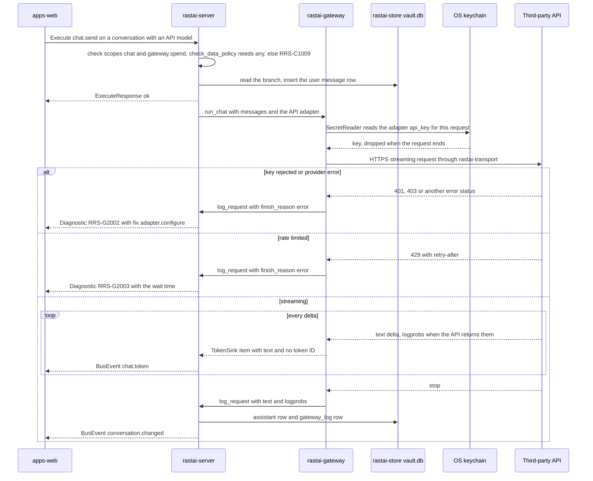

Not obvious:
- **Key handling:** `SecretReader` reads the key from the keychain (account `adapter.<adapter_name>.api_key`, contracts §8.5) on every request. It is never cached, logged or written to disk. A missing key fails before any network call with `RRS-G2001` and the fix `adapter.configure`.
- **No token IDs.** The API's own tokenizer is unknown.
  - `token_ids` and `model_hash` are empty, `fidelity = proxy`, and `gateway_log.text` holds the text.
  - OpenAI-compatible adapters request `logprobs` with `top_logprobs`; Anthropic returns none.
- **Retries** (node layout §6.10): one retry on a connect error before any byte arrives, never after the first byte. A 429 shows `RRS-G2003` with the server's wait time; the user presses Retry (`chat.regenerate`).
- **Timeouts:**
  - connect: 10 s, then `RRS-G2004` *(new)*;
  - first token: 120 s, and a stall of 60 s, both `RRS-G0009`.
  - A connection that drops mid-stream saves the partial text with `RRS-G2004`.
- **Live Psychology is greyed out** for API models (§9). The panel offers a proxy replay (3.2).

**Persisted:** the user row before the call. After it, the assistant row and the `gateway_log` row: text, logprobs blob, `sampling_json`, `adapter`, `finish_reason`. Never the key.

**Tests:**
- `crates/rastai-gateway/tests/api_adapters.rs` (M3-E08): a mock HTTPS server per adapter replays recorded streams, a 401, a 429, a connect failure, a mid-stream drop and a stall. Each gives the code above and the right row.
- `crates/rastai-gateway/tests/no_secret_leak.rs`: after those runs, the key string appears in no row, log line or event.

### 3.2 Proxy replay through a local observer model

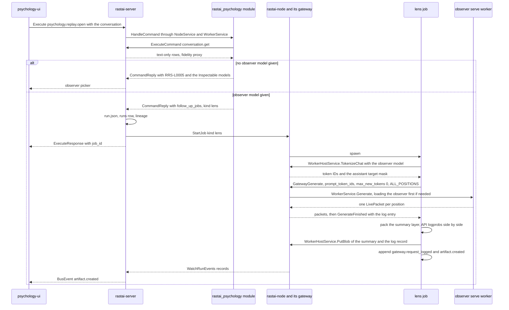

Not obvious:
- **The observer is any Inspectable model the user picks.** `PM` lists the candidates in the `RRS-L0005` reply.
  - If the observer isn't loaded, the node loads it under an evictable lease before `TokenizeChat` or `GatewayGenerate` runs. That load-on-demand rule is a contract addition proposed in training-evaluation §16.
- **`TokenizeChat`** (Python layout §14, node layout §6.6) renders the messages with the observer's chat template.
  - It returns the token IDs plus a target mask.
  - The mask marks each assistant span, which labels the timeline.
  - Tokenization stays in a gateway (§18).
- **What the observer shows** is how *that* model represents the text, not what the API model did.
  - Every view carries the `proxy` label.
  - When the API returned logprobs, the timeline shows them beside the observer's probabilities for the same text.
- **The node gateway logs the replay request once.** The record (prompt IDs, no generated IDs) comes back in `GenerateFinished.gateway_log`.
  - The lens job puts the record in a record blob and appends `gateway.request_logged` with the `request_id`, counts, hashes and the blob's `BlobRef`, never the IDs themselves.
  - The daemon moves the record into `gateway_log` with `run_id`, then deletes the blob (node layout §6.6; the payload change is 9.2's).
- After the job, rewind and branch work on the observer's session like any replay (section 7). The branches belong to the observer model, and the UI labels them so.

**Persisted:**
- the summary blob (`<data>/blobs/`);
- an `artifacts` row of kind `replay_summary` *(new)*;
- a `lineage` row `replay_of` *(new)* from the summary to the conversation;
- one `gateway_log` row with `run_id`; the record blob only until that row commits;
- the lens job's run folder (`run.json`, `events.log`), with no conversation content in it.
- The conversation itself is unchanged.

**Tests:**
- `tests/e2e/proxy_replay.spec.ts`: import a fixture API conversation from `fixtures/conversations/`, replay it on the tiny Gemma fixture, and check the `proxy` label and one summary row per observer token.
- `plugins/psychology/python/rastai_psychology/tests/test_replay_open.py`: with no observer, the reply is `RRS-L0005` and no job starts.

---

## 4. Model loading and VRAM leases

Runs on `model.load` and `model.unload` (UI, CLI, MCP, or the runtime toggle), when a training job needs GPU memory, and when the daemon restarts with models still loaded. The generic lease decision and job lifecycle are drawn in platform flows 5.1–5.3 and node layout §7.4, §7.7; this section draws what they mean for chat.

### 4.1 Model load lifecycle

The states are contracts §9.3. `rastai-node` owns them and reports each change in its heartbeat; the daemon turns the change into `model.state_changed`.

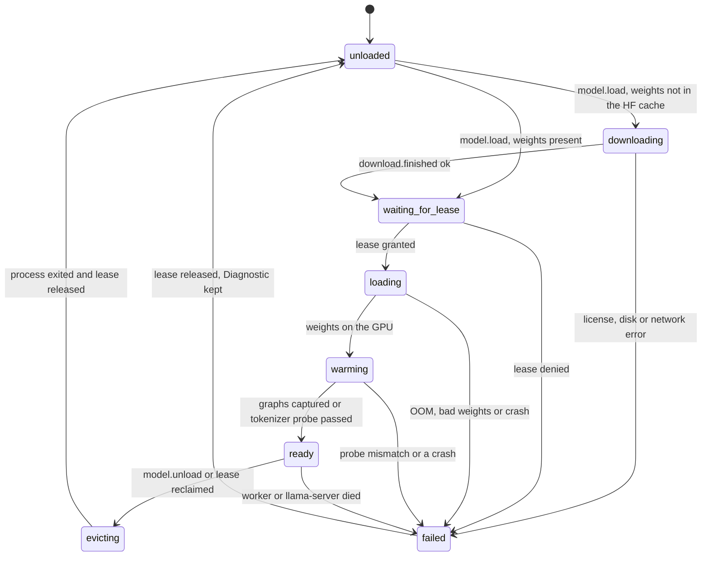

What each state means per runtime:

| State | Inspectable (`serve_inspectable` worker) | Fast (`serve_fast`, llama-server) |
|---|---|---|
| `downloading` | `download` job into the HF cache: license check, free-space check, resumable (platform flow 1.5) | the same, for the GGUF file |
| `waiting_for_lease` | evictable lease for weight bytes + KV cache + `INSPECTABLE_OVERHEAD_PERCENT` (node layout §7.8) | evictable lease for GGUF size + KV cache from the GGUF header + `FAST_COMPUTE_BUFFER_BYTES` |
| `loading` | spawn the worker; compile the ModelSpec from the family mapping; read safetensors with the in-house strict reader | verify the build's SHA-256, spawn llama-server, poll `/health` |
| `warming` | allocate the decode slots, capture the `off` graph for the first slot, time the baseline, resize the lease to the measured peak | tokenizer parity probe through `/tokenize`; resize the lease to the measured VRAM plus 5% |
| `failed` codes | `RRS-H3006` (OOM), `RRS-M2001`–`M2005` (weight binding, designer-gym-remote A2), `RRS-J1001` (killed). `RRS-M4001` is only a warning (eager fallback) | `RRS-G3005` (build hash), `RRS-G3002` (not healthy), `RRS-G3003` (died), `RRS-G1004` (tokenizer mismatch), `RRS-G1003` (no tokenizer files) |

**Persisted:**
- `model.state_changed` is durable but node-originated, so it isn't in an event log. Every `Heartbeat` carries `ModelInfo[]`, sent at once on any change, and the daemon reconciles by snapshot (contracts §7.3; node layout §7.5).
- `models.model_hash` is computed once per weight set (BLAKE3 over the files) and cached in `rastai.db`.

**Tests:** `crates/rastai-node/tests/model_states.rs`: each transition, driven by a fake worker and a fake llama-server script, including every `failed` edge.

### 4.2 VRAM lease lifecycle

The states are contracts §9.4. `rastai-node`'s lease table owns them; the grant decision is node layout §7.7 and platform flow 5.3.

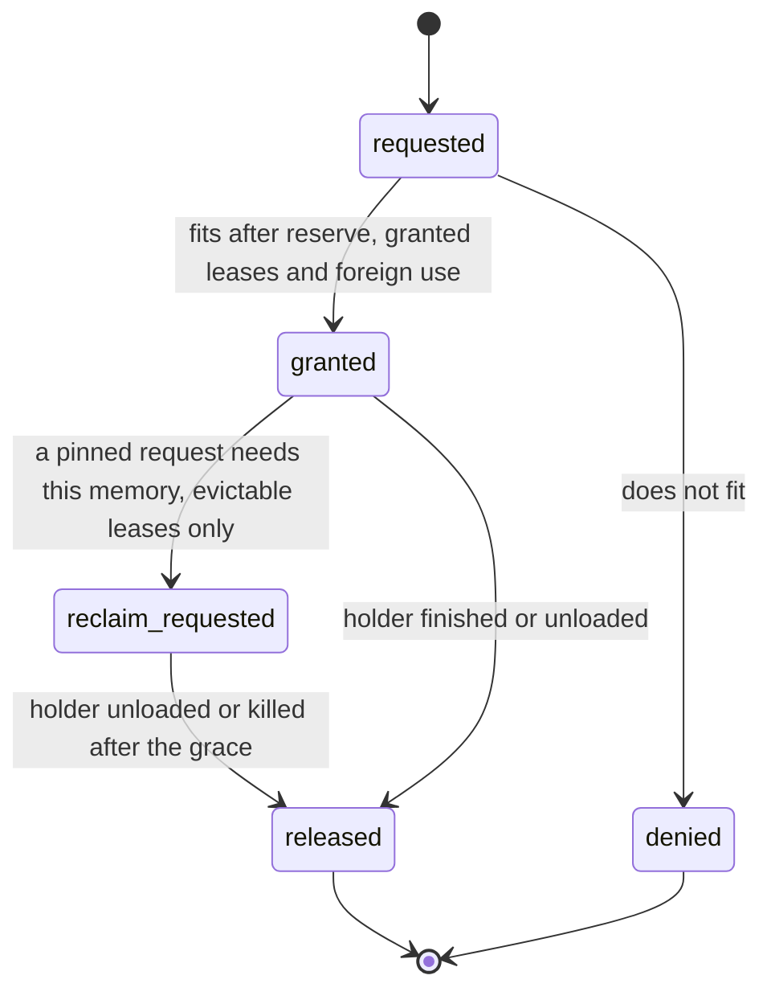

What it means for chat:
- Chat and Psychology models (`serve_inspectable`, `serve_fast`) hold `evictable` leases. Training and gym jobs hold `pinned` ones.
- Only a pinned request reclaims. An evictable request is granted or denied (`RRS-H3001`, listing the holders).
- `ResourceRequest.may_reclaim_evictable` *(training-evaluation §16)* is false for auto-run evals and for Psychology analysis jobs (6.5). Those jobs wait in the queue instead of evicting chat.

**Persisted:** in node memory and in each holder's `job.json` (`granted_leases`), so a node restart rebuilds the leases from reattached jobs (4.8). `lease.state_changed` reaches the daemon through heartbeats; there is no lease table in `rastai.db`.

**Tests:** `crates/rastai-node/tests/leases.rs` (M3-E03): grant; deny with `RRS-H3001`; reclaim the least recently used; pinned never reclaimed; foreign VRAM counted; on a fake two-GPU profile (16 GB + 24 GB).

### 4.3 Loading an Inspectable model

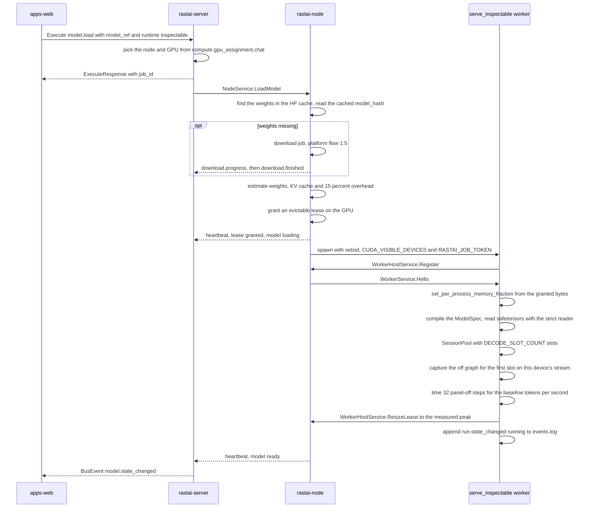

Not obvious:
- **GPU choice:**
  - an explicit GPU wins;
  - else `compute.gpu_assignment.chat` (training jobs use `.training`);
  - else the GPU with the most free memory that fits.
  - With the owner's box set to `{chat: 0, training: 1}`, chat and training never meet in one lease pool. That is the normal, eviction-free setup.
- **The lease:** the node's estimate (node layout §7.8) covers the weights, the KV cache and `INSPECTABLE_OVERHEAD_PERCENT`.
  - After warm-up the worker compares `torch.cuda.max_memory_reserved()` with the lease and calls `ResizeLease`. A denied resize fails the load with `RRS-H3001`.
  - SAEs add a resize when the live panel turns on (5.1).
  - Spike reference: the whole Gemma 3 1B stack with the panel peaks at 2.7 GiB.
- **Decode slots** (`SessionPool`, Python layout §2.2): each slot is a preallocated KV cache plus token and position buffers. The CUDA graphs are captured against those buffers (spike `StaticDecoder`).
  - Sessions bind to slots.
  - A third session evicts the least recently used one: its cache is dropped, and the next request re-prefills (rule 0.2).
  - The second slot captures its graph on first use.
- **Capture failure isn't fatal.** If capture fails (an op that can't be captured, or the graph pool runs out of memory), the worker decodes eagerly at about a third of the speed. It reports `RRS-M4001` *(proposed number in the `RRS-M4xxx` range)* as a warning, and the UI shows the measured speed.
- **The worker reports readiness through its event log** (`run.state_changed`), and `NODE` turns that into model `ready`. Every serve job has a run folder for `job.json` and `events.log`, like any job.

The slot, as plain data:

```python
# python/rastai_models/decoding.py
DECODE_SLOT_COUNT = 2   # chat plus one branch side by side; other sessions re-prefill on demand (~36k tok/s, spike 04)

@dataclass
class DecodeSlot:
    cache: KeyValueCache
    token_buffer: torch.Tensor      # [1, 1]; the captured step reads and writes it on the GPU
    position_buffer: torch.Tensor   # [1]
    graphs: dict[str, torch.cuda.CUDAGraph]  # one per lens variant: "off", "summary"
    session_id: str = ""
    last_used_unix_ms: int = 0
```

**Persisted:**
- the run folder: `run.json`, `job.json` (pid, process group, start ticks, `job_token_hash`, granted leases; 0600) and `events.log`;
- `jobs` and `runs` rows in `rastai.db`, and the `models` row with the hash.
- Weights are never copied out of the HF cache (§19).

**Tests:**
- `tests/gpu/load_inspectable`: load Gemma 3 1B on each GPU and reach `ready`; the measured peak is within the lease.
- `tests/gpu/two_gpu_capture` (M3-E04): capture on GPU 1 after GPU 0 was used first in one process; both captures succeed. This is the spike 02 capture-stream bug.
- `python/rastai_models/tests/test_capture_fallback.py`: a forced capture error gives `RRS-M4001` and the same greedy tokens through the eager path.

### 4.4 llama-server lifecycle

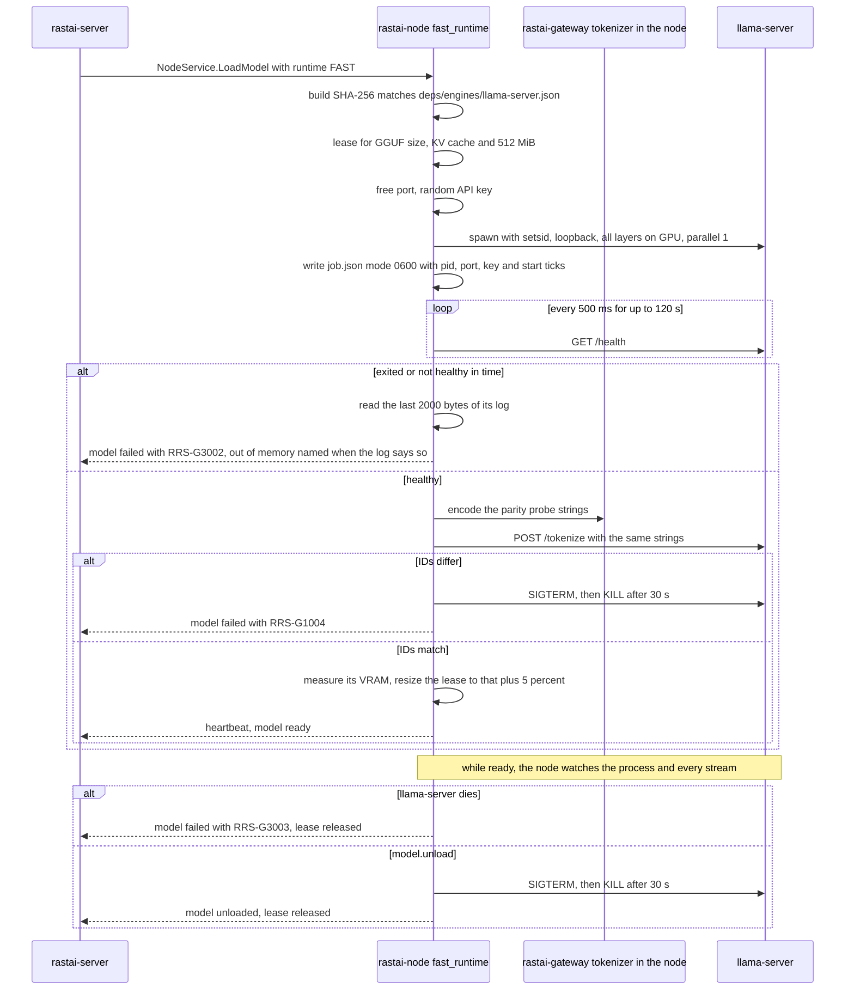

Not obvious:
- **Pinned and verified:** the build pinned in `deps/engines/llama-server.json` lives in `<data>/engines/llama-server/<build>/`.
  - A SHA-256 mismatch fails with `RRS-G3005`, and the build is re-downloaded once.
  - Official CUDA 13 builds ship their runtime libraries, so the node sets `LD_LIBRARY_PATH` to the build folder (spike 04).
- **Loopback only, a free port, a random `--api-key`** (contracts §3.1).
  - The key sits in node memory and in the job's `job.json` (0600). That lets a restarted node re-adopt the server (4.8).
  - It is never logged and never leaves the node.
- **GPU selection** follows rule 0.2: `CUDA_VISIBLE_DEVICES` is the leased GPU, with `--device CUDA0`, `--n-gpu-layers 999`, `--ctx-size` from the lease estimate and `--parallel 1`.
- **Its own process group (`setsid`),** so a daemon crash doesn't kill it (4.8).
- **Startup failures** share one code. An early exit and a server not healthy in 120 s are both `RRS-G3002`.
  - The Diagnostic carries the last 2,000 bytes of `<state>/logs/llama-server/<job_id>.log`.
  - When that tail holds llama.cpp's allocation-failure lines (`out of memory`, `failed to allocate`, `cudaMalloc failed`), the message says so and lists the lease holders (4.7).
- **The parity probe** (node layout §7.8) encodes fixed strings from the 162-case corpus with both tokenizers. It catches a GGUF whose embedded tokenizer disagrees with the gateway's files (wrong twin, or a converter bug).
- **Measured memory:** llama-server has no per-process memory cap, so the node sizes its lease from measured VRAM after the probe.
- **A malformed event mid-stream** fails that request with `RRS-G3007` instead of being skipped.

**Persisted:** `job.json` (0600), the server log in `<state>/logs/llama-server/`, the `jobs` row; model and lease state changes via heartbeats.

**Tests:**
- `crates/rastai-node/tests/fast_runtime.rs` with `tests/support/mock_llama_server.rs` (M3-E05). It covers a hash mismatch, an early exit with an OOM line, never healthy, a probe mismatch, a crash while streaming, a full queue and unload. Each gives its code and releases the lease.
- `tests/gpu/llama_server_lifecycle`: the real pinned build loads, passes the probe and unloads cleanly.

### 4.5 GPU choice and eviction

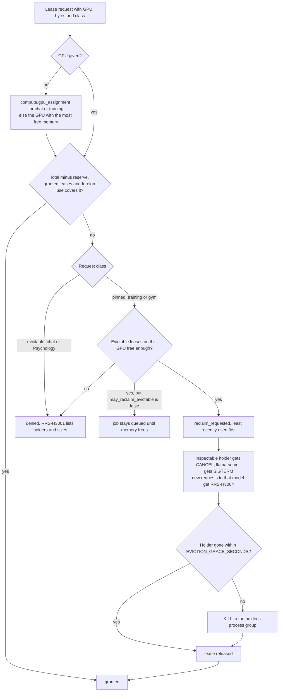

Rules:
- **Pinned leases are never reclaimed.** Training and gym jobs keep their memory until they finish.
- **Evictable requests never evict.** One chat model never pushes out another. The runtime toggle's swap is the daemon's explicit unload of an idle model (2.1).
- **In-flight answers get the grace.**
  - A running answer may finish within `EVICTION_GRACE_SECONDS`. After that it is cancelled and saved with `finish_reason = evicted` and `RRS-H3004` (4.6).
  - A holder still alive after the grace gets `KILL`, and its job ends `cancelled` with `RRS-J1003`.
- **Free memory is computed from leases, not from current use:** total − `compute.vram_reserve_bytes` − granted leases − foreign use. Foreign use (a game or another tool) comes from per-process telemetry.

**Persisted:** `lease.state_changed` (durable, via heartbeats); `job.state_changed` for the holder.

**Tests:** `crates/rastai-node/tests/leases.rs` (4.2), plus `tests/e2e/eviction.spec.ts` (4.6).

### 4.6 Eviction for a training job

Chat on GPU 0 and training on GPU 1 is the normal setup, with no eviction. This is the fallback when both want GPU 0 and don't fit; Teach it on one GPU usually fits next to chat (spike 03: 4.7 GiB peak).

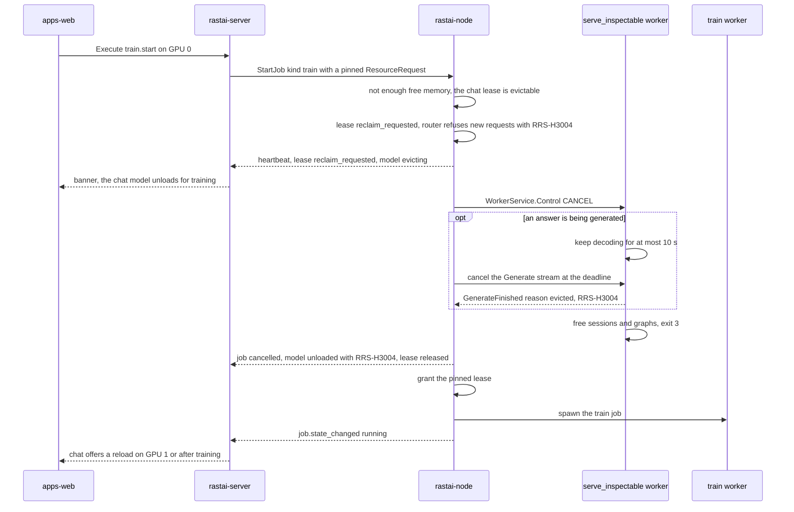

Not obvious:
- **`CANCEL` on a serve job** means drain (node layout §7.4: "unloading an Inspectable model"). The job takes no new requests, lets the running answer continue until the eviction deadline, frees its memory and exits 3, so the job ends `cancelled`.
- `RRS-H3004` is info, not an error, and names the training run that needed the memory. Its fix button runs `model.load` on the other GPU when one fits. Teach it reloads the chat model itself when its chain ends (training-evaluation §7.2).
- An answer cut by eviction is saved like a stopped one (`finish_reason = evicted`), so nothing the user saw is lost.

**Persisted:** the partial assistant row; `job.state_changed` for both jobs; lease and model state changes via heartbeats.

**Tests:** `tests/e2e/eviction.spec.ts` on a fake GPU profile small enough to force eviction: a streaming answer ends with `evicted`, the training job starts, and reloading afterwards works. `crates/rastai-node/tests/leases.rs`: a holder that ignores `CANCEL` gets `KILL` after 10 s and `RRS-J1003`.

### 4.7 OOM diagnostics

Every out-of-memory error ends in a `Diagnostic` that names:
- the GPU;
- the bytes asked for and the bytes free;
- every lease holder with its size.

The fix text suggests, in order: unload a named holder, use the other GPU, use a smaller dtype or a quantized Fast model, use a shorter context.

| Where | How it is detected | Code | Model state after | Also recorded |
|---|---|---|---|---|
| Lease too big | node lease decision | `RRS-H3001` | `failed` → `unloaded` | holders in the Diagnostic |
| Inspectable load | `torch.cuda.OutOfMemoryError` in the worker, mapped at its edge | `RRS-H3006` | `failed` → `unloaded` | the first lines of `torch.cuda.memory_summary()` in `stderr.log` |
| Inspectable step or replay | the same error inside `Generate` | `RRS-H3007` | stays `ready`; the session is closed | context length at the failure |
| llama-server load | allocation-failure lines in its log tail | `RRS-G3002` (message says out of memory) | `failed` → `unloaded` | log tail |
| Process above its lease | per-process telemetry, 10% over for 3 samples | `RRS-H3005` (warning); an evictable holder is then reclaimed | `evicting` → `unloaded` | measured bytes |
| Host RAM | worker or llama-server killed by a SIGKILL the node didn't send, while the cgroup's `memory.events` `oom_kill` count went up | `RRS-J1002` | `failed` → `unloaded` | RAM at the time, from telemetry |

A worker reports failure as a `Diagnostic` in its last `diagnostic.reported` and `job.state_changed`, never as a bare traceback; the traceback goes to `stderr.log` (contracts §10).

**Persisted:** the `Diagnostic` and `jobs.error_code` (`rastai.db`, durable); the details in the run folder's `stderr.log`.

**Tests:** `tests/gpu/oom_paths`:
- a lease larger than the GPU gives `RRS-H3001`;
- a memory fraction too small for the weights gives `RRS-H3006`;
- a context that overflows a tiny lease mid-generation gives `RRS-H3007`, and the model stays `ready`.

### 4.8 Daemon crash and reattach

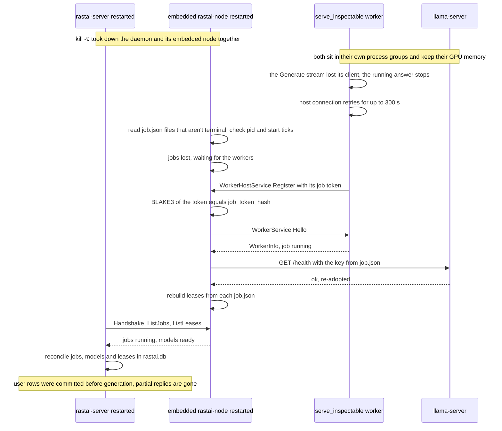

Not obvious:
- **`Register` comes first** (plan §10 row 5). The node stores only the token's hash, so it waits for the worker to re-register before calling `Hello`.
- **The PID-reuse guard** compares the process's start ticks with `job.json`, so the node never signals a reused pid.
- **Failure branches** (node layout §7.4, §7.8):
  - a process that is gone ends with the final state from its log if one is there, else `failed` with `RRS-J3002`;
  - a worker that doesn't re-register within 300 s ends `failed` with `RRS-J3003`, and its group is killed;
  - an unhealthy llama-server gets `KILL` and ends `failed` with `RRS-J3002`.
  - In each case the model goes `failed` → `unloaded`, and its lease isn't rebuilt.
- **The UI reconnects** with its last `bus_sequence`. A gap older than the buffer gives `RRS-C0401`, and the UI refetches with `conversation.get` and `model.list` (contracts §7.2).
- **A conversation whose leaf is a user message shows Regenerate.** Its context is still in the worker's slot cache, so regenerating skips the prefill.

**Persisted:** nothing new. Reattach only reads `job.json` and rewrites `jobs` and `runs` rows.

**Tests:** `tests/crash/serve_reattach`: with one Inspectable and one Fast model ready, kill -9 the daemon. After restart, both are `ready` with the same pids, no reload happened (load time under 1 s), and a new chat turn works on each.

---

## 5. Inspectable decode step and the live Psychology panel

Runs when the user turns on the live panel beside a chat (`psychology.live.start`), then for every generated token, in step mode (`psychology.step`), and when SAEs are fetched (`psychology.sae.load`).

### 5.1 Turning the live panel on

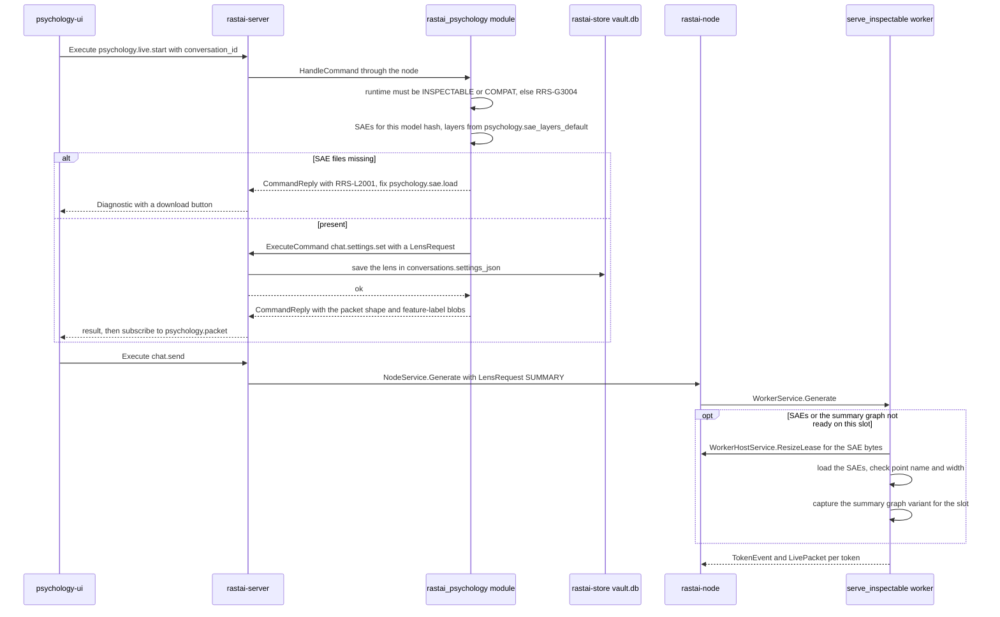

Not obvious:
- **`chat.settings.set`** stores the conversation's `LensRequest`. It takes a new `lens` argument *(new)*, alongside the sampling settings it already sets.
  - The request holds mode `OFF` or `SUMMARY` *(new enum values)*, the layers, the SAE ids, and top-k from `psychology.top_k`.
  - The gateway copies the lens into every `GenerateRequest` for that conversation. `psychology.live.stop` sets mode `OFF`.
- **The result** gives the packet shape (layer count, head count, SAE ids, top-k values) and the feature-label blobs (frontend layout §14.3). The UI decodes packet token IDs with the piece table from `model.vocabulary` (frontend layout §2.2).
- **A denied `ResizeLease`** doesn't fail the chat. The worker answers without packets and reports `RRS-H3001` through `diagnostic.reported`, and the panel says why it is empty.
- **COMPAT models** get the packet's entropy and final top-k only, the readouts at the opaque node's edges.
- **AttnRes designs:** the logit lens and SAEs read each layer's output. `model.inspect` marks the model, and the panel labels those readouts approximate (§9).

**Persisted:** the lens state in `conversations.settings_json` (`vault.db`, durable). SAE files sit in the HF cache. Packets are ephemeral.

**Tests:**
- `tests/e2e/psychology-live.spec.ts` (M4-E04): turn the panel on, send, and receive one `psychology.packet` per `chat.token`, with matching `token_index`.
- `python/rastai_lens/tests/test_sae.py`: a tiny random SAE in Gemma Scope layout loads; a wrong hook point gives `RRS-L2002`.

### 5.2 One decode step

One graph replay inside `W` produces one token and its whole readout. Everything runs on the GPU; the CPU's only work per token is one copy back.

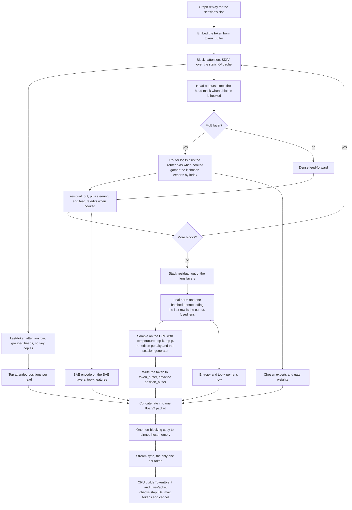

Not obvious:
- **Rules from §9 and the spike, all in the step:**
  - one batched unembedding for all lens layers;
  - the fused lens: the lens's last row *is* the output, so the 262k-row unembedding is read once;
  - last-token attention only, computed per key-value group without expanding shared key heads;
  - top-k on the GPU;
  - one packed tensor and one copy per token.
  - Measured on Gemma 3 1B: +16–31% (1.5–2.4 ms per token) at CUDA-graph speed, and 8.3 KB per packet.
- **Graph variants per slot** (ADR-0026): `off` (the packet is the token ID, its log-probability and the alternatives) and `summary` (the full readout). Switching the panel on or off picks the other captured graph.
- **Recapture rules** (Python layout §2.3):
  - a graph is recaptured only when the set of hooked points changes, for example the first intervention at a new point or a new set of SAE layers. That takes under a second, once.
  - Changing a value (a steering strength, sampling settings) is a buffer write in `InterventionHook` and never recaptures. That is why the slider is cheap (7.1).
- **Identity at zero:** a hooked point at strength 0 leaves the logits unchanged (Python layout `test_interventions.py`).
- **Sampling inside the graph:** temperature, top-k, top-p and the repetition penalty live in GPU buffers; the penalty keeps a per-slot token-count vector. The session's `torch.Generator` is registered with the graph, so a seed replays the same tokens.
- **MoE:** single-token decode gathers the k chosen experts' weights by index, which keeps the shape static (§17). The chosen experts and gate weights go into the packet as `LivePacket.expert_choices` *(new field)*.
- **MLA:** attention patterns are computed from the compressed keys in the absorbed form. `blocks.<i>.latent_cache` is an observation point for zoom (6.3).
- **The CPU side** turns the float packet into `TokenEvent{token_id, logprob, top_alternatives}` and `LivePacket`. Then it checks the stop IDs, `max_new_tokens`, and a cancel flag set by `chat.stop` or a dropped stream, so cancellation takes effect within one token.

```python
# python/rastai_lens/interventions.py (excerpt; InterventionHook is Python layout §3.2)
ROUTER_FORCE_BIAS = 1.0e4  # wins any top-k, stays finite so the captured graph never produces NaN

def router_bias_row(forced_experts: list[int], blocked_experts: list[int], expert_count: int) -> torch.Tensor:
    """One row of the router bias buffer. A swap is a block plus a force."""
```

**Persisted:** nothing. Packets are ephemeral; the gateway writes the token row at the end of the turn (1.1).

**Tests:**
- `tests/gpu/test_live_panel_budget.py` (nightly, M4-E03): on the 5080 capped at 8 GiB and on the 3090, tokens/s with the panel on is within `psychology.overhead_budget_percent` (35) of the baseline, and every packet is under 20 KB.
- `tests/gpu/panel_does_not_change_tokens`: greedy tokens are identical with the panel off, with it on, with the CUDA graph and without it (spike: 64/64).
- `python/rastai_lens/tests/test_live_packet.py` plus the `LivePacket` golden in `fixtures/proto-golden/`: pack in Python, decode the protobuf in TS, same values; the fused packet equals the unfused reference.

### 5.3 Token and packet path, step mode

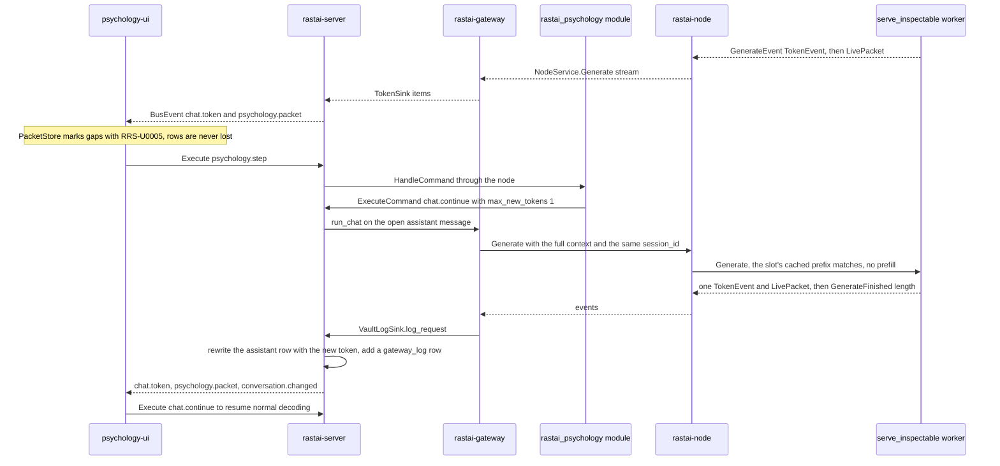

Not obvious:
- **Step mode is ordinary generation with `max_new_tokens = 1`.**
  - `chat.continue` *(new core command)* extends an assistant message by N tokens on its existing session.
  - The first step of a new answer is `chat.send` with a `max_new_tokens` override *(new argument)* of 1.
  - No pause signal is involved, so a paused answer costs nothing but its slot.
- **Each step ends a `Generate` call,** so the assistant row is rewritten after every step. A crash in step mode loses at most the step in flight.
- **Overhead display:** `GenerateFinished.tokens_per_second` is shown next to `GenerateFinished.baseline_tokens_per_second` *(new field)*, measured at warm-up (4.3). Above `psychology.overhead_budget_percent`, the panel shows `RRS-L1001` (warning) and suggests fewer SAE layers or a smaller `psychology.top_k`.
- **Dropped packets** (daemon backpressure): the panel shows "N tokens missing" (`RRS-U0005`, info) and a Recompute button that runs `psychology.replay.open` (frontend layout §2.2).
- **Transport:** packets ride Connect server-streaming like every bus event (8.3 KB × ~150 tok/s ≈ 1.3 MB/s; contracts §14 #11). The bus buffer of 10,000 events covers about 30 s of a streaming chat with the panel on, which is enough for a reconnect.

**Persisted:** the assistant row and a `gateway_log` row after each step (`vault.db`); everything else is ephemeral.

**Tests:** `tests/e2e/step_mode.spec.ts`: three steps, then continue, with greedy sampling. The final row's tokens equal a normal greedy run of the same prompt, and each step produced one packet.

### 5.4 Loading SAEs and labels

Runs when the live panel or an analysis needs SAE layers that aren't in the HF cache. The First Run fetches three layers in the background (platform flow 1.1); this is the same path for any other layer or model.

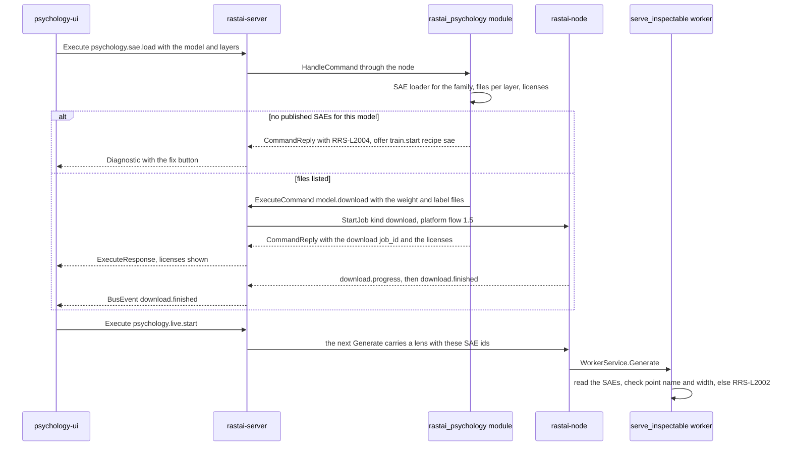

Not obvious:
- **SAE loaders are plugin contributions** (`psychology.gemma_scope`, `psychology.llama_scope`; frontend layout §14.2). Each lists, per model family, the HF repo, the files per layer and point, the width, and the label files. Gemma 3 1B uses `google/gemma-scope-2-1b-it`, residual stream, 16k wide (spike).
- **Everything is data, fetched by the node** (§9, §19).
  - SAE weights go through the same resumable, hash-checked `download` job as model weights.
  - Neuronpedia label files are listed with a URL and a hash, and go through the same job. That is a `url` file entry on `model.download` *(new argument)*.
  - Plugin jobs never open network connections.
- **Licenses are shown, not gated:** Gemma Scope 2 is CC-BY-4.0. A gated source goes through the HF license flow (platform flow 1.4).
- **SAEs for a fine-tuned checkpoint** come from an `sae` run (training-evaluation §12.2). The loader finds them through the checkpoint's lineage, keyed by the tuned model's hash.
- **Validation happens where the SAEs are used.** The serve worker reads them with the strict safetensors reader and checks the hook point and width against the model, failing with `RRS-L2002`. Spike sanity check: Gemma Scope 2 fires 57–63 features per token, against the 54–60 it was trained for.
- **Permissions:** `model.download` needs scope `inference.manage`, so the Psychology manifest adds it to its `commands:[...]` list *(new; frontend layout §14.2 lists psychology, chat, training, data, read)*.

**Persisted:** SAE and label files in the HF cache (durable, the user's cache); the `download` job's row; `download.finished`.

**Tests:**
- `plugins/psychology/python/rastai_psychology/tests/test_sae_load.py`: Gemma 3 1B lists three files per layer; an unknown family gives `RRS-L2004`.
- `tests/gpu/test_gemma_scope_sanity.py`: on layers 7, 13 and 22, the measured L0 is within 20% of trained and variance unexplained is under 0.3.

---

## 6. Replay and offline analyses

Runs when the user opens any conversation, branch or `/v1` log row in Psychology (`psychology.replay.open`), zooms into a view (`psychology.tensor.fetch`), exports (`psychology.replay.export`), opens a `.rrsreplay` in the web viewer, or runs an analysis (projection, probe, attribution graph, routing stats).

### 6.1 Opening a conversation for replay

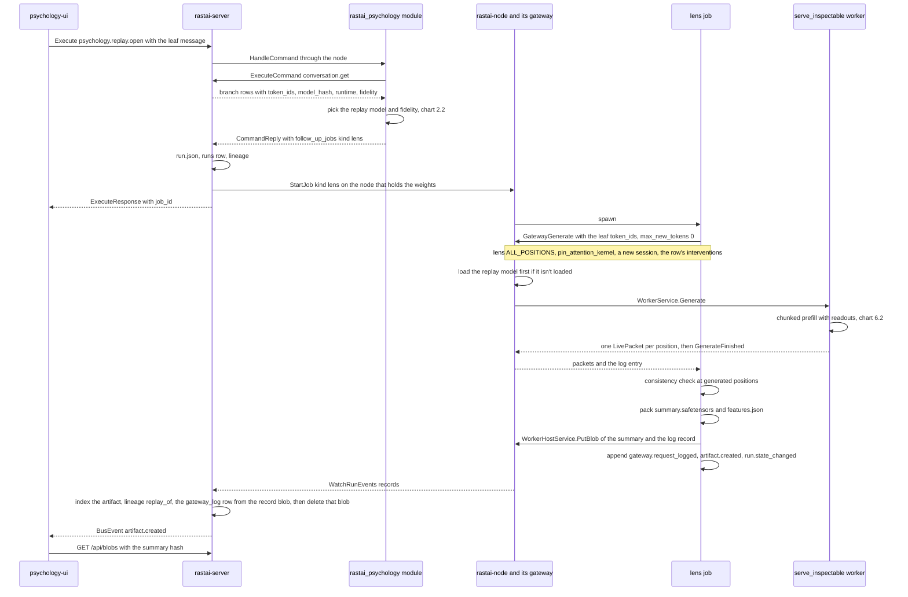

Not obvious:
- **What is replayed:** the leaf assistant row's `token_ids` are the full context (1.1), so one forward pass recomputes the whole view.
  - A `/v1` log row replays from `gateway_log.prompt_ids` + `generated_ids`.
  - The command takes `message_id` or `request_id` *(new argument)*.
- **Same worker as chat.** The replay runs in the `serve_inspectable` job that already holds the model, reached through the node gateway (`GatewayGenerate`, purpose `replay`). The model is never loaded twice, which matters on an 8 GB budget.
  - While the replay runs, chat on that model waits (rule 0.2).
  - For a Fast conversation, the worker is the twin's.
- **The request** sends `prompt_token_ids` as given: no template, no BOS rule (node layout §6.8).
  - `max_new_tokens = 0` means prefill only.
  - `LensRequest` mode `ALL_POSITIONS` *(new value)* asks for a packet at every position (`prefill_packets`, Python layout §3.2).
  - `interventions_json` is the leaf row's interventions, so a steered answer replays steered.
- **Consistency check** (owned by `LJ`):
  - At every position the model generated (from `settings_json.prompt_token_count`), the logged token must be the replay's argmax for greedy turns. For sampled turns it must have nonzero probability under the logged top-k and top-p.
  - Prompt positions are skipped, which also skips template-forced positions (spike 01).
  - A mismatch where the top-two gap is under 1 logit is a kernel near-tie and is listed as info.
  - Any other mismatch gives `RRS-L0003` ("replay diverged at token N") and lowers the label to `approximate`.
- **The summary layer** holds, per token:
  - entropy;
  - the top-k final guesses;
  - the top-k logit lens per layer (`SUMMARY_LENS_TOP_K`);
  - the top-k labeled features (`SUMMARY_FEATURE_TOP_K`, overridden by `psychology.summary_layer_top_k`).
  - It is stored as int32 IDs and float16 values in `summary/summary.safetensors`, plus `features.json` with the labels of the feature IDs used.
  - That is about 1.1 KB per token for Gemma 3 1B with 3 SAEs (Python layout §3.2), under 5 MB per 2k tokens. Attention isn't in the summary; it comes from zoom (6.3).
- **Playback** (play, pause, stop, rewind, speed) is pure UI over the downloaded summary. No server call happens until the user zooms, rewinds or branches.
- **The replay session stays open** in a decode slot, so rewind and branch (7.2) start without a prefill. The worker evicts it like any session when a slot is needed, and an evicted session only costs a re-prefill (rule 0.2).

| Failure | Code | What happens |
|---|---|---|
| Weights not on any node | `RRS-L0001` | fix `model.download`; no job started |
| Weights differ from `model_hash` | `RRS-L0002` (warning) | the UI asks; yes replays as `approximate` |
| Incognito conversation | `RRS-L0006` | refused |
| Fast-only model without a twin | `RRS-G3009` | fix `model.twin.set` |
| KV cache for the whole context doesn't fit the lease | `RRS-H3007` | job fails; suggests a branch closer to the root, or another GPU |
| Replay diverges from the logged tokens | `RRS-L0003` (warning) | the replay opens, labeled `approximate`, with the first diverging token marked |
| Lens job crash or kill -9 | `RRS-J1001` | job `failed`; no partial blob, because blobs land in `.incoming` and are renamed only when complete |
| Serve worker crash mid-replay | `RRS-J1001` on the serve job | the lens job fails with the node's Diagnostic; model `failed` → `unloaded` |

**Persisted:**
- the summary blob (durable);
- an `artifacts` row of kind `replay_summary` and a `lineage` row `replay_of`;
- one `gateway_log` row with the lens job's `run_id`; the record blob only until that row commits (9.2);
- the lens job's run folder, whose `events.log` holds ids, counts and hashes, not the replayed IDs.
- Packets in transit are ephemeral.
- All of it is removed when the conversation is deleted, unless pinned (9.2).

**Tests:**
- `tests/e2e/replay_open.spec.ts`: chat 3 turns, open the replay, and get one summary row per token with the `exact` label.
- `tests/gpu/replay_matches_live` (M4-E06): a replay of a stored greedy chat on Gemma 3 1B equals its live packets, with zero `RRS-L0003`, on the same GPU with the kernel pinned.
- `tests/crash/lens_job_kill`: kill -9 the lens job mid-replay. No blob appears, the job is `failed` with `RRS-J1001`, and a second open succeeds.
- `python/rastai_lens/tests/test_summary_layer.py`: a 2k-token fixture packs under 5 MB.

### 6.2 The replay forward pass inside the worker

```mermaid
flowchart TD
  IN["GenerateRequest with max_new_tokens 0 and ALL_POSITIONS"] --> FITS{"KV cache for all tokens fits the lease?"}
  FITS -->|"no"| OOM["GenerateFinished with RRS-H3007"]
  FITS -->|"yes"| SLOT["Take a free decode slot<br/>evict the least recently used session if needed"]
  SLOT --> HOOK["Apply the request's InterventionSet to the slot"]
  HOOK --> PIN{"pin_attention_kernel?"}
  PIN -->|"yes"| EAGER["Eager attention, the patterns feed the output"]
  PIN -->|"no"| SDPA["SDPA output, patterns computed on the side"]
  EAGER --> CH["Next chunk of 512 positions"]
  SDPA --> CH
  CH --> FWD["Forward the chunk into the KV cache<br/>keep residual_out of the lens layers for the chunk"]
  FWD --> ATTK["Top attended positions per head for each query row"]
  ATTK --> GRP["Readouts in position groups sized to LENS_SCRATCH_BYTES<br/>batched unembedding, top-k on the GPU"]
  GRP --> SEND["Copy the chunk's packets once and stream them"]
  SEND --> MORE{"More chunks?"}
  MORE -->|"yes"| CH
  MORE -->|"no"| KEEP["Keep the cache as the session for rewind and branch"]
  KEEP --> FIN["GenerateFinished"]
```

Not obvious:
- **One forward pass:** every position is computed once. Chunking only bounds memory, because each chunk attends over the cache written by earlier chunks. This is `prefill_packets` in `rastai_lens`.
- **Readout group size** = max(1, `LENS_SCRATCH_BYTES` ÷ (lens layer count × vocabulary size × 2 bytes)). For Gemma 3 1B (26 layers, 262k vocabulary) that's 9 positions per group.
- **The pinned kernel** comes from `inference.pin_attention_kernel_for_replay` (default true).
  - Fast SDPA kernels sum in a different order in bf16 and can flip near-ties (spike 01b), so exact replays use eager attention (ADR-0027).
  - The hardware fingerprint records `attention_kernel`.
- **The prefill runs eagerly, not as a captured graph.** Only the single-token decode step is captured, so a replay never recaptures.

**Persisted:** nothing; the cache stays in GPU memory.

**Tests:** `python/rastai_lens/tests/test_chunked_replay.py`: chunked and unchunked replays of the tiny fixture give identical packets in fp32.

### 6.3 Zoom: full tensors on demand

```mermaid
sequenceDiagram
  participant UI as psychology-ui
  participant SRV as rastai-server
  participant PM as rastai_psychology module
  participant NODE as rastai-node
  participant W as serve_inspectable worker
  UI->>SRV: Execute psychology.tensor.fetch with point and token range
  SRV->>PM: HandleCommand through the node
  PM->>PM: check the point exists, estimate the bytes
  alt over 64 MiB
    PM-->>SRV: CommandReply with RRS-L1002 and a smaller range
  else within the cap
    PM->>SRV: ExecuteCommand chat.tensor.fetch
    SRV->>NODE: NodeService.FetchTensor with context IDs, point and range
    NODE->>W: WorkerService.FetchTensor
    W->>W: recompute up to the range end with a TensorRecorder on that point
    W-->>NODE: TensorChunk stream
    NODE-->>SRV: chunks
    SRV->>SRV: write a safetensors blob through .incoming, then rename
    SRV-->>PM: BlobRef
    PM-->>SRV: CommandReply with the BlobRef
  end
  SRV-->>UI: ExecuteResponse
  UI->>SRV: GET /api/blobs with Range requests
```

Not obvious:
- **`chat.tensor.fetch`** *(new core command)* is the only path to `FetchTensor`. It writes the result as a safetensors blob, because a command result is JSON and a tensor isn't.
- **Recompute, don't store.** Full activations are never kept during chat. Prefill runs at ~36k tok/s (spike 04), so recomputing up to the range end is cheaper than storing activations for every token.
- **Points:** any observation point from contracts §5.3, such as:
  - `blocks.<i>.attention_pattern` (the full eager pattern for the range);
  - `blocks.<i>.residual_out`, `blocks.<i>.router_logits`, `blocks.<i>.latent_cache`.
- **The 3D data-flow view** draws one value per (layer, token) from packets or the summary when zoomed out. Zoomed in on a window of tokens, it asks for heads and top features in that window, and Psychology answers with `psychology.tensor.fetch`. This is the level-of-detail rule of §9 (frontend layout §6.2).
- **The 64 MiB cap** (`TENSOR_FETCH_CAP_BYTES`) applies locally too, so local and remote behave the same.

**Persisted:** a blob of artifact kind `tensor_fetch` *(new)*, unpinned, so `storage.gc` removes it unless the user pins it or exports it with the replay. A `lineage` row `analysis_of` from the artifact to the conversation lets `conversation.delete` find it (9.2).

**Tests:** `plugins/psychology/python/rastai_psychology/tests/test_tensor_fetch.py`: a fetched `residual_out` slice equals the same slice from a full forward pass; an oversized request gives `RRS-L1002` and makes no RPC.

### 6.4 Export and the web viewer

```mermaid
sequenceDiagram
  participant UI as psychology-ui
  participant SRV as rastai-server
  participant PM as rastai_psychology module
  participant NODE as rastai-node
  participant LJ as export lens job
  participant VIEW as apps-viewer
  UI->>SRV: Execute psychology.replay.export
  SRV->>PM: HandleCommand through the node
  PM-->>SRV: CommandReply with follow_up_jobs kind lens
  SRV->>NODE: StartJob kind lens
  NODE->>LJ: spawn
  LJ->>SRV: ExecuteCommand conversation.get
  LJ->>LJ: reuse the replay_summary blob, or compute it as in 6.1
  LJ->>LJ: write replay.json, conversation.jsonl and the summary with rastai_formats
  LJ->>LJ: check the summary budget, warn above 5 MB per 2k tokens
  LJ->>NODE: WorkerHostService.PutBlob of the zip
  LJ->>LJ: append artifact.created to events.log
  NODE-->>SRV: WatchRunEvents record
  SRV-->>UI: BusEvent artifact.created
  UI->>SRV: GET /api/blobs to save the .rrsreplay file
  Note over VIEW: later, on any machine, with no model and no install
  VIEW->>VIEW: open the file, zip size, ratio and zip-slip checks in WASM
  VIEW->>VIEW: parse replay.json with rastai-formats, migrate older versions
  VIEW->>VIEW: read summary.safetensors with the strict reader
  VIEW->>VIEW: render the timeline with viz, tables if WebGL2 is missing
```

Not obvious:
- **Contents** (contracts §5.2):
  - `replay.json`: header, `model_hash`, `model_ref`, `settings`, `branches[]`, `annotations[]`, `hardware_fingerprint`, and `fidelity` with its label text;
  - `conversation.jsonl`: `rastai.conversation/1` with token IDs;
  - the summary layer, always;
  - `activations/*.safetensors`, only for tensors the user fetched and pinned.
- **Every file is written through `rastai_formats`** (the PyO3 wheel; `rastai_lens/replay_writer.py`). The viewer's WASM build of the same crate therefore reads exactly what was written.
- **The viewer makes no network calls.**
  - It applies the untrusted-import limits (`RRS-E5xxx`).
  - It opens files from newer schema versions read-only (`RRS-E4001`, info; the viewer is read-only anyway).
  - It shows a missing or broken summary as `RRS-L0004`.
  - Without WebGL2 it shows `RRS-U1001` (info) and draws the tables that sit behind every chart (§7).
- **Incognito conversations can't be exported** (`RRS-L0006`).

**Persisted:** the `.rrsreplay` zip as a blob, an `artifacts` row of kind `replay` *(new)*, `lineage` `replay_of`, and the file the user saves.

**Tests:**
- `tests/e2e/replay_export_viewer.spec.ts` (M4-E06): export, open in `apps/viewer` with networking blocked, and see the same token timeline as in the app.
- `crates/rastai-formats/tests/replay_roundtrip.rs` and `fixtures/documents/rastai.replay/invalid/`: zip bomb, zip slip, missing summary and newer-version cases, each with its expected code.

### 6.5 Offline analyses

Runs on `psychology.projection.run`, `psychology.probe.train`, `psychology.attribution.run` and `psychology.routing.stats` (the Advanced view, §9; plan M4-E10, M4-E11). The model diff and the SAE fit check run the same way and are drawn in training-evaluation §12.

```mermaid
sequenceDiagram
  participant UI as psychology-ui
  participant SRV as rastai-server
  participant PM as rastai_psychology module
  participant NODE as rastai-node
  participant LJ as lens job with its own model copy
  UI->>SRV: Execute an analysis command with model, inputs and settings
  SRV->>PM: HandleCommand through the node
  PM->>PM: validate inputs, check SAEs, transcoders or MoE as needed
  PM-->>SRV: CommandReply with follow_up_jobs kind lens
  SRV->>SRV: run.json, runs row, lineage
  SRV->>NODE: StartJob, pinned lease, may_reclaim_evictable false
  NODE->>NODE: queued until the lease fits, chat is never evicted for it
  NODE->>LJ: spawn
  LJ->>NODE: TokenizeChat for the conversations or dataset rows
  LJ->>LJ: load the model read-only, no CUDA graphs
  loop batches of inputs
    LJ->>LJ: forward with recorders at the chosen points
    LJ-->>NODE: job.progress over WatchLive
  end
  LJ->>LJ: fit, train or build with rastai.lens
  LJ->>NODE: WorkerHostService.PutBlob of the result
  LJ->>LJ: append artifact.created and run.state_changed completed
  NODE-->>SRV: WatchRunEvents records
  SRV->>SRV: index the artifact, lineage analysis_of
  SRV-->>UI: BusEvent artifact.created
  UI->>SRV: GET /api/blobs, then draw with the viz package
```

| Command | Inputs | `rastai.lens` call (Python layout §3.2) | Result artifact *(new kinds)* | Notes |
|---|---|---|---|---|
| `psychology.projection.run` | model, layer, points (conversations or dataset rows), optional existing projection | `fit_projection` once (PCA), then `place_points` | `projection`: basis and coordinates | New points are placed into the fixed space, so the map never moves. The training view fits on the first checkpoint and places later checkpoints into the same space. |
| `psychology.probe.train` | model, layer, a dataset with a label column, split | `train_probe` on recorded activations | `probe`: weights and held-out accuracy | A probe direction can be saved as a steering vector blob (7.1). |
| `psychology.attribution.run` | model, message, target position, node budget | `build_attribution_graph` with transcoders | `attribution_graph` | Starts with Gemma 3 270M and 1B (§9). Transcoders are data: published ones, or trained by the `sae` recipe in transcoder mode; without them, `RRS-L4002`. |
| `psychology.routing.stats` | MoE model, conversation or dataset | `routing_stats` | `routing_stats`: usage per expert and layer, dead and overloaded experts flagged | A dense model gives `RRS-L4003`. |
| `psychology.diff.run`, `psychology.sae.fit_check` | base and checkpoint, probe set | `compare_models`, `check_sae_fit` | `model_diff`, `sae_fit_check` | training-evaluation §12; no SAEs gives `RRS-L4001` (info); stale labels give `RRS-L2003` (warning). |

Not obvious:
- **Analyses use their own model copy,** because they need many forward passes or gradients (attribution). Sharing the chat worker would block chat for minutes.
  - The lease is pinned, so the job can't be evicted mid-run.
  - It carries `may_reclaim_evictable = false`, so it waits in the queue rather than evicting chat.
  - On the 8 GB budget, a second Gemma 3 1B copy (2 GiB in bf16) fits beside chat.
  - For a LoRA checkpoint the job loads one base and toggles the adapter (Python layout §3.2).
- **Feature search** (`psychology.feature.search`) is sync and runs in `PM` over the label files. It returns labeled features with a confidence score and example inputs (§9 "honest readouts"), and feeds the concept slider (7.1).
- **The UI only draws.** `VectorSpaceView` places coordinates the job computed; the attribution graph renders on `@rastai/canvas` (frontend layout §6).

| Failure | Code | What happens |
|---|---|---|
| Out of GPU memory | `RRS-H3007` | job `failed`, nothing written |
| kill -9 or crash | `RRS-J1001` | job `failed`; no partial blob |
| Cancel | `job.cancel` (`CANCEL`, exit 3) | job `cancelled`; no artifact |
| SAE layers missing for a feature view | `RRS-L2001` | fix `psychology.sae.load`; no job started |
| No transcoders | `RRS-L4002` | fix `train.start` with recipe `sae` in transcoder mode |
| Routing stats on a dense model | `RRS-L4003` | refused before any job |
| Disk full writing the result | `RRS-S3002` | job `failed` (worker exit 4, node layout §7.4) |

**Persisted:** the lens run's folder; the result blob; an `artifacts` row of the kind above; a `lineage` row `analysis_of` *(new)* from the artifact to the model or conversation.

**Tests:**
- `python/rastai_lens/tests/test_projection.py`: placing the fitted points reproduces their coordinates, and new points never move old ones (M4-E10).
- `python/rastai_lens/tests/test_probes.py`: a separable synthetic set is learned.
- `python/rastai_lens/tests/test_attribution.py`: on a tiny model, attributions match brute-force ablation within tolerance (M4-E11).
- `tests/crash/analysis_kill`: kill -9 the lens job; no artifact row, and chat on the same GPU kept serving throughout.

---

## 7. Interventions and branching

Runs when the user boosts or suppresses a concept, applies a steering vector, ablates a head, forces or blocks an expert, rewinds to a token, prefers a branch, or saves, serves or distills a steering preset.

### 7.1 Setting an intervention, the concept slider

```mermaid
sequenceDiagram
  participant UI as psychology-ui
  participant SRV as rastai-server
  participant PM as rastai_psychology module
  participant VAULT as rastai-store vault.db
  participant NODE as rastai-node
  participant W as serve_inspectable worker
  UI->>SRV: Execute psychology.feature.search with text
  SRV->>PM: HandleCommand through the node
  PM-->>SRV: labeled features with confidence and example inputs
  SRV-->>UI: concept list
  UI->>SRV: Execute psychology.intervention.set, boost a feature
  SRV->>PM: HandleCommand through the node
  PM->>PM: runtime INSPECTABLE, valid point, SAE loaded
  PM->>PM: build the InterventionSet with a feature_edits entry
  PM->>SRV: ExecuteCommand chat.settings.set with the interventions
  SRV->>VAULT: save them in conversations.settings_json
  SRV->>NODE: NodeService.SetInterventions for the conversation's session
  NODE->>W: WorkerService.SetInterventions
  W->>W: a new hooked point, recapture the slot once
  W-->>NODE: ok
  SRV-->>PM: ok
  PM-->>SRV: CommandReply with the resolved InterventionSet
  SRV-->>UI: ExecuteResponse
  loop while the slider moves, at most every 50 ms
    UI->>SRV: Execute chat.settings.set with new strengths
    SRV->>NODE: SetInterventions
    NODE->>W: SetInterventions, buffer writes only
  end
  UI->>SRV: on release, Execute psychology.branch.create from the answer start
```

Not obvious:
- **Two commands, one path.** `psychology.intervention.set` resolves and validates. `chat.settings.set` (new `interventions` argument *(new)*) stores the set and applies it to the live session. Slider drags skip resolution and call `chat.settings.set` directly with new strengths.
- **The four kinds** (contracts §5.2 `InterventionSet`; `InterventionHook`, Python layout §3.2):
  - concept boost or suppress is a feature edit, `feature_edits[]{sae_id, feature_index, strength}`. It clamps one feature and needs that layer's SAE on the worker.
  - A steering vector is `steering[]{point, vector_ref, strength}`, with the vector as a blob: a probe direction (6.5) or an uploaded safetensors file.
  - Head ablation is `ablations[]{point, head}`.
  - Expert force, block or swap is `expert_overrides[]{layer, expert, action}`, MoE only. A swap is a block plus a force.
- **Points in v1:**
  - steering and feature edits at `blocks.<i>.residual_out`;
  - ablation per head of `blocks.<i>` attention;
  - expert overrides at `blocks.<i>.router_logits`.
  - Anything else gives `RRS-L3001`.
- **Cost:** the first intervention at a new point recaptures that slot's graph once (5.2). After that, every strength change is a buffer write.
- **During generation** a change applies from the next token, because the graph reads the buffers every step. The row is then flagged as changed mid-answer, and its replay is labeled approximate (2.2).
- **Every later `GenerateRequest` also carries the set** (`interventions_json`). A worker that lost the session therefore still applies it (rule 0.2).
- **"Watch the answer change live"** (§6): on slider release, the UI regenerates from the start of the current answer as a new branch (7.2), so the old answer stays for comparison.

| Failure | Code |
|---|---|
| Fast or API model | `RRS-G3004`, fix `chat.runtime.set` (to Inspectable, or Fast with a twin) |
| Not an intervention point | `RRS-L3001` |
| Expert override on a dense model, or an expert index out of range | `RRS-L3002` |
| Vector length differs from the model's embedding size | `RRS-L3003` |
| SAE for that layer not loaded | `RRS-L2001`, fix `psychology.sae.load` |

**Persisted:**
- `conversations.settings_json.interventions` (`vault.db`);
- any steering vector blob (durable, pinned when a preset uses it);
- every assistant row generated under the set copies it into its `settings_json`, so a replay re-applies it.
- The worker's buffers are memory only.

**Tests:**
- `tests/gpu/steering_changes_output` (M4-E05): a known Gemma Scope feature at strength 0 gives the baseline tokens. At a high strength the text changes, the feature's activation rises in the packets, and the change lands within one token.
- `plugins/psychology/python/rastai_psychology/tests/test_intervention_validation.py`: one case per failure row.
- `tests/e2e/slider.spec.ts`: 40 slider moves in 2 s produce at most 40 `chat.settings.set` calls. The worker's recapture counter rises by exactly one, for the first set at the point.

### 7.2 Rewind, branch, compare, prefer

```mermaid
sequenceDiagram
  participant UI as psychology-ui
  participant SRV as rastai-server
  participant PM as rastai_psychology module
  participant GW as rastai-gateway
  participant NODE as rastai-node
  participant W as serve_inspectable worker
  participant VAULT as rastai-store vault.db
  UI->>SRV: Execute psychology.branch.create at token i of answer A
  SRV->>PM: HandleCommand through the node
  PM->>SRV: ExecuteCommand chat.regenerate with from_token_index i
  SRV->>GW: prepare_chat with A's context plus its first i tokens
  SRV->>NODE: ForkSession of A's session at that length
  NODE->>W: ForkSession, copy the KV prefix into a free slot
  SRV->>GW: run_chat on the new session with the current InterventionSet
  GW->>NODE: Generate
  NODE->>W: Generate
  W-->>GW: TokenEvent and LivePacket stream through the node
  GW-->>SRV: TokenSink items
  SRV-->>UI: chat.token and psychology.packet for answer B
  GW->>SRV: VaultLogSink.log_request
  SRV->>VAULT: row B under A's parent, with rewind_from and interventions
  SRV->>SRV: lineage branch_of from B to A
  SRV-->>UI: conversation.changed
  Note over UI: compare A and B side by side, packets or replays
  UI->>SRV: Execute psychology.branch.prefer, chosen B, rejected A
  SRV->>PM: HandleCommand through the node
  PM->>SRV: ExecuteCommand conversation.get
  PM->>PM: same prompt, not incognito, build the pair row
  PM-->>SRV: CommandReply with a document edit appending one row
  SRV->>SRV: validate, write the .rrsdata, record the undo step
  SRV->>SRV: lineage pair_from, daemon event log, document.changed
  SRV-->>UI: pair saved, Teach it enabled
```

Not obvious:
- **Rewind is a fork, not a copy of text.** `chat.regenerate` gets two new arguments *(new)*: `from_token_index` and an optional `interventions`.
  - Answer B is a new assistant row whose parent is A's parent.
  - Its `token_ids` start with A's context and A's first i generated tokens, then the new ones.
  - `prompt_token_count` covers A's context plus those i tokens, because B didn't sample them.
  - `settings_json.rewind_from` *(new key)* records `{message_id, token_index}`.
- **`ForkSession` is a speed-up, owned by `rastai-server`.** If A's session was evicted, the server skips the fork and the worker prefills from the IDs (rule 0.2).
- **Compare** is UI-only. Both rows come from `conversation.get`, with their live packets if still on screen, otherwise a replay of each leaf (6.1).
- **Prefer this branch** appends one row to the inline source of the project's preferences dataset, `data/preferences.rrsdata`, task `dpo`. The row shape is training-evaluation §7.1's:
  - `prompt`: messages and exact token IDs;
  - `chosen` and `rejected`: text, token IDs and `model_ref`;
  - `source = branch_pick`, `conversation_id` and the message ids.
  - An SFT target is a row with `chosen` only.
  - A target the user edited by hand is re-tokenized with `TokenizeChat` and marked `edited`.
- **Rows hold copies, not references.** Training reads exactly the IDs the model produced, and the dataset survives a later conversation delete (section 9).
  - v1 of this doc stored the pair as an `examples[]` reference. Training-evaluation §7.1 settled on inline rows for branch picks.
  - `examples[]` stays for `dataset.from_conversations` (training-evaluation §2). Its pointer there, "the field `psychology.branch.prefer` uses", needs a one-line fix in M1-01.
- **Undo:** the edit is a JSON Patch in `CommandReply.document_edits`, so `document.undo` works (contracts §6.1).
- **Lineage:** the daemon writes `pair_from` (message → pair) through its own event log (platform flow, "daemon event log"), so lineage runs replay → pair → dataset (§26).
- **Which dataset:** `data/preferences.rrsdata`, created on the first Prefer if missing. The command takes an optional `document_id` *(new argument)* to pick another.

| Failure | Code |
|---|---|
| Branch with interventions on a Fast answer | `RRS-G3004`. Rewinding without interventions works on any local runtime, because the prefix is token IDs. |
| Branch on an API answer (no token IDs) | `RRS-L0005`: replay on an observer first (3.2), then branch there |
| Prefer across different prompts | `RRS-L3004` |
| Prefer on an incognito conversation | `RRS-L0006` |
| Dataset file from a newer schema version (read-only) | `RRS-E4001` |
| Disk full writing the dataset | `RRS-S3002`; the pair isn't saved and the button stays enabled |

**Persisted:**
- row B (`vault.db`);
- `lineage` `branch_of` and `pair_from` (`rastai.db`, via the daemon event log);
- the `.rrsdata` file in the project, with its `documents` and `undo_steps` rows;
- `document.changed`.

**Tests:**
- `tests/e2e/branch_prefer.spec.ts` (M4-E07): rewind at token 5, steer, regenerate, prefer.
  - The dataset has one row whose token IDs equal the messages' `token_ids`.
  - Undo removes it and redo restores it.
  - The lineage panel shows replay → pair → dataset.
- `python/rastai_models/tests/test_sessions.py` and `tests/gpu/fork_equals_prefill`: a branch made through `ForkSession` and one made by a full prefill produce identical greedy tokens.

### 7.3 Steering presets: save, serve, distill

```mermaid
sequenceDiagram
  participant UI as psychology-ui
  participant NAVI as Navi or any client
  participant SRV as rastai-server
  participant PM as rastai_psychology module
  participant GW as rastai-gateway
  participant NODE as rastai-node
  participant W as serve_inspectable worker
  UI->>SRV: Execute psychology.preset.save with a name
  SRV->>PM: HandleCommand through the node
  PM-->>SRV: document edit creating presets/name.json
  SRV->>SRV: write the preset, pin its vector blobs, record undo
  UI->>SRV: Execute psychology.preset.serve with served_model_name
  SRV->>PM: HandleCommand through the node
  PM-->>SRV: document edit setting served_model_name
  SRV->>GW: on document.changed, set_served_presets
  NAVI->>GW: POST /v1/chat/completions with the served name
  GW->>GW: base model on INSPECTABLE with the preset's model_hash
  GW->>GW: render, tokenize, open a new session id
  GW->>NODE: Generate with interventions_json from the preset
  NODE->>W: Generate
  W-->>GW: tokens through the node
  GW-->>NAVI: SSE chunks
  GW->>NODE: CloseSession, on every exit path
  GW->>SRV: log_request with the preset name and content hash
  UI->>SRV: Execute psychology.preset.distill
  SRV->>PM: HandleCommand through the node
  PM-->>SRV: follow_up_jobs kind train, recipe psychology.steering_distill
  Note over SRV: the training flows take over, the result is a LoRA checkpoint
```

Not obvious:
- **A preset is a document** (`rastai.steering_preset/1` in the project's `presets/`): `model_hash`, `interventions` (vectors as blob hashes), `served_model_name`, `notes`. Its vector blobs are pinned, so `storage.gc` keeps them.
- **Serving is declarative.** A non-empty `served_model_name` means served; clearing it stops serving.
  - `rastai-server` rebuilds the gateway's served presets from the preset documents of open projects. It does this at startup and on every `document.changed` (`set_served_presets`, node layout §6.9).
  - No extra command is needed.
- **Model checks:**
  - base model loaded only on Fast, or not at all: `RRS-G0004`, with the fix `model.load` on the Inspectable runtime;
  - loaded base model's hash differs from the preset's `model_hash`: `RRS-G0010` *(new)* in the OpenAI error JSON.
- **One call per request.** `GenerateRequest` carries the preset's set (contracts §4.4), so the gateway needs no separate `SetInterventions`. It closes the session on every exit path, errors included (node layout's `close_preset_session`).
- **Logging:** `gateway_log.sampling_json.preset = <served name>@<content_hash>` (node layout §6.7), so the exact intervention set is recoverable.
- **Distill** hands off to the training flows with recipe `psychology.steering_distill` *(new)*. It is a Recipe the Psychology plugin contributes (§13 recipe extension point), and it runs in a `train` job (Python layout §7.4).
  - The job holds one base copy:
    - the teacher is the base with the preset's `InterventionHook` on and the adapter off;
    - the student is the base with a LoRA on and the hook off.
    - This is the same one-base trick as PPO's reference model (ADR-0022).
  - Prompts: the fixed drift prompt set (`eval.drift_prompt_set`), plus any conversations the user adds. The teacher samples its answers once.
  - The loss is the KL from teacher to student at answer positions only (spike memory rule).
  - Verify reports the KL to the steered teacher on held-out prompts, next to the usual drift from the base.
  - The result is a checkpoint. It is served as `ckpt:<id>` on the Inspectable runtime, or exported to GGUF (`checkpoint.export`) for the Fast runtime, where presets can't run.

**Persisted:**
- the preset file, with its `documents` and `undo_steps` rows, and its pinned vector blobs;
- `gateway_log` rows for served requests;
- the distill run's folder and checkpoints (training flows).

**Tests:**
- `tests/e2e/preset_serve.spec.ts` (M4-E09): save, serve, then an OpenAI client call with the served name. The reply equals an in-app chat with the same interventions and seed, and `/v1/models` lists the name.
- `crates/rastai-gateway/tests/steering_presets.rs`: routes to Inspectable, carries the set, and always closes its session. Clearing `served_model_name` removes the route; a hash mismatch gives `RRS-G0010`.

---

## 8. Remote models

Runs when the conversation's model is loaded on a paired node (`rastai node serve` over SSH), for chat, the live panel, zoom and replay.

```mermaid
sequenceDiagram
  participant UI as apps-web
  participant SRV as rastai-server and gateway
  participant SSH as rastai-transport SSH session
  participant RN as remote rastai-node
  participant RW as remote serve worker
  UI->>SRV: Execute chat.send on a model loaded on node B
  SRV->>SRV: check_data_policy, trusted-remote or any, else RRS-C1009
  SRV->>SRV: render and tokenize with the cached tokenizer files
  SRV->>SSH: NodeService.Generate with token IDs and LensRequest SUMMARY
  SSH->>RN: forwarded to node.sock
  RN->>RW: WorkerService.Generate
  loop every token
    RW-->>RN: TokenEvent and LivePacket computed on the node
    RN-->>SRV: about 8 KB per token, budget 20 KB
    SRV-->>UI: chat.token and psychology.packet
  end
  UI->>SRV: psychology.tensor.fetch on a zoomed layer, path of 6.3
  SRV->>RN: FetchTensor through the tunnel
  RN->>RW: FetchTensor, recompute on the node
  RW-->>SRV: chunks, at most 64 MiB
  SRV-->>UI: BlobRef, then GET /api/blobs
  alt network drops mid-generation
    SSH--xSRV: stream error
    SRV->>SRV: save the partial answer, finish_reason error, RRS-G0006
    RN->>RW: cancel Generate, its client is gone
    SRV->>SRV: three missed heartbeats, node unreachable, RRS-N2001
    SRV->>SSH: reconnect with backoff, Handshake, ListJobs
    RN-->>SRV: serve job still running, model ready, RRS-N2002
    Note over RW: session cache kept, Regenerate skips the prefill
  end
```

Not obvious:
- **Tokenization stays in the daemon.**
  - The server copies each routed model's tokenizer files (a few MB) once, with `GetFile`, into `<cache>/tokenizers/<model_hash12>/` (node layout §6.8).
  - All logged IDs still come from one source.
- **Summaries on the node, tensors on demand** (§9):
  - the packet is built in the remote worker, so only ~8 KB per token crosses the link;
  - full tensors cross only on zoom, under the 64 MiB cap;
  - streaming full tensors over the internet is deferred (§33).
- **Replays recompute where the weights live.**
  - `rastai-server` schedules the replay's lens job on node B, and it runs through node B's gateway. Only token IDs travel.
  - The summary blob is written on B (artifact home B). The daemon then copies it with `GetFile` into the local blob store, with an `artifact_copies` row, so the replay opens and exports offline later.
- **Disconnects** follow designer-gym-remote C6:
  - the gateway saves the partial answer at once;
  - the node is marked `unreachable` after three missed heartbeats (15 s, `RRS-N2001`, warning);
  - after reconnecting, `ListJobs` reconciles by snapshot. The serve job never stopped, so the model is `ready` again with no reload (`RRS-N2002`, info).
  - If the node restarted meanwhile, the job is reattached (4.8) or ends `failed` with `RRS-J3002`.
- **Data policy:** `local-only` refuses remote models with `RRS-C1009` (1.3).
- **Delete reaches node B too.** Deleting a conversation removes its replay's run folder and summary blob on B as well as the local copy (9.2).

**Persisted:**
- locally: the same vault rows as 1.1, plus the replay summary copy and its `artifact_copies` row;
- on node B: the serve job's and lens job's run folders, and the summary blob.
- Unpinned remote data is wiped on teardown (§22).

**Tests:**
- `tests/e2e/remote_chat.spec.ts` against a node on the real SSH transport (CI runs the local node over the network transport, §16): chat with the panel on; the measured bytes per token on the wire stay under 20 KB.
- `tests/crash/remote_drop_mid_chat`: cut the SSH tunnel mid-stream.
  - The partial answer is saved with `RRS-G0006`.
  - The node returns to `connected`, and the serve job keeps its pid.
  - The next turn works without a reload.
- `tests/e2e/remote_replay.spec.ts`: replay a remote conversation. The request carried only token IDs (the transport log shows no weight or tensor transfer), and the summary has a local copy.

---

## 9. Conversation flags and imports

Runs on the side-panel actions (§8): star, pin, archive, delete and import.

### 9.1 Flags and imports

```mermaid
flowchart LR
  CONV["Conversation in vault.db"] --> STAR["conversation.star"]
  CONV --> PIN["conversation.pin"]
  CONV --> ARC["conversation.archive"]
  CONV --> DEL["conversation.delete, chart 9.2"]
  IMP["conversation.import job"] --> HAS{"Rows carry token IDs and model_hash?"}
  HAS -->|"yes"| KEEPF["Stored as is, fidelity kept"]
  HAS -->|"no"| TXT["Stored as text, fidelity approximate<br/>retokenized at replay with TokenizeChat"]
  STAR --> DS["dataset.from_conversations builds or extends a .rrsdata"]
  PIN --> EV["Evaluation's event handler runs<br/>eval.suite.add_conversation"]
  ARC --> HIDE["Hidden from the side panel, nothing deleted"]
```

Not obvious:
- **Star** marks a conversation for datasets. Building the dataset is an explicit `dataset.from_conversations` (training-evaluation §2).
- **Pin** makes a behavior test. The Evaluation plugin's event handler (`contributes.event_handlers[]`, training-evaluation §16) runs `eval.suite.add_conversation` on `conversation.changed` with the pinned flag.
- **Imports** (ChatGPT with branches, Claude, OpenAI JSONL, ShareGPT, `rastai.conversation/1`) parse through `rastai-formats` with the untrusted-import limits (`RRS-E5xxx`; importer errors `RRS-E7xxx`). Text-only rows are flagged `approximate` (§14).

**Persisted:** flag columns on `conversations`; `conversation.changed`.

**Tests:**
- `tests/e2e/conversation_flags.spec.ts`: star, pin, archive and delete, each checked through `conversation.list` and the events.
- `crates/rastai-formats/tests/conversation_import.rs` over `fixtures/conversations/`: branch trees are kept, and text-only imports are flagged `approximate`.

### 9.2 Delete reaches every copy

Delete is permanent (contracts §6.4). The rule (0.2): a conversation's content (text, token IDs, logprobs) lives only in `vault.db`, in artifacts with a lineage edge to it, and in copies the user made on purpose. Delete removes the first two and lists the third. Three things make that true:
- run event logs carry no content, so there is nothing to redact in an append-only file (second chart);
- every derived artifact and run has a lineage edge to the conversation from the moment it is created, so one query finds them all;
- delete removes rows, then files, on every node that holds a copy, and empties the WAL.

```mermaid
flowchart TD
  DEL["conversation.delete"] --> INC{"Incognito?"}
  INC -->|"yes"| MEMO["Drop it from daemon memory, CloseSession<br/>nothing on disk to remove"]
  INC -->|"no"| COL["Collect the derived set<br/>artifacts and runs with lineage replay_of or analysis_of to it<br/>datasets and the pinned suite that hold it"]
  COL --> DRY{"dry_run?"}
  DRY -->|"yes"| DLG["Return the set and change nothing<br/>the confirm dialog names every item"]
  DRY -->|"no"| RUNQ{"A derived job still running?"}
  RUNQ -->|"yes"| CAN["job.cancel, wait for its final state<br/>and for its last event to be indexed"]
  RUNQ -->|"no"| VT
  CAN --> VT["One vault transaction removes the conversation, messages, annotations<br/>and the gateway_log rows of the conversation and of the derived runs"]
  VT --> WAL["secure_delete zeroes the freed pages<br/>wal_checkpoint TRUNCATE empties the WAL"]
  WAL --> REFS["Unsnapshotted dataset references and the pinned suite entry<br/>removed as document edits"]
  REFS --> PINQ{"Derived artifact or run pinned?"}
  PINQ -->|"yes"| KEPT["Kept, and listed as kept in the result"]
  PINQ -->|"no"| ROWS["rastai.db rows first: artifacts, artifact_copies, runs"]
  ROWS --> FILES["Then the files: blobs now, not at the next GC, and run folders"]
  FILES --> HOME{"Does any copy live on a remote node?"}
  HOME -->|"no"| SESS
  HOME -->|"yes, connected"| RDEL["The node removes those run folders and blobs<br/>as node.cache.wipe does"]
  HOME -->|"yes, unreachable"| QUE["Removal queued until the node's next reconcile<br/>the result names the node"]
  RDEL --> SESS["CloseSession frees any cache"]
  QUE --> SESS
  SESS --> EV["conversation.changed"]
```

Not obvious:
- **The confirm dialog is a dry run** of the same command (`ExecuteRequest.dry_run`). It returns the derived set and changes nothing, so the dialog and the real delete can't disagree. It names:
  - the derived artifacts and runs that will go: replay summaries, `.rrsreplay` exports, `tensor_fetch` blobs, analyses and their lens runs;
  - pinned ones, which stay; the user unpins them first (`artifact.unpin`) to remove them too;
  - copies the user made on purpose, which stay: preference rows (7.2), dataset snapshots that already materialized it, and eval results that already ran it as a pinned test (training-evaluation §7.1). The user may want them gone too (PII), so they are listed with their documents and runs; `run.delete` removes such an eval run;
  - remote nodes that hold a copy, and whether they are reachable.
- **What "derived" means.** Lineage edges exist from creation:
  - a lens run gets its lineage when `rastai-server` creates the run (rule 0.2), before the job starts, so a running replay is found too;
  - replay summaries and `.rrsreplay` exports have `replay_of` (6.1, 6.4); analyses have `analysis_of` (6.5); a `tensor_fetch` blob has `analysis_of` (6.3).
  - A multi-conversation analysis (a projection over many) is derived from each of them. It is listed and removed like the others unless pinned, because it holds this conversation's activations.
- **Running derived jobs are cancelled first.** Delete waits for the final state and for the daemon to index the run's last event, so the job's record blob has been consumed before the rows go. A lens job stops within one chunk; the wait is bounded by `STOP_GRACE_SECONDS`.
- **Rows first, then files** (platform flow 8). A crash between them leaves unreferenced files, which the next GC collects. Blobs are deleted at once, not left for the 24 h GC grace. Lineage rows stay and show the artifact as "deleted".
- **The WAL.** `vault.db` runs with `PRAGMA secure_delete = ON`, because SQLite's freed pages keep old bytes until `VACUUM`. The WAL keeps the old page images until a checkpoint, so delete ends with `PRAGMA wal_checkpoint(TRUNCATE)` on the vault writer thread.
- **References not yet snapshotted** are removed from their datasets, and the conversation id from the pinned suite's `pinned_conversations[]`, in the same command as undoable document edits, so no document points at a missing message.
- **Remote copies.** A replay of a remote model leaves its lens run folder and summary blob on node B (section 8). The node keeps no catalog (node layout §7.9), so the daemon sends the exact run ids and blob hashes.
  - When B is unreachable, the removal waits for B's next reconcile (open question 10).
  - A derived job still running on an unreachable B can't be cancelled. Its run is removed locally at once, so its tail never resumes (second chart). After the reconcile, the daemon cancels the job, then sends the removal, which takes B's record blobs too.
- **Rebuild can't bring anything back.** `rastai storage rebuild-index` rebuilds from run folders, the daemon log and the blob store. The derived run folders and blobs are gone, the remaining event logs hold no content, and a re-indexed `gateway.request_logged` finds no record blob, so it writes nothing.

Indexing a job's log record, the second half of the rule:

```mermaid
flowchart TD
  GF["Job gets GenerateFinished.gateway_log"] --> PUT["rastai_worker puts the GatewayLogEntry as a record blob<br/>WorkerHostService.PutBlob"]
  PUT --> APP["Append gateway.request_logged<br/>request_id, run_id, counts, hashes and the record BlobRef"]
  APP --> TAIL["The daemon's run tail reads the event"]
  TAIL --> LIVE{"Run still in runs?"}
  LIVE -->|"no, deleted with its conversation"| DROP["Write nothing, delete the record blob"]
  LIVE -->|"yes"| HAVE{"Record blob readable?<br/>locally, or with GetFile from the run's node"}
  HAVE -->|"no, moved before or deleted since"| NONE["Write nothing"]
  HAVE -->|"yes"| ROW["One vault transaction writes the gateway_log row"]
  ROW --> GONE["Delete the local record blob<br/>the node deletes its copy once the ack covers the event"]
```

Not obvious:
- **Why a record blob and not the event.** A run's `events.log` is append-only with one writer (contracts §7.1), so a delete or retention can't redact it. A blob can be deleted.
- **What the event keeps** is what the run's history needs: `request_id`, `run_id`, `model_ref`, `model_hash`, `runtime`, `finish_reason`, token counts, timings, and BLAKE3 hashes of the prompt and generated ID blobs. A later reader can check that two runs used the same input without the input being stored.
- **This changes the node layout's payload** (§6.6, §11). There, only long token lists go to a blob; here the whole `GatewayLogEntry` always does. Every emitter (lens, eval, rollout and judge jobs) writes it the same way through `rastai_worker`. Listed in 10.2 for M1-01.
- **The record blob is short-lived.** It exists from the job's `PutBlob` to the daemon's index, normally under a second on the embedded node. A remote node keeps it until the daemon has copied it with `GetFile` and acked the event (node layout §7.5).
- **It is in no artifact row.** GC collects a stranded one like any unreferenced blob (24 h grace, platform flow 8), which covers a crash between the vault commit and the blob delete.
- **"Write nothing" is what makes delete and retention stick.** A row is written only from a record blob, and the blob is gone once the row has been written. A re-index, a reconnect that replays a mirror, or a rebuild can't re-create a row that delete or retention removed.

**Persisted:**
- removed: the `vault.db` rows above; the derived `artifacts`, `artifact_copies` and `runs` rows; their blobs and run folders, locally and on remote homes;
- kept: lineage rows (shown as "deleted"), pinned items, copies the user made on purpose;
- written: the `command_journal` row (ids only); `document.changed` for edited datasets and the pinned suite; `conversation.changed`.

**Tests:**
- `tests/e2e/conversation_delete_copies.spec.ts`:
  - chat with a marker string of at least 8 tokens on the tiny Gemma fixture, so a chance byte match in other binary data is negligible. Open its replay (6.1), fetch one tensor (6.3), export it (6.4), then delete the conversation;
  - stop the daemon, run `rastai storage rebuild-index`, start it again;
  - the marker is found nowhere under `<data>` or in `<state>/logs/`: not as text, and not as its token-ID bytes (little-endian u32, as in `messages.token_ids`). The search covers `vault.db` and `vault.db-wal`, `rastai.db`, every `events.log`, the daemon log and `blobs/`;
  - `gateway.log.list` has no row for the replay's `request_id`.
- `crates/rastai-store/tests/secure_delete.rs` (M3-E02): after delete, a marker string isn't found in the bytes of `vault.db` or `vault.db-wal`.
- `crates/rastai-server/tests/request_logged_index.rs`: an event whose record blob is gone writes no row; re-indexing a run log after delete or retention re-creates nothing; the record blob is deleted after the commit.
- `tests/crash/delete_mid_replay`: delete while a replay runs. The lens job is cancelled, and no blob, row or run folder from it survives.
- `tests/e2e/remote_delete.spec.ts`: delete a conversation replayed on node B while B is unreachable. The local copies go at once; B's run folder and blob go after B reconnects.

---

## 10. New names

Everything below must land in `contracts.md` (its own PR, §29; plan M1-01) before code uses it.

### 10.1 Commands and arguments

| Command | Purpose | Scope | Undo | Kind |
|---|---|---|---|---|
| `chat.continue` | extend an assistant message by `max_new_tokens` on its session (step mode, resume after a stop) | chat | | stream |
| `chat.tensor.fetch` | `FetchTensor` for a conversation's context; returns a `BlobRef` | conversations.read | | sync |

New arguments on existing commands:

| Command | Argument | Meaning |
|---|---|---|
| `chat.send` | `max_new_tokens` | per-turn override (step mode uses 1) |
| `chat.regenerate` | `from_token_index`, `interventions` | rewind point inside the source answer; interventions for the new branch |
| `chat.settings.set` | `lens`, `interventions` | the conversation's `LensRequest` and `InterventionSet`; applied to its live session |
| `chat.runtime.set` | `model_ref` | which GGUF or twin when several exist |
| `model.download` | file entries with `url` and `hash` | non-HF data files such as Neuronpedia label exports, through the same resumable job |
| `psychology.replay.open` | `message_id` or `request_id`, `observer_model_ref` | the leaf to replay, or a `/v1` log row; the observer for proxy replays |
| `psychology.branch.prefer` | `document_id`, `kind` (`dpo`/`sft`), `target_text` | target `.rrsdata` (default `data/preferences.rrsdata`); an SFT target the user edited |

### 10.2 Fields, values and keys

| Where | Name | Meaning |
|---|---|---|
| `vault.db` `conversations` | `settings_json` | the conversation's current sampling, runtime, lens and interventions |
| `vault.db` `messages` | `finish_reason` | the gateway's `FinishReason` names: `stop`, `length`, `cancelled`, `client_disconnected`, `error`, `evicted` (the node layout adds the same column to `gateway_log`) |
| `vault.db` `messages.token_ids` | (meaning) | for assistant rows: the full context, prompt IDs then generated IDs |
| `messages.settings_json` | `prompt_token_count`, `rewind_from{message_id, token_index}`, `lens`, `interventions`, `interventions_changed_mid_answer`, `runtime`, `engine` | split point, branch origin, applied lens and interventions, the mid-answer flag (2.2), runtime, llama-server build for Fast turns |
| `rastai.db` `models` | `format_info_json`, `twin_same_weights` | GGUF or safetensors header facts (architecture, vocabulary size, file type or dtype, shape hash); the unquantized-twin flag (2.2) |
| `LensRequest` | `mode`: `OFF`, `SUMMARY`, `ALL_POSITIONS` | `ALL_POSITIONS` returns a packet per position (replay) |
| `GenerateRequest` | `max_new_tokens = 0` | prefill only (the node layout uses the same rule) |
| `GenerateFinished` | `baseline_tokens_per_second`; `reason` values as `finish_reason` | panel overhead display; finish reasons |
| `LivePacket` | `expert_choices[]{layer, expert_indices[], gate_weights[]}` | MoE routing per token |
| `artifacts.kind` | `replay_summary`, `replay`, `tensor_fetch`, `steering_vector`, `projection`, `probe`, `attribution_graph`, `routing_stats` | Psychology artifacts (`model_diff`, `sae_fit_check` are training-evaluation §16's) |
| `lineage.relation` | `replay_of`, `analysis_of` | summary or `.rrsreplay` → conversation; analysis or `tensor_fetch` artifact → model or conversation. `conversation.delete` finds derived data through them (9.2) |
| `gateway.request_logged` payload (`GatewayRequestLogged`) | `request_id`, `run_id`, `model_ref`, `model_hash`, `runtime`, `finish_reason`, `prompt_token_count`, `generated_token_count`, `started_unix_ms`, `finished_unix_ms`, `prompt_ids_hash`, `generated_ids_hash`, `record` (`BlobRef` of the proto-encoded `GatewayLogEntry`) | no conversation content in run logs; the daemon writes the `gateway_log` row from the record blob, then deletes the blob (9.2). Replaces the node layout's full-record payload (§6.6, §11) |
| `conversation.delete` result | `removed[]`, `kept[]`, `pending_nodes[]`; items `{kind (run, artifact, dataset, eval_run), id, node_id, pinned}` | the dry run fills the confirm dialog; the real run reports what went and what waits for a node (9.2) |
| daemon event | `conversation.deleted` (`conversation_id`, `node_id`, `run_ids[]`, `blob_hashes[]`; ids and hashes only) | a remote removal that waits for an unreachable node (9.2, open question 10) |
| `rastai.data/1` | `examples[]{example_id, kind (dpo/sft), conversation_id, chosen_message_id, rejected_message_id, target_text}` | references to conversation messages, materialized by `dataset.snapshot`. Used by `dataset.from_conversations` (training-evaluation §2); Prefer this branch writes inline rows instead (7.2) |
| recipe | `psychology.steering_distill` | contributed by the Psychology plugin: a LoRA that reproduces a steering preset (KL to the steered teacher) |
| Psychology manifest | `commands:[...]` adds `inference.manage` | so `psychology.sae.load` can run `model.download` (5.4) |

### 10.3 Constants

The tables in [0.3](#03-constants-used-in-these-flows). The second table is new; the first lists layout-owned constants this doc relies on.

### 10.4 Error codes

Plan §10 row 8: the owning crate's layout doc keeps its numbers. "Node layout" means the number is already assigned there; "proposed" means this doc proposes it inside the contracts §10 range, for M1-13 to confirm.

| Code | Severity | Title | Owner | Status |
|---|---|---|---|---|
| `RRS-G0001` | error | Invalid request | `rastai-gateway` | node layout |
| `RRS-G0002` | error | Unknown model name | `rastai-gateway` | node layout |
| `RRS-G0004` | error | Steering preset needs its model on the Inspectable runtime | `rastai-gateway` | node layout |
| `RRS-G0005` | error | Model not ready (fix `model.load`) | `rastai-gateway` | node layout |
| `RRS-G0006` | error | The model's node is unreachable (also mid-stream) | `rastai-gateway` | node layout |
| `RRS-G0009` | error | Generation timed out or stalled | `rastai-gateway` | proposed |
| `RRS-G0010` | error | Steering preset was made for different weights | `rastai-gateway` | proposed |
| `RRS-G1001` | error | Tokenizer couldn't be loaded | `rastai-gateway` | node layout |
| `RRS-G1002` | error | Chat template error | `rastai-gateway` | node layout |
| `RRS-G1003` | error | No tokenizer files for this model | `rastai-gateway` | node layout |
| `RRS-G1004` | error | Tokenizer mismatch between the gateway and llama-server | `rastai-gateway` | node layout |
| `RRS-G1005` | error | Prompt longer than the model's context (never truncated) | `rastai-gateway` | node layout |
| `RRS-G2001` | error | API key missing (fix `adapter.configure`) | `rastai-gateway` | node layout |
| `RRS-G2002` | error | API provider returned an error (incl. a rejected key) | `rastai-gateway` | node layout |
| `RRS-G2003` | error | API provider rate limit; wait time shown | `rastai-gateway` | node layout |
| `RRS-G2004` | error | API connection failed or dropped | `rastai-gateway` | proposed |
| `RRS-G3002` | error | llama-server didn't become healthy (out of memory named when its log says so) | `rastai-node` | node layout |
| `RRS-G3003` | error | llama-server stopped unexpectedly | `rastai-node` | node layout |
| `RRS-G3004` | error | Needs the Inspectable runtime (fix `chat.runtime.set`) | `rastai-node`, `rastai_psychology` | node layout |
| `RRS-G3005` | error | llama-server build hash mismatch | `rastai-node` | node layout |
| `RRS-G3006` | error | Fast runtime busy | `rastai-node` | node layout |
| `RRS-G3007` | error | Malformed event from llama-server | `rastai-node` | node layout |
| `RRS-G3008` | error | No GGUF for the Fast runtime (fix `model.download` of a GGUF, or `checkpoint.export`) | `rastai-server` | proposed |
| `RRS-G3009` | error | No full-precision twin for this GGUF (fix `model.twin.set`) | `rastai-server`, `rastai_psychology` | proposed |
| `RRS-G3010` | error | Twin doesn't match the GGUF (family, vocabulary or shapes) | `rastai-server` | proposed |
| `RRS-G4001` | error | Gateway log write failed | `rastai-gateway` | node layout |
| `RRS-H3001` | error | Not enough GPU memory for this lease (holders listed) | `rastai-node` | node layout |
| `RRS-H3004` | info | Model is being evicted; generation stopped | `rastai-node` | node layout |
| `RRS-H3005` | warning | Process uses more GPU memory than its lease | `rastai-node` | node layout |
| `RRS-H3006` | error | Out of GPU memory while loading | `rastai_worker` | proposed |
| `RRS-H3007` | error | Out of GPU memory during generation, replay or analysis | `rastai_worker` | proposed |
| `RRS-J1001` | error | Job killed by a signal | `rastai-node` | node layout |
| `RRS-J1002` | error | Job killed by the kernel's out-of-memory killer | `rastai-node` | node layout |
| `RRS-J1003` | error | Job killed by the node | `rastai-node` | node layout |
| `RRS-J3002` | error | Job ended while no node was watching; no final state | `rastai-node` | node layout |
| `RRS-J3003` | error | Job didn't reconnect after a node restart | `rastai-node` | node layout |
| `RRS-M4001` | warning | CUDA graph capture failed; eager decode in use | `rastai_models` | proposed |
| `RRS-L0001` | error | Replay weights not present (fix `model.download`) | `rastai_psychology` | proposed |
| `RRS-L0002` | warning | Weights differ from the conversation's; replay is approximate | `rastai_psychology` | proposed |
| `RRS-L0003` | warning | Replay diverged from the logged tokens at token N | `rastai_psychology` | proposed |
| `RRS-L0004` | error | Replay file has no readable summary layer | `rastai-formats` (viewer) | proposed |
| `RRS-L0005` | info | API conversation: pick a local observer model | `rastai_psychology` | proposed |
| `RRS-L0006` | error | Incognito conversations are never saved, so replay, export and Prefer are refused | `rastai_psychology` | proposed |
| `RRS-L1001` | warning | Live panel overhead above `psychology.overhead_budget_percent` | `rastai_psychology` | proposed |
| `RRS-L1002` | error | Tensor request over 64 MiB; pick a smaller range | `rastai_psychology` | proposed |
| `RRS-L2001` | error | SAE weights missing (fix `psychology.sae.load`) | `rastai_psychology` | proposed |
| `RRS-L2002` | error | SAE doesn't match the model (hook point or width) | `rastai_lens` | proposed |
| `RRS-L2003` | warning | SAE labels stale after fine-tuning (training-evaluation §12.2's `RRS-L2xxx`) | `rastai_psychology` | proposed |
| `RRS-L2004` | error | No published SAEs for this model (fix `train.start` recipe `sae`) | `rastai_psychology` | proposed |
| `RRS-L3001` | error | Not an intervention point | `rastai_psychology` | proposed |
| `RRS-L3002` | error | Expert override on a dense model or an unknown expert | `rastai_psychology` | proposed |
| `RRS-L3003` | error | Steering vector size differs from the model | `rastai_psychology` | proposed |
| `RRS-L3004` | error | The two branches don't share a prompt | `rastai_psychology` | proposed |
| `RRS-L4001` | info | Model diff ran without SAE features (training-evaluation §12.1's `RRS-L4xxx`) | `rastai_psychology` | proposed |
| `RRS-L4002` | error | No transcoders for this model (fix `train.start` recipe `sae`, transcoder mode) | `rastai_psychology` | proposed |
| `RRS-L4003` | error | Routing stats need an MoE model | `rastai_psychology` | proposed |

Codes used here from other owners: `RRS-C0401`, `RRS-C1005` (control-plane layout); `RRS-C1009` (the project's data policy forbids this; plan §10 row 37, numbered in M1-13); `RRS-E4001`, `RRS-E5xxx`, `RRS-E7xxx` (`rastai-formats`); `RRS-S3002` (disk full while writing; control-plane layout); `RRS-U0005`, `RRS-U1001` (frontend layout); `RRS-N2001`, `RRS-N2002` (designer-gym-remote C6); `RRS-M2001`–`M2005` (designer-gym-remote A2).

### 10.5 Names this doc uses from other docs that aren't in contracts yet

| Name | Defined in | Used in |
|---|---|---|
| `WorkerHostService.TokenizeChat` | Python layout §14, node layout §6.6 (plan §10 row 9) | 3.2, 5.4, 6.5, 7.2 |
| `GatewayGenerateRequest` with `lens`, `pin_attention_kernel`, `session_id`, `purpose`, `served_model_name` | node layout §3.2 | 3.2, 6.1 |
| `GatewayGenerate` and `TokenizeChat` load a local model that isn't loaded, under an evictable lease | training-evaluation §16 | 3.2, 6.1 |
| `ResourceRequest.may_reclaim_evictable` | training-evaluation §16 | 4.2, 4.5, 6.5 |
| `gateway.request_logged`, `gateway_log.run_id`, `gateway_log.finish_reason`, `GatewayLogEntry`, `LogCommit`, `VaultLogSink` | node layout §11 (this doc changes the event's payload, 10.2) | 1.1, 1.2, 1.4, 3.2, 6.1, 9.2 |
| `X-Rastai-Incognito: 1` (proposed by v1 of this doc and by the node layout) | node layout §11.2 | 1.2, 1.4 |
| `.rrsdata` source kind `inline` with `rows[]`; the preference row shape | training-evaluation §7.1, §16 | 7.2 |
| plugin manifest `contributes.event_handlers[]`; the pinned suite's `pinned_conversations[]` | training-evaluation §7.1, §16 | 9.1, 9.2 |
| `model.vocabulary` | frontend layout §2.2 | 5.1 |
| `SessionPool`, `DecodeSlot`, `StaticDecoder`, `InterventionHook`, `LivePanelReadout`, `TensorRecorder`, `prefill_packets` | Python layout §2.2, §3.2 | 4.3, 5.2, 6.1–6.3 |
| `FinishReason`, `prepare_chat`, `run_chat`, `set_served_presets`, `PreparedPrompt.route`, `RouteTarget`, `route_model` | node layout §6.2, §6.3 | 1.1, 1.2, 1.3, 7.3 |
| `crates/rastai-server/src/commands/handlers/chat.rs`, `CommandContext.server`, `gateway_glue/routing.rs` | control-plane layout §8.1, §8.3 | 1.1, 1.2 |
| `check_data_policy` in `rastai-server` `policy.rs` (new file) | this doc, for plan §10 row 37 | 1.1, 1.2, 1.3, 8 |

### 10.6 Superseded v1 names

| Earlier name (v1 unless marked v1.1) | Replaced by |
|---|---|
| `gateway.tokenize` (core command) | `WorkerHostService.TokenizeChat` |
| `chat.lens.set`, `chat.interventions.set` | `chat.settings.set` with `lens` and `interventions` |
| Prefer this branch writing `.rrsdata` `examples[]` references | inline preference rows (training-evaluation §7.1); `examples[]` itself stays, for `dataset.from_conversations` |
| recipe `steering_distill` | `psychology.steering_distill` (plugin-contributed) |
| `prepare_turn`, `run_turn` | `prepare_chat`, `run_chat` |
| `check_data_policy` in the gateway's `privacy.rs` (v1.1) | `check_data_policy` in `rastai-server`'s `policy.rs` |
| `crates/rastai-server/src/handlers/chat.rs`, `context.gateway` (v1.1) | `crates/rastai-server/src/commands/handlers/chat.rs`, `context.server.gateway` |
| `gateway.request_logged` carrying the full record (v1.1, node layout §6.6) | the content-free payload in 10.2 plus a record blob |
| `InterventionBuffers` | `InterventionHook` |
| `MAX_DECODE_SLOTS` | `DECODE_SLOT_COUNT` |
| `RECLAIM_GRACE_SECONDS` | `EVICTION_GRACE_SECONDS` |
| `TOKEN_PARITY_CHECK_STRINGS`, `SERVE_WATCH_INTERVAL_SECONDS`, `LLAMA_SERVER_*` constants | the node layout's parity probe and `fast_runtime.rs` constants |

Error codes, v1 and v1.1 → v1.2. Codes not listed kept their number and meaning.

| Earlier code (meaning) | Current code |
|---|---|
| `RRS-G0003` (model not loaded) | `RRS-G0005` |
| `RRS-G0006` (data policy, v1) | `RRS-C1009`; `RRS-G0006` is now "node unreachable" |
| `RRS-G0008` (data policy, v1.1) | `RRS-C1009` (plan §10 row 37); the one data-policy code, raised by `rastai-server`'s `check_data_policy` |
| `RRS-G0007` (stall or timeout) | `RRS-G0009`; `RRS-G0007` is now the node layout's tool-call code |
| `RRS-G0008` (model busy, v1) | `RRS-G0009` |
| `RRS-G0009` (no twin) | `RRS-G3009` |
| `RRS-G1001` (template failed) | `RRS-G1002` |
| `RRS-G1002` (prompt too long) | `RRS-G1005` |
| `RRS-G1003` (no tokenizer, or twin mismatch) | `RRS-G1003` (no tokenizer), `RRS-G3010` (twin mismatch) |
| `RRS-G2002` (key rejected), `RRS-G2005` (API error) | `RRS-G2002` |
| `RRS-G2006` (no `gateway.spend`) | `RRS-C1005` |
| `RRS-G3001` (build hash) | `RRS-G3005` |
| `RRS-G3002` (exit at startup), `RRS-G3003` (OOM at startup), `RRS-G3004` (not healthy in time) | `RRS-G3002` |
| `RRS-G3005` (died while serving) | `RRS-G3003` |
| `RRS-G3006` (no GGUF) | `RRS-G3008` |
| `RRS-G4001` (incognito refusal) | `RRS-L0006`; `RRS-G4001` is now "Gateway log write failed" |
| `RRS-H3002` (OOM at load) | `RRS-H3006` |
| `RRS-H3003` (OOM in a step or replay) | `RRS-H3007` |
| `RRS-H3005` (host RAM OOM) | `RRS-J1002`; `RRS-H3005` is now "over lease" |
| `RRS-J3001` (ended while the daemon was down) | `RRS-J3002` |
| `RRS-N2002` (stream to the node dropped) | `RRS-G0006`; `RRS-N2002` is "node reconnected" (designer-gym-remote C6) |
| `RRS-C1002` (missing scope) | `RRS-C1005` |
| `RRS-S3001` (disk full while writing) | `RRS-S3002` |
| `RRS-M2001` (weights missing or changed) | `RRS-M2001`–`M2005` (designer-gym-remote A2) |
| `RRS-L0004` (replay diverged) | `RRS-L0003` |
| `RRS-L0005` (no summary layer) | `RRS-L0004` |
| `RRS-L0006` (pick an observer) | `RRS-L0005` |
| `RRS-L1001`, `RRS-L3001` (needs the Inspectable runtime) | `RRS-G3004` |
| `RRS-L1002` (overhead above budget) | `RRS-L1001` |
| `RRS-L1003` (tensor request too big) | `RRS-L1002` |
| `RRS-L3002` (not an intervention point) | `RRS-L3001` |
| `RRS-L3003` (bad expert override) | `RRS-L3002` |
| `RRS-L3004` (preset for different weights) | `RRS-G0010` |
| `RRS-L3005` (vector size) | `RRS-L3003` |
| `RRS-L3006` (branches don't share a prompt) | `RRS-L3004` |

---

## 11. Open questions

Each has the default these flows use until the owner decides.

| # | Question | Default used here |
|---|---|---|
| 1 | Data policy and API chats. The default `local-only` blocks API models and remote nodes until the user changes it. | Keep the one ladder (1.3); the first refusal's fix button sets the project policy in one click. |
| 2 | Storing the full context on every assistant row costs quadratic storage. | Keep it for exact, template-agnostic replay; revisit with a prefix-sharing encoding if a real `vault.db` passes 1 GB. |
| 3 | Two decode slots per Inspectable model. | `DECODE_SLOT_COUNT = 2`; make it a setting only if branch comparison needs more. |
| 4 | Replay runs inside the chat model's worker, so chat on that model waits during a replay. | Accept for the prototype; a 2k-token replay takes well under a second at ~36k tok/s prefill. |
| 5 | `psychology.*` commands that touch sessions go through core `chat.*` commands. The node layout lists `psychology.branch.create` among `rastai-server`'s direct gateway callers. | Adopt the core-command path (it keeps contracts §2.4 rule 5, and third-party lens plugins get the same commands). Under it, `psychology.branch.create` reaches the gateway as `chat.regenerate`; the node layout's row needs a one-line pointer in M1-01. |
| 6 | Interventions changed mid-answer can't be replayed exactly in one forward pass. | Flag the row and label its replay approximate (2.2); the slider's release already makes a clean branch. |
| 7 | Analyses load their own model copy rather than using the chat worker. | Own copy, pinned lease, `may_reclaim_evictable = false` (6.5). Revisit for models too large for two copies; the fallback is running the analysis in the serve job with chat paused. |
| 8 | "Same weights" for an unquantized GGUF twin is decided from headers (names, shapes, dtype), not values. | Header check plus the replay consistency check, which lowers the label on divergence (2.2). A value check over sampled tensors on the node can be added if mislabels show up. |
| 9 | Neuronpedia labels are not on HF, so `model.download` needs `url` file entries (5.4). | Add them to `model.download`, so the node stays the only process that downloads; plugin jobs keep the network off. |
| 10 | A conversation is deleted while a node that holds its replay is unreachable. | Delete the local copies at once and name the node in the result. Record the remote removal as a daemon event `conversation.deleted` (ids and hashes only) and send it after the node's next reconcile (9.2). |
| 11 | A record blob is plaintext on disk until the daemon indexes it, outside the Phase 2 SQLCipher boundary. | Accept: it lives under a second on the embedded node. In Phase 2, either encrypt record blobs with the vault key or send records over `NodeHubService` straight into `vault.db`. |
