# Platform Flows

**Status:** v1.1, 2026-10-10. Pre-build design. Built on spec v5.4 (`docs/spec/rastai_spec_v5.md`), the spike (`spike/README.md`), `docs/architecture/contracts.md` v1.1 and the owner decisions of 2026-10-10. Every name comes from contracts.md, which is the only list of names: this doc has no "New names" section. A name that isn't in contracts.md lands there first, in its own PR (spec §29).

**Changes in v1.1:**
- New sections 8.5–8.12: the long-term archive (MySQL or MariaDB, M11, ADR-0035), and rows 20–24 of the kill -9 matrix (6.5).
- Sign-in follows ADR-0034 (accepted): sessions are bound to the origin that redeemed the login code, and a cookie request without Origin passes only for GET or HEAD with `Sec-Fetch-Site` `same-origin` or `none` (4.1, 4.2).
- Settings live in files only. `rastai.db` has no settings table, so four tables (`tokens`, `nodes`, `plugins`, `projects`) can't be rebuilt from logs (6.4, 8.4).
- Plugin modules where user namespaces are unavailable: the `.deb` AppArmor profile, first-party modules run with a warning, third-party ones without network permission are refused (7.3).
- **(L2)** tags: daily database snapshots and salvage (8.4), the node update watchdog and rollback (9.3), the crash-report rate limit (11). The minimal durable path (event logs, reattach, atomic writes) is built first.
- Free-space checks use `rastai_store::free_bytes`, one `statvfs` call in `disk_space.rs` (ADR-0033, 8.1).
- The "New names" section is gone: its names are in contracts.md v1.1. Names changed to the contracts spelling (for example `PrivacyPage.jsx`). A short "Open questions" section holds four archive questions with their defaults.

## Contents

1. [Install and first run](#1-install-and-first-run): order, hardware detection, uv environments, license and gated sign-in, downloads, `rastai doctor`
2. [Daemon startup, embedded node and reattach](#2-daemon-startup-embedded-node-and-reattach)
3. [Command execution](#3-command-execution): the `Execute` path, plugin commands, undo
4. [Local API security](#4-local-api-security): sign-in, the request gate, scoped tokens
5. [Job lifecycle](#5-job-lifecycle): submit, schedule, VRAM lease, spawn, handshake, finish, fail, cancel
6. [Event-log durability](#6-event-log-durability): record path, crash points, UI resume, rebuild, kill -9 matrix
7. [Plugins](#7-plugins): install, states, load and capability negotiation, missing plugins
8. [Storage housekeeping and the long-term archive](#8-storage-housekeeping-and-the-long-term-archive): free space, blob writes, garbage collection, database snapshots and recovery (L2); the archive (M11): configure, sync, MySQL down, blob upload, prune, delete, restore and rebuild, schema migrations
9. [Self-update and the compatibility matrix](#9-self-update-and-the-compatibility-matrix): update check, apply, node update and rollback
10. [Projects](#10-projects): open, create, close, export, import
11. [Crash reports](#11-crash-reports): detect, write locally, review, send by hand
12. [Constants used in these flows](#12-constants-used-in-these-flows)
13. [Open questions](#open-questions)

Out of scope here (other flow docs): chat and generation, Psychology, training recipes, Agent Gym, SSH pairing and remote transfers.

## Conventions

- **Participants** are crates, packages and processes from contracts.md §2–§3. `rastai-server` is the daemon's code, `rastai-node` is the node agent (embedded in the daemon or `rastai node serve`), `rastai_worker` is a Python job process, `apps/web` is the UI, `apps/desktop` is the Tauri shell.
- **Codes** like `RRS-J0002` are catalog codes. Every code here is listed in contracts §10.3, with the collisions of earlier drafts settled in contracts §10.2.
- **"(L2)"** marks a flow designed now but built only after the core loop reaches L2 (ADR-0017, contracts conventions). **"(M11)"** marks the long-term archive milestone.
- **Paths** use the placeholders from contracts §8.1: `<config>`, `<data>`, `<cache>`, `<state>`, `<runtime>`. Diagrams drop the angle brackets.
- **"Persisted:"** says what is written where. Durable means it survives kill -9. Ephemeral means memory only.
- **Plan, then do.** Several commands are run twice: first with `ExecuteRequest.dry_run = true`, which validates, computes sizes, licenses or permissions, and returns a `<Name>Plan` in `result_json` with no side effects; then for real, carrying the user's choices. Downloads, environment installs, plugin installs, GC and updates all use this one pattern. The UI shows the plan; the CLI prints it and asks.
- **Immediate heartbeats.** The node sends `NodeHubService.Heartbeat` on its 5 s timer *and* right away whenever a job, lease or model changes state. Node-originated durable events (`job.state_changed`, `lease.state_changed`, `model.state_changed`, `download.finished`) travel this way, as contracts §7.3 requires (carried as state, reconciled by snapshot).

---

## 1. Install and first run

### 1.1 First Run order

Runs on first launch, when `apps/web` finds no ready environment in `system.env.list`. The First Run screen in `apps/web` calls the commands below in order. On a headless box the user runs the same commands as CLI verbs.

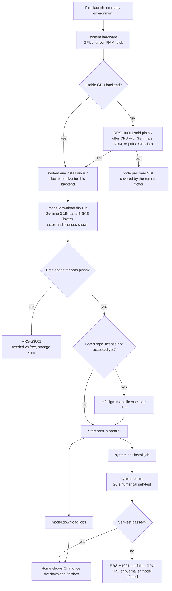

- Downloads and the environment install run in parallel. Downloads are node-native Rust jobs and don't need Python.
- Sizes come from the plans: the environment from `python/envs/environments.json` (download size per backend, measured at release time), the model from HF file sizes. Measured in the spike: CUDA 5.2 GB, ROCm 16.5 GB, CPU 0.75 GB; Gemma 3 1B is 2 GB and three SAE layers 0.45 GB. Time is shown only once a transfer has run a few seconds, from the measured rate.
- The three SAE layers come from `psychology.sae_layers_default` (the spike used 7, 13 and 22). Other layers download on demand through `psychology.sae.load`, which issues the same `model.download`.
- First Run has no "done" flag. It is derived from state (a ready environment and a downloaded default model), so a crash part-way resumes where it stopped.
- **`apps/web` only sequences and shows** (contracts 2.4 rule 9: no domain logic in the web app). Every decision in the chart (backend, sizes, free space, license, self-test verdicts) comes from a command result, so the CLI verbs on a headless box reach the same answers.

**Persisted:** nothing by the screen itself; each command persists its own results (1.2–1.6).

**Tests:** Playwright `tests/e2e/` First Run on the CPU environment, against `fixtures/hf-server/` (a local fake of the HF endpoints the client uses), with a tiny model in place of Gemma; a kill -9 of the daemon halfway through, then a relaunch, resumes First Run where it stopped.

### 1.2 Hardware detection and backend choice

Runs in `rastai-node` at every node start (under a second) and on `system.hardware`. Every box below belongs to the hardware module of `rastai-node`.

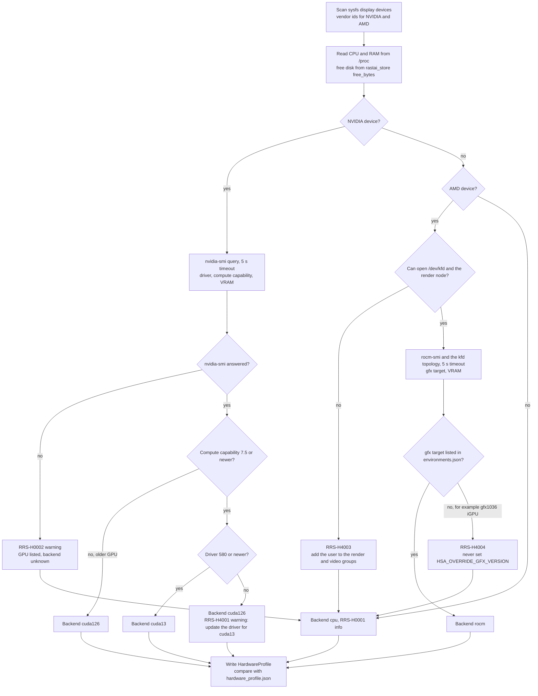

- Tool output is parsed, never trusted blindly: a tool that hangs or prints garbage yields `RRS-H0002` and the GPU stays listed but unused.
- Free disk comes from `rastai_store::free_bytes`, the one function the node and the daemon share (plan §10 row 15; the same function backs every free-space check in 8.1). It is one `statvfs` call in `crates/rastai-store/src/disk_space.rs`, the only `unsafe` in the workspace (ADR-0033); `df` is not used.
- One backend per node in the prototype. A box with GPUs of mixed generations gets the backend for its newest GPU; GPUs that backend can't run are listed as unusable with `RRS-H4004`. A box with NVIDIA and AMD uses NVIDIA.
- A driver below 580 can still run `cuda126`. If it is too old even for that, the self-test (1.6) fails the GPU instead of guessing here.
- The supported gfx targets are listed in `python/envs/environments.json`, filled from the pinned ROCm wheel's build targets at release time (RDNA3 and newer, for example `gfx1100`). Forcing an unsupported chip gave silently wrong matmuls in the spike, so no code path sets `HSA_OVERRIDE_GFX_VERSION`. If the user's own environment sets it, the node removes it from every job it spawns and logs warning `RRS-H4002` once (layout/rust-node-gateway-proto.md 7.4).
- If the fingerprint (GPU list, driver version, backend version) differs from the cached profile, the self-test result is marked stale and the node runs `system.doctor` on its own (1.6). No GPU job is scheduled on a GPU whose self-test is missing, stale or failed.

```rust
// rastai-node: hardware.rs detects, environments.rs picks (layout/rust-node-gateway-proto.md 7.2, 7.6)
const DETECTION_TOOL_TIMEOUT_SECONDS: u64 = 5;            // a hung nvidia-smi must not block node start
const CUDA13_MIN_DRIVER_MAJOR: u32 = 580;                 // spec §22
const CUDA13_MIN_COMPUTE_CAPABILITY: (u32, u32) = (7, 5); // CUDA 13 dropped Maxwell, Pascal and Volta

pub struct EnvironmentChoice {
    pub environment_id: String,          // "cuda13", "cuda126", "rocm" or "cpu"
    pub usable_gpu_indices: Vec<u32>,
    pub notes: Vec<Diagnostic>,          // RRS-H0001, RRS-H4001, ...: the reason shown to the user
}

pub async fn detect_hardware() -> Result<HardwareProfile, NodeError> { ... }       // hardware.rs
pub fn pick_environment_id(hardware: &HardwareProfile) -> EnvironmentChoice { ... } // environments.rs
```

**Persisted:** `<data>/node/hardware_profile.json` (durable): the last `HardwareProfile`, its fingerprint and the self-test verdicts. The live profile is also in every `Heartbeat`.

**Tests:** a table test in `crates/rastai-node/tests/` over recorded tool outputs in `fixtures/hardware/`: 5080 + 3090 → cuda13; Pascal only → cuda126; driver 575 → cuda126 with `RRS-H4001`; gfx1036 iGPU → cpu with `RRS-H4004`; gfx1100 → rocm; `/dev/kfd` denied → `RRS-H4003`; no GPU → cpu; nvidia-smi timeout → `RRS-H0002`. A spawn test: a job launched with `HSA_OVERRIDE_GFX_VERSION` in the user's environment doesn't see it, and `RRS-H4002` is logged. A CI grep fails the build if `HSA_OVERRIDE_GFX_VERSION` is set anywhere outside docs and that spawn test.

### 1.3 Python environment creation

Runs on `system.env.install`: in First Run, after an update changes a lockfile (9.2), or when the user follows the fix on `RRS-H2003`. Never from inside a running job (no runtime installs).

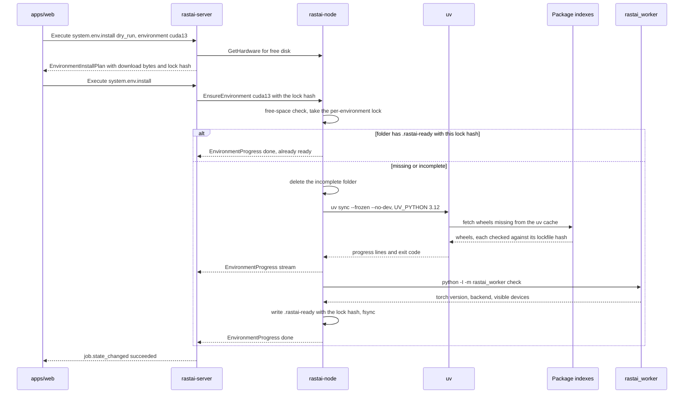

- The environment project (`pyproject.toml` + `uv.lock` from `python/envs/<backend>/`) ships inside the app bundle. So do the first-party wheels (`rastai_worker`, `rastai_models`, ...), which the lockfile references by path and hash. The pinned `uv` binary ships in the bundle too.
- The target folder is `<data>/envs/<environment_id>-<lock_hash12>/`, passed to uv as `UV_PROJECT_ENVIRONMENT`. `UV_CACHE_DIR` is `<cache>/uv/`, which makes a reinstall take under 1 s (spike). `UV_NO_CONFIG=1` keeps the user's own uv config out (layout/rust-node-gateway-proto.md 7.6 has the full variable list).
- The `.rastai-ready` marker is written last. A folder without it is garbage. That is the whole recovery story for a kill -9 mid-sync: the next ensure deletes the folder and syncs again from the warm cache.
- Two callers asking for the same environment wait on one in-memory lock in `rastai-node` and get the same result.
- **Failures the user sees** (`RRS-H2001`–`H2003` are the node layout's numbers):
  - the bundled `uv` binary is missing or its hash is wrong → `RRS-H2001`;
  - the lockfile can't be installed on this platform → `RRS-H2002`;
  - network or package index error → `RRS-H2004` (rerun resumes from the uv cache);
  - a wheel whose hash doesn't match the lockfile → `RRS-H2005`, the folder is deleted;
  - disk full mid-sync → `RRS-S3002` (recognised in uv's stderr), the folder is deleted;
  - the import check fails, for example torch can't see the GPU → `RRS-H2003` with the check's JSON attached. No ready marker is written. The folder is kept until the next ensure, so `rastai doctor --bundle` can include its output.
- **A job whose environment isn't ready** stays `queued` with `RRS-H2006` and a fix button that runs `system.env.install`. Admission in `rastai-node` never half-starts a job (layout/rust-node-gateway-proto.md 7.4). The scheduler tries the job again when the environment becomes ready. If the folder disappears between admission and spawn (GC, a manual delete), the job goes `starting → failed` with the same code (contracts §9.1).

**Persisted:** `<data>/envs/<environment_id>-<lock_hash12>/` (durable once `.rastai-ready` exists); `<cache>/uv/` (safe to delete); the job row in `rastai.db`. Progress is ephemeral.

**Tests:** CPU environment install in CI (3 s, 0.75 GB); `tests/crash/` kill -9 during `uv sync`, then ensure again → rebuilt and ready; a local index fixture serving a tampered wheel → `RRS-H2005`; a job submitted before its environment exists → `queued` with `RRS-H2006`, then `running` once the install finishes; `tools/checks/check-deps` confirms every lockfile is hash-pinned.

### 1.4 Model license and the gated Hugging Face sign-in

Runs before `model.download` when the plan says the repo is gated, and on `hf.license.check`. Gemma's official weights are gated (§6); Gemma Scope 2 is CC-BY-4.0 and ungated.

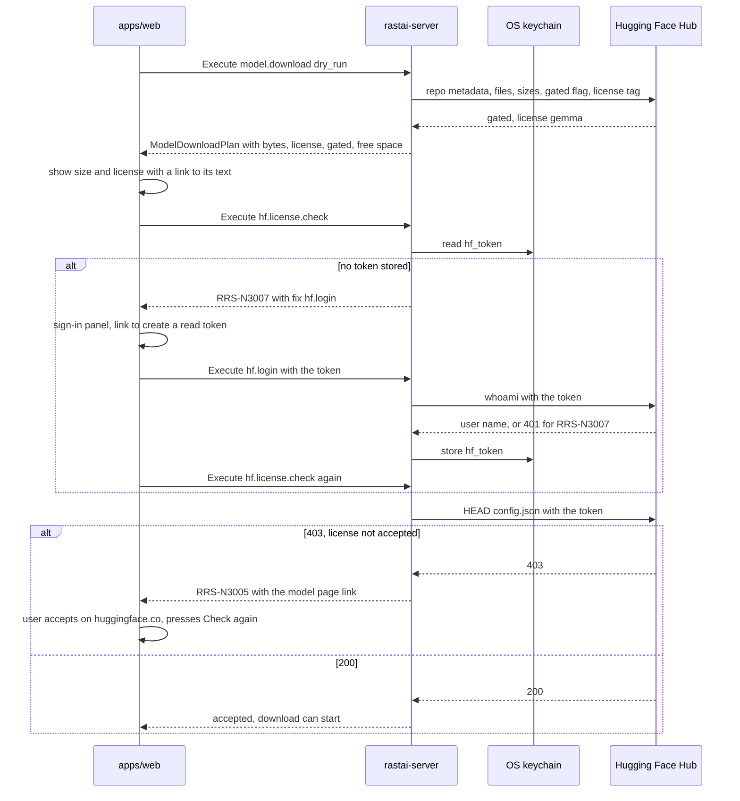

- The HF client lives in `rastai-node`; the daemon calls it in-process for metadata and checks, because the daemon holds the secrets.
- "Sign-in" in the prototype is a pasted read token. An HF OAuth app is Phase 2.
- Rastai can't accept a license for the user. Acceptance happens on huggingface.co; Rastai only checks it with a HEAD request on one file. A repo whose owner approves requests by hand also returns 403 until approved; the message says so.
- `hf.login`'s token is a secret argument: it is replaced with `<redacted>` in the command journal and never reaches logs or events.
- No keychain service (headless Linux) → kernel keyring → encrypted file `<config>/auth/secrets.enc`, with warning `RRS-S4001` naming the fallback in use.
- The license tag is stored in `models.license` and carries into run records and exports (§10).

**Persisted:** `hf_token` in the OS keychain (durable). Journal rows with the token redacted. Plans and checks write nothing.

**Tests:** unit tests against `fixtures/hf-server/`: no token → `RRS-N3007`, 403 → `RRS-N3005`, 200 → accepted; a journal test proving the `hf.login` row holds `<redacted>`; a keychain fallback test on a CI runner with no Secret Service.

### 1.5 Model and SAE download job

Runs on `model.download` after the plan (and license check, if gated). Kind `download`, node-native.

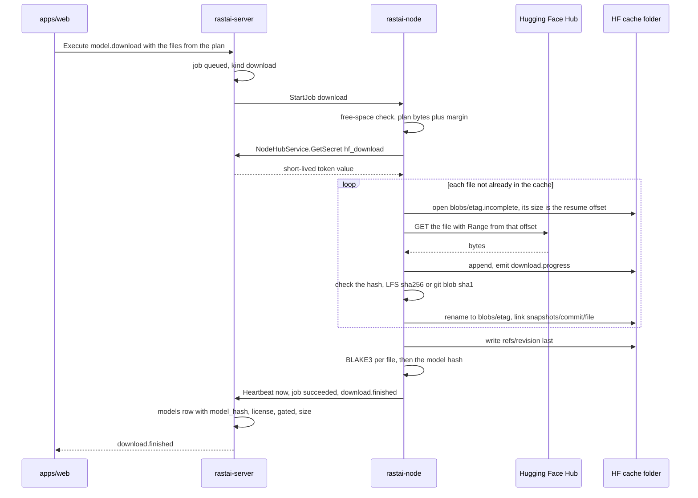

- Files land in the standard HF cache layout (contracts §8.1), so other HF tools see them. Weights are never copied (§19).
- `refs/<revision>` is written last, so a half-finished download never looks complete to Rastai or to HF tools.
- SAE weights are data downloaded the same way, but only the listed files (three layers of `google/gemma-scope-2-1b-it`).
- **Failures the user sees** (`RRS-N3003`–`N3006` are the node layout's numbers, layout/rust-node-gateway-proto.md 7.9):
  - network drop → retry with backoff 1, 2, 4 … 60 s, 10 tries, resuming from the `.incomplete` offset; then `RRS-N3009`, partial kept, rerunning resumes;
  - hash mismatch → delete the partial, retry once from zero, then `RRS-N3003`;
  - repo, revision or file not found → `RRS-N3004`;
  - 401 or 403 mid-download (token revoked, license withdrawn, access not yet approved) → `RRS-N3005`, whose fix runs `hf.license.check` (1.4) to tell the token case (`RRS-N3007`) from the license case;
  - not enough space at the start → `RRS-S3001` before any byte moves; disk full during the write → `RRS-S3002`, partial kept, fix offers `storage.gc`;
  - `hf.offline` or `HF_HUB_OFFLINE=1` → `RRS-N3006` without any network call; cached files still work;
  - cancel → partial kept for a later resume.
- The data leaves the machine only as requests to HF; the egress badge shows while the job runs.
- A daemon crash kills the embedded node and this node-native job with it. On restart the job is marked lost, then failed with info `RRS-J3004`, and `rastai-server` resubmits it; it resumes from the `.incomplete` files (2.3).

**Persisted:** HF cache files (durable; the user's cache, outside Rastai's quota); the `models` row and job row in `rastai.db`. Progress is ephemeral.

**Tests:** `fixtures/hf-server/` cuts the connection at 50% → the job resumes and the hash matches; `tests/crash/` kill -9 of the daemon mid-download → after restart the first half is not fetched again; a wrong-hash fixture → `RRS-N3003`; a 404 fixture → `RRS-N3004`; a 403 mid-download → `RRS-N3005`; a small tmpfs → `RRS-S3002`.

### 1.6 `rastai doctor` and the numerical self-test

Runs on `system.doctor` (CLI alias `rastai doctor`): at the end of First Run, on demand, and by the node on its own when the hardware fingerprint changes.

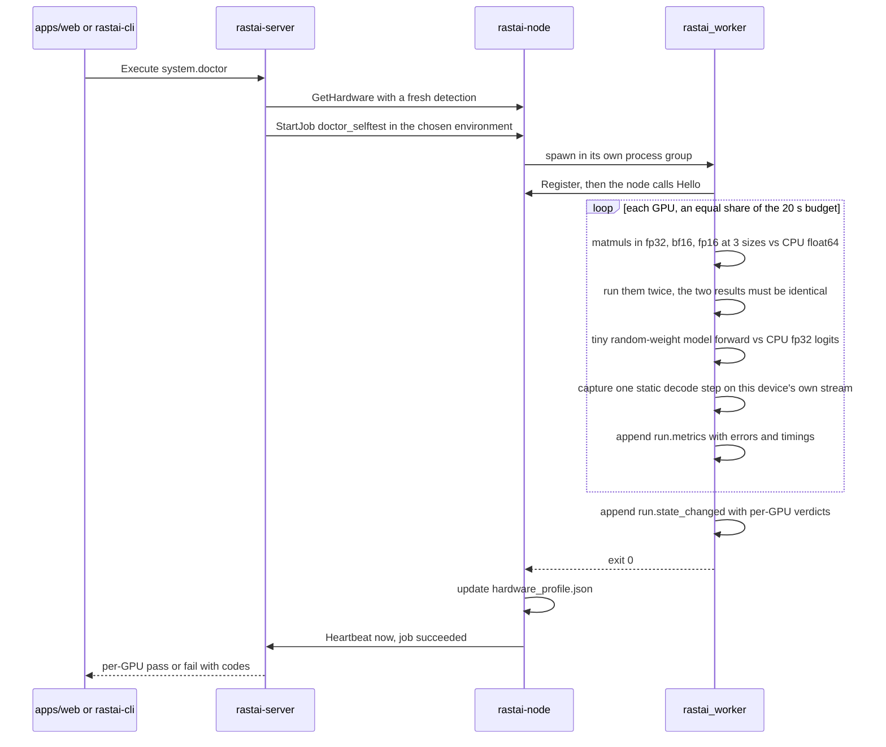

The sequence above is the request path: one `doctor_selftest` job that measures every visible GPU and writes its verdicts to the event log. The chart below is the verdict each GPU gets from those measurements, and what the node does with GPUs that fail.

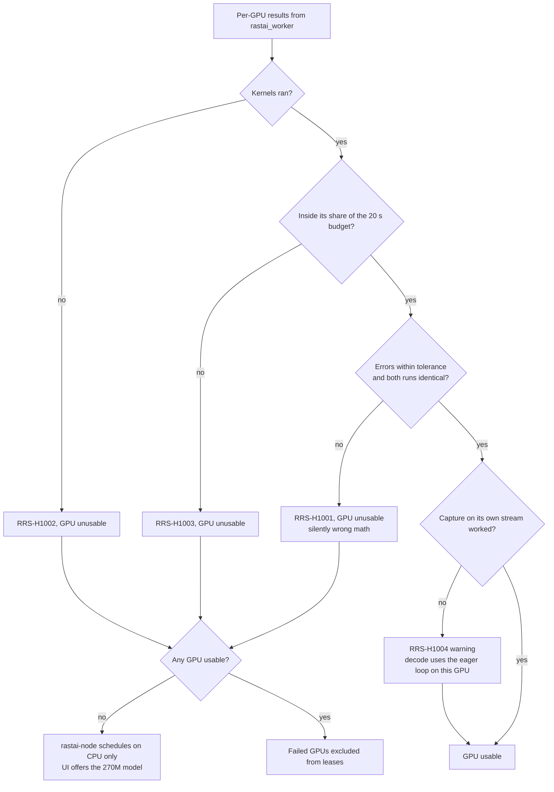

- Two checks catch the spike's failure: comparison with a CPU float64 reference (the forced iGPU had up to 100% error) and two identical runs (its results changed from run to run).
- TF32 is switched off for the fp32 check; otherwise fp32 matmul error is around 1e-3 by design.
- The capture check exists because the spike found that the default capture stream lives on whichever GPU was used first, which broke the second GPU.
- The node kills the job at 60 s if a GPU hangs (`RRS-H1003`).
- `rastai doctor --bundle` (`system.bundle`) packs `<state>/logs/*.jsonl`, `hardware_profile.json`, versions, the compatibility-matrix row (9.1), `settings.get` output and the stderr tails of the last 10 failed jobs into one zip at a path the user picks. `<config>/auth/` and `<data>/plugin-data/` are never read.

```python
# rastai_worker/jobs/doctor_selftest.py
SELF_TEST_BUDGET_SECONDS = 20                 # spec §22
MATRIX_SIZES = (64, 1024, 4096)
TOLERANCE_BY_DTYPE = {"float32": 1e-4, "bfloat16": 2e-2, "float16": 2e-3}  # relative error vs float64 on CPU


def run_job(job: JobSpec, host: WorkerHost, events: JobEvents, control: JobControl) -> None:
    verdicts = [test_one_device(device, job) for device in visible_devices()]
    write_verdicts(events, verdicts)
```

**Persisted:** a doctor run like any other: `runs/<run_id>/run.json` and `events.log` (durable); the updated `hardware_profile.json` (durable).

**Tests:** a fault-injection flag that exists only in test builds perturbs matmul results → `RRS-H1001` and the GPU gets no leases; nightly `tests/gpu/` runs the real self-test on the 5080 and 3090; CPU CI runs the CPU path end to end.

---

## 2. Daemon startup, embedded node and reattach

### 2.1 Daemon startup and the embedded node

Runs when the Tauri shell opens (it runs `rastai open --print-url`, 4.1), when any `rastai` CLI verb finds no daemon, on `rastai serve [--headless]`, or from the systemd user unit. The desktop shell never starts or probes the daemon itself; the CLI does it for the shell.

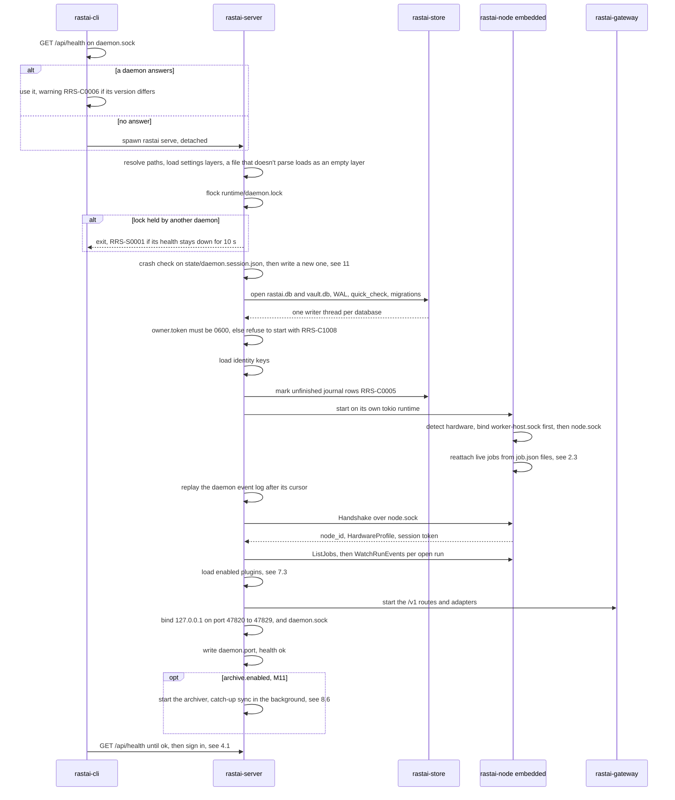

- The daemon reaches its embedded node over `node.sock` with the same `Handshake` a remote node gets, so local and remote never drift (§16).
- Stale sockets from a crashed daemon are unlinked before binding. This is safe because the daemon holds `daemon.lock`. Per-job sockets (`jobs/<job_id>.sock`) belong to live workers and are never touched.
- The first `bus_sequence` after a start is the start time in milliseconds times 1,000. Numbers keep increasing across restarts, so a client's old number is never mistaken for a new one (6.3).
- Plugin Python modules start in the background. Their commands are registered from the manifest at once; a call made before the module registers waits up to 30 s (`RRS-P4002` after that).
- The gateway loads the Gemma tokenizer (about 250 MiB, spike) on the first chat, not at startup, so health is ready in about 0.5 s (spike: Rust gateway startup 0.5 s).
- `rastai serve` without Tauri opens the browser with a login code when `daemon.open_browser` is true (4.1).
- **The archiver** (M11, only when `archive.enabled`) starts after health is ok, so an unreachable MySQL server never delays the start. Before its first catch-up pass it fills any pruned-run stubs a rebuild left (`restore_from_archive(PrunedRunRows)`, 6.4); the catch-up pass then sends what the last daemon left unsent (8.6).
- **Settings are files** (spec v5.4 §19): the layers come from `<config>/settings.json`, the project's `settings.json`, the environment and flags (contracts 11.1). `rastai.db` holds no settings.
- A clean stop (SIGTERM, SIGINT) closes streams, detaches from workers without stopping them, flushes both writer threads, deletes `<state>/daemon.session.json` and releases the lock. Stopping the daemon never stops jobs; `job.cancel` does.
- **`daemon.session.json`** (pid, version, `boot_id`, start time) is written right after taking `daemon.lock` and deleted right before releasing it. Finding one at start means the last daemon didn't stop cleanly; the crash-report flow (11) decides what to do with it.
- **A running daemon of another version** is used as it is; the CLI prints warning `RRS-C0006` ("restart the daemon", layout/rust-control-plane.md). The desktop relaunch after an update replaces it instead (9.2).
- **Failures the user sees:**
  - another daemon owns the data directory and doesn't answer → `RRS-S0001`;
  - `rastai.db` or `vault.db` has a newer schema than this app → `RRS-S0002`, nothing is written;
  - `rastai.db` fails `quick_check` → `RRS-S0003` and the daemon doesn't start. Fix: `rastai storage rebuild-index` (6.4). It reads the four tables that logs can't rebuild (`tokens`, `nodes`, `plugins`, `projects`) from what the damaged file still holds (from L2 on top of the newest good snapshot, 8.4), rebuilds every other table from logs, and resets `archive_cursors`;
  - `vault.db` fails `quick_check` → `RRS-S0005`. `vault.db` is not an index, so it is never rebuilt. The daemon starts without the vault: chat, conversation commands and `/v1` answer `RRS-S0005`, and everything else works. The damaged file is never written. Fix: `storage.vault.recover` (L2, 8.4); before L2 the fix text says to restore `vault.db` from the user's own copy;
  - data directory not writable → `RRS-S0004`;
  - no free port in 47820–47829 → `RRS-C1001`;
  - `owner.token` readable by group or others → the daemon refuses to start with `RRS-C1008` (error), fix text: `chmod 600 <path>` (ADR-0007, "Checked by"). It never rotates or rewrites the file on its own, because a loose mode may mean someone else already read the token.
- **A settings file that doesn't parse** (`<config>/settings.json`, `<config>/keybindings.json`, or a project's `settings.json` at `project.open`, 10.1) never stops the daemon and is never overwritten:
  - The daemon starts with that layer empty, so defaults and the other layers apply. It reports the `RRS-E0xxx` (syntax) or `RRS-E1xxx` (structure) diagnostic with the file and line through `diagnostic.reported`, and the UI shows it as a banner.
  - Every command that would write that file (`settings.set` at that level, the keybinding editor's save) is refused with `RRS-C0009` ("fix the settings file first"). Writing a fresh file from the empty layer would drop the user's other keys.
  - The daemon re-reads a broken file on every `settings.get` and `settings.set`. Once it parses, the layer loads, the banner clears and writes work again. A restart does the same.
  - A file with a newer schema than this app (`rastai.settings/1` header) is read for the keys this version knows and is read-only: writes to it are refused with `RRS-E4001`, as for a newer project (10.1), so the newer version's keys survive.

**Code:** the steps above are one call each in `crates/rastai-server/src/daemon.rs` `run_daemon` (layout/rust-control-plane.md 8.2): `open_store` (sync), `ensure_owner_token`, `start_embedded_node`, `build_server`, `replay_daemon_log`, `connect_to_node`, `load_all_plugins`, `listen_http`. `rastai serve` in `rastai-cli` only parses its flags and calls `run_daemon`.

**Persisted:** `rastai.db` and `vault.db` migrations (durable); `owner.token` and `<data>/identity/*.key` created on first start (durable, 0600); `<state>/daemon.session.json` while the daemon runs (durable); `<runtime>/daemon.port` and the sockets (ephemeral); `<state>/logs/daemon.jsonl`.

**Tests:** startup to health under 1 s in CI; two `rastai serve` at once → one daemon; stale sockets present → clean start; a database with a newer `schema_migrations` version → `RRS-S0002` and the file unchanged; `chmod 644 owner.token` → start refused with `RRS-C1008`, file unchanged; a `vault.db` with one page overwritten → health ok, `chat.send` answers `RRS-S0005`, `train.start` works. **Broken settings:** write `{ "ui": ` to `<config>/settings.json`, start the daemon → health ok, a `diagnostic.reported` names `settings.json` line 1, `settings.set` is refused with `RRS-C0009` and the file is byte-identical afterwards; fix the file by hand → the next `settings.get` loads it and `settings.set` works; a `settings.json` with a newer schema → `settings.set` refused with `RRS-E4001`, file unchanged.

### 2.2 Node connection lifecycle

Runs for every node the daemon knows: the embedded node at startup, remote nodes from pairing on. The daemon (`rastai-server`) owns these states; they are stored in `nodes.state`.

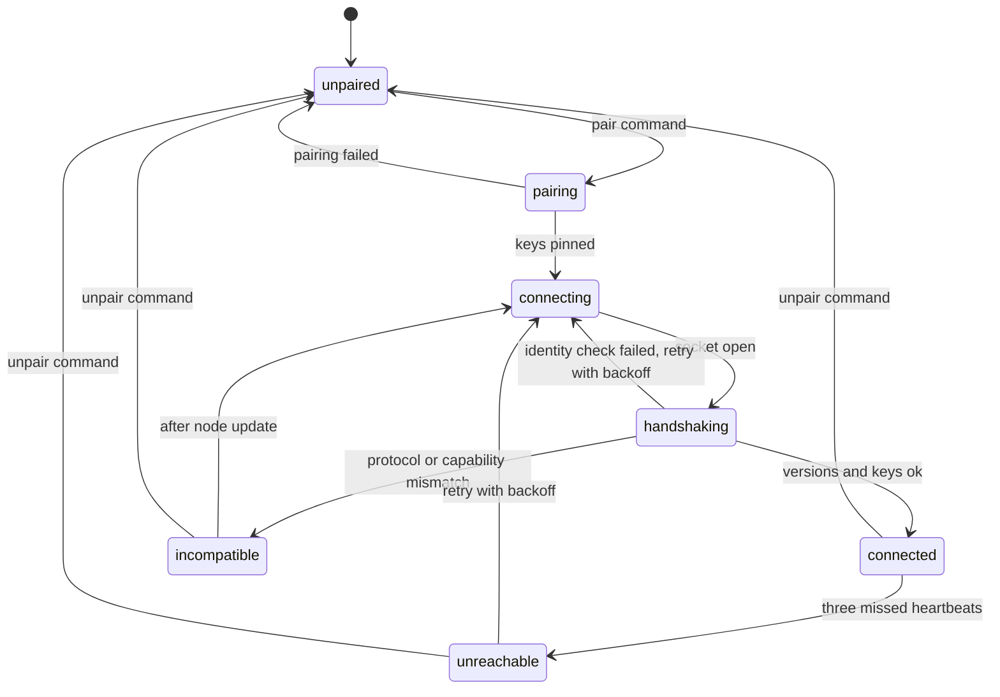

- The embedded node is paired once at first start (both keys are local) and starts in `connecting`. SSH pairing is in the remote flows.
- `node.unpair` works from any state (contracts §9.2). The chart draws it from the three states where the Nodes view offers it, as remote flows C2 does; from `connecting` and `handshaking` it works the same way. An `unreachable` node can't answer and an `incompatible` one speaks only `Handshake` and `UpdateNode` (9.3), so unpair from either takes the "forget locally" branch of remote flows C9; to wipe the box's data, run `node.update` first.
- Heartbeats every 5 s; three missed (15 s) → `unreachable`, `RRS-N2001`, and every job on that node becomes `lost` (5.2). Workers keep running.
- Reconnect backoff: 1 s doubling to 30 s.
- `incompatible` (`RRS-N0001`): the fix button runs `node.update`; after `system.update.apply` the daemon pushes the matching binary to every paired node itself (9.3).
- Identity mismatch in the handshake (`RRS-N0002`: a key on either side isn't the pinned one): no data is exchanged and the node stays out until the user re-pairs.

**Persisted:** `nodes` rows: state, `protocol_version`, `capabilities`, `last_heartbeat_unix_ms` (durable). Telemetry (`node.heartbeat`) is ephemeral.

**Tests:** drop the SSH forward for 20 s → `unreachable` then `connected`, its jobs `lost` then `running`; a node stub reporting `protocol_version` 0 → `incompatible`; a node with a different key → `RRS-N0002` and no `ListJobs` call made; `node.unpair` from `unreachable` and from `incompatible` → `unpaired` and the `nodes` row gone.

### 2.3 Reattaching to running jobs after a daemon crash

Runs at every daemon start. It matters after a crash or kill -9 of the daemon, which takes the embedded node down with it.

What keeps the jobs alive:
- Each worker runs in its own process group (`setsid`), so killing the daemon doesn't kill it.
- While no node is there, the worker keeps working and appending durable events to its log. Ephemeral events have no listener and are dropped. Calls to `WorkerHostService` fail and are retried with backoff; work that needs the host (rollouts through the node gateway, `PutBlob`) waits.
- Orphaned workers are reparented to init or the user's systemd, so the new node can't `waitpid` them. Their exit cause comes from the last record in their log.

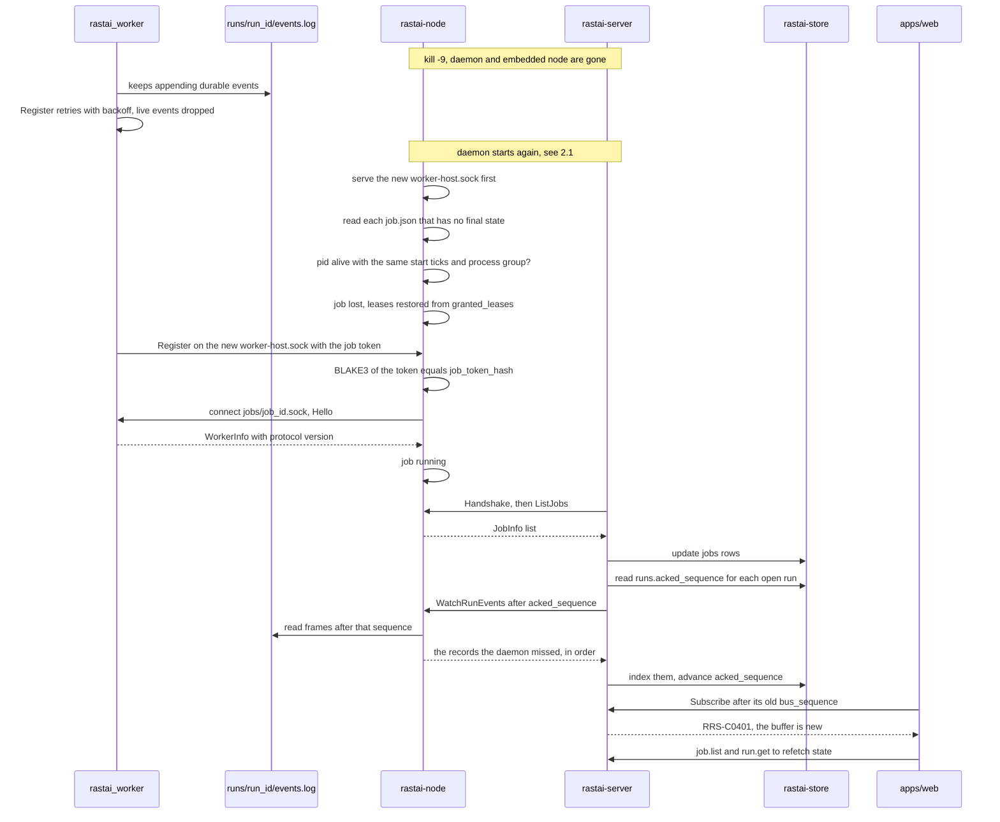

The sequence above is the happy path: the worker re-registers and the daemon catches up from its ack. The chart below is the decision the node makes for each `job.json` it finds, including the jobs that can't be reattached.

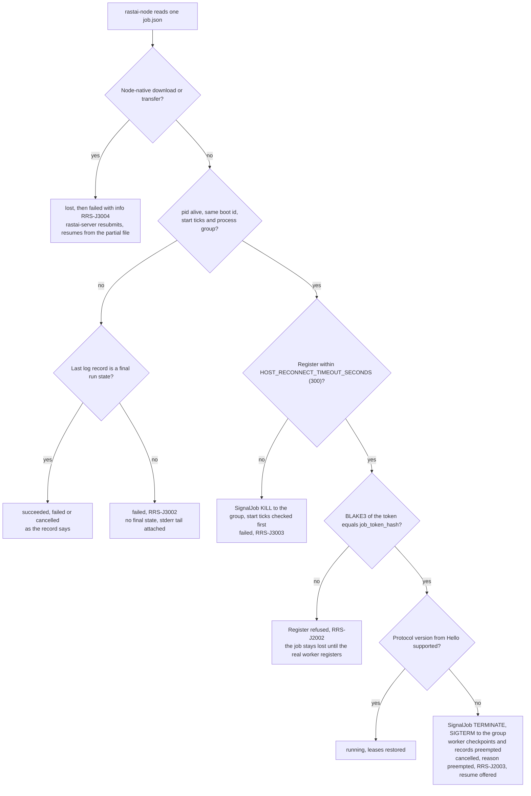

- The pid check uses `job.json`'s `boot_id` and `process_start_ticks` (from `/proc/<pid>/stat`), so a reused pid is never mistaken for the job.
- **Only the token's hash is on disk.** `job.json` (mode 0600) holds `job_token_hash`, the BLAKE3 of the job token; the token itself lives only in the worker's `RASTAI_JOB_TOKEN` and in node memory. After a restart the node has no token to call `Hello` with, so it waits for the worker's re-`Register`, checks BLAKE3(token) against `job_token_hash`, and only then calls `Hello` (plan §10 rows 5 and 6; layout/rust-node-gateway-proto.md 7.4).
- **How long the node waits:** the worker's host connection retries for up to `HOST_RECONNECT_TIMEOUT_SECONDS` (300, `layout/python.md` 7.2), then checkpoints and exits. A job that hasn't re-registered by then is failed with `RRS-J3003` and its group is killed after the start-ticks check.
- `serve_fast` (llama-server) takes the same path, with a `/health` call using its saved API key instead of `Hello`. Healthy means the model stays `ready` with no reload; unhealthy means `KILL` first if the pid is still ours, then `failed` with `RRS-J3002` (layout/rust-node-gateway-proto.md 7.8).
- **A worker protocol this node doesn't speak** (after an update, 9.2–9.3) gets `RRS-J2003`. SIGTERM (`SignalJob TERMINATE`) is the version-independent way to stop it: every worker treats it as preemption (checkpoint, then exit 75), so `train.resume` continues the run on the new version. A reattached worker isn't the node's child, so the node reads the outcome from the final record in its log, not from an exit code.
- The node rebuilds its lease table from the `granted_leases[]` field of each live job's `job.json` before it serves `node.sock`, so no lease is double-granted after the daemon reconnects.

**Persisted:** `job.json` per job on the node (durable, 0600, with `job_token_hash` and `granted_leases[]`); `jobs` rows and `runs.acked_sequence` in `rastai.db` (durable).

**Tests:** the weeks 3–4 exit test in `tests/crash/`: kill -9 the daemon mid-run (TextCNN on CPU), restart, and the job is `running` with `run_metrics` matching `events.log` exactly (no gap, no duplicate). Variants: the worker finishes while the daemon is down → `succeeded` from the final record; the worker is killed while the daemon is down → `RRS-J3002`; a `job.json` with a wrong start time → treated as gone; a worker stub that never re-registers → `RRS-J3003` after the timeout (shortened by a test setting); `job.json` contains no plain token (grep for the `RASTAI_JOB_TOKEN` value finds nothing on disk).

---

## 3. Command execution

### 3.1 The `Execute` path

Runs for every action. The UI (buttons, palette, keybindings, menus), CLI verbs, MCP tools and plugin modules all end in one function, `execute_command`.

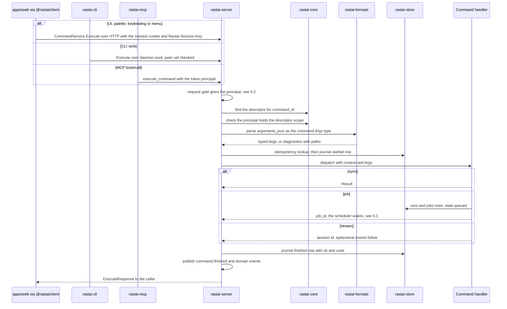

```rust
// rastai-server, commands module
pub async fn execute_command(server: &Server, principal: &Principal, request: ExecuteRequest) -> ExecuteResponse {
    match run_command(server, principal, &request).await {
        Ok(output) => success_response(output),
        Err(diagnostics) => failed_response(diagnostics),
    }
}

async fn run_command(server: &Server, caller: &Principal, request: &ExecuteRequest) -> Result<CommandOutput, Vec<Diagnostic>> {
    let principal = narrow_to_acting_plugin(server, caller, &request.acting_plugin_id);  // only ever removes rights
    let descriptor = find_descriptor(&server.registry, &request.command_id)?;     // RRS-C0001
    check_scope(&principal, descriptor)?;                                           // RRS-C1005
    check_plugin_enabled(server, descriptor)?;                                      // RRS-C0003
    let arguments = parse_command_arguments(descriptor, &request.arguments_json)?;  // RRS-C0002 + RRS-E codes
    if request.dry_run {
        return plan_command(server, &principal, descriptor, arguments).await;      // no journal, no side effects
    }
    if let Some(previous) = find_idempotent_response(server, &principal, request).await? {  // RRS-C0004
        return Ok(previous);
    }
    let journal_id = journal_started(server, &principal, descriptor, request).await?;
    let output = dispatch(server, &principal, descriptor, arguments).await;
    journal_finished(server, journal_id, &output).await;
    publish_command_events(server, journal_id, &output);
    output
}
```

- **The principal is never in the request** (contracts §4.2). It comes from the session cookie or `owner.token` (owner), a scoped bearer token (`token`), the socket peer (owner), a plugin job token (`plugin`) or a node session (`node`). `ExecuteRequest.acting_plugin_id` (new; plan §10 row 3) only narrows an owner principal to that plugin's grant, for calls from a plugin's UI. A plugin that isn't enabled has an empty grant, so every scope check fails.
- **Scope before arguments**, so a caller without the scope learns nothing about argument shapes.
- **Arguments** are parsed by `rastai-formats` into the generated `<Name>Args` type. The `RRS-E` diagnostics come back with JSON-pointer paths, wrapped in `RRS-C0002`.
- **Journal:** every command except `read`-scope ones gets a started row before the handler and a finished row after. Fields marked `secret` in the argument type's description are written as `<redacted>`. A started row with no finished row means the daemon died mid-command; the next start marks it `RRS-C0005`, so the user can see what was interrupted.
- **Idempotency:** the same `idempotency_key`, principal and command within 24 h returns the stored response, so a retried `train.start` never starts two runs. Different arguments under the same key → `RRS-C0004`. A duplicate arriving while the first is still running waits for it.
- **Kinds:** `sync` handlers aim for under 2 s; longer work is a `job`. A `stream` command returns a session id at once and its ephemeral events follow on the bus.
- **Failures** come back as `ExecuteResponse{ok: false, diagnostics}` over HTTP 200. Only credential problems (4.2) are HTTP 401 or 403.

**Persisted:** `command_journal` rows in `rastai.db` (durable), including the new `idempotency_key`, `result_json` and `job_id` columns; `runs` and `jobs` rows for job commands. Bus events are ephemeral (last 10,000 in memory).

**Tests:** `tests/e2e/`: one command through HTTP, the CLI and MCP gives the same result and the same journal row shape; unknown command, missing scope and bad arguments give their codes; `train.start` sent twice with one key → one run; secret redaction; `tests/crash/` kill -9 between the two journal writes → `RRS-C0005` after restart.

### 3.2 Validation, scope and dispatch decisions

Every box is in `rastai-server` unless marked.

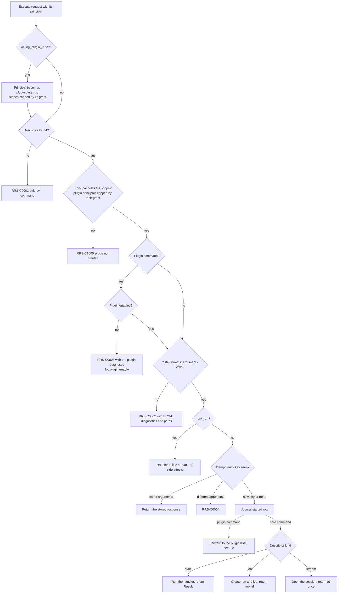

**Persisted** and **Tests:** as 3.1. The decision function is also covered by a table test in `crates/rastai-server/tests/` with one row per branch.

### 3.3 Plugin commands

Runs when a command id belongs to a plugin (`psychology.*`, `eval.*`, third-party ids). `dispatch` falls through to the plugin host (contracts §6.2).

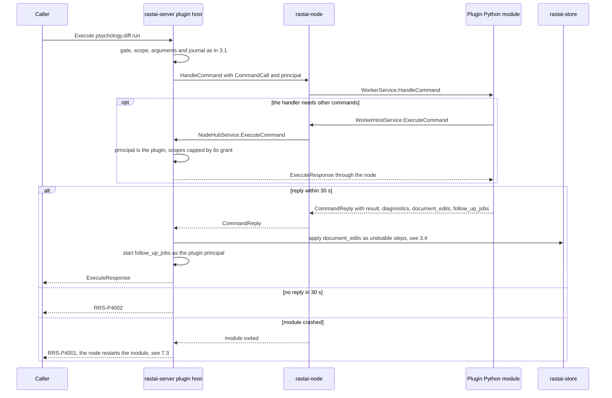

- Module handlers are plain functions (`handle_command`, contracts §6.2). A module never writes to the stores. Document changes come back as JSON Patch in `document_edits`, and the daemon applies them through the same function as 3.4, so undo and the journal work the same.
- A plugin can't escalate. Nested calls carry the plugin principal, and its scopes are the plugin's granted `commands:[scopes]`.
- **A module starts jobs only by returning them** in `follow_up_jobs`. The daemon starts them as the plugin principal, so scheduling, leases and the journal stay in one place. There is no `WorkerHostService.StartJob` (plan §10 row 31; contracts 15.11).
- **Psychology's interactive controls don't take this path.** Sliders and toggles call core commands such as `chat.settings.set` straight from the UI (contracts 2.4 rule 12). The plugin-module path is for validation and offline jobs, so its 30 s timeout never sits in an interactive loop; M4 has a latency test for the direct path (p95 under 50 ms on the local round trip).
- Plugin UIs in iframes reach the same path through the bridge (`tools/call` → `Execute`), with `ExecuteRequest.acting_plugin_id` narrowing the owner's principal to the plugin's grant (3.2, 4.2).

**Persisted:** a journal row for the outer call and one per nested call (principal `plugin:<plugin_id>`); document changes as in 3.4.

**Tests:** with `rastai plugin test` (headless host, mock worker): a fixture plugin calling a command outside its grant → `RRS-C1005`; a handler that sleeps 31 s → `RRS-P4002`; a module that exits mid-call → `RRS-P4001`, then a restart.

### 3.4 Undo and redo for document edits

Runs for undoable commands (`design.edit`, `harness.edit`, `dataset.edit`, `eval.suite.edit`, ...) and for `document.undo` / `document.redo`. Side effects such as training runs are never undoable (§21).

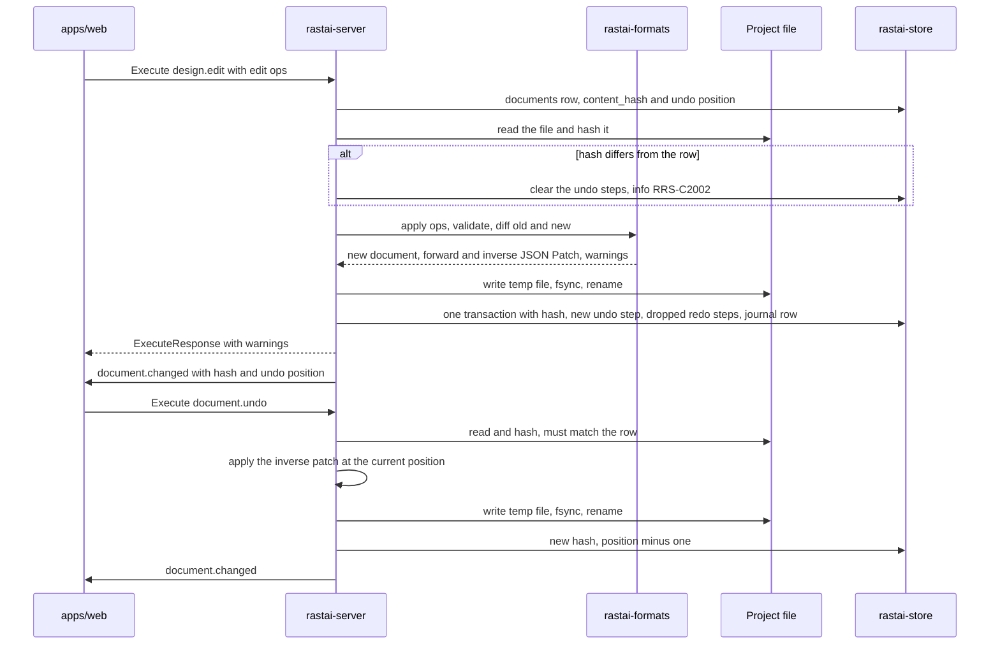

- Meaning-layer problems (shape errors, overlapping input ranges) don't block an edit; they come back as warnings and the Designer shows them. Edit ops can't produce a structure error; if one does, it's a bug and the edit is refused with `RRS-C0002`.
- Redo replays the forward patch. A new edit after an undo drops the redo steps above the current position.
- The last 1,000 steps per document are kept.
- An edit made outside Rastai (an editor, a git checkout) shows up as a hash mismatch on the next command. Old patches no longer apply, so the history is cleared with info `RRS-C2002`.
- Crash safety: the rename and the database transaction are two steps. If the daemon dies between them, the file is new and the row is old; the next command sees a mismatch and treats it as an outside edit. The file is never corrupt; only the history is lost.
- Nothing to undo or redo → `RRS-C2001`. `document.undo` is journaled but not itself undoable (redo is its inverse).

**Persisted:** the project file (durable, atomic rename); `documents`, `undo_steps` and `command_journal` in `rastai.db` (durable).

**Tests:** a property test in `rastai-server`: random edit sequences, then undo everything → the original bytes; `tests/crash/` kill -9 between rename and commit → the `RRS-C2002` path with a valid file; an outside edit test.

---

## 4. Local API security

### 4.1 Signing in the UI

Runs when the Tauri shell opens a window, when `rastai open` runs, when `rastai serve` starts with `daemon.open_browser`, and after a daemon restart (sessions live in memory).

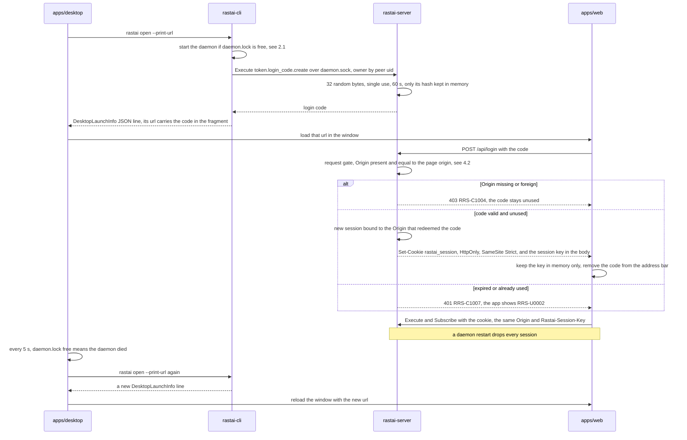

- The code travels in the URL fragment (`#login=<code>`), which browsers never send to servers or put in a Referer header.
- **The desktop shell does no HTTP and no crypto, and never reads `owner.token`** (layout/frontend-and-plugins.md 9.3, 9.5; plan §10 row 2). It only spawns the bundled `rastai` and loads the URL the CLI prints. The CLI mints the code over `daemon.sock`, where the peer uid proves the owner.
- `rastai open` without a flag creates a code the same way and opens the default browser. `rastai open --print-url` prints one `DesktopLaunchInfo` JSON line (`{url, cli_version, daemon_version, runtime_dir, config_dir, updates}`) instead; the shell parses it, and on a headless GPU box reached through an SSH tunnel the user copies `url` to the laptop.
- Sessions live in daemon memory and expire after 24 h idle. A restart signs everyone out. The Tauri shell notices (its 5 s check finds `daemon.lock` free) and runs `rastai open --print-url` again. A plain browser tab shows `RRS-U0003` (signed out; frontend layout) with the `rastai open` hint.
- **Sessions are bound to the origin that redeemed the code** (ADR-0034, decision N4). `POST /api/login` must carry Origin; the session records it, and every later cookie request must carry the same Origin (4.2). Why: the Host rule accepts any loopback port (SSH tunnels need it), and browsers send a cookie to every port on `127.0.0.1`. Without the binding, a page served by another local program on another port, which forwards its requests to the daemon, would pass both the Host and the Origin check with the user's cookie.
- **Sessions also hold a request key** (ADR-0034 decision 10, contracts §3.2). `POST /api/login` returns the key in its response body as `{"session_key": "<64 lowercase hex>"}` (32 random bytes, hex-encoded; contracts §3.3), and the daemon keeps only the hash of that hex text. The web app holds the key in memory only and sends it as `Rastai-Session-Key` on every cookie request other than `GET` or `HEAD`; a missing or wrong key is `RRS-C1002`. A page reload loses it: a browser tab signs in again with a new code from `rastai open`, and the desktop shell does that on its own.
- Cookie name `rastai_session_<daemon id prefix>`; flags HttpOnly, SameSite=Strict, Path=/. No Secure flag on plain-HTTP loopback.
- The web app never asks the shell for anything; it only talks to the daemon over HTTP, so a plain browser is a full client. `@rastai/client`'s `connectToDaemon` takes a `credential` option: the web app uses the cookie, scripts and tools use a bearer token (4.3).
- **Cross-origin browser clients are refused in v1.** A web page on any other origin can't use the session. Two routes are designed for later, both Phase 2: alternative UIs hosted by the daemon on its own origin, and an origin allowlist with pairing (CORS only on demand). Non-browser clients use scoped bearer tokens today.
- **The signed-out screen is locked UI** (decision N7). `SignedOutScreen`, like the egress badge, the trust prompt and the permission list, is drawn by the shell with `LOCKED_TOKENS` (`@rastai/ui`), which no theme can change, so a theme or a plugin UI can't fake or hide it.
- **Residual risk** (for the threat model, M1-56): a program of another OS user listening on a loopback port the user's browser visits receives the cookie in its request headers and could replay it outside a browser with forged headers. Without the session key it can't run a command or upload (`RRS-C1002`); it could only `GET` a blob whose hash it already knows. The 24 h idle expiry and a daemon restart bound it.

**Persisted:** `<config>/auth/owner.token` (durable, 0600; the desktop shell never reads it). Login codes and sessions (with their bound origin and key hash) are ephemeral.

**Tests:** Playwright: valid code → signed in; reused code → `RRS-C1007`; code after 61 s → `RRS-C1007`; daemon restart → a browser tab shows `RRS-U0003`; a page reload after sign-in → `SignedOutScreen` (`RRS-U0003`, the key is gone), and a new code from `rastai open --print-url` signs the tab in again. **Origin binding:** redeem a code at `127.0.0.1:47820`, then send the same cookie through a fixture forwarder on `127.0.0.1:9000` (Host and Origin both port 9000) → `RRS-C1004`; a login POST without Origin → `RRS-C1004` and the code still works afterwards. CLI: `rastai open --print-url` prints exactly one JSON line that parses as `DesktopLaunchInfo` and whose `url` fragment holds a working code.

### 4.2 The request gate

Runs first in every HTTP handler and on every `daemon.sock` connection. One plain function in `rastai-server`; every box is in it.

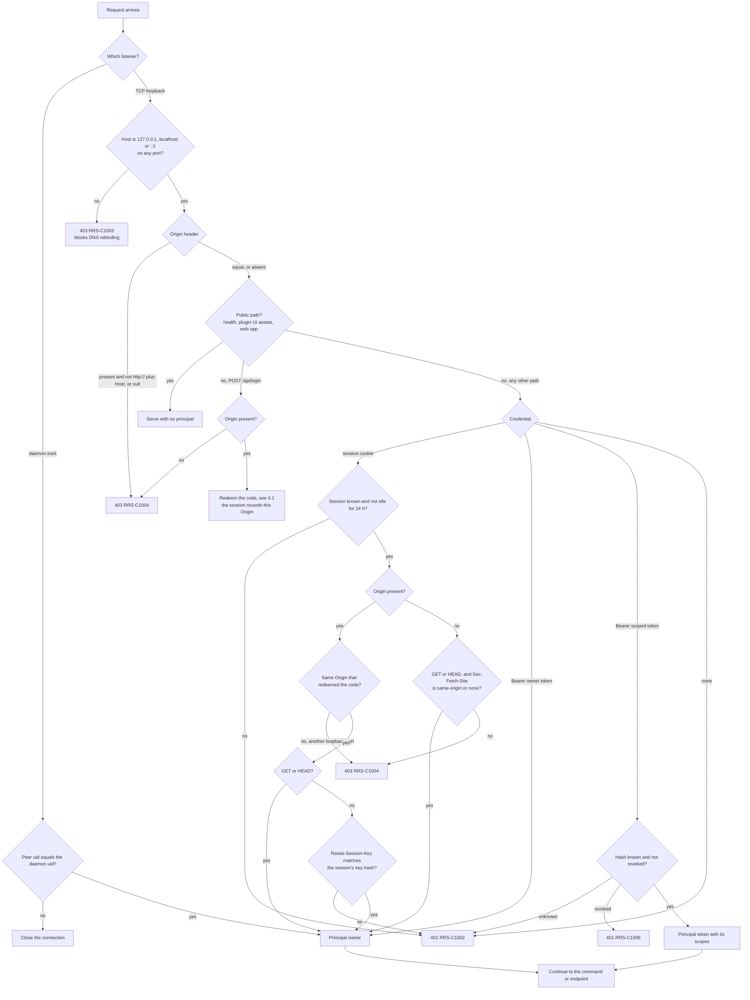

```rust
// rastai-server, auth module; login codes and origin-bound sessions are in sessions.rs
pub fn check_request_gate(request: &RequestHead, listener: &Listener, auth: &AuthState) -> Result<Option<Principal>, Diagnostic> { ... }
```

- Nothing listens on a non-loopback interface by default (§21). The remote UI goes through an SSH tunnel.
- The Host check blocks DNS rebinding: a page that resolves `attacker.test` to 127.0.0.1 still sends `Host: attacker.test`.
- **Any loopback port is accepted** (plan §10 row 22, ADR-0034, superseding ADR-0007 decision 4): an SSH tunnel to a headless box often forwards a different local port, and the browser then sends that port in Host. Two checks tie a cookie to the page that loaded the app: Origin must equal `http://` plus the Host header, and it must equal the origin the session was redeemed from (4.1).
- **A cookie request other than `GET` or `HEAD` needs the session key** (ADR-0034 decision 10). Origin and `Sec-Fetch-Site` are enforced only by browsers, so a non-browser process on another loopback port that receives the cookie could forge both and pass the Origin checks; it never sees the key, so its `Execute` is `RRS-C1002`.
- **A cookie request without Origin** passes only for `GET` and `HEAD` with `Sec-Fetch-Site` `same-origin` or `none`: the app's own blob downloads and images, and a URL the user typed. Browsers send Origin on every POST, so every Connect call carries it. Why the rule: `` on a page served from another loopback port sends the daemon's cookie (same site, since cookies ignore ports) with no Origin, and its `Sec-Fetch-Site` is `same-site`, so it is refused. A browser that sends no `Sec-Fetch-Site` gets `RRS-C1004` on such GETs.
- Bearer requests may omit Origin (curl, Navi, scripts); if they send one, the Origin rule applies. Origin `null` (a sandboxed plugin iframe) is refused, so a third-party iframe can't call the daemon directly. The Tauri window loads the web app from the daemon, so its Origin is the daemon's own and no Tauri origin needs to be accepted.
- Scoped tokens are looked up by BLAKE3 hash; plain tokens are never stored.
- **Plugin UIs get no principal here.** When an iframe calls `tools/call`, the UI bridge in `@rastai/plugin` sends the call with the owner's cookie and sets `ExecuteRequest.acting_plugin_id`. `execute_command` then narrows the principal to the plugin's grant (3.1, 3.2). The field can only remove rights (plan §10 row 3; layout/frontend-and-plugins.md 20).
- `/v1/*` and `/mcp` go through the same gate. Then `rastai-gateway` checks `chat` (plus `gateway.spend` for paid API adapters) and `rastai-mcp` checks each tool's scope.
- Plugin UI assets are public static files with no secrets; the Host check still applies.

**Persisted:** `tokens` rows (hashes and scopes). Sessions and their bound origins are memory only. Nothing is written per request, except command journal rows.

**Tests:** a table test with one request head per branch; a DNS-rebinding test sending `Host: attacker.test`; a tunnel test: redeem a code with `Host: 127.0.0.1:9000` and a matching Origin → later calls pass, the same Host with Origin `http://127.0.0.1:47820` → `RRS-C1004`, and a cookie redeemed at port 47820 sent with Host and Origin on port 9000 → `RRS-C1004`; a cookie GET of `/api/blobs/<hash>` with no Origin and `Sec-Fetch-Site: same-origin` → passes, with `same-site` → `RRS-C1004`, a cookie POST without Origin → `RRS-C1004`; a cookie POST with the right Origin and no `Rastai-Session-Key`, or a wrong one → `RRS-C1002`, and a cookie GET of a blob with no key passes; an Origin `null` test; the desktop smoke test checks that the Tauri webview sends `Sec-Fetch-Site`; cargo-fuzz on the header parsing.

### 4.3 Scoped tokens for Navi and MCP clients

Runs when the owner creates a token for an outside client, and on every request that client makes.

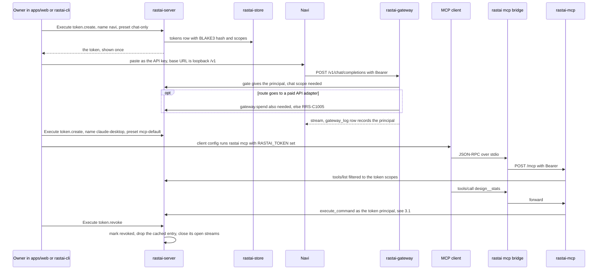

- Presets: `chat-only` = `chat`; `mcp-default` = `read`, `chat`, `project` (contracts §6.3). Custom scope lists are allowed. Only the owner can create tokens (`system.admin`).
- `rastai mcp` without `RASTAI_TOKEN` answers every request with `RRS-C3002` and a fix that runs `token.create` with `mcp-default`. It never falls back to the owner token: an agent gets scopes only when the owner grants them.
- MCP tool names are command ids with dots replaced by `__`. Malformed JSON-RPC → `RRS-C3001`.
- Revocation applies on the next request; open streams for that token close with `RRS-C1006`.
- "Copy as MCP" writes the client config with a placeholder, never a real token.

**Persisted:** `tokens` (durable, hash only); `gateway_log` in `vault.db` with the principal; journal rows.

**Tests:** `tests/e2e/`: a `chat-only` token can stream `/v1/chat/completions` and gets `RRS-C1005` on `train.start`; revoking mid-stream → `RRS-C1006`; a golden MCP transcript through `rastai mcp`.

---

## 5. Job lifecycle

### 5.1 Submit, schedule, lease, spawn, handshake

Runs for every job command (`train.start`, `model.load`, `eval.test`, `system.doctor`, ...). The example is `train.start`.

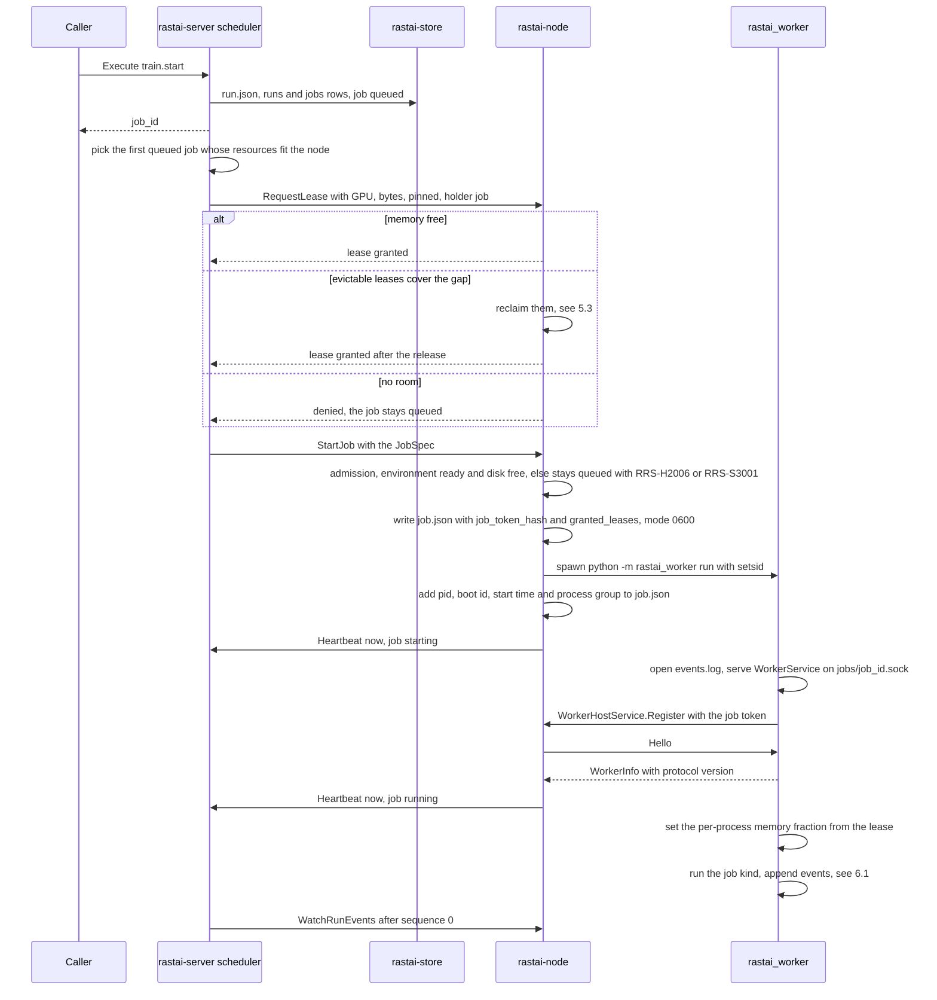

- **Run record:** the daemon writes `run.json` before the job starts. The hardware fingerprint is only known on the node, so the worker puts it in its first `run.state_changed` and the daemon adds it to `run.json` when it indexes that record.
- **Scheduling** (in `rastai-server`): first in, first out per node. A job waiting for GPU memory doesn't block CPU-only jobs. Queued jobs are rows, so they survive a daemon restart.
- **Spawn** (in `rastai-node`): `setsid` gives the worker its own process group. stdout and stderr go to `runs/<run_id>/stdout.log` and `stderr.log`. The environment gets `RASTAI_JOB_TOKEN`, `RASTAI_RUN_ID`, and `CUDA_VISIBLE_DEVICES` or `HIP_VISIBLE_DEVICES` set to the leased GPUs, plus `CUDA_DEVICE_ORDER=PCI_BUS_ID` so CUDA's GPU numbering matches nvidia-smi's (CUDA's default order is fastest first). The rest of the environment is cleared, and `HF_HUB_OFFLINE=1`, `UV_OFFLINE=1` and `PIP_NO_INDEX=1` are set, so a job can never download or install packages (§13, §27); `HSA_OVERRIDE_GFX_VERSION` is removed (1.2). Plugin jobs without a network permission start in a new user and network namespace (`unshare`) so only the job socket works; where user namespaces are unavailable, 7.3 decides (contracts 8.8). The full table is in layout/rust-node-gateway-proto.md 7.4.
- **Start failures:** the spawn itself fails (missing interpreter, exec error) → `RRS-J0001` with the OS error; no `Register` within 60 s → the group is killed and the job fails with `RRS-J0002`; wrong token → `RRS-J2002` and the group is killed (something else is on the socket); a worker protocol the node doesn't speak → `RRS-J2003`; a bad launch the worker itself reports (unreadable job file, exit 2) → `RRS-J2001`.
- **Memory:** the worker calls `torch.cuda.set_per_process_memory_fraction(lease_bytes / device_total_bytes)`. Going past it raises an out-of-memory error inside that job (5.4) instead of hurting another job.
- The daemon starts tailing at sequence 0 as soon as the job exists, so nothing is missed.

```python
# rastai_worker/__main__.py, names from layout/python.md 7.2: a thin main
def run_job_process(job_file: Path) -> int:
    launch = read_job_file(job_file)
    events = open_job_events(launch)               # flock, truncates a torn tail, continues the sequence
    control = install_control(launch)              # Control calls, SIGTERM and SIGINT only set flags
    start_worker_server(launch, control, events)   # WorkerService on jobs/<job_id>.sock, before Register
    host = connect_to_host(launch)                 # WorkerHostService.Register; the node then calls Hello
    apply_vram_lease(launch)                       # set_per_process_memory_fraction from granted_leases
    return run_entry_with_diagnostics(launch, host, events, control)   # final records, fsync, exit code
```

The worker serves `WorkerService` before it calls `Register`, because the node calls `Hello` as soon as `Register` arrives. layout/python.md 7.2 lists `connect_to_host` first; it should move after `start_worker_server`, or the first `Hello` can find no socket.

**Persisted:** `run.json`, `job.json` (0600; the token's BLAKE3 hash only, the token itself travels in `RASTAI_JOB_TOKEN`), `stdout.log`, `stderr.log` in `runs/<run_id>/` (durable); `runs` and `jobs` rows (durable). Leases live in node memory and in `job.json` `granted_leases[]`.

**Tests:** a CPU TextCNN training job end to end in CI; a worker stub that never registers → `RRS-J0002` (timeout shortened by a test setting); a job on an uninstalled environment stays `queued` with `RRS-H2006` and nothing is spawned.

### 5.2 The job state machine

`rastai-node` owns these states; `rastai-server` mirrors them into `jobs.state` and publishes `job.state_changed`.

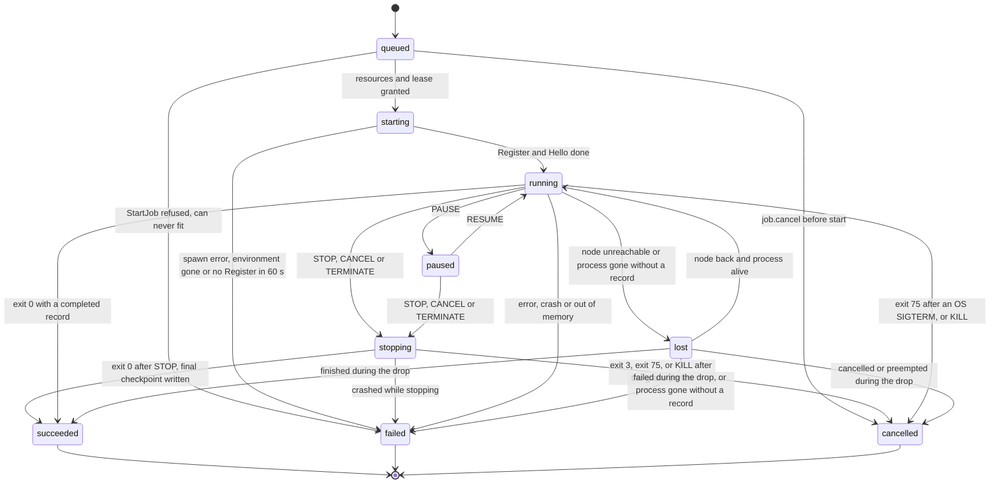

- **Added to contracts §9.1:**
  - `queued → cancelled`: `job.cancel` before the job starts (no process, so no signal);
  - `paused → stopping`: a paused worker still answers `Control`;
  - `queued → failed`: the node refuses `StartJob` for a job that could never fit, for example `RRS-R1009` (more sandboxes than `compute.sandbox_cap`, remote flows B2). A job that only has to wait stays `queued`. An environment that isn't ready is a wait, not a refusal: the job stays `queued` with `RRS-H2006` (1.3), and an environment that vanishes after admission takes `starting → failed`;
  - `lost → succeeded`, `lost → cancelled` and the "failed during the drop" case of `lost → failed`: a job that ended while its node was out of reach. The daemon takes the terminal state the node recorded from `ListJobs` and the final record in the replayed log (2.3, remote flows C6 and open question 10).

  Every other transition is contracts §9.1 drawn as a chart. `KILL` is drawn from `running` and `stopping`; the same holds for `starting` and `paused` ("any live state", contracts §9.1).
- **What each signal does** is the `JobSignal` table in contracts §4.4 (one meaning per value). The platform flows send them like this:

  | Signal | Sent by these flows | If the job hasn't ended in time | Code the user sees |
  |---|---|---|---|
  | `STOP` | `train.stop`, `gym.stop` (stop with a checkpoint); `node.update` with `force` (9.3) | `KILL` after `STOP_GRACE_SECONDS` (120) | none: the run ends `completed`, reason `stopped` |
  | `CANCEL` | `job.cancel`; unloading an Inspectable model; reclaiming an evictable lease (5.3) | `KILL` after `STOP_GRACE_SECONDS`, or after `EVICTION_GRACE_SECONDS` (10) for a reclaim | none; `RRS-H3004` on an evicted model |
  | `TERMINATE` | a worker protocol the node doesn't speak after an update (2.3, 9.2, 9.3); a forced `node.unpair` (remote flows C9) | `KILL` after `STOP_GRACE_SECONDS` | `RRS-J2003` for the protocol case; the run is `preempted` and `train.resume` continues it |
  | `KILL` | the end of any grace period above | none | `RRS-J1003` (job `cancelled`; the daemon records the run `cancelled`, because the worker wrote no final record) |
- **Kinds with nothing to save** (doctor, data checks, serve jobs) skip the checkpoint on `STOP` and `TERMINATE` and still exit with the code in contracts §4.4 (0 and 75).
- The OS sending SIGTERM (shutdown, a spot notice, `kill`) takes the `TERMINATE` path; the node didn't send it, but the worker can't tell the difference and doesn't need to.

**Persisted:** `jobs.state`, `exit_code`, `error_code` (durable); `job.state_changed` is a durable bus event carried by heartbeats.

**Tests:** a table test in `rastai-node` that fires every trigger at every state and rejects illegal transitions; a gym job asking for more sandboxes than the cap → `queued → failed` with `RRS-R1009` and nothing spawned; a job that finishes while its node is unreachable → `lost → succeeded` once the node is back, with the run `completed` from the replayed final record.

### 5.3 VRAM leases

Runs on `RequestLease` (job start, `model.load`) and `WorkerHostService.ResizeLease`. `rastai-node` owns leases.

```mermaid
stateDiagram-v2
  [*] --> requested
  requested --> granted : memory available
  requested --> denied : no room
  granted --> reclaim_requested : a pinned request needs the memory
  reclaim_requested --> released : holder unloaded
  granted --> released : holder done
  released --> [*]
  denied --> [*]
```

The state chart is contracts §9.4 as stored. The chart below is the grant decision `rastai-node` makes for one request, including the reclaim that moves a lease to `reclaim_requested`.

```mermaid
flowchart TD
  A["RequestLease with GPU, bytes and class"] --> F["free = total minus vram_reserve_bytes<br/>minus granted leases minus foreign use"]
  F --> E{"Bytes fit?"}
  E -->|"yes"| G["granted"]
  E -->|"no"| C{"Pinned request that may reclaim, and free<br/>plus evictable leases on this GPU cover the bytes?"}
  C -->|"yes"| R["reclaim_requested on evictable leases<br/>least recently used first, holders unloaded"]
  R --> WAIT{"Released within EVICTION_GRACE_SECONDS (10)?"}
  WAIT -->|"yes"| G
  WAIT -->|"no"| KILL["SignalJob KILL to the holder group"]
  KILL --> G
  C -->|"no"| Q{"Requester is a queued job?"}
  Q -->|"yes"| D1["denied, the job stays queued<br/>retried on the next release"]
  Q -->|"no, an interactive load"| D2["denied, RRS-H3001<br/>names the holders, offers another GPU or CPU"]
```

- **Foreign use** is VRAM held by processes that aren't Rastai's (the desktop compositor, a game), read from per-process telemetry. Free memory is computed from leases plus foreign use, not from a single reading, so two requests in the same second can't both see the same free bytes.
- **Only pinned requests reclaim** (contracts §9.4). An evictable request that doesn't fit is denied with `RRS-H3001`; the daemon may unload an idle model explicitly first (the runtime toggle's swap, inference flows 2.1). The node never evicts one chat model for another. A pinned request can opt out with `ResourceRequest.may_reclaim_evictable = false` (plan §10 row 25): evals that run on their own after a new checkpoint set it, so they wait instead of closing the user's chat.
- **Reclaim** sends `CANCEL` to an Inspectable holder and stops a llama-server holder. The grace is `EVICTION_GRACE_SECONDS` (10, layout/rust-node-gateway-proto.md 7.7): an answer being generated may finish within it, then it ends with `finish_reason = evicted` and the node sends `SignalJob KILL` to a holder that is still alive.
- An evicted chat model shows `model.state_changed` `evicting` → `unloaded` with info `RRS-H3004` naming the training run that needed the memory. The UI offers to reload it when the GPU frees.
- A holder that uses more than its lease (over 10% for 3 samples) gets warning `RRS-H3005`; an evictable one is then reclaimed (node layout 7.7).
- Interactive models hold evictable leases; training and gym hold pinned ones (§22). Spike: Teach it fits next to the resident chat model on the 5080 (4.7 GiB peak), so eviction is the exception.
- Leases are kept in node memory and in each holder's `job.json`, so a node restart rebuilds them before granting anything new (2.3).

**Persisted:** node memory and `job.json` (durable for live jobs); `lease.state_changed` reaches the daemon through heartbeats. There is no lease table in `rastai.db`; `ListLeases` is the source.

**Tests:** unit tests on the grant decision (a pure function over a lease table, foreign use included); an evictable request that doesn't fit → `RRS-H3001` naming the holders; nightly `tests/gpu/`: chat on the 5080 plus Teach it both fit; a large pinned request evicts the chat model and reports `RRS-H3004`; a holder stub that ignores `CANCEL` is killed after `EVICTION_GRACE_SECONDS` (shortened by a test setting).

### 5.4 Finish, fail and cancel

Runs when a job ends for any reason.

```mermaid
sequenceDiagram
  participant C as Caller
  participant SRV as rastai-server
  participant ND as rastai-node
  participant W as rastai_worker
  participant LOG as events.log
  alt normal finish
    W->>LOG: run.state_changed completed, fsync
    W-->>ND: exit 0
    ND->>ND: waitpid, job succeeded
  else error caught by the worker, CUDA out of memory included
    W->>LOG: diagnostic.reported with RRS-H3007 or a domain code
    W->>LOG: run.state_changed failed, fsync
    W-->>ND: exit 1
    ND->>ND: job failed, last_error is the logged diagnostic
  else crash or outside kill
    W-->>ND: killed by a signal, or exit without a final record
    ND->>ND: classify the exit, see 5.5
  else cancel
    C->>SRV: Execute job.cancel
    SRV->>ND: SignalJob CANCEL
    ND->>W: Control CANCEL, job stopping
    alt worker exits within STOP_GRACE_SECONDS (120)
      W->>LOG: run.state_changed cancelled, fsync
      W-->>ND: exit 3
      ND->>ND: job cancelled
    else still running after 120 s
      ND->>W: KILL, SIGKILL to the process group
      ND->>ND: job cancelled, RRS-J1003
    end
  end
  ND->>ND: release the lease, remove the job socket, final state into job.json
  ND->>SRV: Heartbeat now with JobInfo
  SRV->>SRV: update the jobs row, publish job.state_changed
  SRV-->>C: job.state_changed
```

- The worker writes and fsyncs its final records before exiting, so a daemon that is down at that moment still learns the outcome (2.3).
- Killing the whole process group takes DataLoader workers and compile subprocesses with it. Sandboxes labeled with the job are removed by the node (`rastai-sandbox`).
- A CUDA out-of-memory error inside a job step (a training, eval or analysis step, or a generation) reports `RRS-H3007` with the lease bytes, the peak allocated bytes and fixes (smaller batch, gradient checkpointing, QLoRA where the backend has it). One while the job loads its weights, before the first step, reports `RRS-H3006`. These are the inference flows' numbers (inference-psychology 4.7, 10.4). A serve job keeps its model loaded after an `RRS-H3007` and only closes the session.
- Python tracebacks go to `stderr.log`. The user sees the catalog code; the diagnostic links the last lines (contracts §10).

**`rastai_worker` exit codes** (`rastai_worker/exit_codes.py`, layout/python.md 7.2; plan §10 row 4):

| Code | Name | Meaning | Job ends |
|---|---|---|---|
| 0 | `EXIT_OK` | finished; the final record says `completed` (also after `STOP`) | `succeeded` |
| 1 | `EXIT_FAILED` | failed; the diagnostic is in the log | `failed` with that diagnostic |
| 2 | `EXIT_BAD_LAUNCH` | bad job file, missing environment or worker protocol mismatch | `failed`, `RRS-J2001` |
| 3 | `EXIT_CANCELLED` | `CANCEL` honored | `cancelled` |
| 4 | `EXIT_EVENT_LOG_UNWRITABLE` | the event log can't be appended even after the reserve was freed (6.2) | `failed`, `RRS-S3002` |
| 75 | `EXIT_PREEMPTED` | checkpoint written after SIGTERM; relaunch to resume (`EX_TEMPFAIL`) | `cancelled`, reason `preempted` |

A worker that never calls `Register` has no exit code to give: the node decides that case itself (`RRS-J0002` after 60 s, 5.1).

**Persisted:** final records in `events.log` (durable); `stderr.log`; the `jobs` row with `exit_code` and `error_code`; `job.json` with `final_state`.

**Tests:** cancel a worker that ignores `CANCEL` → `KILL` and `RRS-J1003` after `STOP_GRACE_SECONDS` (shortened by a test setting); allocate past the memory fraction inside a training step → `RRS-H3007` with the lease bytes; a memory fraction too small for the weights → `RRS-H3006` before the first step; kill -9 of the worker from the test harness → `RRS-J1001` naming SIGKILL (5.5); one worker stub per exit code → the job state in the table.

### 5.5 Exit cause classification

Runs in `rastai-node` when `waitpid` returns for a job it spawned.

```mermaid
flowchart TD
  A["waitpid result for the job"] --> S{"Killed by a signal?"}
  S -->|"yes"| WHO{"SIGKILL sent by rastai-node?"}
  WHO -->|"yes, KILL after a grace period"| CAN["cancelled, RRS-J1003"]
  WHO -->|"no"| OOM{"SIGKILL, and the kernel OOM-kill count went up?"}
  OOM -->|"yes"| OOMK["failed, RRS-J1002<br/>RAM numbers attached"]
  OOM -->|"no"| SIG["failed, RRS-J1001<br/>signal name and stderr tail"]
  S -->|"no"| X{"Exit code"}
  X -->|"0"| FR{"Final completed record present?"}
  FR -->|"yes"| OK["succeeded"]
  FR -->|"no"| BAD["failed, RRS-J1004"]
  X -->|"1"| DG{"Diagnostic logged?"}
  DG -->|"yes"| DGY["failed with the logged diagnostic"]
  DG -->|"no"| BAD
  X -->|"2"| BL["failed, RRS-J2001 with stderr tail"]
  X -->|"3"| CN["cancelled"]
  X -->|"4"| DF["failed, RRS-S3002"]
  X -->|"75"| PR["cancelled, reason preempted<br/>run preempted, resume offered"]
  X -->|"other"| OT["failed, RRS-J1004 with stderr tail"]
```

- The codes are the node layout's exit table (layout/rust-node-gateway-proto.md 7.4). The node reads the kernel's OOM-kill counter (`oom_kill` in the cgroup's `memory.events`) at spawn and at exit; only a rise gives `RRS-J1002`, with the RAM numbers from the last heartbeat. Any other signal is named as it is (`RRS-J1001`), so the message never claims a cause it can't see.
- **Added to the node layout's table:** exit 0 without a final `completed` record, exit 1 without a logged diagnostic, and unknown exit codes give `RRS-J1004`. Without this check the run would stay `running` in the index forever.
- There is no exit code for "could not register": a worker that never registers is failed by the node with `RRS-J0002` (5.1) before any exit matters.

```rust
// rastai-node, jobs/exit_cause.rs
pub fn classify_exit(exit: &ProcessExit, signals_sent: &[JobSignal], final_record: Option<&RunStateChanged>) -> JobOutcome { ... }
```

**Persisted:** as 5.4. **Tests:** a table test over recorded exits, one row per branch.

---

## 6. Event-log durability

### 6.1 Write, tail, forward, acknowledge, index

Runs for every durable event a job emits. The worker is the only writer of `runs/<run_id>/events.log` (§19, contracts §7.1).

```mermaid
sequenceDiagram
  participant W as rastai_worker
  participant LOG as events.log on the node
  participant ND as rastai-node tailer
  participant SRV as rastai-server indexer
  participant MIR as Daemon mirror, remote runs only
  participant STO as rastai-store
  participant WEB as apps/web
  W->>LOG: append frame n with length, CRC-32 and body, flush
  alt state change or checkpoint
    W->>LOG: fsync now
  else metric
    W->>W: fsync at least once a second
  end
  ND->>LOG: read frames after the last one sent, poll every 50 ms
  ND->>ND: check CRC, stop before an incomplete frame
  ND-->>SRV: WatchRunEvents streams EventRecord n
  opt run is on a remote node
    SRV->>MIR: append the same bytes, fsync
  end
  SRV->>STO: index the batch and set runs.acked_sequence in one transaction
  STO-->>SRV: committed
  SRV->>WEB: BusEvent with the next bus_sequence
  Note over ND,SRV: after any reconnect
  SRV->>ND: WatchRunEvents after acked_sequence
```

```python
# rastai_worker/event_log.py (the EventLogWriter class is in layout/python.md 7.2)
EVENT_LOG_HEADER = b"RRSEVLG1"
METRICS_FSYNC_INTERVAL_SECONDS = 1.0     # contracts §7.1
EVENT_LOG_RESERVE_BYTES = 1024 * 1024    # freed on a full disk so the records that pause the run still fit


def write_frame(file: BinaryIO, body: bytes, fsync_now: bool) -> None:
    """One frame: length, CRC-32, body. EventLogWriter.append calls this for every durable event."""
    file.write(struct.pack("<II", len(body), zlib.crc32(body)) + body)
    file.flush()                         # into the OS page cache: survives kill -9 of this process
    if fsync_now:
        os.fsync(file.fileno())          # survives power loss


def pause_for_full_disk(log: EventLogWriter, control: JobControl) -> None:
    """ENOSPC on an append: free the reserve, say why, and wait for RESUME instead of exiting."""
    truncate_to_last_whole_frame(log)    # a partial write must not leave a torn frame behind
    delete_reserve_file(log)
    log.append("diagnostic.reported", disk_full_diagnostic(), blob_hashes=[], fsync_now=True)   # RRS-S3002
    log.append("run.state_changed", run_paused_payload(), blob_hashes=[], fsync_now=True)
    wait_for_resume(control)             # the user frees space (storage.gc), then RESUME
    create_reserve_file(log)             # back to 1 MiB before training continues
```

```rust
// rastai-store, event-log reader
pub enum FrameRead {
    Record(EventRecord),
    EndOfFile,
    Incomplete { valid_bytes: u64 },   // a torn tail once the writer is gone
    Corrupt { offset: u64 },           // RRS-S2002
}

pub fn read_next_frame(reader: &mut EventLogReader) -> Result<FrameRead, StoreError> { ... }
```

- **The file is the buffer.** The node keeps no queue. After any disconnect it re-reads from the daemon's `acked_sequence`.
- **The ack** is `runs.acked_sequence`, committed in the same transaction as the records it covers. The daemon sends it back as `after_sequence` on every `WatchRunEvents`.
- **Batches:** the daemon indexes up to 256 records or 100 ms per transaction.
- **Indexing is idempotent:** `run_metrics` is keyed by (`run_id`, `sequence`), and other rows are upserted by their ids. Re-sent records never count twice.
- **Local vs remote:** the embedded node shares `<data>` with the daemon, so both read the same `events.log` and there is no mirror. For a remote node the daemon appends the same bytes to its own `<data>/runs/<run_id>/events.log` *before* indexing; after a restart it re-indexes from its mirror and resubscribes after the mirror's last valid sequence.
- **Blobs first:** large payloads go to the blob store (`PutBlob`) before the record that carries their `BlobRef`, so a record never points to a missing blob.
- **Ephemeral events** (tokens, live packets, progress, log lines) never touch the log. They go over `WatchLive` and may be dropped.
- **Disk-full reserve.** At start the worker writes `runs/<run_id>/events.log.reserve`, `EVENT_LOG_RESERVE_BYTES` (1 MiB) of zeros, fsynced. When an append fails with ENOSPC, `pause_for_full_disk` truncates any partial frame, deletes the reserve, appends `diagnostic.reported` (`RRS-S3002`) and `run.state_changed paused`, fsyncs, and waits for `RESUME` with the training state still in memory. Only if those two appends fail too does the worker exit with code 4 (`EXIT_EVENT_LOG_UNWRITABLE`). The job stays `running` while the run is `paused`, so its lease is kept.

**Persisted:** `events.log` on the node (durable, the source of truth); `events.log.reserve` beside it while the job runs (deleted on exit); the daemon mirror for remote runs (durable); `run_metrics`, `checkpoints`, `artifacts`, `lineage` and `runs.acked_sequence` in `rastai.db` (an index).

**Tests:** reader tests over `fixtures/event-logs/` (good, torn tail, corrupt middle); a golden round trip from the Python writer to the Rust reader; cargo-fuzz on `read_next_frame`; a throughput test indexing 10,000 metric records per second without falling behind.

### 6.2 What happens after a crash at each point

| Crash point | On disk afterwards | Recovery | User sees | Lost |
|---|---|---|---|---|
| Worker dies mid-append | an incomplete frame at the end | readers stop before it; a resumed run's worker truncates it (`RRS-S2001` info) | job failed per 5.5 | that one record |
| Worker dies after append, before fsync | the frame is in the page cache | nothing to do; the OS writes it out | job failed per 5.5 | nothing (power loss: up to 1 s of metrics, never a state change) |
| Tailer dies (daemon crash, embedded node) | the log is complete | the new node re-tails after `acked_sequence` | a gap in live charts that fills in | ephemeral events during the gap |
| Daemon dies after receiving records, before commit | `acked_sequence` unchanged | records re-sent and re-indexed once | nothing | nothing |
| Daemon dies mid-commit | SQLite WAL rolls the transaction back | as above | nothing | nothing |
| Daemon dies after mirror append, before commit (remote) | mirror ahead of `acked_sequence` | re-index from the mirror, resubscribe after its last sequence | nothing | nothing |
| Network drop (remote) | the worker keeps writing on the node | node `unreachable` after 15 s; on reconnect `WatchRunEvents` after the ack | node `unreachable`, job `lost` then `running` | ephemeral events |
| Disk full on the node | the append fails with ENOSPC | the worker frees `events.log.reserve`, appends `diagnostic.reported` `RRS-S3002` and `run.state_changed paused`, fsyncs and waits for `RESUME`; it exits with code 4 only if those appends fail too | run `paused`, `RRS-S3002` with a `storage.gc` fix, then Resume | nothing: the training state stays in memory and continues from the same step |
| Disk full on the daemon | the SQLite write fails | indexing pauses and retries every 10 s; records wait in the logs | banner `RRS-S3002` | nothing |
| Bit rot mid-log | a bad frame with frames after it | indexing stops at that frame | `RRS-S2002` on the run; everything before it stays | records after the bad frame |

```mermaid
flowchart TD
  A["rastai-store opens events.log"] --> H{"Header is RRSEVLG1?"}
  H -->|"no"| C0["RRS-S2002, not an event log"]
  H -->|"yes"| N["Read the next frame header"]
  N --> E{"Bytes left?"}
  E -->|"none"| DONE["End of log"]
  E -->|"less than a full frame"| LIVE{"Writer still alive?"}
  LIVE -->|"yes"| WAIT["Wait 50 ms and read again"]
  WAIT --> N
  LIVE -->|"no"| TORN["Torn tail, stop here, RRS-S2001"]
  E -->|"a full frame"| K{"CRC-32 matches?"}
  K -->|"no"| LAST{"Last frame in the file?"}
  LAST -->|"yes"| TORN
  LAST -->|"no"| CORR["RRS-S2002, stop at this offset"]
  K -->|"yes"| SEQ{"Sequence is the previous plus 1?"}
  SEQ -->|"no"| GAP["RRS-S2003, stop and re-request from the ack"]
  SEQ -->|"yes"| REC["Record"]
  REC --> N
```

- Only the writer truncates. Readers (the tailer, the daemon, a rebuild) stop at a torn tail and leave the file alone. A resumed worker opens the log, truncates the torn tail and continues from the last valid sequence plus 1.
- "Last frame in the file" means the bad frame ends exactly at the end of the file, or only zeros follow its start (a power cut can leave a zero-filled block, and an all-zero frame header even has a matching CRC-32). A frame whose CRC-32 matches but whose body isn't a version-1 `EventRecord` is corruption wherever it is (contracts 7.1). A header that is a prefix of `RRSEVLG1`, or zeros, is a torn tail at offset 0.
- "Writer still alive" is known to the tailer from the job state. An offline reader (6.4) treats every writer as gone.

**Persisted:** no new writes; this is recovery. **Tests:** the kill -9 matrix (6.5) and the reader fixtures (6.1); a tmpfs test: fill the volume mid-run (TextCNN on CPU), check the run goes `paused` with `RRS-S3002` and the job keeps its pid, free space, send `RESUME`, and the run continues from memory with every step's `run.metrics` present once (no lost or repeated steps); a variant with no reserve file left exits with code 4.

### 6.3 UI event stream resume

Runs whenever `@rastai/client` reconnects: a network blip on an SSH tunnel, a laptop waking from sleep, a daemon restart.

```mermaid
sequenceDiagram
  participant WEB as @rastai/client
  participant SRV as rastai-server
  WEB->>SRV: EventService.Subscribe after_bus_sequence N
  alt N is still in the buffer of 10000 events
    SRV-->>WEB: events after N, then live events
  else too old, or the daemon restarted
    SRV-->>WEB: RRS-C0401
    WEB->>SRV: list and get commands for the open views
    WEB->>SRV: Subscribe from the current sequence
  end
```

- The bus only notifies; durable state is always refetchable with commands. That's why losing the in-memory buffer in a crash loses nothing.
- While disconnected, the client retries with backoff and shows banner `RRS-U0001`.

**Persisted:** nothing (the buffer is memory). **Tests:** a client unit test against a fake server for both branches; `tests/e2e/`: restart the daemon and the open UI recovers without a page reload.

### 6.4 Rebuilding `rastai.db` from logs and the blob store

Runs from `rastai storage rebuild-index`, a CLI-only command that works offline while holding `daemon.lock` (contracts §8.2). Offered as the fix for `RRS-S0003`.

```mermaid
flowchart TD
  A["rastai-cli takes daemon.lock"] --> B["Move rastai.db and its -wal file aside<br/>as rastai.db.broken-unix_ms"]
  B --> C["rastai-store creates a new rastai.db and runs migrations"]
  C --> D{"L2: a snapshot in backups passes quick_check?<br/>newest first, see 8.4"}
  D -->|"yes"| E["Copy tokens, nodes, plugins, projects<br/>from that snapshot"]
  D -->|"no snapshot, or before L2"| F["Those four tables start empty"]
  E --> SAL["Read the same four tables from the broken file<br/>its readable rows win, windowed salvage from L2"]
  F --> SAL
  SAL --> TOK["Tokens the broken file can't read come back revoked<br/>plugin folders with no row start disabled until re-trusted"]
  TOK --> G["Scan the run folders for run.json"]
  G --> H["Read each events.log or its mirror<br/>stop at a torn tail or corrupt frame"]
  H --> I["Rebuild runs, final job states, run_metrics,<br/>checkpoints, artifacts, lineage, acked_sequence"]
  I --> J["Replay every daemon event log segment<br/>journal, pins, tags, daemon-made artifacts and lineage,<br/>archive.pruned stubs"]
  J --> K["Scan the blob store<br/>drop artifact rows whose blob is missing,<br/>except blobs an archive.pruned record freed"]
  K --> L["Scan known projects for documents rows"]
  L --> M["Scan the HF cache for models rows"]
  M --> N["Report counts, every diagnostic, and pruned-run stubs<br/>pending their archive pull at the next daemon start (M11)"]
```

- **The four kept tables** (`tokens`, `nodes`, `plugins`, `projects`) can't be rebuilt from logs (contracts 8.2). There is no `settings` table: settings live only in their files (contracts 11.1), so a rebuild never touches them.
- **Before L2** the rebuild reads the four kept tables straight from the broken file. A table it can't read starts empty and fails closed: no tokens (clients get `RRS-C1002` and the owner creates new ones), nodes need pairing again, plugins start `disabled` until trusted again, and projects come back on their next `project.open`.
- **(L2) Snapshot base and salvage.** The four tables never come only from the file that failed its check. The base is the newest snapshot that passes `quick_check` (8.4, at most a day old). Rows the broken file still reads are newer, so they replace the snapshot's rows by primary key. The read is the same windowed salvage as `vault.db` recovery (8.4), so one bad page costs only the rows on it.
- **Tokens fail closed.** A token row the broken file can't read may have been revoked after the snapshot, so it comes back revoked; the owner creates a new one. Nodes paired after the snapshot whose rows are unreadable need pairing again. Plugin folders with no row in either source start `disabled` with no granted permissions.
- **Not rebuilt:** `undo_steps` (history only; every document starts with an empty stack), `transfers` (in-flight transfers restart from their partial file sizes) and `archive_cursors` (M11). The cursors start empty, so the next archive sync re-sends everything. That is safe because every archive write is an idempotent upsert (8.6), but it takes as long as a first sync.
- **Pruned runs (M11).** A pruned run has no local `events.log`, so its stub can't come from a log. The `archive.pruned` records in the daemon log say which runs were pruned, and the offline rebuild makes the stubs only (`RebuildReport.pruned_run_stubs`). It never reaches the archive: the store doesn't import it and only the daemon holds archive credentials. At the next daemon start, before the first sync, `rastai-server` runs `restore_from_archive(PrunedRunRows)` to fill each stub with every index row but `run_metrics` (layout/rust-control-plane.md 13.2; ADR-0035, amending ADR-0002 decision 7). If the archive is unreachable then, the stubs keep their run ids, `archive.status` shows `RRS-S5001`, and the pull retries with the sync backoff (8.7). Until it runs, a stub opens with its restore offer (8.11).
- **Not part of this at all:** `vault.db`. It is the primary store for conversations and gateway logs, not an index. Its fix is `storage.vault.recover` (L2, 8.4).
- **The daemon event log** (`<data>/daemon/events.log`, contracts 7.1; implemented in layout/rust-control-plane.md 13.1) holds the durable records the daemon itself makes, which no worker writes: `command.finished`, `artifact.created` for daemon-made artifacts (`dataset.from_conversations`, `psychology.branch.prefer`) and their `lineage.linked`, `document.changed`, `node.state_changed`, `plugin.state_changed`, `download.finished`, `transfer.finished`, `run.tags_changed`, `pin.changed`, `run.deleted`, `conversation.deleted`, `chain.*` and `archive.*`. The daemon appends each in the same frame format and fsyncs, then indexes it, exactly like a worker; its ack is `log_cursors.acked_sequence`. It rolls to a new segment at 256 MiB. Without it, a rebuild loses the journal, daemon-made lineage and pins, and the next GC could delete pinned data.
- The rebuild runs the same `apply_event_record` code as live indexing, so rebuilt rows can't differ from live ones.
- Plugins rebuilt from their folders start `disabled` with no granted permissions, so each asks for trust again. That's the safe default. A plugin row from the snapshot keeps its old grant; if the plugin was updated since and asks for more, the load check (7.3) sends it back to `awaiting_trust`.
- `--verify-blobs` re-hashes every blob (slow) and moves mismatches to `<data>/blobs/.quarantine/` with `RRS-S1001`.

**Persisted:** the new `rastai.db`; the old file kept beside it until the user deletes it.

**Tests:** `tests/crash/`: build a data directory with the CPU loop (design → train → eval → export), rebuild it, and compare every rebuildable table row by row; a corrupt-middle log fixture → the rebuild finishes and reports `RRS-S2002` for that run; take a snapshot, then create one token and revoke another, overwrite the `tokens` page in `rastai.db` and rebuild → no token comes back active (the revoked one is revoked, the new one is missing and its client gets `RRS-C1002`), and the other kept tables match the snapshot plus the newer rows; the same with a readable `tokens` page → the broken file's newer rows win (these two are L2; before L2 the same overwrite gives an empty `tokens` table and every client gets `RRS-C1002`). **Archive (M11, `test-archive`):** prune two runs, rebuild, then start the daemon with MySQL up → both stubs fill in with their state, tags, jobs and checkpoints, their artifact rows are kept, and the next sync re-sends nothing the archive lacks (row counts unchanged); the same with MySQL stopped → stubs with run ids only and `RRS-S5001` in `archive.status`, filled in after MySQL starts.

### 6.5 The kill -9 test matrix

Lives in `tests/crash/` (the Rust crate `rastai-crash-tests`) and runs in CI on CPU with TextCNN or a tiny random-weight model. Each row starts the scenario, pauses the target process at a named point with the test-only `RASTAI_TEST_PAUSE_AT` hook so the kill lands there every time, sends SIGKILL, restarts, and checks the outcome.

| # | Killed | At | Expected after restart |
|---|---|---|---|
| 1 | daemon | training running | job `running`, reattached; `run_metrics` equals the log, no gap or duplicate (weeks 3–4 exit) |
| 2 | daemon | records received, before commit | records indexed exactly once |
| 3 | daemon | worker finishes while the daemon is down | job `succeeded` from the final record |
| 4 | daemon | download at 50% | resubmitted (`RRS-J3004`), resumes at the offset, hash matches |
| 5 | daemon | `uv sync` in progress | incomplete environment deleted and rebuilt on the next ensure |
| 6 | daemon | blob upload in `.incoming/` | leftover deleted at start, no blob, no artifact row |
| 7 | daemon | document edit between rename and commit | valid file, `RRS-C2002` path, history cleared |
| 8 | daemon | plugin unpack in `.installing/` | folder removed, plugin `failed` with `RRS-P3004`, reinstall works |
| 9 | daemon | between journal started and finished | row marked `RRS-C0005` |
| 10 | daemon | `storage.gc` mid-sweep | job `failed` with `RRS-J3005`; a rerun completes, nothing pinned or live deleted |
| 11 | worker | inside a frame write | torn tail ignored; `train.resume` truncates it and continues the sequence |
| 12 | worker | mid-checkpoint (`.partial`) | resume from the previous checkpoint, `.partial` removed |
| 13 | worker | normal run | job `failed` with `RRS-J1001` naming SIGKILL, lease released, process group gone |
| 14 | standalone node | jobs running | workers survive; node restart reattaches; daemon sees `unreachable` then `connected` |
| 15 | daemon and worker | training | job `failed` with `RRS-J3002`; `train.resume` continues from the last checkpoint |
| 16 | llama-server | model loaded | model `failed`, lease released (details in the inference flows) |
| 17 | daemon | `project.import` mid-unpack (10.2) | job `failed` with `RRS-J3005`; no half folder: `<target>.importing/` removed at start, no target folder, no `projects` row; the import runs again cleanly |
| 18 | daemon | (L2) database snapshot mid-`VACUUM INTO` (8.4) | the partial file in `<data>/backups/.incoming/` removed at start; older snapshots untouched and none pruned; the next start takes a new snapshot because the newest is over 24 h old (a test setting shortens it) |
| 19 | daemon | (L2) `storage.vault.recover` between moving the damaged file aside and renaming the recovered one into place (8.4) | no empty vault is created; the daemon starts with `RRS-S0005`; running the recovery again reads the `vault.db.damaged-*` file and ends with the same rows |
| 20 | daemon (archiver, M11) | after the MySQL `COMMIT`, before `archive_cursors` is written (8.6) | the catch-up re-sends that batch; the upserts absorb it: every archive table has the same row count as after a clean sync, no duplicates |
| 21 | daemon (archiver, M11) | mid blob upload to a folder target (8.8) | no `blob_objects` row; the temp file in the target's `.incoming/` is deleted by a later sync once older than `STALE_TEMP_AGE_HOURS`; the next sync copies the blob again, verifies it and writes the row; nothing was pruned |
| 22 | daemon (archiver, M11) | prune between the index transaction and the file delete (8.9) | the run is a `pruned` stub; its leftover files are deleted by the next prune pass; opening the run restores it from the archive with the same metrics as before the prune |
| 23 | daemon (archiver, M11) | `archive.restore` mid-write of a run's `events.log` (8.11) | job `failed` with `RRS-J3005`; the temp file is deleted at start; the run is still `pruned`; running the restore again ends with the same frames and rows |
| 24 | daemon (archiver, M11) | an archive migration mid-statement (8.12) | the server drops the session's `GET_LOCK`; `archive_meta.schema_version` is unchanged; the next start re-runs the migration and every statement checks before it acts; the schema equals a clean migration's (compared from `information_schema`) |

Checked after every row:
- every durable record in every `events.log` is indexed exactly once;
- no visible blob, checkpoint, environment, plugin, project folder or database snapshot is half-written;
- no orphan process group or labeled sandbox remains;
- every failure the user sees has a catalog code;
- rows 20–24 also: every archive row exists once per key, no `blob_objects` row names bytes that aren't on the target (except rows of a delete still in the outbox, 8.10), and nothing local was pruned that the archive hasn't acknowledged and verified.

Rows 20–24 run in the `mysql-archive` CI job (M11-E07) against MySQL 8.4 and 9.7, MariaDB and a folder target; `RASTAI_TEST_PAUSE_AT` names the points inside `rastai-archive`.

---

## 7. Plugins

### 7.1 Install

Runs when the user opens a `.rrsplugin` (double-click goes through Tauri to `file.open`; drag-drop goes through `PUT /api/blobs`; CLI `rastai plugin install <file>`), or accepts the missing-plugin banner (7.4).

```mermaid
sequenceDiagram
  participant WEB as apps/web
  participant SRV as rastai-server plugin host
  participant FMT as rastai-formats
  participant STO as rastai-store
  participant ND as rastai-node
  participant UV as uv
  WEB->>SRV: Execute plugin.install dry_run with the file or blob
  SRV->>FMT: open the zip with limits, read rastai-plugin.json
  FMT-->>SRV: manifest, or RRS-E5001, RRS-E5002, RRS-P0001
  SRV->>SRV: id free and not reserved, else RRS-P0002
  SRV->>SRV: engines range covers the plugin API, else RRS-P1001
  SRV->>SRV: capabilities provided, else RRS-P1002
  SRV->>SRV: plugin dependencies installed or in this request, else RRS-P3001
  SRV-->>WEB: PluginInstallPlan with permissions, dependencies, sizes, content hash
  WEB->>WEB: trust prompt, plain-English permissions, sensitive ones marked
  alt user declines
    WEB->>WEB: nothing written, info RRS-P2002
  else user accepts
    WEB->>SRV: Execute plugin.install with granted permissions and the content hash
    SRV->>SRV: hash the archive again, must match, else RRS-P2003
    SRV->>STO: plugins row, state installing
    SRV->>SRV: unpack into plugins/plugin_id/version.installing, check file hashes
    SRV->>SRV: rename to plugins/plugin_id/version, fsync the parent
    opt manifest has a python entry
      SRV->>ND: EnsureEnvironment with plugin_id and version
      ND->>UV: uv sync --frozen into version/env, layered on the base environment
      UV-->>ND: done, or a conflict for RRS-P3003
      ND->>ND: write the env ready marker last
    end
    SRV->>STO: state installed with granted permissions
    SRV->>SRV: enable and load, see 7.3
  end
```

- Archive limits are the `rastai-formats` untrusted-import checks (total size, entry count, compression ratio, `..` in paths), applied before anything is unpacked.
- **When the trust prompt shows:** the plugin has any code (UI, Python module, provider) or any network or data permission, even if it's declarative (§24). A theme or keybinding set with no permissions installs without a prompt. A theme can't change the locked tokens, so it can't restyle or hide the trust prompt, the permission list, the egress badge, the signed-out screen or the error severity colors (contracts 5.6, decision N7).
- The prompt says plainly that Python modules are trusted code: they run as separate processes with network off by default, but they are not a security sandbox (§24). On a machine without user namespaces (7.3) the prompt for a third-party module without network permission says it will be refused until the AppArmor profile is installed or network is granted.
- **Dependencies:** in the prototype they resolve against installed plugins and archives given in the same request. One combined prompt lists every plugin and its permissions ("Install 3 plugins (permissions: …)", §13). The Phase 2 registry adds remote resolution.
- **No runtime installs:** the plugin's hash-pinned lockfile is synced once, here. A lockfile that conflicts with the base environment's pins fails the install with `RRS-P3003`.
- The pre-install states (`discovered`, `resolving`, `awaiting_trust`) are not stored: they exist while the plan is on screen. Nothing is written until the user accepts.
- **Rename before sync.** uv writes absolute paths into an environment, so the plugin's `env/` is synced only after the folder has its final name. It gets a ready marker written last, like a base environment (1.3).
- **kill -9 anywhere in the install:** the `plugins` row still says `installing`. The next start removes a `.installing/` folder or an `env/` without its marker, and marks the plugin `failed` with `RRS-P3004`; installing again works.
- An update that adds permissions goes back through the prompt (§24).

- **Plugin data is not in the version folder.** The plugin's private files live in `<data>/plugin-data/<plugin_id>/`, one folder per plugin, kept across update, downgrade, disable and enable (contracts 8.1). An install or update never writes there. The downgrade guard (`RRS-P3005`, read-only data from a newer version) is (L2).

**Persisted:** `<data>/plugins/<plugin_id>/<version>/` with `env/` (durable); the `plugins` row with `granted_permissions` and `content_hash` (durable); an uploaded archive stays as an unpinned blob until GC.

**Tests:** each minimal plugin in `fixtures/plugins/` installs and loads; zip-slip and zip-bomb fixtures → `RRS-E5001` and `RRS-E5002`; an archive swapped after the prompt → `RRS-P2003`; `tests/crash/` row 8, which also checks that `plugin-data/<plugin_id>/` is byte-identical after a killed update.

### 7.2 Plugin states

The plugin host in `rastai-server` owns these states; they are stored in `plugins.state` from `installing` on.

```mermaid
stateDiagram-v2
  [*] --> discovered
  discovered --> resolving : dry run
  resolving --> incompatible : engines, capability or dependency check failed
  resolving --> awaiting_trust : plan shown
  awaiting_trust --> installing : user accepts
  awaiting_trust --> uninstalled : user declines
  installing --> installed : unpacked and synced
  installing --> failed : unpack, hash or sync failed
  installed --> enabled : load succeeded
  installed --> disabled : load failed
  enabled --> disabled : user, or crash limit
  disabled --> enabled : user, and load succeeded
  enabled --> incompatible : app update broke engines or capabilities
  incompatible --> resolving : app or plugin updated
  enabled --> awaiting_trust : update adds permissions
  installed --> uninstalled : uninstall
  disabled --> uninstalled : uninstall
  failed --> uninstalled : cleanup
  incompatible --> uninstalled : uninstall
  uninstalled --> [*]
```

- Added to contracts §9.7: `enabled → incompatible` after an app update, `incompatible → resolving` when the app or the plugin changes, and `awaiting_trust → uninstalled` when the user declines.
- Every state change emits `plugin.state_changed` with a diagnostic. "Disabled with a diagnostic, never a crash" (§13) means `incompatible` and `disabled` are both normal states with a fix button.

**Tests:** a table test over the plugin host's transition function.

### 7.3 Load and capability negotiation

Runs at daemon start for every installed plugin, in dependency order; on `plugin.enable`; and after any app update. Every box is in the plugin host in `rastai-server` unless marked.

```mermaid
flowchart TD
  A["Next installed plugin, in dependency order"] --> E{"engines.rastai covers this plugin API?"}
  E -->|"no"| INC["incompatible, RRS-P1001"]
  E -->|"yes"| C{"Every required capability provided?<br/>core table or an enabled first-party plugin"}
  C -->|"no"| INC2["incompatible, RRS-P1002<br/>names the missing capability"]
  C -->|"yes"| X{"Uses experimental APIs?"}
  X -->|"yes, flag off"| DIS1["disabled, RRS-P1003"]
  X -->|"no, or flag on"| P{"Granted permissions cover the manifest?"}
  P -->|"no, an update added some"| TR["awaiting_trust, prompt again"]
  P -->|"yes"| D{"Plugin dependencies enabled?"}
  D -->|"no"| DIS2["disabled, RRS-P3001"]
  D -->|"yes"| R["Register commands, panels, sections, file types,<br/>importers, recipes, metrics and the rest"]
  R --> PY{"Python entry?"}
  PY -->|"no"| EN["enabled"]
  PY -->|"yes"| NG{"Network permission granted?"}
  NG -->|"yes"| ST["rastai-node starts the plugin_module job"]
  NG -->|"no"| NS{"rastai-node: user namespaces available?<br/>the .deb AppArmor profile grants them"}
  NS -->|"yes"| STN["rastai-node starts the plugin_module job<br/>in a new user and network namespace"]
  NS -->|"no"| FP{"Preinstalled first-party module<br/>with the release content hash?"}
  FP -->|"yes"| WARN["Start without the network namespace<br/>warning RRS-P2005"]
  FP -->|"no, third-party"| DIS3["disabled, RRS-P2001<br/>fix: install the AppArmor profile or grant network"]
  WARN --> ST
  ST --> RG{"Module registers within 60 s?"}
  STN --> RG
  RG -->|"yes"| EN
  RG -->|"no"| DIS4["disabled, RRS-J0002 in the diagnostic"]
```

- A failure never stops the daemon. The plugin shows in the Plugins section with its diagnostic and fix. Its commands answer `RRS-C0003`, and files that need it open with placeholders (7.4).
- **User namespaces** (contracts 8.8). Ubuntu 23.10 and later restrict unprivileged user namespaces, so the `.deb` ships an AppArmor profile (`tools/release/apparmor/rastai`, installed as `/etc/apparmor.d/rastai`) that grants `userns` to the installed `rastai` binary. The node probes once at start with `unshare` and keeps the answer. Where namespaces are still unavailable (the AppImage, other distributions, a removed profile):
  - a trusted, preinstalled first-party module (from `<install prefix>/share/rastai/plugins/`, content hash matching the release) runs without the network namespace, and the Plugins section shows warning `RRS-P2005`. Psychology and Evaluation keep working on every machine;
  - a third-party module without network permission is refused with `RRS-P2001`. Its network-off promise can't be kept, and the user asked for it;
  - a third-party module that declares network permission runs as before; it never had a network namespace.
- **Capability table:** core extension points (for example `designer.node@1`) are constants in the plugin host. A first-party plugin's extension points (for example `psychology.lens@2`) exist only while that plugin is enabled, so disabling Psychology disables lens plugins with `RRS-P1002`.
- **Contributions:** manifest commands become registry descriptors, which makes them palette entries, CLI verbs and MCP tools at once. Their scope is capped by the plugin's `commands:[scopes]` grant. Panels are fetched by the UI through `plugin.list`: first-party UIs run in-process, third-party UIs in sandboxed iframes served from `/plugins/<plugin_id>/<version>/ui/`.
- **Module crashes at runtime:** the node restarts the module after 1 s, 5 s, then 30 s. A fourth crash within 5 minutes disables the plugin with `RRS-P4003`. Calls in flight fail with `RRS-P4001`.
- **Manifest consistency** is checked at install (the dry run) and again at every load (layout/rust-control-plane.md 16.4): command ids inside the plugin's own namespace and outside the reserved core areas (`RRS-P0004`), a type in `types.json` for every command (`RRS-P0005`), and contributions only to extension points the manifest requires (`RRS-P0006`). A failure leaves the plugin `incompatible`.
- `plugin.dev` loads an unpacked plugin from `plugins.dev_paths` through the same checks.

**Persisted:** `plugins.state` (durable); `plugin.state_changed` events. Registered contributions are in memory and rebuilt at every start.

**Tests:** fixture plugins: engines `>=99` → `RRS-P1001`; requires `psychology.lens@9` → `RRS-P1002`; Psychology disabled → a dependent lens plugin disabled; a module that crashes on start → `RRS-P4003` after four crashes, while other commands keep working. **Namespaces:** with the namespace probe forced off (a test setting), the preinstalled Psychology module starts with `RRS-P2005` and a third-party fixture module without network permission is `disabled` with `RRS-P2001`; with namespaces on, a network-off fixture module can't open a TCP socket; the `.deb` install test on Ubuntu 24.04 loads the AppArmor profile and the probe succeeds.

### 7.4 Opening a file that needs a missing plugin

Runs on `file.open` (double-click, drag-drop, recent files) when the file's `requires` names a plugin that isn't installed or enabled.

```mermaid
sequenceDiagram
  participant WEB as apps/web
  participant SRV as rastai-server
  participant FMT as rastai-formats
  participant PH as rastai-server plugin host
  WEB->>SRV: Execute file.open with the path
  SRV->>FMT: parse and validate, four layers
  FMT-->>SRV: document, plus warning RRS-E3001 per missing plugin
  SRV->>SRV: route by extension to its handler
  SRV-->>WEB: document with placeholders and warnings
  WEB->>WEB: placeholder graph nodes with their recorded shapes
  WEB->>SRV: Execute plugin.suggest with the requires map
  SRV->>PH: match installed but disabled plugins and plugins.dev_paths
  PH-->>SRV: candidates with their permissions
  SRV-->>WEB: suggestions
  WEB->>WEB: banner, Install 3 plugins, with the permissions
  alt user installs or enables
    WEB->>SRV: plugin.install as in 7.1, one combined prompt
    SRV->>WEB: plugin.state_changed enabled
    WEB->>SRV: file.open again, placeholders resolve
  else no candidate
    WEB->>WEB: banner shows the plugin ids and the file source_url
  end
```

- The file never fails to open (§13). Other parts stay editable. Placeholder nodes keep their attributes verbatim, so saving round-trips them unchanged.
- Actions that need the plugin (compile, train, export) refuse with `RRS-E3001` as an error at that point.
- An unknown extension returns `RRS-E3002` and suggests plugins by extension.
- An installed but disabled plugin is offered as "Enable", not "Install".
- Phase 2 adds registry suggestions.

**Persisted:** nothing until the user installs; the document file is unchanged.

**Tests:** a fixture `.rrsmodel` with `requires: {"fixture_node": "^1"}` opens with placeholders; save → byte-identical placeholder nodes; `design.compile` → `RRS-E3001`.

---

## 8. Storage housekeeping and the long-term archive

8.1–8.4 keep the local stores healthy. 8.5–8.12 are the optional long-term archive (M11): a one-way copy to the owner's MySQL or MariaDB, never a live store.

### 8.1 Free-space checks before downloads, environments and training

Runs in every dry run that writes data, and again at the start of the real job: `model.download`, `system.env.install`, `train.start`, `teach.start`, `checkpoint.export`, `dataset.snapshot`, imports, uploads.

```mermaid
flowchart TD
  A["Command will write data"] --> EST["Estimate bytes<br/>HF file sizes, environments.json sizes,<br/>checkpoint size times checkpoints kept"]
  EST --> WHERE{"Where does it land?"}
  WHERE -->|"node disk"| NODE["rastai-node checks its own volume"]
  WHERE -->|"daemon disk"| DMN["rastai-server checks the data volume"]
  NODE --> F{"Free minus free_space_margin_bytes<br/>covers the estimate?"}
  DMN --> F
  F -->|"no"| GC{"A storage.gc dry run frees enough?"}
  GC -->|"yes"| OFFER["RRS-S3001, fix button runs storage.gc"]
  GC -->|"no"| REF["RRS-S3001, needed vs free, storage view"]
  F -->|"yes"| Q{"Rastai data stays under storage.quota_bytes?"}
  Q -->|"no"| QE["RRS-S3003, fix: GC or raise the quota"]
  Q -->|"yes"| GO["Start, and handle disk full during the write"]
```

```rust
// crates/rastai-store/src/disk_space.rs: the only file in the workspace allowed `unsafe` (ADR-0033)

/// Free bytes on the volume that holds `volume_path`, for an unprivileged user (f_bavail * f_frsize).
/// One libc::statvfs call; the unsafe block is that call alone, and tools/checks/check-unsafe pins it here.
pub fn free_bytes(volume_path: &Path) -> Result<u64, StoreError> { ... }

/// RRS-S3001 when free bytes minus the margin don't cover the estimate. Safe code around free_bytes.
pub fn check_free_space(volume_path: &Path, needed_bytes: u64, margin_bytes: u64) -> Result<(), StoreError> { ... }
```

- **One function for every check** (plan §10 row 15): `free_bytes` backs the store, the node's heartbeat figure and every check in this doc, including the archive's folder target (8.8). The node calls it through `rastai-store`, so no second implementation exists. `libc` is a §27 dependency owned by `rastai-store` (`deny.toml` `wrappers`).
- **Why `statvfs` and not `df`:** one system call with a fixed struct, no child process, no output to parse, and the same answer on NFS and SMB mounts. `df` stays approved only as the fallback if ADR-0033 is ever withdrawn.
- A dry run uses the disk figure from the node's last heartbeat. The node checks again when the job starts, and that check decides.
- **Checkpoint estimate:** full fine-tuning = weights + optimizer state (two float32 copies of the trainable parameters for Adam); LoRA = adapter + its optimizer state; multiplied by `training.checkpoint.keep_last` + best + one in progress.
- HF cache downloads count against free space but not the quota (the cache belongs to the user). The quota covers Rastai's `<data>` (blobs, runs, environments, plugins, engines), not `<cache>`.
- A warning shows at 90% of the quota.
- **Disk full during a write** (`RRS-S3002`):
  - downloads pause with their partial files kept;
  - a checkpoint write deletes its `.partial` folder and pauses the run with its state in memory (`RRS-T2001`, training flows 4.3); Resume after `storage.gc` writes the checkpoint again;
  - an event-log append frees the 1 MiB reserve, records `RRS-S3002` and pauses the run (6.1, 6.2); the worker exits with code 4 only if even that fails.

**Persisted:** nothing; the check is read-only.

**Tests:** fixed-size tmpfs volumes in CI: a download larger than free space → `RRS-S3001` before any byte moves; the volume filled during a checkpoint → run `paused` with `RRS-T2001` and no `.partial` left, then Resume after freeing space writes the checkpoint; the volume filled during an event-log append → the 6.2 tmpfs test; a quota test → `RRS-S3003`.

### 8.2 Blob writes

Runs for every blob: worker `PutBlob`, UI uploads (`PUT /api/blobs`), checkpoint pinning, dataset snapshots.

```mermaid
sequenceDiagram
  participant C as Blob writer
  participant STO as rastai-store blob store
  participant FS as data/blobs folder
  C->>STO: stream bytes
  STO->>STO: free-space check and size cap
  STO->>FS: write .incoming/random while hashing with BLAKE3
  STO->>FS: fsync the file
  alt this hash already exists
    STO->>FS: delete the temp file, touch the existing blob
  else new blob
    STO->>FS: rename to ab/hash, fsync the folder
  end
  STO-->>C: BlobRef with hash, size and media type
```

- A blob is visible only after the rename, so readers never see half a blob. Leftover `.incoming/` files are deleted at daemon start.
- Touching an existing blob refreshes its modification time, which keeps the GC grace window (8.3) honest when a new reference arrives.
- Full reads (exports, transfers) hash as they stream. A mismatch moves the blob to `.quarantine/` with `RRS-S1001`. A referenced blob that doesn't exist → `RRS-S1002`.

**Persisted:** blob files (durable after the rename). **Tests:** `tests/crash/` row 6; a dedupe test; flip one byte in a blob → `RRS-S1001` on export.

### 8.3 Garbage collection and the pinned flag

Runs every `storage.gc_interval_hours` (24), when the user accepts the fix on `RRS-S3001`, or on `storage.gc`. A `storage.gc` dry run feeds the storage view in settings. The job runs in the daemon (kind `daemon_task`); node data is cleaned by the node.

```mermaid
flowchart TD
  A["storage.gc job in rastai-server"] --> L["Build the live set<br/>kept checkpoints, blobs referenced by artifacts,<br/>run events, project documents and lock files"]
  L --> I["Take the next candidate item"]
  I --> P{"Pinned artifact, checkpoint or run?"}
  P -->|"yes"| KEEP["Keep"]
  P -->|"no"| U{"In use?<br/>running job, open document, loaded model"}
  U -->|"yes"| KEEP
  U -->|"no"| R{"In the live set?"}
  R -->|"yes"| KEEP
  R -->|"no"| G{"Touched in the last 24 h?"}
  G -->|"yes"| KEEP
  G -->|"no"| DRY{"Dry run?"}
  DRY -->|"yes"| LIST["Add to the StorageGcPlan with its size"]
  DRY -->|"no"| DEL["Remove the index row, then the file"]
```

| Candidate | Collected when |
|---|---|
| Checkpoints | beyond `keep_last` (3) + best + pinned, per run |
| `.partial` checkpoint folders | the job isn't running |
| Blobs | not in the live set and untouched for 24 h |
| `gateway_log` rows | older than `gateway.retention_days` |
| Rotated logs | beyond `logging.keep_files` |
| Environments | the lock hash isn't used by this app version or by a running job |
| `.incoming/` (blobs and `backups/`), `.installing/`, `.importing/`, environments without `.rastai-ready` | at daemon start, or older than 1 h |
| Remote node data | on `node.unpair` or `node.cache.wipe`, except pinned (§22) |
| Runs | never by GC; only `run.delete` (unpinned runs), or an archive prune (8.9) |
| Plugin version folders | no installed plugin uses that version |
| Database snapshots in `<data>/backups/` (L2) | never by GC; the snapshot task keeps the newest `storage.db_snapshot_days` (8.4) |

- GC never touches the HF cache, `vault.db` conversations, `<data>/plugin-data/`, database snapshots, `vault.db.damaged-*` and `rastai.db.broken-*` files (the user deletes those), or anything pinned (`artifacts.pinned`, `checkpoints.pinned`, `runs.pinned`, set by `artifact.pin`).
- **GC and prune are separate.** GC deletes what nothing needs; prune (8.9, M11) frees space for what the archive holds and leaves a stub. GC never deletes a pruned run's stub row or `run.json`.
- Row first, then file. A crash between them leaves an unreferenced file, which the next run collects. The other order would leave rows pointing at missing files.
- The 24 h grace window plus the touch on reuse (8.2) closes the race where a new reference to an old blob appears during a sweep.
- Lineage rows that point at a deleted artifact are kept and shown as "deleted", so history stays readable.
- The job result lists bytes freed per category.

**Persisted:** deletions; `artifacts`, `checkpoints` and `gateway_log` rows removed; the job result in the journal.

**Tests:** a seeded store with pinned, live, young and dead items → exactly the dead unpinned ones deleted; a reference added mid-sweep → kept by the grace window; `tests/crash/` row 10.

### 8.4 Database snapshots and recovery (L2)

**(L2): built after the core loop reaches L2.** The minimal durable path comes first: event logs (6.1), reattach (2.3) and atomic writes. Until L2 there are no snapshots, `rebuild-index` reads the four kept tables straight from the damaged file (6.4), and a `vault.db` that fails `quick_check` closes the vault with `RRS-S0005` and is left untouched (2.1).

`vault.db` is the only local copy of every conversation and gateway log (an archive copy exists only for projects that opt in, 8.5). Four tables of `rastai.db` (`tokens`, `nodes`, `plugins`, `projects`) can't be rebuilt from logs (contracts 8.2); settings are files, not a table, and are written atomically (contracts 11.1). WAL mode and the vault's `synchronous = FULL` survive a crash, but not a bad page: a disk error, or a filesystem that loses a sync on power loss. A daily snapshot of each database gives a recovery point, so one bad page never loses the user's conversations (spec §2, "durability first").

**Snapshot.** Runs in `storage_tasks.rs` in `rastai-server`, at `storage.db_snapshot_hour` and at daemon start when the newest snapshot is older than `DB_SNAPSHOT_MAX_AGE_HOURS` (24).

```mermaid
flowchart TD
  T["storage_tasks.rs: the snapshot hour,<br/>or daemon start with the newest snapshot over 24 h old"] --> DB["Next database: rastai.db, then vault.db"]
  DB --> SP{"Free space minus free_space_margin_bytes<br/>covers the database file size?"}
  SP -->|"no"| SKIP["Skip, warning RRS-S3004<br/>older snapshots stay"]
  SP -->|"yes"| VI["VACUUM INTO backups/.incoming/name.yyyymmdd<br/>on a reader connection, writers keep going"]
  VI --> OKV{"VACUUM INTO finished?"}
  OKV -->|"SQLITE_CORRUPT"| BAD["Delete the partial copy<br/>live file damaged: RRS-S0003 or RRS-S0005"]
  OKV -->|"yes"| QC{"quick_check of the copy passes?"}
  QC -->|"no"| QF["Delete the copy, warning RRS-S3004<br/>older snapshots stay"]
  QC -->|"yes"| MV["fsync, rename into backups/, fsync the folder"]
  MV --> PR["Delete this database's snapshots<br/>beyond storage.db_snapshot_days"]
```

- **Writers never wait.** `VACUUM INTO` runs on a reader-pool connection and reads one consistent snapshot while the writer thread keeps committing (WAL). Chat and indexing don't pause. The copy is compact and has no `-wal` file.
- **One file per database per day:** `<data>/backups/rastai.db.<yyyymmdd>` and `vault.db.<yyyymmdd>`. A second run on the same day replaces that day's file. The hour is local time; a laptop asleep at that hour gets its snapshot at the next start.
- **Prune only after a good copy,** so the newest snapshot has always passed `quick_check`. Leftovers in `backups/.incoming/` are deleted at start (6.5 row 18).
- **The snapshot also finds damage early.** `VACUUM INTO` reads every page, so a bad page shows up within a day even if no query touches it. For `vault.db` the daemon closes the vault at once with `RRS-S0005`, as at start (2.1). For `rastai.db` it shows a banner with `RRS-S0003`; the daemon keeps running, and the fix text says to stop Rastai and run `rastai storage rebuild-index`.
- **Space:** snapshots count toward `storage.quota_bytes` and show in `storage.usage` as "Database snapshots". GC never deletes them (8.3).
- **Same disk.** Snapshots guard against a bad page, not a lost disk. They are plain SQLite files the user can copy elsewhere; the storage view says so. The long-term archive (8.5, M11) is the off-machine copy for runs and, when a project opts in, conversations; it is not a backup of `rastai.db` itself.
- **Privacy:** a conversation the user deletes, or a `gateway_log` row that retention removes, stays in the snapshots for up to `storage.db_snapshot_days` more days; the delete dialog says so. Incognito chats never reach `vault.db`, so they never reach a snapshot. Snapshots are never exported (10.2) or put in a bundle or crash report (1.6, 11).

**Recovering `vault.db`.** Runs on `storage.vault.recover` (L2; job of kind `daemon_task`, scope `system.admin`), the fix on `RRS-S0005`. The vault is closed while it runs, so nothing else writes it.

```mermaid
sequenceDiagram
  participant WEB as apps/web
  participant SRV as rastai-server
  participant STO as rastai-store
  participant FS as data folder
  Note over SRV,STO: vault.db failed quick_check, RRS-S0005, vault closed
  WEB->>SRV: Execute storage.vault.recover
  SRV->>STO: newest snapshot in backups that passes quick_check
  STO->>FS: copy it to backups/.incoming/vault.db.recovered, or create an empty vault
  STO->>FS: open the damaged vault.db read-only, with its -wal
  loop each table, rowid windows of 256
    STO->>STO: read the window, on SQLITE_CORRUPT split it in half
    STO->>STO: upsert the readable rows by primary key
  end
  STO->>STO: quick_check the recovered file, fsync
  STO->>FS: rename vault.db and vault.db-wal to vault.db.damaged-unix_ms, delete vault.db-shm
  STO->>FS: rename the recovered file to vault.db, fsync the folder
  SRV->>STO: open vault.db, start its writer thread
  SRV-->>WEB: VaultRecoveryReport with rows salvaged, skipped and kept from the snapshot
```

- **The base** is the newest snapshot that passes `quick_check`. With no snapshot yet (the first day), the base is an empty vault with migrations, and salvage still gets every readable row.
- **Salvage reads around the damage.** Each table is read in rowid windows of `SALVAGE_WINDOW_ROWS` (256). A window that fails with `SQLITE_CORRUPT` is split in half until the unreadable rows are isolated and skipped. Every readable row is upserted by primary key, replacing the snapshot's older copy, so the newest version of each row wins. Vault tables keep their rowid (no `WITHOUT ROWID`) so windows can address them. If a table's root page is the bad one, nothing of that table reads; the snapshot's rows stand and the report says so.
- **Deleted rows:** when a table reads in full, rows that only the snapshot has were deleted since, and they stay deleted. When some windows were skipped, such rows are kept, because they may sit on the bad page. The report lists them so the user can delete again what they had deleted.
- A message whose parent row was lost keeps its `parent_id`; the report names its conversation so the user can check it.
- **The swap is crash-safe** (6.5 row 19). The recovered file is complete and checked before anything is renamed. The damaged file moves aside with its `-wal`, because SQLite would replay a stale WAL into the new file. At start, a missing `vault.db` next to a `vault.db.damaged-*` file never becomes a fresh empty vault: the daemon reports `RRS-S0005`, and running the recovery again reads the newest damaged file.
- **The damaged file is kept** until the user deletes it. Recovery never writes to it.
- On a vault that is open and healthy, the command returns at once with nothing changed.

**Recovering `rastai.db`** uses the same two steps for its four kept tables inside `rastai storage rebuild-index` (6.4); every other table is rebuilt from logs.

```rust
// rastai-store, backups.rs: every SQL statement goes through sqlite.rs, the only rusqlite import
const SALVAGE_WINDOW_ROWS: i64 = 256;   // small, so a bad page costs few readable neighbours

pub struct SalvageCounts {
    pub table: String,
    pub rows_salvaged: u64,             // read from the damaged file and written
    pub rows_skipped: u64,              // on pages that couldn't be read
    pub rows_kept_from_snapshot: u64,   // only the snapshot had them; listed in the report
}

pub fn snapshot_database(database_path: &Path, backups_dir: &Path, day: &str) -> Result<PathBuf, StoreError> { ... }
pub fn prune_snapshots(backups_dir: &Path, database_name: &str, keep_count: u32) -> Result<u32, StoreError> { ... }
pub fn newest_good_snapshot(backups_dir: &Path, database_name: &str) -> Option<PathBuf> { ... }
pub fn salvage_table(damaged_path: &Path, target_path: &Path, table: &str) -> Result<SalvageCounts, StoreError> { ... }
pub fn recover_vault(paths: &DataPaths) -> Result<Vec<SalvageCounts>, StoreError> { ... }
```

```rust
// rastai-server, storage_tasks.rs
const DB_SNAPSHOT_MAX_AGE_HOURS: u64 = 24;   // a laptop asleep at the snapshot hour still gets one a day

pub async fn run_database_snapshots(server: &Server) -> Vec<Diagnostic> { ... }   // RRS-S3004 per skipped database
```

**Persisted:** `<data>/backups/rastai.db.<yyyymmdd>` and `vault.db.<yyyymmdd>` (durable, the newest `storage.db_snapshot_days` of each); after a recovery, `<data>/vault.db.damaged-<unix_ms>` and its `-wal` (kept until the user deletes them); the `VaultRecoveryReport` in the journal row's `result_json`.

**Tests:** `tests/crash/`: write conversations, take a snapshot, write more, overwrite one page of `vault.db` with random bytes, start → `RRS-S0005` and chat refused; run `storage.vault.recover` → every row of the snapshot is present, every newer row on a readable page is present, the skipped count equals the rows on that page, and `vault.db.damaged-*` exists. A conversation deleted after the snapshot with no bad page in `conversations` → stays deleted; with the bad page there → kept and listed in the report. A tmpfs too small for the copy → `RRS-S3004`, older snapshots untouched. Eight daily runs on a fake clock → seven snapshots per database. Rows 18 and 19 of the kill -9 matrix (6.5).

### 8.5 The long-term archive: what it is, and configuring it (M11)

**(M11): built in milestone M11, after the 90-day plan** (ADR-0035, contracts 8.7). With no archive configured, nothing in 8.1–8.4 changes.

SQLite stays the live store on every machine. The archive is an optional, one-way, long-term copy in the owner's own MySQL or MariaDB on the LAN or a NAS. Each daemon replicates to it from its event logs and its index, idempotently. Only the daemon talks to it: `rastai-archive` runs inside `rastai serve`, and nodes never hold archive credentials. Nothing reads the archive to serve a live request, except a restore (8.11) and the rebuild step (6.4).

What goes there, in one line each (the full table is contracts 8.7):
- **Always** (when the data policy allows): the raw durable event records of run logs and the daemon log, and the index rows `runs`, `run_tags`, job final states, checkpoint metadata, `run_metrics`, eval results, `artifacts`, `lineage` and the redacted `command_journal`.
- **Opt-in per project:** `conversations`, `messages`, `annotations`, `gateway_log`, through the `vault_changes` outbox, only into encrypted tables (8.6, 8.12).
- **Blob bytes** go to a blob target, not to MySQL: pinned checkpoints, LoRA adapters, dataset snapshots (8.8).
- **Never:** `tokens`, `nodes`, `plugins`, `projects`, settings, `undo_steps`, `transfers`, secrets, HF weights (only `model_ref` and hash).

Configuring runs on `archive.configure` (scope `system.admin`) from Settings → Storage → Archive, or the CLI.

```mermaid
sequenceDiagram
  participant WEB as apps/web
  participant SRV as rastai-server
  participant FMT as rastai-formats
  participant KC as OS keychain
  participant ARC as rastai-archive
  participant DB as MySQL or MariaDB
  participant OBJ as Blob target folder
  WEB->>SRV: Execute secret.set archive.mysql, the password is a secret argument
  SRV->>KC: store archive.mysql
  WEB->>SRV: Execute archive.configure dry_run with ArchiveConfigureArgs
  SRV->>FMT: validate the MysqlConnection, TLS rule
  FMT-->>SRV: ok, or RRS-S5003 for no TLS to a non-loopback host
  SRV->>ARC: test the connection and the target
  ARC->>DB: connect with TLS as this daemon's own user
  DB-->>ARC: server version and kind, or RRS-S5001 or RRS-S5005
  ARC->>DB: read archive_meta and the encryption options
  ARC->>OBJ: free space and a test write, else RRS-S5012
  ARC-->>SRV: what the migration would do, conversations possible or not
  SRV->>SRV: check_data_policy for every open project
  SRV-->>WEB: the plan, with skipped projects and RRS-C1009 fixes
  WEB->>SRV: Execute archive.configure
  SRV->>ARC: run_archive_migrations, see 8.12
  SRV->>SRV: write the archive section to config settings.json, enabled true
  SRV->>ARC: start the archiver, first pass is a full catch-up
  SRV->>SRV: archive.status_changed off to ok
  SRV-->>WEB: ExecuteResponse
```

- **The password never passes through `archive.configure`.** `MysqlConnection.password_secret` names the keychain account (`archive.mysql`); `secret.set` stores the value, redacted in the journal (3.1). An S3 target later uses `archive.objects` the same way.
- **One TLS rule** (contracts 5.2, `MysqlConnection.tls`): TLS is required; `disabled` validates only for a loopback host or a Unix socket (`RRS-S5003`). The MySQL dataset reader (training flows) uses the same rule and the same type.
- **The daemon's MySQL user** is its own and revocable: the owner creates one user per machine. The plan shows the `GRANT` lines it needs on the archive database (create and alter tables and views, select, insert, update, and delete on the conversation tables and `blob_objects` for 8.10); the owner runs them once as a MySQL admin. Physical removal of run data needs admin credentials per call (`archive.purge`, 8.10).
- **Source id.** Every row carries `source_id` = `daemon_<base32 of the daemon key>` (contracts 8.6), so several daemons share one archive without collisions and the owner can see which machine wrote what.
- **Data policy** (contracts 8.7, 10.1). The archive is a remote destination. A project's rows go only when its policy is `trusted-remote` or `any`; rows with no project follow the user-level `privacy.data_policy`. With the default `local-only`, the plan lists every skipped project with `RRS-C1009`, whose fix sets the policy in one click (owner decision 13).
- **Settings are files.** The `archive` section (contracts 11.2) lives in `<config>/settings.json`; `archive.include_conversations` is read only from a project's `settings.json`. None of the archive's configuration is in `rastai.db`; its only local state there is `archive_cursors` and `runs.archive_state`.
- **Never bundled.** MySQL server and MariaDB are GPL-2.0; Rastai never ships them. The user runs their own server. The client is `mysql_async` (`crates/rastai-archive/src/mysql.rs` is its only importer, `deny.toml` `wrappers`).

**Persisted:** the `archive.mysql` keychain entry; the `archive` section of `<config>/settings.json` (atomic write); the archive's schema (8.12); `archive.status_changed` in the daemon log. The dry run writes nothing.

**Tests** (`just test-archive`, CI job `mysql-archive`, M11-E07, against MySQL 8.4 and 9.7, MariaDB 11.4 and a folder target): a non-loopback connection with `tls.mode` `disabled` → `RRS-S5003` before any connect; a wrong password → `RRS-S5005`; a `local-only` project → listed as skipped with `RRS-C1009`; the journal row of `secret.set` holds `<redacted>`; configure twice → the second run changes nothing in the archive.

### 8.6 Sync: indexer commit, archiver, upsert, cursor (M11)

Runs in the archiver task inside `rastai-server` on four triggers (contracts 8.7): the indexer's commit, the timer (`archive.interval_seconds`, 60), `archive.sync` (CLI `rastai archive sync`, a `daemon_task` job), and a catch-up at daemon start (2.1). Wake-ups that arrive while a pass runs or while the archiver backs off (8.7) are merged into one.

```mermaid
sequenceDiagram
  participant IDX as rastai-server indexer
  participant STO as rastai-store
  participant ARC as rastai-archive
  participant OBJ as Blob target
  participant DB as MySQL or MariaDB
  participant WEB as apps/web
  IDX->>STO: index a batch, set acked_sequence, one transaction
  STO-->>IDX: committed
  IDX->>ARC: wake up
  ARC->>STO: read archive_cursors
  ARC->>WEB: egress.active, purpose archive
  loop each stream with work, up to 256 items per batch
    ARC->>STO: read records after the cursor, and the index rows they produced
    ARC->>ARC: check_data_policy per project, skipped projects stay behind
    opt the batch names archived blobs
      ARC->>OBJ: object first, see 8.8
    end
    ARC->>DB: BEGIN, statements from build_upsert, COMMIT
    alt commit ok
      DB-->>ARC: committed
      ARC->>STO: store the new cursor position through the writer thread
    else connection lost or commit failed
      ARC->>ARC: nothing acked, back off, see 8.7
    end
  end
  ARC->>STO: archive.synced in the daemon log, one per stream that moved
  ARC->>WEB: egress.active cleared
```

- **The order is the crash contract** (contracts 8.7, ADR-0035): bytes, then rows in one MySQL transaction, then the local cursor. A kill between the MySQL commit and the cursor write re-sends that batch on the next pass, and the upserts absorb it (kill -9 row 20). A kill before the commit sends nothing twice that matters: MySQL rolls the transaction back.
- **At-least-once, idempotent.** Every archive key starts with `source_id` and every write is an upsert, so sending a batch twice leaves the same rows. All write SQL comes from one function, `build_upsert` (`upsert.rs`). MySQL deprecated `VALUES()` inside `ON DUPLICATE KEY UPDATE` in favour of a row alias that MariaDB doesn't accept, so `build_upsert` is the one place that knows which server it talks to, and CI runs both.
- **Streams** are the keys of `archive_cursors` (contracts 8.2): `run_log:<run_id>` per run, `log:<log_name>` for the daemon log, `table:<name>` for a table read by its own increasing key, `vault_changes` for the outbox, and `blobs`. Each moves on its own, so one run that can't go (its project is `local-only`) never holds up the others.
- **Records and rows together.** Each batch carries the frames verbatim (`event_records`: `log_id`, `sequence`, the protobuf body and its CRC-32) and, in the same transaction, the current index rows those records produced. The archive's rows never run ahead of or behind its records. The archiver reads only records the indexer has already acknowledged, so it never sends a record whose rows aren't in `rastai.db` yet.
- **Data policy is checked per batch,** not once at configure: a policy can change at any time. A run log of a skipped project keeps its cursor where it is and its run stays `local`, so a later switch to `trusted-remote` sends the whole run. Daemon-log records of a project that was skipped at the time are not sent later: the daemon log has one cursor for every project. **Delete records are the exception and are always sent:** a `run.deleted` for a run whose `runs.archive_state` is `archived` or `pruned` goes to the archive whatever the project's current policy, carrying ids only, like a `delete` outbox row (8.10). A run archived while its project was `trusted-remote` therefore still gets its tombstone after the project is switched to `local-only`.
- **Conversations** (opt-in) come from the `vault_changes` outbox in `change_id` order. The archiver sends a row only when its project sets `archive.include_conversations`, its policy allows it, and the archive's conversation tables report encryption (`RRS-S5004` otherwise, shown in `archive.status`). It reads the current row from `vault.db` for an `upsert` and sends a delete for a `delete`. Rows it may not send are dropped, except `delete`, which is always sent (8.10). After the commit, the `vault_changes` cursor moves and the sent outbox rows are removed through the vault's writer thread.
- **Backfill on opt-in.** The outbox records only changes made after recording is switched on. When a project's `archive.include_conversations` turns true, or `archive.configure` runs with opted-in projects, the daemon writes one `upsert` outbox row per existing vault row (conversations, messages, annotations, `gateway_log`) of those projects, in batches through the vault writer thread. They count in `pending_outbox_rows`, and the first passes send them, so the status never shows "nothing pending" while old history is unarchived.
- **`archive.synced` doesn't feed itself.** It is written to the daemon log only for a pass that moved something other than earlier `archive.*` records, so an idle archive doesn't keep writing one record per timer tick.
- **The egress badge** shows `egress.active` with purpose `archive` while a pass runs (decision N7: the badge is locked UI, so no theme can hide it).

```rust
// crates/rastai-archive/src/upsert.rs: the only place that builds write SQL for the archive
/// One multi-row INSERT ... ON DUPLICATE KEY UPDATE for `row_count` rows. `server_kind` is "mysql" or "mariadb",
/// read from the server's version string at connect; the two differ only in how the update clause names new values.
pub fn build_upsert(server_kind: &str, table: &str, key_columns: &[&str], value_columns: &[&str], row_count: usize) -> String { ... }
```

**Persisted:** the archive's rows (MySQL); `archive_cursors` in `rastai.db` after each commit (durable, reset by a rebuild, 6.4); `archive.synced` in the daemon log; outbox rows removed from `vault.db`.

**Tests:** `build_upsert` against every server in the CI matrix: one batch sent twice → identical rows and row counts; kill -9 row 20; a `local-only` project's run stays `local` and its cursor doesn't move, then switching the project to `trusted-remote` sends the whole run; a conversation in a project without `include_conversations` never reaches MySQL, but its delete does; 3 existing conversations, then opt in → all three reach MySQL; archive a run, switch its project to `local-only`, `run.delete` → a tombstone row exists and `v_runs` hides the run; an idle daemon for ten timer ticks writes no `archive.synced`; the `archived_frame` fuzz target reads frames from `event_records`.

### 8.7 MySQL down, backoff and status (M11)

The archiver owns these states; they are the `state` of `ArchiveStatusResult` and each change emits `archive.status_changed` with its diagnostic.

```mermaid
stateDiagram-v2
  [*] --> off
  off --> ok : archive.configure succeeded
  ok --> unreachable : connect or commit failed, RRS-S5001
  unreachable --> ok : a pass succeeded
  unreachable --> lagging : oldest unsent item older than lag_warning_hours
  ok --> lagging : still behind after lag_warning_hours
  lagging --> ok : caught up
  lagging --> unreachable : connect or commit failed, RRS-S5001
  ok --> misconfigured : credentials, TLS, schema or target refused
  unreachable --> misconfigured : credentials, TLS, schema or target refused
  lagging --> misconfigured : credentials, TLS, schema or target refused
  misconfigured --> ok : archive.configure fixed it
  ok --> off : archive.enabled set to false
  unreachable --> off : archive.enabled set to false
  lagging --> off : archive.enabled set to false
  misconfigured --> off : archive.enabled set to false
```

- **Backoff** after a failed pass: 5 s, doubling, capped at 5 min (`archive.backoff_min_seconds`, `archive.backoff_max_seconds`); a success resets it. Nothing is lost while MySQL is down: records wait in the logs, rows in `rastai.db`, conversation changes in the outbox.
- **Lag** is the age of the oldest unsent item per stream (`ArchiveStatusResult.lag_seconds`). Past `archive.lag_warning_hours` (24) the state is `lagging` and the UI shows warning `RRS-S5006`.
- **Pruning pauses** in every state but `ok` (8.9). A pass must succeed before any local data is freed.
- **`misconfigured` doesn't retry on a timer.** Retrying rejected credentials only fills the server's error log. The codes: credentials rejected `RRS-S5005`; TLS refused `RRS-S5003`; the archive's `min_writer_version` is newer than this app `RRS-S5002` (this daemon stops writing until it is updated, 8.12); the blob target is missing or read-only `RRS-S5012`. The archiver tries again after `archive.configure`, a daemon start, or `archive.sync`.
- `archive.status` (scope `read`) returns the state, the lag per stream, `pending_outbox_rows`, the last error and the projects skipped by their data policy. The Storage → Archive page and `rastai archive status` show it.

```rust
// crates/rastai-archive/src/sync.rs
const ARCHIVE_BACKOFF_MIN_SECONDS: u64 = 5;     // default of archive.backoff_min_seconds
const ARCHIVE_BACKOFF_MAX_SECONDS: u64 = 300;   // default of archive.backoff_max_seconds: a NAS that sleeps is retried at least every 5 min
const ARCHIVE_LAG_WARNING_HOURS: u64 = 24;      // default of archive.lag_warning_hours: RRS-S5006 after this

/// The wait after a failed pass: doubles from the minimum, capped at the maximum. Zero means the last pass succeeded.
fn next_backoff_seconds(previous_seconds: u64, min_seconds: u64, max_seconds: u64) -> u64 {
    if previous_seconds == 0 {
        return min_seconds;
    }
    (previous_seconds * 2).min(max_seconds)
}
```

**Persisted:** `archive.status_changed` in the daemon log (durable); the backoff timer is memory only and starts at the minimum after a daemon restart.

**Tests:** stop the CI MySQL container mid-sync → `unreachable` with `RRS-S5001`, retries at 5, 10, 20 … 300 s on a fake clock, no cursor moves; start it → `ok`, every stream catches up, no duplicates; a fake clock past 24 h → `lagging` with `RRS-S5006` and no prune pass runs; revoke the daemon's MySQL user → `misconfigured` with `RRS-S5005` and no further attempts until `archive.sync`.

### 8.8 Blob upload to the archive target (M11)

Runs inside a sync pass (8.6) for each blob the batch names: pinned checkpoints, LoRA adapters and dataset snapshots. Intermediate checkpoints are never archived. A folder target comes first (a NAS, USB disk, NFS or SMB mount); an S3-compatible target follows in M11-E04 with in-house SigV4 signing over `rastai-transport` HTTPS.

```mermaid
sequenceDiagram
  participant ARC as rastai-archive
  participant BS as Local blob store
  participant OBJ as Target folder
  participant DB as MySQL or MariaDB
  ARC->>DB: blob_objects row for this hash and target, verified?
  alt verified row exists
    ARC->>ARC: skip, the bytes are already there
  else no row
    ARC->>OBJ: free_bytes on the target volume, else RRS-S3001
    alt ab/hash already on the target
      ARC->>OBJ: read it back and hash with BLAKE3
    else not there
      ARC->>BS: stream the blob, hashing as it reads
      ARC->>OBJ: write .incoming/random, fsync
      ARC->>OBJ: rename to ab/hash, fsync the folder
      ARC->>OBJ: reopen and hash with BLAKE3
    end
    alt hash matches
      ARC->>DB: upsert blob_objects with verified_unix_ms, in the batch transaction
    else mismatch
      ARC->>OBJ: delete the object, RRS-S5007
    end
  end
```

- **Object first, row second.** A `blob_objects` row exists only for bytes already in place and read back. A kill mid-upload leaves at most a temp file in `.incoming/` and no row (kill -9 row 21); a later pass deletes temp files older than `STALE_TEMP_AGE_HOURS` (1) and copies the blob again.
- **Same layout as the local store** (`ab/<hash>`, contracts 8.4), so the target folder is readable without Rastai. Vault-class blobs (derived from conversations) go under `vault/<source_id>/ab/<hash>`, so a conversation delete can find them (8.10). One object per hash across all sources: `blob_objects.source_id` is only the first writer.
- **Verified** means the reopened file hashed to its name. Prune needs it (8.9). `archive.verify` (a job) re-hashes every object later and compares the archive's row counts with the local index; a bad object gets `RRS-S5007`, its row loses `verified_unix_ms`, and the next pass copies it again from a local copy if one exists.
- **Free space on the target** comes from `rastai_store::free_bytes`, the one `statvfs` call (ADR-0033, 8.1). A target that isn't mounted or isn't writable → `RRS-S5012`, and the archiver goes `misconfigured` (8.7) instead of writing into an empty mount point.

**Persisted:** the object on the target (durable after the rename); its `blob_objects` row in MySQL.

**Tests:** kill -9 row 21; a fixture target that flips one byte on write → `RRS-S5007`, no row, nothing pruned; the same blob from two daemons → one object, one row; an unmounted target folder → `RRS-S5012`; `archive.verify` after a byte flip on the target → the row loses `verified_unix_ms`.

### 8.9 Prune: freeing local space for archived runs (M11)

**Off until `archive.prune_after_days` is set** (contracts 11.2). Prune is not delete: it frees local space only for items the archive acknowledged and verified, and leaves a stub that restores on open. It runs after a sync pass that ends in `ok`.

```mermaid
flowchart TD
  A["Sync pass ended ok"] --> S{"archive.prune_after_days set?"}
  S -->|"no"| STOP["No prune, the default"]
  S -->|"yes"| R["Next finished run older than prune_after_days"]
  R --> P{"Pinned, or a job of the run still running?"}
  P -->|"yes"| SKIP["Skip, RRS-S5009 in the pass report"]
  P -->|"no"| C{"run_log cursor at the end of its events.log<br/>and its index rows sent?"}
  C -->|"no"| SKIP
  C -->|"yes"| B{"Every archived blob of the run<br/>has a verified blob_objects row?"}
  B -->|"no"| SKIP
  B -->|"yes"| L["Append archive.pruned to the daemon log, fsync<br/>run ids and blob hashes freed"]
  L --> T["Index it, one transaction<br/>runs.archive_state pruned, run_metrics rows deleted"]
  T --> F["Delete events.log and the freed blob files"]
  F --> R
```

- **Record, then rows, then files,** like every daemon change (6.4) and GC's row-then-file rule (8.3). A kill between the index transaction and the file delete leaves a correct stub with leftover files, which the next prune pass deletes (kill -9 row 22). A kill before the record is appended changes nothing.
- **The stub** is every index row of the run except `run_metrics`, plus `run.json`: lists, tags, lineage and compare still show the run, and `run.get` reports it as pruned. Freed: the run's `events.log`, its `run_metrics` rows (the bulk), and the bytes of verified, unpinned archived blobs (LoRA adapters, dataset snapshots); their `artifacts` rows stay and fetch the bytes back on use (8.11).
- **Never pruned:** pinned runs, checkpoints and artifacts; runs with a live job; anything in a project whose policy kept it local (it was never archived); intermediate checkpoints and `stdout.log`/`stderr.log`, which the archive doesn't hold. GC's `keep_last` rule (8.3) and `run.delete` stay their only removers.
- **Checked twice.** The pass selects candidates, and `prune_archived_runs` checks each item again inside the write (`RRS-S5009` for one that fails), so a pin or a resume that lands mid-pass wins.
- **Pruning pauses** whenever the archive isn't `ok` (8.7).
- Opening a pruned run restores it (8.11). A `train.resume` of a pruned run restores it first.

**Persisted:** `archive.pruned` in the daemon log (durable, so a rebuild knows which runs are stubs, 6.4); `runs.archive_state = pruned` in `rastai.db`; files deleted.

**Tests:** kill -9 row 22; a pinned run, a running run and a run whose adapter isn't verified are never pruned (`RRS-S5009` each); with `prune_after_days` unset nothing is ever pruned; prune then open → the same `run_metrics` as before; MySQL stopped → no prune pass runs.

### 8.10 Delete reaches the archive (M11)

Delete is user intent. Prune keeps everything in the archive; delete removes it there too.

**Conversations** (`conversation.delete`, "from every copy", contracts 6.4):

```mermaid
sequenceDiagram
  participant WEB as apps/web
  participant SRV as rastai-server
  participant VLT as vault.db writer thread
  participant ARC as rastai-archive
  participant DB as MySQL or MariaDB
  participant OBJ as Blob target
  WEB->>SRV: Execute conversation.delete dry_run
  SRV-->>WEB: every copy, the archive included when configured
  WEB->>SRV: Execute conversation.delete
  SRV->>VLT: one transaction, delete the rows and add vault_changes delete rows
  opt a node holding a copy is unreachable
    SRV->>SRV: conversation.deleted in the daemon log
  end
  SRV-->>WEB: ConversationDeleteResult with the archive item
  ARC->>VLT: read the outbox
  alt archive reachable
    ARC->>DB: read the conversation's vault-class hashes from blob_objects
    ARC->>OBJ: delete vault/source_id/ab/hash objects, a missing object is fine
    ARC->>DB: delete the conversation rows and its blob_objects rows, one transaction
    ARC->>VLT: move the cursor, remove the outbox rows
  else archive down
    ARC->>ARC: the delete waits in the outbox, RRS-S5001, retried with backoff
  end
```

- **The outbox row is written in the same vault transaction as the delete,** so a delete can't reach `vault.db` and miss the archive. It is always sent, even for a project that never opted in: the copy may exist from an earlier opt-in.
- **Objects first for deletes:** the objects go before the rows, so a kill after some objects are gone leaves rows that still name them. The next pass finds the same hashes and finishes; deleting a missing object is a no-op. (After the row delete nothing would name the hashes, and the bytes would stay on the target for good.) Until the pass completes, the checks in 6.5 allow `blob_objects` rows whose bytes are gone.
- **The result** lists the archive among the copies once the outbox row has committed, because the delete can no longer be lost; until it lands, `archive.status` counts it in `pending_outbox_rows` and the delete dialog says "removed from the archive on its next sync". Daily snapshots (8.4) keep it a little longer, as the dialog already says.
- Derived replays and analyses that `conversation.delete` removes (found through lineage) are deleted from the archive the same way.

**Runs** (`run.delete`, an unpinned run): the daemon appends `run.deleted` to its log; the archiver sends it like any record, and always, even if the project's policy changed to `local-only` after the run was archived (ids only, 8.6), and writes a `tombstones` row and `runs.deleted_unix_ms` in the archive. `v_runs` and `v_metrics` hide tombstoned runs. The rows stay until **`archive.purge`** removes them physically.

**Purge** (`archive.purge`, job, scope `system.admin`): takes MySQL admin credentials as a `secret` argument, used for that one call, never stored or journaled (`RRS-S5010` without them). It deletes the tombstoned or chosen items' rows from every archive table, then any object whose hash no remaining row of any source names: `artifacts.content_hash`, the file hashes in `checkpoints`, or the vault-class links of the conversation tables. Pinned checkpoints are blobs recorded by hash in `checkpoints`, not necessarily as `artifacts` rows, so checking `artifacts` alone could delete an object a kept run still needs. It emits `archive.purged`. The daemon's user has no `DELETE` on the run tables, so it can't remove run history. It can still overwrite rows through upserts and delete conversation rows, so a lost machine's MySQL user must be revoked at once (every row carries `source_id`, which audits what it wrote). This row goes into the M1-56 threat model's daemon-to-archive boundary.

**Persisted:** `vault_changes` rows until sent; `conversation.deleted`, `run.deleted` and `archive.purged` in the daemon log; the archive's `tombstones`.

**Tests:** delete a conversation with MySQL stopped → gone locally at once, `pending_outbox_rows` 1, gone from MySQL and the target after MySQL starts; kill the archiver after some objects are deleted and before the row delete → the rest go on the next pass; `run.delete` → tombstone, hidden from `v_runs`, rows present until `archive.purge`; `archive.purge` without admin credentials → `RRS-S5010`; a blob shared by a purged run and a kept artifact of another source stays; a pinned checkpoint shared by a purged run and a kept run of another source keeps its object; kill the archiver between the object delete and the row delete of a conversation → the next pass removes the rest and no `vault/<source_id>` object of the conversation remains.

### 8.11 Restore, and rebuilding from the archive (M11)

Runs on `archive.restore` (job, `system.admin`): opening a pruned run in the UI runs it for that run, and `rastai archive restore` takes a run, a conversation, an artifact, or `--source <id> --all` (`ArchiveRestoreArgs`).

```mermaid
sequenceDiagram
  participant WEB as apps/web
  participant SRV as rastai-server
  participant ARC as rastai-archive
  participant DB as MySQL or MariaDB
  participant OBJ as Blob target
  participant STO as rastai-store
  participant FS as runs/run_id folder
  WEB->>SRV: open a pruned run, Execute archive.restore with run_id
  SRV->>ARC: daemon_task job
  ARC->>DB: blob_objects for the run's artifacts
  loop each blob not in the local store
    ARC->>OBJ: read ab/hash
    ARC->>ARC: BLAKE3 must equal the name, else RRS-S5007
    ARC->>STO: blob write through .incoming, see 8.2
  end
  ARC->>DB: event_records for run run_id, by sequence
  loop each frame
    ARC->>ARC: CRC-32 matches and sequence is the previous plus 1, else RRS-S5008 and stop
    ARC->>FS: append to a temp file
  end
  ARC->>FS: fsync, rename to events.log, fsync the folder
  ARC->>STO: index every record through apply_event_record
  ARC->>STO: archive_state archived, run_log cursor at the last sequence
  ARC->>SRV: archive.restored
  SRV-->>WEB: job succeeded, run.get now returns the full run
```

- **Blobs first, then the log, then the index,** the same rule as live events (6.1): a record never points to a missing blob.
- **The live indexing path.** Restored records go through `apply_event_record`, so a restored run can't differ from the run before the prune. Its `run_log` cursor is set to the last restored sequence, so the archiver doesn't send the frames back; a `train.resume` then appends new records after it.
- **Checks.** Every frame's CRC-32 is checked against its body and the stored `crc32`, and sequences must be contiguous; the first failure stops the restore with `RRS-S5008` and the run stays `pruned`. Every blob is hashed before use (`RRS-S5007`).
- **Crash safety.** The log is written to a temp file and renamed only when complete. A kill mid-write fails the job with `RRS-J3005`; the temp file is deleted at start, the run is still `pruned`, and running the restore again ends with the same frames and rows (kill -9 row 23).
- **A conversation** is restored into `vault.db` by upsert from the archive's conversation tables (only those that were opted in exist). **An artifact** restores its blob as above. **`--source <id> --all`** restores every run, artifact and opted-in conversation that source wrote, one item at a time; it is how a replaced machine gets its history back. Restored rows keep their ids; new records this daemon writes later carry this daemon's `source_id`.
- **Archive unreachable:** `RRS-S5001`, the stub stays, and the UI offers to try again.

**Rebuilding `rastai.db`** (6.4) makes the stubs only: the `archive.pruned` records in the daemon log say which runs are stubs (`RebuildReport.pruned_run_stubs`). The daemon's first start after a rebuild pulls their stub rows (every index row but `run_metrics`, 8.9) from the archive's typed tables, before its first sync (`restore_from_archive(PrunedRunRows)`, layout/rust-control-plane.md 13.2). `archive_cursors` start empty after a rebuild, so the next pass re-sends everything and the upserts absorb it. This amends ADR-0002 decision 7: a rebuild may read pruned runs from the archive.

**Persisted:** `runs/<run_id>/events.log` (durable after the rename); restored blobs; the index rows; `archive.restored` in the daemon log.

**Tests:** kill -9 row 23; prune, restore, compare every table row by row with a copy taken before the prune; a flipped byte in one `event_records.body` → `RRS-S5008`, run still `pruned`; a flipped byte in an object → `RRS-S5007`; `--source --all` into an empty data directory → every run of that source opens; the 6.4 archive tests.

### 8.12 Archive schema migrations under `GET_LOCK` (M11)

Runs on `archive.configure`, and at archiver start before the first pass. Several daemons may share one archive and start at once.

```mermaid
flowchart TD
  A["rastai-archive connects, TLS and credentials checked"] --> L["SELECT GET_LOCK rastai_archive_migrate"]
  L --> G{"Lock granted?"}
  G -->|"timed out"| W["RRS-S5011 info, wait and try again"]
  W --> L
  G -->|"yes"| M["Read archive_meta<br/>no table means schema 0"]
  M --> V{"min_writer_version newer than this app?"}
  V -->|"yes"| OLD["RRS-S5002, release the lock<br/>misconfigured, this daemon stops writing"]
  V -->|"no"| U{"schema_version older than this app's?"}
  U -->|"no"| REL["Release the lock, start syncing"]
  U -->|"yes"| STEP["Next migration step<br/>each statement checks information_schema first"]
  STEP --> ENC{"Step creates the conversation tables?"}
  ENC -->|"yes"| E["Create them encrypted<br/>MySQL ENCRYPTION Y, MariaDB ENCRYPTED YES"]
  E --> EOK{"information_schema reports encryption?"}
  EOK -->|"no"| NOC["RRS-S5004, conversations not archived<br/>everything else goes on"]
  EOK -->|"yes"| SV
  NOC --> SV
  ENC -->|"no"| SV["Set archive_meta.schema_version to this step"]
  SV --> U
```

- **Additive and idempotent.** Migrations only add tables, columns, indexes and views. MySQL and MariaDB commit DDL statement by statement, so a migration can't be one transaction; instead every statement checks `information_schema` before it acts (MySQL has no `ADD COLUMN IF NOT EXISTS`), and `schema_version` moves only after a whole step. A kill mid-statement leaves `schema_version` unchanged, the server drops the session's lock, and the next start re-runs the step to the same schema (kill -9 row 24).
- **`GET_LOCK`** is a server-wide named lock held by the session. Two daemons never migrate at once, and a crashed daemon can't leave it held.
- **`min_writer_version`** is raised only when older writers would corrupt the newer schema. A daemon below it stops writing with `RRS-S5002` until it is updated; reads for a restore still work. A daemon newer than the schema migrates it up; a daemon older but at or above `min_writer_version` writes as before and ignores columns it doesn't know.
- **Encryption** needs the server's keyring (MySQL) or encryption plugin (MariaDB), which the owner configures. Without it the conversation tables aren't created, `archive.status` shows `RRS-S5004`, and runs, metrics and blobs still archive.
- **Views** `v_runs` and `v_metrics` are recreated by each migration that changes them; their columns only grow, so outside tools that read them keep working.

**Persisted:** the archive's schema and `archive_meta` (MySQL). Nothing local.

**Tests:** kill -9 row 24 (the schema after a re-run equals a clean migration's, compared from `information_schema`); two daemons configured at the same moment → one migrates, the other logs `RRS-S5011` and then finds nothing to do; an archive whose `min_writer_version` is set above this build → `RRS-S5002` and no writes; a server without a keyring → `RRS-S5004`, runs still sync; every migration step runs twice in a row with no error and no change.

---

## 9. Self-update and the compatibility matrix

### 9.1 Update check

Runs at daemon start when `updates.auto_check` is true (then every 24 h), and on `system.update.check`. It sends no identifiers: one plain GET of the channel's release manifest. The egress badge shows while it runs.

```mermaid
flowchart TD
  A["rastai-server fetches release.json and its signature<br/>for updates.channel"] --> S{"Signature valid<br/>with the built-in release key?"}
  S -->|"no"| E1["RRS-N4001, stop"]
  S -->|"yes"| V{"Newer than this version?"}
  V -->|"no"| UP["Up to date"]
  V -->|"yes"| M["Read the new compatibility-matrix row"]
  M --> P["Plugins: each engines range<br/>against the new plugin API"]
  M --> EN["Environments: changed lock hashes<br/>and their download size"]
  M --> NP["Nodes: new protocol vs each paired node"]
  M --> DB["rastai.db and vault.db: migrations needed"]
  M --> J["Jobs: any running"]
  P --> PLAN["UpdatePlan"]
  EN --> PLAN
  NP --> PLAN
  DB --> PLAN
  J --> PLAN
  PLAN --> W{"Anything to warn about?"}
  W -->|"plugins would break"| WP["RRS-N4003, list them"]
  W -->|"jobs running"| WJ["Offer: after jobs finish,<br/>or checkpoint and stop them now"]
  W -->|"nothing"| READY["Ready to apply"]
```

- **The compatibility matrix** (§20) lists, per app version: `node_protocol_version` and the minimum it accepts, `worker_protocol_version` and the oldest one the node can reattach (2.3), the environment lock hash per backend, `plugin_api_version`, the `rastai-formats` version, and the database schema versions. The running app's row is compiled into the binary and shown by `system.status`; the new row comes in `release.json`.
- `release.json` also lists each package (AppImage, `.deb`, and the headless binary per platform, which is also what paired nodes get, 9.3) with its URL, size and BLAKE3 hash, and is signed with the release key (Ed25519, `ed25519-dalek`).
- Plugins that would break are a warning, not a block: after the update they go `incompatible` with a diagnostic (7.2), and the user decides.

**Persisted:** nothing; the plan is returned. **Tests:** a plan test with a fixture `release.json` whose plugin API is a major version ahead → the installed fixture plugin listed under `RRS-N4003`; a bad signature → `RRS-N4001`.

### 9.2 Apply

Runs on `system.update.apply` after the user reviews the plan (headless and browser installs), and when the Tauri updater installs a new AppImage (desktop). The order is the safety rule: nothing changes until the package is downloaded and verified, and the database copy is taken only after writes have stopped, so no write can fall between the copy and the stop.

**Headless binary** (the daemon updates itself):

```mermaid
sequenceDiagram
  participant WEB as apps/web
  participant OLD as rastai-server old version
  participant STO as rastai-store
  participant REL as Release host
  participant NEW as rastai-server new version
  participant ND as rastai-node
  WEB->>OLD: Execute system.update.apply, after jobs
  OLD->>OLD: wait until no pinned job runs, RRS-N4004 while waiting
  OLD->>OLD: free-space check for the package, environments and copies
  OLD->>REL: download the binary into cache/updates, resumable
  OLD->>OLD: check BLAKE3 and the release signature, else RRS-N4001
  Note over OLD: nothing has changed yet, a failure leaves this version running
  OLD->>OLD: maintenance on, mutating commands answer RRS-C0008
  OLD->>OLD: stop serve jobs, models reload after the update
  OLD->>STO: drain both writer threads, then refuse new writes
  OLD->>STO: VACUUM INTO name.pre-version for each database whose schema changes
  OLD->>OLD: swap the binary, keep rastai.previous
  OLD->>OLD: release daemon.lock, start the new binary, stay as a watchdog
  NEW->>STO: migrations, reattach, health ok, see 2.1
  alt healthy within 30 s
    OLD->>OLD: exit
    NEW->>ND: EnsureEnvironment for changed locks, in the background
    NEW->>ND: node.update for paired remote nodes, see 9.3
  else not healthy
    OLD->>NEW: stop it, then take daemon.lock
    OLD->>STO: restore a copy only if a new-version migration committed
    OLD->>OLD: put rastai.previous back, start the old version, RRS-N4005
  end
```

- **Download and verify first.** A network failure (`RRS-N4002`, resumable), a bad hash or signature (`RRS-N4001`) or too little space (`RRS-S3001`) stops the apply before maintenance starts. The user loses nothing and can keep working.
- **Maintenance.** From then on every command that isn't `read` scope answers `RRS-C0008` ("update in progress, try again in a moment"); `/v1` answers HTTP 503 with the same code. Read commands, the event stream and job tails keep working. Running jobs keep appending to their logs; their records wait there and the new version indexes them from `acked_sequence`.
- **Drain, then copy.** Each writer thread finishes its queue and commits, then refuses new writes. Only then does `VACUUM INTO` run, so the copy holds every committed write. Only databases whose schema changes are copied (`vault.db` can be large).
- **The watchdog.** The old process releases `daemon.lock` before starting the new binary and never touches the databases again unless it rolls back. It waits up to `UPDATE_HEALTH_WAIT_SECONDS` (30).
- **Training waits, serving stops.** The apply waits for pinned jobs (training, gym), because stopping them costs work. Serve jobs are stopped with `CANCEL` instead of reattached: a model reloads in seconds, and the new version may serve differently. Their models come back on the next `model.load`.

**Desktop AppImage** (the Tauri updater installs; the CLI restarts the daemon). The shell does no HTTP and never stops the daemon itself (layout/frontend-and-plugins.md 9.3, 9.5):

```mermaid
sequenceDiagram
  participant SH as apps/desktop
  participant UPD as Tauri updater
  participant CLI as rastai-cli new version
  participant OLD as rastai-server old version
  participant STO as rastai-store
  participant NEW as rastai-server new version
  SH->>UPD: check the stable endpoint, the user says yes
  UPD->>UPD: download the signed AppImage, verify, else RRS-U0105
  UPD->>UPD: install it, keep the previous AppImage
  SH->>CLI: relaunch runs rastai open --print-url --replace-older-daemon
  CLI->>OLD: health over daemon.sock shows an older version
  CLI->>OLD: Execute system.shutdown over daemon.sock
  OLD->>OLD: maintenance on, mutating commands answer RRS-C0008
  OLD->>STO: drain both writer threads
  OLD->>OLD: release daemon.lock and exit, jobs keep running
  CLI->>STO: take daemon.lock, VACUUM INTO for each database whose schema changes
  CLI->>NEW: release the lock, start rastai serve
  alt healthy within 30 s
    CLI-->>SH: DesktopLaunchInfo line, the window loads, see 4.1
  else not healthy
    CLI->>NEW: stop it, then take daemon.lock
    CLI->>STO: restore a copy only if a new-version migration committed
    CLI-->>SH: exit with RRS-N4005
    SH->>SH: put the previous AppImage back and relaunch it
  end
```

- The shell learns that the update is in place from the CLI's exit or its launch line, never from the event stream.
- Here the old daemon stops before the copy is taken, so the copy is made by the new CLI while it holds `daemon.lock`, like `rastai storage rebuild-index` (6.4). The databases are quiet, so the copy holds everything the old version wrote.
- Running jobs keep running and are reattached by the new version (2.3). A worker whose protocol the new version doesn't support is stopped with a checkpoint (`RRS-J2003`).
- **`.deb` package:** installs need root, so the daemon shows the `apt` command and the OS package manager installs it. The next `rastai` call, or the desktop relaunch, finds an older daemon and takes the same `--replace-older-daemon` path, so the copy and the database rollback are the same. The binary rollback is the package manager's (`RRS-N4005`'s fix text shows the `apt install rastai=<version>` command). An apt repository is Phase 2.

**Rules for both paths:**
- **Rollback restores a database copy only if the new version committed a migration.** The rolling-back process compares the live file's `schema_migrations.version` with the old binary's maximum (read before the new version started). Higher: the new version migrated, and the old binary can't read the file, so the `.pre-<version>` copy is restored. Not higher: the live file is kept, because it holds everything written up to the stop and the copy would only lose writes.
- **Restoring a copy loses no user data.** The new version accepts no commands before its health is ok (`listen_http` is the last startup step, 2.1), so the only rows it wrote are index rows from event logs, which come back from `acked_sequence` when the old version re-tails.
- **A failed migration counts as not healthy.** SQLite rolls the failed migration's transaction back, so the version check above finds nothing committed and keeps the live file.
- **Environments** for changed locks are new folders beside the old ones (1.3). GPU jobs wait for them; the download size was in the plan. GC removes the old folders once nothing uses them.
- **Failures the user sees:** download failed → `RRS-N4002` (resumable); bad signature or hash → `RRS-N4001`, nothing swapped; not enough space → `RRS-S3001`; a mutating command during maintenance → `RRS-C0008`; the new version failed health → `RRS-N4005`, the old version running again.

**Persisted:** the package in `<cache>/updates/`; the previous AppImage or `rastai.previous`; `rastai.db.pre-<version>` and, when its schema changes, `vault.db.pre-<version>`; new environment folders. Maintenance mode is memory only: a crash during it starts the old version normally.

**Tests:** in CI, update between two locally built versions signed with a test key: the waiting path with a job running; a successful update migrates the database and reattaches nothing (no jobs were running); a new version that fails health after migrating → rollback restores the binary and the database copy; a new version that fails health before migrating → rollback keeps the live file. **Data-loss test:** send a chat message while the package downloads (a slow fixture release host holds the download open), force the new version to fail health, and the message is still in `vault.db` after rollback. A desktop-path variant drives `rastai open --print-url --replace-older-daemon` against an older fixture daemon and checks the copy is taken after `system.shutdown` returns.

### 9.3 Node update

Runs when a paired node's handshake shows an older version: on `node.update` (the fix button on `RRS-N0001`), and as the last step of `system.update.apply` (9.2), which pushes the matching binary to every paired node (§22). The version decision itself, and unpair and teardown, are in the remote flows (designer-gym-remote.md C3b, C9). The embedded node updates with the app and never takes this path.

```mermaid
flowchart TD
  A["rastai-server: Handshake result for a paired node"] --> V{"Node version vs this app"}
  V -->|"same"| OK["connected"]
  V -->|"older, protocol still accepted"| WARN["connected with a warning<br/>node.update offered"]
  V -->|"protocol below the minimum"| INC["incompatible, RRS-N0001<br/>fix: node.update"]
  V -->|"newer than this app"| NEW["incompatible, RRS-N0001<br/>fix: system.update.apply here"]
  WARN -->|"node.update, or the last step of system.update.apply"| HOLD["Hold new jobs for this node"]
  HOLD --> JOBS{"Jobs running there?"}
  JOBS -->|"no"| PUSH["UpdateNode, sequence below"]
  JOBS -->|"yes"| WAIT["Wait for them, RRS-N4004<br/>or STOP them with a checkpoint if the user forces it"]
  WAIT --> PUSH
  INC -->|"node.update, or the last step of system.update.apply"| PUSH
```

**Hold** is memory only. It belongs to the `node.update` job (kind `daemon_task`): while that job runs, the scheduler starts nothing new on this node, and new jobs wait as `queued` rows. If the daemon dies mid-update, the job ends `failed` with `RRS-J3005`, the hold goes with it, the queued jobs start on the old node, and `node.update` starts over. **Force** (`NodeUpdateArgs.force`) skips the wait: the job sends `STOP` to each running job (final checkpoint, 5.2), a job still running after `STOP_GRACE_SECONDS` gets `KILL` (`RRS-J1003`), and then the push starts. Without force the job reports `RRS-N4004` while it waits, as the app update does (9.2).

**(L2): the update watchdog and rollback** (`rastai node check-update`, `update-attempt.json`, `rastai.previous` on the node, the `ExecStartPre` line) are built after the core loop reaches L2. Before L2 the push, restart and reattach work as drawn without them: a new binary that fails to start leaves the node `unreachable` (`RRS-N2001`), and pairing again over SSH reinstalls a working binary (remote flows C1).

The push itself, on a standalone node run by its systemd user unit:

```mermaid
sequenceDiagram
  participant SRV as rastai-server
  participant ND as Remote rastai-node
  participant SD as systemd user unit
  participant W as rastai_worker jobs on that node
  SRV->>ND: UpdateNode, a header with version and signature, then the bytes
  ND->>ND: write node/rastai-version.partial
  ND->>ND: check the Ed25519 signature over the BLAKE3, else RRS-N4001
  ND->>ND: (L2) copy the installed binary to node/rastai.previous, fsync
  ND->>ND: (L2) write node/update-attempt.json, both versions, starts 0, fsync
  ND->>ND: rename the new binary over the installed one
  ND->>SD: exit with RESTART_EXIT_CODE 75
  SD->>SD: (L2) ExecStartPre runs rastai.previous node check-update, see the chart below
  SD->>ND: start the new binary
  Note over W: workers keep running in their own process groups
  ND->>ND: (L2) arm the update watchdog, NODE_UPDATE_HEALTH_SECONDS
  ND->>ND: reattach live jobs, see 2.3
  W->>ND: Register again with the job token
  SRV->>ND: Handshake
  ND-->>SRV: connected, new protocol version and capabilities
  ND->>ND: (L2) delete update-attempt.json, keep rastai.previous
  SRV->>SRV: release the held jobs
```

The sequence is the happy path. The chart below (L2) is what `rastai node check-update` and the update watchdog decide on every start of the unit, including the rollback to `rastai.previous`.

```mermaid
flowchart TD
  A["systemd starts the node unit"] --> PRE["ExecStartPre: rastai.previous node check-update"]
  PRE --> F{"update-attempt.json pending?"}
  F -->|"no file, or already rolled back"| RUN["Start the installed binary"]
  F -->|"yes"| N{"starts below NODE_UPDATE_MAX_STARTS (3)<br/>and first start under 60 s ago?"}
  N -->|"yes"| INC["starts plus 1, first start time kept, fsync"]
  INC --> RUN
  N -->|"no"| RB["Copy rastai.previous over the installed binary<br/>temp file, then rename, attempt marked rolled_back"]
  RB --> RUN
  RUN --> P{"Attempt pending for this binary's version?"}
  P -->|"no"| NORMAL["Normal start<br/>a stale attempt for another version is deleted"]
  P -->|"yes"| H{"Daemon Handshake within<br/>NODE_UPDATE_HEALTH_SECONDS (60)?"}
  H -->|"yes"| OK["Delete update-attempt.json, update done"]
  H -->|"no, or the binary crashed"| EXIT["Exit 75 or crash<br/>systemd starts the unit again"]
  EXIT --> A
```

- **The previous binary runs the check.** A new binary that crashes at start can't be trusted to roll itself back, so `ExecStartPre` runs `<data>/node/rastai.previous`, a binary that has already worked on this box. It is also the version that wrote `update-attempt.json`, so it always reads its own format. The new binary reads the file too (to arm its watchdog and to delete it), so the file's fields are frozen like `Handshake`.
- **Unit lines** (remote flows C1 installs the unit; the `ExecStartPre` line is L2): `ExecStartPre=-<data>/node/rastai.previous node check-update` (the `-` lets systemd go on when no previous binary exists yet, after a fresh pair), `Restart=on-failure`, `RestartSec=5`, `KillMode=process`. With 5 s between starts, three failed starts stay well under systemd's default start limit (5 in 10 s).
- **The watchdog** is armed first thing in `main`, on its own OS thread, before the tokio runtime starts, so a deadlock in the node can't stop it. With no daemon `Handshake` in `NODE_UPDATE_HEALTH_SECONDS` (60) it exits with 75, and the next start rolls back.
- **After a rollback** the old node reattaches its workers (2.3). Rollback finishes in about a minute, well inside `HOST_RECONNECT_TIMEOUT_SECONDS` (300), so no worker gives up. The `node.update` job waits for the reconnect; an older version in the `Handshake` fails it with `RRS-N4005`. No new handshake field is needed: the version is already in it. The daemon never pushes the same version again on its own; the user runs `node.update` again after a fix.
- A rollback caused by the daemon going away during the update (a laptop that sleeps) is harmless: the old node runs, and `node.update` pushes again.
- A crash between writing the attempt and the rename leaves the old binary installed with a pending attempt for another version; that binary deletes the stale attempt at start (the `NORMAL` branch).
- **`Handshake` and `UpdateNode` are frozen:** their messages never change shape, so any daemon can update any older node, even one it can't otherwise talk to.
- **A compatible but older node** gets the careful path from the remote flows (C9): new jobs are held and running ones finish or checkpoint first, so the new node never has to reattach a worker it can't speak to.
- **An incompatible node** can't be asked about its jobs: only `Handshake` and `UpdateNode` work across the version gap. So the push goes ahead at once. Its workers keep running, the new node reattaches them (2.3), and any worker whose protocol it doesn't speak is stopped with `TERMINATE` (`RRS-J2003`): it checkpoints, and `train.resume` continues the run.
- The binary comes from the release manifest for the node's platform (9.1) and is checked by BLAKE3 before the daemon streams it. The node checks the signature again with its own built-in release key, so a compromised daemon can't push an unsigned binary.
- **Failures the user sees:**
  - bad signature → `RRS-N4001`, the `.partial` file is deleted and the old binary keeps running;
  - the stream breaks → the `.partial` file is deleted at the next node start and `node.update` can run again;
  - (L2) the new binary crashes at start, or runs without completing a `Handshake` in 60 s → the old binary is put back, jobs reattach, and the `node.update` job fails with `RRS-N4005` ("the new version failed its health check; the previous version was restored"). Before L2 the node stays `unreachable` (`RRS-N2001`) until it is paired again;
  - the node doesn't come back even after the rollback → `unreachable` (`RRS-N2001`), and pairing again over SSH reinstalls a binary (remote flows C1).

**Persisted:** the node binary (durable, replaced by an atomic rename); (L2) `<data>/node/rastai.previous` (durable, the binary before the last update, kept for the next one); (L2) `<data>/node/update-attempt.json` while an update is unproven (`from_version`, `to_version`, `starts`, `first_start_unix_ms`, `state` pending or rolled_back); `nodes.protocol_version` and `nodes.capabilities` after the new handshake. Held jobs stay `queued` rows; the hold itself is memory only.

**Tests:** `rastai node serve` on localhost over the SSH fixture with an older protocol version → updated, reconnected, and a running CPU job reattached; a fixture worker with an unsupported protocol → `TERMINATE`, a checkpoint, `RRS-J2003`, then `train.resume` works; a binary signed with the wrong key → `RRS-N4001` and the old node still answers. **Rollback (L2):** push a correctly signed test binary that exits at start → after three starts the node runs the old version, the `node.update` job fails with `RRS-N4005`, and a running CPU job is reattached with no gap in its events; a test binary that starts but never handshakes → rolled back after `NODE_UPDATE_HEALTH_SECONDS` (shortened by a test setting); kill -9 of the node between writing `update-attempt.json` and the rename → the old binary runs and deletes the stale attempt; `node.update` with `force` and a running job → `STOP`, a final checkpoint, then the push.

---

## 10. Projects

Runs on `project.create`, `project.open`, `project.close` (sync) and `project.export`, `project.import` (jobs of kind `daemon_task`), contracts §6.4. A project is a `.rrsproj` folder (spec §15, contracts §5.2): `project.json` (header, `name`, `data_policy`, `default_node`), `rastai.lock`, `settings.json`, the document folders, run records under `runs/`, and `weights/` only in offline bundles. Every box below is in `rastai-server` unless marked.

### 10.1 Opening a project

```mermaid
flowchart TD
  A["Execute project.open with a folder"] --> P{"rastai-formats: project.json parses?"}
  P -->|"no"| BAD["RRS-E0xxx or RRS-E1xxx with the path<br/>nothing opened"]
  P -->|"yes, newer schema than this app"| RO["Open read-only, RRS-E4001 info<br/>edits refused, the checks below still run"]
  P -->|"yes, this or an older schema"| MIG["Migrated in memory<br/>the file changes only on the next save"]
  RO --> L["rastai-formats: read rastai.lock"]
  MIG --> L
  L --> ENV{"Environment lock hash ready<br/>on the project's default node?"}
  ENV -->|"no"| OFFE["Offer system.env.install, RRS-H2003 info"]
  ENV -->|"yes"| PLG{"Every locked plugin version<br/>installed and enabled?"}
  OFFE --> PLG
  PLG -->|"no"| OFFP["plugin.suggest banner, see 7.4"]
  PLG -->|"yes"| MOD{"Every locked model revision in the HF cache<br/>or in the project's weights folder?"}
  OFFP --> MOD
  MOD -->|"no"| OFFM["Offer model.download for that revision"]
  MOD -->|"yes"| DOC["Scan the document folders<br/>register documents rows with content hashes"]
  OFFM --> DOC
  DOC --> POL["Load data_policy and settings.json<br/>into the project settings layer"]
  POL --> GWT["Rebuild the gateway routing table<br/>with this project's served presets"]
  GWT --> ROW["projects row with opened_unix_ms<br/>the response lists every offer"]
```

- **Opening never fails because something is missing** (spec §13). Missing environments, plugins and model revisions become offers in the response and banners in the UI; documents that need a missing plugin open with placeholders (7.4). Only an unreadable `project.json` stops the open.
- **Read-only projects** (newer schema) refuse edits with `RRS-E4001` at the edit, the same as a single newer document (3.4).
- **Documents rows:** each file's hash is compared with an existing `documents` row; a mismatch is an outside edit and clears that document's undo steps with info `RRS-C2002` (3.4).
- **`data_policy`** from `project.json` becomes the project layer of `privacy.data_policy` (contracts §11.1), which the gateway routing (inference flows 1.3) and the scheduler read for remote and API targets. A target the policy forbids is refused with `RRS-C1009` by the daemon's policy check, before anything starts (plan §10 row 37).
- **`project.create`** copies a starter from `projects/` (contracts §1) or writes an empty project: `project.json`, a `rastai.lock` with the current environment lock hash, `settings.json` and the empty folders, each through a temp file and a rename, then runs `project.open`.
- **`project.close`** drops the project's routes and served presets from the gateway and its settings layer; its rows stay.

**Persisted:** the `projects` row (`project_id`, `path`, `name`, `data_policy`, `opened_unix_ms`; not rebuildable, contracts §8.2); `documents` rows. Opening writes nothing into the project folder.

**Tests:** a table test over fixture projects in `fixtures/projects/`: a newer `project.json` opens read-only with `RRS-E4001`; a lock naming a missing environment, plugin version and model revision opens with three offers; an edited document clears its undo history with `RRS-C2002`; a project with `data_policy: local-only` refuses an API chat with `RRS-C1009` (plan §10 row 37).

### 10.2 Export and import

```mermaid
sequenceDiagram
  participant WEB as apps/web
  participant SRV as rastai-server
  participant FMT as rastai-formats
  participant BS as Blob store
  participant FS as Target folder
  WEB->>SRV: Execute project.export, embed_weights false
  SRV->>SRV: daemon_task job, refresh rastai.lock from the open project
  SRV->>FMT: write_zip_stored with project.json, rastai.lock, documents and run records
  opt embed_weights, an offline bundle
    SRV->>FMT: add weights/ from the HF cache, checked by model_hash
  end
  SRV->>BS: zip through .incoming, then rename
  SRV-->>WEB: artifact.created kind project_export, saved with GET /api/blobs
  WEB->>SRV: Execute project.import with a zip blob and a target folder
  SRV->>FMT: list_zip_entries with the untrusted-import limits
  alt zip slip, zip bomb or too large
    FMT-->>SRV: RRS-E5001, RRS-E5002 or RRS-E5003
    SRV-->>WEB: refused, nothing written
  else within limits
    SRV->>FS: unpack into target.importing, fsync each file
    SRV->>FMT: parse project.json, rastai.lock and every document
    SRV->>FS: rename target.importing to target, fsync the parent
    SRV->>SRV: projects and documents rows, then project.open, see 10.1
  end
```

- **Limits come first.** `crates/rastai-formats/src/zip/reader.rs` checks the central directory before anything is inflated: entry count, total size, per-entry ratio (`RRS-E5002`), `..`, absolute paths or backslashes (`RRS-E5001`), file size (`RRS-E5003`). An archive that fails is refused before a byte reaches the disk.
- **Temp folder, then rename.** The project appears at its target path only after every entry is written and every document parses. A document that fails layer 1 (syntax) or layer 2 (structure) aborts the import with its `RRS-E` code and the `.importing` folder is deleted; meaning-level warnings import with the warnings attached.
- **Weights travel only in offline bundles.** Without `embed_weights`, `rastai.lock` names each model by `model_ref`, revision and `model_hash`, and the opener downloads it. With it, the weights are copied once into the zip's `weights/` and, on import, stay in the project folder; model resolution looks in the HF cache first, then in `weights/`, and checks `model_hash` either way.
- **Never exported:** secrets (contracts §8.5), `vault.db` conversations, checkpoints and run folders (only run records), and anything under `<config>/auth/`.
- An existing target folder is never overwritten: the import is refused with `RRS-C0002` naming the path.

**Persisted:** export: the zip as a blob (artifact kind `project_export`, unpinned, so GC removes it after the user saves it); import: the project folder (durable after the rename), the `projects` and `documents` rows. A leftover `<target>.importing/` is deleted at daemon start.

**Tests:** export then import round-trips byte-identical documents and the same `rastai.lock`; zip-slip, zip-bomb and oversized fixtures are refused with nothing on disk; an offline bundle opens with no network (`HF_HUB_OFFLINE=1`) and its model loads from `weights/`; `tests/crash/` row 17.

---

## 11. Crash reports

Spec §24: no telemetry, no account, and crash reports go out only if the user opts in. The prototype has no Rastai endpoint, so nothing is ever uploaded. Rastai writes a redacted report on the user's own disk. The user can read every byte of it, and sending is a GitHub issue the user files by hand with the file attached. `privacy.crash_reports` (default false) only decides whether the "review report" prompt appears; reports are listed in Settings → Privacy (`PrivacyPage.jsx`) either way.

### 11.1 Detect and write

Runs in `rastai-server` (`crash_reports.rs`) on three triggers.

```mermaid
flowchart TD
  D["Daemon start finds state/daemon.session.json"] --> B{"Same boot_id as now?"}
  B -->|"no, the machine restarted"| SKIP["No report, power loss or reboot"]
  B -->|"yes"| DC["Daemon crash<br/>with the panic file if the hook wrote one"]
  W["rastai-node: a job ended by a signal it didn't send,<br/>or exited with no final record"] --> WC["Worker crash, RRS-J1001 or RRS-J1004"]
  U["apps/web PanelFrame catches a panel crash"] --> UC["system.crash_report.record<br/>RRS-U1004, message and component stack"]
  DC --> RATE{"L2: a report of this kind in the last hour?"}
  WC --> RATE
  UC --> RATE
  RATE -->|"yes"| CNT["Count it in the daemon log only"]
  RATE -->|"no"| COL["Collect what system.bundle collects<br/>for this crash"]
  COL --> RED["Redact: no conversation text, no secrets,<br/>home folder shown as ~"]
  RED --> ZIP["Write crash-reports/crash-time.zip<br/>temp name, fsync, rename"]
  ZIP --> KEEP["Keep the newest CRASH_REPORTS_KEPT (10)"]
  KEEP --> P{"privacy.crash_reports on?"}
  P -->|"no"| LIST["Listed in Settings, Privacy"]
  P -->|"yes"| PROMPT["Banner: Rastai crashed, review report"]
```

- **Daemon crash.** `daemon.session.json` is deleted on every clean stop (2.1), so finding it means the last daemon died. Its `boot_id` tells a crash from a power loss or a reboot: a different boot id means the machine restarted, which isn't a Rastai bug. A Rust panic hook (`std::panic::set_hook`) writes the panic message and backtrace to `<state>/crash-reports/panic-<unix_ms>.json` before the process aborts; the next start folds it into the report.
- **Worker crash.** Only exits that point at a bug: a signal the node didn't send other than SIGKILL (`RRS-J1001` with SIGSEGV, SIGABRT or SIGBUS, for example a fault in a CUDA kernel) and an exit with no final record (`RRS-J1004`). A SIGKILL (the user's `kill -9`, the kernel OOM killer's `RRS-J1002`, the node's own `KILL` after a grace period) and caught errors with their own codes are not crashes. The daemon writes the report when the `job.state_changed` with that code arrives, so remote jobs are covered too.
- **Panel crash.** `PanelFrame`'s error boundary shows `RRS-U1004` (layout/frontend-and-plugins.md) and calls `system.crash_report.record` with the error message's first line, the component stack and the panel id.
- **Contents:** the `system.bundle` contents (1.6): the log lines around the crash from `<state>/logs/*.jsonl`, `hardware_profile.json`, versions, the compatibility-matrix row, `settings.get` output, plus the crash's own details (the panic file; the signal and the stderr tail the node attached to the diagnostic, 5.5, which works for remote jobs too; or the panel's stack). `<config>/auth/`, `rastai.db`, `vault.db`, their snapshots, run data and blobs are never read.
- **Redaction** runs on every line before it is written, as a second guard behind the rule that logs never carry message text. It drops fields that can hold user text (`text`, `prompt`, `content`, `parts_json`, `arguments_json`), any value equal to a stored secret (the HF token, scoped tokens are only hashes), and `Bearer` values, and writes the home folder as `~`. A `stderr.log` tail keeps only traceback frame lines and the exception type, not the exception message or other output, because those can quote dataset text.
- **(L2) One report per kind per hour,** so a crash loop doesn't fill the disk; later crashes in that hour are counted in the daemon log. Before L2 every crash writes a report, and keeping only the newest `CRASH_REPORTS_KEPT` (10) bounds the disk.

### 11.2 Review and send

Runs when the user opens the banner or Settings → Privacy.

```mermaid
sequenceDiagram
  participant WEB as apps/web
  participant SRV as rastai-server
  participant BS as Blob store
  participant BR as Default browser
  WEB->>SRV: Execute system.crash_report.list
  SRV-->>WEB: summaries with kind, code, time, version and issue_url
  WEB->>SRV: Execute system.crash_report.get with the report name
  SRV->>BS: put the zip, unpinned
  SRV-->>WEB: every file in the report as text, and its BlobRef
  WEB->>WEB: the user reads exactly what would be shared
  alt user sends
    WEB->>SRV: GET /api/blobs with the hash, the zip is saved
    WEB->>BR: open issue_url, a prefilled GitHub new-issue form
    BR->>BR: the user attaches the zip and submits, or doesn't
  else user deletes
    WEB->>SRV: Execute system.crash_report.delete
  end
```

- **Nothing leaves the machine through Rastai.** `issue_url` is `CRASH_REPORT_ISSUE_URL` (the project's GitHub new-issue page, a constant set at release) with a title and a short body: version, OS, backend and the code. The UI shows that body before opening the link. The user attaches the file; Rastai never uploads it, so no egress badge is involved.
- The zip reaches the browser the same way an export does (10.2): an unpinned blob that GC removes after its grace window. On a headless box behind a tunnel this is the only way to get the file.
- **Phase 2:** an upload button needs its own endpoint, a privacy review and its own §27 row for the transport; until then `privacy.crash_reports` means "show the prompt", not "upload".

```rust
// rastai-server, crash_reports.rs
const CRASH_REPORTS_KEPT: usize = 10;                 // the newest explain the current bug; older ones are noise
const CRASH_REPORT_MIN_INTERVAL_MINUTES: u64 = 60;    // (L2) one report per kind per hour, so a crash loop can't fill the disk
const CRASH_REPORT_STDERR_TAIL_LINES: usize = 50;
const CRASH_REPORT_ISSUE_URL: &str = "https://github.com/<org>/rastai/issues/new";   // set at release; the only place a report points to

pub enum CrashKind { Daemon, Worker, Panel }

pub struct CrashDetails {
    pub kind: CrashKind,
    pub code: String,                 // RRS-J1001, RRS-J1004, RRS-U1004, or empty for a daemon crash
    pub subject_id: String,           // job_id or panel id
    pub detail_lines: Vec<String>,    // panic text, signal and stderr frames, or the component stack
}

pub fn previous_session_crashed(paths: &DataPaths, current_boot_id: &str) -> Option<CrashDetails> { ... }
pub fn write_crash_report(paths: &DataPaths, details: &CrashDetails, secrets: &[String]) -> Result<PathBuf, Diagnostic> { ... }
fn redact_line(line: &str, secrets: &[String], home_dir: &str) -> String { ... }
```

**Persisted:** `<state>/daemon.session.json` while the daemon runs (durable); `<state>/crash-reports/crash-<yyyymmdd-hhmmss>.zip` (durable, the newest 10); `<state>/crash-reports/panic-<unix_ms>.json` until the next start folds it into a report. Nothing is sent anywhere.

**Tests:** `tests/crash/`: kill -9 the daemon → the next start writes one report, and the banner shows only with `privacy.crash_reports` true; a changed boot id (test hook) → no report; a worker stub that raises SIGSEGV → a report with `RRS-J1001`; a panel that throws in Playwright → `RRS-U1004` and a report; a seeded conversation with a unique marker string and a stored HF token → neither appears anywhere in the zip; (L2) a crash loop of 20 worker crashes in an hour → one report; the whole flow runs in a network namespace with no route, and `issue_url` holds no path, prompt or token.

---

## 12. Constants used in these flows

Each lives at the top of the file that uses it, with a comment saying why.

| Constant | Value | Owner | Why |
|---|---|---|---|
| `DETECTION_TOOL_TIMEOUT_SECONDS` | 5 | `rastai-node` | a hung nvidia-smi must not block node start |
| `SELF_TEST_BUDGET_SECONDS` | 20 | `rastai_worker` | spec §22 |
| `SELF_TEST_JOB_TIMEOUT_SECONDS` | 60 | `rastai-node` | hard stop for a hung GPU |
| `WORKER_REGISTER_TIMEOUT_SECONDS` | 60 | `rastai-node` | contracts §9.1 |
| `HOST_RECONNECT_TIMEOUT_SECONDS` | 300 | `rastai_worker` (the node waits as long) | a worker re-registers within this after a node or daemon restart; after it the node fails the job with `RRS-J3003` (2.3) |
| `STOP_GRACE_SECONDS` | 120 | `rastai-node` | after `CANCEL`, `STOP` or `TERMINATE`, then `KILL` (SIGKILL to the group) with `RRS-J1003` |
| `EVICTION_GRACE_SECONDS` | 10 | `rastai-node` | an evictable holder may finish its answer, then `KILL` (5.3) |
| `PLUGIN_COMMAND_TIMEOUT_SECONDS` | 30 | `rastai-server` | sync plugin commands |
| `PLUGIN_MODULE_RESTART_DELAYS_SECONDS` | 1, 5, 30 | `rastai-node` | a fourth crash in 5 minutes disables the plugin |
| `LOGIN_CODE_LIFETIME_SECONDS` | 60 | `rastai-server` | single use |
| `SESSION_IDLE_EXPIRY_HOURS` | 24 | `rastai-server` | |
| `IDEMPOTENCY_KEY_LIFETIME_HOURS` | 24 | `rastai-server` | |
| `UNDO_STEPS_PER_DOCUMENT` | 1000 | `rastai-server` | |
| `TAIL_POLL_MS` | 50 | `rastai-node` | tailing without a file-watch dependency |
| `EVENT_LOG_RESERVE_BYTES` | 1 MiB | `rastai_worker` | freed on ENOSPC so the records that pause the run still fit (6.1) |
| `INDEX_BATCH_RECORDS`, `INDEX_BATCH_MS` | 256, 100 | `rastai-server` | one transaction per batch |
| `METRICS_FSYNC_INTERVAL_SECONDS` | 1 | `rastai_worker` | contracts §7.1 |
| `INDEX_DISK_FULL_RETRY_SECONDS` | 10 | `rastai-server` | indexing resumes when space frees |
| `DOWNLOAD_RETRY_LIMIT` | 10 tries, 1 s doubling to 60 s | `rastai-node` | |
| `NODE_RECONNECT_BACKOFF_SECONDS` | 1 doubling to 30 | `rastai-server` | |
| `BLOB_GC_GRACE_HOURS` | 24 | `rastai-store` | closes the reference-during-sweep race |
| `STALE_TEMP_AGE_HOURS` | 1 | `rastai-store` | `.incoming/`, `.installing/`, `.importing/` while the daemon runs |
| `QUOTA_WARNING_FRACTION` | 0.9 | `rastai-store` | |
| `DAEMON_LOCK_WAIT_SECONDS` | 10 | `rastai-cli` | before `RRS-S0001` |
| `UPDATE_HEALTH_WAIT_SECONDS` | 30 | `rastai-server` (headless watchdog), `rastai-cli` (`--replace-older-daemon`) | rollback trigger (9.2) |
| `NODE_UPDATE_HEALTH_SECONDS` | 60 (L2) | `rastai-node` (update watchdog, `check-update`) | a new node binary that hasn't completed a daemon `Handshake` by then is rolled back (9.3) |
| `NODE_UPDATE_MAX_STARTS` | 3 (L2) | `rastai-node` (`check-update`) | a new node binary that has started this many times without finishing its update is rolled back (9.3) |
| `DB_SNAPSHOT_MAX_AGE_HOURS` | 24 (L2) | `rastai-server` (`storage_tasks.rs`) | a start with an older newest snapshot takes one at once (8.4) |
| `SALVAGE_WINDOW_ROWS` | 256 (L2) | `rastai-store` (`backups.rs`) | rowid window for reading a damaged database; small, so a bad page costs few readable rows (8.4) |
| `CRASH_REPORTS_KEPT` | 10 | `rastai-server` (`crash_reports.rs`) | the newest reports explain the current bug (11) |
| `CRASH_REPORT_MIN_INTERVAL_MINUTES` | 60 (L2) | `rastai-server` (`crash_reports.rs`) | one report per kind per hour, so a crash loop can't fill the disk (11) |
| `CRASH_REPORT_STDERR_TAIL_LINES` | 50 | `rastai-server` (`crash_reports.rs`) | enough traceback frames to place the crash (11) |
| `CRASH_REPORT_ISSUE_URL` | the project's GitHub new-issue page | `rastai-server` (`crash_reports.rs`) | set at release; the only place a crash report points to (11) |
| `ARCHIVE_BACKOFF_MIN_SECONDS`, `ARCHIVE_BACKOFF_MAX_SECONDS` | 5, 300 (M11) | `rastai-archive` (`sync.rs`) | defaults of `archive.backoff_min_seconds` and `archive.backoff_max_seconds`; a NAS that sleeps is retried at least every 5 min (8.7) |
| `ARCHIVE_LAG_WARNING_HOURS` | 24 (M11) | `rastai-archive` (`sync.rs`) | default of `archive.lag_warning_hours`: `RRS-S5006` after this (8.7) |

---

## Open questions

Each has a default this doc follows until the owner decides. A new name an answer needs lands in contracts.md first.

| # | Question | Default followed here |
|---|---|---|
| 1 | `ConversationDeleteResult` has no way to say "queued for the archive" (8.10). | The archive item is listed in `removed[]` once its outbox row commits, since the delete can no longer be lost; `archive.status` counts it in `pending_outbox_rows` and the dialog says it leaves the archive on the next sync. |
| 2 | Prune frees only what the archive holds, and intermediate checkpoints are never archived, so a pruned run keeps its `keep_last` checkpoints on disk (8.9). | Keep them; the run view shows their size beside the stub, with GC and `run.delete` as the ways to free it. Revisit after M11 with measured sizes. |
| 3 | Daemon-log records of a project that was `local-only` when they were written are never sent after the policy changes (8.6), except delete records, which are always sent. | Accept it: run logs, which hold the bulk, are sent in full. A per-project daemon-log cursor would need a new `archive_cursors` stream kind. |
| 4 | Which table links a conversation to its vault-class blob hashes isn't named in contracts (8.10, purge). | 8.10 reads them from the `blob_objects` rows under `vault/<source_id>/` that the conversation's rows name; contracts names the link when M11-E01 builds the schema. |
