# Training and Evaluation: Logic Flows

**Status:** v1.2 draft, 2026-10-10. Pre-build. Built on spec v5.4 (§10, §12, §13, §15, §19, §22, §26), the spike (`spike/README.md`, experiments 03, 03b and 04; `spike/src/rastai_spike/training.py`, `lora.py`, `evaluation.py`) and `docs/architecture/contracts.md` v1.1, which is the only list of shared names: this doc keeps no "New names" section. Where contracts.md is silent, this doc uses the names the layout docs already chose (`layout/python.md`, `layout/rust-control-plane.md`, `layout/rust-node-gateway-proto.md`, `layout/frontend-and-plugins.md`), the ADRs, and contracts §16's answers to the plan's §10 conflict table. Owner decisions of 2026-10-10 applied here: the MySQL dataset source and the long-term archive (ADR-0035), image decoding through torchvision, anchors on by default for DPO, the judge trust bar, blind votes as a project document, and the Teach it default model.

This doc covers how files become a dataset, how a training run lives and survives interruption, how Teach it and the RLHF chain string runs together, how the Evaluation plugin tests a model, and how results leave the app (export) or come in (log import).

## Contents

1. [Conventions](#1-conventions)
2. [Data import](#2-data-import)
3. [Recipe selection and hardware-aware defaults](#3-recipe-selection-and-hardware-aware-defaults)
4. [A training run end to end](#4-a-training-run-end-to-end)
5. [Checkpoints, preemption and the resume contract](#5-checkpoints-preemption-and-the-resume-contract)
6. [Chains](#6-chains)
7. [Teach it](#7-teach-it)
8. [The Evaluation plugin: running a suite](#8-the-evaluation-plugin-running-a-suite)
9. [Evaluation metrics](#9-evaluation-metrics)
10. [Auto-run, regression diff, Elo and benchmarks](#10-auto-run-regression-diff-elo-and-benchmarks)
11. [The RLHF chain](#11-the-rlhf-chain)
12. [Model diff and the SAE fit check](#12-model-diff-and-the-sae-fit-check)
13. [Export](#13-export)
14. [The runs table and log import](#14-the-runs-table-and-log-import)
15. [Open questions](#15-open-questions)

---

## 1. Conventions

**Participants.** Diagrams use these ids. Each names the component that owns the step.

| Id | Component | Runs in |
|---|---|---|
| `UI` | `apps/web`, through `@rastai/client` | browser or Tauri webview |
| `CLI` | `rastai-cli` | the `rastai` CLI process |
| `D` | `rastai-server` | daemon |
| `ST` | `rastai-store` (one writer thread per database) | daemon |
| `N` | `rastai-node` (`NodeService`, `WorkerHostService`, job supervisor, VRAM leases) | embedded or remote node |
| `GW` | `rastai-gateway` | node (tokenization, judges) or daemon (API adapters) |
| `W`, `T`, `R`, `E`, `L`, `X` | `rastai_worker` running one engine: `rastai_data`, `rastai_train`, `rastai_rl`, `rastai_eval`, `rastai_psychology`, `rastai_models` | Python worker job |
| `PM` | `rastai_eval` plugin module | `plugin_module` job |
| `PSY` | `rastai_psychology` plugin module | `plugin_module` job |
| `LS` | `llama-server`, managed by `rastai-node` | engine process on the node |

**The event path, drawn once.** Every durable event in this doc takes the path in contracts §7:
- the job appends a frame to `runs/<run_id>/events.log` and fsyncs (state changes and checkpoints at once, metrics at least once a second);
- the node tails the log (`WatchRunEvents`);
- the daemon mirrors the bytes, indexes the record in `rastai.db` through the `rastai-store` writer thread, and stores `runs.acked_sequence`;
- `EventService.Subscribe` fans a `BusEvent` out to the UI and CLI.

Diagrams draw this as one arrow from the job to the daemon. Ephemeral events (`job.progress`, `job.log_line`) go over `WatchLive` and may drop.

**Commands.** Every action enters as `CommandService.Execute` and is journaled in `command_journal`. Plugin commands (`eval.*`, `psychology.*`) fall through the daemon's `dispatch` to the plugin host, then `NodeService.HandleCommand`, then `WorkerService.HandleCommand` on the plugin module. A plugin command that needs a job returns it in `CommandReply.follow_up_jobs[]` (platform flow 3.3). The daemon, not the plugin, then creates the run (`run.json`, `runs` row, lineage), starts the job as the plugin principal and returns its `job_id` in `ExecuteResponse`. One component creates runs (section 15, settled list).

**Calls from jobs and plugin modules.** A job or plugin module that runs a command calls `WorkerHostService.ExecuteCommand`, which the node forwards to `NodeHubService.ExecuteCommand`. Diagrams draw it as one arrow to the daemon. A `GatewayGenerate` or `TokenizeChat` call naming a local model that isn't loaded makes the node load it under an evictable lease first (`model.state_changed` events), as `model.load` would (contracts §4.5). `TokenizeChat` is the node gateway RPC from `layout/python.md` §14 (plan §10 row 9): conversations in, `token_ids[]` and a `target_mask` per conversation out.

**Error codes.** Every code in this doc is in contracts §10.3 with its number. This area owns `RRS-D` (data), `RRS-T` (training) and `RRS-V` (evaluation). Codes from other areas: `RRS-S3001` (not enough free disk space), `RRS-S3002` (disk full during a write), `RRS-H3001` (not enough GPU memory for a lease), `RRS-H3004` (model evicted, info), `RRS-H3006` (out of GPU memory while loading), `RRS-H3007` (out of GPU memory inside a job step), `RRS-J0002` (worker didn't register), `RRS-J1001` (job killed by a signal), `RRS-J1002` (killed by the kernel's out-of-memory killer), `RRS-J1003` (killed by the node), `RRS-N2001` (node unreachable), `RRS-G0006` (the model's node is unreachable), `RRS-G1004` (tokenizer mismatch with llama-server), `RRS-G1006` (template can't produce a training mask), `RRS-G2002` and `RRS-G2004` (API provider error, connection dropped), `RRS-C0401` (event gap), `RRS-C1005` (scope or permission not granted), `RRS-C1009` (the one data-policy refusal, raised by `check_data_policy`), `RRS-L2003` (SAE labels stale), `RRS-L4001` (analysis ran without SAEs) and `RRS-U0006` (file too large to upload from the browser). Withdrawn draft numbers are in contracts §10.2.

**Signatures** follow contracts §12 and the layout docs: plain functions, dataclasses, one base class per extension point, constants at the top of the file. Where a layout doc already gives a signature, this doc repeats it rather than inventing another.

---

## 2. Data import

Runs when the user drops a file or folder on the app, picks an HF dataset, writes a MySQL query (section 2.5), or runs `rastai dataset import <path>`. The commands are `dataset.import` (job), then `dataset.edit` and `converter.generate` in the preview, then `dataset.check` (job).

### 2.1 Import and preview

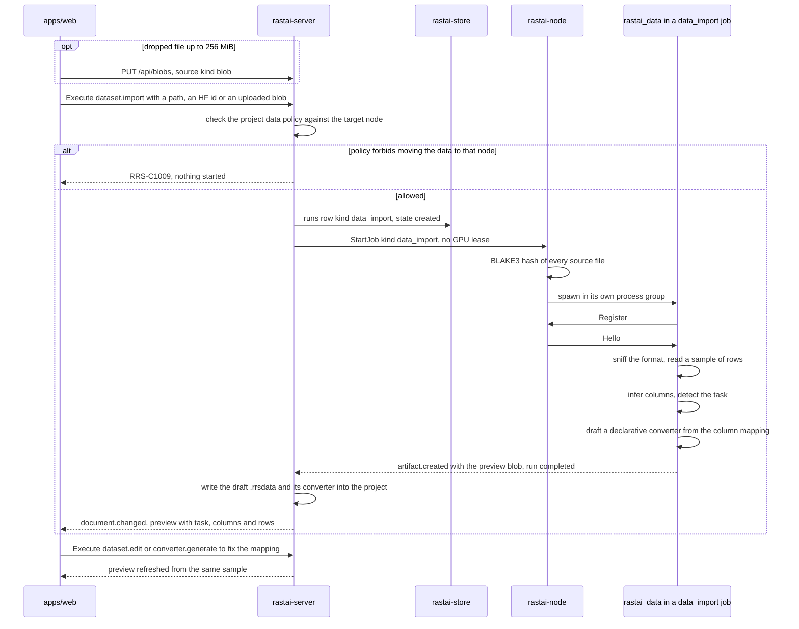

Not obvious:
- **Path or blob.** The UI never reads local paths (`layout/frontend-and-plugins.md` 2.1 and 9.3: Tauri's drag-drop handler is off, so HTML5 drop events reach the page). The same rules hold in Tauri, a plain browser and the remote UI over an SSH tunnel:
  - a dropped file up to `MAX_BROWSER_UPLOAD_BYTES` (256 MiB) is uploaded with `PUT /api/blobs`, and the source has kind `blob`;
  - a larger drop shows "Open from disk", which picks the same file through `file.browse` and imports it by path: kind `path`, read in place, never copied;
  - a dropped folder takes the "Open from disk" route too, so a folder of documents is never uploaded file by file;
  - `rastai dataset import <path>` always imports by path.
- **Which node.** Converters run next to the data (§22). A local path goes to the embedded node. An HF dataset goes to the node that will train, which pulls it directly. A MySQL source goes to the node that will train and reads the server from there (section 2.5). Private local data, and rows read from a database, move to a remote node only under the `trusted-remote` or `any` data policy (§24).
- **Source hash.** The node hashes files in Rust. A folder's `content_hash` is BLAKE3 over its sorted `<relative path> <file hash>` lines, the same rule as the model hash.
- **The sample** is the first 1,000 rows plus 1,000 seeded random rows. First rows alone are often unrepresentative (examples, headers, sorted data).
- **Only the daemon writes project documents.** The job returns the draft as a blob. `documents`, undo steps and `document.changed` stay in one place.
- **Formats in the prototype (§14):** JSONL, JSON arrays, CSV/TSV, Parquet, HF datasets (including streaming), text and Markdown folders, Alpaca, ShareGPT and OpenAI chat formats, DPO pair files, image folders and Parquet image columns (decoded through torchvision, section 2.5), and a MySQL or MariaDB query (section 2.5). The readers are `rastai_data/readers/` (`layout/python.md` 4.1). Anything else fails with `RRS-D1001` and a fix button that runs `plugin.suggest`.
- **The converter** is a `rastai.converter/1` document (`rastai_data.generate_converter(preview, task)`): a column mapping, templates and filters. Known formats start from the built-in files in `rastai_data/converters/known_formats/`.
- `dataset.from_conversations` skips this flow. It writes `examples[]` references (kind `sft`, `conversation_id`, the answer's message id) instead of copying rows, and `dataset.snapshot` materializes them with their exact token IDs (section 2.3). `examples[]` is only for this command; `psychology.branch.prefer` writes inline rows (section 7.1).

Persisted: source files stay where they are; HF datasets go to the HF cache. Durable: the `data_import` run's `events.log`, the preview blob, the draft `.rrsdata` and its converter file (`data/converters/<name>.json`) in the project, indexed in `documents`. Ephemeral: `job.progress`.

Tests: `rastai_data/tests/test_task_detection.py` and `test_declarative_converter.py` over `fixtures/datasets/` (one small file per supported format); a golden test that the drafted converter for each fixture equals a checked-in expected converter; a Playwright test that drops a CSV and sees the detected task in the preview.

### 2.2 Task detection

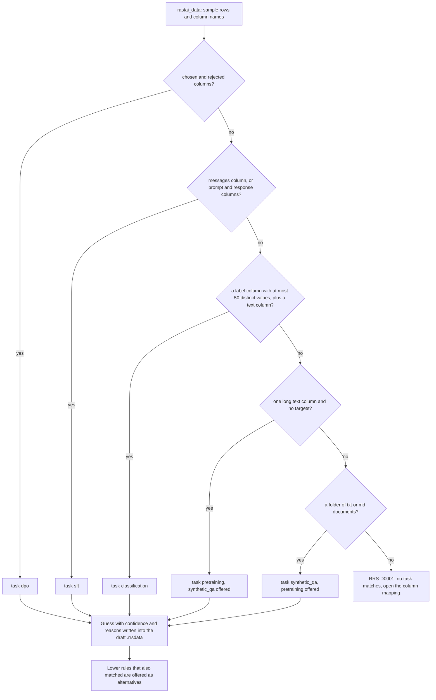

Rules are checked in this order, and the first match wins, because a richer task contains the poorer ones (a DPO file also has prompts and responses). Each guess carries a confidence and its reasons, shown in the preview; a user override is saved in `.rrsdata` (`layout/python.md` 4.3). Column names match case-insensitively:

| Role | Names matched |
|---|---|
| prompt | `prompt`, `instruction`, `question`, `input`, `query`; `system` and `context` are joined in |
| response | `response`, `output`, `answer`, `completion` |
| messages | `messages`, `conversations` (OpenAI `role`/`content`, ShareGPT `from`/`value`) |
| chosen / rejected | `chosen`, `rejected` |
| label | `label`, `labels`, `class`, `category`, `target`, when the column has at most 50 distinct values |
| long text | `text`, `content`, `document`, `body`, or the only string column with a median length over 1,000 characters |

`synthetic_qa` is a recipe that turns documents into Q&A pairs with a generator model through the gateway. Import only labels the task; nothing is generated here.

Persisted: the detection result and its alternatives in the preview blob; the chosen task in `.rrsdata` `task`.

Tests: a table-driven unit test, one fixture per row of the table above, plus fixtures that should fail with `RRS-D0001`.

### 2.3 Checks and snapshot

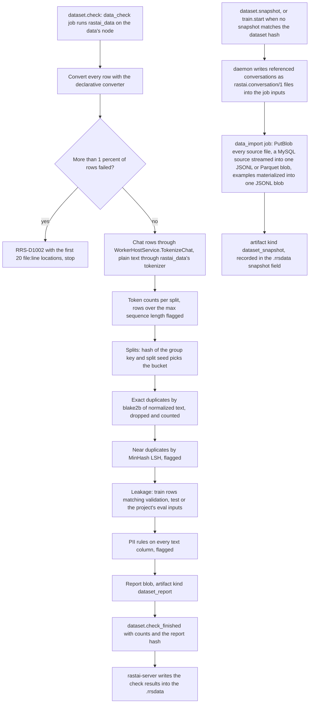

Not obvious:
- **Chat rows are tokenized by the node's gateway** through `WorkerHostService.TokenizeChat`. The gateway owns chat templates and tokenization (§18), so training token IDs and chat token IDs come from one source. The reply carries a `target_mask` per conversation: the gateway renders the prefix up to each assistant turn's start and up to its end, and the tokens in between (including the end-of-turn token) are targets (`target_mask.rs`, node layout 6.8). A template whose prefixes aren't token prefixes of the whole conversation can't give a mask: that conversation is skipped and counted with `RRS-G1006`. Rows that already carry token IDs (branch picks, logged conversations) are used as they are.
- **Plain text** (pretraining, classification) is tokenized by `rastai_data/tokenization.py`, the one wrapper around the Python `tokenizers` package. It wraps the same Rust library as the gateway, and `test_tokenization.py` checks it against the gateway's expected IDs on the 162-case corpus.
- **Splits.** Splits in the source win (HF split names, `train/` and `test/` folders). Otherwise `assign_split(row_key, ratios, seed)` picks the bucket from a stable hash (`zlib.crc32`) of the row's group key and `split_seed`. The group key is the conversation id, document id or normalized prompt, so rows that share a prompt never straddle splits.
- **Exact duplicates:** `hashlib.blake2b` of the text after NFKC, lowercasing and whitespace collapse. Python has no BLAKE3 in §27, and the hash never leaves the job. Dropped and counted (`RRS-D2001`, info).
- **Near duplicates:** in-house MinHash, 128 permutations over word 5-grams, LSH with 16 bands of 8 rows (candidate threshold about 0.71). Candidates are confirmed when their MinHash estimate is at least `NEAR_DUPLICATE_THRESHOLD` (0.8, `layout/python.md` 4.2). A pair at 0.8 becomes a candidate with about 95% probability, a pair at 0.9 with more than 99.9%. Flagged and kept by default; one click drops them.
- **Leakage** uses the same MinHash index across splits, plus every test input in the project's `.rrseval` suites, so a suite can't be trained on by accident. Leaks give `RRS-D2002` (warning) with counts; the fix drops the leaked rows from train, which keeps every evaluation honest.
- **PII:** rules for emails, phone numbers, card numbers (Luhn check), IBANs (mod-97 check), IP addresses, private-key blocks and common API-key prefixes (`sk-`, `ghp_`, `hf_`, `AKIA`). Flags only (`RRS-D2003`, warning). `dataset.export` redacts when `gateway.redact_pii_on_export` is on. Names and street addresses aren't detected in the prototype (no NER model); the report says so.
- **The snapshot** freezes what a run trains on. `dataset.snapshot` (job kind `data_import`, `layout/python.md` 7.4) copies every local source file into the blob store, so the bytes survive the user editing or deleting the file. HF sources are already pinned by `revision` and stay in the HF cache, never copied (§19). A `mysql` source is read through a server-side cursor into one JSONL or Parquet blob (`snapshot_format`), so the rows are frozen as of that read (section 2.5). It also materializes `examples[]` references into one JSONL blob with each message's token IDs; the daemon exports those conversations from `vault.db`, because `rastai_data` never reads it. `train.start` runs the snapshot first when none matches the dataset's content hash. The run record's `dataset_hashes[]` lists the `.rrsdata` content hash and the snapshot's hash. With an archive configured (M11), the snapshot blob is one of the blobs it keeps (contracts 8.7: pinned checkpoints, LoRA adapters, dataset snapshots).
- **Tokenized rows are a cache,** not part of the snapshot: `cache_folder/tokenized/<dataset_hash12>-<template_hash12>.safetensors` on each node (`layout/python.md` 15). Deleting it costs one re-tokenization.

Persisted: durable: the report blob (`dataset_report`), `dataset.check_finished`, the `.rrsdata` `checks` results; for a snapshot, the source-file blobs, the examples blob, the `dataset_snapshot` artifact and the `.rrsdata` `snapshot{artifact_id, content_hash, row_count}` field. Blobs land in `blobs/.incoming/` and are renamed into place, so a crash leaves no partial blob. Node-local and safe to delete: the tokenized cache.

Tests:
- MinHash recall of at least 0.95 at Jaccard 0.9 on a synthetic near-duplicate set, and no false pairs below Jaccard 0.5; the same signatures under two `PYTHONHASHSEED` values (`test_minhash.py`).
- Leakage test with planted eval inputs; PII corpus with positives and negatives (including Luhn-invalid numbers).
- `test_chat_tokenization.py` with a fake host: target masks cover answer tokens only; a prefix-unstable template yields `RRS-G1006` for that conversation and the rest continue.
- Determinism: the same inputs and seeds give the same splits, report and snapshot hash on two runs.
- `tests/crash/`: kill -9 the `data_import` job mid-snapshot; no artifact and no `.rrsdata` change appear, and a rerun gives the same hash.

### 2.4 Failures

| Failure | Detected by | User sees | Persisted |
|---|---|---|---|
| Path missing or permission denied | node, while hashing | `RRS-D3001` with the path | nothing |
| Unknown format | `rastai_data` | `RRS-D1001`, fix button `plugin.suggest` | import run `failed` |
| Bad rows | converter | skipped and counted; over 1% gives `RRS-D1002` with `file:line` locations | check report blob |
| Python converter raises | `rastai_data` | `RRS-D1003`; traceback in `stderr.log` | run `failed` |
| Chat template can't give a training mask | node gateway (`TokenizeChat`) | that conversation skipped and counted, `RRS-G1006` | count in the check report |
| HF dataset gated, or network drop | node download | resumes from its offset; after retries `RRS-D3002` (gated: fix `hf.login`) | partial download kept for resume |
| Disk full writing the snapshot | worker | `RRS-S3002` | `.incoming` file removed |
| Data policy forbids the move | daemon's policy check (plan §10 row 37) | `RRS-C1009` | nothing |
| Dropped file over 256 MiB | UI (`FileDrop`), before any upload | `RRS-U0006` with the fix "Open from disk" (`file.browse`, imports by path) | nothing |
| kill -9 of the job | node, exit by signal | `RRS-J1001` (job killed), Retry | events up to the last fsync; no document change |
| Source changed after the check | daemon at `train.start` (hash differs) | `RRS-D3003`, fix `dataset.check` | nothing |
| MySQL server unreachable, login rejected, or the query fails | `mysql_reader.py` in the job (section 2.5) | `RRS-D3005` (server unreachable or login rejected) or `RRS-D3006` (the query fails), with the reason (host, authentication or SQL error text) | import run `failed`; no partial blob |
| MySQL column type with no row in the type-mapping table | `mysql_reader.py` | `RRS-D3008` naming the column and its type | import run `failed` |
| MySQL connection without TLS to a remote host | daemon, when validating the `MysqlConnection` | `RRS-D3007` (the shared `MysqlConnection` TLS check in `rastai-formats`; only loopback or a Unix socket may skip TLS); nothing is started | nothing |
| MySQL rows changed since the snapshot (rerun) | `run.rerun` re-derives the snapshot | `RRS-D3003` | nothing |
| Image format `torchvision` can't decode | `image_decode.py` | `RRS-D1001` for that dataset | import run `failed` |
| Corrupt or truncated image | `image_decode.py` | skipped and counted as a bad row; over 1% gives `RRS-D1002` with `file:line` locations | check report blob |

### 2.5 MySQL sources and image datasets

Two kinds of source need more than a file read. Both use the same `data_import` job and the same preview, check and snapshot steps as a file.

**MySQL source (option C of the archive decision, ADR-0035).** A `.rrsdata` source of kind `mysql` holds a `MysqlConnection` (host and port or a Unix socket, database, user, TLS mode, and the name of a keychain account, never a password), a `query` and a `snapshot_format` (`jsonl` or `parquet`). `dataset.import` takes it instead of a path, an HF id or a blob, from the UI, the CLI or MCP. MySQL and MariaDB are read by the same code.

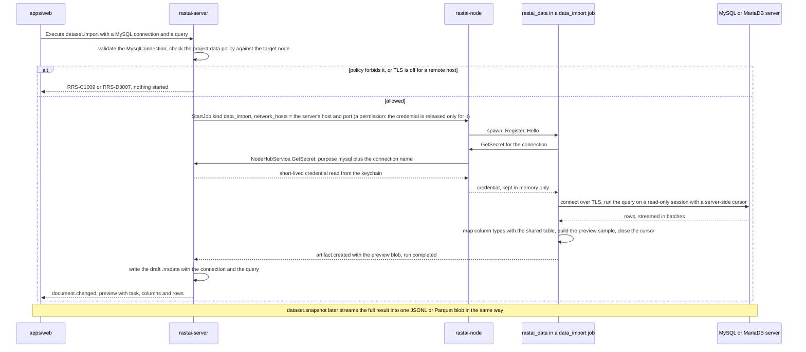

Not obvious:
- **Where it runs.** On the node that will train (the embedded node for local work), by the same "which node" rule as any source. The server must be reachable from that node, and the job's `network_hosts` names only that one host and port. This is a permission, not a network sandbox: the node releases the connection credential (`GetSecret`) only for that host and port, because worker jobs get no network enforcement (node layout section 7.9). Rows read from a database count as project data for the data policy: a remote node needs `trusted-remote` or `any` (`RRS-C1009` otherwise, with the one-click fix).
- **Credentials.** The `.rrsdata`, `job.json`, logs and events hold the connection name only. The daemon reads the keychain account `mysql.<connection_name>` and hands the password to the node through `NodeHubService.GetSecret` (purpose `mysql:<connection_name>`, short-lived). The reader keeps it in memory and never writes it down. Nodes never get archive credentials (contracts 3.1); this is a different secret for a different database.
- **One TLS policy** with the archive: `required` by default, and `disabled` validates only for a loopback host or a Unix socket.
- **The reader** is `rastai_data/readers/mysql_reader.py`, the only file that imports PyMySQL. It opens a read-only session (a mistyped query can't change the owner's data; a SELECT-only MySQL user is still the better practice), uses a server-side cursor, and fetches `FETCH_BATCH_ROWS` rows at a time, so a large table never sits in memory.
- **One type-mapping table** (MySQL type to Rastai column type) with golden fixtures in `fixtures/mysql/type-mapping/`, checked by both Python here and Rust in the archive. A column type with no row in the table fails the source with `RRS-D3008` naming the column. It never guesses.
- **The preview sample.** `ORDER BY RAND()` would scan the whole table, so the preview takes the first 1,000 rows plus a seeded reservoir sample of 1,000 over the first `PREVIEW_SCAN_ROWS` rows (100,000), then closes the cursor. The full pass happens in the snapshot (section 15, question 12).
- **Check and snapshot.** The `.rrsdata` content hash covers the connection and the query, not the rows. So a `mysql` source is always snapshotted first: `dataset.check` reads the frozen blob, never the live server, and `train.start` trains on that blob, so the check, the splits and the run see the same rows. The run record's `dataset_hashes[]` lists both hashes. `run.rerun` re-derives the snapshot from the query; a different hash gives `RRS-D3003`, the same as for a changed local file.
- **The archive is separate.** The archive and this reader share only the `MysqlConnection` type, the mapping table, the TLS policy and the CI MySQL service. The reader never touches archive tables.

**Image datasets.** `task` `classification` takes an `image` column. Two layouts are read: one folder per class, and HF Parquet image columns (`{bytes, path}`). `readers/image_folder.py` reads the layout; `rastai_data/image_decode.py` decodes. That file is the only one that imports `torchvision.io.decode_image` (owner decision 5; there is no in-house PNG or JPEG decoder). It takes bytes and returns a uint8 `[channels, height, width]` tensor. The job decodes each image once, resizes it to the design's input side and writes `cache_folder/images/<dataset_hash12>-<side>.safetensors`; training reads that file, so decoding cost is paid once per dataset. A format the library can't decode is `RRS-D1001`; a corrupt or truncated file is a bad row and is never half-decoded.

Persisted: the `.rrsdata` with the connection and query (no secret); the snapshot blob; the image cache (node-local, safe to delete). Nothing from the server is kept except the snapshot.

Tests:
- `rastai_data/tests/test_mysql_reader.py` against the CI MySQL service (the `mysql-archive` job: MySQL 8.4 and 9.7, MariaDB): a large table streams in bounded memory; the type-mapping goldens in `fixtures/mysql/type-mapping/` give the same columns as the Rust test; a write statement fails on the read-only session; a connection cut mid-stream fails the import and leaves no blob (`.incoming` removed); a `tls.mode` of `disabled` for a remote host is refused.
- The credential never appears in `job.json`, `stdout.log`, `stderr.log`, any event or the `command_journal`.
- Snapshot determinism: the same query on unchanged rows gives the same snapshot hash.
- `rastai_data/tests/test_image_decode.py` over `fixtures/images/` (PNG exactly, JPEG within the tolerance constant at the top of the test) and `test_image_folder.py` over `fixtures/datasets/images_tiny/` in both layouts; a truncated image is counted as a bad row.

---

## 3. Recipe selection and hardware-aware defaults

Runs when the launch dialog opens (`recipe.list`, then `train.start` with `dry_run`) and again inside `train.start`. The daemon decides; the worker checks the decision with a probe step (section 4).

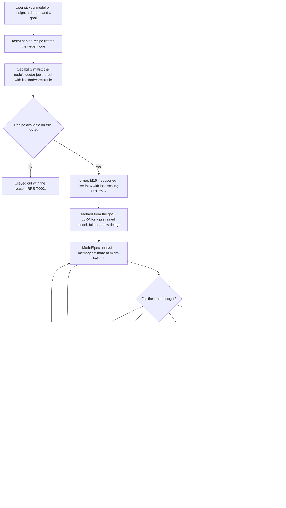

**The capability matrix** is computed on each node, not in the daemon (`layout/python.md` 5.3 and §14 item 8). The rules live in one place, `rastai_train/capability.py` (`recipe_availability(hardware_profile)`). The `doctor_selftest` job runs them after the numerical self-test, so a kernel that imports but computes wrong counts as missing. The result is stored with the node's hardware profile, and `recipe.list` reads it without starting Python. Third-party recipes declare their needs as data in the manifest (`contributes.recipes[].requirements`), and the same rules evaluate them. A new plugin or a driver change reruns the doctor job.

| Requirement | How the node knows | If missing |
|---|---|---|
| bf16 | NVIDIA sm_80 or newer, or a ROCm arch whose self-test passes bf16 matmuls | fp16 with dynamic loss scaling (sm_70+), else fp32 |
| 4-bit kernels (QLoRA) | bitsandbytes imports in the node's environment, and its 4-bit matmul matches the CPU reference in `system.doctor` | QLoRA greyed out, LoRA offered (§28 risk 6). Blackwell sm_120 support is decided by the self-test, not a version table |
| CUDA graphs | CUDA or ROCm backend | eager decode for rollouts: slower, same results |
| Multi-GPU (DDP, FSDP2) | two or more GPUs and a passing NCCL/RCCL self-test | single GPU |
| Sandbox (Pass@k, gym rewards) | container engine socket answers; Linux | recipes and tests that need it are greyed out |
| Reward source (PPO, GRPO) | a reward-model checkpoint or a reward-function plugin is installed | `RRS-T0002`, fix `plugin.suggest` |

**The memory estimate** lives in `rastai-server`'s ModelSpec analysis, beside the `estimate_memory_bytes` that `design.stats` uses (`layout/rust-control-plane.md`, `modelspec_analysis/memory.rs`). The training estimate is a new function in the same file:

```rust
// crates/rastai-server/src/modelspec_analysis/memory.rs
const ADAMW_MOMENTS_PER_PARAMETER: u64 = 2;
const MICRO_BATCH_HEADROOM: f64 = 0.9; // allocator fragmentation; tests/gpu checks this against measured peaks

pub struct TrainingMemoryEstimate {
    pub weights_bytes: u64,                // frozen base in its dtype (4-bit plus scales for QLoRA)
    pub trainable_state_bytes: u64,        // float32 master + gradient + AdamW moments per trainable parameter
    pub activation_bytes_per_sample: u64,  // with gradient checkpointing: each layer's input plus one layer's internals
    pub logits_bytes_per_sample: u64,      // answer positions only: full-vocabulary logits everywhere cost gigabytes (spike)
    pub workspace_bytes: u64,              // CUDA context and kernel workspaces
}

pub fn estimate_training_memory(model: &ModelSpec, method: TrainingMethod, dtype: Dtype, sequence_length: u32, answer_tokens_per_sample: u32) -> TrainingMemoryEstimate;
pub fn largest_micro_batch(estimate: &TrainingMemoryEstimate, budget_bytes: u64) -> u32;
```

Not obvious:
- **Budget** = free VRAM on the chosen GPU − `compute.vram_reserve_bytes`, plus evictable leases the job may reclaim, capped by `training.memory_cap_bytes`.
- **GPU choice:** `compute.gpu_assignment.training` if set, else the GPU with the most free VRAM that isn't serving chat.
- **Fixed defaults** come from settings and the spike: `training.answer_only_loss`, `training.gradient_checkpointing`, `training.lora` (rank 16, alpha 32), LoRA master weights in float32 with bf16 compute.
- **MoE models:** GRPO defaults to its GSPO option (`sequence_level_ratio: true`, §10, ADR-0021) when the policy has a `moe` graph node.
- **PPO** fits where LoRA fits, because the policy, the reference, the value head and a same-base reward model share one base copy (ADR-0022). Full fine-tuning PPO needs a real reference copy and is offered only when the estimate fits.
- **Time estimate:** tokens ÷ throughput from the designer's FLOPs estimate (`estimate_time_seconds`), replaced by the probe step's measured throughput once the run starts.

Persisted: the capability matrix with the node's hardware profile (`nodes` row and the doctor job's run). Nothing else until launch. The accepted plan is written into `run.json` (`recipe.settings`, `job_spec`) by `train.start`.

Tests: `rastai_train/tests/test_capability.py`, table-driven over `HardwareProfile` fixtures (5080 sm_120, 3090 sm_86, a Pascal card, CPU, ROCm gfx1100), asserting availability and fallbacks; a Rust unit test that `largest_micro_batch` never exceeds the budget; `tests/gpu/`: for Gemma 3 1B LoRA the estimate is at least the measured peak and within 15% of it.

---

## 4. A training run end to end

Runs when the user presses Train in the launch dialog or runs `rastai train start`. `train.start` is a job command; chains (section 6) call it too.

### 4.1 Start to finish

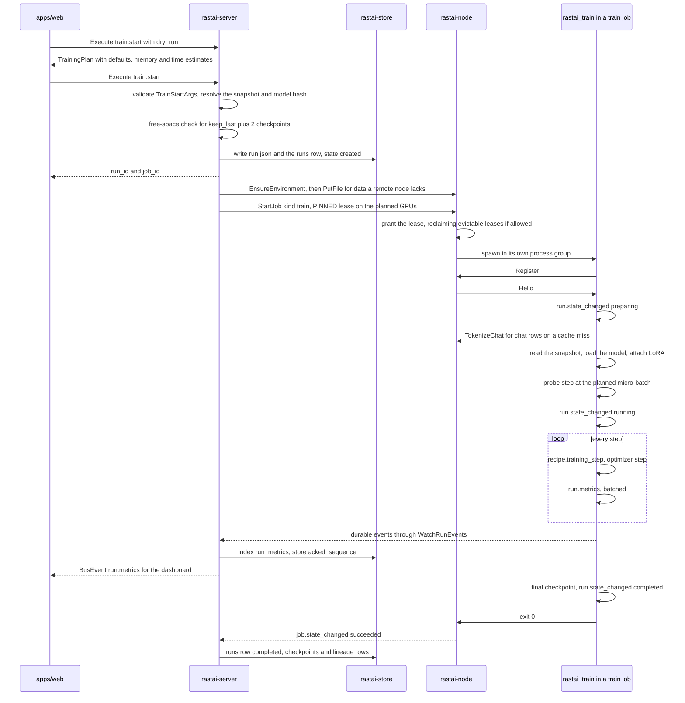

Not obvious:
- **Before the job exists**, the daemon does the slow, failure-prone setup: environment (`EnsureEnvironment`), model download (a `download` job if the weights are missing), the dataset snapshot if none matches (section 2.3), and transfer of private data to a remote node. A failure there leaves the run in `created` with a diagnostic, never a half-started job. The launch itself is `scheduler/launch.rs` in `rastai-server`: write `run.json`, build the `JobSpec`, call `StartJob`.
- **The probe step** runs one forward and backward pass at the planned micro-batch on the longest sequence in the snapshot. On `torch.OutOfMemoryError` the worker halves the micro-batch and doubles gradient accumulation, up to three times. The effective batch never changes. If micro-batch 1 still fails, the run fails with `RRS-H3007` (out of GPU memory inside a job step) and the fix text lists QLoRA, a shorter max length or a smaller rank.
- **Validation:** when the snapshot has a validation split, `validation.loss` runs at every checkpoint, and `is_best` marks the lowest.
- **Standard metric names:** `train.loss`, `train.learning_rate`, `train.grad_norm`, `train.tokens_per_second`, `train.samples_seen`, `train.vram_peak_bytes`, `validation.loss`. Recipe metrics use the recipe as prefix (`dpo.reward_margin`, `ppo.kl`).
- **The dashboard** (simple and advanced views) is two UI layouts over the same `run.metrics` events plus node telemetry from `node.heartbeat`. Charts use `@rastai/viz`.

The loop in `rastai_train`, with the signature from `layout/python.md` 5.2. The recipe returns a loss and metrics; the loop owns backward, the optimizer and the checkpoint cadence, so they are the same for every recipe:

```python
# python/rastai_train/loop.py
STEPS_BETWEEN_METRIC_RECORDS = 10


def train(context: TrainingContext, recipe: Recipe, events: JobEvents, control: JobControl) -> TrainingOutcome:
    recipe.prepare(context)
    while True:
        batch = context.loader.next_batch()
        if batch is None:
            return finish_run(context, recipe, events)
        # Checked first: SIGTERM has a time budget, STOP and CANCEL don't.
        if control.preempt_requested:
            return preempt_at_step_boundary(context, recipe, events)  # checkpoint within the budget, train.preempted, exit 75
        if control.stop_requested or control.cancel_requested:
            return stop_at_step_boundary(context, recipe, events, control)
        step_result = recipe.training_step(batch)
        optimizer_step(context, step_result.loss)
        record_step_metrics(events, context, step_result)
        if control.checkpoint_requested or checkpoint_is_due(context):
            save_checkpoint_and_report(context, recipe, events)
```

Persisted: durable: `run.json`, `events.log` (`run.state_changed`, `run.metrics`, `checkpoint.saved`), checkpoint folders, `stdout.log` and `stderr.log`; indexed into `runs`, `run_metrics`, `checkpoints`, `jobs` and `lineage` (`checkpoint_of`). Ephemeral: `job.progress`, `job.log_line`, telemetry.

Tests: the full CPU loop in `tests/loop/` (TextCNN and a tiny random-weight decoder: design, train, eval, export, re-import in under 10 minutes); `rastai_train/tests/test_loop.py` (loss falls, `stop_requested` gives a final checkpoint, `preempt_requested` gives a checkpoint, `train.preempted` and exit 75, metrics carry steps); a Playwright test that starts a run and sees the loss chart move; a unit test that the probe step halves the micro-batch on a simulated OOM and keeps the effective batch.

### 4.2 Run lifecycle

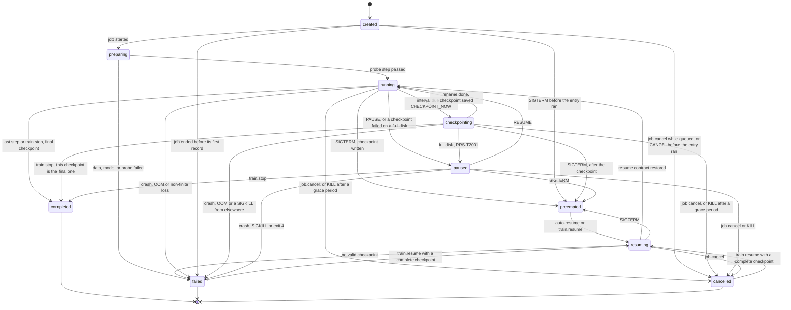

Not obvious:
- `train.stop` ends a run early with a final checkpoint and counts as `completed` (reason `stopped`). `job.cancel` ends it at the next step boundary without a new checkpoint (`cancelled`).
- **A worker killed with SIGKILL** can't write its own state, so the daemon writes the run's final state (contracts §4.4, platform flow 5.5). A `KILL` the node sent after a grace period gives job and run `cancelled`. A SIGKILL from anywhere else (the kernel's OOM killer, a user's `kill -9`) gives job and run `failed` with `RRS-J1001` (`RRS-J1002` for the kernel's OOM killer). Power loss leaves the job `lost`, then `failed` when the node comes back.
- **`train.resume` reopens a `failed` or `cancelled` run** that has a complete checkpoint, as well as a `preempted` one. Other flow docs rely on this too (platform flow 6.5 row 15, designer-gym-remote B8), and contracts §9.5 has both transitions: `failed` and `cancelled` are terminal only when no complete checkpoint exists, and `completed` is the only state that is always terminal.
- **A job can end in any live state**, so every live run state has a way to each end (contracts §9.5, M1-47): a run that is `checkpointing` or `paused` when its job is stopped, preempted, cancelled, killed or crashes goes straight to that end, and a job that ends before the worker's first record leaves the run `created` → `failed`, `cancelled` or `preempted`. `preempted` stays resumable, and its only exit is `resuming` until the owner decides contracts §14 row 25. The daemon writes a final state only for a job that ended without one (contracts §9.5, "Who writes the final state"), and only along these edges.
- `verifying` exists only on chain runs (section 6).
- `train.resume` starts a new job under the same `run_id`. It appends to the same `events.log` after truncating a torn tail, so sequence numbers continue and the log still has one writer at a time.
- **A full disk pauses the run** (`running → paused`) with the training state still in memory and the lease kept; the job stays `running`. That covers both a checkpoint write (`RRS-T2001`) and an event-log append (`RRS-S3002`, platform flow 6.1). Resume after `storage.gc` retries the write.

Persisted: each transition is a durable `run.state_changed` in `events.log`, mirrored to `runs.state`. The daemon writes the final record for a SIGKILLed worker.

Tests: a unit test drives a fake trainer through every transition and checks the event sequence; `tests/crash/` covers the kill paths (section 5).

### 4.3 Failures

| Failure | Detected by | User sees | Persisted | Recovery |
|---|---|---|---|---|
| kill -9 of the worker | node: exit by a signal it didn't send | `RRS-J1001` (killed by a SIGKILL Rastai didn't send), Resume button | events to the last fsync; last complete checkpoint; the daemon writes run `failed` | `train.resume` |
| Worker ignores `CANCEL` past the grace period | node sends `KILL` | `RRS-J1003` (killed by the node) | run `cancelled`, written by the daemon | `train.resume` if a checkpoint exists |
| GPU OOM at the probe | worker | auto-retry with smaller micro-batches, then `RRS-H3007` with peak bytes | `run.state_changed failed` | QLoRA, shorter sequences |
| GPU OOM mid-run | worker catches the error | `RRS-H3007` with step, micro-batch and peak; fix button resumes at half the micro-batch | emergency checkpoint of the last completed step (the failed step never reached `optimizer.step`) | `train.resume` with the override |
| Host RAM OOM killer | node: SIGKILL plus the cgroup's `oom_kill` count | `RRS-J1002` (killed by the kernel's OOM killer) | last checkpoint | resume with fewer dataloader workers |
| Non-finite loss or gradients | worker: gradients checked before `optimizer.step` | a skipped step is logged; 3 in a row stop the run with `RRS-T3001` | checkpoint of the last good step | resume with a lower learning rate |
| Disk too full to start | daemon (platform flow 8.1) | `RRS-S3001` with bytes needed and free | nothing started | `storage.gc` |
| Disk full at a periodic checkpoint | worker: ENOSPC | `RRS-T2001`; the run pauses with its state still in memory | `.partial` folder removed | free space, then Resume |
| Disk full at the preemption checkpoint | worker: ENOSPC after SIGTERM | `RRS-T2001`, exit 1, run `failed` (it can't wait for space while being stopped; `layout/python.md` 5.4) | `.partial` removed; the previous checkpoint stays | `train.resume` from the previous checkpoint |
| Disk full on an event-log append | worker: ENOSPC | `RRS-S3002`; run paused (platform flow 6.1) | the 1 MiB reserve file makes room for the diagnostic and the `paused` record | free space, then Resume |
| Daemon crash or restart | — | the UI reconnects; nothing else | the worker keeps writing; the daemon catches up from `acked_sequence` | automatic reattach |
| Remote node unreachable | daemon: 3 missed heartbeats | node badge `unreachable`, job `lost`, `RRS-N2001` | the worker keeps writing on the node | automatic catch-up on reconnect |
| Recipe plugin not installed | daemon at validation | `RRS-T0002`, fix `plugin.suggest` | nothing | install, retry |
| Dataset task doesn't fit the recipe | daemon | `RRS-T0005` | nothing | pick another recipe |
| Worker never registers (60 s) | node | `RRS-J0002` (no Register) | `stderr.log` | check the environment |

### 4.4 Multi-GPU on one machine

- The job process is rank 0. It starts the other ranks as `python -m rastai_worker rank --job-file <path> --rank <n>` child processes in the same process group, so the node's kill and reattach logic covers all of them. They rendezvous through the FileStore `runs/<run_id>/distributed.store` (`layout/python.md` 7.6).
- `ResourceRequest.gpu_indices` lists every GPU; the node grants one `PINNED` lease per GPU.
- Only rank 0 writes `events.log` and checkpoints. Under FSDP2, the prototype gathers a full state dict to rank 0 on the CPU before writing safetensors. `torch.distributed.checkpoint` isn't used, because its metadata file is pickled. Sharded checkpoints come when a model's state no longer fits host RAM.
- Any rank dying ends the job: the node kills the whole process group, the run is `failed`, and `train.resume` restarts every rank.
- The dataloader position is a global sample count. Each rank takes its slice of the global order, so a resume may change the GPU count.

Tests: `tests/gpu/`: DDP on the 5080 and the 3090 gives the same loss curve as one GPU within tolerance at the same effective batch; kill -9 of rank 1 fails the job and leaves no orphan process.

---

## 5. Checkpoints, preemption and the resume contract

Checkpoints run on a timer and on demand (`train.checkpoint`). Preemption runs when the OS or a provider sends SIGTERM. Resume runs on `train.resume`, or by itself when a node comes back with a `preempted` run and `training.auto_resume` is on.

### 5.1 Writing a checkpoint, and SIGTERM

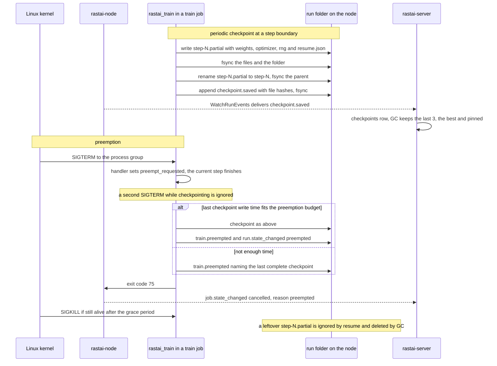

```python
# python/rastai_train/checkpoints.py
PARTIAL_SUFFIX = ".partial"


def write_checkpoint(run_folder: Path, step: int, context: TrainingContext, recipe_state: dict,
                     validation_loss: float | None) -> Path:
    final_folder = checkpoint_folder(run_folder, step)
    partial_folder = final_folder.with_name(final_folder.name + PARTIAL_SUFFIX)
    write_weights(partial_folder, context.model, validation_loss)  # adapter tensors only for LoRA runs; the loss in metadata
    write_optimizer_state(partial_folder, context.optimizer)  # keyed by parameter name, never by index
    write_rng_state(partial_folder)                           # torch CPU and each CUDA device, as byte tensors
    write_resume_json(partial_folder, context, recipe_state)  # rastai.resume/1 through rastai_formats
    fsync_folder(partial_folder)
    partial_folder.rename(final_folder)                       # the checkpoint exists only after this rename
    fsync_folder(final_folder.parent)
    return final_folder
```

The loop's caller hashes the files and appends `checkpoint.saved` (with `is_best`) only after `write_checkpoint` returns, so the daemon never indexes a half-written folder.

Not obvious:
- **The signal handler only sets a flag.** SIGTERM sets `control.preempt_requested`, its own flag, separate from `stop_requested` (`STOP`) and `cancel_requested` (`CANCEL`), because each ends differently. The loop (section 4.1) checks it first at the next step boundary, where weights, optimizer and dataloader agree, and calls `preempt_at_step_boundary`: checkpoint if it fits `training.checkpoint.preemption_budget_seconds`, append `train.preempted`, exit 75.
- **Who sends what** (contracts §4.4 `JobSignal`, platform flow 5.2):

  | Trigger | Path | Worker does | Run ends | Job ends |
  |---|---|---|---|---|
  | `train.stop` | `SignalJob STOP` (`WorkerService.Control STOP`) | sets `control.stop_requested`, final checkpoint at the next step boundary, exit 0 | `completed` (reason `stopped`) | `succeeded` |
  | `job.cancel` | `SignalJob CANCEL` (`WorkerService.Control CANCEL`) | exit at the next step boundary, no new checkpoint, exit 3 | `cancelled` | `cancelled` |
  | `train.checkpoint` | `SignalJob CHECKPOINT_NOW` | checkpoint, keep training | `running` | `running` |
  | `SignalJob TERMINATE`, or SIGTERM from the OS (shutdown, spot notice, `kill`) | SIGTERM to the process group | sets `control.preempt_requested`, checkpoint if it fits the budget, exit 75 | `preempted` | `cancelled` (reason `preempted`) |
  | `SignalJob KILL` (a `CANCEL` or `TERMINATE` grace period ran out) | SIGKILL from the node | nothing | `cancelled`, written by the daemon; resumable if a checkpoint exists | `cancelled`, `RRS-J1003` (killed by the node) |
  | SIGKILL the node didn't send (OOM killer, `kill -9`), or power loss | SIGKILL, or none | nothing | `failed`, written by the daemon; resumable | `failed`, `RRS-J1001` (`RRS-J1002` for the OOM killer); `lost` first after power loss |

- **`STOP` and `TERMINATE` are different signals.** `STOP` is a control message: the run finishes normally with a final checkpoint. `TERMINATE` is SIGTERM, the preemption path, and keeps that meaning in every version. `KILL` is the only immediate SIGKILL.
- **Exit code 75** (`EXIT_PREEMPTED`, contracts §9.1, `layout/python.md` 7.2) tells the node "preempted, resumable".
- **The preemption budget** is `training.checkpoint.preemption_budget_seconds` (default 25 s). The worker compares it with how long the last checkpoint took. A LoRA checkpoint is small (52 MB for the spike's rank-16 adapter on Gemma 3 1B), so it almost always fits.
- **A full disk during the preemption checkpoint** can't wait for space: the worker deletes the `.partial` folder, reports `RRS-T2001` and exits 1, so the node marks the run `failed` instead of relaunching it forever (`layout/python.md` 5.4). The previous checkpoint is still there for `train.resume`.
- **Stopping the daemon must not preempt training.** The systemd user unit uses `KillMode=process` (node layout 7.4), so `systemctl --user stop rastai` leaves workers running for reattach. A real system shutdown still sends SIGTERM to every process, and that is the preemption path.
- **Checkpoint frequency follows the risk of interruption.** The daemon writes the policy into `JobSpec.checkpoint_policy_json`, and the worker follows it. The base is `training.checkpoint.interval_minutes` (15) on the local box. Paired SSH nodes use half of it (network drops and remote reboots are likelier). Phase 3 spot machines use 5 minutes, plus the provider's notice. The interval is never shorter than 20× the last checkpoint's write time, which keeps overhead under 5%. Short runs such as Teach it only checkpoint at the end.
- **Retention:** keep the last 3, the best and any pinned (`training.checkpoint.keep_last`). LoRA adapters always sync back from a remote node; full checkpoints stay on the node and are fetched on demand (§22). With an archive configured (M11), pinned checkpoints and LoRA adapters are copied to its blob target; intermediate checkpoints never are (contracts 8.7).

Persisted: durable: the checkpoint folder (`weights.safetensors` or `adapter.safetensors`, `optimizer.safetensors`, `rng.safetensors`, `resume.json`), `checkpoint.saved` with file hashes, `train.preempted`, the `checkpoints` row. Nothing is pickled.

Tests:
- `tests/crash/test_train_kill9.py`: kill -9 the train job at random points, including mid-checkpoint (between the file writes and the rename). The next resume always finds a complete checkpoint and never reads a `.partial` folder.
- `tests/crash/test_train_sigterm_resume.py`: SIGTERM mid-step. The run ends `preempted` with exit code 75 and a checkpoint at the following step boundary; the relaunch continues the event sequence.
- A tmpfs volume filled during a checkpoint: run `paused` with `RRS-T2001` and no `.partial` left; Resume after freeing space writes the checkpoint (platform flow 8.1 test).
- `tests/crash/`: kill -9 the daemon mid-run. On restart it reattaches and loses no events (the Weeks 3–4 exit test).

### 5.2 Resume

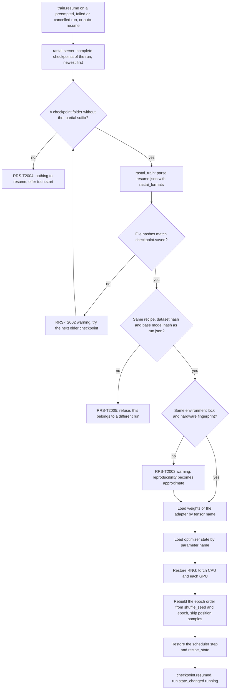

The resume contract (`rastai.resume/1` plus the files beside it):

| Part | Where | Format | Restored how |
|---|---|---|---|
| Weights | `weights.safetensors`, or `adapter.safetensors` for LoRA and frozen-base runs | in-house safetensors writer | by tensor name onto the compiled model; base weights come from the HF cache by `model_hash` |
| Optimizer | `optimizer.safetensors` | `<parameter name>.exp_avg`, `.exp_avg_sq`, `.step` | by name, so adding a head never shifts state |
| RNG | `rng.safetensors` | `torch_cpu` and `cuda_<index>` per device, as byte tensors (ADR-0024) | set before the first batch |
| Dataloader | `resume.json` `dataloader{dataset_hash, split, shuffle_seed, epoch, position}` (`BatchLoader.position()`) | `position` counts samples, not batches | `make_loader(..., start_epoch, start_position)` rebuilds the order and skips `position` samples |
| Scheduler | `resume.json` `scheduler{}` | the schedule position; hyperparameters come back from the run record | recomputed from the step |
| Recipe | `resume.json` `recipe_state{}` | whatever `Recipe.resume_state()` returned (plain JSON values) | handed to `Recipe.restore_state` |

Python's `random` module holds no training state: shuffles and anchor mixing are pure functions of their seeds. The order is a pure function of seed and epoch, so the position is all a resume needs:

```python
# python/rastai_data/loaders.py
def epoch_order(example_count: int, shuffle_seed: int, epoch: int) -> list[int]:
    """Same seed and epoch, same order, on any machine. Resume skips the first `position` entries."""
    shuffler = random.Random(f"{shuffle_seed}:{epoch}")   # a str seed is hashed with SHA-512, not PYTHONHASHSEED
    order = list(range(example_count))
    shuffler.shuffle(order)
    return order
```

Because the position counts samples, a resume may change the micro-batch (the OOM fix) or the GPU count.

Persisted: durable: `checkpoint.resumed` with the step and the checkpoint used. A rejected checkpoint stays on disk for inspection; GC removes it on its usual rules. A resumed run leaves the newer checkpoints it fell back past out of its latest, its best and keep_last until it writes that step again (`TrainingProgress.skipped_checkpoint_steps`), since they are ahead of it.

Tests:
- **Resume parity (CPU, deterministic mode):** `rastai_train/tests/test_resume.py`: train N steps straight; separately train k steps, kill -9, resume, and train N − k. Final weights and the loss curve must be bit-identical. Run for SFT, DPO and PPO on tiny random-weight models in `tests/loop/`.
- `rastai_data/tests/test_loaders.py`: resuming at (epoch, position) yields exactly the batches an uninterrupted run would.
- The same on GPU in `tests/gpu/`, within a stated tolerance.
- Corrupt one byte of `optimizer.safetensors`; resume falls back to the older checkpoint with `RRS-T2002`.

---

## 6. Chains

Used by `teach.start`, `rlhf.start` and `sweep.start`. A chain strings ordinary runs together. The chain driver in `rastai-server` (`scheduler/chains.rs`, `layout/rust-control-plane.md`) starts each step when the previous one ends. Each step is one Python job (`layout/python.md` 5.3, "Chains live in the daemon").

Rules:
- A chain is a run (kind `teach`, `rlhf` or `sweep`) with no job of its own. Its `run.json` lists the steps (the `chain` field), each with a child run id assigned when the chain is created.
- Each step is an ordinary run (`train`, `eval`, `lens`) whose `parent_run_id` is the chain. "Each step is also a recipe on its own" (§10) holds because a step is exactly the run the user could have started by hand.
- The chain driver is the only writer of the chain run's `events.log` (`chain.step_started`, `chain.step_finished`, `run.state_changed`). Contracts §7.1 and §16 row 18 give the rule: one writer of a run log, the job, or the chain driver for chain runs.
- The next action is a pure function of the chain record and the children's states, so restarts and tests are simple. `start_next_chain_step(server, finished_run_id)` reads the chain and calls it:

```rust
// crates/rastai-server/src/scheduler/chains.rs
pub struct ChainStep {
    pub step_name: String,       // "train", "verify", "diff"
    pub child_run_id: String,    // assigned at chain creation, so a restart never starts a step twice
    pub command_id: String,      // "train.start", "eval.test", "psychology.diff.run"
    pub arguments_json: String,
    pub gate: Option<StepGate>,  // e.g. the reward model's accuracy in RLHF
    pub optional: bool,          // skipped with an info diagnostic when its plugin is disabled
}

pub enum ChainAction {
    StartStep(usize),
    Wait,
    Finish(RunState),
    Fail(Diagnostic),
}

pub fn next_chain_action(steps: &[ChainStep], child_outcomes: &[Option<ChildRunOutcome>]) -> ChainAction;
```

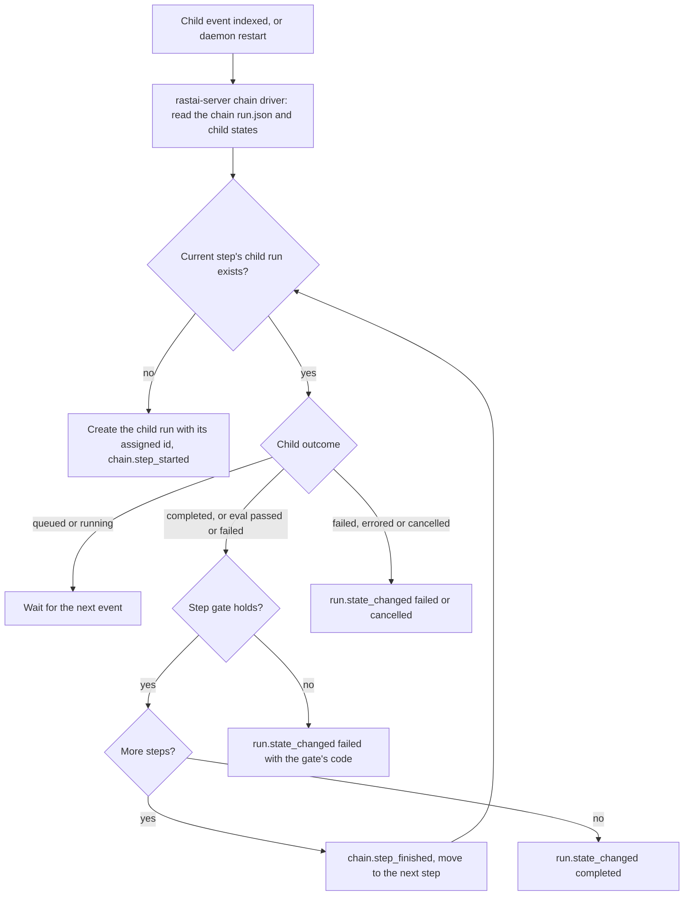

Not obvious:
- **An eval child that ends `failed` (tests failed) is a successful step.** The chain reports the verdict; it doesn't fail on it. Only `errored` (could not evaluate) fails the chain.
- **Idempotent restarts.** If the daemon dies after creating a child but before writing `chain.step_started`, the next pass finds the child and waits on it. If it dies after the event but before the child exists, the next pass creates it with the same id.
- **Optional steps** (model diff, SAE fit check) whose plugin is disabled are recorded as skipped with an info diagnostic and the chain moves on.

Persisted: durable: the chain's `run.json` and `events.log` (written by the daemon, fsync per record); each child run as usual.

Tests: unit tests for `next_chain_action` over a table of child outcomes, gates and optional steps; `tests/crash/`: kill -9 the daemon right after `chain.step_started` and right after a child is created, then restart; exactly one child run exists per step and the chain completes.

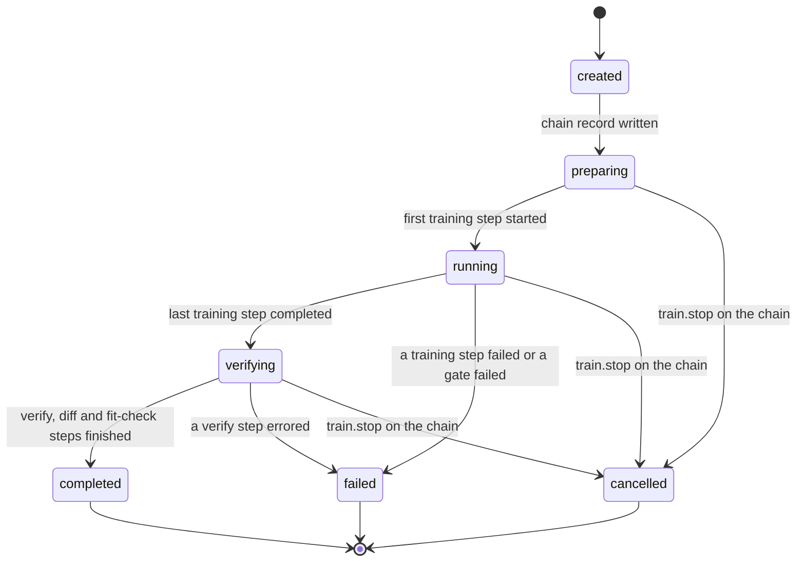

Not obvious:
- **The chain's state is the phase of its current step:** `running` while a training step runs (RLHF has two), `verifying` while eval, diff or fit-check steps run.
- **Cancel.** `train.stop` with a chain's run id sends `SignalJob STOP` to the running child (training writes its final checkpoint and exits 0) and ends the chain `cancelled`. An eval or lens child gets `CANCEL`, since it has nothing to checkpoint.

Persisted: each transition is a durable `run.state_changed` in the chain's `events.log`, mirrored to `runs.state`.

Tests: a unit test drives a chain with fake children through every transition, including `train.stop` in each phase.

---

## 7. Teach it

Runs when the user presses **Teach it** in chat or Psychology after preferring branches (`psychology.branch.prefer`) or pinning conversations (`conversation.pin`). The command is `teach.start`; it creates a chain of kind `teach`.

### 7.1 Collecting the data

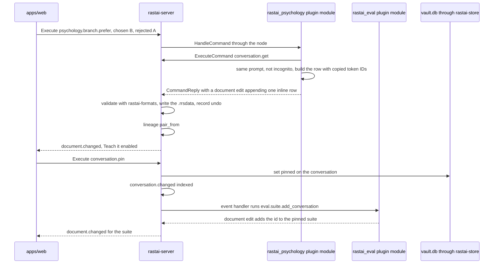

Not obvious:
- **The prefer half is inference-psychology flow 7.2,** repeated here because Teach it starts from it. `psychology.branch.prefer` appends one row to the inline source (`sources[]` kind `inline`) of the project's `data/preferences.rrsdata`, task `dpo`. The file is created on the first pick; the optional `document_id` argument picks another dataset. This doc owns the row shape:
  - `prompt`: the messages both answers continue, and `token_ids`, the rendered context exactly as the gateway sent it (A's prompt tokens);
  - `chosen` and `rejected`: `text`, `token_ids` (the answer's tokens after that context, through the end-of-turn token) and `model_ref` each. A rewound answer's forced first tokens are part of its answer, so the two sides may share a prefix; DPO's log-ratio difference cancels it. An SFT target is a row with `chosen` only;
  - `source`: `branch_pick`;
  - `conversation_id`, `chosen_message_id`, `rejected_message_id`: lineage only; training never reads them;
  - `edited`: true when the user rewrote the target. The module re-tokenizes the edited text through `TokenizeChat` before writing the row, so its mask comes from the same template as everything else.

  ```json
  {
    "source": "branch_pick",
    "prompt": {"messages": [{"role": "user", "text": "Who wrote Romeo and Juliet?"}], "token_ids": [2, 105, 2364, 107]},
    "chosen": {"text": "William Shakespeare.", "token_ids": [17534, 50795, 236761, 106], "model_ref": "hf:google/gemma-3-1b-it@main"},
    "rejected": {"text": "Pedro de Alva.", "token_ids": [44215, 581, 102167, 106], "model_ref": "hf:google/gemma-3-1b-it@main"},
    "edited": false,
    "conversation_id": "c_01J9", "chosen_message_id": "m_01JB", "rejected_message_id": "m_01JA"
  }
  ```

  The token IDs above are placeholders. Appending is a JSON Patch in `CommandReply.document_edits`, so undo works like any document edit.
- **Rows hold copies, not references.** Training reads exactly the token IDs the model produced, with no tokenization step (section 2.3). The pair survives a later conversation delete (inference-psychology flow 9), and it travels inside a `.rrsproj` export, which never includes `vault.db` (platform flow 10.2). `examples[]` references are only for `dataset.from_conversations` (section 2.1).
- **Blind A/B votes** (`eval.vote`, the `eval.vote` panel beside chat) go to a different file from picks: the project's `evals/votes.rrsdata`, an ordinary `dpo` dataset created on the first vote (owner decision 9, contracts §16). The Evaluation module returns a document edit that appends one inline preference row, the way Prefer does, so a vote is journaled and undoable like any edit. The row has `source` `blind_vote`, `chosen_side` (`a` or `b`, the side the voter saw as chosen) and both `model_ref`s, which the panel hides until the vote is in. Teach it and RLHF read `data/preferences.rrsdata` by default, not the votes file, so a vote never trains a model by accident; the user may still pick the votes file as a dataset. Elo reads it like any preference dataset (section 10.3).
- **Pinned conversations become tests** through the Evaluation plugin's event handler (manifest field `contributes.event_handlers[]`, which receives `HandlerEventArgs`). The handler adds the conversation id to `pinned_conversations[]` of the project's pinned suite (`evals/pinned.rrseval`, created on the first pin). At run time `rastai_eval/suites.py` expands each one into a test: the input is the conversation up to the pinned answer, and the reference is that answer. Storing the id, not a copy, keeps the suite small; the suite hash still changes when a pin is added, so results only compare across the same set.

Persisted: durable: the `.rrsdata` and `.rrseval` documents in the project (`documents`, `undo_steps`), the `pinned` flag in `vault.db`, lineage `pair_from` (message → pair). Votes are rows of `evals/votes.rrsdata`, so they sit in the same tables and, being project documents, travel in a `.rrsproj` export.

Tests: `tests/e2e/branch_prefer.spec.js` (inference-psychology 7.2: one inline row appended, its token IDs equal the messages' `token_ids`, undo removes it, lineage shows replay → pair → dataset); a test that deleting the conversation afterwards leaves the row and a `.rrsproj` export carries it; a unit test that an edited target is re-tokenized and marked `edited`; a test that `eval.vote` appends a `blind_vote` row with `chosen_side` to `evals/votes.rrsdata`, writes a `command_journal` entry, and that undo removes the row; a Playwright test that pins a conversation and finds it in `evals/pinned.rrseval`.

### 7.2 Recipe, anchors and placement

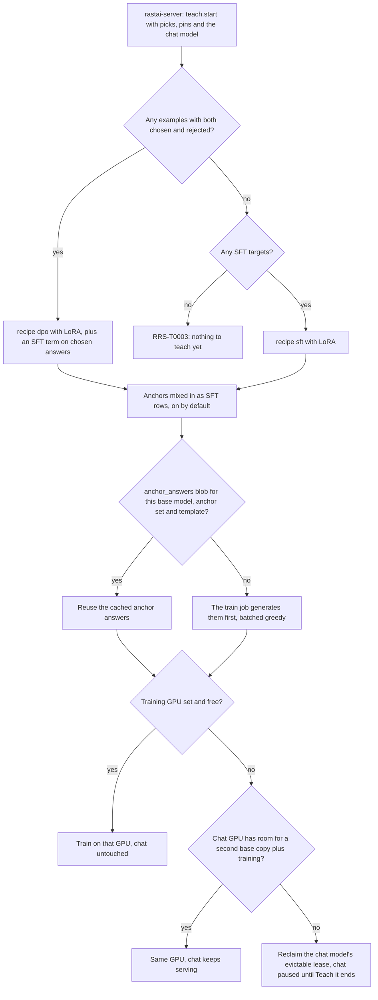

Not obvious:
- **Anchors** are the base model's own answers to a fixed set of unrelated questions (`templates/evals/`, the default anchor set), mixed in at one anchor per taught example (`ANCHORS_PER_EXAMPLE`). In the spike they cut drift on unseen prompts by 83–87% with no loss of the new facts. They are stored as token IDs, never decoded text, so retokenization can't change them.
- **Where anchors are kept.** ADR-0028 makes them a blob (artifact kind `anchor_answers`), keyed by the base model hash, the anchor set hash and the chat template hash, so a run record can name the exact anchors it trained on (`dataset_hashes[]`). Each node also keeps a copy at `cache_folder/anchors/<base_model_hash12>-<anchor_set_hash12>-<template_hash12>.safetensors` (`layout/python.md` 15), so a warm node skips the blob fetch. The spike took 57 s to generate them one at a time; batched greedy generation is faster, and ADR-0028 doesn't count it in the Teach it time. `training.anchors_default` (true, for SFT and for DPO) turns them off; Verify still reports drift.
- **Defaults** (ADR-0028): LoRA rank 16, alpha 32 on every linear projection, float32 masters with bf16 compute, loss on answer tokens only, gradient checkpointing on, 8 epochs.
- **Anchors with DPO** are on by default too (owner decision 16), as an SFT term next to the DPO loss. The spike only measured anchors with SFT, so the DPO case sits behind its own GPU test, `tests/gpu/test_dpo_anchor_drift.py`, which must pass before L2. It reuses the Teach it bar of spike 03b: the taught facts are still learned, and drift on unseen prompts is at least 50% lower with anchors than without. The weight of the SFT term is a recipe setting that test fixes.
- **DPO's reference model** is the same base with the adapter switched off. Reference log-probs for every row are computed once in `preparing` and kept in memory (one number per side per row). A resume recomputes them.
- **"LoRA on the resident base while chat keeps serving" means two processes.** The chat model stays loaded in its `serve_inspectable` job under its evictable lease. Teach it trains in its own `train` job with its own copy of the base weights under a pinned lease. The spike held the same two copies (chat model plus training copy, 4.69 GiB peak, `results/03_teach_it_lora.md`); the second process adds its own CUDA context, a few hundred MB, which `tests/gpu/test_teach_it_budget.py` holds within 10% of the spike's peak. Two processes buy two things:
  - a training OOM or crash can't take chat down;
  - lease classes stay simple: chat is evictable, training is pinned.

  Sharing one base between the two processes through read-only CUDA IPC is on the M5 completion list behind a measurement gate (contracts glossary, "Teach it"). The gate is a measurement on the 5080 with a 4B model: how much VRAM it saves and whether chat speed and training speed hold. Until it passes, the processes keep separate copies.
- **The default model is the First Run model, 1B** (Gemma 3 1B class). Teach it and the offline analyses of its Verify step (model diff, SAE fit check) keep it unless the user picks another model. At 1B the chat copy and the training copy fit together (the spike held both under an 8 GiB cap), so chat rarely pauses.
- **When both don't fit**, the pinned request reclaims the chat model's evictable lease after the 10 s grace (inference-psychology flow 4.6, `RRS-H3004`, info). A chat pause is never silent:
  - the confirm step says "Chat will pause while Teach it trains" before anything starts, when the lease check shows both won't fit;
  - while it lasts, the chat panel shows "Chat paused while Teach it trains";
  - the daemon reloads the chat model when the chain ends, and the banner goes away.

Persisted: durable: the teach dataset document, the `anchor_answers` blob (pinned to its base model hash), `lease.state_changed` events for any reclaim. Node-local and safe to delete: the anchor cache file.

Tests: unit tests for the recipe choice over example mixes; `rastai_train/tests/test_anchors.py` (anchors are token IDs; the second call hits the cache; the mix ratio holds); `tests/gpu/test_dpo_anchor_drift.py` (the DPO case above, before L2); `crates/rastai-node/tests/leases.rs` (a pinned request reclaims an evictable lease) and a daemon test that the evicted chat model is reloaded when the chain ends.

### 7.3 The Teach it chain

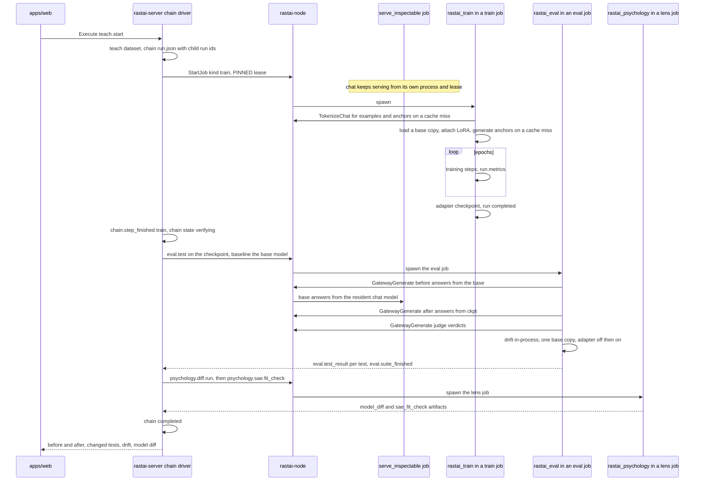

Not obvious:
- **`eval.test` and `psychology.diff.run` are plugin commands.** The chain driver executes them like any client, with the owner's principal; the plugin modules return `follow_up_jobs`, and the daemon creates the child runs with the ids the chain assigned (section 8.1).
- **The Verify suite.** If the user picks none, Teach it writes `evals/teach-<chain run id>.rrseval` with:
  - one judge test per taught row (the reference is the chosen answer);
  - the project's pinned suite;
  - drift on `eval.drift_prompt_set`.

  Taught rows show that the model learned, not that it generalizes. The Basic view says so and invites a few held-out phrasings.
- **No judge configured** (`eval.judge_default` empty), **or a judge that isn't trusted yet** (fewer than `eval.judge_min_labels` hand-labeled examples, section 9.3): judge tests are skipped with `RRS-V1001`, and the verdict rests on drift and the model diff. The Basic view says "label 10 examples to turn the judge on". In the spike, keyword checks missed both a style change and an invented fact.
- **Before and after answers go through the gateway** (`layout/python.md` 9.3), so the template and the token logging are the gateway's. "Before" comes from the base, which is usually the chat model already loaded. "After" comes from `ckpt:<checkpoint_id>`, which the node loads as the base plus the adapter under an evictable lease; the train job has released its memory by then.
- **Drift needs logits,** so it runs in the eval job itself: one base copy with the adapter off, then on (`set_active_adapter`, the spike's `set_lora_enabled`). The `ckpt` model is idle once its answers are in, so when the eval job grows its lease for drift (`ResizeLease`) the node may evict it (inference-psychology flow 4.5). That keeps Verify inside the same 8 GiB cap as training.
- **Use the result:** "Chat with it" runs `model.load` with `ckpt:<checkpoint_id>`.
- **Time (spike, Gemma 3 1B on the 5080 under an 8 GiB cap, the default model):** training took about 10 s for 40 rows with anchors, and chat kept serving at about 70 tok/s. Process starts, the eval job and the diff add seconds. The target is under 3 minutes end to end, and the whole loop under 10 minutes from a cold start (§32, weeks 11–12).
- **No resume for Teach it.** Its runs are seconds long and only checkpoint at the end, so a killed Teach it restarts from scratch.

Failures:

| Failure | User sees | Chat | Persisted |
|---|---|---|---|
| Not enough VRAM for both | "Chat paused while Teach it trains" (info) | paused, reloaded after | lease events |
| No rows | `RRS-T0003` | serving | nothing |
| GPU OOM in the train job | `RRS-H3007`, chain `failed`, fix: shorter max length or a smaller rank | serving (separate process) | chain and train logs |
| kill -9 of the train job | `RRS-J1001`, Teach it again | serving | chain and train logs |
| Eval step errored | the eval code (`RRS-V…`); the adapter is kept and usable | serving | adapter checkpoint |
| Psychology disabled, or no SAEs loaded | diff or fit-check step skipped (info) | serving | chain log |
| Cancel | chain `cancelled`; the running child gets `STOP` (train) or `CANCEL` (eval, lens) | serving | partial results |
| Daemon kill -9 mid-chain | nothing beyond a reconnect | serving | the chain continues from its log |

Persisted: durable: the chain's `run.json` and `events.log`; the train child's folder with `adapter.safetensors` (artifact kind `adapter`); the eval child's result file (artifact kind `eval_result`) and judge transcripts (`judge_transcript`); the `model_diff` and `sae_fit_check` artifacts; lineage replay → pair → dataset → run → checkpoint → diff (§26).

Tests:
- `tests/gpu/test_teach_it_budget.py`: reproduce spike 03 and 03b on Gemma 3 1B under an 8 GiB cap: 40 examples in under 180 s, held-out accuracy at least 80%, drift at least 50% lower with anchors than without, chat at least 60 tok/s while training, peak within 10% of 4.7 GiB.
- `tests/loop/`: the same chain on a tiny random-weight model on CPU, checking event order and artifacts.
- `plugins/evaluation/tests/python/test_invented_fact.py`, the weeks 11–12 exit test: the Verify suite fails a checkpoint that invents a fact which keyword checks pass.
- `tests/crash/`: kill -9 the train job; chat keeps answering and the chain ends `failed` with a Retry.
- Playwright: branch, prefer, Teach it, and the before/after view renders.

---

## 8. The Evaluation plugin: running a suite

Runs on `rastai eval test <suite> --model <model or checkpoint>`, the Evaluation section's Run button, a chain's verify step, or the auto-run handler (section 10). The command is `eval.test`, a plugin command of the first-party plugin `eval`.

### 8.1 `rastai eval test`

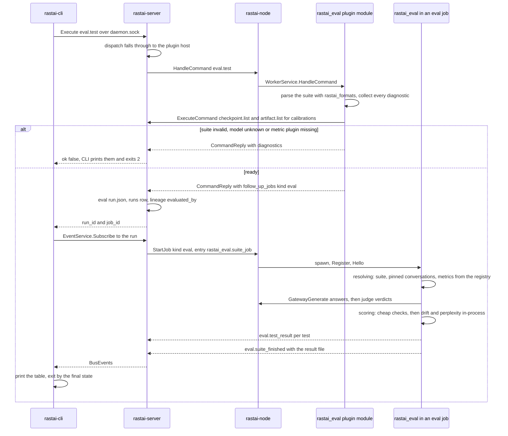

CLI exit codes. ADR-0020 item 4 (accepted) stands, per plan §10 row 35 and M5-E05. `eval.test` maps its own outcomes; the CLI-wide table (`layout/rust-control-plane.md` 9.5) keeps its codes for other verbs:

| Code | For `rastai eval test` |
|---|---|
| 0 | `passed` |
| 1 | `failed`: a test missed its threshold |
| 2 | `errored`, `cancelled` or refused (`ok: false`: invalid suite, unknown model, missing metric plugin). A usage error caught before sending also exits 2 (`EXIT_USAGE`). In every case the suite gave no verdict |
| 3 | `EXIT_DAEMON_UNAVAILABLE`: the daemon can't be reached or started, so the command never ran |
| 4 | `EXIT_NOT_PERMITTED`: `RRS-C1005` (scope `eval` missing), so the command never ran |

`rastai eval test` never exits 5 (`EXIT_ERRORED`). A CI job that must tell `errored` from refused or `cancelled` reads `--json`.

Not obvious:
- **Answers come through the gateway** (`layout/python.md` 9.3), for the model under test and for judges, so templates are the gateway's and every request is logged once (as `gateway.request_logged` in the eval run's log for node gateways, node layout 6.6). A local model that isn't loaded is loaded by the node under an evictable lease, as for `model.load`. An API model (`api:<adapter>/<model>`) goes through the daemon's gateway (`NodeHubService.GatewayGenerate`).
- **Metrics that need logits** (drift, perplexity, `eval.choice_loglikelihood`, reward-model score) run in the eval job itself during `scoring`, through the public facade `rastai.runtime`. For an API model they are skipped with `RRS-V2003`.
- **Drift always runs alongside** when a base model is known (ADR-0020 item 6, `layout/python.md` 9.4), even if the suite didn't ask for it.
- **Generation settings for tests:** greedy, seed 0, `pin_attention_kernel` set (in the spike, fast kernels flipped bf16 near-ties). A rerun on the same hardware gives the same answers.
- **If the CLI dies** the evaluation keeps running and its results are stored. A CLI that loses its stream re-subscribes with `after_bus_sequence`; on `RRS-C0401` it reads the final state with `job.get`.
- **Before and after.** With `baseline_model` (an `EvalTestArgs` field), the job also answers every test with the baseline. It reuses the baseline's stored result for the same suite hash when there is one.
- **Results per checkpoint:** the result file is a blob registered as an `eval_result` artifact with lineage `evaluated_by` from the checkpoint. `eval.result.list --model ckpt:<id>` reads that lineage through `artifact.list`. The plugin keeps no database of its own.

Persisted: durable: the eval run's `run.json` and `events.log` (`run.state_changed`, `eval.test_result`, `eval.suite_finished`, `gateway.request_logged`), which the archive keeps as event records and as `eval_results` rows when configured (M11); the result file (`rastai.eval_result/1`, artifact kind `eval_result`) with every answer, its token IDs, scores, pass flags, judge transcript hashes (`judge_transcript`), the judge agreement rate, generation settings and the hardware fingerprint; lineage `evaluated_by`.

Tests: `plugins/evaluation/tests/`: the CLI exits 0, 1, 2 and 2 for a passing suite, a failing suite, an invalid suite and an unreachable judge, on a tiny CPU model with a scripted gateway; `test_suite_job.py` (state order, `errored` vs `failed`) on the plugin test host (`rastai plugin test`, mock worker); the regression diff of two stored results matches a golden file.

### 8.2 Eval run lifecycle

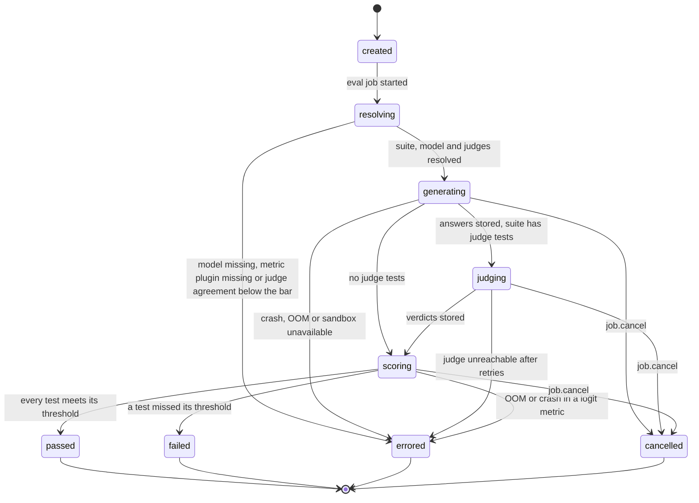

Not obvious:
- **Any errored test makes the suite `errored`.** A suite can't claim a pass when a test couldn't run. Skipped tests (an untrusted judge, section 9.3) are listed in the result; a suite where every test was skipped is `errored`, because nothing was checked.
- **`pass_rule`** in the suite is `all` (default) or `min_fraction` with a value.
- **The eval job holds no model while generating and judging.** Answers and verdicts come through the gateway, so a local judge and the model under test can use the GPU first. The job grows its lease (`ResizeLease`) only in `scoring`, when a metric needs logits, and the node may then evict idle evictable models.

Persisted: each transition is a durable `run.state_changed`; `eval.test_result` per test as it finishes, so a crash keeps the results so far.

Tests: a unit test walks a fake suite through every state, including errored from each phase.

### 8.3 Failures

| Failure | Detected by | User sees | Exit | Persisted |
|---|---|---|---|---|
| Suite file invalid | `rastai_formats` in the plugin module | every diagnostic (`RRS-E…`) with its path | 2 | nothing |
| Suite has no tests | plugin module | `RRS-V0001` | 2 | nothing |
| Model or checkpoint not found | plugin module | `RRS-V0003` | 2 | nothing |
| Generated-text tests with only cheap checks | plugin module (suite validation) | `RRS-V0101` warning: keyword checks miss real regressions (spike); fix button adds a judge or drift | — | warning in the results |
| Metric plugin missing | plugin module | `RRS-V2001`, fix `plugin.suggest` | 2 | nothing |
| API judge under a `local-only` project | plugin module, through `check_data_policy` | `RRS-C1009` | 2 | nothing |
| Scope `eval` missing on the token | daemon | `RRS-C1005` | 4 | journal entry |
| Judge has fewer than `eval.judge_min_labels` hand labels, or none | eval job, resolving | `RRS-V1001` warning; that judge's tests are skipped and counted, their transcripts kept | — | the skipped count in the result |
| Judge agreement below the bar (0.8 on at least 10 labels) | eval job, resolving | `RRS-V1002` with the rate | 2 | the calibration artifact |
| Plugin lacks `gateway.spend` for a paid API | daemon, at `GatewayGenerate` | `RRS-C1005` (permission not granted) | 2 | results so far |
| Judge times out or returns no verdict | eval job | retried once with a format reminder, then the test is errored with `RRS-V1004` | 2 | results so far, transcript kept |
| Model under test fails to load or runs out of memory | node or eval job | `RRS-H3006` (while loading) or `RRS-H3007` (in a step) | 2 | results so far |
| Sandbox engine missing | eval job | `RRS-V2002` | 2 | results so far |
| A sandbox sample times out | container time cap | that sample fails; not an error | — | sample blob |
| Network drop to a remote judge's node or an API | node gateway, after retries | `RRS-G0006` (node unreachable) or `RRS-G2004` (API connection dropped; `RRS-G2002` for a provider error); the test is errored | 2 | results so far |
| kill -9 of the eval job | node | `RRS-J1001`, run `errored`, rerun | 2 | results so far |
| `job.cancel` | eval job | run `cancelled` | 2 | results so far |
| Tests failed | eval job | the table of failures and changes | 1 | full result file |

---

## 9. Evaluation metrics

Runs inside the eval job during `generating`, `judging` and `scoring`. Each metric is a `Metric` found by name in the `rastai_plugin` registry, the same extension point third parties use.

### 9.1 From test to verdict

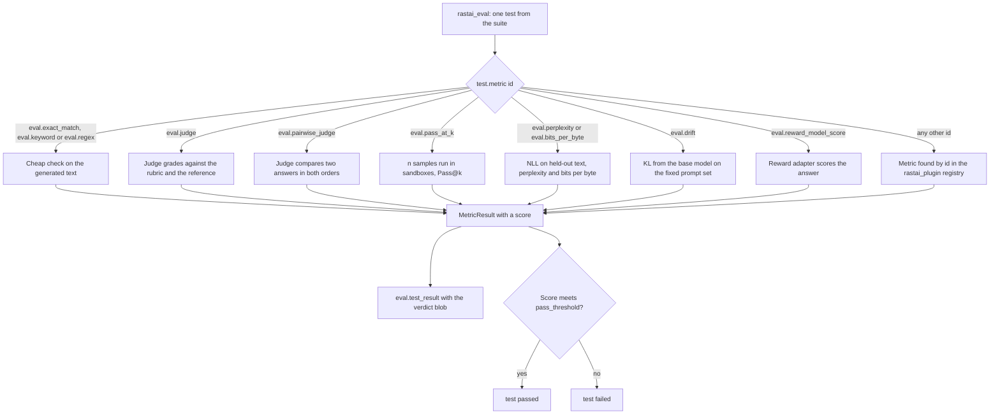

Each test names a registered metric id (`tests[].metric`; the ids are the first-party set in `layout/frontend-and-plugins.md` 15.2). `expectation{kind, value}` carries what the metric compares against:

| Metric id | `expectation.kind`: value | Score | Notes |
|---|---|---|---|
| `eval.exact_match` | `text`: expected text | 1 or 0 after trimming whitespace | cheap |
| `eval.keyword` | `keywords`: a list plus `any` or `all` | fraction found | cheap; never the only check on generated text |
| `eval.regex` | `pattern`: a regex | 1 or 0 | patterns are validated at suite load; answers are capped at 64 KB before matching |
| `eval.judge` | `reference`: reference answer; the rubric is in `judges[]` | 1–10 | threshold per test |
| `eval.pairwise_judge` | `none`: compares the model under test with `baseline_model` | win 1, tie 0.5, loss 0 | both orders, section 9.2 |
| `eval.pass_at_k` | `check_command`: command and image | Pass@k | section 9.4 |
| `eval.perplexity`, `eval.bits_per_byte` | `held_out_text`: a dataset or text ref | perplexity; bits per byte | lower is better |
| `eval.drift` | `none`; uses the suite's `drift{prompt_set_ref, max_kl}` | mean KL(base ‖ model) | passes when at most `max_kl` |
| `eval.reward_model_score` | `none`; settings name the reward checkpoint | scalar reward | needs the reward model's base |

Not obvious:
- **Perplexity** runs in sliding windows of the model's context with a stride of half a window, scoring only the new tokens in each window. **Bits per byte** divides the total negative log-likelihood by the UTF-8 byte count, so models with different tokenizers compare.
- **Drift** follows the spike's `answer_drift`: KL(base ‖ model) at the positions that predict the base model's own greedy answers to the fixed prompt set, up to `DRIFT_ANSWER_TOKEN_LIMIT` (48) tokens each. The base answers are cached per base model hash in `cache_folder/drift/` (`layout/python.md` 15). For a LoRA checkpoint both distributions come from one base copy. For full weights the job runs the base first and keeps its log-probs in host RAM (about 1 GB in bf16 for 40 prompts × 48 tokens × a 262k vocabulary), then loads the checkpoint.
- **Reward-model scores** use the reward model as a second adapter on the same base when the bases match. A reward model on a different base runs as its own job under its own lease and is called through the node-local gateway (ADR-0022 item 4).

The two formulas that are easy to get wrong, with the signatures from `layout/python.md` 9.2:

```python
# plugins/evaluation/python/rastai_eval/metrics/pass_at_k.py
def pass_at_k(sample_count: int, passed_count: int, k: int) -> float:
    """Unbiased Pass@k: 1 - C(n - c, k) / C(n, k), as a running product so nothing overflows."""
    if sample_count - passed_count < k:
        return 1.0
    probability_all_fail = 1.0
    for draw_size in range(sample_count - passed_count + 1, sample_count + 1):
        probability_all_fail *= 1.0 - k / draw_size
    return 1.0 - probability_all_fail


# plugins/evaluation/python/rastai_eval/metrics/perplexity.py
import math


def bits_per_byte(total_negative_log_likelihood_nats: float, byte_count: int) -> float:
    """Perplexity depends on the tokenizer; bits per byte doesn't, so it compares across models."""
    return total_negative_log_likelihood_nats / (math.log(2) * byte_count)
```

Persisted: every `MetricResult` (score, threshold, details) in `eval.test_result` and the result file.

Tests: `test_pass_at_k.py` against brute-force enumeration for all n ≤ 12; `test_perplexity.py`: bits per byte is 8.0 for a model that is uniform over bytes, with byte-level and character-level tokenizations of the same text; `test_drift.py`: drift is 0 for identical models; the cheap checks run over a table of cases; the `RRS-V0101` warning fires on a keyword-only suite.

### 9.2 LLM judge

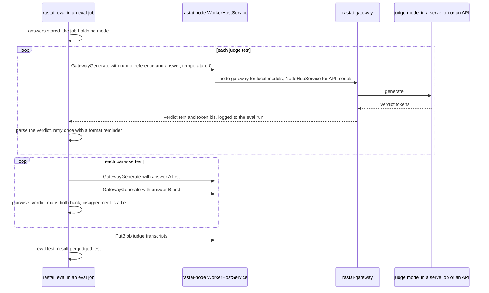

Not obvious:
- **Both orders, always,** for pairwise tests (`JUDGE_BOTH_ORDERS`, `pairwise_verdict(verdict_a_first, verdict_b_first)` returns `a`, `b` or `tie`). A judge that prefers whichever answer comes first produces ties, not a false win.
- **Logged with every result:** the judge's prompt, its verdict, its `model_ref` and model hash, and the rubric hash, as a `judge_transcript` blob.
- **The eval job never loads a judge itself** (`layout/python.md` 9.7). A local judge model is loaded by the node under an evictable lease on first use.
- **API judges** go through the daemon's gateway (`NodeHubService.GatewayGenerate`). That needs the plugin's `gateway.spend` permission (asked at install, `layout/frontend-and-plugins.md` 15.2) and a project data policy other than `local-only`. The egress badge shows while they run.

Persisted: durable: `judge_transcript` blobs referenced from `eval.test_result`. The judge's generations are logged once, by the gateway that ran them: a node gateway's record comes back in `GenerateFinished.gateway_log`, the eval job appends it as `gateway.request_logged`, and the daemon indexes it into `vault.db` `gateway_log` with the run id; an API judge is logged by the daemon gateway directly.

Tests: a fake judge that always prefers the first position makes every pairwise result a tie; a fake judge returning garbage twice gives `RRS-V1004`; a `local-only` project with an API judge is refused with `RRS-C1009` before any request leaves the machine.

### 9.3 Judge calibration

A judge's verdicts count only after it clears the trust bar: at least 0.8 agreement with the user's hand labels on at least 10 labeled examples (owner decision 15; `eval.judge_min_agreement` and `eval.judge_min_labels`, contracts §9.6 and §11.2).

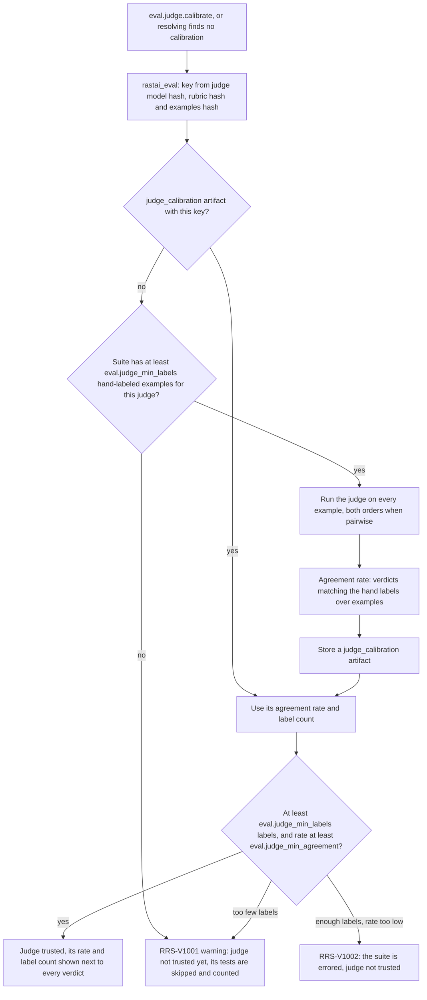

Not obvious:
- **Hand labels live in the suite** (`judges[].calibration{examples[], min_agreement}`), so a suite carries its own proof.
- **The calibration key** changes when the judge model, rubric or examples change, so a stale calibration is never reused. Adding a label changes the examples hash, so it recalibrates.
- **Lookup is a scan** of `judge_calibration` artifacts. There are few, and the plugin needs no database.
- **The bar has two parts, and each fails differently.** Too few labels is a missing proof: `RRS-V1001` (warning). The judge still runs, and its transcripts are kept so the user can read them and label more, but its verdicts don't count toward `passed` or `failed`: those tests are `skipped`, and the result and the Basic view say how many. Enough labels with a rate below the bar is a measured problem: `RRS-V1002` (error), and the suite is `errored`.
- **Settings.** `eval.judge_min_agreement` defaults to 0.8 and `eval.judge_min_labels` to 10. A suite's `min_agreement` can only raise the bar: the effective rate is the larger of the suite's value and `eval.judge_min_agreement`. A lower value is a validation warning and is ignored.
- **A suite with only skipped tests** is `errored` (section 8.2), never a pass.

Persisted: durable: the calibration run's results blob (artifact kind `judge_calibration`) with every verdict, the rate and the label count.

Tests: a fake judge that agrees on 9 of 10 examples passes at 0.8 and fails at 0.95; one that agrees on 9 of 9 is still not trusted (`RRS-V1001`, its tests skipped, transcripts kept); changing one rubric character or adding one label forces recalibration; a suite whose only tests are skipped judge tests ends `errored`; a suite with `min_agreement` 0.5 and a judge at 0.7 agreement still gets `RRS-V1002`.

### 9.4 Pass@k in the sandbox

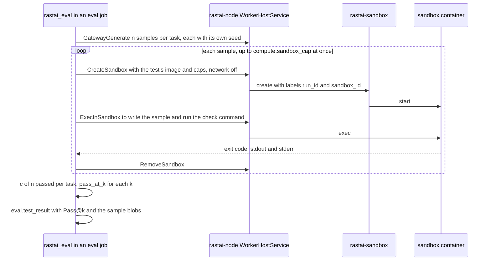

Not obvious:
- **A sample passes when the check command exits 0.** A sample that hits its time cap, crashes or exits non-zero fails. None of these errors the test.
- **Sandboxes never see a Rastai socket** (contracts §3.2). The job's sandbox cap is enforced by the node.
- **Shared with Agent Gym:** `rastai_rl` looks up `eval.pass_at_k` in the registry (plan §10 row 17), so a harness's reward and its eval share one definition (§12).
- **Linux only** in the prototype; elsewhere `eval.pass_at_k` tests are greyed out with `RRS-V2002`.
- **The plugin needs `sandbox.spawn`,** granted at install with its other permissions (`layout/frontend-and-plugins.md` 15.2).

Persisted: durable: each sample's code and output as blobs, `sandbox.state_changed` events, Pass@k in the result.

Tests: `tests/e2e/` (Linux with Podman): a suite with a known-good and a known-bad solution gives Pass@1 of 1 and 0; kill -9 the eval job mid-batch, and the orphan sweep (`sandbox.cleanup`) removes every labeled container.

---

## 10. Auto-run, regression diff, Elo and benchmarks

Auto-run fires on every `checkpoint.saved` when `eval.run_on_new_checkpoint` is on. The diff runs on `eval.result.diff` and at the end of every suite. Elo runs on `eval.elo.fit`. Benchmarks run on `eval.benchmark.import` and `eval.benchmark.run`.

### 10.1 Auto-run on new checkpoints

```mermaid
flowchart TD
  A["checkpoint.saved indexed by rastai-server"] --> B["Plugin host matches the eval plugin's event_handlers"]
  B --> C["Execute eval.checkpoint.evaluate with the eval plugin principal"]
  C --> D{"eval.run_on_new_checkpoint on?"}
  D -->|no| Z["Nothing to do"]
  D -->|yes| E["rastai_eval module reads the run's eval_suite_ids"]
  E --> F{"An eval for the same run and suite still queued?"}
  F -->|yes| G["Cancel it: the newest checkpoint wins"]
  F -->|no| H["follow_up_jobs: one eval job per suite"]
  G --> H
  H --> I["Job waits in queued until the checkpoint fits on a GPU, never evicting chat"]
  I --> J["Suite runs against the checkpoint"]
  J --> K["Changed tests vs the run's previous checkpoint go into eval.suite_finished"]
  K --> L{"A test went from pass to fail?"}
  L -->|yes| M["Regression notice on the run and its dashboard"]
  L -->|no| N["Result shown on the checkpoint row"]
```

Not obvious:
- **Which suites:** `train.start` takes `eval_suite_ids`, which the launch dialog fills with the project's suites. They are stored in `run.json`.
- **Auto-run never evicts chat.** Its jobs set `ResourceRequest.may_reclaim_evictable = false` (an optional bool; unset means true), and the node applies the same flag to the model loads their gateway calls cause, so they wait for free memory instead. Evals the user starts, including a chain's Verify step, may reclaim.
- **Coalescing** keeps a long run from piling up evals: only the newest checkpoint per suite waits in the queue.
- **Handler deliveries** are tracked in `plugin_event_deliveries`. M5 builds only what auto-run and pins need (queue, deliver once, retry on restart); backlog views, per-plugin limits and redelivery tools are L2 (contracts 8.2).

Persisted: as section 8.1, plus lineage `evaluated_by` from each checkpoint.

Tests: a fake run that saves 5 checkpoints while the GPU is busy ends with one eval per suite, on the newest checkpoint; with the setting off, nothing runs.

### 10.2 Regression diff

`eval.result.diff` compares two results of the same suite (by `suite id`). Each test is matched by `test_id` and its content hash:

| Class | Rule |
|---|---|
| regressed | passed before, failed now |
| fixed | failed before, passed now |
| score moved | same status; judge score moved by 2 or more, or Pass@k moved outside its binomial confidence interval |
| definition changed | same `test_id`, different test hash: listed, not compared |
| added / removed | in one result only |

Drift and perplexity deltas are shown beside the tests. The Basic view, "Did it get better?", is this table filtered to regressed and fixed, with before and after answers side by side.

Persisted: nothing new; `diff_results(earlier, later)` computes the diff from two stored result files. `eval.suite_finished` carries the changed tests against the previous checkpoint.

Tests: golden-file tests for every class, including a suite edited between runs.

### 10.3 Elo from pairwise preferences

```mermaid
flowchart TD
  A["eval.elo.fit over a set of models"] --> B["rastai_eval: collect pairs from preference datasets, including evals/votes.rrsdata, and from pairwise verdicts"]
  B --> C["Keep pairs whose two sides are both in the set"]
  C --> D{"Comparison graph connected?"}
  D -->|no| D1["RRS-V2004 warning: each connected group gets its own scale"]
  D -->|yes| E["Fit Bradley-Terry strengths, a tie counts half to each side"]
  D1 --> E
  E --> F["Elo: 400 times log10 of strength, shifted so the mean is 1000"]
  F --> G["Bootstrap: resample pairs 1000 times with a fixed seed, refit"]
  G --> H["2.5 and 97.5 percentiles as the interval"]
  H --> I["elo_fit artifact with ratings, intervals and pair counts"]
```

With the constants and signatures from `layout/python.md` 9.2:

```python
# plugins/evaluation/python/rastai_eval/elo.py
ELO_SCALE = 400.0
ELO_ANCHOR_RATING = 1000.0   # the mean rating; only differences carry meaning
BOOTSTRAP_ROUNDS = 1000


@dataclass(frozen=True)
class Comparison:
    first_model_id: str
    second_model_id: str
    first_score: float  # 1 win, 0.5 tie, 0 loss


def fit_bradley_terry(comparisons: list[Comparison], iteration_count: int = 200) -> dict[str, float]:
    """Strengths by minorization-maximization updates: each strength = wins / sum over its comparisons of
    1 / (own + opponent strength). One virtual tie against an average opponent keeps an unbeaten model
    finite. Only win counts matter, so the order of comparisons doesn't."""


def elo_with_intervals(comparisons: list[Comparison], seed: int) -> list[EloRating]:
    """ELO_SCALE * log10(strength), shifted so the mean is ELO_ANCHOR_RATING, with bootstrap percentiles."""
```

Not obvious:
- **Sources:** branch-pick rows in preference datasets (section 7.1) whose `chosen.model_ref` and `rejected.model_ref` differ, blind A/B votes (rows of `evals/votes.rrsdata` with `source` `blind_vote`), and pairwise judge verdicts in stored results. The votes file is read like any preference dataset, so no Elo code knows about votes.
- **The virtual tie** is a prior, not data: it's counted once per model, and the result lists it with the pair counts, so a model with three comparisons doesn't look as certain as one with three hundred. The bootstrap interval shows the rest of that uncertainty.

Persisted: durable: the `elo_fit` artifact. Votes stay in `evals/votes.rrsdata`; branch picks stay in their datasets. An undone vote drops out of the next fit, because the fit reads the documents as they are.

Tests: `test_elo.py`: synthetic players with known strengths recover their order and ratings within the bootstrap interval; shuffling the comparison order gives identical ratings; the seeded bootstrap repeats; a disconnected set gives `RRS-V2004`; a vote row in a `votes.rrsdata` fixture counts as one comparison, and undoing it removes it from the next fit.

### 10.4 Benchmarks

Runs when the user imports a benchmark (`eval.benchmark.import`) and compares models on it (`eval.benchmark.run`). Benchmark tasks are data, never code (§10).

```mermaid
flowchart TD
  A["eval.benchmark.import with an lm-eval-harness task folder"] --> B["rastai_eval module: read the task files with the in-house YAML-subset reader"]
  B --> C{"Only supported YAML, fields and template features?"}
  C -->|no| X["RRS-V3001 names the task and the feature, that task is skipped"]
  C -->|yes| D["Task's dataset imported through dataset.import, pinned by revision"]
  D --> E["Prompt templates filled by field substitution only"]
  E --> F["A benchmark .rrseval: one test per row, metric from the task"]
  F --> G["eval.benchmark.run: eval.test per model or checkpoint"]
  G --> H["Results side by side, same suite hash for every model"]
```

Not obvious:
- **A benchmark is just a generated suite.** It runs through the same `eval.test` path (section 8), so results are stored per checkpoint and diff like any suite.
- **Task files are data** (`layout/python.md` 9.5). `benchmarks/yaml_subset.py` reads mappings, lists, scalars, quoted and block strings; YAML anchors and tags are rejected. `!function` entries (Python code references) are rejected and never run. Each is `RRS-V3001` for that task; the rest of the folder imports.
- **Templates support `{{field}}` substitution only** (`benchmarks/prompt_fill.py`). Jinja blocks (``) and filters are rejected with `RRS-V3001`, so an unsupported task fails visibly instead of running wrong. The filled prompt then goes through the gateway like any test input, so the model's own chat template still comes from the gateway.
- **Task metrics map onto metric ids:** multiple-choice log-likelihood tasks use `eval.choice_loglikelihood` (first-party metric, scored from logits in the eval job: the choice is the answer whose `TokenizeChat` target tokens have the highest summed log-probability); exact-match tasks use `eval.exact_match` or `eval.regex`.

Persisted: durable: the generated `.rrseval` in the project's `evals/`, the task dataset's `.rrsdata`, and each model's eval results as in section 8.1.

Tests: `test_yaml_subset.py` and `test_lm_eval_import.py` over `fixtures/benchmarks/`: a task folder with one multiple-choice and one exact-match task imports to a golden suite; `!function` and a Jinja filter each give `RRS-V3001`; two models run on the same benchmark share one suite hash; seeded mutation tests marked `fuzz` (contracts 12.5) feed truncated and flipped task files to `yaml_subset.py`, which only ever returns data or `RRS-V3001`.

---

## 11. The RLHF chain

Runs on `rlhf.start` (the UI shows it as one chain). Each step is also a recipe on its own: `reward_model`, `ppo`, and `grpo` with its GSPO option.

### 11.1 The chain

```mermaid
flowchart LR
  P["Preference pairs: .rrsdata with task dpo"] --> RM["Step 1, rastai_train: reward_model run, LoRA plus scalar head"]
  RM --> GATE{"Held-out pairwise accuracy meets the gate?"}
  GATE -->|no| F["Chain failed, RRS-T0201, fix reruns with accept_weak_reward_model"]
  GATE -->|yes| PPO["Step 2, rastai_train: ppo run, policy LoRA, value head, reward adapter"]
  PPO --> V["Step 3, rastai_eval: eval.test on the policy checkpoint with eval.reward_model_score and drift"]
  V --> DF["Step 4, rastai_psychology: model diff, optional"]
```

Not obvious:
- **Inputs** (`RlhfStartArgs`): the base `model_ref`, a preference dataset or an existing `reward_model_checkpoint_id`, a prompt dataset (default: the prompts of the preference pairs), an optional reward-function plugin instead of a reward model, PPO settings, and `accept_weak_reward_model`.
- **The gate** is `training.rlhf_reward_model_min_accuracy` (default 0.65) on the reward model's held-out pairs. The fix button reruns `rlhf.start` with the trained reward model's checkpoint and `accept_weak_reward_model`, so nothing is retrained.

- **The chain's state** follows section 6: `running` through the reward-model and PPO steps, `verifying` through eval and diff (ADR-0021).

Persisted: the chain's `run.json` and log; each step's run as usual; the reward model checkpoint stays usable alone (best-of-n reranking, the `eval.reward_model_score` metric).

Tests: `next_chain_action` cases for the gate; `tests/loop/`: the whole chain on a tiny random-weight model on CPU.

### 11.2 Reward model

- **Model:** the base with a LoRA plus a scalar head (`hidden_size → 1`, float32) on the final hidden state of the last non-padding token.
- **Loss (Bradley-Terry):**

```python
# python/rastai_train/recipes/reward_model.py
def reward_model_loss(chosen_rewards: torch.Tensor, rejected_rewards: torch.Tensor) -> torch.Tensor:
    """The chance that chosen beats rejected is sigmoid(r_chosen - r_rejected); maximize it."""
    return -torch.nn.functional.logsigmoid(chosen_rewards - rejected_rewards).mean()
```

- **Validation metric:** `validation.pairwise_accuracy`, the gate's input.
- **Checkpoint:** `adapter.safetensors` holds the LoRA tensors and `reward_head.weight` and `reward_head.bias`.

Tests: `test_recipe_reward_model.py`: on synthetic pairs where the chosen answer always contains a marker word, accuracy passes 0.95 within a few hundred steps on CPU.

### 11.3 One PPO iteration on one base model

The PPO step runs in one `train` job: `rastai_rl.run_rl_training` drives rollouts, rewards and advantages, and the `ppo` recipe in `rastai_train` takes the update (`layout/python.md` 6.3, ADR-0022).

```mermaid
sequenceDiagram
  participant R as rastai_rl run loop in the train job
  participant G as rastai-gateway on the node
  participant PS as PolicyServer on the model thread
  participant P as rastai_train ppo recipe
  participant M as rastai_models, one base in VRAM
  participant EV as events.log
  loop each iteration
    R->>G: GatewayGenerate per prompt, model ref job:JOB_ID
    G->>PS: WorkerService.Generate on this same job
    PS->>M: policy adapter on, static decode step
    PS-->>R: response token ids and logprobs, through the gateway
    R->>EV: gateway.request_logged from GenerateFinished.gateway_log
    R->>M: reward adapter on, scalar head scores
    R->>M: every adapter off, reference logprobs
    R->>M: policy adapter on, old logprobs and value head values
    R->>R: per-token reward and GAE advantages and returns
    R->>P: RolloutBatch for the update
    loop ppo_epochs over minibatches
      P->>M: policy forward, clipped ratio loss plus value loss
      P->>P: optimizer_step on the policy LoRA and the value head
    end
    P->>EV: run.metrics reward, kl, entropy, clip fraction, value loss
    opt checkpoint due
      R->>EV: checkpoint at the iteration boundary
    end
  end
```

Not obvious:
- **One base, four roles** (ADR-0022). The frozen base sits in VRAM once. LoRA layers hold named adapters, and one call picks the active one:

```python
# python/rastai_models/lora.py
def set_active_adapter(model: torch.nn.Module, adapter_name: str | None) -> None:
    """Turn on one named LoRA adapter on every graph node that has it. None means base weights only (the reference)."""
```

  The policy is the `policy` adapter. The reference is every adapter off, run under `torch.no_grad()`. The value head is a small head on the policy pass's final hidden state, so it shares the policy's backbone. The reward model is the `reward` adapter plus its scalar head. PPO then fits where LoRA fits (§10). A reward model trained on a different base can't share VRAM: it runs as its own job under its own lease and is called through the node-local gateway, and the plan shows the extra memory (`RRS-T0202`, warning).
- **Rollouts go through the gateway loop-back** (`layout/python.md` 6.3). The job serves its own policy as model ref `job:<job_id>` through `PolicyServer`, on the same model thread, so there is no second copy of the model. The node gateway renders the chat template and returns its log record in `GenerateFinished.gateway_log`; the job appends it as a durable `gateway.request_logged` event, and the daemon indexes it into `vault.db` `gateway_log` with the run id (node layout 6.6). So "rollouts go through the gateway and capture token IDs" (§12) holds, and the job stays the one writer of its log. The captured CUDA graph stays valid across updates because the optimizer updates the LoRA weights in place. At L1 policy requests decode one at a time; batching a prompt batch is the L2 step.
- **Old logprobs are recomputed** with a forward pass, not taken from decode: decode runs the static bf16 step, and its numbers can differ slightly from a training forward. The ratio must compare like with like.
- **Per-token reward** is −β × (policy logprob − reference logprob) at every response token, plus the reward-model score at the last token. Advantages are whitened per batch.
- **Starting defaults** (to tune, not measured): KL coefficient β 0.05, γ 1.0, GAE λ 0.95, ratio clip 0.2, value clip 0.2, 2 PPO epochs per iteration.
- **Reward hacking guard:** mean KL above `max_kl` for 3 iterations in a row stops the run with a checkpoint and `RRS-T3002`.
- **Resume:** checkpoints are written only at iteration boundaries, so there is never a half-used rollout buffer to save. They hold the policy adapter and the value head (`adapter.safetensors`), never a second copy of the base (ADR-0022 item 6). `recipe_state` holds the KL coefficient (when adaptive), the reward normalization statistics and the iteration number.
- **A reward-function plugin** instead of a reward model is a `RewardFunction` (a base class in `rastai_plugin`) found in the registry; `rastai_rl/rewards.py` calls it on the decoded response.

Failures: too few pairs (`RRS-T0003`); reward source plugin missing (`RRS-T0002`, fix `plugin.suggest`); KL blow-up (`RRS-T3002`); non-finite values (`RRS-T3001`); GPU OOM (`RRS-H3007`, fix: smaller rollout batch or shorter responses); node gateway unreachable (retries, then a checkpoint and exit 1 with `RRS-G0006`, `layout/python.md` 6.3); preemption and kill -9 as in section 5.

Persisted: durable: `run.metrics` per iteration, a `gateway.request_logged` event for every rollout (indexed into `vault.db` `gateway_log`), rollout trace blobs (`rollout_trace`), checkpoints (policy adapter, value head, optimizer, RNG, prompt position, `recipe_state`).

Tests: `rastai_rl/tests/test_advantages.py`: GAE against a hand-computed 5-step example; `test_recipe_ppo.py`: KL = 0 at init, and with β very large the policy stays at the reference; `test_policy_server.py`: requests from several threads are served in order on one thread; resume parity across an iteration boundary (section 5.2); `tests/gpu/`: PPO on Gemma 3 1B peaks within 1.5× the memory of plain LoRA SFT at the same batch.

### 11.4 GRPO and its GSPO option

```mermaid
flowchart TD
  A["rastai_rl single_turn: prompt batch"] --> B["G samples per prompt through the gateway loop-back, policy adapter on"]
  B --> C["Reward per sample from a reward function, a metric or the reward adapter"]
  C --> D["Group advantage: reward minus the group mean, divided by the group std plus epsilon"]
  D --> Z{"Group std is zero?"}
  Z -->|yes| SK["Advantages all zero: no learning signal, the group adds nothing"]
  Z -->|no| E{"sequence_level_ratio setting"}
  E -->|"false, plain GRPO"| F["rastai_train grpo recipe: importance ratio and clipping per token"]
  E -->|"true, GSPO"| G["Ratio per sequence: exp of the mean token log ratio, clipped once per sequence"]
  F --> H["Policy loss plus KL to the reference, which is adapters off"]
  G --> H
  H --> I["optimizer_step on the policy adapter"]
  M["Policy has moe graph nodes"] -.->|"recipe default"| G
```

Not obvious:
- **GSPO** is `grpo.py` with `sequence_level_ratio = true` (`layout/python.md` 5.3): ratio = exp(mean over the sequence's tokens of log π_new − log π_old), clipped once per sequence. A geometric mean moves far less than single-token ratios, so its clip range is far narrower (the GSPO paper uses about 3e-4 and 4e-4). It's the default for MoE policies, where per-token ratios make RL unstable (§10, ADR-0021).
- **A group of identical rewards** gives zero advantages, not NaN (`GROUP_ADVANTAGE_EPSILON`), and contributes no gradient.
- **Agent Gym** uses the same recipe with agent rollouts and sandboxes; that flow is in `designer-gym-remote.md`.

Persisted: as PPO, without the value head.

Tests: `rastai_rl/tests/test_advantages.py` (identical rewards give zeros); `test_recipe_grpo.py`: on a toy reward (answer length), both ratio levels raise the reward, and the sequence ratio matches a hand computation.

---

## 12. Model diff and the SAE fit check

Runs as the optional last steps of the Teach it and RLHF chains, or when the user runs `psychology.diff.run` or `psychology.sae.fit_check`. Both are Psychology plugin commands that run as `lens` jobs.

### 12.1 Model diff

```mermaid
sequenceDiagram
  participant D as rastai-server
  participant PSY as rastai_psychology plugin module
  participant L as rastai_psychology in a lens job
  participant M as base model plus adapter
  D->>PSY: psychology.diff.run with base, checkpoint and probe set
  PSY-->>D: follow_up_jobs kind lens
  D->>L: StartJob through the node
  L->>M: load the base once, attach the adapter, load the base's SAEs
  loop each probe prompt, adapter off then on
    L->>M: forward with readouts at SAE and lens layers
    M-->>L: feature activations, lens distributions, router choices
  end
  L->>L: firing frequency per feature, base vs tuned
  L->>L: features that fire on the training rows count as expected
  L->>L: logit-lens KL per layer, routing shift per MoE layer
  L->>D: ExecuteCommand eval.result.diff for eval deltas
  L-->>D: model_diff artifact, lineage diff_of
```

Not obvious:
- **Who owns what** (`layout/python.md` §14 item 1): the plugin module owns the command and the `lens` job; the math (feature frequencies, lens shifts, routing shifts, the fit check) is in `rastai_lens` (`model_diff.py`, `sae_fit_check.py`), reached through the public facade `rastai.lens`.
- **The probe set** defaults to the drift prompt set plus a seeded sample of the training rows.
- **"Unexpected" changes** are flagged by a plain rule: a feature whose firing frequency changed by at least 2× (and fires on at least 0.1% of tokens) but never fired on the training rows. These are the side effects worth a look.
- **Routing shift** (MoE only): Jensen-Shannon divergence between base and tuned expert-usage distributions per layer, plus experts that became dead or overloaded.
- **No SAEs loaded:** the diff runs without feature frequencies and says so (`RRS-L4001`, info).
- **Eval deltas** come from the Evaluation plugin through a command, never an import. The Psychology plugin's manifest needs `commands:[eval]` for that call; without it, or with Evaluation disabled, the diff leaves the eval section empty and says why.

Persisted: durable: the `model_diff` artifact (`rastai.model_diff/1`), lineage `diff_of`.

Tests: a diff of a model against itself has no flagged features and zero KL everywhere; on the spike's facts-only Teach it adapter, the style change shows up as flagged features or lens shifts.

### 12.2 SAE fit check and the SAE fine-tuning offer

```mermaid
flowchart TD
  A["psychology.sae.fit_check on base and checkpoint"] --> B["rastai_psychology lens job: run the probe set through base and tuned model"]
  B --> C["Per SAE: fraction of variance unexplained, FVU, for both"]
  C --> D["Per SAE: loss increase when the SAE reconstruction is spliced in"]
  D --> E{"Tuned FVU minus base FVU above the limit?"}
  E -->|no| OK["Labels stay current"]
  E -->|yes| ST["Labels shown as stale, RRS-L2003 warning"]
  ST --> OF["Offer: fine-tune these SAEs, with a time estimate"]
  OF -->|accepted| TR["train.start recipe sae, warm start from the base SAE weights"]
  TR --> RE["Fit check again on the new SAEs"]
  RE --> LB["Labels carried by feature index, moved features flagged for review"]
```

Not obvious:
- **The limit is relative to the base,** because base FVU already varies from 3% to 24% across layers for Gemma Scope 2 (spike). The default is `psychology.sae_fit_max_fvu_increase` = 0.05.
- **SAE fine-tuning** trains on activations of the tuned model (training rows plus general text). It keeps the dictionary size and starts from the base SAE weights, so feature indices stay aligned and labels can carry over. A feature whose decoder direction moved below 0.7 cosine similarity to its base direction is flagged "label needs review", with fresh top-activating examples.
- **New SAEs are registered for the tuned model's hash.** Psychology loads them whenever that checkpoint is loaded.

Persisted: durable: the `sae_fit_check` artifact (`rastai.sae_fit_check/1`); on fine-tuning, a `train` run with recipe `sae` whose checkpoint holds the SAE weights as safetensors, registered as an artifact of kind `sae` for the tuned model's hash.

Tests: the base checked against itself is never stale; a checkpoint with a large random weight perturbation is stale; after an SAE fine-tune on that checkpoint, the fit check passes again.

---

## 13. Export

Runs on `checkpoint.export` (GGUF, safetensors, Ollama Modelfile) and `checkpoint.push` (HF Hub). Both are training-scope job commands on a checkpoint. Both start an `export` job (`rastai_train.export_checkpoint`, `layout/python.md` 7.4); for a push the job only prepares the folder, and the node uploads it.

### 13.1 Export and push

```mermaid
sequenceDiagram
  participant UI as apps/web
  participant D as rastai-server
  participant N as rastai-node
  participant X as rastai_train in an export job
  participant LS as llama-server
  participant HF as Hugging Face Hub
  UI->>D: Execute checkpoint.export, format gguf
  D->>D: license carry-through check, provenance fields from run.json
  D->>N: StartJob kind export on the checkpoint's home node
  N->>X: spawn
  X->>X: merge the LoRA into a base copy in float32, cast to the target dtype
  X->>X: write merged safetensors with provenance in __metadata__
  X->>X: GGUF: rastai_models gguf_writer plus the rastai_formats byte encoder
  X-->>D: artifact.created kind gguf
  X->>N: GatewayGenerate greedy on fixed prompts, model ref blob GGUF hash, runtime FAST
  N->>LS: load the GGUF, tokenizer parity probe at warm-up
  LS-->>N: greedy tokens
  N-->>X: tokens
  X->>X: compare with the merged model run in-process
  X-->>D: export check result, run completed, lineage exported_as
  opt checkpoint.push
    D->>N: StartJob kind transfer for the prepared folder
    N->>D: GetSecret purpose hf_upload
    D-->>N: short-lived HF token
    N->>HF: create the repo private, upload, skip files already present
    N-->>D: transfer.finished with the commit id
  end
```

Formats:

| Format | Contents | Writer | Check |
|---|---|---|---|
| safetensors, merged | `model-0000N-of-0000M.safetensors` (5 GB shards) + index, `config.json`, tokenizer files, `README.md`, license files | in-house Python writer (`rastai_models/io`) | strict reader; logits of merged weights match adapter-on logits within tolerance (`test_export.py`) |
| safetensors, adapter | PEFT layout: `adapter_model.safetensors` + `adapter_config.json` | in-house writer plus the PEFT name map | reload in Rastai; names round-trip |
| GGUF | `model.gguf` in F32, F16, BF16 or Q8_0 | `rastai_models/io/gguf_writer.py` (tensor side) + the `rastai-formats` byte encoder through the wheel | llama-server parity probe and greedy tokens |
| GGUF, K-quants (Q4_K_M and friends) | `model-<type>.gguf` | the pinned llama.cpp build's `llama-quantize`, run by the node from the F16 GGUF | greedy tokens, reported not gated |
| Ollama | the GGUF plus `Modelfile` (`FROM`, `TEMPLATE` when known, `PARAMETER stop`, sampling defaults, `LICENSE`) | `rastai_train/export.py` + a per-family template table | the GGUF check |
| HF Hub push | any of the above + model card + `rastai/run.json` | `rastai-node` `hf_upload.rs` | file hashes after upload |

Not obvious:
- **One GGUF byte encoder** (`layout/python.md` §14 item 2). `rastai-formats` owns the byte encoding and is called through the `rastai_formats` wheel; `rastai_models/io/gguf_writer.py` does the tensor side (names, dtypes, merged weights, metadata, the vocabulary read from `tokenizer.json`).
- **Tensor names and tokenizer keys are per family.** Each family in `rastai_models/families/` carries its GGUF name map and architecture keys next to its HF map. The writer builds the `tokenizer.ggml.*` keys and `tokenizer.chat_template` from the tokenizer files. A family without a map, or a design with opaque nodes, fails with `RRS-T4001`.
- **K-quants** aren't in the in-house writer. The node runs `llama-quantize` from the same pinned llama.cpp build as `llama-server` (a §27 engine process, same SHA-256 check; `layout/python.md` 5.3). In-house K-quants come later.
- **The export check** loads the GGUF in a managed `llama-server` through the ordinary Fast-runtime path (model ref `blob:<hash>`, evictable lease) and compares (spike experiment 04):
  - **tokens:** the node's tokenizer parity probe runs at every llama-server warm-up (`check_tokenizer_parity`, node layout 7.8): probe strings from the 162-case corpus are encoded by the gateway and by llama-server's `/tokenize`. A mismatch fails the load with `RRS-G1004`, which proves the GGUF's tokenizer metadata is wrong;
  - **greedy tokens** on fixed prompts against the merged model run in-process on the Inspectable runtime: F16 and BF16 must match token for token. Q8_0 and K-quants are reported, not gated: the check shows how many tokens match before the first divergence, as the spike did for Q4_K_M (3–9 tokens).

  A mismatch keeps the export but marks it `RRS-T4003`.
- **QLoRA merges** dequantize the 4-bit base to bf16 first. The merged model differs slightly from what was trained (training saw the quantized base), so its check uses a looser tolerance and says so.
- **Ollama templates.** Ollama uses Go templates, not Jinja. Families with a known template get a `TEMPLATE` line from the table. Others get none, and Ollama falls back to the GGUF's `tokenizer.chat_template`; that gives `RRS-T4006` (warning), because the fallback only works for templates Ollama recognizes.
- **Push** prepares the folder in the `export` job, then the node uploads it as a node-native `transfer` job from wherever the files are (full checkpoints stay remote; §22). The HF token comes from `NodeHubService.GetSecret` (purpose `hf_upload`) for this job only and is never written down. Upload retries per file. Files whose SHA-256 the Hub already has are skipped, so a retry after a network drop resumes at file granularity. Repos are created private unless the user says otherwise. The egress badge shows during upload.

Provenance (§13), with the keys from `layout/python.md` 15:

| Where | Keys |
|---|---|
| safetensors `__metadata__` | `format` (`pt`), `rastai.created_with`, `rastai.run_id`, `rastai.recipe`, `rastai.derived_from` (base model and dataset ids with their hashes), `rastai.licenses` |
| GGUF | the same `rastai.*` keys, beside the standard `general.name`, `general.license`, `general.base_model.count`, `general.base_model.0.name`, `general.base_model.0.repo_url` |
| Model card (`README.md`, `rastai_train/model_card.py`) | "Made with Rastai, open recipe", the recipe and settings, base model, datasets with their licenses, the checkpoint's eval results |
| HF push | adds `rastai/run.json`, so `rastai rerun` works from the repo |

Persisted: durable: export files under the run's `outputs/`, registered as blobs (artifact kinds `checkpoint_export` and `gguf`, lineage `exported_as`); the export check result in the export run's `events.log`; `transfer.finished` with the Hub commit id and a `transfers` row. The llama-server for the check holds an evictable lease and unloads when idle.

Tests: `rastai_train/tests/test_export.py` (merged weights give the adapter-on logits; provenance keys present); `tests/gpu/`: Gemma 3 1B plus a Teach it adapter exported to F16 GGUF generates the same tokens in llama-server as the Inspectable runtime (spike 04, plan M5-E13); a GGUF with a deliberately wrong merges table fails the load with `RRS-G1004` and the export is marked `RRS-T4003`; `crates/rastai-node/tests/hf_upload.rs`: a push to a local fake Hub, cut mid-upload, resumes without re-sending finished files, and a 403 is refused with `RRS-T4004`.

### 13.2 License carry-through

```mermaid
flowchart TD
  A["checkpoint.export or checkpoint.push"] --> B["rastai-server: the base model's license from the models table"]
  B --> C["Each dataset's license from its .rrsdata header, via run.json"]
  C --> D["Output license field is the base model's license, never relicensed"]
  D --> E{"A dataset license is non-commercial, share-alike or unknown?"}
  E -->|no| G["Model card lists every input license"]
  E -->|yes| W["RRS-T4002 warning names the datasets"]
  W --> H{"Pushing to HF Hub?"}
  H -->|no| G
  H -->|yes| I{"confirm_license set by the user?"}
  I -->|no| X["Push refused until confirmed"]
  I -->|yes| G
  G --> J["The base repo's license and notice files are copied into the export"]
```

Rastai never decides license compatibility for the user; it carries every license through, warns, and asks before publishing. A local export is never blocked.

Persisted: the license field and every input license in the export's metadata (`rastai.licenses`) and model card; the user's `confirm_license` in the `command_journal` entry of the push.

Tests: one unit test per rule: permissive base and datasets; a non-commercial dataset (warning, push refused without confirmation, allowed with it); an unknown dataset license; a gated base whose notice files are copied.

### 13.3 Failures

| Failure | User sees | Persisted |
|---|---|---|
| No GGUF map for the family, or opaque nodes | `RRS-T4001` | nothing |
| License needs confirmation before push | `RRS-T4002` | export kept; push not started |
| Export check mismatch | `RRS-T4003` with the first differing token | export kept, marked |
| HF token can't write the repo | `RRS-T4004`, fix `hf.login` | files on disk |
| Network drop during push | retries, then `RRS-T4005`; a retry skips uploaded files | `transfers` row |
| Exported GGUF's tokenizer disagrees with the gateway | `RRS-G1004` at load, then `RRS-T4003` on the export | export kept, marked |
| Disk too full to start | `RRS-S3001` with bytes needed (platform flow 8.1 runs before `checkpoint.export`) | nothing |
| Disk full mid-write | `RRS-S3002` | `.partial` export folder removed |
| kill -9 of the export job | `RRS-J1001`, Retry | nothing registered; the partial output folder is removed by GC |

Tests: `tests/crash/`: kill -9 the export job mid-write; no `checkpoint_export` or `gguf` artifact is registered and a retry produces the same file hashes.

---

## 14. The runs table and log import

The runs table is the `runs` index plus `run.list`, `run.get`, `run.compare`, `run.tag`. It fills itself from event logs as runs happen (section 4.1). Log import runs on `run.import_logs`.

### 14.1 Importing W&B, TensorBoard and Trackio logs

```mermaid
sequenceDiagram
  participant UI as apps/web
  participant D as rastai-server
  participant N as rastai-node
  participant W as rastai_data in a data_import job
  UI->>D: Execute run.import_logs with the source kind and a folder
  D->>N: StartJob kind data_import, mode run_logs
  N->>W: spawn
  W->>W: find source runs: wandb run folders, tfevents files, trackio databases
  loop each source run
    W->>W: read records with the in-house reader
    W->>W: map tags to metric names with steps and wall times
    W->>W: write the metrics and config blobs
    W-->>D: run.imported with the source id and blobs
    D->>D: imported run row, run_metrics from the blob, parent_run_id
  end
  W-->>D: run.state_changed completed with counts
  D-->>UI: imported runs appear in the runs table
```

| Source | Files | Reader |
|---|---|---|
| TensorBoard | `events.out.tfevents.*` | in-house TFRecord reader (length, masked CRC32C, data, CRC) + generated code from a vendored subset of TensorBoard's `event.proto` and `summary.proto`. Scalars from `simple_value` and scalar tensors; images and histograms are counted and skipped |
| W&B | `wandb/run-*/run-*.wandb` | in-house reader for its record log (32 KiB blocks, CRC32C per record) + a vendored subset of W&B's record protobuf. History, config and summary records; media skipped. No network, no API key |
| Trackio | its local SQLite files | Python's built-in `sqlite3`; the schema is checked against the Trackio version we test |
| `rastai_spool` | `./rastai-runs/<run_id>.jsonl` | the SDK's own offline spool: `rastai.log()` writes it when no daemon is reachable (`layout/python.md` 15). With a daemon, a notebook run goes straight in through `run.external.start`, `run.external.log` and `run.external.finish` |

Not obvious:
- **An imported run is an ordinary run** of kind `imported`, with `parent_run_id` pointing at the import run and a `source{kind, location, original_run_id}` field in its record. It overlays and diffs like a native run.
- **Rebuildable:** an imported run's rows come from the import run's `run.imported` events and blobs, so `rastai storage rebuild-index` restores it. With an archive configured (M11), the same command also pulls pruned runs back from the archive (ADR-0035 amends ADR-0002 decision 7).
- **Idempotent:** the source id is a hash of the source path and the original run id. Importing the same folder twice adds nothing.
- **CRC32C** is a small in-house table; Python's `zlib` only has CRC-32.
- **These formats are internal to their tools.** Versions we haven't tested fail with `RRS-D4001` naming the version, instead of guessing.

**`run.compare`:** a config diff (JSON diff of the run records' recipe settings and job specs, or of imported configs) and a metric overlay aligned by step, samples seen or wall time. The daemon downsamples each series to 2,000 points with min/max buckets, so spikes stay visible.

**`run.rerun`:** reads `run.json`, installs the recorded environment lock if missing (`system.env.install`), refuses with `RRS-T0002` when a plugin version is missing, re-derives the snapshot from the sources if its blob was collected (a different hash gives `RRS-D3003`), downloads the recorded model revision, then calls `train.start` with the recorded arguments and seed and `parent_run_id` set. On the same hardware fingerprint in deterministic mode the result matches bit for bit; otherwise within the stated tolerance (§26).

**Sweeps:** `sweep.start` is a chain (section 6) with one child `train` run per trial. Grid or seeded random sampling over declared settings; at most as many trials run at once as there are free GPUs that fit the plan; children get the sweep id as a tag.

Failures: folder unreadable (`RRS-D3001`); format version untested (`RRS-D4001`); a corrupt record (`RRS-D4002`: that source run is skipped and counted, the rest import); kill -9 (`RRS-J1001`; runs already announced by `run.imported` stay, and a rerun skips them).

Persisted: durable: the import run's `events.log` with one `run.imported` per source run, metrics and config blobs, `runs` and `run_metrics` rows (rebuildable).

Tests: `fixtures/run-logs/` with one small run per source and expected metric tables; imported values equal their source values (plan M5-E12); a re-import adds nothing; a truncated tfevents file imports every complete record and reports `RRS-D4002`; seeded mutation tests marked `fuzz` (contracts 12.5) corrupt the TFRecord, W&B, Trackio and spool readers' input and expect only data or `RRS-D4001`/`RRS-D4002`, never a crash or a read past a record; `rastai.log()` spools while the daemon is down and the spool imports later; `tests/loop/`: train, rerun and compare on CPU with bit-identical metrics in deterministic mode.

### 14.2 Runs and metrics to MySQL: the archive

There is no separate exporter. "Export runs and metrics to MySQL" is the long-term archive (ADR-0035, contracts 8.7, milestone M11): SQLite stays the live store, and each daemon replicates to the owner's own MySQL or MariaDB one way and idempotently.

```mermaid
flowchart LR
  EV["events.log frames and the rastai.db index"] --> AR["rastai-archive: archive.sync"]
  AR -->|"idempotent upserts"| TB["typed tables: runs, run_tags, jobs, checkpoints, run_metrics, eval_results, artifacts, lineage"]
  TB --> VW["stable views v_runs and v_metrics"]
  VW --> US["the owner's SQL, notebooks and BI tools"]
```

Not obvious:
- **Configure and sync** with `archive.configure` (Settings > Storage > Archive) and `archive.sync` (`rastai archive sync`). Sync also runs after the indexer's commit, every `archive.interval_seconds` (60) and at daemon start.
- **What lands for runs:** the run record (`runs.record_json`), tags, each job's final state, checkpoint metadata, every `run_metrics` point (`source_id`, `run_id`, `sequence`, `name`, `step`, `value`), eval results per test, and artifact and lineage metadata. Imported runs (section 14.1) are ordinary runs and are archived like the rest.
- **The views are the contract.** `v_runs` and `v_metrics` change only by adding columns, so an owner's queries keep working while the tables evolve. Every row carries `source_id`, so several machines can write into one database and the views show them together.
- **Policy.** A `local-only` project's runs are skipped and listed in `archive.status` with `RRS-C1009` and its one-click fix. TLS is required except over loopback or a Unix socket.
- **Pruned runs** show in `run.list` as stubs until restored. Opening one restores it (`archive.restore`), and `rastai storage rebuild-index` pulls pruned runs back. `train.resume` on a pruned run restores it first; only pinned checkpoints are archived, so without a pinned one it ends with `RRS-T2004`.
- **Delete is separate from prune.** `run.delete` writes a tombstone to the archive; `archive.purge`, with admin credentials, removes the rows physically.
- **No bytes in MySQL.** Checkpoint, adapter and snapshot bytes go to the blob target (a folder first), with a `blob_objects` row only after the bytes are in place.

Persisted: the archive is a copy. Nothing in this flow reads it back except restore and rebuild.

Tests: the `mysql-archive` CI job (M11-E07); here, the run from `tests/loop/` is archived and the archive's `v_metrics` rows equal the local `run_metrics` rows, a re-sync adds nothing, an imported run appears in `v_runs`, and the views' column lists match a golden file that only grows.

---

## 15. Open questions

Each has the default these flows use until the owner decides. Row numbers are stable: settled rows are removed, not renumbered.

| # | Question | Default used here |
|---|---|---|
| 4 | **Auto-run cost on long runs:** one eval per checkpoint per suite. | Coalesce to the newest checkpoint (section 10.1). Add "every Nth checkpoint" only if it hurts. |
| 9 | **Restoring evicted models** after Teach it reclaims chat's lease. | The daemon reloads whatever the chain evicted when the chain ends. |
| 12 | **Preview sampling from a MySQL query.** `ORDER BY RAND()` scans the whole table. | First 1,000 rows plus a seeded reservoir sample of 1,000 over the first `PREVIEW_SCAN_ROWS` (100,000) rows, then close the cursor (section 2.5). |

Settled, with the answer used above:
- **Sharing one base between chat and Teach it** (was 1): separate copies in the prototype; read-only CUDA IPC sharing is on M5's completion list behind a measurement gate (section 7.2).
- **Anchors with DPO** (was 2): on by default, as an SFT term beside the DPO loss, behind `tests/gpu/test_dpo_anchor_drift.py` before L2 (owner decision 16, section 7.2).
- **Judge trust bar** (was 3): 0.8 agreement on at least 10 hand-labeled examples before a judge's verdicts count (owner decision 15, section 9.3).
- **`rastai eval test` exit codes** (was 5): ADR-0020 stands (plan §10 row 35; contracts §16).
- **How a plugin command starts a job** (was 6): `follow_up_jobs` only; no `WorkerHostService.StartJob` in the prototype (plan §10 row 31).
- **Where anchor answers live** (was 7): both. The `anchor_answers` blob is the record a run names in `dataset_hashes[]`; the cache file is a node-local copy (section 7.2).
- **`train.resume` on `failed` and `cancelled` runs** (was 8): allowed with a complete checkpoint (contracts §9.5, section 4.2).
- **Run kinds and artifact kinds** (was 10): enumerated in contracts §9.5 and §15.7.
- **Vendored third-party `.proto` subsets** (was 11): `proto/third_party/{onnx,tensorboard,wandb}/`, compiled by `buf` and excluded from `buf breaking` (contracts §1).
- **Votes storage:** `evals/votes.rrsdata`, a project document read by Elo like any preference dataset (owner decision 9; section 7.1).
- **Earlier answers:** training tokenization is `WorkerHostService.TokenizeChat` (plan §10 row 9); chain runs are written by the chain driver (plan §10 row 18); K-quants come from the pinned `llama-quantize` (`layout/python.md` 5.3); benchmark templates are `{{field}}` substitution only (`layout/python.md` 9.5); `rastai_data` keeps the Python `tokenizers` package for plain text (`layout/python.md` 4.5); a data-policy refusal is `RRS-C1009` (plan §10 row 37); a branch pick is an inline row with copied token IDs, and `examples[]` references are only for `dataset.from_conversations` (section 7.1, contracts §16).
