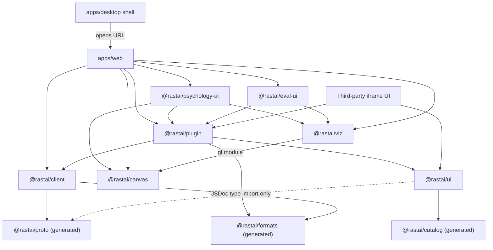
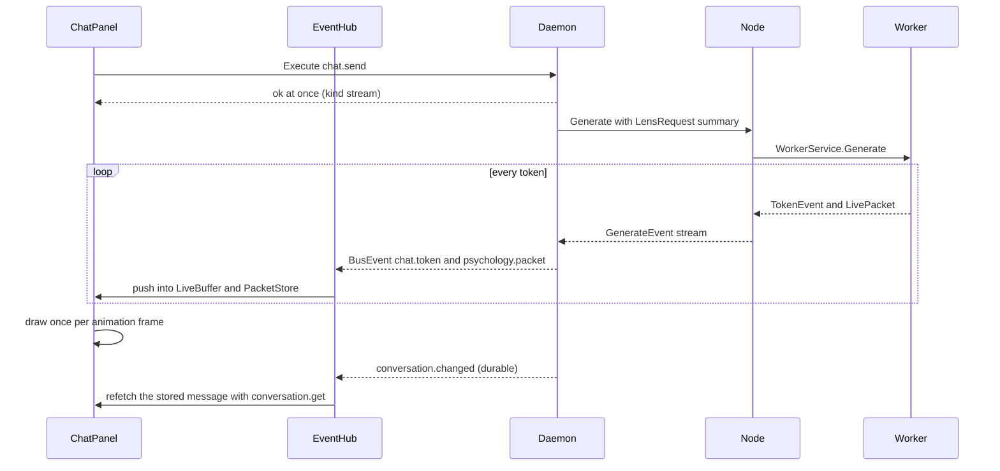
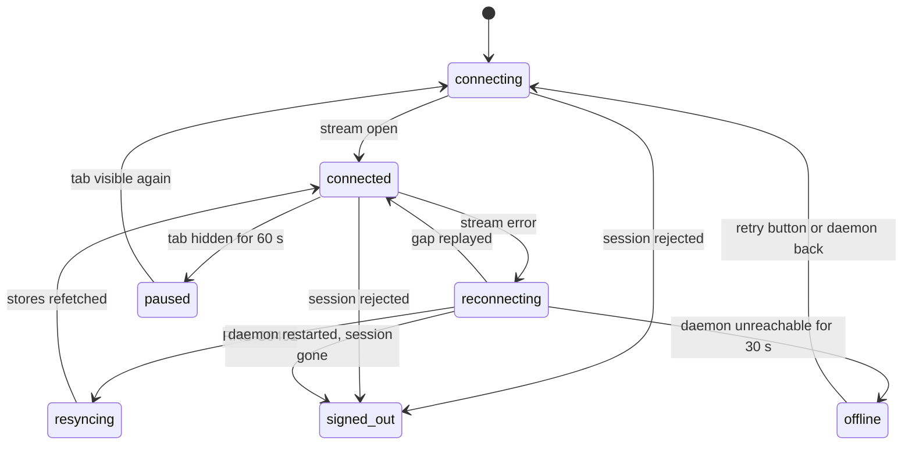
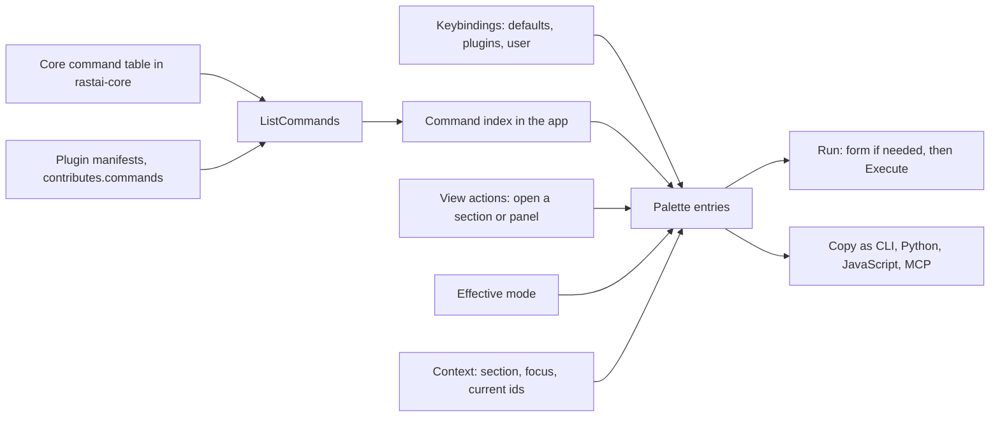
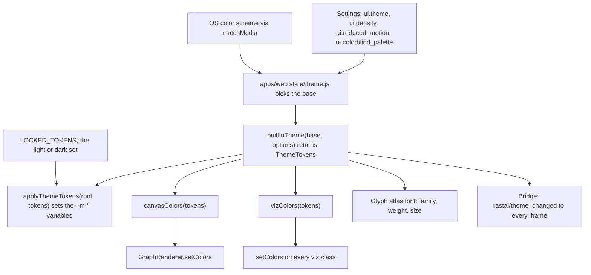
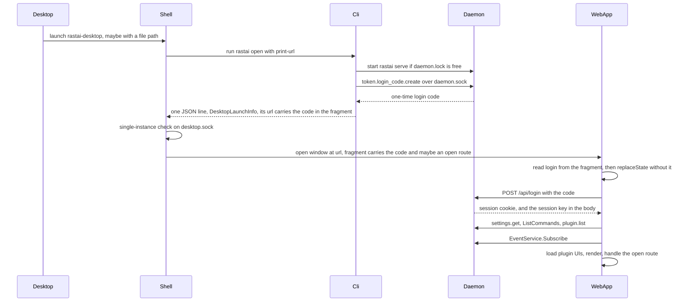
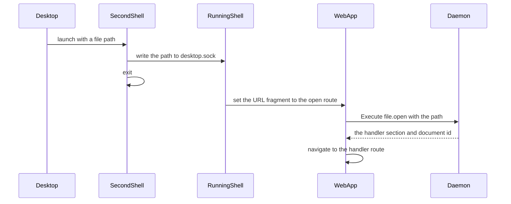
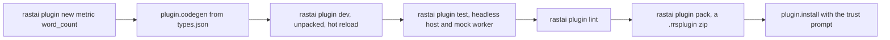
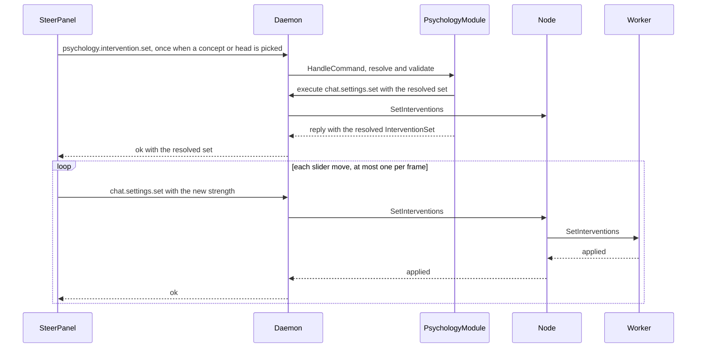

# Frontend and Plugins: Code Layout

**Status:** v1.1, 2026-10-10. Pre-build design. Built on spec v5.4 (`docs/spec/rastai_spec_v5.md`), the spike (`spike/README.md`) and the shared names (`docs/architecture/contracts.md` v1.2). v1.1 applies the owner decisions of 2026-10-10: plain JavaScript instead of TypeScript (ADR-0036), the theme token contract and the locked security UI, the `CommandExecutor` shape and the client's credential option, no domain logic in `apps/web`, custom frontends (2.11), origin-bound sessions (ADR-0034), direct core commands for Psychology's interactive controls, and blind A/B votes as a project document. Its "New names" section is gone: those names now live in contracts.md. M1-01 (2026-10-11) moves the tutorials and assistant skills to Phase 2, as the plan's level table has them (plan §10 row 45; tutorials are L3 work, ADR-0017); their design stays in 8.4.

**Covers:**
- `apps/web` (the React app) and `apps/desktop` (the Tauri 2 shell);
- `packages/ui`, `packages/client`, `packages/canvas`, `packages/viz`, `packages/plugin`;
- the plugin SDKs: `@rastai/plugin` (JavaScript), `python/rastai_plugin` (Python), `crates/rastai-plugin` (Rust);
- the `rastai plugin new` templates in `templates/plugins/`;
- the plugin iframe bridge (MCP Apps compatible);
- the first-party plugins `plugins/psychology/` and `plugins/evaluation/` as packages: their UI, and how they register commands, panels, lenses and metrics;
- what other frontends can use today and later (2.11).

**Not covered here:** the generated packages (`@rastai/proto`, `@rastai/formats`, `@rastai/catalog`) beyond how they're used; `apps/viewer`; the daemon's plugin host in `rastai-server`; the Python internals of `rastai_psychology` and `rastai_eval` (analysis jobs, metric math). Those live in the other layout docs.

**Conventions:**
- Every shared name is from contracts.md v1.2, the only list of names. A wire, document or command shape this doc needs goes into contracts first, in its own PR; any other new name goes into contracts in the same PR as the code (ADR-0038; `check-names` enforces it). Names private to one package (a file, a local function, a test file) are this doc's.
- "(spike)" marks a measured result. "(L2)" marks something built only after the core loop reaches L2. "(M8)", "(M11)" mark the milestone that first builds it.
- Every frontend code sample is plain JavaScript or JSX with short JSDoc (1.1). There is no TypeScript syntax anywhere in this doc or in the code it describes.

---

## 0. Decisions in this doc

1. **Live streams use one Connect server stream per window** (`EventService.Subscribe`): a streaming HTTP response, like SSE, but with binary protobuf frames and resume by `after_bus_sequence`. No WebSocket now. `openEventStream` in `@rastai/client` is the one place a WebSocket transport would go if measurement in WebKitGTK shows stalls (contracts §14 Q11).
2. **One stream per window, shared by every panel.** Browsers allow about 6 HTTP/1.1 connections per origin, so a stream per panel would starve command calls. A tab hidden for 60 s closes its stream and resumes when shown again. Each extra window (the training dashboard's second window, `view.window.open`, 8.4) costs one more stream. Hidden windows pause after 60 s like tabs.
3. **No state library.** Four kinds of state, each with one tool: React state for local state; `createStore` for shared UI state; `useQuery` over commands for server state, invalidated by bus events; `LiveBuffer` and typed-array stores for high-rate streams, read once per animation frame.
4. **Basic/Advanced is threaded with one React context.** `ui.mode` feeds a `ModeProvider` at the root; each `PanelFrame` re-provides it with the layout's `mode_override`. There is `<AdvancedOnly>` and no `BasicOnly`, so Advanced can't hide Basic controls by construction.
5. **The command palette is generated** from `ListCommands`, the merged keybindings and the app's view actions. Nothing is hand-listed.
6. **Hash routing** (`#/<section_id>/...`), in-house and about 60 lines. It works in a browser, in Tauri and in the static viewer with no server fallback.
7. **One host interface for plugin UIs**, `PluginHost`, with three implementations: in-process (first-party), over the iframe bridge (third-party), and a mock (tests). The same panel code runs in all three.
8. **Renderers don't know about React or the daemon.** `@rastai/canvas` and `@rastai/viz` take a canvas element, plain arrays and plain color data; React wraps them with one hook (`useRenderer`). The static viewer and iframe plugins reuse them unchanged.
9. **Charts are Canvas2D with min/max decimation; the graph and 3D views are WebGL2.** Shaders only where they buy something (spike: instancing holds the refresh cap at 50,000 nodes).
10. **The desktop shell does no HTTP and no crypto.** It runs `rastai open --print-url` (contracts §3.2), opens the URL it prints, and passes file opens through the URL fragment, merged with the `#login=<code>` fragment the CLI prints (2.6). A second launch forwards its file paths to the running window over `<runtime>/desktop.sock`.
11. **Plugin command argument types come from the plugin's own `types.json`** (the TypeDescription format of contracts §5.4), generated into JavaScript wrappers with JSDoc and into Python dataclasses by `plugin.codegen`. First-party plugins use this path too, so the third-party path is exercised from day one.
12. **Contribution ids are namespaced:** a plugin's section id is its `plugin_id`; panels, lenses and metrics are `<plugin_id>.<name>` (e.g. `psychology.live`, `eval.pass_at_k`).
13. **Plain JavaScript, no TypeScript** (ADR-0036). Hand-written code is `.js` and `.jsx` ES modules with React and short JSDoc types. `tsc` runs only as a dev-time checker in `checkJs` mode. Generated files live in generated folders and aren't reviewed (1.1).
14. **One theme token contract** (contracts §5.6). Components read only `--rr-*` CSS variables; renderers get plain color data from `canvasColors(tokens)` and `vizColors(tokens)` and switch with `setColors`, never by recreating a WebGL context. The security UI uses locked tokens no theme can change (2.10).
15. **One executor shape.** `CommandExecutor` is any object with `execute(commandId, args, options)`. `DaemonClient` and `PluginHost` both satisfy it, so the generated typed wrappers in `@rastai/client` run in the app, in a plugin panel and in a script (contracts §12.4).
16. **`apps/web` holds no domain logic** (contracts §2.4 rule 9). Anything stateful or computed is a command; the app renders, routes and keeps view state. That is what lets other frontends (2.11) do everything the app does.
17. **Psychology's interactive controls call core commands directly** (contracts §2.4 rule 12): a slider drag is `chat.settings.set`, a branch is `chat.regenerate`. The plugin's Python module validates and runs offline jobs; it is never on the slider's path. M4 tests the round trip at p95 under 50 ms (14.3).
18. **Blind A/B votes are a project document** (owner decision 9, contracts §16). `eval.vote` writes an inline preference row to `evals/votes.rrsdata`; it is journaled and undoable, and `eval.elo.fit` reads it like any preference dataset. The UI keeps no vote file of its own (15.1).

---

## 1. Package Map

| Path | Name | Runs in | Internal deps | External deps (§27) | First needed (§31 step) |
|---|---|---|---|---|---|
| `packages/client` | `@rastai/client` | browser, Tauri webview; scripts with a bearer credential | `@rastai/proto`, `@rastai/formats` | connect-es, protobuf-es runtime | 1 |
| `packages/ui` | `@rastai/ui` | browser, iframes, viewer | `@rastai/catalog`, `@rastai/proto` (JSDoc type import only) | react, react-dom | 1 |
| `packages/plugin` | `@rastai/plugin` | browser, iframes | `@rastai/client`, `@rastai/ui`, `@rastai/formats`, `@rastai/proto`, `@rastai/catalog` | react | 1 (bridge in 8) |
| `packages/canvas` | `@rastai/canvas` | browser, iframes, viewer | none | none | 4 (attribution graph), 6 (Designer) |
| `packages/viz` | `@rastai/viz` | browser, iframes, viewer | `@rastai/canvas` (its `gl` module only) | none | 4 |
| `apps/web` | `@rastai/web` | browser, Tauri webview | every package above + `@rastai/psychology-ui`, `@rastai/eval-ui` | react, react-dom | 1 |
| `apps/desktop` | `@rastai/desktop` + crate `rastai-desktop` in `src-tauri/` | desktop shell | none (spawns `rastai`, loads a URL) | tauri, tauri-build, Tauri updater plugin, serde, serde_json | 1 (window), week 13 (packaging) |
| `plugins/psychology/ui` | `@rastai/psychology-ui` | browser | `@rastai/plugin`, `@rastai/ui`, `@rastai/canvas`, `@rastai/viz` | react | 4 |
| `plugins/evaluation/ui` | `@rastai/eval-ui` | browser | `@rastai/plugin`, `@rastai/ui`, `@rastai/viz` | react | 5 |
| `python/rastai_plugin` | `rastai_plugin` | worker jobs, plugin modules | `rastai_proto`, `rastai_formats` | grpcio | 1 (registry), grows to 8 |
| `crates/rastai-plugin` | `rastai-plugin` | provider processes | `rastai-diag`, `rastai-formats`, `rastai-proto` | tokio, tonic | 8 (skeleton), Phase 3 (used) |
| `templates/plugins` | (data) | `plugin.new` | — | — | 8 |

Two edges worth knowing (both in contracts §2.3–§2.4):
- `@rastai/ui` names the `Diagnostic` type from `@rastai/proto` in one JSDoc line, `@typedef {import("@rastai/proto").Diagnostic} Diagnostic`, so `DiagnosticView` doesn't re-declare it (§20: no type defined twice). A JSDoc import is erased at build time, so the viewer and iframes get no protobuf code from it.
- `@rastai/viz` imports the WebGL helpers from `@rastai/canvas` (`gl/` module) instead of copying them.



Arrows mean "may import". Not obvious from the picture:
- Only three folders of `apps/web` import `@rastai/client` directly: `src/app/`, `src/events/` and `src/plugin-host/`. Core sections (`src/sections/*`) and plugin UIs reach the daemon only through `PluginHost` from `@rastai/plugin`, which also re-exports the generated typed wrappers. `tools/checks/check-imports` enforces this.
- `@rastai/ui`, `@rastai/canvas` and `@rastai/viz` never import `@rastai/client`, so the static viewer and sandboxed iframes can use them with no daemon.
- An iframe plugin bundles its own copy of `@rastai/plugin` (guest side) and `@rastai/ui`. It has no network access; everything goes over postMessage.

### 1.1 JavaScript conventions

These extend contracts §12.4 and ADR-0036. The owner reviews every line, so the code must read like plain JavaScript to someone who doesn't know TypeScript.

**Files and modules**
- `.js` for modules, `.jsx` for React components. Files are `kebab-case.js`; components are `UpperCamelCase.jsx`, one component per file.
- Every package exports its source (`"exports": { ".": "./src/index.js" }`); Vite builds it with esbuild's JSX transform. No per-package build step in the prototype; npm publishing (Phase 2) adds one.
- Constants at the top of each file, `SCREAMING_SNAKE_CASE`, with a comment when the value was measured. Small functions, verb-first names (`openEventStream`, `storePacket`), a thin `main`.
- Each package has a `CLAUDE.md` with its local rules (spec §29) and a `jsconfig.json` that extends the root `jsconfig.base.json`.

**Types in JSDoc, kept short**
- One `@typedef` per data shape, with one `@property` line per field. Functions get `@param` and `@returns`; a function-valued field or argument gets a `@callback`.
- No JSDoc gymnastics: no conditional or mapped types, no `@template` chains, no long generic types. If a type is hard to write, the function is doing too much: split it, or pass a plain object.
- Hand-written objects use camelCase fields. Generated document and command-argument types keep the JSON's `snake_case` (one spelling across Rust, Python and JavaScript, so a field is greppable everywhere). Protobuf messages use protobuf-es's camelCase.
- Generated types are imported with a JSDoc import (`@typedef {import("@rastai/proto").BusEvent} BusEvent`), never re-declared.

**Plain data and functions first**
- Prefer plain objects and functions. A store is an object with `get`, `set` and `subscribe`; a buffer is an object plus the functions that act on it.
- Classes only where polymorphism or a browser API needs one: a renderer that owns a WebGL context (`GraphRenderer`, the viz classes). Polymorphism elsewhere is a shared object shape described by one `@typedef` (`PluginHost`, `Panel`, `CommandExecutor`).
- No state library, no router, no dependency-injection container, no higher-order-component chains. React function components and hooks only.

**Checking and formatting**
- `just check-js` runs `tsc --noEmit -p jsconfig.json` with `checkJs` on (contracts §2.5: the `typescript` package is a dev-time checker only). It never emits or ships code.
- prettier formats; `tools/checks/check-no-typescript` fails on any `.ts`, `.tsx` or `.d.ts` outside generated folders; `check-colors` fails on a color literal outside `@rastai/ui/src/tokens/` (2.10); `check-imports` enforces the import rules of each section below.

**Generated code**
- Lives in generated folders only: `packages/proto/src/generated/` (the package's `index.js` and golden test are hand-written), `packages/catalog/`, `packages/formats/src/generated/`, `packages/client/src/generated/`, a plugin's `ui/src/generated/`. Each is `.js` with JSDoc `@typedef`s, or `.js` plus `.d.ts` declarations (protobuf-es generates with target `js+dts`).
- Never edited by hand and not part of review. `just codegen` regenerates it; CI fails if that changes anything.

A short example of the style, from 2.3:

```js
// packages/plugin/src/state/store.js

/**
 * A value that several components share. Plain object, no class.
 * @typedef {object} Store
 * @property {() => any} get
 * @property {(value: any) => void} set
 * @property {(listener: () => void) => (() => void)} subscribe   returns the unsubscribe function
 */

/**
 * @param {any} initialValue
 * @returns {Store}
 */
export function createStore(initialValue) {
  let value = initialValue;
  const listeners = new Set();
  return {
    get: () => value,
    set: (newValue) => {
      value = newValue;
      listeners.forEach((listener) => listener());
    },
    subscribe: (listener) => {
      listeners.add(listener);
      return () => listeners.delete(listener);
    },
  };
}
```

---

## 2. Cross-Cutting Design

### 2.1 Talking to the daemon

- **Base URL** is the page's own origin (`http://127.0.0.1:47820` by default). The daemon serves the app at `/` (contracts §3.3), so there is nothing to configure.
- **Sign-in:** the start URL carries `#login=<code>` in the fragment (contracts §3.2–3.3). Browsers never send a fragment to a server or put it in a Referer header, so the code stays out of the daemon's request log. `main.jsx` reads `login` from the fragment before routing (2.6), exchanges it with `POST /api/login` for the HttpOnly session cookie and the session key, then removes it from the fragment with `history.replaceState`. The browser app never holds a token; the session key lives only in the window's memory (never a cookie, `localStorage` or `sessionStorage`). A `login` in the real query string is ignored.
- **Credential:** the app calls `connectToDaemon({ baseUrl: location.origin, credential: { kind: "cookie", sessionKey } })`. The cookie is sent by the browser; no `Authorization` header is ever set. The client sends `sessionKey` as `Rastai-Session-Key` on every request other than `GET` or `HEAD` (`Execute`, `Subscribe`, `PUT /api/blobs`). Origin and Fetch Metadata are enforced only by browsers, so a non-browser process on another loopback port that receives the cookie could forge them; it never sees the key (ADR-0034 decision 10, contracts §3.2). A missing or wrong key is `RRS-C1002`. The bearer form (`{ kind: "bearer", token }`) exists for scripts and other clients (2.11), never for the browser app.
- **The session is bound to the origin that redeemed the code** (ADR-0034, contracts §3.2). Browsers don't isolate cookies by port, so a page on another loopback port gets the same cookie; the daemon refuses its requests because their Origin differs (`RRS-C1004`). Same-origin `POST` and `PUT` requests always carry Origin. Same-origin `GET`s without Origin (an `` of a blob, a download, the app's own files) pass only with `Sec-Fetch-Site` `same-origin` or `none` (ADR-0034 decision 5). A browser that sends no Fetch Metadata fails closed.
- **Sessions don't survive a daemon restart** (contracts §16). After a restart every window is signed out (`RRS-U0003`); the desktop shell reruns `rastai open --print-url` and reloads (9.3), and a browser tab shows `SignedOutScreen`.
- **A page reload loses the session key**, so it signs the window out too: a browser tab shows `SignedOutScreen` with the `rastai open` hint, and the desktop shell signs in again on its own (9.3). Unsent drafts survive it (2.3).
- **Commands:** Connect unary `CommandService.Execute` with protobuf binary. `?wire=json` switches to Connect JSON for debugging in devtools.
- **Events:** one `EventService.Subscribe` stream per window (2.2). Binary only in the prototype (contracts §4).
- **Blobs:** `GET /api/blobs/<hash>` (immutable, so the browser caches it by hash) and `PUT /api/blobs` with upload progress.
- **Version:** `GET /api/health` returns the daemon version. If it differs from the version baked into the web build, the app shows RRS-U0004 "Reload to update" (a tab left open across an update).
- **Files:** the UI never reads local files by path. Drag-drop uploads to the blob store (up to `MAX_BROWSER_UPLOAD_BYTES`, 256 MiB). Larger files open by path through a daemon-side file browser, `file.browse`, so nothing is copied.
- **No domain logic in the browser** (decision 16). A validation, a statistic, a plan or a filter that decides what something is comes from a command result. The UI may reshape a result for display (sort, group, format), nothing more.

### 2.2 Per-token live streams

**Transport choice**

| Need | SSE (`EventSource`) | WebSocket | Connect server stream (chosen) |
|---|---|---|---|
| Binary 8.3 KB packets (spike) | text only; base64 adds 33% | yes | yes, protobuf frames |
| Same auth, Host and Origin checks as commands | yes | separate upgrade path to secure | yes, same axum handler stack |
| Resume after a drop | `Last-Event-ID` | hand-rolled | `after_bus_sequence` in the request |
| Types generated from proto | no | hand-rolled framing | yes (`@rastai/proto`) |
| Client → server messages | no | yes | no; not needed, commands go through `Execute` |
| Works through an SSH tunnel and in a plain browser | yes | yes | yes |

Connect server streaming over HTTP/1.1 is `fetch()` with a streamed response body, which every target engine supports. The rate is small: 8.3 KB × ~150 tok/s ≈ 1.3 MB/s for one live panel (spike). The daemon must set `TCP_NODELAY` on streaming responses (spike: 40 ms stalls per reply without it).

**The path of one token**



Steps that aren't obvious:
- `chat.send` returns as soon as generation starts. Tokens arrive only as bus events, never in the `Execute` response.
- The event hub does O(1) work per event: decode, then push into a buffer. Nothing renders per event. Views re-read their buffers once per animation frame (about 60 Hz in WebKitGTK even on a 144 Hz monitor, spike).
- The live packet carries token IDs, not text. The UI fetches the model's token piece table once with `model.vocabulary` (returns a `BlobRef`, about 3 MB for Gemma's 262k vocabulary) and decodes IDs locally. The gateway's tokenizer is the only source of the table, the same one that produced the IDs.

What's persisted where:
- `chat.token` and `psychology.packet` are ephemeral (contracts §7.3). The browser keeps them only in memory.
- The message itself is stored in `vault.db` by the daemon. When `conversation.changed` names the message, the UI fetches it and replaces the streamed text with the stored text. Any dropped tokens heal there.
- Packets are not stored. A replay recomputes them from token IDs (`psychology.replay.open`), and an exported `.rrsreplay` carries the summary layer.

Failure branches:
- **Dropped ephemeral events** (daemon backpressure): the PacketStore marks the missing token indexes. The live panel shows "N tokens missing" (RRS-U0005, info) and a **Recompute** button that runs `psychology.replay.open`.
- **Stream drop:** the client reconnects with backoff and `after_bus_sequence` = the last sequence seen. The daemon replays the gap from its 10,000-event buffer.
- **Gap too old** (RRS-C0401): the hub calls `onResync`; every query is invalidated and the app stores refetch. Live buffers keep what they have and mark the rest missing.
- **Daemon gone mid-generation:** the banner shows "reconnecting". A restarted daemon has no sessions, so the reconnect is refused and the window is `signed_out` until a new login code arrives (the desktop shell brings one; a browser tab needs `rastai open`). After sign-in, `conversation.get` returns the user's message; the half-streamed reply is lost and Regenerate works (contracts §8.3).

**Connection status** (what `ConnectionBanner` shows):



- `offline` shows RRS-U0001 with the fix "start Rastai" (`rastai` in a terminal). Retrying continues in the background every 5 s.
- `signed_out` shows `SignedOutScreen`: "Open Rastai again from the app or with `rastai open`" (RRS-U0003). The UI can't sign itself in; only a login code can. Sessions live in daemon memory, so every daemon restart ends here (contracts §16). `SignedOutScreen` is security UI with locked tokens (2.10), so a theme can't fake or hide it.
- `paused` is the tab-visibility rule from decision 2. The banner is hidden while paused.

### 2.3 State management

| Kind | Tool | Read with | Examples |
|---|---|---|---|
| Local | `useState`, `useReducer` | the component | short form fields, hover, open menus |
| Unsent draft | `draft-store.js` (localStorage, best effort) | `loadDraft` on mount | the chat composer's text, a harness's system prompt, a suite test's input |
| Shared UI | `createStore(initialValue)` (get, set, subscribe) | `useStore(store)` (React's `useSyncExternalStore`) | route, settings, command index, replay playhead shared by the timeline and every view |
| Server | `useQuery(commandId, args, invalidatedBy)` | the hook's `QueryState` | `useQuery("conversation.list", {}, ["conversation.changed"])` |
| High-rate | a `LiveBuffer` or a typed-array store | `useLiveBuffer(buffer)` (at most one render per animation frame); WebGL views read arrays directly | streamed chat text, live packets, metric series, log lines |
| User preference | daemon settings (`settings.get` / `settings.set`), stored in `settings.json` files (contracts §11.1) | the settings store | `ui.mode`, `ui.theme`, `ui.density`, sampling defaults |

Rules:
- **No Redux, MobX, Zustand, React Query or similar.** The tools above are each under 100 lines and live in `@rastai/plugin/src/state/`.
- **Server state is never computed in the browser** (decision 16). `useQuery` holds command results as they came; views may sort, group and format them for display.
- **The query cache** is a `Map` keyed by `command_id` + canonical JSON of the arguments. An entry is dropped when an event of one of its `invalidatedBy` types arrives (optionally matching `subject_id`), and all entries drop on resync.
- **localStorage** holds only throwaway conveniences and unsent drafts. Every access is wrapped in try/catch, and the app works with it empty. Never settings, never secrets.
  - Conveniences: recently used palette entries and the last route per section.
  - **Unsent drafts** (spec §2: nothing the user did is lost to a crash): text the user typed but hasn't sent or committed, so a WebKitGTK crash, a reload after RRS-U0004 or a resync doesn't lose a long prompt.
    - Key `draft:<section>:<subject_id>`, e.g. `draft:inference:conv_01JA...`, or `draft:inference:new` before the conversation exists.
    - Saved 500 ms after the last keystroke. Restored when the component mounts. Cleared after the `chat.send` or the document edit that commits it returns `ok`.
    - Never for incognito conversations (incognito is never stored, anywhere) and never for secret or token fields.
    - Drafts older than `DRAFT_MAX_AGE_DAYS` (30) are dropped on load. localStorage is per origin, so a daemon that fell back to another port starts with no drafts. Drafts are a safety net, not storage.
- **Undo** is the daemon's (`document.undo` / `document.redo`). The UI keeps no undo stack.

`Store` and `createStore` are shown in full in 1.1. The other state tools, as signatures:

```js
// packages/plugin/src/state/store.js
/**
 * @param {Store} store
 * @returns {any} the current value; the component re-renders when it changes
 */
export function useStore(store) {}

// packages/plugin/src/react/use-query.js
/**
 * @typedef {object} QueryState
 * @property {"loading" | "ready" | "error"} status
 * @property {any} data                       the parsed result_json; null until ready
 * @property {Diagnostic[]} diagnostics
 */

/**
 * Runs a read command and re-runs it when one of the named events arrives.
 * @param {string} commandId
 * @param {object} args
 * @param {string[]} invalidatedBy   event types, e.g. ["conversation.changed"]
 * @returns {QueryState}
 */
export function useQuery(commandId, args, invalidatedBy) {}

// packages/plugin/src/state/live-buffer.js
const DEFAULT_LIVE_BUFFER_CAPACITY = 16384;

/**
 * A ring of the newest items from a stream. Old items fall off the front.
 * @typedef {object} LiveBuffer
 * @property {any[]} items
 * @property {number} capacity
 * @property {number} firstSequence   sequence number of items[0]
 * @property {number} nextSequence    sequence number the next pushed item gets
 */

/**
 * @param {number} capacity
 * @returns {LiveBuffer}
 */
export function createLiveBuffer(capacity) {}

/**
 * @param {LiveBuffer} buffer
 * @param {any} item
 */
export function pushItem(buffer, item) {}

/**
 * @param {LiveBuffer} buffer
 * @param {number} sequence
 * @returns {any[]} the items from that sequence on (fewer if they fell off the front)
 */
export function itemsSince(buffer, sequence) {}

/**
 * Re-renders the component at most once per animation frame.
 * @param {LiveBuffer} buffer
 * @returns {number} the buffer's nextSequence
 */
export function useLiveBuffer(buffer) {}

// packages/plugin/src/state/draft-store.js
const DRAFT_SAVE_DELAY_MS = 500;      // one write per typing pause, not per keystroke
const DRAFT_MAX_AGE_DAYS = 30;        // older drafts are dropped on load

/**
 * @param {string} key
 * @returns {string | null} null when missing, too old, or storage is unavailable
 */
export function loadDraft(key) {}

/**
 * Debounced by DRAFT_SAVE_DELAY_MS; empty text clears the draft.
 * @param {string} key
 * @param {string} text
 */
export function saveDraft(key, text) {}

/** @param {string} key */
export function clearDraft(key) {}
```

Signature blocks in this doc show the JSDoc and an empty body (`{}`); the real file has the body.

`chat/Composer.jsx`, `harness/HarnessEditor.jsx` and Evaluation's `suites/SuiteEditor.jsx` use the draft store. In a sandboxed iframe localStorage throws, so the store's try/catch makes it a no-op there.

### 2.4 Basic/Advanced

How the setting reaches a control:
1. **Global:** `ui.mode` from `settings.get` (the prototype default is `advanced`, contracts §11.2). It lives in the app's settings store.
2. **Per panel:** the layout node's `mode_override` (`basic`, `advanced` or empty) in `rastai.layout/1`. The panel's title bar has the toggle.
3. **Context:** `App` renders `<ModeProvider mode={globalMode}>`. Every `PanelFrame` renders `<ModeProvider mode={override ?? globalMode}>` around its panel.
4. **Components** call `useMode()` to change wording or detail, and wrap extra controls in `<AdvancedOnly>`. Visual density is a separate setting, `ui.density`, carried by the theme tokens (2.10), not by the mode.
5. **Commands:** in Basic mode the palette and menus show only commands whose `CommandDescriptor.basic` is true.
6. **Diagnostics:** `DiagnosticView` shows the catalog's `basic_text` and a fix button in Basic mode, and adds the code, path and full message in Advanced.
7. **Iframes** get the mode in the `ui/initialize` result and every change through `rastai/theme_changed`.
8. **Switching keeps all state.** Controls inside `<AdvancedOnly>` keep their values in the panel's store, not in `useState` inside the Advanced subtree, so switching back restores them. Changing the global mode is `settings.set` on `ui.mode`; the resulting `command.finished` event refreshes every window.

```js
// packages/ui/src/mode/mode-types.js
/** @typedef {"basic" | "advanced"} UiMode */
/** @typedef {import("react").ReactNode} ReactNode */

// packages/ui/src/mode/ModeProvider.jsx
/**
 * @param {object} props
 * @param {UiMode} props.mode
 * @param {ReactNode} props.children
 */
export function ModeProvider({ mode, children }) {}

// packages/ui/src/mode/use-mode.js
/** @returns {UiMode} */
export function useMode() {}

// packages/ui/src/mode/AdvancedOnly.jsx
/**
 * Renders its children only in Advanced mode.
 * @param {object} props
 * @param {ReactNode} props.children
 */
export function AdvancedOnly({ children }) {}
```

Rules:
- There is no `BasicOnly`. A Basic control can't be hidden in Advanced (spec §7).
- `<AdvancedOnly>` sits after or beside Basic blocks and never wraps them, so Advanced doesn't move Basic controls.
- The e2e test `tests/e2e/basic-advanced.spec.js` checks both rules for every section: the ordered list of interactive elements (role and accessible name) in Basic must be a subsequence of the list in Advanced, and a value typed in Basic must survive a round trip through Advanced.

### 2.5 Command palette generation



Steps:
1. **Descriptors:** at boot and on every `plugin.state_changed`, the app calls `ListCommands`. The daemon merges the core table and enabled plugins' manifests, so the UI never merges them itself.
2. **Keybindings,** lowest to highest: each descriptor's `default_shortcut`, plugins' `contributes.keybindings`, then the user's `<config>/keybindings.json` read with `workspace.keybindings.get`. A binding's `when` is empty (always) or a single `<key>=<value>` test against the context, e.g. `focus=canvas` or `section=designer`. Context keys are in contracts §15.6.
3. **View actions** are UI-only entries the app derives from the registry: `view.section.open` per section, `view.panel.open` per panel, `view.window.open` (the current route in a new window, 8.4), `view.palette.repeat_last`. They never reach the daemon and have no "Copy as". `view` is a reserved core area (contracts §6.1), so no plugin command can take a `view.*` id.
4. **Filter:** hide `experimental` commands unless `plugins.experimental_apis` is on. In Basic mode keep only `basic` ones. Every command is `stability` `preview` until Phase 2 (contracts §6.1), so the palette shows no stability tag in the prototype; a `deprecated` command, once one exists, gets a tag and its replacement.
5. **Match and rank:** in-house subsequence scoring over the title, command id and section. Recently used entries (localStorage) rank first.
6. **Run:**
   - If the arguments have required fields that the context can't fill, the palette opens `CommandForm`, generated from the descriptor's `arguments_schema_json` (the same schema the MCP server lists as `inputSchema`).
   - Context prefill: a field named like a context id (`conversation_id`, `document_id`, `run_id`, `checkpoint_id`, `model_ref`) is filled from the current context. Sections set the context with `host.setContext`.
   - Then `execute`. A `job` command shows a `JobProgress` toast with a link; a `stream` command navigates to the view that shows the stream.
7. **Copy as:** the entry's menu writes the same call four ways (`apps/web/src/commands/copy-as.js`):

```
CLI     rastai eval test --suite evals/facts.rrseval --model ckpt:ckpt_01JA...
Python  rastai.connect().execute("eval.test", {"suite": "evals/facts.rrseval", "model": "ckpt:ckpt_01JA..."})
JS      await client.execute("eval.test", { suite: "evals/facts.rrseval", model: "ckpt:ckpt_01JA..." })
MCP     {"name": "eval__test", "arguments": {"suite": "evals/facts.rrseval", "model": "ckpt:ckpt_01JA..."}}
```

The exact CLI flag syntax belongs to `rastai-cli`'s generated verbs. Both sides read the golden file `fixtures/command-golden/copy-as.json`, so they can't drift. `rastai.connect()` is the Python SDK client (contracts §15.2). The JavaScript line uses a `DaemonClient` from `connectToDaemon` with a bearer credential (2.11); it works with any `CommandExecutor`.

What's persisted: nothing new. Descriptors live in the daemon's registry, keybindings in `<config>/keybindings.json`, recent entries in localStorage (losing them only changes the ranking).

Failures:
- If `ListCommands` fails at boot, the palette offers only view actions and the connection banner explains why. It refills on reconnect.
- A failed command shows its diagnostics in a toast with the fix button.
- A keybinding that names an unknown command is skipped and listed on the Keybindings settings page.

**Macros** (spec §13) reuse the same formatters: while recording, `macro-recorder.js` keeps every executed command id and argument object (skipping `read`-scope queries) and writes them out as a Python or JavaScript script. Saved macros become palette actions through the `macros` contribution from M8 (capability `ui.macro@1`, contracts §5.5).

### 2.6 Routing and workspace

**Routes** are `#/<section_id>/<segments>?<query>`. Each section gets `path: string[]` and `query` and handles its own segments with a plain `switch`. There is no nested router.

| Route | Shows |
|---|---|
| `#/home` | Home: Chat · Teach it my data · See inside · Fix a behavior · Design a network · Train an agent |
| `#/inference/chat/<conversation_id>` | a conversation |
| `#/psychology/replay/<conversation_id>` | Psychology replay |
| `#/training/run/<run_id>` | run dashboard |
| `#/eval/run/<run_id>` | eval results ("Did it get better?") |
| `#/designer/design/<document_id>` | a design on the canvas |
| `#/open?path=<percent-encoded path>` | open a file: `file.open`, then navigate to the route of the handler it returns |

**Fragment grammar.** Everything after `#` is `[/<section_id>/<segments>][?<query>]`. `<query>` is `key=value` pairs joined by `&`, percent-encoded, read with `URLSearchParams`. The forms that come from outside the app:

| Source | Fragment | Means |
|---|---|---|
| CLI start URL (`rastai open`, contracts §3.3) | `#login=<code>` | a bare query with no route: sign in, then `#/home` |
| Desktop shell, cold start with a file | `#/open?path=<enc>&login=<code>` | sign in, then open the file |
| Desktop shell, running window | `#/open?path=<enc>` | open the file (the window is already signed in) |
| Anything that wants a start route | `#/<section_id>/...?login=<code>`, e.g. `#/home?login=<code>` | sign in, then that route |

- A fragment that doesn't start with `/` is a bare query, and its route is `#/home`.
- `login` is reserved: no route uses a `login` key of its own. `main.jsx` reads it (`readLoginCode`) and removes it (`removeLoginCodeFromUrl`) before the router starts. Removal rewrites the fragment with `history.replaceState`, so the code never stays in the address bar or the history. `replaceState` fires no `hashchange`, so the router reads `location.hash` once after sign-in.
- `readLoginCode` (`@rastai/client`) and `parseRoute` (`apps/web/src/routing/route.js`) split the fragment the same way. Their tests share one fixture table, `fixtures/ui/fragments.json`, so the two can't drift.
- The page's real query string is separate. It carries only the debug switch `?wire=json` (and `?new_window=1` in one desktop fallback, section 19, question 12), never a code.

**Workspace:**
- One layout tree per section. The default comes from the section's `section.json` (`default_layout`). Saved layouts are files (`workspace.layout.save` / `workspace.layout.apply`).
- A panel from another plugin docks by panel id. Example: Inference's default layout puts `psychology.live` on the right. If that plugin is disabled, the slot says so and offers to enable it.
- Prototype docking: split and tabs, plus "move to right / bottom / new tab" from the panel menu. Free drag-docking is Phase 2.
- A layout node's `theme_override` (contracts §5.2) is read from M8 or Phase 2; until then it's ignored (2.10).

### 2.7 Errors in the UI

- Everything shown as an error is a `Diagnostic` with a catalog code, rendered by `DiagnosticView` from `@rastai/catalog`. Its severity colors are locked tokens (2.10), so a theme can't make an error look like info.
- A command failure is `ExecuteOutcome.ok = false` plus diagnostics, never an exception. `fix_command_id` and `fix_arguments_json` drive the fix button. Example: the first data-policy refusal, `RRS-C1009`, carries a one-click fix that runs `settings.set` on `privacy.data_policy` (contracts §11.2).
- A job failure arrives as the `Diagnostic` in its last `job.state_changed`; `JobProgress` shows it.
- Client-side failures use the RRS-U codes of contracts §10.3. A crashed panel is caught by `PanelFrame`'s error boundary and shows RRS-U1004 with "Reload panel". The rest of the window keeps working. `PanelFrame` also records the crash with `system.crash_report.record` (stack and panel id; never conversation text), so it shows up with the daemon's own crash reports.

### 2.8 UI performance rules

- No React render per streamed event (2.2). Buffers are filled at event rate and drawn at frame rate.
- Lists longer than 200 rows use `VirtualList`.
- WebGL views draw on demand (a dirty flag). They run every frame only while something animates or streams. The spike drew every frame; production must not, to save power.
- Hot paths reuse preallocated typed arrays. No per-frame allocation, no per-frame `readPixels`.
- Frame budget: 16 ms (WebKitGTK caps at about 60 Hz, spike), with script time per frame under 4 ms at the target sizes. The spike measured 0.9 ms for 50,000 recolored nodes in Chrome.
- Sections and plugin UIs load lazily with dynamic `import()`. The first screen loads the shell, Home and Inference only.
- Never branch on the GPU renderer string. WebKitGTK reports "Apple GPU" on an NVIDIA box (spike). Use capability checks and the pixel read-back self-check (5.6).

### 2.9 Accessibility (WCAG 2.2 AA, spec §7)

- Every chart has a table: each `@rastai/viz` chart has `toTable()`, and `ChartFrame` in `@rastai/ui` has a "Show as table" toggle.
- The Psychology token timeline is keyboard-driven: left/right moves by token, up/down by layer, Enter opens details, Space plays or pauses.
- The Designer canvas mirrors visible nodes into an offscreen `role="tree"` DOM, so the graph can be navigated with the keyboard and a screen reader.
- Colorblind-safe palettes (`ui.colorblind_palette`): blue/orange instead of red/green for diverging maps; the setting swaps the `series_*` and diverging role colors (2.10).
- Reduced motion (`ui.reduced_motion` or the OS setting) sets both motion tokens to 0 and turns off camera auto-motion, inertia and animated transitions in 3D views.
- Focus is always visible: the focus ring is a token (`--rr-focus-ring-width`, `--rr-focus-ring-offset`, color role `focus_ring`).
- `tests/e2e/accessibility.spec.js` runs axe-core (dev tooling, contracts §2.5) on every section in both modes and both built-in themes.
- From M8, theme plugins pass an accessibility check in `rastai-formats` before they load (WCAG 2.2 AA: 4.5:1 for text, 3:1 for UI parts and the focus ring, 24 px targets); high-contrast built-in themes come with it (2.10).

### 2.10 Theming and the locked security UI

The theme contract is contracts §5.6 (owner decision N1); this section is how the frontend applies it. `@rastai/ui/src/tokens/` is the only place in the frontend that holds color values.



**How a theme switch runs**
1. The user picks a theme in Settings > Appearance. That is `settings.set` on `ui.theme` (`system`, `light`, `dark`, or a plugin theme id from M8), written to `settings.json`.
2. The `command.finished` event refreshes the settings store in every window. `apps/web/src/state/theme.js` picks the base: for `system` it follows `matchMedia("(prefers-color-scheme: dark)")` and listens for OS changes, which re-resolve without any command.
3. `builtInTheme(base, options)` returns the resolved `ThemeTokens`. `options` carries `density` (`ui.density`: `comfortable` or `compact` picks the spacing scale), `reducedMotion` (both durations become 0) and `colorblind` (swaps the `series_*` and diverging colors).
4. `applyThemeTokens(document.documentElement, tokens)` rewrites the `--rr-*` variables, and then the `--rr-locked-*` variables from `LOCKED_TOKENS` for the theme's `base`. Components restyle through CSS; React re-renders nothing for colors.
5. Renderers get new plain color data: `useRenderer` passes `canvasColors(tokens)` or `vizColors(tokens)` to the renderer's `setColors`, which updates uniforms and buffers in place. **No WebGL context is ever recreated for a theme switch.** A font change rebuilds only the glyph atlas texture (`createGlyphAtlas(gl, font)`).
6. The bridge host sends `rastai/theme_changed` with the resolved tokens (locked tokens excluded) to every iframe, which calls `applyThemeTokens` on its own document.

**Rules**
- **Components and plugin UIs read only `--rr-*` variables.** No color, font, spacing, radius, shadow or duration literal in component CSS or JSX. `tools/checks/check-colors` fails CI on a color literal in `packages/canvas/src/`, `packages/viz/src/`, `apps/web/src/sections/` and `plugins/*/ui/src/`; `@rastai/ui`'s own component CSS follows the same rule.
- **Renderers never pick colors.** They take `CanvasColors` or `VizColors` (plain RGBA arrays) through `setColors`. The spike's hard-coded `#101318` is gone; it seeds the built-in dark theme's `canvas_background`.
- **Role keys are fixed** (contracts §5.6). A theme may set any of them; missing ones come from its `base`. The list comes from the generated `ThemeDocument` type in `@rastai/formats`; nothing in the frontend re-types it.
- **Built-in themes** are `light` and `dark`, stored as `rastai.theme/1` data in `@rastai/ui/src/tokens/built-in-themes.js`. Follow-OS high-contrast themes and a font assets path come in M8.
- **Plugin themes** (`themes[]`, capability `ui.theme@1`) are refused before M8 with `RRS-P1002`. From M8 the daemon validates the theme file, runs the accessibility check (2.9) and the Appearance page offers a picker.
- **Per-panel `theme_override`** in `rastai.layout/1` is M8 or Phase 2.

**Locked security UI** (owner decision N7, contracts §5.6)
- The egress badge, the trust prompt, the permission list, the signed-out screen and the error severity colors use locked tokens: `--rr-locked-severity-*`, `--rr-locked-egress*` and `--rr-locked-security-*`. `applyThemeTokens` always sets them from `LOCKED_TOKENS` (`@rastai/ui/src/tokens/locked.js`), never from a theme. A theme file that names a locked key fails validation (`RRS-E1003`).
- `EgressBadge`, `TrustPrompt`, `PermissionList` and `SignedOutScreen` live in `@rastai/ui/src/security/` and are exported only from the subpath `@rastai/ui/security`. `check-imports` allows that subpath only under `apps/web/src/` (the app shell and its core sections), never in `plugins/*/ui/` or a template. Plugin UIs can't render them, so they can't fake them.
- Plugin UIs can't cover them either: an iframe is clipped to its panel, and only first-party code runs in-process. The egress badge sits in the status bar outside every panel; the trust prompt is a modal the shell renders above all panels.
- `docs/security/threat-model.md` has the row for themes and plugin UIs that hide or disguise security UI, with `theme.spec.js` and `plugin-iframe.spec.js` as its tests.
- Phase 2: an unsupported user stylesheet, with the security UI moved into closed shadow roots so the stylesheet can't reach it.

What's persisted: the settings in `settings.json` (`ui.theme`, `ui.density`, `ui.reduced_motion`, `ui.colorblind_palette`). Resolved tokens are never stored; every window resolves them at boot and on change.

Failure branches:
- A plugin theme id in `ui.theme` whose plugin is disabled or fails validation: the app falls back to `system` and shows the plugin's diagnostic in Settings > Appearance.
- A renderer whose context was lost (RRS-U1002) restores with the current colors, because `setColors` input is kept in `useRenderer`.

Tests: `tokens.test.js` (every role key resolves in both built-ins; `applyThemeTokens` sets every documented variable; a theme object carrying locked names leaves the locked variables unchanged); `palettes.test.js` (2.9 contrast rules on both built-ins); `theme.spec.js` (e2e: light, dark, `system` with an emulated OS dark scheme, then compact density; the canvas and every chart recolor, the number of WebGL contexts created stays the same, and the locked variables don't change).

### 2.11 Custom frontends

The web app is one client of the commands API among several. Because `apps/web` holds no domain logic (decision 16), anything the app does, another client can do with the same commands and events.

**What works now**

| Client | How it connects | Credential |
|---|---|---|
| The CLI, a terminal UI, a native app | Connect over `daemon.sock` (JSON, plus binary for `Subscribe`) | socket peer credentials, same user (contracts §3.2) |
| Scripts in Python | `rastai.connect()` (`RASTAI_DAEMON_SOCKET` or `RASTAI_URL`) | socket peer, or a scoped token in `RASTAI_TOKEN` |
| Scripts in JavaScript (Node) | `connectToDaemon({ baseUrl, credential: { kind: "bearer", token } })` and the generated wrappers from `@rastai/client` | a scoped token from `token.create` |
| MCP clients | `rastai mcp` (stdio) or `/mcp` | scoped bearer token (`mcp-default` preset) |
| Navi and other OpenAI or Anthropic clients | `/v1/*` | scoped bearer token (`chat-only` preset) |
| A VS Code extension | the extension host (Node) connects like a JS script, over `daemon.sock` or with a bearer token; its webviews have their own origin, so they never call the daemon and message the extension host instead | as the script |

- **Cross-origin browser clients are refused in v1** (ADR-0034). A page on any other origin, another loopback port included, gets `RRS-C1004`, even though the browser sends it the cookie.
- **Bearer requests may omit Origin**; if they send one, the Origin rule applies (contracts §3.2). A token is scoped (`token.create`), revocable (`token.revoke`) and never shown again after creation.
- **Typed calls in JavaScript** use the generated wrappers against any `CommandExecutor`: `modelLoad(client, args)` in a script is the same function a plugin panel calls with its `PluginHost`.
- **Stability:** every command and event type is `preview` until Phase 2 (`CommandDescriptor.stability`, `EventTypeDescriptor.stability`). `buf breaking` checks the protobuf messages, but it can't see inside `arguments_json` and `result_json`, which are strings to protobuf; `check-schema-diff` (M1-58, ADR-0038) diffs `schemas/commands/` and `schemas/events/` against the base branch: every change needs a contracts.md update, and a breaking change to a `stable` item fails CI. Every item stays `preview` until Phase 2, so until then a client should pin the daemon version it was tested with (`GET /api/health`).
- **Proof that it works:** M1-49's three-surfaces test (`tests/e2e/three_surfaces/`) runs one action through UI, CLI and MCP and grows each milestone; M10-E02 adds an API-only run of the core loop.

**Live-stream rules for any client** (the web app follows the same rules, 2.2)
- Open one `EventService.Subscribe` stream per client or window, filtered by event types and subject ids. The stream is binary protobuf in the prototype; JSON for `EventService` comes through a generated proto-JSON codec only if needed (M9, else Phase 2).
- Keep the last `bus_sequence` you saw and resume with `after_bus_sequence`. On `RRS-C0401` the gap is gone: refetch state with the `*.list` and `*.get` commands.
- Ephemeral events (`chat.token`, `psychology.packet`, `job.progress`, ...) may be dropped under load. Never treat them as the record: the stored message, run or result comes from a command after the durable event names it.
- Decode token IDs with the model's piece table from `model.vocabulary`; never tokenize or detokenize on your own.
- Draw at frame rate, not event rate, and do O(1) work per event.
- Send `Rastai-Client: <name>/<version>` on every request.

**Phase 2 routes** (spec §13, not built in the prototype)
- Alternative UIs hosted by the daemon on its own origin, so they get the same-origin session like `apps/web`.
- An origin allowlist with pairing, and CORS only on demand.
- `token.pair` for non-browser clients, instead of copying a token by hand.
- The stable commands API 1.0 subset (the first `stable` commands; `check-schema-diff` already runs from M1).
- Built packages published to npm, with `PacketStore` and token decoding moved into a shared package.
- A reference terminal UI run in CI.

---

## 3. `packages/client` (`@rastai/client`)

A thin daemon client: transport, credential, sign-in, commands, the event stream with resume, blobs, and the generated typed command wrappers. No React, no UI. The browser app, plugin hosts and JavaScript scripts all use it.

### 3.1 Tree

```
packages/client/
  package.json              @rastai/client; exports "." -> ./src/index.js, "./commands" -> ./src/generated/commands.js,
                            "./testing" -> ./src/testing/executor-contract.js (tests only)
  jsconfig.json             extends jsconfig.base.json (checkJs)
  CLAUDE.md                 local rules: no React, no UI, never throw on command failure,
                            connect-es and protobuf-es only in connection.js
  src/
    index.js                public exports only; re-exports generated/commands.js
    constants.js            reconnect delays, timeouts, upload size cap, login parameter name
    types.js                JSDoc @typedefs: Credential, ConnectOptions, DaemonClient, ExecuteOptions, ExecuteOutcome
    command-executor.js     the CommandExecutor and ExecuteFunction @typedefs (contracts §12.4)
    connection.js           connectToDaemon, checkHealth; Connect transport (binary or JSON), credential header;
                            the BusEvent proto-JSON codec the iframe bridge uses;
                            the only file that imports connect-es and protobuf-es
    login.js                readLoginCode and removeLoginCodeFromUrl (URL fragment only), exchangeLoginCode
    execute.js              execute, listCommands, idempotency keys, ExecuteResponse to ExecuteOutcome
    event-stream.js         openEventStream: one server stream, backoff, resume, resync signal
    blobs.js                blobUrl, uploadBlob (XMLHttpRequest for upload progress), readBlobBytes
    diagnostics.js          clientDiagnostic: RRS-U Diagnostics for transport and session failures, with the
                            catalog's messages for the codes it raises (the client may not import @rastai/catalog;
                            diagnostics.test.js compares them with catalog/errors/RRS-U.json); the daemon's own
                            Diagnostic read from a failed call
    generated/
      commands.js           one typed wrapper per core command, with JSDoc (generated by rastai-formats-codegen;
                            never edited, not reviewed)
    connection.test.js      unit tests next to each file
    execute.test.js
    event-stream.test.js
    login.test.js
    blobs.test.js
    diagnostics.test.js
    proto-golden.test.js    the goldens of fixtures/proto-golden/ through the client's own wire path: what it
                            decodes encodes back byte-identical, and what it sends equals the request goldens
                            (every message's round trip is packages/proto/src/golden.test.js)
    testing/
      executor-contract.js  the shared table every CommandExecutor must pass: DaemonClient and each PluginHost
      fake-daemon.js        the tests' fake daemon: connect-es's in-memory router for CommandService, Subscribe
                            in the daemon's own stream format (HTTP 200 at once, then envelopes), the plain HTTP
                            paths, and a stand-in XMLHttpRequest for uploads; it records every request's headers
```

### 3.2 Public API

```js
// constants.js
export const RECONNECT_DELAYS_MS = [250, 500, 1000, 2000, 5000];   // then stays at 5 s
export const OFFLINE_AFTER_MS = 30_000;                             // banner switches to "offline"
export const MAX_BROWSER_UPLOAD_BYTES = 256 * 1024 * 1024;          // bigger files open by path, no copy
export const LOGIN_CODE_PARAMETER = "login";   // a key in the URL fragment's query (#login=<code>), never the real query
                                               // string: a fragment never reaches a server log or a Referer header

// types.js
/** @typedef {import("@rastai/proto").Diagnostic} Diagnostic */

/**
 * How the client proves who it is. The browser app always uses the cookie.
 * @typedef {object} Credential
 * @property {"cookie" | "bearer"} kind
 * @property {string} [sessionKey]   only for "cookie": the key exchangeLoginCode returned, held in memory only
 * @property {string} [token]        only for "bearer": a scoped token from token.create
 */

/**
 * @typedef {object} ConnectOptions
 * @property {string} baseUrl           e.g. location.origin
 * @property {Credential} credential
 * @property {boolean} [useJsonWire]    Connect JSON instead of binary, for devtools (?wire=json)
 */

/**
 * One connection to one daemon. It satisfies CommandExecutor through its execute field.
 * @typedef {object} DaemonClient
 * @property {string} baseUrl
 * @property {string} daemonVersion
 * @property {Credential} credential
 * @property {CommandServiceClient} commands   the connect-es CommandService client (a JSDoc import of connect-es's
 *                                              Client type, so the other files call it type-checked)
 * @property {EventServiceClient} events       the connect-es EventService client
 * @property {ExecuteFunction} execute
 */

/**
 * @typedef {object} ExecuteOptions
 * @property {string} [projectId]
 * @property {boolean} [dryRun]
 * @property {string} [actingPluginId]   the owner's only, sent by a plugin UI's bridge: narrows the call to the
 *                                       plugin's grant; any other caller is refused (RRS-C1005)
 */

/**
 * @typedef {object} ExecuteOutcome
 * @property {boolean} ok
 * @property {any} result                parsed result_json; null when ok is false
 * @property {string | null} jobId
 * @property {Diagnostic[]} diagnostics
 * @property {string | null} journalId
 */

// command-executor.js: the CommandExecutor and ExecuteFunction typedefs exactly as in contracts §12.4.

// connection.js
/**
 * Checks the daemon's health, then builds a client.
 * @param {ConnectOptions} options
 * @returns {Promise<DaemonClient | Diagnostic>}   RRS-U0001 when the daemon isn't reachable
 */
export async function connectToDaemon(options) {
  const health = await checkHealth(options.baseUrl);
  if (!health.ok) {
    return clientDiagnostic("RRS-U0001", { base_url: options.baseUrl });
  }
  const transport = createTransport(options);   // "Authorization: Bearer" for a bearer credential; "Rastai-Session-Key"
                                                // on non-GET requests for a cookie credential
  const client = {
    baseUrl: options.baseUrl,
    daemonVersion: health.version,
    credential: options.credential,
    commands: createClient(CommandService, transport),
    events: createClient(EventService, transport),
    execute: null,
  };
  // Set here so a DaemonClient satisfies CommandExecutor (contracts §12.4).
  client.execute = (commandId, args, executeOptions) => execute(client, commandId, args, executeOptions);
  return client;
}

/**
 * @param {string} baseUrl
 * @returns {Promise<{ ok: boolean, version: string }>}
 */
export async function checkHealth(baseUrl) {}

// login.js (fragment grammar in 2.6)
/**
 * @param {Location} location
 * @returns {string | null}   parses location.hash only; null when absent
 */
export function readLoginCode(location) {}

/**
 * Redeems the code for the session cookie (set by the browser) and the session key (ADR-0034 decision 10),
 * the response body's session_key field: 64 lowercase hex characters, sent back unchanged (contracts §3.3).
 * @param {string} baseUrl
 * @param {string} code
 * @returns {Promise<{ sessionKey: string | null, diagnostic: Diagnostic | null }>}   RRS-U0002 when the code is
 *   rejected or expired; the caller keeps sessionKey in memory only and passes it in the cookie credential
 */
export async function exchangeLoginCode(baseUrl, code) {}

/** Rewrites the fragment without login, with history.replaceState. */
export function removeLoginCodeFromUrl() {}

// execute.js
/**
 * Never throws for an expected failure: transport problems come back as an outcome with an RRS-U diagnostic.
 * @param {DaemonClient} client
 * @param {string} commandId
 * @param {object} args
 * @param {ExecuteOptions} [options]
 * @returns {Promise<ExecuteOutcome>}
 */
export async function execute(client, commandId, args, options) {}

/**
 * @param {DaemonClient} client
 * @returns {Promise<CommandDescriptor[]>}
 */
export async function listCommands(client) {}

// event-stream.js
/** @typedef {"connecting" | "connected" | "reconnecting" | "resyncing" | "offline" | "signed_out"} EventStreamStatus */

/**
 * @typedef {object} EventStreamHandlers
 * @property {(event: BusEvent) => void} onEvent
 * @property {(status: EventStreamStatus, problem: Diagnostic | null) => void} onStatus
 * @property {() => void} onResync      the daemon no longer holds our gap (RRS-C0401): refetch state
 */

/**
 * @typedef {object} EventStream
 * @property {() => void} stop
 * @property {() => bigint} lastBusSequence
 */

/**
 * @param {DaemonClient} client
 * @param {string[]} eventTypes
 * @param {bigint} afterBusSequence
 * @param {EventStreamHandlers} handlers
 * @returns {EventStream}
 */
export function openEventStream(client, eventTypes, afterBusSequence, handlers) {}

// blobs.js
/**
 * A URL for  or a download link. Cookie credential only (a GET with no Origin, contracts §3.2).
 * @param {DaemonClient} client
 * @param {string} blobHash
 * @returns {string}
 */
export function blobUrl(client, blobHash) {}

/**
 * @param {DaemonClient} client
 * @param {Blob} file
 * @param {(bytesDone: number, bytesTotal: number) => void} onProgress
 * @returns {Promise<BlobRef | Diagnostic>}   RRS-U0006 above MAX_BROWSER_UPLOAD_BYTES
 */
export async function uploadBlob(client, file, onProgress) {}

/**
 * @param {DaemonClient} client
 * @param {string} blobHash
 * @returns {Promise<Uint8Array>}
 */
export async function readBlobBytes(client, blobHash) {}
```

The generated wrappers in `src/generated/commands.js` look like the `modelLoad` example in contracts §12.4: one plain function per core command, `(executor, args) => executor.execute("<command_id>", args)`, with `@param` lines naming the generated argument type from `@rastai/formats`. They take any `CommandExecutor`, so the same call works with a `DaemonClient`, a `PluginHost` or the mock host. The name is the camelCase of the command id's segments (`model.load` → `modelLoad`, contracts §6.1). The file is also exported alone as `@rastai/client/commands`, so `@rastai/plugin` can re-export the wrappers without pulling the transport into an iframe bundle.

Callers:
- `apps/web/src/app/` (connect, sign in, version check), `src/events/event-hub.js` (the one stream), `src/plugin-host/in-process-host.js` (execute for plugin code).
- `@rastai/plugin` uses the types and re-exports the generated wrappers, so sections and plugin UIs import them from `@rastai/plugin` only.
- JavaScript scripts and other clients, with a bearer credential (2.11).

Behavior worth stating:
- `execute` never throws for an expected failure. Each call gets a fresh `idempotency_key`; a retry after a reconnect reuses it, so the daemon doesn't run the command twice.
- `openEventStream` owns its reconnect loop. Only `stop()` ends it. A refused session (after a daemon restart) reports `signed_out` and stops retrying.
- With a cookie credential the client never sets an `Authorization` header and never reads `document.cookie` (the cookie is HttpOnly anyway). With a bearer credential it sends the token on every request and nothing else.

### 3.3 Dependencies

- Internal: `@rastai/proto` (messages and service stubs), `@rastai/formats` (generated argument and result types, named in the wrappers' JSDoc).
- External: `@connectrpc/connect` and `@connectrpc/connect-web` (connect-es: the Connect transport) and `@bufbuild/protobuf` (protobuf-es runtime), approved in §27 (contracts §2.5). All three are imported only in `connection.js`. Other files call the generated stubs on the client object with plain request objects, so they import no library. The tests reach them through `testing/fake-daemon.js`; `proto-golden.test.js` alone imports protobuf-es, to re-encode what the client decoded.
- Modules: `connection.js` imports `execute.js`, `diagnostics.js` and `constants.js`; `execute.js` and `event-stream.js` import `diagnostics.js` and `constants.js`; `blobs.js` and `login.js` also import `connection.js` for `daemonUrl` and the credential headers (`requestHeaders`); `generated/commands.js` imports nothing at run time (its types are JSDoc imports); `types.js` and `command-executor.js` hold only JSDoc.

### 3.4 Boundary rules

- Never imports React, `@rastai/ui` or any app code.
- In the browser, never holds a token: the session cookie is HttpOnly and the app uses the cookie credential. The session key and a bearer token live only in memory, passed in by the caller; the client never stores a credential anywhere. The key goes out only as `Rastai-Session-Key`, from the transport in `connection.js` and from `uploadBlob` in `blobs.js`.
- Never opens more than one event stream per `DaemonClient`. The app creates one client per window.
- Never reads local files or opens other sockets (contracts §2.4 rule 4).

### 3.5 Tests

- Unit tests next to each file, run by vitest in Node. The fake daemon (`testing/fake-daemon.js`) is connect-es's in-memory router behind a `fetch` the tests install in place of the global one, so the client runs unchanged and every request's headers are recorded.
- `connection.test.js`: a bearer credential sets `Authorization: Bearer <token>` on commands, the stream and blob reads; a cookie credential never sets it, and sends `Rastai-Session-Key` on `Execute`, `Subscribe` and blob uploads but not on blob reads; `useJsonWire` picks the JSON format; an unreachable daemon gives RRS-U0001.
- `event-stream.test.js`: resume with the right `after_bus_sequence`; the backoff sequence; RRS-C0401 calls `onResync`; a refused session ends in `signed_out`; `stop()` ends the loop.
- `login.test.js`: the cases in `fixtures/ui/fragments.json`. `#login=abc` and `#/open?path=x&login=abc` give `abc`; after removal the fragments are `#/home` and `#/open?path=x`; `?login=abc` in the real query string gives `null`.
- `proto-golden.test.js`: the golden `ExecuteResponse`, `ListCommandsResponse` and `BusEvent` bytes go through `execute`, `listCommands` and `openEventStream`, and what they return encodes back byte-identical; `execute` writes the `ExecuteRequest` golden byte for byte. Every message's own round trip is `packages/proto/src/golden.test.js` (node layout 3.5).
- `diagnostics.test.js`: each message `clientDiagnostic` fills is the catalog's (`catalog/errors/RRS-U.json`).
- `execute.test.js` also runs the shared executor contract table (`src/testing/executor-contract.js`) against a `DaemonClient` on the fake router. The table lives here, beside `CommandExecutor`, so `@rastai/plugin`'s tests import it downward (7.5).
- Covered end to end by `tests/e2e/reconnect.spec.js`: kill -9 the daemon while a chat streams; the test restarts it and signs in again with a fresh login code (sessions don't survive a restart); the UI resyncs, the user message is stored and Regenerate works (plan §10 row 23).

### 3.6 Ported code

None. Lessons applied: binary frames for the 8.3 KB packet; the daemon-side `TCP_NODELAY` rule (spike 07).

### 3.7 Build order

Step 1 (Foundation, weeks 3–4): `connectToDaemon` with both credential kinds, sign-in, `execute`, `listCommands`, `openEventStream`, `CommandExecutor` and the generated wrappers. Blob upload arrives with step 3 (conversation import) and step 5 (data import).

---

## 4. `packages/ui` (`@rastai/ui`)

The design system (spec §7): theme tokens, the locked security UI, components, Basic/Advanced primitives, the diagnostics view, the in-house Markdown renderer. Used by core sections, first-party plugins, third-party iframe UIs and the static viewer alike.

### 4.1 Tree

```
packages/ui/
  package.json                 exports "." -> ./src/index.js and "./security" -> ./src/security/index.js
  jsconfig.json
  CLAUDE.md                    local rules: no daemon access, no global state, Advanced only adds,
                               color values only in tokens/, security/ reads only --rr-locked-* variables
  src/
    index.js
    tokens/                    the only place in the frontend that holds color values (2.10)
      token-types.js           JSDoc @typedefs: ThemeTokens, TypographyTokens, ThemeOptions
      built-in-themes.js       the light and dark themes as rastai.theme/1 data (dark seeded from the spike's colors)
      resolve-tokens.js        builtInTheme(base, options): theme data plus density, motion and colorblind settings
      palettes.js              constants: the colorblind-safe series and diverging colors
      locked.js                LOCKED_TOKENS: security-UI colors, one light and one dark set; no theme reaches them
      apply-theme.js           applyThemeTokens(root, tokens): sets the --rr-* and --rr-locked-* variables
      canvas-colors.js         canvasColors(tokens): plain RGBA arrays for @rastai/canvas
      viz-colors.js            vizColors(tokens): plain RGBA arrays and color maps for @rastai/viz
    security/                  exported only from @rastai/ui/security; only apps/web may import it (2.10)
      index.js
      EgressBadge.jsx          "data is leaving this machine": the active {purpose, host} pairs, click for details
      TrustPrompt.jsx          a plugin's permissions in plain English; says Python modules are trusted code
      PermissionList.jsx       requested and granted permissions
      SignedOutScreen.jsx      RRS-U0003 with "open Rastai again" instructions
    styles/
      base.css                 reset, typography, focus ring, reduced-motion rules; values only through var(--rr-*)
      components.css           one block per component; class prefix rr-; values only through var(--rr-*)
    mode/
      mode-types.js            JSDoc @typedef UiMode
      ModeProvider.jsx
      use-mode.js
      AdvancedOnly.jsx
    components/                one component per file
      Button.jsx  IconButton.jsx  TextField.jsx  NumberField.jsx  Slider.jsx  Select.jsx
      Checkbox.jsx  Toggle.jsx  RadioGroup.jsx  Tabs.jsx  SplitView.jsx  Dialog.jsx  Menu.jsx
      Tooltip.jsx  Toast.jsx  show-toast.js  Banner.jsx  Badge.jsx  ProgressBar.jsx  Spinner.jsx
      EmptyState.jsx  KeyHint.jsx  Table.jsx  VirtualList.jsx  Tree.jsx  FileDropZone.jsx
      FieldForm.jsx            renders a FieldSpec list (plain data) as a form; CommandForm builds on it
      ChartFrame.jsx           title, chart slot, legend, "Show as table" toggle with Table
      CommandPaletteView.jsx   palette view only: filter input, list, keyboard navigation; data comes from the caller
      SidebarNav.jsx  StatusBarView.jsx   view only; apps/web's StatusBar feeds it
      PanelChrome.jsx          panel title bar: title, Basic/Advanced override toggle, panel menu
    diagnostics/
      DiagnosticView.jsx       Basic: basic_text and fix button. Advanced: adds code, path, message, fix_text.
                               Severity colors from --rr-locked-severity-*
      DiagnosticList.jsx
      catalog-lookup.js        catalog entry for a code, with {placeholders} filled from the Diagnostic
    terms/
      TermText.jsx             marks glossary terms; tooltip shows the plain-English definition
    markdown/
      parse-markdown.js        in-house subset: paragraphs, headings, lists, emphasis, links, inline code, code fences, tables
      Markdown.jsx             renders the parsed blocks as React elements; never innerHTML
      CodeBlock.jsx            monospace block with a copy button (no syntax highlighting in the prototype)
    icons/
      icon-paths.js            constants: in-house SVG path data
      Icon.jsx
    hooks/
      use-renderer.js          mounts a framework-free renderer, passes it new colors, destroys it on unmount
      use-keyboard-list.js     arrow-key navigation for lists, tables and the token timeline
      use-reduced-motion.js    ui.reduced_motion or the OS setting
    format/
      format-bytes.js  format-duration.js  format-number.js   (Intl based)
```

### 4.2 Public API (main items)

```js
// tokens/token-types.js
/**
 * Resolved tokens: a theme plus the user's density, motion and colorblind settings.
 * Field names are camelCase; the rastai.theme/1 file they come from is snake_case (contracts §5.2).
 * @typedef {object} ThemeTokens
 * @property {string} name
 * @property {"light" | "dark"} base
 * @property {Object<string, string>} colors     role key -> "#rrggbb"; the keys are fixed (contracts §5.6)
 * @property {TypographyTokens} typography      the rastai.theme/1 key is `typography` (the header's `type` field is a different thing)
 * @property {number[]} spacingPx                 the active density's scale
 * @property {{ small: number, medium: number, large: number }} radiusPx
 * @property {{ fastMs: number, slowMs: number, easing: string }} motion
 * @property {{ widthPx: number, offsetPx: number }} focusRing
 * @property {{ level1: string, level2: string, level3: string }} elevation   CSS box-shadow values
 */

/**
 * @typedef {object} TypographyTokens
 * @property {string} fontFamilyUi
 * @property {string} fontFamilyMono
 * @property {{ regular: number, medium: number, bold: number }} fontWeights
 * @property {{ xs: number, sm: number, md: number, lg: number, xl: number }} fontSizesPx
 * @property {{ body: number, heading: number, code: number }} lineHeights
 */

/**
 * @typedef {object} ThemeOptions
 * @property {"comfortable" | "compact"} density   ui.density
 * @property {boolean} reducedMotion               ui.reduced_motion or the OS setting: both durations become 0
 * @property {boolean} colorblind                  ui.colorblind_palette: swaps the series and diverging colors
 */

// tokens/resolve-tokens.js
/**
 * @param {"light" | "dark"} base
 * @param {ThemeOptions} options
 * @returns {ThemeTokens}
 */
export function builtInTheme(base, options) {}

// tokens/apply-theme.js
/**
 * Sets every --rr-* variable from the tokens, then every --rr-locked-* variable from LOCKED_TOKENS.
 * @param {HTMLElement} root
 * @param {ThemeTokens} tokens
 */
export function applyThemeTokens(root, tokens) {}

// tokens/canvas-colors.js and tokens/viz-colors.js
/** @typedef {import("@rastai/canvas").CanvasColors} CanvasColors */
/** @typedef {import("@rastai/viz").VizColors} VizColors */

/**
 * @param {ThemeTokens} tokens
 * @returns {CanvasColors}   plain RGBA arrays (0 to 1) per canvas role, plus the label font from the typography tokens
 */
export function canvasColors(tokens) {}

/**
 * @param {ThemeTokens} tokens
 * @returns {VizColors}      series colors, axis and grid colors, sequential and diverging color maps, label font
 */
export function vizColors(tokens) {}

// tokens/locked.js
// One light and one dark set of the --rr-locked-* values (contracts §5.6). Chosen by the theme's base only.
export const LOCKED_TOKENS = { light: { /* ... */ }, dark: { /* ... */ } };

// diagnostics/DiagnosticView.jsx
/**
 * @param {object} props
 * @param {Diagnostic} props.diagnostic
 * @param {(commandId: string, argumentsJson: string) => void} props.onFix
 */
export function DiagnosticView({ diagnostic, onFix }) {}

// components/FieldForm.jsx. FieldSpec is a view model, not a schema type.
/**
 * @typedef {object} FieldSpec
 * @property {string} name
 * @property {string} label
 * @property {"text" | "number" | "boolean" | "choice" | "json"} kind
 * @property {boolean} required
 * @property {string} help
 * @property {string[]} choices
 */

/**
 * @param {object} props
 * @param {FieldSpec[]} props.fields
 * @param {Object<string, any>} props.values
 * @param {(values: Object<string, any>) => void} props.onChange
 */
export function FieldForm({ fields, values, onChange }) {}

// hooks/use-renderer.js
/**
 * What useRenderer needs from a renderer: GraphRenderer and every viz class have both methods.
 * @typedef {object} Renderer
 * @property {(colors: any) => void} setColors
 * @property {() => void} destroy
 */

/**
 * Creates the renderer once per dependency change. A theme change calls setColors and never
 * recreates the renderer, so a theme switch keeps the WebGL context.
 * @param {(canvas: HTMLCanvasElement, colors: any) => Renderer} create
 * @param {any} colors           from canvasColors(tokens) or vizColors(tokens); includes the label font
 * @param {any[]} dependencies
 * @returns {{ canvasRef: { current: HTMLCanvasElement | null }, renderer: Renderer | null }}
 */
export function useRenderer(create, colors, dependencies) {}
```

The mode primitives are in 2.4. The security components (`@rastai/ui/security`) take plain props: `EgressBadge({ activeEgress, onOpen })` with `activeEgress` a list of `{ purpose, host, subjectId }`; `TrustPrompt({ pluginName, permissions, onAccept, onDecline })`; `PermissionList({ requested, granted })`; `SignedOutScreen()`.

Callers: every section and plugin UI; `apps/web`'s frame (`PanelChrome`, `CommandPaletteView`, `StatusBarView`, the security components); the static viewer; iframe plugins (which apply the host's resolved tokens with `applyThemeTokens` after `ui/initialize` and on `rastai/theme_changed`).

### 4.3 Dependencies

- Internal: `@rastai/catalog` (error and term entries). `@rastai/proto`, `@rastai/canvas` and `@rastai/viz` only as JSDoc type imports (`Diagnostic`, `CanvasColors`, `VizColors`), erased at build time.
- External: react, react-dom. No component kit, no CSS framework, no icon library, no Markdown library.
- Modules: `tokens/` imports nothing outside itself; `mode/` imports nothing; `security/` imports `tokens/locked.js` and `components/`; `components/` imports `tokens/`, `mode/`, `hooks/`, `icons/`; `diagnostics/` and `terms/` import `components/` and the catalog; `markdown/` imports `components/CodeBlock.jsx` only.

### 4.4 Boundary rules

- Never imports `@rastai/client`, `@rastai/plugin` or app code. No network, no daemon types beyond `Diagnostic`.
- No global state; components are controlled or own only local UI state.
- No `BasicOnly`. Advanced only adds (2.4).
- Color values exist only in `tokens/`. Components and CSS use `var(--rr-*)` only (2.10).
- `security/` reads only `--rr-locked-*` variables for its colors, and only `apps/web` may import `@rastai/ui/security` (`check-imports`).
- Markdown never becomes HTML strings: no `innerHTML`, no `dangerouslySetInnerHTML` anywhere in the package (CI greps for both).

### 4.5 Tests

- Component tests next to the source (`*.test.jsx`) in vitest browser mode with the Playwright provider, in Chromium and WebKit (real engines, no jsdom).
- `parse-markdown.test.js`: a fixture table of Markdown → block trees, including hostile input (`<script>`, `javascript:` links are rendered as text).
- `palettes.test.js`: every palette pair meets WCAG contrast against both built-in themes' backgrounds; categorical palettes stay distinguishable under simulated deuteranopia and protanopia.
- `tokens.test.js` (2.10): every role key resolves in both built-ins and both densities; `applyThemeTokens` sets every documented variable; locked variables come only from `LOCKED_TOKENS`.
- `security.test.jsx`: screenshots of the four security components under both built-in themes and under a hostile test theme that sets every role to one color; the screenshots must not change.
- Screenshot tests for `DiagnosticView` in both modes.

### 4.6 Ported code

None. The spike canvas's background (`#101318`) and node colors seed the built-in dark theme's canvas roles (`canvas_background`, `canvas_node`, ...).

### 4.7 Build order

Step 1 (M1): the token contract (`token-types.js`, built-in themes, `applyThemeTokens`, `canvasColors`, `vizColors`, `LOCKED_TOKENS`), base styles, the security components, Button, fields, Table, Dialog, Toast, `DiagnosticView`, mode primitives, `CommandPaletteView`, `PanelChrome`. Every later step adds what its section needs: Markdown in step 3 (chat), `ChartFrame` in step 4. M8 adds plugin theme resolution, the high-contrast built-ins and the font assets path.

---

## 5. `packages/canvas` (`@rastai/canvas`)

The in-house WebGL2 graph renderer for the Designer and Psychology's attribution graph and architecture map. It starts from `spike/canvas/canvas_test.js`: instanced SDF rounded rectangles for nodes, instanced quads for edges, and a glyph atlas for labels. Three draw calls per frame at any size held the refresh cap at 50,000 nodes and 620,000 glyphs in Chrome and WebKitGTK (spike).

### 5.1 Tree

```
packages/canvas/
  package.json, jsconfig.json
  CLAUDE.md                    local rules: no React, no daemon, no per-frame allocation, draw on demand,
                               no color literals (colors arrive through setColors)
  src/
    index.js                   public exports, including the gl module that @rastai/viz reuses
    constants.js               MAX_GRAPH_NODES (50,000, measured), atlas size, label cutoff, edge width (from the spike)
    types.js                   JSDoc @typedefs: GraphScene, CanvasNode, CanvasEdge, Camera, HitResult, RendererProblem
    colors.js                  JSDoc @typedef CanvasColors (with labelFont); packs it into uniform arrays.
                               Holds no color values: they come from canvasColors(tokens) in @rastai/ui
    gl/
      context.js               createContext: WebGL2 or a RendererProblem (RRS-U1001); context-lost and restored handling
      program.js               compileShader, createProgram, uniformLocations (ported)
      buffers.js               createBuffer, bindAttribute, UNIT_QUAD (ported)
      frame-loop.js            requestDraw (one rAF per renderer), continuous mode only while animating
      self-check.js            drawnPixelFraction read-back (ported); a blank first frame gives RRS-U1003
    shaders/
      edge-shader.js           ported; adds dashed residual and skip edges and a selected color
      node-shader.js           ported SDF rounded rectangle; adds selection ring, kind color, collapsed-block badge
      glyph-shader.js          ported
      port-shader.js           SDF circles for input and output ports
      group-shader.js          expanded-block frames drawn behind their children
    text/
      glyph-atlas.js           ported; createGlyphAtlas(gl, font): family, weight and size come from the theme's typography tokens
                               tokens (CanvasColors.labelFont); adds on-demand Unicode glyphs, proportional advances,
                               device pixel ratio, rebuild when full or when the font changes
      label-layout.js          label to glyph instances; ellipsis to fit the node width; skipped below the size cutoff
    scene/
      instance-arrays.js       GraphScene to typed instance arrays (rectangles, segments, glyphs, ports, groups)
      edge-routing.js          straight or two-bend segments between ports
      hierarchy.js             visibleScene(scene, expandedBlockIds): collapse and expand blocks
    layout/
      layered-layout.js        in-house layered layout: layers by longest path, barycenter ordering, coordinates
      cycle-breaking.js        reverses recurrent edges for layout only
    camera.js                  fitCamera, zoomAt, panBy, screenToWorld, worldToScreen (pure)
    hit-test.js                uniform-grid spatial index over world rectangles and ports; hitTest
    interaction.js             pointer, wheel and keyboard to camera changes and plain interaction events
    graph-renderer.js          class GraphRenderer: owns the context and buffers, issues the instanced draws;
                               setColors updates uniforms in place (a theme switch keeps the context)
    accessibility.js           mirrors visible nodes into an offscreen role="tree" DOM, synced with selection
  bench/
    graph-bench.html           ported canvas_test.html
    graph-bench.js             ported measureScene, probeRefreshRate, headroom loop; writes a results JSON
```

### 5.2 Public API

```js
// constants.js
export const MAX_GRAPH_NODES = 50_000;        // held the refresh cap in Chrome and WebKitGTK (spike 06)
export const LABEL_MIN_SCREEN_HEIGHT_PX = 5;  // smaller labels are skipped: unreadable and costly

// types.js
/** @typedef {import("@rastai/proto").Diagnostic} Diagnostic */

/**
 * One box on the canvas. Callers build these from their own documents.
 * @typedef {object} CanvasNode
 * @property {string} nodeId
 * @property {number} x
 * @property {number} y
 * @property {number} width
 * @property {number} height
 * @property {string} label
 * @property {string} kind              picks the node's color role
 * @property {string | null} parentBlockId
 * @property {boolean} collapsed
 * @property {number} inputPortCount
 * @property {number} outputPortCount
 */

/**
 * @typedef {object} CanvasEdge
 * @property {string} edgeId
 * @property {string} fromNodeId
 * @property {number} fromPort
 * @property {string} toNodeId
 * @property {number} toPort
 * @property {"normal" | "residual" | "selected"} style
 */

/**
 * @typedef {object} GraphScene
 * @property {CanvasNode[]} nodes
 * @property {CanvasEdge[]} edges
 */

/**
 * @typedef {object} Camera
 * @property {number} centerX
 * @property {number} centerY
 * @property {number} scale
 */

/**
 * @typedef {object} HitResult
 * @property {"node" | "port" | "edge" | "empty"} kind
 * @property {string | null} id
 * @property {number | null} port
 */

/** @typedef {{ problem: Diagnostic }} RendererProblem   RRS-U1001 when WebGL2 is missing */

// colors.js
/**
 * Plain RGBA arrays (0 to 1), one per canvas color role of contracts §5.6.
 * Built by canvasColors(tokens) in @rastai/ui; the canvas never picks a color itself.
 * @typedef {object} CanvasColors
 * @property {number[]} background
 * @property {number[]} grid
 * @property {number[]} node
 * @property {number[]} nodeBorder
 * @property {number[]} nodeSelected
 * @property {number[]} edge
 * @property {number[]} edgeActive
 * @property {number[]} label
 * @property {number[]} port
 * @property {Object<string, number[]>} nodeKinds   node kind -> fill, from the series_* roles
 * @property {{ family: string, weight: number, sizePx: number }} labelFont   from the typography tokens
 */

// graph-renderer.js
/**
 * @param {HTMLCanvasElement} canvas
 * @param {CanvasColors} colors
 * @returns {GraphRenderer | RendererProblem}
 */
export function createGraphRenderer(canvas, colors) {}

// A class only because it owns a WebGL context (ADR-0036 decision 5).
export class GraphRenderer {
  /** @param {GraphScene} scene */
  setScene(scene) {}

  /**
   * Theme switch: rewrites the color uniforms in place and never recreates the context.
   * Rebuilds the glyph atlas texture only when labelFont changed.
   * @param {CanvasColors} colors
   */
  setColors(colors) {}

  /**
   * Live highlighting: RGBA per node, same order as scene.nodes. Overrides the kind color until cleared.
   * @param {Uint8Array | null} nodeColors
   */
  setNodeColors(nodeColors) {}

  /** @param {string[]} nodeIds */
  setSelection(nodeIds) {}

  /** @param {Camera} camera */
  setCamera(camera) {}

  requestDraw() {}

  /**
   * @param {number} screenX
   * @param {number} screenY
   * @returns {HitResult}
   */
  hitTest(screenX, screenY) {}

  destroy() {}
}

// text/glyph-atlas.js
/**
 * @param {WebGL2RenderingContext} gl
 * @param {{ family: string, weight: number, sizePx: number }} font   CanvasColors.labelFont
 * @returns {object}   the atlas texture and glyph metrics
 */
export function createGlyphAtlas(gl, font) {}

// layout/layered-layout.js (pure)
/**
 * @typedef {object} LayoutInput
 * @property {{ nodeId: string, width: number, height: number }[]} nodes
 * @property {{ fromNodeId: string, toNodeId: string, recurrent: boolean }[]} edges
 */

/**
 * @param {LayoutInput} input
 * @param {"top_down" | "left_right"} direction
 * @returns {Map<string, { x: number, y: number }>}   position per node id
 */
export function layoutLayered(input, direction) {}

// camera.js (pure). Rectangle, Size and Point are small typedefs in types.js.
/**
 * @param {Rectangle} bounds
 * @param {Size} viewport
 * @returns {Camera}
 */
export function fitCamera(bounds, viewport) {}

/**
 * @param {Camera} camera
 * @param {Size} viewport
 * @param {Point} screenPoint
 * @param {number} factor
 * @returns {Camera}
 */
export function zoomAt(camera, viewport, screenPoint, factor) {}

// interaction.js
/**
 * Plain callbacks; the caller turns them into document edits.
 * @typedef {object} InteractionHandlers
 * @property {(nodeIds: string[]) => void} onSelect
 * @property {(nodeIds: string[], deltaX: number, deltaY: number) => void} onMoveNodes
 * @property {(fromNodeId: string, fromPort: number, toNodeId: string, toPort: number) => void} onConnect
 * @property {(nodeId: string) => void} onOpenNode       double-click: expand a block or open its inside
 * @property {(camera: Camera) => void} onCameraChange
 */

/**
 * @param {HTMLCanvasElement} canvas
 * @param {GraphRenderer} renderer
 * @param {InteractionHandlers} handlers
 * @returns {() => void}   detaches every listener
 */
export function attachInteraction(canvas, renderer, handlers) {}
```

`useRenderer` (4.2) creates the renderer with `canvasColors(tokens)` and calls `setColors` on every theme change.

Callers:
- Designer: `apps/web/src/sections/designer/canvas/DesignCanvas.jsx` (scene from the ModelSpec, edits from interaction events).
- Psychology: `AttributionGraph.jsx` (read-only, colored by attribution) and the architecture-map navigation (click a block to see inside it).
- `@rastai/viz` imports `gl/` only.
- The static viewer (read-only designs).

How it draws:
- Five instanced draws per frame (groups, edges, nodes, ports, glyphs), whatever the node count.
- Node colors are one `Uint8Array` updated with `bufferSubData`, so live highlighting (activations painted onto the architecture map) can change every node every frame. The spike did exactly this at 50,000 nodes.
- Node positions come from the ModelSpec node's `layout{x, y, collapsed}` (contracts §5.2), written by the Designer's `move` edit. Nodes without a stored layout get `layoutLayered`.
- Colors come only from `setColors` (`CanvasColors`, built by `canvasColors(tokens)`). Node fill is picked by `kind` from `nodeKinds`; live highlighting overrides it per node with `setNodeColors`.
- Big models: blocks stamped N times (`repeat`) start collapsed, so an 80-block model stays far under the 1,000-visible-node target. Past `MAX_GRAPH_NODES` visible, the canvas refuses to expand further and shows RRS-U1005 with "collapse blocks".

### 5.3 Dependencies

- Internal: none.
- External: none. WebGL2 and Canvas2D (for drawing glyphs into the atlas) are browser APIs.
- Modules:
  - `graph-renderer.js` imports `gl/`, `shaders/`, `text/`, `scene/`, `hit-test.js`;
  - `interaction.js` imports `camera.js` and `hit-test.js`;
  - `layout/`, `camera.js` and `scene/hierarchy.js` are pure and import only `types.js`;
  - `gl/` imports nothing in the package, which is what lets `@rastai/viz` reuse it;
  - nothing imports `bench/`.

### 5.4 Boundary rules

- No React, no daemon access, no ModelSpec types: callers convert their documents to `GraphScene`.
- Never allocate in the per-frame path; never `readPixels` per frame (only `self-check.js` once, and the bench).
- Never branch on `RENDERER` or `VENDOR` strings (spike: WebKitGTK reports "Apple GPU").
- Never set `WEBKIT_DISABLE_DMABUF_RENDERER` or similar. That's the shell's fix, offered by RRS-U1003 (5.6).
- No color literals anywhere in `src/` (`check-colors`, 2.10). The shaders take every color as a uniform.
- Never recreate the WebGL context for a theme or font change; only `destroy()` releases it.

### 5.5 Tests

- Pure unit tests (vitest, Node): `layered-layout.test.js` (fixtures in `fixtures/ui/graphs/`: TextCNN, Gemma 3 1B architecture map, an 80-block model, a recurrent graph), `camera.test.js`, `hit-test.test.js`, `hierarchy.test.js`, `label-layout.test.js` (ellipsis, non-ASCII).
- Browser tests (vitest browser mode, Chromium and WebKit): `graph-renderer.browser.test.js` draws each fixture and checks the drawn-pixel fraction, then screenshot-compares with a tolerance.
- Context loss: `WEBGL_lose_context` forces a loss mid-test; the renderer must restore and redraw with the last colors.
- Theme switch: `setColors` with the light, then the dark built-in colors, then a new `labelFont`; the screenshot changes, the context is the same object, and no `getContext` call happens after the first.
- Performance gate (nightly on the owner's box): `bench/graph-bench.html` in Chrome and in Tauri's WebKitGTK (opened with the desktop shell's debug-only `--open-url` flag, 9.3). Fails if 5,000 nodes drop below 95% of the refresh cap, or 1,000 nodes below 60 fps.

### 5.6 Ported code (spike → here)

| Spike (`spike/canvas/canvas_test.js`) | Here | What changes |
|---|---|---|
| `compileShader`, `createProgram`, `uniformLocations`, `bindAttribute`, `createBuffer`, `UNIT_QUAD`, `SCREEN_FROM_PIXELS` | `gl/program.js`, `gl/buffers.js` | Unchanged apart from JSDoc on the exports. |
| `EDGE_*`, `NODE_*`, `GLYPH_*` shaders | `shaders/` | Same SDF approach. Adds selection ring, kind colors, dashed edges, ports, groups. The spike's hard-coded colors (the `#101318` clear color and node colors) become uniforms fed by `setColors`; their values seed the built-in dark theme (4.6). |
| `buildGlyphAtlas`, `glyphInstances` | `text/` | ASCII 32–126 in monospace becomes on-demand Unicode with proportional advances (labels are user text). The atlas follows the device pixel ratio. Labels below the size cutoff are skipped. |
| `layoutGraph` (a fixed grid) | `layout/layered-layout.js` | Replaced by a real layered layout. The grid survives only as a bench fixture. |
| `camera()` (scripted pan and zoom) | `camera.js`, `interaction.js` | Interactive; pure math kept separate from event handling. |
| `resizeCanvas` (once at load) | `graph-renderer.js` | A `ResizeObserver` plus device-pixel-ratio changes. |
| Continuous `requestAnimationFrame` loop | `gl/frame-loop.js` | Draw on demand. |
| `drawnPixelFraction` | `gl/self-check.js` | Runs once after the first frame. A blank frame gives RRS-U1003, whose fix is "start the desktop app with `--disable-dmabuf`". The spike saw no blank-window problem on NVIDIA + Wayland, so the workaround is not on by default. |
| `measureScene`, `probeRefreshRate`, `measureHeadroom`, `summarize` | `bench/graph-bench.js` | Kept as the nightly performance gate. |

### 5.7 Build order

- Step 4: renderer, camera, hit test, layered layout, read-only interaction (pan, zoom, select, open), for Psychology's attribution graph.
- Step 6: editing gestures (move, connect, delete), hierarchy collapse, ports, the accessibility mirror, for the Designer. §32 week 13's "thin Designer" uses the TextCNN template.

---

## 6. `packages/viz` (`@rastai/viz`)

Charts (Canvas2D), the vector-space view and the 3D data-flow view (WebGL2). Framework-free, like the canvas.

### 6.1 Tree

```
packages/viz/
  package.json, jsconfig.json
  CLAUDE.md                     local rules: no React, no daemon, every chart has toTable(), every class has
                                setColors, no color literals
  src/
    index.js
    constants.js                decimation target, tick counts, LOD distances, flow cell spacing (from the spike)
    types.js                    JSDoc @typedefs: Series, TableData, VizColors, AxisOptions, Range, chart options
    table-data.js               helpers that build TableData for every chart's toTable()
    chart/
      scales.js                 linear and log scales, readable tick values
      axes.js                   axes, ticks and grid on Canvas2D
      decimate.js               min/max per pixel column, so a million points draw as about 2 per pixel
      line-chart.js             class LineChart: metrics and loss; appendPoints for live runs
      bar-chart.js              class BarChart: pass/fail counts, expert usage, Elo with interval bars
      heatmap.js                class Heatmap: layers × tokens and attention maps; setColumn for live tokens
      histogram.js              class Histogram: feature frequencies, score distributions
      scatter-2d.js             class Scatter2d: up to 20,000 points on Canvas2D
      legend.js
      hover.js                  pointer position to the nearest value, for a tooltip the caller renders
    three/
      mat4.js                   perspective, lookAt, multiply (ported)
      orbit-camera.js           orbit, pan, zoom; no inertia or auto-motion under reduced motion
      cube-geometry.js          cubeVertices (ported)
    flow/
      flow-shaders.js           ported
      data-flow-view.js         class DataFlowView: layers × tokens cubes, token-major buffer, picking, LOD
      flow-lod.js               detail level from camera distance; onNeedDetail(layerRange, tokenRange)
    space/
      point-shaders.js
      vector-space-view.js      class VectorSpaceView: 2D or 3D points in a fixed projection, picking, highlight
  bench/
    flow-bench.html, flow-bench.js   ported flow-scene measurement
```

### 6.2 Public API

```js
// types.js
/**
 * One line of a chart. The color is an index into VizColors.series, never a color value.
 * @typedef {object} Series
 * @property {string} name
 * @property {Float64Array} xs
 * @property {Float64Array} ys
 * @property {number} length          points in use; the arrays grow by doubling
 * @property {number} seriesIndex     0 to 7: series_1 to series_8
 */

/**
 * @typedef {object} TableData
 * @property {string[]} columns
 * @property {(string | number)[][]} rows
 */

/** @typedef {{ start: number, end: number }} Range */

/**
 * Plain color data from vizColors(tokens) in @rastai/ui. RGBA arrays (0 to 1).
 * @typedef {object} VizColors
 * @property {number[][]} series                 8 entries; the colorblind set when ui.colorblind_palette is on
 * @property {number[]} axis
 * @property {number[]} grid
 * @property {number[]} text
 * @property {number[]} background
 * @property {number[][]} sequential             a 256-entry color map from sequential_low to sequential_high
 * @property {number[][]} diverging              a 256-entry color map: negative, zero, positive
 * @property {{ family: string, weight: number, sizePx: number }} labelFont
 */

// chart/line-chart.js. A class only because it owns a canvas and its draw state.
export class LineChart {
  /**
   * @param {HTMLCanvasElement} canvas
   * @param {VizColors} colors
   * @param {{ xLabel: string, yLabel: string, logY: boolean }} options
   */
  constructor(canvas, colors, options) {}

  /** @param {Series[]} series */
  setSeries(series) {}

  /**
   * Live runs: adds points to one series without copying the rest.
   * @param {string} seriesName
   * @param {Float64Array} xs
   * @param {Float64Array} ys
   */
  appendPoints(seriesName, xs, ys) {}

  /** @param {Range | null} range   null fits all data */
  setVisibleRange(range) {}

  /** @param {VizColors} colors   theme switch: redraw with the new colors, nothing recreated */
  setColors(colors) {}

  /** @returns {TableData} */
  toTable() {}

  destroy() {}
}

// chart/heatmap.js
export class Heatmap {
  /**
   * @param {HTMLCanvasElement} canvas
   * @param {VizColors} colors
   * @param {{ rows: number, columns: number, colorMap: "sequential" | "diverging", minValue: number, maxValue: number }} options
   */
  constructor(canvas, colors, options) {}

  /** @param {Float32Array} values   row-major, rows × columns */
  setValues(values) {}

  /**
   * One new token.
   * @param {number} columnIndex
   * @param {Float32Array} values
   */
  setColumn(columnIndex, values) {}

  /**
   * @param {number | null} row
   * @param {number | null} column
   */
  setHighlight(row, column) {}

  /**
   * @param {number} screenX
   * @param {number} screenY
   * @returns {{ row: number, column: number } | null}
   */
  cellAt(screenX, screenY) {}

  /** @param {VizColors} colors */
  setColors(colors) {}

  /** @returns {TableData} */
  toTable() {}

  destroy() {}
}

// flow/data-flow-view.js. WebGL2: owns a context.
export class DataFlowView {
  /**
   * @param {HTMLCanvasElement} canvas
   * @param {VizColors} colors
   * @param {{ layerCount: number, maxTokens: number, reducedMotion: boolean }} options
   */
  constructor(canvas, colors, options) {}

  /**
   * One contiguous upload per token.
   * @param {number} tokenIndex
   * @param {Float32Array} layerValues
   */
  setTokenColumn(tokenIndex, layerValues) {}

  /**
   * @param {Range} layerRange
   * @param {Range} tokenRange
   * @param {object} detail   heads and top features for the window, from psychology.tensor.fetch
   */
  setDetail(layerRange, tokenRange, detail) {}

  /**
   * @param {number} screenX
   * @param {number} screenY
   * @returns {{ layer: number, token: number } | null}
   */
  pick(screenX, screenY) {}

  /** @param {(layerRange: Range, tokenRange: Range) => void} listener */
  onNeedDetail(listener) {}

  /** @param {VizColors} colors   updates the color-map texture in place; the context stays */
  setColors(colors) {}

  destroy() {}
}

// space/vector-space-view.js. WebGL2: owns a context.
export class VectorSpaceView {
  /**
   * @param {HTMLCanvasElement} canvas
   * @param {VizColors} colors
   * @param {{ dimensions: 2 | 3, reducedMotion: boolean }} options
   */
  constructor(canvas, colors, options) {}

  /**
   * @param {Float32Array} coordinates
   * @param {Uint16Array} groups   group index per point; group colors come from VizColors.series
   */
  setPoints(coordinates, groups) {}

  /**
   * New points, placed in the fixed projection (spec §9).
   * @param {Float32Array} coordinates
   * @param {Uint16Array} groups
   */
  addPoints(coordinates, groups) {}

  /** @param {Uint32Array} pointIndexes */
  setHighlight(pointIndexes) {}

  /**
   * @param {number} screenX
   * @param {number} screenY
   * @returns {number | null}   the point index
   */
  pick(screenX, screenY) {}

  /** @param {VizColors} colors */
  setColors(colors) {}

  destroy() {}
}
```

`BarChart`, `Histogram` and `Scatter2d` follow `LineChart`'s shape: a constructor taking `(canvas, colors, options)`, `set*` for data, `setColors`, `toTable()`, `destroy()`. Every class takes colors in the constructor and through `setColors`, so `useRenderer` drives them all the same way.

Callers:
- Training dashboard and runs compare (`LineChart`).
- Psychology: logit-lens grid and attention (`Heatmap`), 3D flow (`DataFlowView`), projections (`VectorSpaceView`), feature frequencies (`Histogram`), MoE expert usage (`BarChart`).
- Evaluation: pass/fail and Elo (`BarChart`), drift and perplexity (`LineChart`).
- Gym rewards (`LineChart`); the static viewer's replay summary (`Heatmap`).

Design notes:
- **Charts are Canvas2D.** After decimation a line chart draws at most about two points per pixel column, which Canvas2D handles in well under a millisecond. A heatmap is an `ImageData` of rows × columns scaled up with smoothing off. Neither needs a shader.
- **The flow view keeps one value per (layer, token) when zoomed out.** Zoomed in on a window of tokens, it asks the caller for heads and top features in that window (`onNeedDetail`); Psychology answers with `psychology.tensor.fetch`. That's the level-of-detail rule in spec §9.
- **The projection is computed in Python** (`psychology.projection.run`, fit once). `VectorSpaceView` only draws coordinates; new points are added in the same fixed space, so the map stays stable.

### 6.3 Dependencies

- Internal: `@rastai/canvas` for `gl/` only (context, programs, buffers, frame loop, self-check), as contracts §2.3–§2.4 rule 1 allow.
- External: none.
- Modules: `chart/` uses Canvas2D only and imports `types.js` and `table-data.js`; `flow/` and `space/` import `three/` and the canvas `gl/` module; `three/` is pure math.

### 6.4 Boundary rules

- Same as the canvas: no React, no daemon, no per-frame allocation, draw on demand, no renderer-string checks.
- Every chart class has `toTable()` (2.9). A chart without it fails review.
- Colors come in only through the constructor and `setColors` (from `vizColors(tokens)`); viz has no theme of its own and no color literals (`check-colors`). A theme switch never recreates a WebGL context.

### 6.5 Tests

- Node unit tests: `decimate.test.js` (min and max preserved per column; a spike in the data survives), `scales.test.js`, `mat4.test.js` (against known matrices), `flow-lod.test.js`, `table-data.test.js`.
- Browser tests: one screenshot per chart type and built-in theme, from fixtures in `fixtures/ui/`; `DataFlowView` with a recorded packet stream from `fixtures/ui/live-packets/`.
- `set-colors.browser.test.js`: every class gets the light colors, then the dark ones; the drawing changes and the WebGL classes create no second context.
- Nightly bench: `bench/flow-bench.html` at 26×512, 26×2048 and 26×8192 in Chrome and WebKitGTK; fails below the refresh cap at 26×2048.

### 6.6 Ported code

| Spike (`spike/canvas/canvas_test.js`) | Here | What changes |
|---|---|---|
| `cubeVertices`, `perspective`, `lookAt`, `multiply` | `three/` | Unchanged apart from JSDoc on the exports. |
| `FLOW_VERTEX_SHADER`, `FLOW_FRAGMENT_SHADER` | `flow/flow-shaders.js` | Color map from `VizColors`; colorblind-safe diverging map. |
| `createFlowScene` | `flow/data-flow-view.js` | The spike stored activations layer-major and regenerated every value every frame (6.5 ms of script at 26×8192 in Chrome). Here the buffer is token-major, so a new token is one contiguous `bufferSubData` of `layer_count` floats, and nothing is recomputed per frame. |
| scripted swing camera | `three/orbit-camera.js` | Interactive; no motion of its own under reduced motion. |
| flow measurement | `bench/flow-bench.js` | Nightly gate. |

### 6.7 Build order

Step 4: `Heatmap`, `BarChart`, `Histogram` (Basic lenses); then `DataFlowView` and `VectorSpaceView` with Psychology's advanced views. Step 5: `LineChart` for the training dashboard and evaluation.

---

## 7. `packages/plugin` (`@rastai/plugin`)

The JavaScript plugin SDK and the public API for every UI that isn't the app shell: core sections, first-party plugins and third-party iframe plugins. It holds the `PluginHost` shape (a `CommandExecutor`), UI registration, the state tools, the re-exported typed command wrappers and both sides of the iframe bridge.

It is plain JavaScript with short JSDoc, like every package here. Plugin authors' editors complete names from that JSDoc, because the package exports its source, and from the generated `.d.ts` files of the types it re-exports (`@rastai/proto`, the command wrappers). Nothing in it is hand-written TypeScript. Authors may still write their own iframe UI in any language that builds to `ui/dist/`.

### 7.1 Tree

```
packages/plugin/
  package.json, jsconfig.json
  CLAUDE.md                     local rules: the public surface; breaking changes need a semver note
  src/
    index.js                    the only import path plugins use; re-exports @rastai/client/commands
    constants.js                bridge limits: message size, calls in flight, init timeout, events per batch
    host-api.js                 JSDoc @typedefs: PluginHost, EventFilter, Contribution (no code)
    ui-registry.js              JSDoc @typedefs PluginUi, Section, Panel, LensView, MetricView, SettingsPage;
                                registerPluginUi
    react/
      PluginHostProvider.jsx    gives a subtree its PluginHost
      use-plugin-host.js
      use-query.js              2.3
      use-command.js            useCommand: run, running, last outcome
      CommandForm.jsx           form from a command's arguments_schema_json, built on FieldForm
      JobProgress.jsx           state and progress of any job id, with its final Diagnostic
      ModelPicker.jsx           model.list with load state; used by several sections and plugins
      FileBrowser.jsx           file.browse dialog for opening large files by path
    state/
      store.js                  createStore, useStore
      live-buffer.js            createLiveBuffer, pushItem, itemsSince, useLiveBuffer
      frame-tick.js             one shared requestAnimationFrame scheduler
      query-cache.js            cache map and invalidation by event type and subject
      draft-store.js            loadDraft, saveDraft, clearDraft: unsent text in localStorage (2.3)
    commands/
      mcp-names.js              toMcpToolName and fromMcpToolName ("eval.test" and "eval__test")
      schema-to-fields.js       JSON Schema subset to FieldSpec[] for CommandForm
    bridge/
      protocol.js               JSON-RPC 2.0 types and method-name constants (MCP Apps names plus rastai/)
      host.js                   createBridgeHost: validates, enforces scopes, batches events (runs in the app)
      guest.js                  connectToHost: a PluginHost over postMessage (runs inside the iframe)
      event-permissions.js      which permission each event type needs before an iframe may receive it
    testing/
      mock-host.js              createMockHost: a PluginHost with canned outcomes and recorded calls
      host-contract.js          a shared test table for the rest of PluginHost (subscribe, mode, theme, contributions)
```

There is no `generated/` folder here. The typed wrappers for core commands (contracts §12.4) are generated once, into `@rastai/client/src/generated/commands.js`, which the client also exports as the subpath `@rastai/client/commands`. That file imports nothing at run time, so re-exporting it brings no transport code into an iframe bundle.

### 7.2 Public API

```js
// host-api.js: JSDoc only, no code.
/** @typedef {import("@rastai/proto").BusEvent} BusEvent */
/** @typedef {import("@rastai/proto").Diagnostic} Diagnostic */
/** @typedef {import("@rastai/client").ExecuteFunction} ExecuteFunction */
/** @typedef {import("@rastai/client").ExecuteOutcome} ExecuteOutcome */
/** @typedef {import("@rastai/ui").UiMode} UiMode */
/** @typedef {import("@rastai/ui").ThemeTokens} ThemeTokens */

/**
 * @typedef {object} EventFilter
 * @property {string[]} eventTypes
 * @property {string[]} subjectIds   empty: any subject
 */

/**
 * One entry of an enabled plugin's manifest list, e.g. a lens or a metric.
 * @typedef {object} Contribution
 * @property {string} pluginId
 * @property {string} id
 * @property {string} title
 * @property {object} data            the manifest entry as it is
 */

/**
 * What every panel, section and plugin UI gets. It has `execute`, so it is a CommandExecutor
 * (contracts §12.4) and the generated wrappers accept it.
 * Three objects have this shape: the in-process host, the iframe guest and the mock (table below).
 * @typedef {object} PluginHost
 * @property {string} pluginId
 * @property {ExecuteFunction} execute
 * @property {(filter: EventFilter, onEvent: (event: BusEvent) => void) => (() => void)} subscribe   returns unsubscribe
 * @property {() => UiMode} mode
 * @property {() => ThemeTokens} theme                 resolved tokens, locked ones excluded
 * @property {(listener: () => void) => (() => void)} onDisplayChange   mode or theme changed
 * @property {(route: string) => void} navigate        e.g. "#/psychology/replay/conv_..."
 * @property {(values: Object<string, string>) => void} setContext   palette prefill and keybinding "when"
 * @property {(kind: string) => Contribution[]} contributions   kind is a manifest contributes key, e.g. "lenses"
 * @property {(diagnostics: Diagnostic[]) => void} showDiagnostics
 */

// ui-registry.js
/** @typedef {import("react").ReactNode} ReactNode */

/**
 * A section, panel, lens view, metric view or settings page is any object with an id and a render function.
 * @typedef {object} Panel
 * @property {string} id
 * @property {(props: { params: Object<string, string> }) => ReactNode} render
 */

/**
 * @typedef {object} Section
 * @property {string} id
 * @property {(props: { path: string[], query: Object<string, string> }) => ReactNode} render
 */

/**
 * @typedef {object} LensView
 * @property {string} id
 * @property {(props: { sessionId: string, tokenIndex: number | null, readoutJson: string }) => ReactNode} render
 */

/**
 * @typedef {object} MetricView
 * @property {string} id
 * @property {(props: { resultJson: string, compareToJson: string | null }) => ReactNode} render
 */

/**
 * @typedef {object} SettingsPage
 * @property {string} id
 * @property {() => ReactNode} render
 */

/**
 * @typedef {object} PluginUi
 * @property {string} pluginId
 * @property {Section[]} sections
 * @property {Panel[]} panels
 * @property {LensView[]} lensViews
 * @property {MetricView[]} metricViews
 * @property {SettingsPage[]} settingsPages
 */

/** @param {PluginUi} ui */
export function registerPluginUi(ui) {}

// react/use-plugin-host.js
/** @returns {PluginHost} */
export function usePluginHost() {}

// react/use-command.js
/**
 * @typedef {object} CommandState
 * @property {(args: object) => Promise<ExecuteOutcome>} run
 * @property {boolean} running
 * @property {ExecuteOutcome | null} outcome   the last one
 */

/**
 * @param {string} commandId
 * @returns {CommandState}
 */
export function useCommand(commandId) {}

// index.js: the generated wrappers, one plain function per core command (contracts §12.4).
// modelLoad(executor, args), conversationGet(executor, args), chatSettingsSet(executor, args), ...
export * from "@rastai/client/commands";

// bridge/host.js (used by apps/web only)
/**
 * @typedef {object} BridgeHostOptions
 * @property {HTMLIFrameElement} iframe
 * @property {string} pluginId
 * @property {string[]} grantedScopes
 * @property {string[]} grantedPermissions
 * @property {PluginHost} host        the in-process host the checked calls go to
 */

/**
 * @param {BridgeHostOptions} options
 * @returns {{ dispose: () => void }}
 */
export function createBridgeHost(options) {}

// bridge/guest.js (used inside iframe plugins)
/** @returns {Promise<PluginHost>}   resolves after ui/initialize */
export async function connectToHost() {}

// testing/mock-host.js
/**
 * A PluginHost with canned outcomes, plus what the test needs to look at.
 * @typedef {object} MockHost
 * @property {PluginHost} host
 * @property {{ commandId: string, args: object }[]} calls   every execute, in order
 * @property {(event: BusEvent) => void} emit                 delivers a fake event to subscribers
 */

/**
 * @param {string} pluginId
 * @param {Object<string, (args: object) => ExecuteOutcome>} outcomes   command id -> canned outcome
 * @returns {MockHost}
 */
export function createMockHost(pluginId, outcomes) {}
```

`createMockHost` returns the host and the test's view of it as two fields, instead of one object that is both a `PluginHost` and a recorder: two plain objects read more clearly than one merged type.

Three implementations of `PluginHost`:

| Implementation | Where | Used by | Notes |
|---|---|---|---|
| In-process | `apps/web/src/plugin-host/in-process-host.js` | core sections, first-party plugins | Direct calls into `@rastai/client` and the event hub. Passes `actingPluginId` and checks the plugin's declared `commands:[scopes]` before calling. |
| Iframe guest | `@rastai/plugin/src/bridge/guest.js` | third-party plugin UIs | JSON-RPC over postMessage; events arrive as proto-JSON and are parsed back into `BusEvent` by the JSON codec in `@rastai/client`'s `connection.js`, the one file allowed to import protobuf-es (contracts §2.5). The bridge host encodes them with the same codec. |
| Mock | `@rastai/plugin/src/testing/mock-host.js` | unit tests, `rastai plugin test` UI snapshots | Canned outcomes, recorded calls, `emit` for fake events. |

So a panel is written once against `PluginHost` and runs anywhere. Typed wrappers (`modelLoad(host, args)`) are plain generated functions, one per command, so a call site reads like the command it runs and is greppable. They take any `CommandExecutor`, so the same line works with a `DaemonClient` in a script. Plugins get the same wrappers for their own commands, generated from their `types.json` (10.4).

The in-process host fills `actingPluginId` itself; a plugin's own `options` may set only `projectId` and `dryRun`.

### 7.3 Dependencies

- Internal: `@rastai/client` (the `CommandExecutor` and outcome types, the generated wrappers through `@rastai/client/commands`, and the event JSON codec for the bridge), `@rastai/ui`, `@rastai/formats` (generated argument types), `@rastai/proto` (`BusEvent`, `Diagnostic`, `CommandDescriptor`), `@rastai/catalog`.
- External: react. No protobuf library: protobuf-es is reached only through `@rastai/client`.
- Modules:
  - `state/` imports nothing else in the package;
  - `react/` imports `state/`, `host-api.js` and `commands/`;
  - `bridge/host.js` imports `protocol.js`, `event-permissions.js` and `commands/mcp-names.js`;
  - `bridge/guest.js` imports `protocol.js` and `commands/mcp-names.js` and returns an object of the `PluginHost` shape;
  - `host-api.js` and the typedefs in `ui-registry.js` hold only JSDoc.

### 7.4 Boundary rules

- Never imports `apps/web`. The app depends on the SDK, not the other way round.
- Never exports anything from `@rastai/ui/security` (2.10); plugin UIs can't render the security UI.
- The guest never touches the network; its only channel is `window.parent.postMessage`.
- The bridge host never forwards a call it hasn't checked (10.5).
- Generated files it re-exports are never edited by hand; `just codegen` regenerates them and CI fails if that changes anything.
- Every export is public API under the plugin API's semver (spec §13). A change to the `PluginHost` shape or the registry shapes needs a changelog note; removing anything needs a deprecation first.

### 7.5 Tests

- Unit (Node): `query-cache.test.js`, `live-buffer.test.js` (wrap-around, `itemsSince` across the wrap), `mcp-names.test.js`, `schema-to-fields.test.js`, `draft-store.test.js` (debounce, age limit, a throwing `localStorage` is a no-op).
- Bridge (vitest browser mode): `bridge.browser.test.js` mounts a real sandboxed iframe with a guest from `fixtures/plugins/iframe-panel/`, then checks the handshake, a permitted `tools/call`, a refused one (RRS-P2004), an oversized message (RRS-P4103), more than 32 calls in flight (RRS-P4102), event batching, that `ui/initialize` carries no `--rr-locked-*` value, and that messages from any other window are ignored.
- Shared contract tables: `@rastai/client`'s `executor-contract.js` runs against the mock host, the in-process host, the iframe guest and (in the client's own tests) a `DaemonClient`, so every `CommandExecutor` behaves the same: an `ok` outcome, a failed one with diagnostics and no throw, a job id. `host-contract.js` runs the rest of the `PluginHost` shape against the three hosts.

### 7.6 Ported code

None.

### 7.7 Build order

Step 1: the `PluginHost` shape, `registerPluginUi`, the state tools, `useQuery`, the re-exported core wrappers and the host contract table (first-party sections load through the plugin host from day one, §31). Step 4: `LensView`. Step 5: `MetricView`. Step 8: the bridge, the testing host and the template-facing docs.

---

## 8. `apps/web` (`@rastai/web`)

The React app: the frame, routing, the event hub, the palette, the workspace, the UI side of the plugin host, and the core sections. Served by the daemon at `/` and opened by Tauri or any browser.

### 8.1 Tree: the shell

```
apps/web/
  package.json                  @rastai/web
  jsconfig.json
  vite.config.js                builds to dist/ (hashed assets); esbuild JSX; dev proxy to the daemon that rewrites Origin
  index.html
  CLAUDE.md                     local rules: sections use only the public API; no Tauri APIs; no domain logic
                                (anything stateful or computed is a command); no color literals
  src/
    main.jsx                    thin main (8.3)
    constants.js                hidden-tab pause delay, toast durations, egress badge hold, version baked in at build
    app/
      boot.js                   signIn (login from the fragment, 2.6; returns the session key, kept in memory only),
                                loadSettings, loadCommands, loadPlugins: the steps main calls
      daemon.js                 the window's one DaemonClient (cookie credential carrying the session key);
                                version check (RRS-U0004)
      App.jsx                   frame: sidebar, workspace, status bar, palette, banners; renders SignedOutScreen
                                from @rastai/ui/security when signed out
      ConnectionBanner.jsx      shows the connection status (2.2)
      ErrorBoundary.jsx         used by PanelFrame and the root; RRS-U1004
    state/
      app-stores.js             settingsStore, commandsStore, pluginsStore, connectionStore, routeStore, contextStore,
                                themeStore
      settings.js               effective settings; refetch after command.finished for settings.set
      mode.js                   globalMode(settings), effectiveMode(globalMode, override)
      theme.js                  resolves ui.theme (system follows matchMedia), ui.density, ui.reduced_motion and
                                ui.colorblind_palette into ThemeTokens; applyThemeTokens; feeds themeStore (2.10)
    events/
      event-hub.js              the one stream: listeners, union of event types, reopen with resume, tab-hidden pause
      resync.js                 on RRS-C0401: drop the query cache, reload app stores
    routing/
      route.js                  Route type, parseRoute, formatRoute (fragment grammar, 2.6)
      navigate.js               navigate, useRoute (hashchange)
      open-file.js              #/open?path= to file.open, then navigate to the handler's route
    commands/
      command-index.js          descriptors by id, section and plugin
      palette-entries.js        buildPaletteEntries(descriptors, viewActions, keybindings, mode, context)
      palette-match.js          subsequence scoring
      view-actions.js           view.* entries from the plugin registry; view.window.open (8.4)
      keybindings.js            merge the three layers; match key events; evaluate "when"
      run-command.js            form if needed, execute, toasts, follow the job
      copy-as.js                formatCli, formatPython, formatJavaScript, formatMcp
      macro-recorder.js         records executed commands; writes a script with copy-as
      context-arguments.js      prefill argument fields from contextStore
      CommandPalette.jsx        wires CommandPaletteView to the entries (Ctrl/Cmd-K)
    workspace/
      layout-tree.js            pure functions: defaultLayout, movePanel, setModeOverride, findPanel
      default-layouts.js        each section's default_layout from its section.json
      layout-files.js           workspace.layout.save and workspace.layout.apply
      Workspace.jsx             renders a layout tree with SplitView and Tabs
      PanelFrame.jsx            PanelChrome, ModeProvider with the override, ErrorBoundary, PluginHostProvider
    plugin-host/
      load-plugins.js           plugin.list, engines and requires checks, load each UI
      first-party.js            the static table: plugin_id to a lazy import (trusted, in-process only)
      core-sections.js          the core sections' section.json files and lazy imports, loaded the same way
      plugin-registry.js        sections, panels, lens views, metric views, settings pages, contributions
      in-process-host.js        PluginHost for in-process code
      IframePanel.jsx           iframe element and its bridge host's lifecycle
      MissingPluginsBanner.jsx  "Install 3 plugins (permissions: ...)" with plugin.suggest
    frame/
      egress-state.js           active {purpose, host, subject_id} pairs from egress.active events only, with the hold timer (8.4)
      FileDrop.jsx              window-level drop: upload as a blob, or offer FileBrowser for big files
      StatusBar.jsx             connection, running jobs, GPU use; subscribes to job.state_changed, node.heartbeat and
                                egress.active; renders StatusBarView and EgressBadge (from @rastai/ui/security)
```

The security components (`EgressBadge`, `TrustPrompt`, `PermissionList`, `SignedOutScreen`) live once, in `@rastai/ui/security` (4.1). The app imports them; it never keeps its own copy, so their locked tokens can't be bypassed by a local variant.

### 8.2 Tree: core sections

Every section folder has `section.json` (the plugin manifest schema, contracts §1), `index.js` (exports its `PluginUi`) and a `<Name>Section.jsx` root. The one exception is `assistant/`, which contributes a panel and no section. Sections import only `@rastai/plugin`, `@rastai/ui`, `@rastai/canvas`, `@rastai/viz`, react and files in their own folder.

```
src/sections/
  home/
    HomeSection.jsx             outcome cards, the First Run checklist, "Take the tour" (Phase 2 with the tutorials, plan §10 row 45)
    OutcomeCard.jsx
    FirstRunChecklist.jsx       hardware, environment, model and SAE download, HF sign-in; each step is a command
    HardwareSummary.jsx         system.hardware and the doctor result; says plainly when no GPU is usable, offers 270M
    DownloadSizes.jsx           download size and time per backend before starting (spike numbers as estimates)
    HfSignIn.jsx                hf.login, hf.license.check, the model license text
  assistant/                    Phase 2 (plan §10 row 45): panel core.assistant only (8.4); no section, no sidebar entry
    AssistantPanel.jsx          tutorials, the step in progress with Check and Show me, registered skills
    TutorialList.jsx            tutorial.list; started, done and not started
    tutorial-runner.js          runs one rastai.tutorial/1 document: tutorial.check per step, advance on pass
    assistant-skills.js         the skills from contributes.assistant_skills[]: a prompt and a command list each
  inference/
    InferenceSection.jsx        routes: chat/<id>, models, gateway
    chat/ChatView.jsx
    chat/MessageList.jsx        virtualized; one path through the message tree
    chat/MessageBubble.jsx      Markdown text; Basic confidence shading from logprobs; click a token to inspect it
    chat/TokenText.jsx          per-token spans with shading
    chat/Composer.jsx           unsent text kept in the draft store (2.3), never for incognito conversations
    chat/BranchSwitcher.jsx     sibling branches at a message
    chat/message-tree.js        pure: pathToLeaf, siblingsOf, branchPoints
    chat/chat-stream.js         chat.token into a per-message LiveBuffer; conversation.changed triggers a refetch
    chat/ChatToolbar.jsx        model, runtime toggle (Inspectable or Fast), incognito, live panel toggle
    chat/SamplingPanel.jsx      Advanced: temperature, top_k, top_p, repetition_penalty, max_tokens, seed
    sidebar/ConversationList.jsx  star, pin, archive, rename, delete, filters
    sidebar/ModelList.jsx       local, HF cache and API models; load, unload, state
    models/ModelDetails.jsx     model.inspect: license, size, fits per GPU, replay twin
    models/DownloadDialog.jsx   model.download with the disk check and the gated-model flow
    models/TwinLabel.jsx        "approximate: Q4 → bf16"
    models/TwinSettings.jsx     model.twin.set
    gateway/GatewayPanel.jsx    endpoints, port, chat-only tokens for Navi
    gateway/AdapterSettings.jsx adapter.configure, adapter.test, API keys with secret.set
    import/ConversationImport.jsx  conversation.import
  training/
    TrainingSection.jsx         routes: runs, run/<id>, new, teach, rlhf, compare
    new-run/NewRunForm.jsx      recipe, model or design, dataset, node
    new-run/RecipePicker.jsx    recipe.list; recipes the node can't run are greyed out with the reason
    new-run/MemoryEstimate.jsx  fits check from model.inspect or design.stats
    teach/TeachIt.jsx           one button: preferred branches and anchors, LoRA, then the eval.verify panel
    teach/TeachItProgress.jsx   run states including verifying; stays on screen (about 10 s, spike)
    rlhf/RlhfChain.jsx          pairs, reward model, PPO as one chain; each step opens on its own
    dashboard/Dashboard.jsx     Basic: loss, progress, time left. Advanced: every metric, learning rate, memory.
                                "Open in new window" runs view.window.open for #/training/run/<run_id> (8.4)
    dashboard/MetricChart.jsx   LineChart through useRenderer; live appends
    dashboard/metric-series.js  run.metrics into growable Float64Arrays per (run, metric)
    runs/RunsTable.jsx          tags, states, filters, pin; a pruned run (runs.archive_state = pruned, M11) is a stub
                                row whose "Restore" runs archive.restore
    runs/RunCompare.jsx         config diff and metric overlay
    runs/RunDetails.jsx         run record, hardware fingerprint, lineage, logs
    runs/LogView.jsx            job.log_line tail through a LiveBuffer
    runs/ImportLogs.jsx         run.import_logs
    checkpoints/CheckpointList.jsx  pin, export, push
    checkpoints/ExportDialog.jsx    GGUF, safetensors, Ollama, HF; license carry-through note
    sweeps/SweepForm.jsx
  designer/
    DesignerSection.jsx         routes: design/<id>, templates, import
    canvas/DesignCanvas.jsx     GraphRenderer and interaction through useRenderer
    canvas/design-scene.js      ModelSpec to GraphScene: positions, collapsed blocks, colors by op and train_mode
    canvas/edit-gestures.js     interaction events to design.edit operations
    canvas/live-highlight.js    node colors from Psychology activation summaries (the architecture map)
    inspector/NodeInspector.jsx attributes; train_mode freeze, LoRA or train; LoRA rank and alpha
    inspector/BlockChoices.jsx  attention variant, position encoding, dense or MoE feed-forward
    palette/OpPalette.jsx       the op vocabulary plus plugin node types from contributions
    stats/StatsBar.jsx          design.stats_updated: params, FLOPs per token, memory, fits, time; warnings
    stats/FitsTable.jsx
    diagnostics/DesignDiagnostics.jsx  design.validate results; click selects the node
    input-map/InputMapEditor.jsx       drag and resize input ranges; encoder per range; fusion node
    hierarchy/BlockBreadcrumb.jsx      model, block, op
    templates/TemplatePicker.jsx       design.template.list, design.create
    import/ImportDialog.jsx            design.import; opaque-node notice
    actions/CompileAndTrain.jsx        the play button: design.compile then train.start
    actions/EjectDialog.jsx            design.eject, design.export_onnx
    diff/DesignDiff.jsx                design.diff
  gym/
    GymSection.jsx
    harness/HarnessEditor.jsx   system prompt, tools, environment, reward, tasks; uncommitted text in the draft store
    harness/ToolList.jsx        harness.tool.toggle; remote HTTP tools shown as network permissions
    harness/HarnessImport.jsx   harness.import and harness.export
    tasks/TaskImport.jsx        gym.task.import (Harbor)
    runs/GymRunForm.jsx         gym.start: GRPO, GSPO or PPO; group size; sandbox cap
    runs/GymDashboard.jsx       rewards and group stats
    runs/RolloutList.jsx        gym.rollout_finished; open a trace in Psychology
    peek/LivePeek.jsx           gym.peek_step through a LiveBuffer
    peek/StepControls.jsx       gym.step; partial-group notice
    sandboxes/SandboxList.jsx   sandbox.list, sandbox.kill, sandbox.cleanup
  data/
    DataSection.jsx
    import/DataDrop.jsx         drop or path to dataset.import; shows the detected task
    preview/DatasetPreview.jsx  rows (VirtualList), token counts, splits
    preview/SplitEditor.jsx     dataset.edit
    checks/ChecksReport.jsx     dataset.check: duplicates, leakage, PII
    converters/ConverterView.jsx  converter.generate, converter.test
    conversations/FromConversations.jsx  dataset.from_conversations (starred)
    export/DatasetExport.jsx    dataset.export with PII redaction
  plugins/
    PluginsSection.jsx
    PluginList.jsx              state, version, enable and disable
    PluginDetails.jsx           PermissionList (requested and granted), contributions, diagnostics
    InstallFromFile.jsx         plugin.install from a .rrsplugin; shows TrustPrompt before anything is installed
    DevPlugins.jsx              plugin.dev folders, reload, last errors
  remote/
    RemoteSection.jsx
    NodeList.jsx                node.list: state, last heartbeat
    NodeDetails.jsx             telemetry, jobs, leases, cache
    PairDialog.jsx              node.pair over SSH; progress; key fingerprints
    TransferList.jsx            transfer.list, transfer.cancel
    HeadlessHelp.jsx            the ssh -L tunnel command for using a headless box from this UI
  settings/
    SettingsSection.jsx
    SettingsForm.jsx            settings.get with the source layer of each key; settings.set
    ModeSetting.jsx             the global Basic/Advanced switch
    AppearancePage.jsx          ui.theme (system, light, dark; plugin themes from M8), ui.density, ui.reduced_motion,
                                ui.colorblind_palette; a live preview; each change is settings.set
    KeybindingsPage.jsx         workspace.keybindings.get and .set
    TokensPage.jsx              token.create, token.list, token.revoke; the chat-only and mcp-default presets;
                                the bearer-token note for scripts and other clients (2.11)
    SecretsPage.jsx             secret.set, secret.delete, secret.list, hf.login
    StoragePage.jsx             storage.usage, storage.gc, pinned artifacts
    ArchivePage.jsx             (M11) Settings > Storage > Archive: archive.configure, archive.status (state, lag,
                                last error, projects skipped by their data policy), archive.sync, archive.verify;
                                archive.purge asks for admin credentials each time and never stores them
    EnvironmentsPage.jsx        system.env.list, system.env.install, with download sizes
    DoctorPage.jsx              system.doctor, system.bundle
    UpdatesPage.jsx             system.update.check for browser and headless installs
    PrivacyPage.jsx             data policy, retention, crash reports, egress badge
    PluginSettingsPages.jsx     settings pages contributed by plugins
```

Section ids: `home`, `inference`, `training`, `designer`, `gym`, `data`, `plugins`, `remote`, `settings`. The plugin sections are `psychology` and `eval`. `assistant/` (Phase 2, plan §10 row 45) registers only the panel `core.assistant`.

### 8.3 Main and boot

```js
// apps/web/src/main.jsx
// Thin main: each step is one function in app/boot.js or state/theme.js.
async function main() {
  const sessionKey = await signIn();                // login code from the URL fragment; removed before routing
  const client = await connectDaemon(sessionKey);   // health and version check; cookie credential with the key
  const settings = await loadSettings(client);
  applyTheme(settings);                   // before the first render, so the page never flashes the wrong theme
  const commands = await loadCommands(client);
  const plugins = await loadPlugins(client);
  startEventHub(client);
  renderApp(client, settings, commands, plugins);
}

main();
```

If `signIn` or `connectDaemon` fails, `main` renders `SignedOutScreen` or the offline banner with the built-in theme for the OS color scheme; no settings are needed for that.



- In a plain browser the first steps are `rastai` (or `rastai open`) opening the default browser at the same kind of URL, `http://127.0.0.1:<port>/#login=<code>`.
- The fragment grammar is in 2.6. With a file path on a cold start, the shell merges the open route into the CLI's fragment (`#/open?path=<enc>&login=<code>`, 9.3). The code is read and removed before the router runs, so it never stays in the address bar or the history, and the router sees only `#/open?path=<enc>`.
- The login code is single-use and expires after 60 s (contracts §3.3). A reload after sign-in finds no code in the fragment and no session key in memory, so `signIn` renders `SignedOutScreen` (RRS-U0003) in a browser tab; the desktop shell sees the reload and signs in again with a new code (9.3).
- What's persisted: the browser keeps only the session cookie (and the localStorage conveniences of 2.3). The session key is never persisted. Settings live in the `settings.json` files (contracts §11.1), commands in the daemon's registry, plugin state in `rastai.db`; the window refetches them on every boot.
- Failure: if `POST /api/login` fails, the app shows `SignedOutScreen` (RRS-U0002). If `plugin.list` reports an incompatible plugin, that plugin is disabled with its RRS-P1xxx diagnostic and the app still starts.

### 8.4 Notable behaviors

- **Event hub:** listeners register `(EventFilter, callback)`. The hub subscribes to the union of their event types and reopens the stream with resume when the union changes (debounced 100 ms). Durable types the app always needs (`command.finished`, `plugin.state_changed`, `conversation.changed`, `job.state_changed`, `document.changed`) are always in the set.
- **Egress badge** (spec §24: a visible badge whenever data leaves the machine): driven only by ephemeral `egress.active` events `{purpose, host, subject_id}` (contracts §7.3). Every outbound HTTPS request reports itself when the connection opens and at least every 5 s while data flows (the node layout's `EGRESS_REPORT_INTERVAL_SECONDS`). That covers API adapter calls, judge calls to API models, HF downloads and uploads, update checks, sandbox CONNECTs, a paired SSH node's link while it carries data (purpose `remote_node`) and archive sync (purpose `archive`, M11), with no guessing in the UI.
  - `StatusBar` subscribes to `egress.active` and keeps the pairs in `egress-state.js`. The badge stays on for `EGRESS_BADGE_HOLD_MS` (10 s, two report intervals) after the last event, so a live transfer never flickers.
  - The badge is `EgressBadge` from `@rastai/ui/security`, drawn with locked tokens (2.10): no theme can recolor or hide it, and no plugin UI can draw a fake one.
  - Clicking the badge lists each active `{purpose, host}` pair and the subject it belongs to (a run, a conversation, a download).
  - Hidden if `privacy.show_egress_badge` is off. The events still arrive. Only the badge is hidden.
- **Lineage panel** (spec §26): a core panel `core.lineage` from `artifact.lineage`, available in every section's panel menu.
- **Second window** (spec §10: "a second window for live training and the dashboard"): the view action `view.window.open` opens a route, such as `#/training/run/<run_id>`, in a new window. `Dashboard.jsx` has "Open in new window"; the palette offers it for the current route.
  - Browser: `window.open(location.origin + "/" + route)`. The new window shares the session cookie but not the opener's memory, so it has no session key, and the cookie alone can't run `Execute` or `Subscribe` (2.1). How it gets the key is open question 24 (contracts §14); until that is settled, its default applies: when the new window loads, `signIn` asks its opener with `postMessage`, and the opener answers with the key, targeting its own origin only and checking `event.origin` and `event.source` on both sides. The key never goes into a URL. The window then opens its own event stream (decision 2). A reloaded second window asks its opener again. A window with no opener, such as the same URL pasted into a new tab, shows `SignedOutScreen`, as a reloaded main window does.
  - Tauri: `window.rs` turns a `window.open` to the daemon origin into a second `WebviewWindow`. It gets the same navigation guard, the same cookie store and no IPC. A `window.open` to any other origin goes to the system browser (9.3). Whether the second `WebviewWindow` keeps `window.opener`, which the default above needs, is checked when step 5 is built (9.8); if it doesn't, the second window signs in again with a new code from `rastai open --print-url`, as a reload does (9.3), and open question 24 records the answer.
  - Each window is a full app frame with its own stores and query cache. Settings and documents stay in step through bus events, as between two tabs.
  - Nothing is persisted per window. Closing a second window loses nothing: the run keeps going, and a reopened dashboard loads its series the same way as on first open.
- **Assistant and tutorials** (spec §7, §13; Phase 2, plan §10 row 45): the panel `core.assistant` docks on the right in every section. It opens from the palette (`view.panel.open`) and from Home's "Take the tour".
  - **Tutorials** are `rastai.tutorial/1` documents (owner `rastai-formats`, contracts §5.2). Built-in ones live in `templates/tutorials/`, starting with `first-run.tutorial.json`.
  - Each step is `{step_id, text, check_command_id, check_arguments_json, expected{path, test, value}, show_me_command_id, show_me_arguments_json}`.
  - `expected.path` is a JSON Pointer into the check command's result. `test` is `equals`, `not_empty`, `at_least` or `contains` (an array element whose fields include all of `value`'s).
  - **Check:** `tutorial-runner.js` calls `tutorial.check {tutorial_id, step_id}` (scope `read`, sync) when a step opens and after each `command.finished` or `job.state_changed` (debounced 500 ms; a job command finishes before its job does). The daemon runs the step's check command with the caller's principal narrowed to `read` and `conversations.read`. A tutorial can't change state; a check command outside those scopes fails with RRS-C1005. The result is `{passed, actual_json}`. The runner advances on `passed`.
  - **Show me:** runs `show_me_command_id`. A view action navigates or opens a panel. A daemon command opens in `CommandForm`, prefilled, so the user presses Run. Nothing runs without the user.
  - `tutorial.list` (scope `read`, sync) returns the built-in tutorials with titles and step counts. Progress lives in React state for the session; a finished step is re-checked, not remembered.
  - **Assistant skills:** `assistant-skills.js` reads `host.contributions("assistant_skills")`. Each skill is `{skill_id, title, prompt, command_ids[]}`. When skills arrive in Phase 2, the panel lists each skill and its commands, and each command opens in `CommandForm`. Until then the capability `assistant.skill@1` is unsupported (contracts §5.5), so a manifest that uses the key is refused with `RRS-P1002`.
  - The language-model assistant that answers free text and runs "do it" by itself is Phase 2 (section 19, question 11). The tutorials and assistant skills above are Phase 2 too: tutorials are L3 work (ADR-0017 decision 3), and plan §10 row 45 schedules both there. This design is ready for then.
- **Sending files:** `FileDrop` uploads files up to 256 MiB with `PUT /api/blobs` and calls `file.open` with the blob. Bigger files get "Open from disk", which uses `file.browse` and opens by path.
- **Embedding:** `rastai-server` embeds `apps/web/dist/` in the binary. `index.html` is served `no-store`; hashed assets `immutable`. The CSP the daemon sends must allow `'wasm-unsafe-eval'` (the `@rastai/formats` validator) and `frame-src` for `/plugins/*`, and nothing from other origins.
- **Dev loop:** `just dev-web` runs Vite with a proxy to `127.0.0.1:47820` that rewrites the `Host` and `Origin` headers on every request, `/api/login` included, so the session is bound to the daemon's origin and every later request matches it. The daemon needs no dev flag. Vite's hot module replacement keeps the page and its in-memory session key; a full page reload loses the key, so it needs a new login code from `rastai open --print-url` (2.1).

One step of the First Run tutorial (`templates/tutorials/first-run.tutorial.json`), for the assistant bullet above. The `path` must follow `model.list`'s result type in `rastai-formats` once that type exists:

```json
{
  "step_id": "load_model",
  "text": "Load Gemma 3 1B so you can chat with it.",
  "check_command_id": "model.list",
  "check_arguments_json": "{}",
  "expected": { "path": "/models", "test": "contains", "value": { "state": "loaded" } },
  "show_me_command_id": "view.section.open",
  "show_me_arguments_json": "{\"section_id\": \"inference\"}"
}
```

The First Run tutorial covers minutes 3–10 of spec §6: load a model, chat, open the live panel, drag a concept slider, branch, Teach it, read the Verify panel. Home's First Run checklist already covers minutes 0–3 (environment, downloads, HF sign-in), so the two don't repeat each other. Tutorials are L3 work, built in Phase 2 (ADR-0017 decision 3, plan §10 row 45); this design is ready for them.

### 8.5 Dependencies

- Internal: every package in section 1, plus `@rastai/psychology-ui` and `@rastai/eval-ui` (lazy-loaded through `first-party.js`).
- External: react, react-dom. Dev tooling: vite, vitest, Playwright, axe-core, prettier, and the `typescript` package as the `checkJs` checker only (`just check-js`). No router, no state library, no UI kit, no chart library.
- Modules:
  - `main.jsx` imports `app/boot.js` and `app/App.jsx`;
  - `app/` imports `state/`, `events/`, `routing/`, `commands/`, `workspace/`, `plugin-host/`, `frame/`;
  - `commands/`, `workspace/` and `plugin-host/` import `state/` and `events/`, never each other's internals except through the plugin registry;
  - `sections/<name>/` import only their own folder and the public packages;
  - `state/` and `routing/` import nothing else in the app.

### 8.6 Boundary rules

- Sections import only the public API (`tools/checks/check-imports`). Only `app/`, `events/` and `plugin-host/` import `@rastai/client`.
- **No domain logic** (contracts §2.4 rule 9). A validation, a statistic, a plan, a filter that decides what something is: each is a command, so the CLI, MCP and scripts get it too. Review rejects a computed result in `apps/web`; M1-49's three-surfaces test grows with each milestone to catch one that slipped in.
- Only `apps/web/src/` imports `@rastai/ui/security`, and it renders the security UI from there, never from a copy (2.10).
- No color, font or spacing literals in `src/sections/` (`check-colors`); everything reads `--rr-*` variables.
- No Tauri APIs anywhere. The app must behave the same in a browser (spec §16).
- Never parses `.rrs` files itself. The daemon does, or the `@rastai/formats` WASM validator for early form feedback (the daemon still validates).
- Never stores settings or secrets in localStorage. The only things there are conveniences and unsent drafts, never for incognito conversations or secret fields (2.3).
- Never loads third-party UI code in-process. `first-party.js` is a static table reviewed like code.

### 8.7 Tests

- Unit (vitest, next to the source): `route.test.js`, `layout-tree.test.js`, `palette-entries.test.js` (Basic filtering, experimental hiding, ranking), `keybindings.test.js` (layer precedence, `when`), `copy-as.test.js` (reads `fixtures/command-golden/copy-as.json`), `message-tree.test.js`, `chat-stream.test.js`, `metric-series.test.js`, `event-hub.test.js` (union filter, reopen with resume, tab-hidden pause), `tutorial-runner.test.js` (on the mock host: a step advances when `tutorial.check` passes, waits when it doesn't, re-checks after `command.finished`; Show me opens `CommandForm` and runs nothing), `egress-state.test.js` (on with an event, off 10 s after the last one, hidden by the setting), `theme.test.js` (`system` follows an emulated OS scheme change without a command; a disabled plugin theme falls back to `system`).
- `route.test.js` reads `fixtures/ui/fragments.json`, the same table as `login.test.js` (2.6).
- Component tests (vitest browser mode) for `PanelFrame`, `IframePanel`, `CommandPalette`.
- E2E (Playwright, `tests/e2e/`, against `rastai serve --headless` with tiny fixture models from `fixtures/models/`):

| Spec | Covers |
|---|---|
| `first-run.spec.js` | the Home checklist with a CPU environment and a tiny model |
| `chat.spec.js` | send, stream, stop, branch, star, pin, incognito never stored |
| `reconnect.spec.js` | kill -9 the daemon mid-stream; restart; resync; the user message is stored and Regenerate works (plan §10 row 23); a typed but unsent message in the composer survives a page reload (which signs the tab out; it is there after signing in again with a new login code) and is gone after it's sent |
| `second-window.spec.js` | "Open in new window" on a run dashboard: the new window gets the session key from its opener (open question 24's default, contracts §14), never from its URL, opens its own event stream, and shows the same live metrics; hiding it for 60 s pauses only its stream; the same URL pasted into a new tab, with the cookie but no opener, shows `SignedOutScreen` |
| `tutorial.spec.js` (Phase 2, plan §10 row 45) | the First Run tutorial on the fixture model: each step's check fails before the action and passes after it; every command id in `templates/tutorials/` is a `view.*` action or exists in `ListCommands` |
| `egress.spec.js` | an HF download from `fixtures/hf-server/` and an API chat against the mock API server turn the badge on with the right host; `privacy.show_egress_badge` off hides it |
| `palette.spec.js` | Ctrl/Cmd-K, Basic filtering, forms, copy as, keybindings |
| `basic-advanced.spec.js` | the two rules of 2.4 for every section |
| `psychology-live.spec.js` | live panel with a recorded packet stream; dropped packets marked; Recompute |
| `teach-it-loop.spec.js` | branch, prefer, Teach it, Verify panel shows pass/fail and drift (the §5 core loop at L2) |
| `designer.spec.js` | TextCNN template, edit, stats, compile, train |
| `plugin-iframe.spec.js` | a fixture iframe plugin: allowed and refused calls; no network from the iframe; no cookies; navigating a top-level tab to a plugin entry file can't read `document.cookie` or script the app window |
| `file-open.spec.js` | `#/open?path=` for each file type |
| `accessibility.spec.js` | axe-core on every section in both modes and both built-in themes |
| `theme.spec.js` | light, dark, `system` with an emulated OS dark scheme, then compact density: the canvas and every chart recolor, the number of WebGL contexts stays the same, and the `--rr-locked-*` variables don't change (2.10) |
| `psychology-latency.spec.js` | M4 latency budget: 200 slider changes on the fixture model; the p95 of the round trip from `execute("chat.settings.set")` to its `ok` outcome (UI → daemon → node → worker) is under 50 ms locally (14.3) |
| `three_surfaces/` | M1-49: one action through the UI, the CLI and MCP gives the same result; grows each milestone. M10-E02 adds an API-only run of the core loop with no browser |

### 8.8 Ported code

None directly. Lessons: render at frame rate, not event rate (spike 02 packet rate); WebKitGTK's 60 Hz cap (spike 06).

### 8.9 Build order

| Step | What lands in `apps/web` |
|---|---|
| 1 | shell: boot, routing, event hub, stores, the theme (`state/theme.js`, Appearance page), the security UI from `@rastai/ui/security`, palette, workspace, plugin host (in-process), Settings (settings, tokens, secrets), Plugins (list only), Remote (local node only) |
| 2 | Home's First Run checklist: environments, doctor, downloads, HF sign-in; the egress badge (HF downloads are the first egress). `tutorial-runner.js`, `TutorialList` and the tutorial steps of later rows move to Phase 2 (plan §10 row 45); so do `core.assistant` and assistant skills |
| 3 | Inference |
| 4 | Psychology loads (plugin); Designer's live-highlight hook point |
| 5 | Training, Data; Evaluation loads (plugin); the dashboard's second window |
| 6 | Designer |
| 7 | Gym |
| 8 | Plugins section complete (install, trust prompt, dev), `IframePanel` and the bridge, macros (`assistant-skills.js` is Phase 2, plan §10 row 45) |
| 9 | Remote: pairing, transfers, headless help |
| M8 | plugin themes in the Appearance picker, the high-contrast built-ins, `theme_override` per panel (or Phase 2) |
| M11 | `ArchivePage.jsx` (Settings > Storage > Archive), pruned-run stubs with Restore (M11-E06) |

---

## 9. `apps/desktop` (`@rastai/desktop`)

The Tauri 2 shell: the window, file associations and the updater (spec §16). It never talks to the daemon over HTTP; the web app does.

### 9.1 Tree

```
apps/desktop/
  package.json                  @rastai/desktop; dev dependency on the Tauri CLI; scripts for dev and bundle
  CLAUDE.md                     local rules: no IPC to the webview, no HTTP, no crypto; spawn rastai and load a URL
  splash/
    index.html                  static "Starting Rastai" page and the startup error view (Tauri's local frontend)
  src-tauri/
    Cargo.toml                  package `rastai-desktop` (contracts §2.1); member of the root Rust workspace
    build.rs                    tauri_build::build()
    tauri.conf.json             identifier, bundle targets (appimage, deb), file associations, updater endpoint and key
    capabilities/default.json   grants nothing, to any window: the remote origin gets no Tauri IPC
    icons/
    binaries/                   the rastai binary as a sidecar, placed by tools/release (target-triple suffix)
    linux/rastai-mime.xml       shared-mime-info types for the .rrs* extensions (installed by the .deb)
    src/
      main.rs                   thin main
      arguments.rs              DesktopArguments: file paths; flags --disable-dmabuf, --devtools, --open-url (debug builds only)
      launch.rs                 run rastai open --print-url; parse DesktopLaunchInfo
      single_instance.rs        desktop.lock and desktop.sock: forward paths to the running window
      window.rs                 main window, second windows from window.open (same guard, no IPC), navigation guard,
                                open-file fragments, window geometry
      file_open.rs              paths from argv and RunEvent::Opened; #/open fragments merged with #login= (2.6)
      daemon_watch.rs           every 5 s: if daemon.lock is free, restart the daemon and reload with a new URL
      updater.rs                check on start, native prompt, install, restart
      external_links.rs         open non-daemon URLs in the system browser (xdg-open)
      errors.rs                 DesktopError and its RRS-U codes; native error dialog
    tests/
      launch_line.rs            DesktopLaunchInfo parsing, good and bad lines; a url without #login= in the fragment,
                                or with login in the query string, is refused (RRS-U0103)
      file_open.rs              merging into #login=<code>; the running-window fragment; odd file names
                                (spaces, Unicode, #, ?, &, =); the cases in fixtures/ui/fragments.json
      single_instance.rs        two instances on a temp runtime dir: the second forwards and exits
      navigation.rs             the navigation guard allows only the daemon origin; window.open to the daemon origin
                                makes a second window, to any other origin goes to the system browser
```

### 9.2 Public surface and main signatures

The shell has no library API. Its contract is the launch line from the CLI and the URL fragment it gives the web app.

```rust
// src/main.rs
fn main() -> ExitCode {
    let arguments = arguments::read_arguments();
    let launch = match launch::get_launch_info(&arguments) {
        Ok(launch) => launch,
        Err(error) => return errors::show_startup_error(error),
    };
    if single_instance::forward_paths(&launch, &arguments.file_paths) {
        return ExitCode::SUCCESS;
    }
    window::run_app(launch, arguments)
}

// src/launch.rs
const LAUNCH_TIMEOUT_SECONDS: u64 = 30;   // cold start includes loading the tokenizer (~250 MiB, spike 07)

pub struct DesktopLaunchInfo {
    pub url: String,              // http://127.0.0.1:<port>/#login=<code>: the code is in the fragment (contracts §3.3)
    pub cli_version: String,
    pub daemon_version: String,
    pub runtime_dir: PathBuf,     // <runtime>, resolved by rastai-core, never by the shell
    pub config_dir: PathBuf,
    pub updates: UpdateSettings,
}
pub struct UpdateSettings { pub channel: String, pub auto_check: bool }

pub fn get_launch_info(arguments: &DesktopArguments) -> Result<DesktopLaunchInfo, DesktopError>
fn find_bundled_cli() -> Result<PathBuf, DesktopError>
fn run_print_url(cli_path: &Path, replace_older_daemon: bool) -> Result<String, DesktopError>
fn parse_launch_line(line: &str) -> Result<DesktopLaunchInfo, DesktopError>

// src/single_instance.rs
pub fn forward_paths(launch: &DesktopLaunchInfo, file_paths: &[PathBuf]) -> bool   // true: another window took them
// A plain function pointer, not a generic closure: the shell stays thin and keeps no state of its own.
pub fn listen_for_paths(launch: &DesktopLaunchInfo, on_paths: fn(Vec<PathBuf>)) -> Result<(), DesktopError>

// src/file_open.rs (fragment grammar in 2.6)
/// Cold start with a file: merges the open route into the CLI's fragment instead of appending a second "#".
/// "http://127.0.0.1:47820/#login=c" -> "http://127.0.0.1:47820/#/open?path=<percent-encoded>&login=c"
pub fn add_open_route(launch_url: &str, path: &Path) -> String
/// Running window, already signed in: "#/open?path=<percent-encoded>"
pub fn open_fragment(path: &Path) -> String

// src/window.rs
pub fn run_app(launch: DesktopLaunchInfo, arguments: DesktopArguments) -> ExitCode
fn allow_navigation(url: &Url, daemon_origin: &str) -> bool
fn open_second_window(app: &AppHandle, url: &Url, daemon_origin: &str) -> Result<(), DesktopError>   // window.open target

// src/errors.rs
pub enum DesktopError {
    CliMissing(PathBuf),
    DaemonStartFailed(String),
    LaunchLineInvalid(String),
    WindowFailed(String),
    UpdateFailed(String),
    UpdateSignatureInvalid,
}
impl DesktopError { pub fn code(&self) -> &'static str }   // RRS-U0101 ... RRS-U0106
```

### 9.3 Behavior

- **Starting:** the shell runs the bundled `rastai open --print-url` (contracts §3.2). The CLI starts `rastai serve` if `daemon.lock` is free, waits until it is healthy, mints a one-time login code with `token.login_code.create` over `daemon.sock`, and prints one JSON line. The URL in it carries the code as `#login=<code>`. The shell never reads `owner.token`, never computes a code and never makes an HTTP request.
- **The window** loads the daemon URL as an external URL. `withGlobalTauri` is off and the capability file grants nothing, so the page has no Tauri IPC at all. "HTTP only" is enforced, not just a convention.
- **Navigation guard:** only the daemon's origin may load in the window. Anything else (docs links, `ui/open-link` after the host's confirmation) opens in the system browser.
- **Second windows:** a `window.open` from the page to the daemon origin (`view.window.open`, 8.4) goes through `open_second_window`. It creates another `WebviewWindow` with the same navigation guard, the same webview data directory (so the same session cookie) and no IPC; the capability file names no window, so it grants nothing there either. A `window.open` to any other origin goes to the system browser. This needs the webview's new-window hook in the pinned Tauri version (section 19, question 12). Second windows don't save geometry. Paths forwarded over `desktop.sock` go to the most recently focused window. The app exits when the last window closes; the daemon keeps running.
- **Drag and drop:** Tauri's own drag-drop handler is disabled so HTML5 drop events reach the page (8.4).
- **File associations:**
  - `.rrsmodel`, `.rrsharness`, `.rrsdata`, `.rrseval`, `.rrsreplay`, `.rrsplugin`, `.rrsproj` map to the MIME types of contracts §15.4, through `tauri.conf.json` and `linux/rastai-mime.xml`.
  - The `.deb` registers them. AppImage associations are left to the user's AppImage integration tool in the prototype.
  - A double-click starts the shell with the path. On a cold start the shell merges the open route into the launch URL's fragment with `add_open_route`, giving `#/open?path=<enc>&login=<code>`. It never appends a second `#`.



- The running shell holds `<runtime>/desktop.lock` (an exclusive file lock, Rust std) and listens on `<runtime>/desktop.sock` (one path per line). A second launch that can't take the lock writes its paths and exits.
- The running window is already signed in, so the shell sets the fragment to `open_fragment(path)`, with no login code.
- Setting only the fragment doesn't reload the page; the web app's `hashchange` handler runs `open-file.js`.
- Failure: if the socket write fails (a stale lock after a crash), the second launch takes over as the main window.

**Daemon lifetime:**
- Closing the window never stops the daemon. Training and other jobs keep running (spec §19).
- `daemon_watch.rs` checks every 5 s whether `daemon.lock` can be taken. If it can, the daemon has died: the shell runs `rastai open --print-url` again and reloads the window with the new URL.
- **A reload signs in again.** A page reload loses the web app's in-memory session key (ADR-0034 decision 10). When the main window loads the daemon origin with no `login` in its fragment (the user pressed reload, or RRS-U0004's "Reload to update"), `window.rs` runs `rastai open --print-url` again and loads the new URL. Second windows are open question 24 (contracts §14).
- Whether a daemon started by the desktop exits when idle is an open question (section 19).

**AppImage:** the daemon must not run from the AppImage's mount, which disappears when the shell exits. When `$APPIMAGE` is set, the CLI copies itself to `<data>/bin/rastai-<version>`, checks the hash, and starts `serve` from that copy. That's the CLI's job; it's listed here because only the desktop bundle triggers it.

**Updates:**
- On start, if `updates.auto_check` is on, the Tauri updater checks the `stable` endpoint, verifies the signature against the public key in `tauri.conf.json`, and asks with a native dialog: "Update to x.y.z now? Running jobs keep running."
- On yes it installs and relaunches. The relaunch runs `rastai open --print-url --replace-older-daemon`: if the running daemon is older than the CLI, the CLI stops it with `system.shutdown` (contracts §6.4) and starts the new binary. Jobs survive in their own process groups and are reattached.
- A bad signature is RRS-U0105, and nothing is installed.
- Browser and headless installs update through `system.update.*` instead.

**WebKitGTK notes (spike):**
- It animates at about 60 Hz even on high-refresh displays. Nothing to fix; the UI's frame budget assumes it.
- `WEBKIT_DISABLE_DMABUF_RENDERER` is off by default (no difference on the test box). `--disable-dmabuf` sets it; RRS-U1003's fix text points there.

**Debug-only flags:**
- `--open-url <url>` opens any URL. The nightly canvas and viz benches use it to run in the real Tauri webview; this replaces `spike/webview-harness`.
- `--devtools` enables the inspector (for `rastai plugin dev`).

### 9.4 Dependencies

- Internal: none. The shell spawns the `rastai` binary and talks to nothing else.
- External: `tauri`, `tauri-build` and the Tauri updater plugin (Foundation, contracts §2.5), `serde` and `serde_json` (parsing the launch line and the window-geometry file). File locks, the Unix socket and percent-encoding use the Rust standard library.
- Modules: `main.rs` calls `arguments`, `launch`, `single_instance`, `window` and `errors`; `window.rs` uses `file_open`, `updater`, `daemon_watch` and `external_links`; `launch.rs` and `file_open.rs` are plain functions with no Tauri types, so they're tested without a window.

### 9.5 Boundary rules

- No HTTP client and no crypto in the shell; no Tauri commands exposed to the webview.
- Never reads `settings.json`, `owner.token` or any daemon file. Everything it needs comes in `DesktopLaunchInfo`.
- Never stops the daemon (only the CLI does, on `--replace-older-daemon`).
- Paths come from the CLI's launch line (contracts §8.1: only `rastai-core` builds paths). The shell's one file of its own, `<config>/desktop-window.json` (window size and position), is built from `config_dir`.

### 9.6 Tests

- Unit and integration tests under `src-tauri/tests/` (9.1).
- `tools/checks/check-catalog-codes`: the shell's hard-coded RRS-U codes must exist in `catalog/errors/RRS-U.json`.
- Nightly on the owner's box: build the AppImage, launch it under the real compositor, check that a daemon comes up (`rastai system status`), double-click a fixture `.rrsreplay` via `xdg-open`, check that `file.open` was journaled; open a run dashboard in a second window and check that it is signed in and has no Tauri IPC; then run the canvas and flow benches through `--open-url`.

### 9.7 Ported code

`spike/webview-harness/src/main.rs` is not ported; Tauri does what it did (a `tao` window with a `wry` webview in the window's GTK container). What carries over: the real webview is the benchmark target, and the DMABUF workaround stays optional.

### 9.8 Build order

- Step 1: the window, `rastai open --print-url`, single instance, the navigation guard (a dev build on the owner's box).
- Step 5: second windows (the training dashboard).
- §32 week 13 (alongside step 6): AppImage and `.deb` bundles, file associations, the updater, the daemon watch.

---

## 10. The Plugin System: Contributions, Loading and the Iframe Bridge

### 10.1 What a plugin declares

The manifest (`rastai-plugin.json`, `rastai.plugin/1`, owned by `rastai-formats`) declares every contribution by id. Code only implements what the manifest declares. Each `contributes` key needs its capability in `requires_capabilities` (contracts §5.5): a missing one is `RRS-P0006`, and a capability the host doesn't provide yet is `RRS-P1002`. The entries this doc's code reads:

| Contribution | Entry fields | Implemented by |
|---|---|---|
| `commands[]` | `command_id`, `title`, `summary`, `scope`, `kind`, `arguments_type`, `result_type`, `basic`, `default_shortcut`, `undoable` | Python `handle_command` in the plugin module |
| `sections[]` | `section_id` (= `plugin_id`), `title`, `icon`, `order`, `default_layout` | JS `Section` |
| `panels[]` | `panel_id`, `title`, `dock_section`, `placement` (right/bottom/tab), `basic` | JS `Panel` (in-process) or the iframe entry |
| `lenses[]` | `lens_id`, `title`, `source` (live/offline), `points[]` (observation-point patterns), `readout_class` (Python), `view` (lens view id or `table`), `basic` | Python `Lens` (offline) or the runtime (`live`, first-party only); JS `LensView` |
| `metrics[]` | `metric_id`, `title`, `metric_class` (Python), `result_view` (metric view id or `table`), `needs[]` (`judge_model`, `sandbox`, `reference`) | Python `Metric`; JS `MetricView` |
| `settings_pages[]` | `page_id`, `title` | JS `SettingsPage` |
| `file_types[]` | `extension`, `mime_type`, `command_id` (optional: run when the file opens), `route` (where it shows, e.g. `#/eval/suite/{document_id}`) | the command, then the route; `file.open` returns both |
| `themes[]` | `theme_id`, `title`, `tokens_file` (a `rastai.theme/1` document, contracts §5.6) | data only. Capability `ui.theme@1`: refused before M8 (`RRS-P1002`); from M8 validated and accessibility-checked, then offered in the Appearance picker (2.10) |
| `icon_sets[]` | `rastai.icon_set/1` files | data only. `ui.icon_set@1`: unsupported until M8 |
| `locales[]` | catalog and UI string files | data only. `ui.locale@1`: unsupported (Phase 2); prototype strings are English and catalog text is keyed |
| `macros[]` | a title and a list of command calls | data only. `ui.macro@1`: from M8, each macro is a palette action (2.5) |
| `chat_templates[]` | `template_id`, `match{family, model_ref_glob}`, `file` | data only. `inference.chat_template@1`: from M8, files only; the gateway reads them, not the UI |
| `layouts[]`, `keybindings[]` | `rastai.layout/1` files; keybinding entries as in 2.5 | data only. Supported |
| `recipes[]`, `converters[]`, `reward_functions[]`, `node_types[]`, `importers[]`, `exporters[]`, `sae_loaders[]`, `samplers[]`, `benchmark_loaders[]`, `data_sources[]` (experimental) | `<kind>_id` (e.g. `recipe_id`, `sampler_id`), `title`, `class` (Python); plus each kind's own fields, such as `recipes[].requirements` (training flow) | the Python base class of 11.2, registered as `registry.register("<key>", <id>, implementation)` |
| `assistant_skills[]` | `skill_id`, `title`, `prompt` (text), `command_ids[]` | data only; listed by `core.assistant` (8.4). Capability `assistant.skill@1`, unsupported until Phase 2 (plan §10 row 45) |

- `ui{entry, kind}`: `kind` is `in_process` (first-party only) or `iframe`. For `iframe`, `entry` is a path under the plugin's `ui/` folder, served at `/plugins/<plugin_id>/<version>/ui/<entry>`.
- `python{module, lockfile}`: the module's `register()` and `handle_command()` (section 11).
- The plugin's command argument and result types are in `types.json` (10.4).

### 10.2 Loading in the UI


- Core sections go through the same path: `core-sections.js` reads their `section.json` files and lazy-imports them like first-party plugins. One loading path from day one (§31 step 1). They register under the pseudo plugin id `core`, which is why the panels are `core.lineage` and `core.assistant`. Their commands are core commands from the `rastai-core` table, so a `section.json` declares sections and panels only. `core` is a reserved area (contracts §6.1), so no installable plugin can take it.
- A third-party manifest with `ui.kind = in_process` is treated as `iframe`. Only the static first-party table can load code into the app.
- What's persisted: nothing in the browser. The installed plugins, their state and granted permissions are in `rastai.db` (`plugins` table); the UI rebuilds its registry from `plugin.list` on every boot and on `plugin.state_changed`.
- Failures: a plugin UI that throws while loading or registering is disabled with RRS-P4105, and the app starts without it. A panel that throws later is caught by its `PanelFrame` (RRS-U1004).

### 10.3 Registration by kind

| What | Declared in | Registered at runtime by | Looked up by |
|---|---|---|---|
| Command | manifest `commands[]` + `types.json` | the daemon's plugin host (merged into `ListCommands`) | palette, CLI, MCP; dispatch falls through to the plugin module (contracts §6.2) |
| Section, panel, settings page | manifest | `registerPluginUi` (in-process) or the iframe entry | app plugin registry |
| Lens | manifest `lenses[]` | Python `registry.register("lenses", lens_id, lens)` (offline lenses); JS `LensView` | Psychology's lens picker via `host.contributions("lenses")`; `rastai_lens` jobs with `registry.find("lenses", lens_id)` |
| Metric | manifest `metrics[]` | Python `registry.register("metrics", metric_id, metric)`; JS `MetricView` | Evaluation's suite editor via `host.contributions("metrics")`; eval and gym jobs with `registry.find("metrics", metric_id)` |
| Other Python extension points | manifest `recipes[]`, `converters[]`, ... (10.1) | Python `registry.register("<key>", id, implementation)` | engines with `registry.find("<key>", id)` |
| Assistant skill (Phase 2, plan §10 row 45) | manifest `assistant_skills[]` | nothing: data only | `assistant-skills.js` via `host.contributions("assistant_skills")` |

At startup, for each kind, a plugin module's `registry.names(kind)` must equal its manifest's ids under that key. If not, the module fails with RRS-P0103 and the plugin is marked `failed` with that diagnostic.

### 10.4 Plugin command types: `types.json`

One source per plugin for its command argument and result types, in the TypeDescription format of contracts §5.4, as JSON:

```json
{
  "types": [
    {
      "name": "EvalTestArgs",
      "fields": [
        { "name": "suite", "kind": "string", "required": true, "doc": "Path or id of the .rrseval suite." },
        { "name": "model", "kind": "string", "required": true, "doc": "Model ref or checkpoint ref." },
        { "name": "fail_fast", "kind": "boolean", "required": false, "doc": "Stop at the first failed test." }
      ]
    }
  ]
}
```

- Field kinds: `string`, `integer`, `number`, `boolean`, `list:<kind>`, `map:<kind>`, a type name from the same file, or `core:<TypeName>` for a `rastai-formats` type (e.g. `core:InterventionSet`).
- `plugin.codegen` writes `ui/src/generated/commands.js` (JSDoc `@typedef`s for the argument and result types, plus one wrapper per command that takes any `CommandExecutor`, like the core wrappers of 3.2), a `.d.ts` beside it for editors, and `python/<module>/generated/types.py` (dataclasses). Generated files are never edited and aren't reviewed. `plugin lint` fails if they're stale (RRS-P5003).
- The daemon's plugin host turns the same file into `arguments_schema_json` for `ListCommands` and the MCP tool list.
- Core command types live in `rastai-formats/src/commands/`; plugin commands, first-party included, use `types.json` (contracts §5.2).

### 10.5 The iframe bridge

The bridge is JSON-RPC 2.0 over `postMessage`, with MCP Apps method names where MCP Apps defines them (contracts §4.8).

**Iframe setup** (`IframePanel.jsx`):
- `<iframe sandbox="allow-scripts" src="/plugins/<plugin_id>/<version>/ui/<entry>">`. There's no `allow-same-origin`: the iframe has an opaque origin, gets no cookies, and can't reach the daemon.
- Under `rastai plugin dev` the source is `/plugins/<plugin_id>/dev/ui/<entry>` (contracts §3.3), reloaded on `plugin.state_changed`.
- The daemon serves every `/plugins/*/ui/*` response with `Content-Security-Policy: sandbox allow-scripts; default-src 'none'; script-src 'self'; style-src 'self'; img-src 'self' data:; connect-src 'none'` plus `Cross-Origin-Opener-Policy: same-origin`. The `sandbox` directive gives the document an opaque origin even when it is opened top-level (a link in model output, `ui/open-link`, a typed URL), not only inside the iframe; without it, a top-level plugin page would run with the daemon's origin and could script the app window. The headers are `rastai-server`'s; `plugin-iframe.spec.js` checks the effect, including the top-level case.


Rules the host enforces (`bridge/host.js`):
- **Source:** only messages whose `event.source` is this iframe's `contentWindow`. Replies go only to that window. The target origin must be `"*"` because the iframe's origin is opaque; that's safe because the message goes to one specific window.
- **Scopes:**
  - A `tools/call` runs only if the command's scope is in the plugin's granted `commands:[scopes]`.
  - The host also sends `ExecuteRequest.acting_plugin_id`. The daemon then narrows the call to the plugin's grant and journals the principal as the plugin. It only removes rights, so it can't escalate.
  - The host check is the first gate; the daemon's is the second.
- **Limits:** messages up to 1 MiB (RRS-P4103); at most 32 calls in flight (RRS-P4102); `ui/initialize` must arrive within 10 s (RRS-P4104); malformed JSON-RPC is RRS-P4101.
- **Events:**
  - `rastai/subscribe` is accepted only for event types the plugin's permissions allow (`event-permissions.js`). Content-bearing events (`chat.token`, `conversation.changed`, `psychology.packet`, `gym.peek_step`) need `conversations.read`; the rest need `read`.
  - Events are batched once per animation frame, at most 256 per message, as `rastai/event` with params `{ "events": [BusEvent as JSON] }` (contracts §4.8).
- **Results:**
  - `tools/call` returns an MCP `CallToolResult`: `content` holds `result_json` as text, `structuredContent` the parsed result, `isError` is `!ok`.
  - `_meta["rastai/outcome"]` carries `job_id`, `diagnostics` and `journal_id`.
  - `tools/list` returns the commands the plugin may call, with MCP tool names (`eval__test`) and their argument schemas.
- **Links:** `ui/open-link` shows a confirmation with the full URL; on yes, the browser (or the shell's navigation guard) opens it externally.
- **Theme:** `ui/initialize` and `rastai/theme_changed` carry the resolved tokens and the mode, never the `--rr-locked-*` values. The iframe applies them with `applyThemeTokens` on its own document. It can't import the security components and is clipped to its panel, so it can't draw over or imitate the egress badge or a trust prompt (2.10).
- **Other MCP Apps methods** return JSON-RPC "method not found" (-32601) in the prototype. Two-way MCP Apps (Rastai panels inside other hosts) is deferred (spec §33).

What's persisted: nothing. The bridge is stateless across reloads; a reloaded iframe runs `ui/initialize` again.

### 10.6 Plugin development loop



- `plugin dev`: the daemon serves the unpacked folder at `/plugins/<plugin_id>/dev/ui/`, restarts the Python module when a `.py` file changes, and emits `plugin.state_changed`, so the host reloads the iframe. The author runs the UI build in watch mode themselves (`pnpm dev` in `ui/`, set up by the template); the daemon never runs Node.
- `plugin test`: runs the plugin's pytest suite against `rastai_plugin.testing.TestHost` with tiny fixture models, and its UI tests against `createMockHost`, including snapshot tests.
- `plugin lint`: manifest valid, ids namespaced, `types.json` valid (RRS-P5004), generated files current (RRS-P5003), the Python module importing only `rastai` and `rastai_plugin`, a JavaScript UI importing only `@rastai/plugin` and `@rastai/ui` (plus react, canvas, viz) and never `@rastai/ui/security`, and no color literals in the UI source (the `check-colors` rule, 2.10). A UI written in another language is checked only through its built bundle's CSP at run time.
- `plugin pack`: zips the manifest, `ui/dist/`, `python/` with `uv.lock`, `catalog/`, `types.json`. Nothing is installed at runtime; `plugin.install` runs `uv sync` from the plugin's lockfile in the `installing` state (contracts §9.7).

---

## 11. `python/rastai_plugin` (Python plugin SDK)

The extension-point base classes, the registry, the job-side types every engine and plugin job uses (`WorkerHost`, `JobEvents`, `JobControl`), the command-reply helpers, and the test host. This doc owns the plugin-author surface. How engines (`rastai_train`, `rastai_lens`, `rastai_rl`, `rastai_eval` jobs) use it is in the Python packages doc, whose §1.5–1.6 this section matches name for name.

### 11.1 Tree

```
python/rastai_plugin/
  pyproject.toml
  CLAUDE.md                    local rules: base classes stay small; no engine imports; no pickle
  rastai_plugin/
    __init__.py                public exports
    extension_points.py        base classes: Recipe, Metric, Lens, Converter, RewardFunction, Sampler, BenchmarkLoader,
                               NodeType, SaeLoader, Importer, Exporter, DataSource
    registry.py                REGISTRY_KINDS; PluginRegistry: register(kind, name, implementation), find, names
    host.py                    PluginHost (the command-handler view), WorkerHost (the WorkerHostService client),
                               connect_worker_host
    job_events.py              JobEvents: the base class jobs emit durable and ephemeral events through
    job_control.py             JobControl: plain flags the worker sets and engines poll
    commands.py                reply helpers: reply_ok, reply_with_jobs, reply_error, unknown_command
    manifest.py                read_manifest (through the rastai_formats wheel); manifest_ids: the ids per kind
                               (ID_FIELD_BY_KIND: recipe_id, metric_id, ...)
    module_loader.py           load_plugin_module: import, call register() into a new registry, compare names with
                               the manifest (RRS-P0103); never installs a package (a missing one is RRS-P3001)
    errors.py                  PluginError(code, message)
    catalog/
      __init__.py              the lookup find_catalog_entry (M1-37); first-party plugin catalogs join the generated
                               tables; third-party PLG- codes live in rastai-diag's RuntimeCatalog (M8), so the
                               lookup returns None for them
      generated.py             generated error-code constants (RRS_M4001, ...) and entries, from rastai-catalog-codegen
    types.py                   plain dataclasses shared by extension points (TrainingContext, Batch, StepResult,
                               EvalCase, EvalContext, ModelOutput, MetricResult, ...)
    testing/
      __init__.py
      test_host.py             TestHost: a fake WorkerHost that records calls and returns canned outcomes;
                               RecordingEvents: a JobEvents that keeps events in lists
      fixtures.py              tiny fixture models and data from fixtures/models and fixtures/plugins
      run_extension.py         run_metric_on_cases, run_converter_on_file, run_lens_on_replay
  tests/
    test_registry.py           register, find and names per kind; unknown kind and repeated name refused
    test_module_loader.py      id mismatch, missing register(), register() that raises
    test_host.py               WorkerHost against a fake WorkerHostService over a temp socket
    test_job_control.py        flags set from another thread are seen by the polling thread
    test_extension_points.py   required methods raise, optional ones have safe defaults
    test_catalog.py            the generated catalog and its lookup
```

`types.py` holds only types that exist nowhere else. Document and wire types come from `rastai_formats` and `rastai_proto` and are never re-declared.

### 11.2 Public API

```python
# rastai_plugin/extension_points.py

class Recipe:
    """A training method. The trainer calls prepare, then training_step per batch.
    resume_state and restore_state carry the recipe's own state through a checkpoint."""
    name: str = ""

    def prepare(self, context: TrainingContext) -> None: ...
    def training_step(self, batch: Batch) -> StepResult: ...
    def resume_state(self) -> dict: ...                  # saved as recipe_state in resume.json
    def restore_state(self, state: dict) -> None: ...    # called once, after prepare, when a run resumes


class Metric:
    """One evaluation metric. Judges, Pass@k, perplexity and drift are all Metrics."""
    name: str = ""                      # "<plugin_id>.<name>", e.g. "eval.pass_at_k"

    def prepare(self, context: EvalContext) -> None: ...  # once per suite run: judge model, sandbox, reference data
    def score(self, case: EvalCase, output: ModelOutput) -> MetricResult: ...


class Lens:
    """An offline readout over observation points, run on a replay by a lens job."""
    name: str = ""
    points: tuple[str, ...] = ()        # observation-point patterns, e.g. ("blocks.*.residual_out",)

    def compute(self, observations: Observations) -> LensResult: ...


class Converter:
    """Python fallback for a data format the declarative converter can't express."""
    name: str = ""

    def detect(self, sample: SourceSample) -> float: ...              # confidence from 0 to 1
    def convert(self, rows: Iterable[dict]) -> Iterable[dict]: ...


class RewardFunction:
    name: str = ""

    def reward(self, task: TaskRecord, trace: RolloutTrace) -> float: ...


class Sampler:
    """A logits processor in the sampling step (spec §13: sampler/logits processor).
    Runs eagerly, so a session that uses one decodes without a CUDA graph (python layout 2.3)."""
    name: str = ""

    def process_logits(self, logits: torch.Tensor, token_ids: torch.Tensor) -> torch.Tensor: ...


class BenchmarkLoader:
    """Turns a benchmark's task files into eval cases. Reads them as data; never runs code from them."""
    name: str = ""

    def load_cases(self, task_folder: Path) -> list[EvalCase]: ...


class NodeType:
    """A Designer node type: shapes for live stats, a module for the compiler."""
    op: str = ""

    def output_shapes(self, input_shapes: list[Shape], attributes: dict) -> list[Shape]: ...
    def build_module(self, attributes: dict) -> torch.nn.Module: ...


class Importer:
    extensions: tuple[str, ...] = ()

    def import_file(self, path: Path, host: PluginHost) -> ImportResult: ...

# Exporter, SaeLoader and DataSource follow the same shape: a name and one or two plain methods.


# rastai_plugin/registry.py
# The manifest's contributes keys that have Python implementations. Every kind is one of these.
REGISTRY_KINDS = (
    "recipes", "metrics", "lenses", "converters", "reward_functions", "node_types",
    "importers", "exporters", "sae_loaders", "samplers", "benchmark_loaders", "data_sources",
)


class PluginRegistry:
    """Every extension-point implementation this process knows, by kind and name. One per process."""

    def register(self, kind: str, name: str, implementation: object) -> None: ...  # PluginError: unknown kind or repeated name
    def find(self, kind: str, name: str) -> object | None: ...                       # None: the caller reports its own code
    def names(self, kind: str) -> list[str]: ...                                     # sorted


# rastai_plugin/host.py
class PluginHost:
    """What a command handler may ask of the node. Every call is checked there against the plugin's grant."""

    def execute_command(self, command_id: str, arguments: dict) -> dict: ...   # the outcome: result, job_id, diagnostics
    def put_blob(self, path: Path) -> str: ...                                  # returns the blob hash (the node computes it)
    def get_blob(self, blob_hash: str, destination: Path) -> None: ...
    def gateway_generate(self, request: dict) -> Iterator[dict]: ...           # the node gateway; it logs the token IDs


class WorkerHost(PluginHost):
    """A job's client of WorkerHostService on worker-host.sock (contracts §4.5). It converts dicts to and from
    rastai_proto messages, so engines never import rastai_proto (python layout rule 1.4.7)."""

    job_file_path: Path                                                         # the job's job.json; a job entry gets only
                                                                                # its JobSpec and reads the rest here (M1-46)
    def register(self) -> None: ...                                             # the first call, on start and on reattach
    def resize_lease(self, gpu_index: int, vram_bytes: int) -> None: ...
    def tokenize_chat(self, model_ref: str, conversations: list[dict], add_generation_prompt: bool) -> list[dict]: ...
    def create_sandbox(self, spec: dict) -> str: ...
    def exec_in_sandbox(self, sandbox_id: str, command: list[str], stdin: bytes) -> dict: ...
    def remove_sandbox(self, sandbox_id: str) -> None: ...
    def list_tools(self, sandbox_id: str) -> list[dict]: ...                   # gym tools (plan §10 row 34)
    def call_tool(self, sandbox_id: str, tool_name: str, arguments: dict) -> dict: ...
    def resolve_model(self, model_ref: str) -> dict: ...                       # local: resolved_models from job.json, no RPC


def connect_worker_host(job_file_path: Path) -> WorkerHost: ...  # socket path from job.json, token from RASTAI_JOB_TOKEN


# rastai_plugin/job_events.py
class JobEvents:
    """Where a job's events go. rastai_worker implements it over the event log and the live stream;
    testing.RecordingEvents keeps them in lists."""

    def emit_durable(self, event_type: str, payload: dict, blob_hashes: list[str] | None = None) -> None: ...
    def emit_ephemeral(self, event_type: str, payload: dict) -> None: ...      # may be dropped under backpressure


# rastai_plugin/job_control.py
@dataclass
class JobControl:
    """Plain flags. The worker's gRPC and signal handlers set them (rastai_worker/control.py); engines poll them
    between steps, never inside a captured step. Python 3.12 assigns a bool or int atomically, so no lock."""
    stop_requested: bool = False          # STOP (contracts §4.4 JobSignal): final checkpoint, then exit 0
    cancel_requested: bool = False        # CANCEL: stop at the next step boundary, no checkpoint, exit 3
    checkpoint_requested: bool = False    # CHECKPOINT_NOW: save at the next step boundary, then clear it
    paused: bool = False                  # PAUSE and RESUME
    step_budget: int | None = None        # STEP: steps left before pausing again; None runs freely


# rastai_plugin/commands.py
def reply_ok(result: dict) -> CommandReply: ...
def reply_with_jobs(result: dict, follow_up_jobs: list[dict]) -> CommandReply: ...  # job specs the daemon starts
def reply_error(code: str, message: str) -> CommandReply: ...
def unknown_command(call: CommandCall) -> CommandReply: ...
```

**Two host views, one client.** `WorkerHost` is the only implementation that talks to the node; `PluginHost` is the narrower base class a command handler sees. `TestHost` implements `WorkerHost`'s methods with canned outcomes, so it works for both.
- **There is no `start_job`.** A plugin module starts work only by returning job specs with `reply_with_jobs`. They travel as `CommandReply.follow_up_jobs`, and the daemon starts them as the plugin principal, so scheduling, leases and the journal stay in one place (plan §10 row 31, platform flow 3.3). `WorkerHostService.StartJob` isn't built in the prototype.
- Each `WorkerHost` method maps one to one onto a `WorkerHostService` RPC (contracts §4.5, plus `TokenizeChat` from python layout §14 and `ListTools` and `CallTool` from plan §10 row 34). The exception is `resolve_model`, which reads `job.json` and makes no call. Each method lands with its RPC (11.6).
- **One name per base class.** The sampler base class is `Sampler`, like every other extension point; `SamplerPlugin` is withdrawn (contracts §15.11).

**A plugin module** is a package with two plain functions:

```python
# python/<module>/__init__.py
def register(registry: PluginRegistry) -> None:
    """Called once in every process that loads this plugin."""
    registry.register("metrics", "word_count.words", WordCountMetric())


# python/<module>/commands.py (only if the plugin declares commands)
def handle_command(call: CommandCall, host: PluginHost) -> CommandReply:
    if call.command_id == "word_count.explain":
        return explain(call, host)
    return unknown_command(call)
```

- **The plugin-module process** (`python -m rastai_worker plugin --plugin <plugin_id>`, contracts §3.1) calls `connect_worker_host`, then `load_plugin_module`, then serves `HandleCommand` with `handle_command`. It passes its `WorkerHost` typed as `PluginHost`. A handler answers within the call's timeout and hands longer work to the daemon as follow-up jobs, so it needs no leases, sandboxes or tokenization.
- **Jobs** (engine jobs and plugin job entries) get the full `WorkerHost` plus `JobEvents` and `JobControl` through `run_job(job, host, events, control)` (python layout 1.5).
- **Jobs that need a plugin's extension points** (an eval job running a third-party metric) call its `register()` into their own registry and look implementations up with `find`. The registry is per process; nothing is shared between processes.
- **The module loader** checks, for each kind in `REGISTRY_KINDS`, that `registry.names(kind)` equals the manifest's ids under that key. A difference, a `register()` that raises, or a `PluginError` from `registry.register` is RRS-P0103.
- **A missing name is the caller's error.** `find` returns `None` and the engine reports its own catalog code (for example, `rastai_eval` reports an `RRS-V2xxx` for a suite naming an unknown metric).

### 11.3 Dependencies

- Internal: `rastai_proto` (`CommandCall`, `CommandReply` and the `WorkerHostService` stub, imported only in `host.py` and `commands.py`), `rastai_formats` (manifest, document types).
- External: grpcio (`host.py` only; the `WorkerHostService` client). `torch` appears only in type hints of `NodeType`, `Lens` and `Sampler`.

### 11.4 Boundary rules

- Never imports an engine (`rastai_models`, `rastai_train`, `rastai_lens`, `rastai_rl`, `rastai_data`) or `rastai_worker`. It sits below them (contracts §2.4 rule 6). `rastai_worker` implements `JobEvents` and updates `JobControl`, not the other way round.
- Plugin modules import only `rastai` and `rastai_plugin` (`plugin lint` and `tools/checks/check-imports`).
- No pickle; no `pip` or `uv pip` from a running process; no network unless the plugin was granted `network:[hosts]`.
- No decorators that register things: registration is the explicit `register()` call.
- Never starts jobs itself: no `start_job` method and no `StartJob` call (11.2).

### 11.5 Tests and ported code

- Tests are listed in 11.1. Every template's tests (section 13) run in CI against this SDK.
- Ported code: none.

### 11.6 Build order

| Step | What lands |
|---|---|
| 1 (M1-37) | registry, `Recipe` (with `restore_state`) and `Metric` (with `prepare`), the plain types, `JobEvents`, `JobControl`, `PluginHost` (no calls yet), `WorkerHost.register` and `connect_worker_host`, `manifest`, `module_loader`, the catalog lookup, `PluginError` |
| 3 | `Sampler` |
| 4 | `Lens`, `SaeLoader`; `PluginHost.execute_command` and `HandleCommand`, with `commands.py` (the reply helpers build `CommandReply`, which arrives with it) (Psychology is the first plugin module) |
| 5 | `Converter`, `BenchmarkLoader`, `DataSource`; `WorkerHost.gateway_generate`, `tokenize_chat`, `put_blob`, `get_blob`, `resize_lease`, the sandbox calls, `resolve_model` |
| 6 | `NodeType`, `Importer`, `Exporter` |
| 7 | `RewardFunction`; `WorkerHost.list_tools`, `call_tool` |
| 8 | the `testing/` package and the templates |

---

## 12. `crates/rastai-plugin` (Rust plugin SDK)

The SDK for out-of-process compute-target providers (Phase 3), plus manifest helpers. Small in the prototype; it exists so the provider contract is tested before Phase 3 builds on it.

### 12.1 Tree

```
crates/rastai-plugin/
  Cargo.toml
  CLAUDE.md                   local rules: no daemon crates; plain sync trait for authors
  src/
    lib.rs                    public exports
    manifest.rs               read_manifest(path): parse rastai-plugin.json through rastai-formats
    provider.rs               the Provider trait
    serve.rs                  serve_provider: socket from RASTAI_PROVIDER_SOCKET, token check, tonic server
    errors.rs                 PluginSdkError with code() (RRS-P codes)
  tests/
    provider_roundtrip.rs     a fake provider served on a temp socket, called through ProviderService
```

### 12.2 Public API

```rust
// src/provider.rs
/// A compute-target provider. Methods are plain blocking calls; serve_provider runs them on
/// blocking threads, so authors write ordinary code with their HTTP client of choice.
pub trait Provider: Send + Sync + 'static {
    fn offers(&self, request: OffersRequest) -> Result<Vec<Offer>, PluginSdkError>;
    fn provision(&self, request: ProvisionRequest, progress: &ProgressSender) -> Result<MachineInfo, PluginSdkError>;
    fn status(&self, machine_id: &str) -> Result<MachineInfo, PluginSdkError>;
    fn stop(&self, machine_id: &str) -> Result<(), PluginSdkError>;
    fn terminate(&self, machine_id: &str) -> Result<(), PluginSdkError>;
    fn list_billable(&self) -> Result<Vec<BillableResource>, PluginSdkError>;
}

// src/serve.rs
pub fn serve_provider(provider: impl Provider) -> ExitCode

// src/manifest.rs
pub fn read_manifest(path: &Path) -> Result<PluginManifest, PluginSdkError>
```

The message types (`OffersRequest`, `Offer`, `MachineInfo`, ...) are the generated `rastai.provider.v1` types from `rastai-proto`, re-exported, never re-declared.

### 12.3 Dependencies, rules, tests, build order

- Internal: `rastai-diag`, `rastai-formats`, `rastai-proto`. External: tokio, tonic.
- Boundary rules: never depends on `rastai-core` or any daemon crate (a provider must not pull in the daemon, contracts §2.4); no `async fn` in the public trait (contracts §12.2).
- Tests: `provider_roundtrip.rs`, plus `fixtures/plugins/provider/` (a fake provider binary used by the daemon's provider tests in Phase 3).
- Ported code: none.
- Build order: step 8 (skeleton and round-trip test); used in Phase 3. There's no `rastai plugin new provider` template until then.

---

## 13. `templates/plugins` (`rastai plugin new`)

`plugin.new` copies a template folder and replaces three placeholders in file contents and paths: `{{plugin_id}}`, `{{display_name}}` and `{{module_name}}`. Plain string replacement; no template engine and no template manifest. A template's one-line description is the first line of its `README.md`.

### 13.1 Tree

```
templates/plugins/
  README.md                       how templates work; the placeholder list
  _shared/                        copied into every new plugin first
    README.md                     first steps: dev, test, lint, pack
    catalog/errors.json           PLG-{{plugin_id}}-0001 example entry
    .gitignore
  panel/                          an iframe panel that runs a command and shows its result
    rastai-plugin.json
    ui/package.json  ui/jsconfig.json  ui/vite.config.js  ui/index.html
    ui/src/main.jsx               connectToHost, applyThemeTokens, render
    ui/src/Panel.jsx              plain JSX with short JSDoc; runs a core command through its typed wrapper;
                                  styles read only --rr-* variables
    ui/src/Panel.test.jsx         with createMockHost
  section/                        an iframe section with two routes
    rastai-plugin.json  ui/...  ui/src/Section.jsx  ui/src/Section.test.jsx
  converter/                      a declarative converter plus the Python fallback
    rastai-plugin.json
    converters/{{plugin_id}}.converter.json
    python/pyproject.toml  python/{{module_name}}/__init__.py  python/{{module_name}}/converter.py
    tests/test_converter.py  tests/fixtures/sample.csv
  recipe/                         a Recipe on the trainer with a tiny fixture model
    rastai-plugin.json  types.json
    python/{{module_name}}/__init__.py  python/{{module_name}}/recipe.py
    tests/test_recipe.py
  designer-node/                  a NodeType with output_shapes and build_module
    rastai-plugin.json  python/{{module_name}}/node_type.py  tests/test_node_type.py
  lens/                           an offline Lens and its iframe LensView
    rastai-plugin.json  python/{{module_name}}/lens.py  ui/src/LensView.jsx  tests/test_lens.py
  metric/                         a Metric with a table result view
    rastai-plugin.json  python/{{module_name}}/metric.py  tests/test_metric.py
  reward/                         a RewardFunction for gym harnesses
    rastai-plugin.json  python/{{module_name}}/reward.py  tests/test_reward.py
  adapter/                        declarative only: an OpenAI-compatible endpoint
    rastai-plugin.json            adapters[]: adapter_id, kind openai_compatible, base_url, secret_name, models[]
  importer/                       an Importer for a new file extension
    rastai-plugin.json  python/{{module_name}}/importer.py  tests/test_importer.py  tests/fixtures/sample.ext
  exporter/
    rastai-plugin.json  python/{{module_name}}/exporter.py  tests/test_exporter.py
  theme/                          declarative only; loads from M8 (refused before with RRS-P1002)
    rastai-plugin.json  themes/{{plugin_id}}.theme.json   (a full rastai.theme/1: colors, typography, density,
                                                          radius, motion, focus ring, elevation; no locked keys)
```

Rules for every template:
- The main code file is about 50 lines and runs as is (spec §13: a runnable sample per extension point).
- Templates that declare commands include `types.json` and `python/{{module_name}}/commands.py`.
- Python templates ship `pyproject.toml` with no extra dependencies. The author runs `uv lock` to create `uv.lock` before `plugin pack`; the installer never resolves packages.
- UI templates are plain JavaScript and JSX with short JSDoc (`.js`, `.jsx`, a `jsconfig.json` with `checkJs`), like the rest of the frontend (ADR-0036). They build with Vite to `ui/dist/`, bundle `@rastai/plugin` and `@rastai/ui`, and run as iframes. An author may switch the UI to another language; only `ui/dist/` is packed.
- UI templates use only `--rr-*` variables for colors, fonts and spacing, so they follow the user's theme with no code.
- The adapter template is declarative because gateway adapters are a closed Rust enum (contracts §12.2). A plugin adapter adds an OpenAI-compatible endpoint, not code.

### 13.2 Tests

`just test-templates` (CI): for each template, `rastai plugin new <template> test_<template>` into a temp folder, then `plugin codegen`, `plugin lint`, `plugin test` and `plugin pack`. A template that stops working fails the build. Unknown template names are RRS-P5001; a non-empty target folder is RRS-P5002.

### 13.3 Build order

Step 8 (SDK basics, `rastai plugin new | dev | test | pack`). The extension-point reference pages in `docs/reference/` link to these samples.

---

## 14. `plugins/psychology` (first-party plugin)

Psychology's UI (`@rastai/psychology-ui`), its manifest and command types, and its registration. The Python module `rastai_psychology` (analysis jobs, command handlers) is in the Python packages doc; only its registration surface is here. The live readouts themselves come from `rastai_lens` inside the Inspectable runtime (contracts §1 decision).

### 14.1 Tree

```
plugins/psychology/
  rastai-plugin.json            manifest (14.2)
  types.json                    argument and result types for every psychology.* command
  CLAUDE.md
  catalog/
    errors.json                 RRS-L entries owned by the plugin
    terms.json                  plain-English terms: logit lens, SAE feature, entropy, steering, ...
  ui/
    package.json                @rastai/psychology-ui
    jsconfig.json
    src/
      index.js                  exports psychologyUi (a PluginUi)
      generated/commands.js     plugin.codegen output from types.json: JSDoc types and one wrapper per psychology.*
                                command (never edited, not reviewed)
      PsychologySection.jsx     routes: replay/<conversation_id>, diff/<id>, attribution/<job_id>, features
      data/
        packet-store.js         typed-array store of live packets, token-major (14.4)
        vocabulary.js           model.vocabulary once per model; decode token ids to display pieces
        feature-labels.js       SAE feature label tables (blobs named in the live start result), cached
        summary-layer.js        the replay summary layer from psychology.replay.open or a .rrsreplay
        replay-state.js         playhead, speed, selected token and layer, selected branch (a Store)
      live/
        LivePanel.jsx           panel psychology.live beside the chat; Basic lenses for the selected token
        StepControls.jsx        psychology.step: one token, pause, inspect, continue
        OverheadMeter.jsx       tokens/s with the panel on vs off, against psychology.overhead_budget_percent (+35% at
                                CUDA-graph speed); RRS-L1001 above it
        MissingTokensNotice.jsx RRS-U0005 and the Recompute button
      timeline/
        TokenTimeline.jsx       keyboard-driven token strip; confidence shading from entropy
        PlaybackControls.jsx    play, pause, stop, rewind, slower, faster
      basic/
        ActiveConcepts.jsx      labeled SAE features with confidence and example inputs
        AlmostSaid.jsx          top guesses, plus the layer where the lens first agrees with the answer
        LookingAt.jsx           which earlier tokens the current token attends to
        ConfidenceMeter.jsx     per-token entropy in plain words
      advanced/
        LogitLensGrid.jsx       layers × tokens Heatmap with top guesses on hover
        AttentionHeads.jsx      per head and layer
        ProjectionView.jsx      VectorSpaceView from psychology.projection.run
        DataFlow3d.jsx          DataFlowView with LOD detail from psychology.tensor.fetch
        ProbePanel.jsx          psychology.probe.train results
        FeatureDashboard.jsx    one feature: activations, examples, label confidence
        AttributionGraph.jsx    GraphRenderer, read-only, colored by attribution
        ExpertRouting.jsx       MoE: experts and gate weights per token and layer; usage; dead and overloaded flags
        DepthAttention.jsx      AttnRes: weights over earlier layers; labeled approximate
        LatentCache.jsx         MLA: the compressed cache as its own observation point
      interventions/
        SteerPanel.jsx          panel psychology.steer: concept sliders (Basic), head ablation, expert overrides (Advanced)
        intervention-state.js   the resolved InterventionSet being edited (a Store)
        apply-interventions.js  slider and toggle changes: chatSettingsSet with interventions, at most one call per
                                animation frame (14.3); never through the plugin's Python module
        PresetList.jsx          psychology.preset.save, .serve, .distill
      branches/
        BranchesPanel.jsx       panel psychology.branches: branches side by side
        PreferBranch.jsx        "Prefer this branch": psychology.branch.prefer
      diff/
        ModelDiffView.jsx       psychology.diff.run results: feature frequency, lens shifts, routing shifts
        SaeFitCheck.jsx         psychology.sae.fit_check; stale labels; offer SAE fine-tuning
      lenses/
        lens-views.js           the built-in LensView list
        LensPicker.jsx          lenses from every enabled plugin (host.contributions("lenses"))
      metric-views/
        ModelDiffMetricView.jsx MetricView for psychology.model_diff, shown inside Evaluation
      common/
        FidelityBadge.jsx       exact, approximate (twin or retokenized), proxy
        EvidenceCard.jsx        label, confidence, example inputs ("evidence, not mind-reading")
  python/
    pyproject.toml  uv.lock
    rastai_psychology/__init__.py      register(registry)
    rastai_psychology/commands.py      handle_command: dispatch on psychology.* ids
    rastai_psychology/generated/       dataclasses from types.json
    ...                                analysis modules (see the Python packages doc)
  tests/                               plugin-level tests run by rastai plugin test
```

### 14.2 Registration

| Contribution | Ids | Notes |
|---|---|---|
| Section | `psychology` ("Psychology"; Home's "See inside" card) | JS `Section` |
| Panels | `psychology.live` (docks in `inference`, right, basic), `psychology.steer` (docks in `inference`, right, basic), `psychology.branches` (docks in `inference`, bottom) | concept sliders are Basic: the First Run's minute 5–7 |
| Commands | every `psychology.*` command in contracts §6.4 | scope `psychology`; handled by `rastai_psychology.commands` |
| Lenses | `psychology.entropy`, `psychology.logit_lens`, `psychology.attention`, `psychology.sae_features` (source `live`, basic); `psychology.moe_routing`, `psychology.depth_attention`, `psychology.latent_cache` (source `live`, advanced) | live lenses are computed by `rastai_lens` in the decode step; only first-party lenses can be `live` |
| Metrics | `psychology.model_diff` | lets Evaluation show the model diff as a suite metric without importing Psychology |
| File types | `.rrsreplay` → `psychology.replay.import`, then route `#/psychology/replay/{conversation_id}` | |
| SAE loaders | `psychology.gemma_scope`, `psychology.llama_scope` | weights and labels are data; licenses shown |
| Settings pages | `psychology.settings` | `psychology.*` settings keys |
| Permissions | `conversations.read`, `weights.read`, `gpu`, `commands:[psychology, chat, training, data, read]` | first-party, preinstalled, still declared |

### 14.3 How the live panel works

1. The user turns on the live panel. The panel calls `psychology.live.start` with the conversation's session. The result gives the packet shape (`layer_count`, `head_count`, SAE ids, `top_k`) and the feature-label blobs.
2. The panel subscribes to `psychology.packet` for that session and `chat.token` for the conversation, through `host.subscribe`.
3. Each packet goes into the `PacketStore` with `storePacket`, which is a few typed-array copies. A gap in `token_index` is marked missing.
4. The views re-render at most once per animation frame (`useLiveBuffer`-style version counter).
5. Basic views read the selected token: `AlmostSaid` shows the final top 3 and "settled at layer N of 26" (the spike's "logit lens first agrees at layer 17" readout); `LookingAt` highlights attended positions; `ActiveConcepts` lists labeled features; `ConfidenceMeter` turns entropy into words.
6. Step mode: `psychology.step` generates one token and pauses; the panel shows that token's full packet before continuing.

Failure branches: missing packets (2.2); a model that isn't Inspectable (Fast, API) greys the panel out and offers to switch the runtime or replay through a twin or a proxy, with the `FidelityBadge` label; stale SAEs after fine-tuning show "stale" labels (from `psychology.sae.fit_check`); overhead above the budget shows `RRS-L1001` (warning) in `OverheadMeter`, and the panel keeps working.

**Interactive controls call core commands directly** (contracts §2.4 rule 12, plan §10 row 30)



- **Picking** a concept, a head or an expert runs `psychology.intervention.set` once. The plugin's Python module resolves the concept to a steering vector and validates the set; it then calls `chat.settings.set` itself. The resolved `InterventionSet` comes back in the result and goes into `intervention-state.js`.
- **Dragging** a slider or flipping a toggle changes only a strength or a flag in that resolved set. `apply-interventions.js` sends it with the core wrapper `chatSettingsSet(host, { conversation_id, interventions })`. The plugin's Python module is never on this path, so a slider move costs one daemon → node → worker round trip and no plugin process hop.
- **At most one call per animation frame.** Moves between frames are merged; the last value wins. 40 moves in 2 s make at most 40 calls (plan M4-E05).
- **Branching** from the panel is `chat.regenerate` from the UI, also a core command.
- **Latency budget (M4):** `tests/e2e/psychology-latency.spec.js` measures, on the owner's box with the fixture model, the time from `execute("chat.settings.set")` to its `ok` outcome over 200 slider changes. The daemon answers after the worker's `SetInterventions` reply, so this is the full UI → daemon → node → worker round trip. p95 must be under 50 ms locally.
- What's persisted: the conversation's `interventions` live with its session (contracts §6.4 `chat.settings.set`); presets are saved only by `psychology.preset.save`.
- Failure: a worker that has lost the session answers with a coded diagnostic; the slider snaps back to the last applied value and `DiagnosticView` shows why. A refused value (out of range) is the same.

### 14.4 Key API

```js
// ui/src/data/packet-store.js
const MAX_TOKENS_PER_STORE = 8192;

/** @typedef {import("@rastai/proto").LivePacket} LivePacket */

/**
 * Sizes of one live packet, from the psychology.live.start result.
 * @typedef {object} PacketShape
 * @property {number} layerCount
 * @property {number} headCount
 * @property {number} finalTopK
 * @property {number} lensTopK
 * @property {number} attentionTopK
 * @property {string[]} saeIds
 * @property {number} featureTopK
 */

/**
 * Every live packet of one session, token-major in flat typed arrays. Index comments give the layout.
 * @typedef {object} PacketStore
 * @property {PacketShape} shape
 * @property {number} tokenCount
 * @property {Float32Array} entropy                [token]
 * @property {Int32Array} finalTopIds              [token][finalTopK]
 * @property {Float32Array} finalTopProbabilities
 * @property {Float32Array} lensEntropy            [token][layer]
 * @property {Int32Array} lensTopIds               [token][layer][lensTopK]
 * @property {Float32Array} lensTopProbabilities
 * @property {Int32Array} attentionPositions       [token][layer][head][attentionTopK]
 * @property {Float32Array} attentionWeights
 * @property {Int32Array} featureIds               [token][sae][featureTopK]
 * @property {Float32Array} featureValues
 * @property {Int32Array} featureActiveCounts      [token][sae]
 * @property {Uint8Array} missing                  [token]: 1 when the packet was dropped
 * @property {number} version                      bumped on every write; views re-read when it changes
 */

/**
 * Allocates every array once, for MAX_TOKENS_PER_STORE tokens.
 * @param {PacketShape} shape
 * @returns {PacketStore}
 */
export function createPacketStore(shape) {}

/**
 * A few typed-array copies; marks any gap in token_index as missing.
 * @param {PacketStore} store
 * @param {LivePacket} packet
 */
export function storePacket(store, packet) {}

/**
 * @param {PacketStore} store
 * @param {number} fromToken
 * @param {number} toToken
 */
export function markMissing(store, fromToken, toToken) {}

/**
 * The first layer whose lens top-1 equals the final top-1 and stays equal to the last layer.
 * @param {PacketStore} store
 * @param {number} tokenIndex
 * @returns {number | null}   null when the layers never agree
 */
export function firstAgreeingLayer(store, tokenIndex) {}

// ui/src/interventions/apply-interventions.js
/** @typedef {import("@rastai/plugin").PluginHost} PluginHost */

/**
 * Sends the edited set with the core command, merging moves within one animation frame.
 * @param {PluginHost} host
 * @param {string} conversationId
 * @param {object} interventions   the resolved InterventionSet (generated type from @rastai/formats)
 */
export function scheduleInterventions(host, conversationId, interventions) {}
```

```js
// ui/src/index.js
/** @type {import("@rastai/plugin").PluginUi} */
export const psychologyUi = {
  pluginId: "psychology",
  sections: [psychologySection],
  panels: [livePanel, steerPanel, branchesPanel],
  lensViews: builtInLensViews,
  metricViews: [modelDiffMetricView],
  settingsPages: [psychologySettingsPage],
};
```

`apps/web/src/plugin-host/first-party.js` maps `"psychology"` to `() => import("@rastai/psychology-ui")`, and the loader passes `psychologyUi` to `registerPluginUi`.

### 14.5 Dependencies, rules, tests

- Internal: `@rastai/plugin`, `@rastai/ui`, `@rastai/canvas`, `@rastai/viz`. External: react.
- Boundary rules:
  - Never imports `@rastai/client`, `apps/web` or `@rastai/eval-ui`. Core command wrappers come from `@rastai/plugin`.
  - Interactive controls call core commands directly (`chat.settings.set`, `chat.regenerate`); the Python module is for validation and offline jobs only (14.3).
  - The Python module imports only `rastai` and `rastai_plugin`. The analysis math lives in `rastai_lens` (contracts §16).
  - Wording is "what it's representing", never "what it's thinking" (spec §7). `catalog/terms.json` and a lint over UI strings check this.
- Tests:
  - `packet-store.test.js` against a recorded stream in `fixtures/ui/live-packets/` (generated from the spike's packet layout: entropy, top 10, a 26-layer lens, attention per head and layer, top-16 features from 3 SAEs).
  - `firstAgreeingLayer` checked against the spike's published examples (" sky" at layer 17, " due" at 24).
  - Component tests for every Basic view in both modes.
  - `psychology-live.spec.js` and `teach-it-loop.spec.js` end to end.
  - `apply-interventions.test.js` on the mock host: 40 moves within 2 s make at most 40 `chat.settings.set` calls, the last value always arrives, and no call goes to a `psychology.*` command.
  - `psychology-latency.spec.js` (M4): p95 under 50 ms for the slider round trip (14.3).
  - The GPU-side live overhead is the runtime's test (`tests/gpu/test_live_panel_overhead.py`, nightly, fails above +35%), not this package's; `OverheadMeter` only shows the measured number.

### 14.6 Ported code

| Spike | Here | What changes |
|---|---|---|
| `spike/src/rastai_spike/lenses.py` `unpack()` (packet layout) | `data/packet-store.js` field order and shapes | The flat float tensor stays on the worker side; the UI gets the typed `LivePacket` message and stores it token-major in typed arrays. |
| `spike/results/02_live_lens_overhead.md` readouts ("first agrees at layer N", lens top-1 by layer bands) | `basic/AlmostSaid.jsx` | Basic shows three bands (early, middle, late) instead of all 26 layers. |
| `spike/canvas/canvas_test.js` flow scene | through `@rastai/viz` `DataFlowView` | 6.6. |

### 14.7 Build order

Step 4, in the §31 order: replay with the timeline and Basic lenses; the live panel; steering; branching; Prefer this branch; model diff and SAE fit check; advanced views (projections, probes, attribution graph, 3D flow); replay export. Weeks 9–10 (§32) need only the timeline, `AlmostSaid`, `ActiveConcepts`, `ConfidenceMeter`, one slider in `SteerPanel`, and replay.

---

## 15. `plugins/evaluation` (first-party plugin)

Evaluation's UI (`@rastai/eval-ui`), manifest, command types and registration. Plugin id `eval`; the Python module `rastai_eval` (metrics, judges, Pass@k, Elo, perplexity, drift, benchmarks) is in the Python packages doc.

### 15.1 Tree

```
plugins/evaluation/
  rastai-plugin.json
  types.json                    argument and result types for every eval.* command
  CLAUDE.md
  catalog/errors.json           RRS-V entries
  catalog/terms.json            judge, Pass@k, Elo, bits per byte, drift, ...
  ui/
    package.json                @rastai/eval-ui
    jsconfig.json
    src/
      index.js                  exports evalUi (a PluginUi)
      generated/commands.js     plugin.codegen output for eval.* commands (never edited, not reviewed)
      EvalSection.jsx           routes: suites, suite/<document_id>, run/<run_id>, compare, elo, benchmarks
      suites/
        SuiteList.jsx
        SuiteEditor.jsx         eval.suite.edit; diagnostics inline; uncommitted text in the draft store (2.3)
        TestTable.jsx           input, expectation, metric, pass threshold
        ExpectationEditor.jsx
        MetricPicker.jsx        metrics from every enabled plugin (host.contributions("metrics"))
        JudgeEditor.jsx         rubric, reference answer, pairwise both orders
        AddPinnedConversation.jsx  eval.suite.add_conversation
        SuiteWarnings.jsx       shows the keyword-only warning (RRS-V0101) prominently
      runs/
        RunProgress.jsx         eval run states: resolving, generating, judging, scoring
        DidItGetBetter.jsx      Basic: pass/fail, changed tests, drift, before and after
        RunResults.jsx          Advanced: every test, metric and judge verdict
        ResultDiff.jsx          eval.result.diff between two checkpoints
        BeforeAfter.jsx         answers side by side
      judges/
        JudgeCalibration.jsx    eval.judge.calibrate: agreement rate on hand-labeled examples; "not trusted yet" until
                                at least 0.8 agreement on at least 10 labels (eval.judge_min_agreement,
                                eval.judge_min_labels); verdicts of an untrusted judge are shown but don't count
        VerdictView.jsx         the judge's prompt and verdict, both orders for pairwise
      elo/
        EloBoard.jsx            eval.elo.fit ratings with bootstrap intervals (BarChart and table); the fit reads
                                evals/votes.rrsdata like any preference dataset
        BlindVote.jsx           eval.vote: blind A/B; each vote is an inline preference row in the project's
                                evals/votes.rrsdata (journaled, undoable with document.undo)
      benchmarks/
        BenchmarkImport.jsx     eval.benchmark.import
        BenchmarkCompare.jsx    eval.benchmark.run results side by side
      metric-views/
        ScoreTableView.jsx      the default view for any metric without its own
        JudgeMetricView.jsx
        PassAtKView.jsx         n, k, the estimate, per-task samples
        PerplexityView.jsx      perplexity and bits per byte
        DriftView.jsx           KL from the base model on the fixed prompt set
      panels/
        VerifyPanel.jsx         panel eval.verify: docks in training (Teach it, RLHF) and run details
        VotePanel.jsx           panel eval.vote: blind A/B beside the chat; Undo on the last vote
  python/
    pyproject.toml  uv.lock
    rastai_eval/__init__.py     register(registry): adds every built-in metric
    rastai_eval/commands.py     handle_command
    rastai_eval/generated/
    ...                         metrics, judges, Elo, benchmarks (see the Python packages doc)
  tests/
```

### 15.2 Registration

| Contribution | Ids | Notes |
|---|---|---|
| Section | `eval` ("Evaluation") | Home's "Fix a behavior" card ends here after Teach it |
| Panels | `eval.verify` (docks in `training`, basic), `eval.vote` (docks in `inference`, advanced) | Training's default layout names `eval.verify`; Training never imports Evaluation |
| Commands | every `eval.*` command in contracts §6.4 | scope `eval` |
| Metrics | `eval.exact_match`, `eval.keyword`, `eval.regex`, `eval.judge`, `eval.pairwise_judge`, `eval.pass_at_k`, `eval.perplexity`, `eval.bits_per_byte`, `eval.drift`, `eval.reward_model_score` | the reference set for the metric extension point; `rastai_rl` looks up `eval.pass_at_k` by name |
| File types | `.rrseval` → route `#/eval/suite/{document_id}` (no command; the suite editor opens it) | |
| Permissions | `conversations.read` (pinned conversations), `gateway.spend` (API judges; asked at install), `sandbox.spawn` (Pass@k), `gpu`, `commands:[eval, chat, training, read]` | |
| Project documents | `evals/votes.rrsdata` (blind A/B votes), `evals/pinned.rrseval` (pins) | written through `eval.vote` and the pin handler; both are ordinary project documents, journaled and undoable, never plugin data (contracts §5.2, §16) |

### 15.3 Key API

```js
// ui/src/index.js
/** @type {import("@rastai/plugin").PluginUi} */
export const evalUi = {
  pluginId: "eval",
  sections: [evalSection],
  panels: [verifyPanel, votePanel],
  lensViews: [],
  metricViews: [judgeMetricView, passAtKView, perplexityView, driftView, scoreTableView],
  settingsPages: [],
};

// ui/src/runs/did-it-get-better.js (pure, used by DidItGetBetter.jsx and VerifyPanel.jsx)
// It only picks and renames fields for display. Every number comes from the eval.* results as is.

/**
 * @typedef {object} VerifySummary
 * @property {boolean} passed
 * @property {number} passedCount
 * @property {number} failedCount
 * @property {object[]} changedTests       from eval.result.diff
 * @property {number | null} driftKl       shown next to pass/fail, never hidden
 * @property {number | null} driftLimit
 * @property {boolean} keywordOnly         the suite checks generated text only by keyword or regex (RRS-V0101)
 */

/**
 * @param {object} result        the eval run result (generated type from types.json)
 * @param {object | null} diff   the eval.result.diff result, when there is a previous checkpoint
 * @returns {VerifySummary}
 */
export function summarizeVerify(result, diff) {}

// ui/src/elo/BlindVote.jsx
/**
 * Records one blind vote. The row lands in evals/votes.rrsdata; Undo is document.undo on that document.
 * @param {import("@rastai/plugin").PluginHost} host
 * @param {object} voteArgs   the eval.vote arguments (generated from types.json), with chosen_side "a" or "b"
 * @returns {Promise<object>}   the ExecuteOutcome; its journal_id is what Undo names
 */
export function recordVote(host, voteArgs) {
  return evalVote(host, voteArgs);   // generated wrapper for eval.vote
}
```

### 15.4 Behavior that comes from the spike

- In the spike, keyword checks missed both a style change and an invented fact. So `VerifyPanel` and `DidItGetBetter` always show drift next to pass/fail.
- A suite that checks generated text only with keyword or regex metrics shows the RRS-V0101 warning (emitted by `rastai_eval`'s suite validation). It never appears as a clean pass. The warning's fix button adds a judge or drift.
- Teach it takes about 10 s (spike), so `VerifyPanel` updates in place from `eval.test_result` and `eval.suite_finished` events, with no page change.

### 15.5 Dependencies, rules, tests

- Internal: `@rastai/plugin`, `@rastai/ui`, `@rastai/viz`. External: react.
- Boundary rules:
  - Never imports `@rastai/psychology-ui`. The model diff appears through `MetricView` lookup by id.
  - Never computes scores in the UI. Scores, Elo ratings and judge trust come from `eval.*` results.
  - Never writes votes anywhere but through `eval.vote`; there is no plugin-data vote file.
  - Elo and Pass@k values are shown with their intervals or `n` and `k`, never as bare numbers.
- Tests:
  - `summarize-verify.test.js` with fixtures in `fixtures/ui/eval/`: a passing suite with high drift, a keyword-only suite, a regression between two checkpoints.
  - Component tests of every metric view.
  - `blind-vote.test.jsx` on the mock host: a vote calls `eval.vote` once with the chosen side, Undo calls `document.undo` on `evals/votes.rrsdata`, and the A/B sides stay hidden until after the vote.
  - `judge-calibration.test.jsx`: a judge under 10 labels shows "not trusted yet" with its verdicts marked not counted (RRS-V1001); a judge under 0.8 agreement on enough labels shows the suite as errored with RRS-V1002 and the rate.
  - `teach-it-loop.spec.js`.
  - The §32 weeks 11–12 exit ("the eval suite catches an invented fact that keyword checks miss") is a Python-side test; the UI's part is that the failing judge verdict is visible in `VerdictView`.

### 15.6 Ported code

`spike/src/rastai_spike/evaluation.py` (keyword checks, drift KL) moves to `rastai_eval/metrics/` (contracts §1). Its UI counterpart is `DriftView` and the keyword-only warning.

### 15.7 Build order

- Step 5. Weeks 11–12 (§32, v0): `SuiteEditor` with tests, one judge, drift; `VerifyPanel`; `DidItGetBetter`.
- The rest of step 5: Pass@k, Elo, perplexity, benchmarks, calibration.

---

## 16. Test Map

| Level | Where | Runner | What |
|---|---|---|---|
| Static checks | the whole JS workspace | `just check` | `check-js` (`tsc --noEmit -p jsconfig.json`, checkJs), `check-no-typescript`, `check-colors`, `check-imports`, prettier |
| Unit (JS, pure) | `<file>.test.js` next to the source | vitest (Node) | layout, camera, decimation, routes, palette, stores, packet store, theme tokens |
| Component and renderer (JS) | `<file>.test.jsx` and `*.browser.test.js` | vitest browser mode (Playwright provider: Chromium, WebKit) | components, renderers and `setColors`, the security components under a hostile theme, the bridge with real iframes, screenshots |
| Contract tables | `packages/client/src/testing/executor-contract.js`, `packages/plugin/src/testing/host-contract.js` | vitest | every `CommandExecutor` and every `PluginHost` behaves the same (7.5) |
| Unit (Python SDK) | `python/rastai_plugin/tests/` | pytest | registry, module loader, host client |
| Unit (desktop) | `apps/desktop/src-tauri/tests/` | cargo test | launch line, fragments, single instance, navigation guard |
| Unit (Rust SDK) | `crates/rastai-plugin/tests/` | cargo test | provider round trip |
| Templates | `just test-templates` | rastai CLI | every template: new, codegen, lint, test, pack |
| E2E | `tests/e2e/*.spec.js`, `tests/e2e/three_surfaces/` | Playwright | the table in 8.7 |
| Crash | `tests/e2e/reconnect.spec.js` (UI side of `tests/crash/`) | Playwright | kill -9 the daemon mid-stream; resume or resync; nothing lost |
| Latency (M4) | `tests/e2e/psychology-latency.spec.js` | Playwright on the owner's box | slider round trip p95 under 50 ms (14.3) |
| Performance (nightly) | `packages/canvas/bench/`, `packages/viz/bench/` | Chrome + WebKitGTK via `rastai-desktop --open-url` | refresh-cap gates (5.5, 6.5) |
| Golden | `fixtures/proto-golden/`, `fixtures/command-golden/copy-as.json` | vitest + the CLI's tests | JS leg of the proto round trip; copy-as parity with the CLI |

UI fixtures (contracts §12.5): `fixtures/ui/graphs/`, `fixtures/ui/live-packets/`, `fixtures/ui/eval/`, `fixtures/ui/fragments.json` (URL fragments with the expected route, login code and fragment after removal; read by the JS and desktop tests), `fixtures/command-golden/copy-as.json`, and `fixtures/plugins/iframe-panel/` (a minimal iframe plugin for the bridge tests).

---

## 17. Build Order Summary (§31)

| Step | Frontend and plugin work that lands |
|---|---|
| 1 Foundation (M1) | `@rastai/client` with the credential option, `CommandExecutor`, the generated wrappers and the executor contract table; `@rastai/ui` theme token contract (built-in themes, `applyThemeTokens`, `canvasColors`, `vizColors`, `LOCKED_TOKENS`), the security components, basics and mode primitives; `@rastai/plugin` host shape, registry, state tools, host contract table; `apps/web` shell with the theme, the Appearance page, palette, workspace and in-process plugin host; Settings, Plugins (list), Remote (local node); `apps/desktop` window and launch; `check-js`, `check-no-typescript`, `check-colors`, prettier; `rastai_plugin` registry, module loader, `JobEvents`, `JobControl`, `WorkerHost.register` |
| 2 Unified runtime | Home's First Run checklist (environments, doctor, downloads, HF sign-in); the egress badge from `egress.active`. The tutorial runner, `tutorial.list`, `tutorial.check` and every tutorial step are Phase 2 (plan §10 row 45) |
| 3 Inference | Inference section; chat streaming through `LiveBuffer`; the composer's draft store; `model.vocabulary`; Markdown; blob upload; `rastai_plugin.Sampler` |
| 4 Psychology | `@rastai/psychology-ui`; `@rastai/viz` heatmaps, bars, histograms, then 3D flow and vector space; `@rastai/canvas` core for the attribution graph; `LensView`; `rastai_plugin.Lens`; direct `chat.settings.set` sliders and the latency budget test |
| 5 Training and Evaluation | Training and Data sections; `LineChart`; the dashboard's second window (`view.window.open`, desktop second windows); `@rastai/eval-ui` with votes in `evals/votes.rrsdata` and the judge trust bar; `MetricView`; `rastai_plugin.Metric`, `Recipe`, `Converter`, `BenchmarkLoader`, `DataSource` |
| 6 Designer | Designer section; `@rastai/canvas` editing, hierarchy, accessibility mirror; `NodeType`, `Importer`, `Exporter`. §32 week 13: AppImage, `.deb`, file associations, updater |
| 7 Agent Gym | Gym section; `RewardFunction`; `WorkerHost.list_tools` and `call_tool` |
| 8 Plugins | iframe bridge; `IframePanel`; Plugins section (install, trust prompt, dev); `.jsx` templates; `plugin.new`, `plugin.codegen`, `dev`, `test`, `lint`, `pack`; `rastai_plugin.testing`; `crates/rastai-plugin` skeleton; macros (assistant skills are Phase 2, plan §10 row 45). Theme plugins end to end with the accessibility check and the picker, follow-OS high-contrast themes, the font assets path, icon sets (`rastai.icon_set/1`), per-panel `theme_override` (or Phase 2) |
| 9 Remote | Remote section (pairing, transfers, headless help); SSH traffic in the egress badge (purpose `remote_node`) |
| M11 Long-term storage | Settings > Storage > Archive (`ArchivePage.jsx`), pruned-run stubs with Restore, the egress badge during sync (M11-E06) |
| Phase 2 | the unsupported user stylesheet with the security UI in closed shadow roots; daemon-hosted alternative UIs; `token.pair`; an origin allowlist with CORS (on demand); the stable commands API 1.0 subset (`check-schema-diff` runs from M1); npm packages with `PacketStore` and token decoding in a shared package; a reference TUI in CI; proto-JSON for `EventService` if M9 didn't need it |

The theming work of N1–N7 is about 3.5 size-days in M1. Writing JSDoc instead of TypeScript adds about 8 size-days across the UI milestones (ADR-0036).

---

## 18. External Dependencies Used Here

Every row is in contracts §2.5 with its one importing file.

| Dependency | §27 row | Used in | For |
|---|---|---|---|
| react, react-dom | Foundation: React | ui, plugin, web, plugin UIs | UI |
| typescript (the package) | Dev tooling: checker only | `just check-js` | `tsc --noEmit` over `jsconfig.json` in checkJs mode; never emits or ships, and nobody writes TypeScript syntax |
| connect-es (`@connectrpc/connect`, `@connectrpc/connect-web`) | Compatibility: protobuf | `packages/client/src/connection.js`; generated stubs | Connect transport |
| protobuf-es runtime (`@bufbuild/protobuf`) | Compatibility: protobuf | `packages/client/src/connection.js`; generated `@rastai/proto` | message encode and decode, the bridge's JSON codec |
| tauri, tauri-build, Tauri updater plugin | Foundation | desktop | shell, signed updates |
| serde, serde_json | Foundation | desktop | launch line, window geometry |
| tokio, tonic | Foundation, Compatibility | rastai-plugin | provider server |
| grpcio | Compatibility: protobuf | rastai_plugin | WorkerHostService client |
| vite, vitest, `@vitest/browser`, pnpm, prettier | Dev tooling | the JS workspace | build, tests in real engines (instead of jsdom), workspace, formatting |
| Playwright, axe-core | Dev tooling | e2e, browser tests | end-to-end and WCAG checks |
| Tauri CLI (`@tauri-apps/cli`) | Dev tooling | desktop | bundling |

Not used (in-house instead): TypeScript as a language, a router, a state library, a data-fetching library, a component kit, a CSS framework, an icon set, a Markdown parser, chart libraries (uPlot is dropped in §27), three.js, deck.gl, React Flow, jsdom, a template engine for `plugin new`, an i18n library (prototype strings are English; catalog text is already keyed), a theming library, and Vite's React plugin (esbuild's JSX transform is enough; module reload replaces Fast Refresh).

---

## 19. Open Questions

Each has the default this doc uses until the owner decides. Row numbers are stable; decided rows are removed, not renumbered.

**Decided on 2026-10-10 and removed:** row 5 (sessions don't survive a daemon restart, contracts §16), row 6 (prettier is dev tooling from M1; `tsc` is a `checkJs` checker only, ADR-0036), row 7 (`types.json` for plugin commands, contracts §5.2), row 8 (namespaced registry names, contracts §2.4 rule 6), row 13 (SSH node traffic shows as `egress.active` purpose `remote_node`, contracts §7.3).

| # | Question | Default |
|---|---|---|
| 1 | Does the pinned Tauri updater install `.deb` in place, or only AppImage? | Verify against the pinned version. If `.deb` isn't supported, the shell shows the release link for `.deb` installs. |
| 2 | Browsers allow ~6 HTTP/1.1 connections per origin; many open tabs each hold a stream. | Hidden tabs close their stream after 60 s. If that's not enough, share one stream across tabs with `BroadcastChannel`. |
| 3 | WebSocket for live streams (contracts §14 row 11)? | No. Nightly `live-stream-jitter` measurement in WebKitGTK; switch only if p95 inter-arrival jitter exceeds one frame (16 ms) at 150 tok/s. |
| 4 | Should a daemon started by the desktop exit when idle? | No in the prototype (jobs may be running). Revisit with the daemon doc. |
| 9 | Browser upload cap for dropped files. | 256 MiB; bigger files open by path with `file.browse`. |
| 10 | AppImage file associations. | Not self-registered in the prototype; the `.deb` registers them. |
| 11 | The language-model assistant: free-text questions, and "show me" or "do it" decided by a model (spec §7). | Phase 2, with the tutorials (checks through `tutorial.check`, Show me that opens a view or a prefilled `CommandForm`) and assistant-skill registration (skills listed, their commands runnable by the user): tutorials are L3 work (ADR-0017 decision 3), and plan §10 row 45 schedules both in Phase 2. Their design in 8.4 is ready for then. Nothing in the prototype interprets free text or runs a command the user didn't press. |
| 12 | Does the pinned Tauri version expose a new-window hook on the webview, so `window.open` can create a second guarded window? | Verify against the pinned version in M1-55. If it doesn't, the navigation guard does it: `view.window.open` navigates to `/?new_window=1#<route>`, and the guard cancels that navigation and opens a second window at `/#<route>` instead. The page detects neither case; both are plain URLs. |
| 14 | How do npm packages (Phase 2) ship declarations for `@rastai/plugin`'s hand-written JSDoc? | Not needed in the prototype: packages export their source, and editors read the JSDoc directly. At Phase 2 publishing, decide between shipping source only and generating a `.d.ts` bundle; generating one with `tsc --emitDeclarationOnly` would widen the `typescript` package's dev-tool role, so it needs the owner's yes. |
