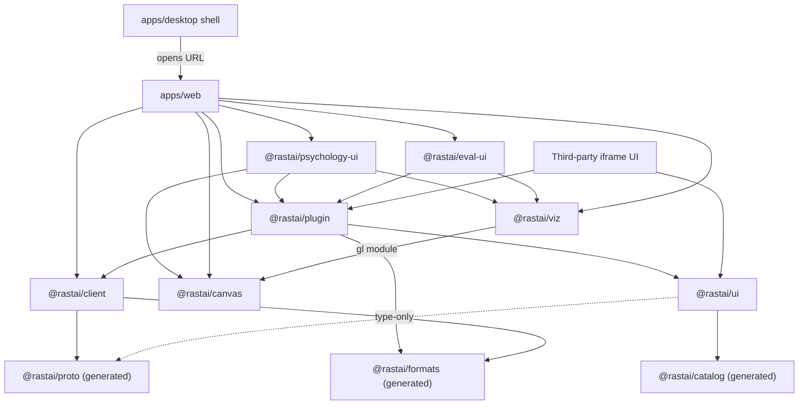
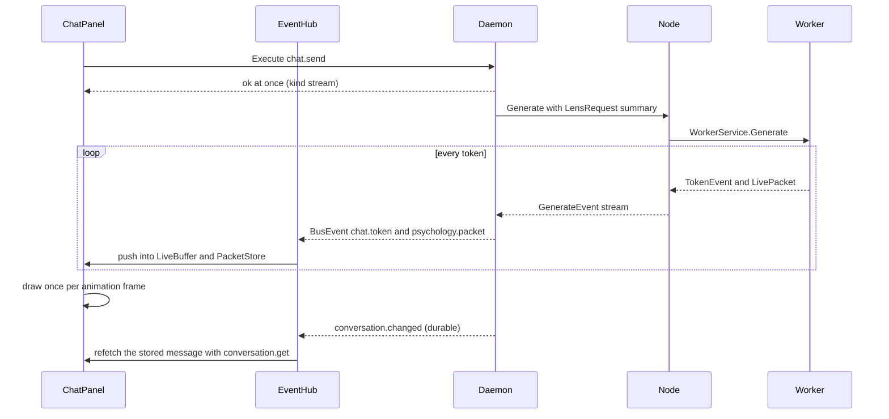
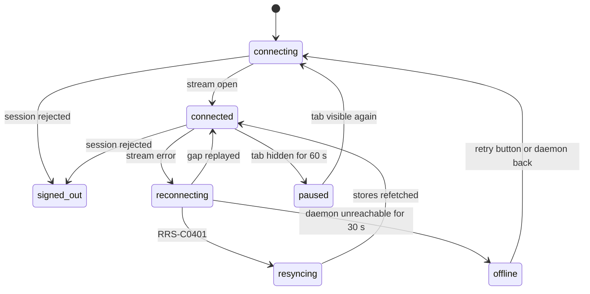
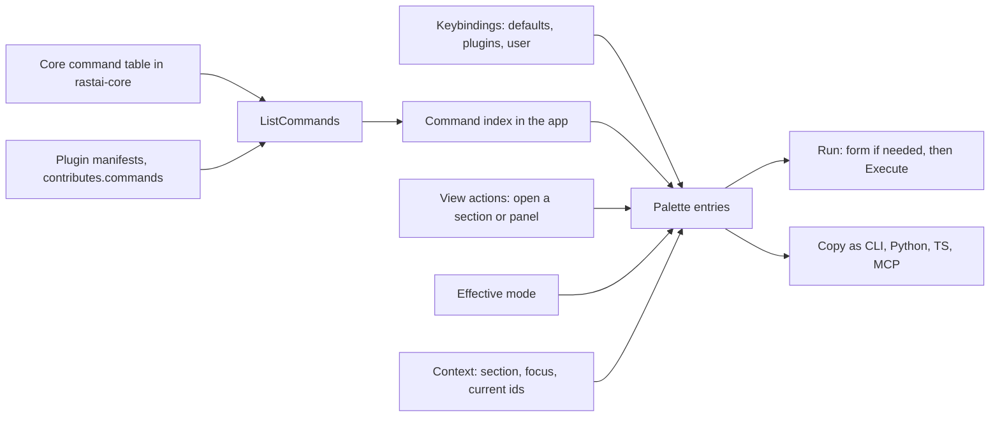
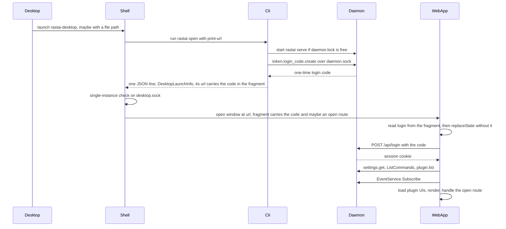
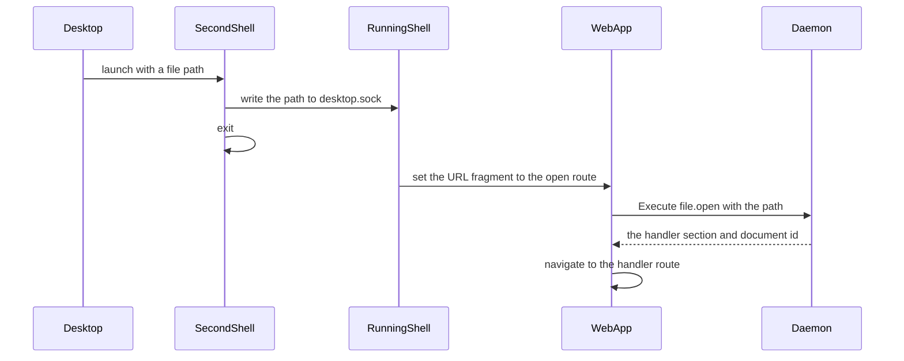
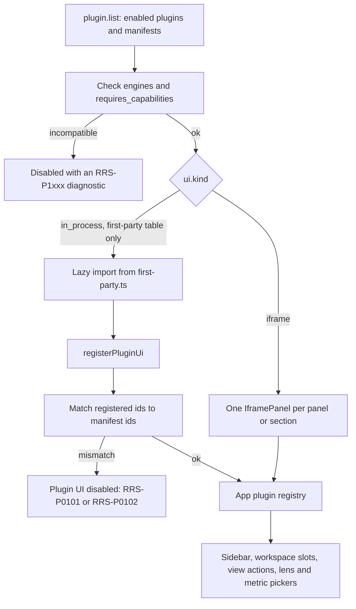
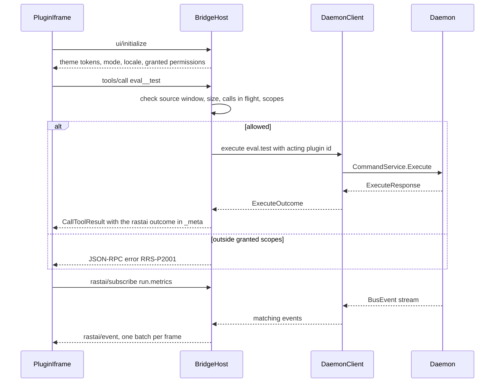
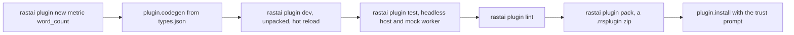

# Frontend and Plugins: Code Layout

**Status:** v1, 2026-10-10. Pre-build design. Built on spec v5.3 (`docs/spec/rastai_spec_v5.md`), the spike (`spike/README.md`) and the shared names (`docs/architecture/contracts.md` v1).

**Covers:**
- `apps/web` (the React app) and `apps/desktop` (the Tauri 2 shell);
- `packages/ui`, `packages/client`, `packages/canvas`, `packages/viz`, `packages/plugin`;
- the plugin SDKs: `@rastai/plugin` (TS), `python/rastai_plugin` (Python), `crates/rastai-plugin` (Rust);
- the `rastai plugin new` templates in `templates/plugins/`;
- the plugin iframe bridge (MCP Apps compatible);
- the first-party plugins `plugins/psychology/` and `plugins/evaluation/` as packages: their UI, and how they register commands, panels, lenses and metrics.

**Not covered here:** the generated packages (`@rastai/proto`, `@rastai/formats`, `@rastai/catalog`) beyond how they're used; `apps/viewer`; the daemon's plugin host in `rastai-server`; the Python internals of `rastai_psychology` and `rastai_eval` (analysis jobs, metric math). Those live in the other layout docs.

**Conventions:** as in contracts.md. "(spike)" marks a measured result. A name that contracts.md doesn't define is marked "(new)" where it's introduced and listed in section 20.

---

## 0. Decisions in this doc

1. **Live streams use one Connect server stream per window** (`EventService.Subscribe`): a streaming HTTP response, like SSE, but with binary protobuf frames and resume by `after_bus_sequence`. No WebSocket now. `openEventStream` in `@rastai/client` is the one place a WebSocket transport would go if measurement in WebKitGTK shows stalls (contracts §14 Q11).
2. **One stream per window, shared by every panel.** Browsers allow about 6 HTTP/1.1 connections per origin, so a stream per panel would starve command calls. A tab hidden for 60 s closes its stream and resumes when shown again. Each extra window (the training dashboard's second window, `view.window.open`, 8.4) costs one more stream. Hidden windows pause after 60 s like tabs.
3. **No state library.** Four kinds of state, each with one tool: React state for local state; `createStore` for shared UI state; `useQuery` over commands for server state, invalidated by bus events; `LiveBuffer` and typed-array stores for high-rate streams, read once per animation frame.
4. **Basic/Advanced is threaded with one React context.** `ui.mode` feeds a `ModeProvider` at the root; each `PanelFrame` re-provides it with the layout's `mode_override`. There is `<AdvancedOnly>` and no `BasicOnly`, so Advanced can't hide Basic controls by construction.
5. **The command palette is generated** from `ListCommands`, the merged keybindings and the app's view actions. Nothing is hand-listed.
6. **Hash routing** (`#/<section_id>/...`), in-house and about 60 lines. It works in a browser, in Tauri and in the static viewer with no server fallback.
7. **One host interface for plugin UIs**, `PluginHost`, with three implementations: in-process (first-party), over the iframe bridge (third-party), and a mock (tests). The same panel code runs in all three.
8. **Renderers don't know about React or the daemon.** `@rastai/canvas` and `@rastai/viz` take a canvas element and plain arrays; React wraps them with one hook (`useRenderer`). The static viewer and iframe plugins reuse them unchanged.
9. **Charts are Canvas2D with min/max decimation; the graph and 3D views are WebGL2.** Shaders only where they buy something (spike: instancing holds the refresh cap at 50,000 nodes).
10. **The desktop shell does no HTTP and no crypto.** It runs `rastai open --print-url` (contracts §3.2), opens the URL it prints, and passes file opens through the URL fragment, merged with the `#login=<code>` fragment the CLI prints (2.6). A second launch forwards its file paths to the running window over `<runtime>/desktop.sock` (new).
11. **Plugin command argument types come from the plugin's own `types.json`** (new, the TypeDescription format of contracts §5.4), generated into TS and Python by `plugin.codegen` (new). First-party plugins use this path too, so the third-party path is exercised from day one.
12. **Contribution ids are namespaced:** a plugin's section id is its `plugin_id`; panels, lenses and metrics are `<plugin_id>.<name>` (e.g. `psychology.live`, `eval.pass_at_k`).

---

## 1. Package Map

| Path | Name | Runs in | Internal deps | External deps (§27) | First needed (§31 step) |
|---|---|---|---|---|---|
| `packages/client` | `@rastai/client` | browser, Tauri webview | `@rastai/proto`, `@rastai/formats` | connect-es, protobuf-es runtime | 1 |
| `packages/ui` | `@rastai/ui` | browser, iframes, viewer | `@rastai/catalog`, `@rastai/proto` (type-only, proposed) | react, react-dom | 1 |
| `packages/plugin` | `@rastai/plugin` | browser, iframes | `@rastai/client`, `@rastai/ui`, `@rastai/formats`, `@rastai/proto`, `@rastai/catalog` | react | 1 (bridge in 8) |
| `packages/canvas` | `@rastai/canvas` | browser, iframes, viewer | none | none | 4 (attribution graph), 6 (Designer) |
| `packages/viz` | `@rastai/viz` | browser, iframes, viewer | `@rastai/canvas` (its `gl` module only, proposed) | none | 4 |
| `apps/web` | `@rastai/web` | browser, Tauri webview | every package above + `@rastai/psychology-ui`, `@rastai/eval-ui` | react, react-dom | 1 |
| `apps/desktop` | `@rastai/desktop` + crate in `src-tauri/` | desktop shell | none (spawns `rastai`, loads a URL) | tauri, tauri-build, Tauri updater plugin, serde, serde_json | 1 (window), week 13 (packaging) |
| `plugins/psychology/ui` | `@rastai/psychology-ui` | browser | `@rastai/plugin`, `@rastai/ui`, `@rastai/canvas`, `@rastai/viz` | react | 4 |
| `plugins/evaluation/ui` | `@rastai/eval-ui` | browser | `@rastai/plugin`, `@rastai/ui`, `@rastai/viz` | react | 5 |
| `python/rastai_plugin` | `rastai_plugin` | worker jobs, plugin modules | `rastai_proto`, `rastai_formats` | grpcio | 1 (registry), grows to 8 |
| `crates/rastai-plugin` | `rastai-plugin` | provider processes | `rastai-diag`, `rastai-formats`, `rastai-proto` | tokio, tonic | 8 (skeleton), Phase 3 (used) |
| `templates/plugins` | (data) | `plugin.new` | — | — | 8 |

Two changes to contracts §2.3 are proposed here (section 20):
- `@rastai/ui` imports the `Diagnostic` type from `@rastai/proto`, type-only, so `DiagnosticView` doesn't re-declare it (§20: no type defined twice).
- `@rastai/viz` imports the WebGL helpers from `@rastai/canvas` (`gl/` module) instead of copying them.



Arrows mean "may import". Not obvious from the picture:
- Only three folders of `apps/web` import `@rastai/client` directly: `src/app/`, `src/events/` and `src/plugin-host/`. Core sections (`src/sections/*`) and plugin UIs reach the daemon only through `PluginHost` from `@rastai/plugin`. `tools/checks/check-imports` enforces this.
- `@rastai/ui`, `@rastai/canvas` and `@rastai/viz` never import `@rastai/client`, so the static viewer and sandboxed iframes can use them with no daemon.
- An iframe plugin bundles its own copy of `@rastai/plugin` (guest side) and `@rastai/ui`. It has no network access; everything goes over postMessage.

**TS conventions used below** (extending contracts §12.4):
- Hand-written TS types use camelCase fields. Generated document and command-argument types keep the JSON's snake_case (one spelling across Rust, Python and TS, so a field is greppable everywhere). Protobuf messages use protobuf-es's camelCase.
- Every package exports TypeScript source (`"exports": { ".": "./src/index.ts" }`); Vite compiles it. No per-package build step in the prototype. npm publishing (Phase 2) adds one.
- Each package has a `CLAUDE.md` with its local rules (spec §29).

---

## 2. Cross-Cutting Design

### 2.1 Talking to the daemon

- **Base URL** is the page's own origin (`http://127.0.0.1:47820` by default). The daemon serves the app at `/` (contracts §3.3), so there is nothing to configure.
- **Sign-in:** the start URL carries `#login=<code>` in the fragment (contracts §3.2–3.3). Browsers never send a fragment to a server or put it in a Referer header, so the code stays out of the daemon's request log. `main.tsx` reads `login` from the fragment before routing (2.6), exchanges it with `POST /api/login` for the HttpOnly session cookie, then removes it from the fragment with `history.replaceState`. JavaScript never holds a long-lived token. A `login` in the real query string is ignored.
- **Commands:** Connect unary `CommandService.Execute` with protobuf binary. `?wire=json` switches to Connect JSON for debugging in devtools.
- **Events:** one `EventService.Subscribe` stream per window (2.2).
- **Blobs:** `GET /api/blobs/<hash>` (immutable, so the browser caches it by hash) and `PUT /api/blobs` with upload progress.
- **Version:** `GET /api/health` returns the daemon version. If it differs from the version baked into the web build, the app shows RRS-U0004 "Reload to update" (a tab left open across an update).
- **Files:** the UI never reads local files by path. Drag-drop uploads to the blob store (up to `MAX_BROWSER_UPLOAD_BYTES`, 256 MiB). Larger files open by path through a daemon-side file browser, `file.browse` (new), so nothing is copied.

### 2.2 Per-token live streams

**Transport choice**

| Need | SSE (`EventSource`) | WebSocket | Connect server stream (chosen) |
|---|---|---|---|
| Binary 8.3 KB packets (spike) | text only; base64 adds 33% | yes | yes, protobuf frames |
| Same auth, Host and Origin checks as commands | yes | separate upgrade path to secure | yes, same axum handler stack |
| Resume after a drop | `Last-Event-ID` | hand-rolled | `after_bus_sequence` in the request |
| Types generated from proto | no | hand-rolled framing | yes (`@rastai/proto`) |
| Client → server messages | no | yes | no; not needed, commands go through `Execute` |
| Works through an SSH tunnel and in a plain browser | yes | yes | yes |

Connect server streaming over HTTP/1.1 is `fetch()` with a streamed response body, which every target engine supports. The rate is small: 8.3 KB × ~150 tok/s ≈ 1.3 MB/s for one live panel (spike). The daemon must set `TCP_NODELAY` on streaming responses (spike: 40 ms stalls per reply without it).

**The path of one token**



Steps that aren't obvious:
- `chat.send` returns as soon as generation starts. Tokens arrive only as bus events, never in the `Execute` response.
- The event hub does O(1) work per event: decode, then push into a buffer. Nothing renders per event. Views re-read their buffers once per animation frame (about 60 Hz in WebKitGTK even on a 144 Hz monitor, spike).
- The live packet carries token IDs, not text. The UI fetches the model's token piece table once with `model.vocabulary` (new; returns a `BlobRef`, about 3 MB for Gemma's 262k vocabulary) and decodes IDs locally. The gateway's tokenizer is the only source of the table, the same one that produced the IDs.

What's persisted where:
- `chat.token` and `psychology.packet` are ephemeral (contracts §7.3). The browser keeps them only in memory.
- The message itself is stored in `vault.db` by the daemon. When `conversation.changed` names the message, the UI fetches it and replaces the streamed text with the stored text. Any dropped tokens heal there.
- Packets are not stored. A replay recomputes them from token IDs (`psychology.replay.open`), and an exported `.rrsreplay` carries the summary layer.

Failure branches:
- **Dropped ephemeral events** (daemon backpressure): the PacketStore marks the missing token indexes. The live panel shows "N tokens missing" (RRS-U0005, info) and a **Recompute** button that runs `psychology.replay.open`.
- **Stream drop:** the client reconnects with backoff and `after_bus_sequence` = the last sequence seen. The daemon replays the gap from its 10,000-event buffer.
- **Gap too old** (RRS-C0401): the hub calls `onResync`; every query is invalidated and the app stores refetch. Live buffers keep what they have and mark the rest missing.
- **Daemon gone mid-generation:** the banner shows "reconnecting". After the daemon is back, `conversation.get` returns whatever the gateway logged.

**Connection status** (what `ConnectionBanner` shows):



- `offline` shows RRS-U0001 with the fix "start Rastai" (`rastai` in a terminal). Retrying continues in the background every 5 s.
- `signed_out` shows `SignedOutScreen`: "Open Rastai again from the app or with `rastai open`" (RRS-U0003). The UI can't sign itself in; only a login code can.
- `paused` is the tab-visibility rule from decision 2. The banner is hidden while paused.

### 2.3 State management

| Kind | Tool | Read with | Examples |
|---|---|---|---|
| Local | `useState`, `useReducer` | the component | short form fields, hover, open menus |
| Unsent draft | `draft-store.ts` (localStorage, best effort) | `loadDraft` on mount | the chat composer's text, a harness's system prompt, a suite test's input |
| Shared UI | `createStore<T>()` (get, set, subscribe) | `useStore(store)` (React's `useSyncExternalStore`) | route, settings, command index, replay playhead shared by the timeline and every view |
| Server | `useQuery(commandId, args, invalidatedBy)` | the hook's `QueryState` | `useQuery("conversation.list", {}, ["conversation.changed"])` |
| High-rate | `LiveBuffer<T>` or a typed-array store | `useLiveBuffer(buffer)` (at most one render per animation frame); WebGL views read arrays directly | streamed chat text, live packets, metric series, log lines |
| User preference | daemon settings (`settings.get` / `settings.set`) | the settings store | `ui.mode`, theme, sampling defaults |

Rules:
- **No Redux, MobX, Zustand, React Query or similar.** The tools above are each under 100 lines and live in `@rastai/plugin/src/state/`.
- **The query cache** is a `Map` keyed by `command_id` + canonical JSON of the arguments. An entry is dropped when an event of one of its `invalidatedBy` types arrives (optionally matching `subject_id`), and all entries drop on resync.
- **localStorage** holds only throwaway conveniences and unsent drafts. Every access is wrapped in try/catch, and the app works with it empty. Never settings, never secrets.
  - Conveniences: recently used palette entries and the last route per section.
  - **Unsent drafts** (spec §2: nothing the user did is lost to a crash): text the user typed but hasn't sent or committed, so a WebKitGTK crash, a reload after RRS-U0004 or a resync doesn't lose a long prompt.
    - Key `draft:<section>:<subject_id>`, e.g. `draft:inference:conv_01JA...`, or `draft:inference:new` before the conversation exists.
    - Saved 500 ms after the last keystroke. Restored when the component mounts. Cleared after the `chat.send` or the document edit that commits it returns `ok`.
    - Never for incognito conversations (incognito is never stored, anywhere) and never for secret or token fields.
    - Drafts older than `DRAFT_MAX_AGE_DAYS` (30) are dropped on load. localStorage is per origin, so a daemon that fell back to another port starts with no drafts. Drafts are a safety net, not storage.
- **Undo** is the daemon's (`document.undo` / `document.redo`). The UI keeps no undo stack.

```ts
// packages/plugin/src/state/store.ts
export type Store<T> = {
  get: () => T;
  set: (value: T) => void;
  subscribe: (listener: () => void) => () => void;
};
export function createStore<T>(initial: T): Store<T>
export function useStore<T>(store: Store<T>): T

// packages/plugin/src/react/use-query.ts
export type QueryState<T> = { status: "loading" | "ready" | "error"; data: T | null; diagnostics: Diagnostic[] };
export function useQuery<T>(commandId: string, args: object, invalidatedBy: string[]): QueryState<T>

// packages/plugin/src/state/live-buffer.ts
const DEFAULT_LIVE_BUFFER_CAPACITY = 16384;

export type LiveBuffer<T> = { items: T[]; capacity: number; firstSequence: number; nextSequence: number };
export function createLiveBuffer<T>(capacity: number): LiveBuffer<T>
export function pushItem<T>(buffer: LiveBuffer<T>, item: T): void
export function itemsSince<T>(buffer: LiveBuffer<T>, sequence: number): T[]
export function useLiveBuffer<T>(buffer: LiveBuffer<T>): number   // returns nextSequence; re-renders at most once per frame

// packages/plugin/src/state/draft-store.ts
const DRAFT_SAVE_DELAY_MS = 500;      // one write per typing pause, not per keystroke
const DRAFT_MAX_AGE_DAYS = 30;        // older drafts are dropped on load

export function loadDraft(key: string): string | null      // null when missing, too old, or storage is unavailable
export function saveDraft(key: string, text: string): void // debounced by DRAFT_SAVE_DELAY_MS; empty text clears
export function clearDraft(key: string): void
```

`chat/Composer.tsx`, `harness/HarnessEditor.tsx` and Evaluation's `suites/SuiteEditor.tsx` use the draft store. In a sandboxed iframe localStorage throws, so the store's try/catch makes it a no-op there.

### 2.4 Basic/Advanced

How the setting reaches a control:
1. **Global:** `ui.mode` from `settings.get` (the prototype default is `advanced`, contracts §11.2). It lives in the app's settings store.
2. **Per panel:** the layout node's `mode_override` (`basic`, `advanced` or empty) in `rastai.layout/1`. The panel's title bar has the toggle.
3. **Context:** `App` renders `<ModeProvider mode={globalMode}>`. Every `PanelFrame` renders `<ModeProvider mode={override ?? globalMode}>` around its panel.
4. **Components** call `useMode()` to change wording or density, and wrap extra controls in `<AdvancedOnly>`.
5. **Commands:** in Basic mode the palette and menus show only commands whose `CommandDescriptor.basic` is true.
6. **Diagnostics:** `DiagnosticView` shows the catalog's `basic_text` and a fix button in Basic mode, and adds the code, path and full message in Advanced.
7. **Iframes** get the mode in the `ui/initialize` result and every change through `rastai/theme_changed`.
8. **Switching keeps all state.** Controls inside `<AdvancedOnly>` keep their values in the panel's store, not in `useState` inside the Advanced subtree, so switching back restores them. Changing the global mode is `settings.set` on `ui.mode`; the resulting `command.finished` event refreshes every window.

```ts
// packages/ui/src/mode/
export type UiMode = "basic" | "advanced";
export function ModeProvider(props: { mode: UiMode; children: ReactNode }): JSX.Element
export function useMode(): UiMode
export function AdvancedOnly(props: { children: ReactNode }): JSX.Element | null   // renders children only in Advanced
```

Rules:
- There is no `BasicOnly`. A Basic control can't be hidden in Advanced (spec §7).
- `<AdvancedOnly>` sits after or beside Basic blocks and never wraps them, so Advanced doesn't move Basic controls.
- The e2e test `tests/e2e/basic-advanced.spec.ts` checks both rules for every section: the ordered list of interactive elements (role and accessible name) in Basic must be a subsequence of the list in Advanced, and a value typed in Basic must survive a round trip through Advanced.

### 2.5 Command palette generation



Steps:
1. **Descriptors:** at boot and on every `plugin.state_changed`, the app calls `ListCommands`. The daemon merges the core table and enabled plugins' manifests, so the UI never merges them itself.
2. **Keybindings,** lowest to highest: each descriptor's `default_shortcut`, plugins' `contributes.keybindings`, then the user's `<config>/keybindings.json` read with `workspace.keybindings.get` (new). A binding's `when` is empty (always) or a single `<key>=<value>` test against the context, e.g. `focus=canvas` or `section=designer`. Context keys are listed in section 20.
3. **View actions** are UI-only entries the app derives from the registry: `view.section.open` per section, `view.panel.open` per panel, `view.window.open` (the current route in a new window, 8.4), `view.palette.repeat_last`. They never reach the daemon and have no "Copy as". The `view` area must be reserved in contracts §6.1, so no plugin command can take a `view.*` id (section 20 asks M1-01 to add it).
4. **Filter:** hide `experimental` commands unless `plugins.experimental_apis` is on. In Basic mode keep only `basic` ones.
5. **Match and rank:** in-house subsequence scoring over the title, command id and section. Recently used entries (localStorage) rank first.
6. **Run:**
   - If the arguments have required fields that the context can't fill, the palette opens `CommandForm`, generated from the descriptor's `arguments_schema_json` (new field; the MCP server needs the same schema for its tool list).
   - Context prefill: a field named like a context id (`conversation_id`, `document_id`, `run_id`, `checkpoint_id`, `model_ref`) is filled from the current context. Sections set the context with `host.setContext`.
   - Then `execute`. A `job` command shows a `JobProgress` toast with a link; a `stream` command navigates to the view that shows the stream.
7. **Copy as:** the entry's menu writes the same call four ways (`apps/web/src/commands/copy-as.ts`):

```
CLI     rastai eval test --suite evals/facts.rrseval --model ckpt:ckpt_01JA...
Python  rastai.client.connect().execute("eval.test", {"suite": "evals/facts.rrseval", "model": "ckpt:ckpt_01JA..."})
TS      await execute(client, "eval.test", { suite: "evals/facts.rrseval", model: "ckpt:ckpt_01JA..." })
MCP     {"name": "eval__test", "arguments": {"suite": "evals/facts.rrseval", "model": "ckpt:ckpt_01JA..."}}
```

The exact CLI flag syntax belongs to `rastai-cli`'s generated verbs. Both sides read the golden file `fixtures/command-golden/copy-as.json` (new), so they can't drift. `rastai.client.connect()` is the Python SDK client (new; to reconcile with the Python packages doc).

What's persisted: nothing new. Descriptors live in the daemon's registry, keybindings in `<config>/keybindings.json`, recent entries in localStorage (losing them only changes the ranking).

Failures:
- If `ListCommands` fails at boot, the palette offers only view actions and the connection banner explains why. It refills on reconnect.
- A failed command shows its diagnostics in a toast with the fix button.
- A keybinding that names an unknown command is skipped and listed on the Keybindings settings page.

**Macros** (spec §13) reuse the same formatters: while recording, `macro-recorder.ts` keeps every executed command id and argument object (skipping `read`-scope queries) and writes them out as a Python or TS script.

### 2.6 Routing and workspace

**Routes** are `#/<section_id>/<segments>?<query>`. Each section gets `path: string[]` and `query` and handles its own segments with a plain `switch`. There is no nested router.

| Route | Shows |
|---|---|
| `#/home` | Home: Chat · Teach it my data · See inside · Fix a behavior · Design a network · Train an agent |
| `#/inference/chat/<conversation_id>` | a conversation |
| `#/psychology/replay/<conversation_id>` | Psychology replay |
| `#/training/run/<run_id>` | run dashboard |
| `#/eval/run/<run_id>` | eval results ("Did it get better?") |
| `#/designer/design/<document_id>` | a design on the canvas |
| `#/open?path=<percent-encoded path>` | open a file: `file.open`, then navigate to the route of the handler it returns |

**Fragment grammar.** Everything after `#` is `[/<section_id>/<segments>][?<query>]`. `<query>` is `key=value` pairs joined by `&`, percent-encoded, read with `URLSearchParams`. The forms that come from outside the app:

| Source | Fragment | Means |
|---|---|---|
| CLI start URL (`rastai open`, contracts §3.3) | `#login=<code>` | a bare query with no route: sign in, then `#/home` |
| Desktop shell, cold start with a file | `#/open?path=<enc>&login=<code>` | sign in, then open the file |
| Desktop shell, running window | `#/open?path=<enc>` | open the file (the window is already signed in) |
| Anything that wants a start route | `#/<section_id>/...?login=<code>`, e.g. `#/home?login=<code>` | sign in, then that route |

- A fragment that doesn't start with `/` is a bare query, and its route is `#/home`.
- `login` is reserved: no route uses a `login` key of its own. `main.tsx` reads it (`readLoginCode`) and removes it (`removeLoginCodeFromUrl`) before the router starts. Removal rewrites the fragment with `history.replaceState`, so the code never stays in the address bar or the history. `replaceState` fires no `hashchange`, so the router reads `location.hash` once after sign-in.
- `readLoginCode` (`@rastai/client`) and `parseRoute` (`apps/web/src/routing/route.ts`) split the fragment the same way. Their tests share one fixture table, `fixtures/ui/fragments.json` (new), so the two can't drift.
- The page's real query string is separate. It carries only the debug switch `?wire=json` (and `?new_window=1` in one desktop fallback, section 19, question 12), never a code.

**Workspace:**
- One layout tree per section. The default comes from the section's `section.json` (`default_layout`). Saved layouts are files (`workspace.layout.save` / `workspace.layout.apply`).
- A panel from another plugin docks by panel id. Example: Inference's default layout puts `psychology.live` on the right. If that plugin is disabled, the slot says so and offers to enable it.
- Prototype docking: split and tabs, plus "move to right / bottom / new tab" from the panel menu. Free drag-docking is Phase 2.

### 2.7 Errors in the UI

- Everything shown as an error is a `Diagnostic` with a catalog code, rendered by `DiagnosticView` from `@rastai/catalog`.
- A command failure is `ExecuteOutcome.ok = false` plus diagnostics, never an exception. `fix_command_id` and `fix_arguments_json` drive the fix button.
- A job failure arrives as the `Diagnostic` in its last `job.state_changed`; `JobProgress` shows it.
- Client-side failures use RRS-U codes (section 20). A crashed panel is caught by `PanelFrame`'s error boundary and shows RRS-U1004 with "Reload panel". The rest of the window keeps working.

### 2.8 UI performance rules

- No React render per streamed event (2.2). Buffers are filled at event rate and drawn at frame rate.
- Lists longer than 200 rows use `VirtualList`.
- WebGL views draw on demand (a dirty flag). They run every frame only while something animates or streams. The spike drew every frame; production must not, to save power.
- Hot paths reuse preallocated typed arrays. No per-frame allocation, no per-frame `readPixels`.
- Frame budget: 16 ms (WebKitGTK caps at about 60 Hz, spike), with script time per frame under 4 ms at the target sizes. The spike measured 0.9 ms for 50,000 recolored nodes in Chrome.
- Sections and plugin UIs load lazily with dynamic `import()`. The first screen loads the shell, Home and Inference only.
- Never branch on the GPU renderer string. WebKitGTK reports "Apple GPU" on an NVIDIA box (spike). Use capability checks and the pixel read-back self-check (5.6).

### 2.9 Accessibility (WCAG 2.2 AA, spec §7)

- Every chart has a table: each `@rastai/viz` chart has `toTable()`, and `ChartFrame` in `@rastai/ui` has a "Show as table" toggle.
- The Psychology token timeline is keyboard-driven: left/right moves by token, up/down by layer, Enter opens details, Space plays or pauses.
- The Designer canvas mirrors visible nodes into an offscreen `role="tree"` DOM, so the graph can be navigated with the keyboard and a screen reader.
- Colorblind-safe palettes (`ui.colorblind_palette`): blue/orange instead of red/green for diverging maps.
- Reduced motion (`ui.reduced_motion` or the OS setting) turns off camera auto-motion, inertia and animated transitions in 3D views.
- `tests/e2e/accessibility.spec.ts` runs axe-core (proposed dev tooling, section 18) on every section in both modes.

---

## 3. `packages/client` (`@rastai/client`)

A thin daemon client: transport, sign-in, commands, the event stream with resume, blobs. No React, no UI.

### 3.1 Tree

```
packages/client/
  package.json              @rastai/client; exports ./src/index.ts
  tsconfig.json
  CLAUDE.md                 local rules: no React, no UI, never throw on command failure
  src/
    index.ts                public exports only
    constants.ts            reconnect delays, timeouts, upload size cap, login parameter name
    connection.ts           connectToDaemon, checkHealth, Connect transport setup (binary or JSON)
    login.ts                readLoginCode and removeLoginCodeFromUrl (URL fragment only), exchangeLoginCode
    execute.ts              execute, listCommands, idempotency keys, ExecuteResponse to ExecuteOutcome
    event-stream.ts         openEventStream: one server stream, backoff, resume, resync signal
    blobs.ts                blobUrl, uploadBlob (XMLHttpRequest for upload progress), readBlobBytes
    diagnostics.ts          clientDiagnostic: RRS-U Diagnostics for transport and session failures
    execute.test.ts         unit tests next to each file
    event-stream.test.ts
    login.test.ts
    blobs.test.ts
    proto-golden.test.ts    round-trips fixtures/proto-golden/ in TS (the TS leg of the golden test)
```

### 3.2 Public API

```ts
// constants.ts
export const RECONNECT_DELAYS_MS = [250, 500, 1000, 2000, 5000];   // then stays at 5 s
export const OFFLINE_AFTER_MS = 30_000;                             // banner switches to "offline"
export const MAX_BROWSER_UPLOAD_BYTES = 256 * 1024 * 1024;          // bigger files open by path, no copy
export const LOGIN_CODE_PARAMETER = "login";   // a key in the URL fragment's query (#login=<code>), never the real query
                                               // string: a fragment never reaches a server log or a Referer header

// connection.ts
export type DaemonClient = {
  baseUrl: string;
  daemonVersion: string;
  commands: CommandServiceClient;   // generated by connect-es from @rastai/proto
  events: EventServiceClient;
};
export async function connectToDaemon(baseUrl: string, useJsonWire: boolean): Promise<DaemonClient>
export async function checkHealth(baseUrl: string): Promise<{ ok: boolean; version: string }>

// login.ts (fragment grammar in 2.6)
export function readLoginCode(location: Location): string | null   // parses location.hash only; null when absent
export async function exchangeLoginCode(baseUrl: string, code: string): Promise<Diagnostic | null>
export function removeLoginCodeFromUrl(): void                      // history.replaceState with the fragment minus login

// execute.ts
export type ExecuteOptions = {
  projectId?: string;
  dryRun?: boolean;
  actingPluginId?: string;   // set by plugin hosts; the daemon narrows scopes to the plugin's grant
};
export type ExecuteOutcome = {
  ok: boolean;
  result: unknown;           // parsed result_json; null when ok is false
  jobId: string | null;
  diagnostics: Diagnostic[];
  journalId: string | null;
};
export async function execute(client: DaemonClient, commandId: string, args: object, options?: ExecuteOptions): Promise<ExecuteOutcome>
export async function listCommands(client: DaemonClient): Promise<CommandDescriptor[]>

// event-stream.ts
export type EventStreamStatus = "connecting" | "connected" | "reconnecting" | "resyncing" | "offline" | "signed_out";
export type EventStreamHandlers = {
  onEvent: (event: BusEvent) => void;
  onStatus: (status: EventStreamStatus, problem: Diagnostic | null) => void;
  onResync: () => void;      // the daemon no longer holds our gap (RRS-C0401): refetch state
};
export type EventStream = { stop: () => void; lastBusSequence: () => bigint };
export function openEventStream(client: DaemonClient, eventTypes: string[], afterBusSequence: bigint, handlers: EventStreamHandlers): EventStream

// blobs.ts
export function blobUrl(client: DaemonClient, blobHash: string): string
export async function uploadBlob(client: DaemonClient, file: Blob, onProgress: (bytesDone: number, bytesTotal: number) => void): Promise<BlobRef | Diagnostic>
export async function readBlobBytes(client: DaemonClient, blobHash: string): Promise<Uint8Array>
```

Callers:
- `apps/web/src/app/` (connect, sign in, version check), `src/events/event-hub.ts` (the one stream), `src/plugin-host/in-process-host.ts` (execute for plugin code).
- `@rastai/plugin` uses only the types (`ExecuteOutcome`, `ExecuteOptions`).

Behavior worth stating:
- `execute` returns transport failures as an outcome with an RRS-U diagnostic; it never throws for an expected failure. Each call gets a fresh `idempotency_key`; a retry after a reconnect reuses it, so the daemon doesn't run the command twice.
- `openEventStream` owns its reconnect loop. Only `stop()` ends it.

### 3.3 Dependencies

- Internal: `@rastai/proto` (messages and service stubs), `@rastai/formats` (command argument and result types, for typed callers).
- External: `@connectrpc/connect` and `@connectrpc/connect-web` (connect-es: the Connect transport), `@bufbuild/protobuf` (protobuf-es runtime; contracts §14 Q1 proposes adding it to §27). All three are imported only in `connection.ts` and `event-stream.ts` (contracts §2.4 rule 8).
- Modules: `execute.ts`, `event-stream.ts` and `blobs.ts` import `connection.ts` and `diagnostics.ts`; `login.ts` imports `diagnostics.ts` only; `constants.ts` imports nothing.

### 3.4 Boundary rules

- Never imports React, `@rastai/ui` or any app code.
- Never sees a long-lived token: the session cookie is HttpOnly.
- Never opens more than one event stream per `DaemonClient`. The app creates one client per window.
- Never reads local files or opens other sockets (contracts §2.4 rule 4).

### 3.5 Tests

- Unit tests next to each file, run by vitest in Node. The fake daemon is connect-es's in-memory router transport.
- `event-stream.test.ts`: resume with the right `after_bus_sequence`; the backoff sequence; RRS-C0401 calls `onResync`; `stop()` ends the loop.
- `login.test.ts`: the cases in `fixtures/ui/fragments.json`. `#login=abc` and `#/open?path=x&login=abc` give `abc`; after removal the fragments are `#/home` and `#/open?path=x`; `?login=abc` in the real query string gives `null`.
- `proto-golden.test.ts`: every message in `fixtures/proto-golden/` decodes and re-encodes byte-identical.
- Covered end to end by `tests/e2e/reconnect.spec.ts` (kill -9 the daemon while a chat streams; the test restarts it; the UI resyncs, the user message is stored and Regenerate works, plan §10 row 23).

### 3.6 Ported code

None. Lessons applied: binary frames for the 8.3 KB packet; the daemon-side `TCP_NODELAY` rule (spike 07).

### 3.7 Build order

Step 1 (Foundation, weeks 3–4): `connectToDaemon`, sign-in, `execute`, `listCommands`, `openEventStream`. Blob upload arrives with step 3 (conversation import) and step 5 (data import).

---

## 4. `packages/ui` (`@rastai/ui`)

The design system (spec §7): tokens, components, Basic/Advanced primitives, the diagnostics view, the in-house Markdown renderer. Used by core sections, first-party plugins, third-party iframe UIs and the static viewer alike.

### 4.1 Tree

```
packages/ui/
  package.json, tsconfig.json
  CLAUDE.md                    local rules: no daemon access, no global state, Advanced only adds
  src/
    index.ts
    tokens/
      tokens.ts                ThemeTokens type, builtInTheme(name, colorblind)
      palettes.ts              constants: categorical, sequential, diverging palettes (colorblind-safe variants)
      apply-theme.ts           applyThemeTokens(root, tokens): sets CSS custom properties
      viz-colors.ts            vizColors(tokens): plain color data handed to canvas and viz renderers
    styles/
      base.css                 reset, typography, focus ring, reduced-motion rules
      components.css           one block per component; class prefix rr-
    mode/
      ModeProvider.tsx
      use-mode.ts
      AdvancedOnly.tsx
    components/                one component per file
      Button.tsx  IconButton.tsx  TextField.tsx  NumberField.tsx  Slider.tsx  Select.tsx
      Checkbox.tsx  Toggle.tsx  RadioGroup.tsx  Tabs.tsx  SplitView.tsx  Dialog.tsx  Menu.tsx
      Tooltip.tsx  Toast.tsx  show-toast.ts  Banner.tsx  Badge.tsx  ProgressBar.tsx  Spinner.tsx
      EmptyState.tsx  KeyHint.tsx  Table.tsx  VirtualList.tsx  Tree.tsx  FileDropZone.tsx
      FieldForm.tsx            renders FieldSpec[] (plain data) as a form; CommandForm builds on it
      ChartFrame.tsx           title, chart slot, legend, "Show as table" toggle with Table
      CommandPaletteView.tsx   palette view only: filter input, list, keyboard navigation; data comes from the caller
      SidebarNav.tsx  StatusBar.tsx
      PanelChrome.tsx          panel title bar: title, Basic/Advanced override toggle, panel menu
    diagnostics/
      DiagnosticView.tsx       Basic: basic_text and fix button. Advanced: adds code, path, message, fix_text
      DiagnosticList.tsx
      catalog-lookup.ts        catalog entry for a code, with {placeholders} filled from the Diagnostic
    terms/
      TermText.tsx             marks glossary terms; tooltip shows the plain-English definition
    markdown/
      parse-markdown.ts        in-house subset: paragraphs, headings, lists, emphasis, links, inline code, code fences, tables
      Markdown.tsx             renders the parsed blocks as React elements; never innerHTML
      CodeBlock.tsx            monospace block with a copy button (no syntax highlighting in the prototype)
    icons/
      icon-paths.ts            constants: in-house SVG path data
      Icon.tsx
    hooks/
      use-renderer.ts          mounts a framework-free renderer on a canvas and destroys it on unmount
      use-keyboard-list.ts     arrow-key navigation for lists, tables and the token timeline
      use-reduced-motion.ts    ui.reduced_motion or the OS setting
    format/
      format-bytes.ts  format-duration.ts  format-number.ts   (Intl based)
```

### 4.2 Public API (main items)

```ts
// tokens
export type ThemeTokens = { name: string; colors: Record<string, string>; spacingPx: number[]; fontSizesPx: Record<string, number>; radiusPx: number };
export function builtInTheme(name: "light" | "dark", colorblind: boolean): ThemeTokens
export function applyThemeTokens(root: HTMLElement, tokens: ThemeTokens): void
export function vizColors(tokens: ThemeTokens): VizColors          // plain arrays and hex strings

// mode (2.4)
export function ModeProvider(props: { mode: UiMode; children: ReactNode }): JSX.Element
export function useMode(): UiMode
export function AdvancedOnly(props: { children: ReactNode }): JSX.Element | null

// diagnostics
export function DiagnosticView(props: { diagnostic: Diagnostic; onFix: (commandId: string, argumentsJson: string) => void }): JSX.Element

// forms: FieldSpec is a view model, not a schema type
export type FieldSpec = { name: string; label: string; kind: "text" | "number" | "boolean" | "choice" | "json"; required: boolean; help: string; choices: string[] };
export function FieldForm(props: { fields: FieldSpec[]; values: Record<string, unknown>; onChange: (values: Record<string, unknown>) => void }): JSX.Element

// renderer hook
export function useRenderer<R extends { destroy(): void }>(create: (canvas: HTMLCanvasElement) => R, dependencies: unknown[]): { canvasRef: RefObject<HTMLCanvasElement>; renderer: R | null }
```

Callers: every section and plugin UI; `apps/web`'s frame (`PanelChrome`, `CommandPaletteView`, `StatusBar`); the static viewer; iframe plugins (which apply the host's theme tokens with `applyThemeTokens` after `ui/initialize`).

### 4.3 Dependencies

- Internal: `@rastai/catalog` (error and term entries). `@rastai/proto` type-only, for `Diagnostic` (proposed).
- External: react, react-dom. No component kit, no CSS framework, no icon library, no Markdown library.
- Modules: `tokens/` imports nothing; `mode/` imports nothing; `components/` imports `tokens/`, `mode/`, `hooks/`, `icons/`; `diagnostics/` and `terms/` import `components/` and the catalog; `markdown/` imports `components/CodeBlock.tsx` only.

### 4.4 Boundary rules

- Never imports `@rastai/client`, `@rastai/plugin` or app code. No network, no daemon types beyond `Diagnostic`.
- No global state; components are controlled or own only local UI state.
- No `BasicOnly`. Advanced only adds (2.4).
- Markdown never becomes HTML strings: no `innerHTML`, no `dangerouslySetInnerHTML` anywhere in the package (CI greps for both).

### 4.5 Tests

- Component tests next to the source (`*.test.tsx`) in vitest browser mode with the Playwright provider, in Chromium and WebKit (real engines, no jsdom).
- `parse-markdown.test.ts`: a fixture table of Markdown → block trees, including hostile input (`<script>`, `javascript:` links are rendered as text).
- `palettes.test.ts`: every palette pair meets WCAG contrast against both themes' backgrounds; categorical palettes stay distinguishable under simulated deuteranopia and protanopia.
- Screenshot tests for `DiagnosticView` in both modes.

### 4.6 Ported code

None. The spike canvas's background (`#101318`) and node colors seed the dark theme's tokens.

### 4.7 Build order

Step 1: tokens, base styles, Button, fields, Table, Dialog, Toast, `DiagnosticView`, mode primitives, `CommandPaletteView`, `PanelChrome`. Every later step adds what its section needs: Markdown in step 3 (chat), `ChartFrame` in step 4.

---

## 5. `packages/canvas` (`@rastai/canvas`)

The in-house WebGL2 graph renderer for the Designer and Psychology's attribution graph and architecture map. It starts from `spike/canvas/canvas_test.js`: instanced SDF rounded rectangles for nodes, instanced quads for edges, and a glyph atlas for labels. Three draw calls per frame at any size held the refresh cap at 50,000 nodes and 620,000 glyphs in Chrome and WebKitGTK (spike).

### 5.1 Tree

```
packages/canvas/
  package.json, tsconfig.json
  CLAUDE.md                    local rules: no React, no daemon, no per-frame allocation, draw on demand
  src/
    index.ts                   public exports, including the gl module that @rastai/viz reuses
    constants.ts               MAX_GRAPH_NODES (50,000, measured), atlas size, label cutoff, edge width (from the spike)
    types.ts                   GraphScene, CanvasNode, CanvasEdge, CanvasGroup, Camera, HitResult, CanvasColors
    gl/
      context.ts               createContext: WebGL2 or a RendererProblem (RRS-U1001); context-lost and restored handling
      program.ts               compileShader, createProgram, uniformLocations (ported)
      buffers.ts               createBuffer, bindAttribute, UNIT_QUAD (ported)
      frame-loop.ts            requestDraw (one rAF per renderer), continuous mode only while animating
      self-check.ts            drawnPixelFraction read-back (ported); a blank first frame gives RRS-U1003
    shaders/
      edge-shader.ts           ported; adds dashed residual and skip edges and a selected color
      node-shader.ts           ported SDF rounded rectangle; adds selection ring, kind color, collapsed-block badge
      glyph-shader.ts          ported
      port-shader.ts           SDF circles for input and output ports
      group-shader.ts          expanded-block frames drawn behind their children
    text/
      glyph-atlas.ts           ported; adds on-demand Unicode glyphs, proportional advances, device pixel ratio, rebuild when full
      label-layout.ts          label to glyph instances; ellipsis to fit the node width; skipped below the size cutoff
    scene/
      instance-arrays.ts       GraphScene to typed instance arrays (rectangles, segments, glyphs, ports, groups)
      edge-routing.ts          straight or two-bend segments between ports
      hierarchy.ts             visibleScene(scene, expandedBlockIds): collapse and expand blocks
    layout/
      layered-layout.ts        in-house layered layout: layers by longest path, barycenter ordering, coordinates
      cycle-breaking.ts        reverses recurrent edges for layout only
    camera.ts                  fitCamera, zoomAt, panBy, screenToWorld, worldToScreen (pure)
    hit-test.ts                uniform-grid spatial index over world rectangles and ports; hitTest
    interaction.ts             pointer, wheel and keyboard to camera changes and plain interaction events
    graph-renderer.ts          class GraphRenderer: owns the context and buffers, issues the instanced draws
    accessibility.ts           mirrors visible nodes into an offscreen role="tree" DOM, synced with selection
  bench/
    graph-bench.html           ported canvas_test.html
    graph-bench.ts             ported measureScene, probeRefreshRate, headroom loop; writes a results JSON
```

### 5.2 Public API

```ts
// constants.ts
export const MAX_GRAPH_NODES = 50_000;        // held the refresh cap in Chrome and WebKitGTK (spike 06)
export const LABEL_MIN_SCREEN_HEIGHT_PX = 5;  // smaller labels are skipped: unreadable and costly

// types.ts
export type CanvasNode = {
  nodeId: string; x: number; y: number; width: number; height: number;
  label: string; kind: string; parentBlockId: string | null; collapsed: boolean;
  inputPortCount: number; outputPortCount: number;
};
export type CanvasEdge = { edgeId: string; fromNodeId: string; fromPort: number; toNodeId: string; toPort: number; style: "normal" | "residual" | "selected" };
export type GraphScene = { nodes: CanvasNode[]; edges: CanvasEdge[] };
export type Camera = { centerX: number; centerY: number; scale: number };
export type HitResult = { kind: "node" | "port" | "edge" | "empty"; id: string | null; port: number | null };
export type RendererProblem = { problem: Diagnostic };

// graph-renderer.ts (a class: it owns a WebGL context, contracts §12.4)
export function createGraphRenderer(canvas: HTMLCanvasElement, colors: CanvasColors): GraphRenderer | RendererProblem
export class GraphRenderer {
  setScene(scene: GraphScene): void
  setNodeColors(colors: Uint8Array): void      // RGBA per node, same order as scene.nodes; for live highlighting
  setSelection(nodeIds: string[]): void
  setCamera(camera: Camera): void
  requestDraw(): void
  hitTest(screenX: number, screenY: number): HitResult
  destroy(): void
}

// layout/layered-layout.ts (pure)
export type LayoutInput = { nodes: { nodeId: string; width: number; height: number }[]; edges: { fromNodeId: string; toNodeId: string; recurrent: boolean }[] };
export type LayoutResult = { positions: Map<string, { x: number; y: number }> };
export function layoutLayered(input: LayoutInput, direction: "top_down" | "left_right"): LayoutResult

// camera.ts (pure)
export function fitCamera(bounds: Rectangle, viewport: Size): Camera
export function zoomAt(camera: Camera, viewport: Size, screenPoint: Point, factor: number): Camera

// interaction.ts
export type InteractionHandlers = {
  onSelect: (nodeIds: string[]) => void;
  onMoveNodes: (nodeIds: string[], deltaX: number, deltaY: number) => void;
  onConnect: (fromNodeId: string, fromPort: number, toNodeId: string, toPort: number) => void;
  onOpenNode: (nodeId: string) => void;          // double-click: expand a block or open its inside
  onCameraChange: (camera: Camera) => void;
};
export function attachInteraction(canvas: HTMLCanvasElement, renderer: GraphRenderer, handlers: InteractionHandlers): () => void
```

Callers:
- Designer: `apps/web/src/sections/designer/canvas/DesignCanvas.tsx` (scene from the ModelSpec, edits from interaction events).
- Psychology: `AttributionGraph.tsx` (read-only, colored by attribution) and the architecture-map navigation (click a block to see inside it).
- `@rastai/viz` imports `gl/` only.
- The static viewer (read-only designs).

How it draws:
- Five instanced draws per frame (groups, edges, nodes, ports, glyphs), whatever the node count.
- Node colors are one `Uint8Array` updated with `bufferSubData`, so live highlighting (activations painted onto the architecture map) can change every node every frame. The spike did exactly this at 50,000 nodes.
- Node positions come from the document (the Designer's `move` edit op). Nodes without a stored position get `layoutLayered`. This needs a `position` field on ModelSpec graph nodes, which contracts §5.2 doesn't list yet (section 20).
- Big models: blocks stamped N times (`repeat`) start collapsed, so an 80-block model stays far under the 1,000-visible-node target. Past `MAX_GRAPH_NODES` visible, the canvas refuses to expand further and shows RRS-U1005 with "collapse blocks".

### 5.3 Dependencies

- Internal: none.
- External: none. WebGL2 and Canvas2D (for drawing glyphs into the atlas) are browser APIs.
- Modules:
  - `graph-renderer.ts` imports `gl/`, `shaders/`, `text/`, `scene/`, `hit-test.ts`;
  - `interaction.ts` imports `camera.ts` and `hit-test.ts`;
  - `layout/`, `camera.ts` and `scene/hierarchy.ts` are pure and import only `types.ts`;
  - `gl/` imports nothing in the package, which is what lets `@rastai/viz` reuse it;
  - nothing imports `bench/`.

### 5.4 Boundary rules

- No React, no daemon access, no ModelSpec types: callers convert their documents to `GraphScene`.
- Never allocate in the per-frame path; never `readPixels` per frame (only `self-check.ts` once, and the bench).
- Never branch on `RENDERER` or `VENDOR` strings (spike: WebKitGTK reports "Apple GPU").
- Never set `WEBKIT_DISABLE_DMABUF_RENDERER` or similar. That's the shell's fix, offered by RRS-U1003 (5.6).

### 5.5 Tests

- Pure unit tests (vitest, Node): `layered-layout.test.ts` (fixtures in `fixtures/ui/graphs/` (new): TextCNN, Gemma 3 1B architecture map, an 80-block model, a recurrent graph), `camera.test.ts`, `hit-test.test.ts`, `hierarchy.test.ts`, `label-layout.test.ts` (ellipsis, non-ASCII).
- Browser tests (vitest browser mode, Chromium and WebKit): `graph-renderer.browser.test.ts` draws each fixture and checks the drawn-pixel fraction, then screenshot-compares with a tolerance.
- Context loss: `WEBGL_lose_context` forces a loss mid-test; the renderer must restore and redraw.
- Performance gate (nightly on the owner's box): `bench/graph-bench.html` in Chrome and in Tauri's WebKitGTK (opened with the desktop shell's debug-only `--open-url` flag, 9.3). Fails if 5,000 nodes drop below 95% of the refresh cap, or 1,000 nodes below 60 fps.

### 5.6 Ported code (spike → here)

| Spike (`spike/canvas/canvas_test.js`) | Here | What changes |
|---|---|---|
| `compileShader`, `createProgram`, `uniformLocations`, `bindAttribute`, `createBuffer`, `UNIT_QUAD`, `SCREEN_FROM_PIXELS` | `gl/program.ts`, `gl/buffers.ts` | Unchanged apart from typing. |
| `EDGE_*`, `NODE_*`, `GLYPH_*` shaders | `shaders/` | Same SDF approach. Adds selection ring, kind colors, dashed edges, ports, groups. |
| `buildGlyphAtlas`, `glyphInstances` | `text/` | ASCII 32–126 in monospace becomes on-demand Unicode with proportional advances (labels are user text). The atlas follows the device pixel ratio. Labels below the size cutoff are skipped. |
| `layoutGraph` (a fixed grid) | `layout/layered-layout.ts` | Replaced by a real layered layout. The grid survives only as a bench fixture. |
| `camera()` (scripted pan and zoom) | `camera.ts`, `interaction.ts` | Interactive; pure math kept separate from event handling. |
| `resizeCanvas` (once at load) | `graph-renderer.ts` | A `ResizeObserver` plus device-pixel-ratio changes. |
| Continuous `requestAnimationFrame` loop | `gl/frame-loop.ts` | Draw on demand. |
| `drawnPixelFraction` | `gl/self-check.ts` | Runs once after the first frame. A blank frame gives RRS-U1003, whose fix is "start the desktop app with `--disable-dmabuf`". The spike saw no blank-window problem on NVIDIA + Wayland, so the workaround is not on by default. |
| `measureScene`, `probeRefreshRate`, `measureHeadroom`, `summarize` | `bench/graph-bench.ts` | Kept as the nightly performance gate. |

### 5.7 Build order

- Step 4: renderer, camera, hit test, layered layout, read-only interaction (pan, zoom, select, open), for Psychology's attribution graph.
- Step 6: editing gestures (move, connect, delete), hierarchy collapse, ports, the accessibility mirror, for the Designer. §32 week 13's "thin Designer" uses the TextCNN template.

---

## 6. `packages/viz` (`@rastai/viz`)

Charts (Canvas2D), the vector-space view and the 3D data-flow view (WebGL2). Framework-free, like the canvas.

### 6.1 Tree

```
packages/viz/
  package.json, tsconfig.json
  CLAUDE.md                     local rules: no React, no daemon, every chart has toTable()
  src/
    index.ts
    constants.ts                decimation target, tick counts, LOD distances, flow cell spacing (from the spike)
    types.ts                    Series, TableData, VizColors, AxisOptions, Range
    table-data.ts               helpers that build TableData for every chart's toTable()
    chart/
      scales.ts                 linear and log scales, readable tick values
      axes.ts                   axes, ticks and grid on Canvas2D
      decimate.ts               min/max per pixel column, so a million points draw as about 2 per pixel
      line-chart.ts             class LineChart: metrics and loss; appendPoints for live runs
      bar-chart.ts              class BarChart: pass/fail counts, expert usage, Elo with interval bars
      heatmap.ts                class Heatmap: layers × tokens and attention maps; setColumn for live tokens
      histogram.ts              class Histogram: feature frequencies, score distributions
      scatter-2d.ts             class Scatter2d: up to 20,000 points on Canvas2D
      legend.ts
      hover.ts                  pointer position to the nearest value, for a tooltip the caller renders
    three/
      mat4.ts                   perspective, lookAt, multiply (ported)
      orbit-camera.ts           orbit, pan, zoom; no inertia or auto-motion under reduced motion
      cube-geometry.ts          cubeVertices (ported)
    flow/
      flow-shaders.ts           ported
      data-flow-view.ts         class DataFlowView: layers × tokens cubes, token-major buffer, picking, LOD
      flow-lod.ts               detail level from camera distance; onNeedDetail(layerRange, tokenRange)
    space/
      point-shaders.ts
      vector-space-view.ts      class VectorSpaceView: 2D or 3D points in a fixed projection, picking, highlight
  bench/
    flow-bench.html, flow-bench.ts   ported flow-scene measurement
```

### 6.2 Public API

```ts
export type Series = { name: string; xs: Float64Array; ys: Float64Array; length: number; color: string };
export type TableData = { columns: string[]; rows: (string | number)[][] };

export class LineChart {
  constructor(canvas: HTMLCanvasElement, options: LineChartOptions)
  setSeries(series: Series[]): void
  appendPoints(seriesName: string, xs: Float64Array, ys: Float64Array): void
  setVisibleRange(range: Range | null): void      // null fits all data
  toTable(): TableData
  destroy(): void
}

export class Heatmap {
  constructor(canvas: HTMLCanvasElement, options: HeatmapOptions)   // rows, columns, color map, value range
  setValues(values: Float32Array): void          // row-major rows × columns
  setColumn(columnIndex: number, values: Float32Array): void        // one new token
  setHighlight(row: number | null, column: number | null): void
  cellAt(screenX: number, screenY: number): { row: number; column: number } | null
  toTable(): TableData
  destroy(): void
}

export class DataFlowView {
  constructor(canvas: HTMLCanvasElement, options: DataFlowOptions)  // layerCount, maxTokens, colors, reducedMotion
  setTokenColumn(tokenIndex: number, layerValues: Float32Array): void  // one contiguous upload per token
  setDetail(layerRange: Range, tokenRange: Range, detail: FlowDetail): void
  pick(screenX: number, screenY: number): { layer: number; token: number } | null
  onNeedDetail(listener: (layerRange: Range, tokenRange: Range) => void): void
  destroy(): void
}

export class VectorSpaceView {
  constructor(canvas: HTMLCanvasElement, options: VectorSpaceOptions)  // dimensions 2 or 3
  setPoints(coordinates: Float32Array, groups: Uint16Array): void
  addPoints(coordinates: Float32Array, groups: Uint16Array): void      // new points placed in the fixed projection (spec §9)
  setHighlight(pointIndexes: Uint32Array): void
  pick(screenX: number, screenY: number): number | null
  destroy(): void
}
```

`BarChart`, `Histogram` and `Scatter2d` follow `LineChart`'s shape: a constructor with options, `set*` for data, `toTable()`, `destroy()`.

Callers:
- Training dashboard and runs compare (`LineChart`).
- Psychology: logit-lens grid and attention (`Heatmap`), 3D flow (`DataFlowView`), projections (`VectorSpaceView`), feature frequencies (`Histogram`), MoE expert usage (`BarChart`).
- Evaluation: pass/fail and Elo (`BarChart`), drift and perplexity (`LineChart`).
- Gym rewards (`LineChart`); the static viewer's replay summary (`Heatmap`).

Design notes:
- **Charts are Canvas2D.** After decimation a line chart draws at most about two points per pixel column, which Canvas2D handles in well under a millisecond. A heatmap is an `ImageData` of rows × columns scaled up with smoothing off. Neither needs a shader.
- **The flow view keeps one value per (layer, token) when zoomed out.** Zoomed in on a window of tokens, it asks the caller for heads and top features in that window (`onNeedDetail`); Psychology answers with `psychology.tensor.fetch`. That's the level-of-detail rule in spec §9.
- **The projection is computed in Python** (`psychology.projection.run`, fit once). `VectorSpaceView` only draws coordinates; new points are added in the same fixed space, so the map stays stable.

### 6.3 Dependencies

- Internal: `@rastai/canvas` for `gl/` (context, programs, buffers, frame loop, self-check). Proposed; contracts lists none.
- External: none.
- Modules: `chart/` uses Canvas2D only and imports `types.ts` and `table-data.ts`; `flow/` and `space/` import `three/` and the canvas `gl/` module; `three/` is pure math.

### 6.4 Boundary rules

- Same as the canvas: no React, no daemon, no per-frame allocation, draw on demand, no renderer-string checks.
- Every chart class has `toTable()` (2.9). A chart without it fails review.
- Colors come in through options (from `vizColors(tokens)`); viz has no theme of its own.

### 6.5 Tests

- Node unit tests: `decimate.test.ts` (min and max preserved per column; a spike in the data survives), `scales.test.ts`, `mat4.test.ts` (against known matrices), `flow-lod.test.ts`, `table-data.test.ts`.
- Browser tests: one screenshot per chart type and theme, from fixtures in `fixtures/ui/` (new); `DataFlowView` with a recorded packet stream from `fixtures/ui/live-packets/` (new).
- Nightly bench: `bench/flow-bench.html` at 26×512, 26×2048 and 26×8192 in Chrome and WebKitGTK; fails below the refresh cap at 26×2048.

### 6.6 Ported code

| Spike (`spike/canvas/canvas_test.js`) | Here | What changes |
|---|---|---|
| `cubeVertices`, `perspective`, `lookAt`, `multiply` | `three/` | Unchanged apart from typing. |
| `FLOW_VERTEX_SHADER`, `FLOW_FRAGMENT_SHADER` | `flow/flow-shaders.ts` | Color map from `VizColors`; colorblind-safe diverging map. |
| `createFlowScene` | `flow/data-flow-view.ts` | The spike stored activations layer-major and regenerated every value every frame (6.5 ms of script at 26×8192 in Chrome). Here the buffer is token-major, so a new token is one contiguous `bufferSubData` of `layer_count` floats, and nothing is recomputed per frame. |
| scripted swing camera | `three/orbit-camera.ts` | Interactive; no motion of its own under reduced motion. |
| flow measurement | `bench/flow-bench.ts` | Nightly gate. |

### 6.7 Build order

Step 4: `Heatmap`, `BarChart`, `Histogram` (Basic lenses); then `DataFlowView` and `VectorSpaceView` with Psychology's advanced views. Step 5: `LineChart` for the training dashboard and evaluation.

---

## 7. `packages/plugin` (`@rastai/plugin`)

The TS plugin SDK and the public API for every UI that isn't the app shell: core sections, first-party plugins and third-party iframe plugins. It holds the `PluginHost` interface, UI registration, the state tools, typed command wrappers and both sides of the iframe bridge.

### 7.1 Tree

```
packages/plugin/
  package.json, tsconfig.json
  CLAUDE.md                     local rules: the public surface; breaking changes need a semver note
  src/
    index.ts                    the only import path plugins use
    constants.ts                bridge limits: message size, calls in flight, init timeout, events per batch
    host-api.ts                 PluginHost interface, EventFilter, Contribution types
    ui-registry.ts              PluginUi, Section, Panel, LensView, MetricView, SettingsPage; registerPluginUi
    react/
      PluginHostProvider.tsx    gives a subtree its PluginHost
      use-plugin-host.ts
      use-query.ts              2.3
      use-command.ts            useCommand: run, running, last outcome
      CommandForm.tsx           form from a command's arguments_schema_json, built on FieldForm
      JobProgress.tsx           state and progress of any job id, with its final Diagnostic
      ModelPicker.tsx           model.list with load state; used by several sections and plugins
      FileBrowser.tsx           file.browse dialog for opening large files by path
    state/
      store.ts                  createStore, useStore
      live-buffer.ts            createLiveBuffer, pushItem, itemsSince, useLiveBuffer
      frame-tick.ts             one shared requestAnimationFrame scheduler
      query-cache.ts            cache map and invalidation by event type and subject
      draft-store.ts            loadDraft, saveDraft, clearDraft: unsent text in localStorage (2.3)
    commands/
      mcp-names.ts              toMcpToolName and fromMcpToolName ("eval.test" and "eval__test")
      schema-to-fields.ts       JSON Schema subset to FieldSpec[] for CommandForm
    generated/
      core-commands.ts          one typed function per core command (generated; never edited)
    bridge/
      protocol.ts               JSON-RPC 2.0 types and method-name constants (MCP Apps names plus rastai/)
      host.ts                   createBridgeHost: validates, enforces scopes, batches events (runs in the app)
      guest.ts                  connectToHost: a PluginHost over postMessage (runs inside the iframe)
      event-permissions.ts      which permission each event type needs before an iframe may receive it
    testing/
      mock-host.ts              createMockHost: a PluginHost with canned outcomes and recorded calls
```

### 7.2 Public API

```ts
// host-api.ts
export type EventFilter = { eventTypes: string[]; subjectIds: string[] };   // empty subjectIds: any subject
export type ContributionKind = "sections" | "panels" | "lenses" | "metrics" | "node_types" | "settings_pages" | "themes" | "assistant_skills";
export type Contribution = { pluginId: string; id: string; title: string; data: Record<string, unknown> };

export interface PluginHost {
  pluginId: string;
  execute(commandId: string, args: object): Promise<ExecuteOutcome>;
  subscribe(filter: EventFilter, onEvent: (event: BusEvent) => void): () => void;
  mode(): UiMode;
  theme(): ThemeTokens;
  onDisplayChange(listener: () => void): () => void;     // mode or theme changed
  navigate(route: string): void;                          // "#/psychology/replay/conv_..."
  setContext(values: Record<string, string>): void;       // palette prefill and keybinding "when"
  contributions(kind: ContributionKind): Contribution[];  // e.g. every enabled plugin's lenses
  showDiagnostics(diagnostics: Diagnostic[]): void;
}

// ui-registry.ts
export type SectionProps = { path: string[]; query: Record<string, string> };
export type PanelProps = { params: Record<string, string> };
export type LensViewProps = { sessionId: string; tokenIndex: number | null; readoutJson: string };
export type MetricViewProps = { resultJson: string; compareToJson: string | null };

export interface Section { id: string; render(props: SectionProps): JSX.Element }
export interface Panel { id: string; render(props: PanelProps): JSX.Element }
export interface LensView { id: string; render(props: LensViewProps): JSX.Element }
export interface MetricView { id: string; render(props: MetricViewProps): JSX.Element }
export interface SettingsPage { id: string; render(): JSX.Element }

export type PluginUi = {
  pluginId: string;
  sections: Section[];
  panels: Panel[];
  lensViews: LensView[];
  metricViews: MetricView[];
  settingsPages: SettingsPage[];
};
export function registerPluginUi(ui: PluginUi): void

// react/
export function usePluginHost(): PluginHost
export function useCommand(commandId: string): { run: (args: object) => Promise<ExecuteOutcome>; running: boolean; outcome: ExecuteOutcome | null }

// generated/core-commands.ts (one function per command in the core table)
export function modelLoad(host: PluginHost, args: ModelLoadArgs): Promise<ExecuteOutcome>
export function conversationGet(host: PluginHost, args: ConversationGetArgs): Promise<ExecuteOutcome>
// ...

// bridge/host.ts (used by apps/web only)
export type BridgeHostOptions = { iframe: HTMLIFrameElement; pluginId: string; grantedScopes: string[]; grantedPermissions: string[]; host: PluginHost };
export function createBridgeHost(options: BridgeHostOptions): { dispose: () => void }

// bridge/guest.ts (used inside iframe plugins)
export async function connectToHost(): Promise<PluginHost>

// testing/mock-host.ts
export type MockOutcomes = Record<string, (args: object) => ExecuteOutcome>;
export function createMockHost(pluginId: string, outcomes: MockOutcomes): PluginHost & { calls: { commandId: string; args: object }[]; emit: (event: BusEvent) => void }
```

Three implementations of `PluginHost`:

| Implementation | Where | Used by | Notes |
|---|---|---|---|
| In-process | `apps/web/src/plugin-host/in-process-host.ts` | core sections, first-party plugins | Direct calls into `@rastai/client` and the event hub. Passes `actingPluginId` and checks the plugin's declared `commands:[scopes]` before calling. |
| Iframe guest | `@rastai/plugin/src/bridge/guest.ts` | third-party plugin UIs | JSON-RPC over postMessage; events arrive as JSON and are parsed back into `BusEvent` with protobuf-es. |
| Mock | `@rastai/plugin/src/testing/mock-host.ts` | unit tests, `rastai plugin test` UI snapshots | Canned outcomes, recorded calls, `emit` for fake events. |

So a panel is written once against `PluginHost` and runs anywhere. Typed wrappers (`modelLoad(host, args)`) are plain generated functions, one per command, so a call site reads like the command it runs and is greppable. Plugins get the same wrappers for their own commands, generated from their `types.json` (section 10.4).

### 7.3 Dependencies

- Internal: `@rastai/client` (types only: `ExecuteOutcome`, `ExecuteOptions`), `@rastai/ui`, `@rastai/formats` (generated argument types), `@rastai/proto` (`BusEvent`, `Diagnostic`, `CommandDescriptor`), `@rastai/catalog`.
- External: react.
- Modules:
  - `state/` imports nothing else in the package;
  - `react/` imports `state/`, `host-api.ts` and `commands/`;
  - `bridge/host.ts` imports `protocol.ts`, `event-permissions.ts` and `commands/mcp-names.ts`;
  - `bridge/guest.ts` imports `protocol.ts` and `commands/mcp-names.ts` and implements `host-api.ts`;
  - `generated/` imports `host-api.ts` only.

### 7.4 Boundary rules

- Never imports `apps/web`. The app depends on the SDK, not the other way round.
- The guest never touches the network; its only channel is `window.parent.postMessage`.
- The bridge host never forwards a call it hasn't checked (10.5).
- Generated files are never edited by hand; `just codegen` regenerates them and CI fails if that changes anything.
- Every export is public API under the plugin API's semver (spec §13). A change to `PluginHost` or the registry interfaces needs a changelog note; removing anything needs a deprecation first.

### 7.5 Tests

- Unit (Node): `query-cache.test.ts`, `live-buffer.test.ts` (wrap-around, `itemsSince` across the wrap), `mcp-names.test.ts`, `schema-to-fields.test.ts`, `draft-store.test.ts` (debounce, age limit, a throwing `localStorage` is a no-op).
- Bridge (vitest browser mode): `bridge.browser.test.ts` mounts a real sandboxed iframe with a guest from `fixtures/plugins/iframe-panel/`, then checks the handshake, a permitted `tools/call`, a refused one (RRS-P2001), an oversized message (RRS-P4003), more than 32 calls in flight (RRS-P4002), event batching, and that messages from any other window are ignored.
- `mock-host.test.ts`: the mock satisfies the same contract tests as the in-process host (`host-contract.ts`, a shared test table run against both).

### 7.6 Ported code

None.

### 7.7 Build order

Step 1: `PluginHost`, `registerPluginUi`, the state tools, `useQuery`, generated core commands (first-party sections load through the plugin host from day one, §31). Step 4: `LensView`. Step 5: `MetricView`. Step 8: the bridge, the testing host and the template-facing docs.

---

## 8. `apps/web` (`@rastai/web`)

The React app: the frame, routing, the event hub, the palette, the workspace, the UI side of the plugin host, and the core sections. Served by the daemon at `/` and opened by Tauri or any browser.

### 8.1 Tree: the shell

```
apps/web/
  package.json                  @rastai/web
  tsconfig.json
  vite.config.ts                builds to dist/ (hashed assets); esbuild JSX; dev proxy to the daemon that rewrites Origin
  index.html
  CLAUDE.md                     local rules: sections use only the public API; no Tauri APIs
  src/
    main.tsx                    thin main (8.3)
    constants.ts                hidden-tab pause delay, toast durations, egress badge hold, version baked in at build
    app/
      boot.ts                   signIn (login from the fragment, 2.6), loadSettings, loadCommands, loadPlugins: the steps main calls
      daemon.ts                 the window's one DaemonClient; version check (RRS-U0004)
      App.tsx                   frame: sidebar, workspace, status bar, palette, banners
      ConnectionBanner.tsx      shows the connection status (2.2)
      SignedOutScreen.tsx       RRS-U0003 with instructions
      ErrorBoundary.tsx         used by PanelFrame and the root; RRS-U1004
    state/
      app-stores.ts             settingsStore, commandsStore, pluginsStore, connectionStore, routeStore, contextStore
      settings.ts               effective settings; refetch after command.finished for settings.set
      mode.ts                   globalMode(settings), effectiveMode(globalMode, override)
    events/
      event-hub.ts              the one stream: listeners, union of event types, reopen with resume, tab-hidden pause
      resync.ts                 on RRS-C0401: drop the query cache, reload app stores
    routing/
      route.ts                  Route type, parseRoute, formatRoute (fragment grammar, 2.6)
      navigate.ts               navigate, useRoute (hashchange)
      open-file.ts              #/open?path= to file.open, then navigate to the handler's route
    commands/
      command-index.ts          descriptors by id, section and plugin
      palette-entries.ts        buildPaletteEntries(descriptors, viewActions, keybindings, mode, context)
      palette-match.ts          subsequence scoring
      view-actions.ts           view.* entries from the plugin registry; view.window.open (8.4)
      keybindings.ts            merge the three layers; match key events; evaluate "when"
      run-command.ts            form if needed, execute, toasts, follow the job
      copy-as.ts                formatCli, formatPython, formatTypeScript, formatMcp
      macro-recorder.ts         records executed commands; writes a script with copy-as
      context-arguments.ts      prefill argument fields from contextStore
      CommandPalette.tsx        wires CommandPaletteView to the entries (Ctrl/Cmd-K)
    workspace/
      layout-tree.ts            pure functions: defaultLayout, movePanel, setModeOverride, findPanel
      default-layouts.ts        each section's default_layout from its section.json
      layout-files.ts           workspace.layout.save and workspace.layout.apply
      Workspace.tsx             renders a layout tree with SplitView and Tabs
      PanelFrame.tsx            PanelChrome, ModeProvider with the override, ErrorBoundary, PluginHostProvider
    plugin-host/
      load-plugins.ts           plugin.list, engines and requires checks, load each UI
      first-party.ts            the static table: plugin_id to a lazy import (trusted, in-process only)
      core-sections.ts          the core sections' section.json files and lazy imports, loaded the same way
      plugin-registry.ts        sections, panels, lens views, metric views, settings pages, contributions
      in-process-host.ts        PluginHost for in-process code
      IframePanel.tsx           iframe element and its bridge host's lifecycle
      MissingPluginsBanner.tsx  "Install 3 plugins (permissions: ...)" with plugin.suggest
    frame/
      EgressBadge.tsx           shows when data leaves the machine, from egress.active events only (8.4)
      FileDrop.tsx              window-level drop: upload as a blob, or offer FileBrowser for big files
      StatusBar.tsx             connection, running jobs, GPU use, egress badge; subscribes to job.state_changed,
                                node.heartbeat and egress.active
```

### 8.2 Tree: core sections

Every section folder has `section.json` (the plugin manifest schema, contracts §1), `index.ts` (exports its `PluginUi`) and a `<Name>Section.tsx` root. The one exception is `assistant/`, which contributes a panel and no section. Sections import only `@rastai/plugin`, `@rastai/ui`, `@rastai/canvas`, `@rastai/viz`, react and files in their own folder.

```
src/sections/
  home/
    HomeSection.tsx             outcome cards, the First Run checklist, "Take the tour" (opens core.assistant on first-run)
    OutcomeCard.tsx
    FirstRunChecklist.tsx       hardware, environment, model and SAE download, HF sign-in; each step is a command
    HardwareSummary.tsx         system.hardware and the doctor result; says plainly when no GPU is usable, offers 270M
    DownloadSizes.tsx           download size and time per backend before starting (spike numbers as estimates)
    HfSignIn.tsx                hf.login, hf.license.check, the model license text
  assistant/                    panel core.assistant only (8.4); no section, no sidebar entry
    AssistantPanel.tsx          tutorials, the step in progress with Check and Show me, registered skills
    TutorialList.tsx            tutorial.list; started, done and not started
    tutorial-runner.ts          runs one rastai.tutorial/1 document: tutorial.check per step, advance on pass
    assistant-skills.ts         the skills from contributes.assistant_skills[]: a prompt and a command list each
  inference/
    InferenceSection.tsx        routes: chat/<id>, models, gateway
    chat/ChatView.tsx
    chat/MessageList.tsx        virtualized; one path through the message tree
    chat/MessageBubble.tsx      Markdown text; Basic confidence shading from logprobs; click a token to inspect it
    chat/TokenText.tsx          per-token spans with shading
    chat/Composer.tsx           unsent text kept in the draft store (2.3), never for incognito conversations
    chat/BranchSwitcher.tsx     sibling branches at a message
    chat/message-tree.ts        pure: pathToLeaf, siblingsOf, branchPoints
    chat/chat-stream.ts         chat.token into a per-message LiveBuffer; conversation.changed triggers a refetch
    chat/ChatToolbar.tsx        model, runtime toggle (Inspectable or Fast), incognito, live panel toggle
    chat/SamplingPanel.tsx      Advanced: temperature, top_k, top_p, repetition_penalty, max_tokens, seed
    sidebar/ConversationList.tsx  star, pin, archive, rename, delete, filters
    sidebar/ModelList.tsx       local, HF cache and API models; load, unload, state
    models/ModelDetails.tsx     model.inspect: license, size, fits per GPU, replay twin
    models/DownloadDialog.tsx   model.download with the disk check and the gated-model flow
    models/TwinLabel.tsx        "approximate: Q4 → bf16"
    models/TwinSettings.tsx     model.twin.set
    gateway/GatewayPanel.tsx    endpoints, port, chat-only tokens for Navi
    gateway/AdapterSettings.tsx adapter.configure, adapter.test, API keys with secret.set
    import/ConversationImport.tsx  conversation.import
  training/
    TrainingSection.tsx         routes: runs, run/<id>, new, teach, rlhf, compare
    new-run/NewRunForm.tsx      recipe, model or design, dataset, node
    new-run/RecipePicker.tsx    recipe.list; recipes the node can't run are greyed out with the reason
    new-run/MemoryEstimate.tsx  fits check from model.inspect or design.stats
    teach/TeachIt.tsx           one button: preferred branches and anchors, LoRA, then the eval.verify panel
    teach/TeachItProgress.tsx   run states including verifying; stays on screen (about 10 s, spike)
    rlhf/RlhfChain.tsx          pairs, reward model, PPO as one chain; each step opens on its own
    dashboard/Dashboard.tsx     Basic: loss, progress, time left. Advanced: every metric, learning rate, memory.
                                "Open in new window" runs view.window.open for #/training/run/<run_id> (8.4)
    dashboard/MetricChart.tsx   LineChart through useRenderer; live appends
    dashboard/metric-series.ts  run.metrics into growable Float64Arrays per (run, metric)
    runs/RunsTable.tsx          tags, states, filters, pin
    runs/RunCompare.tsx         config diff and metric overlay
    runs/RunDetails.tsx         run record, hardware fingerprint, lineage, logs
    runs/LogView.tsx            job.log_line tail through a LiveBuffer
    runs/ImportLogs.tsx         run.import_logs
    checkpoints/CheckpointList.tsx  pin, export, push
    checkpoints/ExportDialog.tsx    GGUF, safetensors, Ollama, HF; license carry-through note
    sweeps/SweepForm.tsx
  designer/
    DesignerSection.tsx         routes: design/<id>, templates, import
    canvas/DesignCanvas.tsx     GraphRenderer and interaction through useRenderer
    canvas/design-scene.ts      ModelSpec to GraphScene: positions, collapsed blocks, colors by op and train_mode
    canvas/edit-gestures.ts     interaction events to design.edit operations
    canvas/live-highlight.ts    node colors from Psychology activation summaries (the architecture map)
    inspector/NodeInspector.tsx attributes; train_mode freeze, LoRA or train; LoRA rank and alpha
    inspector/BlockChoices.tsx  attention variant, position encoding, dense or MoE feed-forward
    palette/OpPalette.tsx       the op vocabulary plus plugin node types from contributions
    stats/StatsBar.tsx          design.stats_updated: params, FLOPs per token, memory, fits, time; warnings
    stats/FitsTable.tsx
    diagnostics/DesignDiagnostics.tsx  design.validate results; click selects the node
    input-map/InputMapEditor.tsx       drag and resize input ranges; encoder per range; fusion node
    hierarchy/BlockBreadcrumb.tsx      model, block, op
    templates/TemplatePicker.tsx       design.template.list, design.create
    import/ImportDialog.tsx            design.import; opaque-node notice
    actions/CompileAndTrain.tsx        the play button: design.compile then train.start
    actions/EjectDialog.tsx            design.eject, design.export_onnx
    diff/DesignDiff.tsx                design.diff
  gym/
    GymSection.tsx
    harness/HarnessEditor.tsx   system prompt, tools, environment, reward, tasks; uncommitted text in the draft store
    harness/ToolList.tsx        harness.tool.toggle; remote HTTP tools shown as network permissions
    harness/HarnessImport.tsx   harness.import and harness.export
    tasks/TaskImport.tsx        gym.task.import (Harbor)
    runs/GymRunForm.tsx         gym.start: GRPO, GSPO or PPO; group size; sandbox cap
    runs/GymDashboard.tsx       rewards and group stats
    runs/RolloutList.tsx        gym.rollout_finished; open a trace in Psychology
    peek/LivePeek.tsx           gym.peek_step through a LiveBuffer
    peek/StepControls.tsx       gym.step; partial-group notice
    sandboxes/SandboxList.tsx   sandbox.list, sandbox.kill, sandbox.cleanup
  data/
    DataSection.tsx
    import/DataDrop.tsx         drop or path to dataset.import; shows the detected task
    preview/DatasetPreview.tsx  rows (VirtualList), token counts, splits
    preview/SplitEditor.tsx     dataset.edit
    checks/ChecksReport.tsx     dataset.check: duplicates, leakage, PII
    converters/ConverterView.tsx  converter.generate, converter.test
    conversations/FromConversations.tsx  dataset.from_conversations (starred)
    export/DatasetExport.tsx    dataset.export with PII redaction
  plugins/
    PluginsSection.tsx
    PluginList.tsx              state, version, enable and disable
    PluginDetails.tsx           permissions requested and granted, contributions, diagnostics
    TrustPrompt.tsx             permissions in plain English; says Python modules are trusted code
    InstallFromFile.tsx         plugin.install from a .rrsplugin
    DevPlugins.tsx              plugin.dev folders, reload, last errors
  remote/
    RemoteSection.tsx
    NodeList.tsx                node.list: state, last heartbeat
    NodeDetails.tsx             telemetry, jobs, leases, cache
    PairDialog.tsx              node.pair over SSH; progress; key fingerprints
    TransferList.tsx            transfer.list, transfer.cancel
    HeadlessHelp.tsx            the ssh -L tunnel command for using a headless box from this UI
  settings/
    SettingsSection.tsx
    SettingsForm.tsx            settings.get with the source layer of each key; settings.set
    ModeSetting.tsx             the global Basic/Advanced switch
    KeybindingsPage.tsx         workspace.keybindings.get and .set (new)
    TokensPage.tsx              token.create, token.list, token.revoke; the chat-only and mcp-default presets
    SecretsPage.tsx             secret.set, secret.delete, secret.list, hf.login
    StoragePage.tsx             storage.usage, storage.gc, pinned artifacts
    EnvironmentsPage.tsx        system.env.list, system.env.install, with download sizes
    DoctorPage.tsx              system.doctor, system.bundle
    UpdatesPage.tsx             system.update.check for browser and headless installs
    PrivacyPage.tsx             data policy, retention, crash reports, egress badge
    PluginSettingsPages.tsx     settings pages contributed by plugins
```

Section ids: `home`, `inference`, `training`, `designer`, `gym`, `data`, `plugins`, `remote`, `settings`. The plugin sections are `psychology` and `eval`. `assistant/` registers only the panel `core.assistant`.

### 8.3 Main and boot

```ts
// apps/web/src/main.tsx
async function main(): Promise<void> {
  await signIn();                         // login code from the URL fragment, if any; removed before routing
  const client = await connectDaemon();   // health and version check
  const settings = await loadSettings(client);
  const commands = await loadCommands(client);
  const plugins = await loadPlugins(client);
  startEventHub(client);
  renderApp(client, settings, commands, plugins);
}

main();
```



- In a plain browser the first steps are `rastai` (or `rastai open`) opening the default browser at the same kind of URL, `http://127.0.0.1:<port>/#login=<code>`.
- The fragment grammar is in 2.6. With a file path on a cold start, the shell merges the open route into the CLI's fragment (`#/open?path=<enc>&login=<code>`, 9.3). The code is read and removed before the router runs, so it never stays in the address bar or the history, and the router sees only `#/open?path=<enc>`.
- The login code is single-use and expires after 60 s (contracts §3.3). Reloading after sign-in works because the cookie is set; by then the code is gone from the fragment.
- What's persisted: the browser keeps only the session cookie. Settings, commands and plugin state stay in the daemon (`rastai.db`), and the window refetches them on every boot.
- Failure: if `POST /api/login` fails, the app shows `SignedOutScreen` (RRS-U0002). If `plugin.list` reports an incompatible plugin, that plugin is disabled with its RRS-P1xxx diagnostic and the app still starts.

### 8.4 Notable behaviors

- **Event hub:** listeners register `(EventFilter, callback)`. The hub subscribes to the union of their event types and reopens the stream with resume when the union changes (debounced 100 ms). Durable types the app always needs (`command.finished`, `plugin.state_changed`, `conversation.changed`, `job.state_changed`, `document.changed`) are always in the set.
- **Egress badge** (spec §24: a visible badge whenever data leaves the machine): driven only by ephemeral `egress.active` events `{purpose, host, subject_id}` (node layout §4.6). Every outbound HTTPS request reports itself when the connection opens and at least every 5 s while data flows (`EGRESS_REPORT_INTERVAL_SECONDS`). That covers API adapter calls, judge calls to API models, HF downloads and uploads, update checks and sandbox CONNECTs, with no guessing in the UI.
  - `StatusBar` subscribes to `egress.active`. The badge stays on for `EGRESS_BADGE_HOLD_MS` (10 s, two report intervals) after the last event, so a live transfer never flickers.
  - Clicking the badge lists each active `{purpose, host}` pair and the subject it belongs to (a run, a conversation, a download).
  - Hidden if `privacy.show_egress_badge` is off. The events still arrive. Only the badge is hidden.
  - Traffic to a paired SSH node isn't HTTPS, so it shows only if the daemon reports it as `egress.active` too (section 19, question 13).
- **Lineage panel** (spec §26): a core panel `core.lineage` (new) from `artifact.lineage`, available in every section's panel menu.
- **Second window** (spec §10: "a second window for live training and the dashboard"): the view action `view.window.open` opens a route, such as `#/training/run/<run_id>`, in a new window. `Dashboard.tsx` has "Open in new window"; the palette offers it for the current route.
  - Browser: `window.open(location.origin + "/" + route)`. The new window shares the session cookie, so it boots with no login code, and it opens its own event stream (decision 2).
  - Tauri: `window.rs` turns a `window.open` to the daemon origin into a second `WebviewWindow`. It gets the same navigation guard, the same cookie store and no IPC. A `window.open` to any other origin goes to the system browser (9.3).
  - Each window is a full app frame with its own stores and query cache. Settings and documents stay in step through bus events, as between two tabs.
  - Nothing is persisted per window. Closing a second window loses nothing: the run keeps going, and a reopened dashboard loads its series the same way as on first open.
- **Assistant and tutorials** (spec §7, §13): the panel `core.assistant` (new) docks on the right in every section. It opens from the palette (`view.panel.open`) and from Home's "Take the tour".
  - **Tutorials** are `rastai.tutorial/1` documents (new, owner `rastai-formats`). Built-in ones live in `templates/tutorials/`, starting with `first-run.tutorial.json`.
  - Each step is `{step_id, text, check_command_id, check_arguments_json, expected{path, test, value}, show_me_command_id, show_me_arguments_json}`.
  - `expected.path` is a JSON Pointer into the check command's result. `test` is `equals`, `not_empty`, `at_least` or `contains` (an array element whose fields include all of `value`'s).
  - **Check:** `tutorial-runner.ts` calls `tutorial.check {tutorial_id, step_id}` (new, scope `read`, sync) when a step opens and after each `command.finished` or `job.state_changed` (debounced 500 ms; a job command finishes before its job does). The daemon runs the step's check command with the caller's principal narrowed to `read` and `conversations.read`. A tutorial can't change state; a check command outside those scopes fails with RRS-C1005. The result is `{passed, actual_json}`. The runner advances on `passed`.
  - **Show me:** runs `show_me_command_id`. A view action navigates or opens a panel. A daemon command opens in `CommandForm`, prefilled, so the user presses Run. Nothing runs without the user.
  - `tutorial.list` (new, scope `read`, sync) returns the built-in tutorials with titles and step counts. Progress lives in React state for the session; a finished step is re-checked, not remembered.
  - **Assistant skills:** `assistant-skills.ts` reads `host.contributions("assistant_skills")`. Each skill is `{skill_id, title, prompt, command_ids[]}`. In the prototype the panel lists each skill and its commands, and each command opens in `CommandForm`. The capability `assistant.skill@1` is experimental (control-plane layout §12), so a third-party skill loads only with `plugins.experimental_apis` on.
  - The language-model assistant that answers free text and runs "do it" by itself is Phase 2 (section 19, question 11). The prototype ships tutorials at L0/L1 and skill registration.
- **Sending files:** `FileDrop` uploads files up to 256 MiB with `PUT /api/blobs` and calls `file.open` with the blob. Bigger files get "Open from disk", which uses `file.browse` and opens by path.
- **Embedding:** `rastai-server` embeds `apps/web/dist/` in the binary. `index.html` is served `no-store`; hashed assets `immutable`. The CSP the daemon sends must allow `'wasm-unsafe-eval'` (the `@rastai/formats` validator) and `frame-src` for `/plugins/*`, and nothing from other origins.
- **Dev loop:** `just dev-web` runs Vite with a proxy to `127.0.0.1:47820` that rewrites the `Origin` header, so the daemon's Origin check passes without a dev flag on the daemon.

One step of the First Run tutorial (`templates/tutorials/first-run.tutorial.json`), for the assistant bullet above. The `path` must follow `model.list`'s result type in `rastai-formats` once that type exists:

```json
{
  "step_id": "load_model",
  "text": "Load Gemma 3 1B so you can chat with it.",
  "check_command_id": "model.list",
  "check_arguments_json": "{}",
  "expected": { "path": "/models", "test": "contains", "value": { "state": "loaded" } },
  "show_me_command_id": "view.section.open",
  "show_me_arguments_json": "{\"section_id\": \"inference\"}"
}
```

The First Run tutorial covers minutes 3–10 of spec §6: load a model, chat, open the live panel, drag a concept slider, branch, Teach it, read the Verify panel. Home's First Run checklist already covers minutes 0–3 (environment, downloads, HF sign-in), so the two don't repeat each other. Steps are added as their sections land (8.9).

### 8.5 Dependencies

- Internal: every package in section 1, plus `@rastai/psychology-ui` and `@rastai/eval-ui` (lazy-loaded through `first-party.ts`).
- External: react, react-dom. Dev tooling: vite, typescript, vitest, Playwright. No router, no state library, no UI kit, no chart library.
- Modules:
  - `main.tsx` imports `app/boot.ts` and `app/App.tsx`;
  - `app/` imports `state/`, `events/`, `routing/`, `commands/`, `workspace/`, `plugin-host/`, `frame/`;
  - `commands/`, `workspace/` and `plugin-host/` import `state/` and `events/`, never each other's internals except through the plugin registry;
  - `sections/<name>/` import only their own folder and the public packages;
  - `state/` and `routing/` import nothing else in the app.

### 8.6 Boundary rules

- Sections import only the public API (`tools/checks/check-imports`). Only `app/`, `events/` and `plugin-host/` import `@rastai/client`.
- No Tauri APIs anywhere. The app must behave the same in a browser (spec §16).
- Never parses `.rrs` files itself. The daemon does, or the `@rastai/formats` WASM validator for early form feedback (the daemon still validates).
- Never stores settings or secrets in localStorage. The only things there are conveniences and unsent drafts, never for incognito conversations or secret fields (2.3).
- Never loads third-party UI code in-process. `first-party.ts` is a static table reviewed like code.

### 8.7 Tests

- Unit (vitest, next to the source): `route.test.ts`, `layout-tree.test.ts`, `palette-entries.test.ts` (Basic filtering, experimental hiding, ranking), `keybindings.test.ts` (layer precedence, `when`), `copy-as.test.ts` (reads `fixtures/command-golden/copy-as.json`), `message-tree.test.ts`, `chat-stream.test.ts`, `metric-series.test.ts`, `event-hub.test.ts` (union filter, reopen with resume, tab-hidden pause), `tutorial-runner.test.ts` (on the mock host: a step advances when `tutorial.check` passes, waits when it doesn't, re-checks after `command.finished`; Show me opens `CommandForm` and runs nothing), `egress-badge.test.ts` (on with an event, off 10 s after the last one, hidden by the setting).
- `route.test.ts` reads `fixtures/ui/fragments.json`, the same table as `login.test.ts` (2.6).
- Component tests (vitest browser mode) for `PanelFrame`, `IframePanel`, `CommandPalette`.
- E2E (Playwright, `tests/e2e/`, against `rastai serve --headless` with tiny fixture models from `fixtures/models/`):

| Spec | Covers |
|---|---|
| `first-run.spec.ts` | the Home checklist with a CPU environment and a tiny model |
| `chat.spec.ts` | send, stream, stop, branch, star, pin, incognito never stored |
| `reconnect.spec.ts` | kill -9 the daemon mid-stream; restart; resync; the user message is stored and Regenerate works (plan §10 row 23); a typed but unsent message in the composer survives a page reload and is gone after it's sent |
| `second-window.spec.ts` | "Open in new window" on a run dashboard: the new window is signed in by the cookie alone, opens its own event stream, and shows the same live metrics; hiding it for 60 s pauses only its stream |
| `tutorial.spec.ts` | the First Run tutorial on the fixture model: each step's check fails before the action and passes after it; every command id in `templates/tutorials/` is a `view.*` action or exists in `ListCommands` |
| `egress.spec.ts` | an HF download from `fixtures/hf-server/` and an API chat against the mock API server turn the badge on with the right host; `privacy.show_egress_badge` off hides it |
| `palette.spec.ts` | Ctrl/Cmd-K, Basic filtering, forms, copy as, keybindings |
| `basic-advanced.spec.ts` | the two rules of 2.4 for every section |
| `psychology-live.spec.ts` | live panel with a recorded packet stream; dropped packets marked; Recompute |
| `teach-it-loop.spec.ts` | branch, prefer, Teach it, Verify panel shows pass/fail and drift (the §5 core loop at L2) |
| `designer.spec.ts` | TextCNN template, edit, stats, compile, train |
| `plugin-iframe.spec.ts` | a fixture iframe plugin: allowed and refused calls; no network from the iframe; no cookies |
| `file-open.spec.ts` | `#/open?path=` for each file type |
| `accessibility.spec.ts` | axe-core on every section in both modes |

### 8.8 Ported code

None directly. Lessons: render at frame rate, not event rate (spike 02 packet rate); WebKitGTK's 60 Hz cap (spike 06).

### 8.9 Build order

| Step | What lands in `apps/web` |
|---|---|
| 1 | shell: boot, routing, event hub, stores, palette, workspace, plugin host (in-process), Settings (settings, tokens, secrets), Plugins (list only), Remote (local node only) |
| 2 | Home's First Run checklist: environments, doctor, downloads, HF sign-in; the egress badge (HF downloads are the first egress); `core.assistant` with `tutorial-runner.ts` and `TutorialList` |
| 3 | Inference; the First Run tutorial's chat steps |
| 4 | Psychology loads (plugin); Designer's live-highlight hook point; the tutorial's live panel and slider steps |
| 5 | Training, Data; Evaluation loads (plugin); the dashboard's second window; the tutorial's Teach it and Verify steps |
| 6 | Designer |
| 7 | Gym |
| 8 | Plugins section complete (install, trust prompt, dev), `IframePanel` and the bridge, macros, `assistant-skills.ts` |
| 9 | Remote: pairing, transfers, headless help |

---

## 9. `apps/desktop` (`@rastai/desktop`)

The Tauri 2 shell: the window, file associations and the updater (spec §16). It never talks to the daemon over HTTP; the web app does.

### 9.1 Tree

```
apps/desktop/
  package.json                  @rastai/desktop; dev dependency on the Tauri CLI; scripts for dev and bundle
  CLAUDE.md                     local rules: no IPC to the webview, no HTTP, no crypto; spawn rastai and load a URL
  splash/
    index.html                  static "Starting Rastai" page and the startup error view (Tauri's local frontend)
  src-tauri/
    Cargo.toml                  member of the root Rust workspace
    build.rs                    tauri_build::build()
    tauri.conf.json             identifier, bundle targets (appimage, deb), file associations, updater endpoint and key
    capabilities/default.json   grants nothing, to any window: the remote origin gets no Tauri IPC
    icons/
    binaries/                   the rastai binary as a sidecar, placed by tools/release (target-triple suffix)
    linux/rastai-mime.xml       shared-mime-info types for the .rrs* extensions (installed by the .deb)
    src/
      main.rs                   thin main
      arguments.rs              DesktopArguments: file paths; flags --disable-dmabuf, --devtools, --open-url (debug builds only)
      launch.rs                 run rastai open --print-url; parse DesktopLaunchInfo
      single_instance.rs        desktop.lock and desktop.sock: forward paths to the running window
      window.rs                 main window, second windows from window.open (same guard, no IPC), navigation guard,
                                open-file fragments, window geometry
      file_open.rs              paths from argv and RunEvent::Opened; #/open fragments merged with #login= (2.6)
      daemon_watch.rs           every 5 s: if daemon.lock is free, restart the daemon and reload with a new URL
      updater.rs                check on start, native prompt, install, restart
      external_links.rs         open non-daemon URLs in the system browser (xdg-open)
      errors.rs                 DesktopError and its RRS-U codes; native error dialog
    tests/
      launch_line.rs            DesktopLaunchInfo parsing, good and bad lines; a url without #login= in the fragment,
                                or with login in the query string, is refused (RRS-U0103)
      file_open.rs              merging into #login=<code>; the running-window fragment; odd file names
                                (spaces, Unicode, #, ?, &, =); the cases in fixtures/ui/fragments.json
      single_instance.rs        two instances on a temp runtime dir: the second forwards and exits
      navigation.rs             the navigation guard allows only the daemon origin; window.open to the daemon origin
                                makes a second window, to any other origin goes to the system browser
```

### 9.2 Public surface and main signatures

The shell has no library API. Its contract is the launch line from the CLI and the URL fragment it gives the web app.

```rust
// src/main.rs
fn main() -> ExitCode {
    let arguments = arguments::read_arguments();
    let launch = match launch::get_launch_info(&arguments) {
        Ok(launch) => launch,
        Err(error) => return errors::show_startup_error(error),
    };
    if single_instance::forward_paths(&launch, &arguments.file_paths) {
        return ExitCode::SUCCESS;
    }
    window::run_app(launch, arguments)
}

// src/launch.rs
const LAUNCH_TIMEOUT_SECONDS: u64 = 30;   // cold start includes loading the tokenizer (~250 MiB, spike 07)

pub struct DesktopLaunchInfo {
    pub url: String,              // http://127.0.0.1:<port>/#login=<code>: the code is in the fragment (contracts §3.3)
    pub cli_version: String,
    pub daemon_version: String,
    pub runtime_dir: PathBuf,     // <runtime>, resolved by rastai-core, never by the shell
    pub config_dir: PathBuf,
    pub updates: UpdateSettings,
}
pub struct UpdateSettings { pub channel: String, pub auto_check: bool }

pub fn get_launch_info(arguments: &DesktopArguments) -> Result<DesktopLaunchInfo, DesktopError>
fn find_bundled_cli() -> Result<PathBuf, DesktopError>
fn run_print_url(cli_path: &Path, replace_older_daemon: bool) -> Result<String, DesktopError>
fn parse_launch_line(line: &str) -> Result<DesktopLaunchInfo, DesktopError>

// src/single_instance.rs
pub fn forward_paths(launch: &DesktopLaunchInfo, file_paths: &[PathBuf]) -> bool   // true: another window took them
pub fn listen_for_paths(launch: &DesktopLaunchInfo, on_paths: impl Fn(Vec<PathBuf>) + Send + 'static) -> Result<(), DesktopError>

// src/file_open.rs (fragment grammar in 2.6)
/// Cold start with a file: merges the open route into the CLI's fragment instead of appending a second "#".
/// "http://127.0.0.1:47820/#login=c" -> "http://127.0.0.1:47820/#/open?path=<percent-encoded>&login=c"
pub fn add_open_route(launch_url: &str, path: &Path) -> String
/// Running window, already signed in: "#/open?path=<percent-encoded>"
pub fn open_fragment(path: &Path) -> String

// src/window.rs
pub fn run_app(launch: DesktopLaunchInfo, arguments: DesktopArguments) -> ExitCode
fn allow_navigation(url: &Url, daemon_origin: &str) -> bool
fn open_second_window(app: &AppHandle, url: &Url, daemon_origin: &str) -> Result<(), DesktopError>   // window.open target

// src/errors.rs
pub enum DesktopError {
    CliMissing(PathBuf),
    DaemonStartFailed(String),
    LaunchLineInvalid(String),
    WindowFailed(String),
    UpdateFailed(String),
    UpdateSignatureInvalid,
}
impl DesktopError { pub fn code(&self) -> &'static str }   // RRS-U0101 ... RRS-U0106
```

### 9.3 Behavior

- **Starting:** the shell runs the bundled `rastai open --print-url` (contracts §3.2). The CLI starts `rastai serve` if `daemon.lock` is free, waits until it is healthy, mints a one-time login code with `token.login_code.create` over `daemon.sock`, and prints one JSON line. The URL in it carries the code as `#login=<code>`. The shell never reads `owner.token`, never computes a code and never makes an HTTP request.
- **The window** loads the daemon URL as an external URL. `withGlobalTauri` is off and the capability file grants nothing, so the page has no Tauri IPC at all. "HTTP only" is enforced, not just a convention.
- **Navigation guard:** only the daemon's origin may load in the window. Anything else (docs links, `ui/open-link` after the host's confirmation) opens in the system browser.
- **Second windows:** a `window.open` from the page to the daemon origin (`view.window.open`, 8.4) goes through `open_second_window`. It creates another `WebviewWindow` with the same navigation guard, the same webview data directory (so the same session cookie) and no IPC; the capability file names no window, so it grants nothing there either. A `window.open` to any other origin goes to the system browser. This needs the webview's new-window hook in the pinned Tauri version (section 19, question 12). Second windows don't save geometry. Paths forwarded over `desktop.sock` go to the most recently focused window. The app exits when the last window closes; the daemon keeps running.
- **Drag and drop:** Tauri's own drag-drop handler is disabled so HTML5 drop events reach the page (8.4).
- **File associations:**
  - `.rrsmodel`, `.rrsharness`, `.rrsdata`, `.rrseval`, `.rrsreplay`, `.rrsplugin`, `.rrsproj` map to the MIME types in section 20, through `tauri.conf.json` and `linux/rastai-mime.xml`.
  - The `.deb` registers them. AppImage associations are left to the user's AppImage integration tool in the prototype.
  - A double-click starts the shell with the path. On a cold start the shell merges the open route into the launch URL's fragment with `add_open_route`, giving `#/open?path=<enc>&login=<code>`. It never appends a second `#`.



- The running shell holds `<runtime>/desktop.lock` (an exclusive file lock, Rust std) and listens on `<runtime>/desktop.sock` (one path per line). A second launch that can't take the lock writes its paths and exits.
- The running window is already signed in, so the shell sets the fragment to `open_fragment(path)`, with no login code.
- Setting only the fragment doesn't reload the page; the web app's `hashchange` handler runs `open-file.ts`.
- Failure: if the socket write fails (a stale lock after a crash), the second launch takes over as the main window.

**Daemon lifetime:**
- Closing the window never stops the daemon. Training and other jobs keep running (spec §19).
- `daemon_watch.rs` checks every 5 s whether `daemon.lock` can be taken. If it can, the daemon has died: the shell runs `rastai open --print-url` again and reloads the window with the new URL.
- Whether a daemon started by the desktop exits when idle is an open question (section 19).

**AppImage:** the daemon must not run from the AppImage's mount, which disappears when the shell exits. When `$APPIMAGE` is set, the CLI copies itself to `<data>/bin/rastai-<version>` (new path), checks the hash, and starts `serve` from that copy. That's the CLI's job; it's listed here because only the desktop bundle triggers it.

**Updates:**
- On start, if `updates.auto_check` is on, the Tauri updater checks the `stable` endpoint, verifies the signature against the public key in `tauri.conf.json`, and asks with a native dialog: "Update to x.y.z now? Running jobs keep running."
- On yes it installs and relaunches. The relaunch runs `rastai open --print-url --replace-older-daemon`: if the running daemon is older than the CLI, the CLI stops it with `system.shutdown` (contracts §6.4) and starts the new binary. Jobs survive in their own process groups and are reattached.
- A bad signature is RRS-U0105, and nothing is installed.
- Browser and headless installs update through `system.update.*` instead.

**WebKitGTK notes (spike):**
- It animates at about 60 Hz even on high-refresh displays. Nothing to fix; the UI's frame budget assumes it.
- `WEBKIT_DISABLE_DMABUF_RENDERER` is off by default (no difference on the test box). `--disable-dmabuf` sets it; RRS-U1003's fix text points there.

**Debug-only flags:**
- `--open-url <url>` opens any URL. The nightly canvas and viz benches use it to run in the real Tauri webview; this replaces `spike/webview-harness`.
- `--devtools` enables the inspector (for `rastai plugin dev`).

### 9.4 Dependencies

- Internal: none. The shell spawns the `rastai` binary and talks to nothing else.
- External: `tauri` and `tauri-build` (Foundation: Tauri 2), the Tauri updater plugin (spec §25 names the Tauri updater; it should get its own §27 row, section 18), `serde` and `serde_json` (parsing the launch line and the window-geometry file). File locks, the Unix socket and percent-encoding use the Rust standard library.
- Modules: `main.rs` calls `arguments`, `launch`, `single_instance`, `window` and `errors`; `window.rs` uses `file_open`, `updater`, `daemon_watch` and `external_links`; `launch.rs` and `file_open.rs` are plain functions with no Tauri types, so they're tested without a window.

### 9.5 Boundary rules

- No HTTP client and no crypto in the shell; no Tauri commands exposed to the webview.
- Never reads `settings.json`, `owner.token` or any daemon file. Everything it needs comes in `DesktopLaunchInfo`.
- Never stops the daemon (only the CLI does, on `--replace-older-daemon`).
- Paths come from the CLI's launch line (contracts §8.1: only `rastai-core` builds paths). The shell's one file of its own, `<config>/desktop-window.json` (new: size and position), is built from `config_dir`.

### 9.6 Tests

- Unit and integration tests under `src-tauri/tests/` (9.1).
- `tools/checks/check-catalog-codes`: the shell's hard-coded RRS-U codes must exist in `catalog/errors/RRS-U.json`.
- Nightly on the owner's box: build the AppImage, launch it under the real compositor, check that a daemon comes up (`rastai system status`), double-click a fixture `.rrsreplay` via `xdg-open`, check that `file.open` was journaled; open a run dashboard in a second window and check that it is signed in and has no Tauri IPC; then run the canvas and flow benches through `--open-url`.

### 9.7 Ported code

`spike/webview-harness/src/main.rs` is not ported; Tauri does what it did (a `tao` window with a `wry` webview in the window's GTK container). What carries over: the real webview is the benchmark target, and the DMABUF workaround stays optional.

### 9.8 Build order

- Step 1: the window, `rastai open --print-url`, single instance, the navigation guard (a dev build on the owner's box).
- Step 5: second windows (the training dashboard).
- §32 week 13 (alongside step 6): AppImage and `.deb` bundles, file associations, the updater, the daemon watch.

---

## 10. The Plugin System: Contributions, Loading and the Iframe Bridge

### 10.1 What a plugin declares

The manifest (`rastai-plugin.json`, `rastai.plugin/1`, owned by `rastai-formats`) declares every contribution by id. Code only implements what the manifest declares. The shapes of the contribution entries used by this doc are below; contracts §5.2 lists the keys but not their fields, so these are proposals for `rastai-formats` (section 20).

| Contribution | Entry fields | Implemented by |
|---|---|---|
| `commands[]` | `command_id`, `title`, `summary`, `scope`, `kind`, `arguments_type`, `result_type`, `basic`, `default_shortcut`, `undoable` | Python `handle_command` in the plugin module |
| `sections[]` | `section_id` (= `plugin_id`), `title`, `icon`, `order`, `default_layout` | TS `Section` |
| `panels[]` | `panel_id`, `title`, `dock_section`, `placement` (right/bottom/tab), `basic` | TS `Panel` (in-process) or the iframe entry |
| `lenses[]` | `lens_id`, `title`, `source` (live/offline), `points[]` (observation-point patterns), `readout_class` (Python), `view` (lens view id or `table`), `basic` | Python `Lens` (offline) or the runtime (`live`, first-party only); TS `LensView` |
| `metrics[]` | `metric_id`, `title`, `metric_class` (Python), `result_view` (metric view id or `table`), `needs[]` (`judge_model`, `sandbox`, `reference`) | Python `Metric`; TS `MetricView` |
| `settings_pages[]` | `page_id`, `title` | TS `SettingsPage` |
| `file_types[]` | `extension`, `mime_type`, `command_id` (optional: run when the file opens), `route` (where it shows, e.g. `#/eval/suite/{document_id}`) | the command, then the route; `file.open` returns both |
| `themes[]` | `theme_id`, `title`, `tokens_file` (a `rastai.theme/1` document, new) | data only |
| `recipes[]`, `converters[]`, `reward_functions[]`, `node_types[]`, `importers[]`, `exporters[]`, `sae_loaders[]`, `samplers[]` (new), `benchmark_loaders[]` (new), `data_sources[]` (new) | `<kind>_id` (e.g. `recipe_id`, `sampler_id`), `title`, `class` (Python); plus each kind's own fields, such as `recipes[].requirements` (training flow) | the Python base class of 11.2, registered as `registry.register("<key>", <id>, implementation)` |
| `assistant_skills[]` | `skill_id`, `title`, `prompt` (text), `command_ids[]` | data only; listed by `core.assistant` (8.4). Experimental capability `assistant.skill@1` |

- `ui{entry, kind}`: `kind` is `in_process` (first-party only) or `iframe`. For `iframe`, `entry` is a path under the plugin's `ui/` folder, served at `/plugins/<plugin_id>/<version>/ui/<entry>`.
- `python{module, lockfile}`: the module's `register()` and `handle_command()` (section 11).
- The plugin's command argument and result types are in `types.json` (10.4).

### 10.2 Loading in the UI



- Core sections go through the same path: `core-sections.ts` reads their `section.json` files and lazy-imports them like first-party plugins. One loading path from day one (§31 step 1). They register under the pseudo plugin id `core` (new), which is why the panels are `core.lineage` and `core.assistant`. Their commands are core commands from the `rastai-core` table, so a `section.json` declares sections and panels only. `core` must be reserved in contracts §6.1, so no installable plugin can take it (section 20).
- A third-party manifest with `ui.kind = in_process` is treated as `iframe`. Only the static first-party table can load code into the app.
- What's persisted: nothing in the browser. The installed plugins, their state and granted permissions are in `rastai.db` (`plugins` table); the UI rebuilds its registry from `plugin.list` on every boot and on `plugin.state_changed`.
- Failures: a plugin UI that throws while loading or registering is disabled with RRS-P4005, and the app starts without it. A panel that throws later is caught by its `PanelFrame` (RRS-U1004).

### 10.3 Registration by kind

| What | Declared in | Registered at runtime by | Looked up by |
|---|---|---|---|
| Command | manifest `commands[]` + `types.json` | the daemon's plugin host (merged into `ListCommands`) | palette, CLI, MCP; dispatch falls through to the plugin module (contracts §6.2) |
| Section, panel, settings page | manifest | `registerPluginUi` (in-process) or the iframe entry | app plugin registry |
| Lens | manifest `lenses[]` | Python `registry.register("lenses", lens_id, lens)` (offline lenses); TS `LensView` | Psychology's lens picker via `host.contributions("lenses")`; `rastai_lens` jobs with `registry.find("lenses", lens_id)` |
| Metric | manifest `metrics[]` | Python `registry.register("metrics", metric_id, metric)`; TS `MetricView` | Evaluation's suite editor via `host.contributions("metrics")`; eval and gym jobs with `registry.find("metrics", metric_id)` |
| Other Python extension points | manifest `recipes[]`, `converters[]`, ... (10.1) | Python `registry.register("<key>", id, implementation)` | engines with `registry.find("<key>", id)` |
| Assistant skill | manifest `assistant_skills[]` | nothing: data only | `assistant-skills.ts` via `host.contributions("assistant_skills")` |

At startup, for each kind, a plugin module's `registry.names(kind)` must equal its manifest's ids under that key. If not, the module fails with RRS-P0103 and the plugin is marked `failed` with that diagnostic.

### 10.4 Plugin command types: `types.json`

One source per plugin for its command argument and result types, in the TypeDescription format of contracts §5.4, as JSON:

```json
{
  "types": [
    {
      "name": "EvalTestArgs",
      "fields": [
        { "name": "suite", "kind": "string", "required": true, "doc": "Path or id of the .rrseval suite." },
        { "name": "model", "kind": "string", "required": true, "doc": "Model ref or checkpoint ref." },
        { "name": "fail_fast", "kind": "boolean", "required": false, "doc": "Stop at the first failed test." }
      ]
    }
  ]
}
```

- Field kinds: `string`, `integer`, `number`, `boolean`, `list:<kind>`, `map:<kind>`, a type name from the same file, or `core:<TypeName>` for a `rastai-formats` type (e.g. `core:InterventionSet`).
- `plugin.codegen` (new) writes `ui/src/generated/commands.ts` (types plus one typed function per command, like 7.2's core wrappers) and `python/<module>/generated/types.py` (dataclasses). `plugin lint` fails if they're stale (RRS-P5003).
- The daemon's plugin host turns the same file into `arguments_schema_json` for `ListCommands` and the MCP tool list.
- Contracts §5.2 says command argument types live in `rastai-formats/src/commands/`. This doc reads that as core commands only; plugin commands, first-party included, use `types.json` (section 20).

### 10.5 The iframe bridge

The bridge is JSON-RPC 2.0 over `postMessage`, with MCP Apps method names where MCP Apps defines them (contracts §4.8).

**Iframe setup** (`IframePanel.tsx`):
- `<iframe sandbox="allow-scripts" src="/plugins/<plugin_id>/<version>/ui/<entry>">`. There's no `allow-same-origin`: the iframe has an opaque origin, gets no cookies, and can't reach the daemon.
- Under `rastai plugin dev` the source is `/plugins/<plugin_id>/dev/ui/<entry>` (new path), reloaded on `plugin.state_changed`.
- The daemon serves plugin UI files with a CSP that blocks all network access from the iframe (`connect-src 'none'`) and loads scripts and styles only from the plugin's own folder. The header is `rastai-server`'s; `plugin-iframe.spec.ts` checks the effect.



Rules the host enforces (`bridge/host.ts`):
- **Source:** only messages whose `event.source` is this iframe's `contentWindow`. Replies go only to that window. The target origin must be `"*"` because the iframe's origin is opaque; that's safe because the message goes to one specific window.
- **Scopes:**
  - A `tools/call` runs only if the command's scope is in the plugin's granted `commands:[scopes]`.
  - The host also sends `acting_plugin_id` (new `ExecuteRequest` field). The daemon then narrows the call to the plugin's grant and journals the principal as the plugin. It only removes rights, so it can't escalate.
  - The host check is the first gate; the daemon's is the second.
- **Limits:** messages up to 1 MiB (RRS-P4003); at most 32 calls in flight (RRS-P4002); `ui/initialize` must arrive within 10 s (RRS-P4004); malformed JSON-RPC is RRS-P4001.
- **Events:**
  - `rastai/subscribe` is accepted only for event types the plugin's permissions allow (`event-permissions.ts`). Content-bearing events (`chat.token`, `conversation.changed`, `psychology.packet`, `gym.peek_step`) need `conversations.read`; the rest need `read`.
  - Events are batched once per animation frame, at most 256 per message, as `rastai/event` with params `{ "events": [BusEvent as JSON] }`. That batching is a refinement of contracts §4.8, which describes one event per notification.
- **Results:**
  - `tools/call` returns an MCP `CallToolResult`: `content` holds `result_json` as text, `structuredContent` the parsed result, `isError` is `!ok`.
  - `_meta["rastai/outcome"]` (new) carries `job_id`, `diagnostics` and `journal_id`.
  - `tools/list` returns the commands the plugin may call, with MCP tool names (`eval__test`) and their argument schemas.
- **Links:** `ui/open-link` shows a confirmation with the full URL; on yes, the browser (or the shell's navigation guard) opens it externally.
- **Other MCP Apps methods** return JSON-RPC "method not found" (-32601) in the prototype. Two-way MCP Apps (Rastai panels inside other hosts) is deferred (spec §33).

What's persisted: nothing. The bridge is stateless across reloads; a reloaded iframe runs `ui/initialize` again.

### 10.6 Plugin development loop



- `plugin dev`: the daemon serves the unpacked folder at `/plugins/<plugin_id>/dev/ui/`, restarts the Python module when a `.py` file changes, and emits `plugin.state_changed`, so the host reloads the iframe. The author runs the UI build in watch mode themselves (`pnpm dev` in `ui/`, set up by the template); the daemon never runs Node.
- `plugin test`: runs the plugin's pytest suite against `rastai_plugin.testing.TestHost` with tiny fixture models, and its UI tests against `createMockHost`, including snapshot tests.
- `plugin lint`: manifest valid, ids namespaced, `types.json` valid (RRS-P5004), generated files current (RRS-P5003), the Python module importing only `rastai` and `rastai_plugin`, the UI importing only `@rastai/plugin` and `@rastai/ui` (plus react, canvas, viz).
- `plugin pack`: zips the manifest, `ui/dist/`, `python/` with `uv.lock`, `catalog/`, `types.json`. Nothing is installed at runtime; `plugin.install` runs `uv sync` from the plugin's lockfile in the `installing` state (contracts §9.7).

---

## 11. `python/rastai_plugin` (Python plugin SDK)

The extension-point base classes, the registry, the job-side types every engine and plugin job uses (`WorkerHost`, `JobEvents`, `JobControl`), the command-reply helpers, and the test host. This doc owns the plugin-author surface. How engines (`rastai_train`, `rastai_lens`, `rastai_rl`, `rastai_eval` jobs) use it is in the Python packages doc, whose §1.5–1.6 this section matches name for name.

### 11.1 Tree

```
python/rastai_plugin/
  pyproject.toml
  CLAUDE.md                    local rules: base classes stay small; no engine imports; no pickle
  rastai_plugin/
    __init__.py                public exports
    extension_points.py        base classes: Recipe, Metric, Lens, Converter, RewardFunction, Sampler, BenchmarkLoader,
                               NodeType, SaeLoader, Importer, Exporter, DataSource
    registry.py                REGISTRY_KINDS; PluginRegistry: register(kind, name, implementation), find, names
    host.py                    PluginHost (the command-handler view), WorkerHost (the WorkerHostService client),
                               connect_worker_host
    job_events.py              JobEvents: the base class jobs emit durable and ephemeral events through
    job_control.py             JobControl: plain flags the worker sets and engines poll
    commands.py                reply helpers: reply_ok, reply_with_jobs, reply_error, unknown_command
    manifest.py                read_manifest (through the rastai_formats wheel); expected ids per kind
    module_loader.py           load_plugin_module: import, call register(), compare names with the manifest (RRS-P0103)
    errors.py                  PluginError(code, message)
    catalog.py                 generated error-code constants (RRS_M4001, ...) and lookups, the plugin's own
                               catalog/errors.json included
    types.py                   plain dataclasses shared by extension points (TrainingContext, Batch, StepResult,
                               EvalCase, EvalContext, ModelOutput, MetricResult, ...)
    testing/
      __init__.py
      test_host.py             TestHost: a fake WorkerHost that records calls and returns canned outcomes;
                               RecordingEvents: a JobEvents that keeps events in lists
      fixtures.py              tiny fixture models and data from fixtures/models and fixtures/plugins
      run_extension.py         run_metric_on_cases, run_converter_on_file, run_lens_on_replay
  tests/
    test_registry.py           register, find and names per kind; unknown kind and repeated name refused
    test_module_loader.py      id mismatch, missing register(), register() that raises
    test_host.py               WorkerHost against a fake WorkerHostService over a temp socket
    test_job_control.py        flags set from another thread are seen by the polling thread
```

`types.py` holds only types that exist nowhere else. Document and wire types come from `rastai_formats` and `rastai_proto` and are never re-declared.

### 11.2 Public API

```python
# rastai_plugin/extension_points.py

class Recipe:
    """A training method. The trainer calls prepare, then training_step per batch.
    resume_state and restore_state carry the recipe's own state through a checkpoint."""
    name: str = ""

    def prepare(self, context: TrainingContext) -> None: ...
    def training_step(self, batch: Batch) -> StepResult: ...
    def resume_state(self) -> dict: ...                  # saved as recipe_state in resume.json
    def restore_state(self, state: dict) -> None: ...    # called once, after prepare, when a run resumes


class Metric:
    """One evaluation metric. Judges, Pass@k, perplexity and drift are all Metrics."""
    name: str = ""                      # "<plugin_id>.<name>", e.g. "eval.pass_at_k"

    def prepare(self, context: EvalContext) -> None: ...  # once per suite run: judge model, sandbox, reference data
    def score(self, case: EvalCase, output: ModelOutput) -> MetricResult: ...


class Lens:
    """An offline readout over observation points, run on a replay by a lens job."""
    name: str = ""
    points: tuple[str, ...] = ()        # observation-point patterns, e.g. ("blocks.*.residual_out",)

    def compute(self, observations: Observations) -> LensResult: ...


class Converter:
    """Python fallback for a data format the declarative converter can't express."""
    name: str = ""

    def detect(self, sample: SourceSample) -> float: ...              # confidence from 0 to 1
    def convert(self, rows: Iterable[dict]) -> Iterable[dict]: ...


class RewardFunction:
    name: str = ""

    def reward(self, task: TaskRecord, trace: RolloutTrace) -> float: ...


class Sampler:
    """A logits processor in the sampling step (spec §13: sampler/logits processor).
    Runs eagerly, so a session that uses one decodes without a CUDA graph (python layout 2.3)."""
    name: str = ""

    def process_logits(self, logits: torch.Tensor, token_ids: torch.Tensor) -> torch.Tensor: ...


class BenchmarkLoader:
    """Turns a benchmark's task files into eval cases. Reads them as data; never runs code from them."""
    name: str = ""

    def load_cases(self, task_folder: Path) -> list[EvalCase]: ...


class NodeType:
    """A Designer node type: shapes for live stats, a module for the compiler."""
    op: str = ""

    def output_shapes(self, input_shapes: list[Shape], attributes: dict) -> list[Shape]: ...
    def build_module(self, attributes: dict) -> torch.nn.Module: ...


class Importer:
    extensions: tuple[str, ...] = ()

    def import_file(self, path: Path, host: PluginHost) -> ImportResult: ...

# Exporter, SaeLoader and DataSource follow the same shape: a name and one or two plain methods.


# rastai_plugin/registry.py
# The manifest's contributes keys that have Python implementations. Every kind is one of these.
REGISTRY_KINDS = (
    "recipes", "metrics", "lenses", "converters", "reward_functions", "node_types",
    "importers", "exporters", "sae_loaders", "samplers", "benchmark_loaders", "data_sources",
)


class PluginRegistry:
    """Every extension-point implementation this process knows, by kind and name. One per process."""

    def register(self, kind: str, name: str, implementation: object) -> None: ...  # PluginError: unknown kind or repeated name
    def find(self, kind: str, name: str) -> object | None: ...                       # None: the caller reports its own code
    def names(self, kind: str) -> list[str]: ...                                     # sorted


# rastai_plugin/host.py
class PluginHost:
    """What a command handler may ask of the node. Every call is checked there against the plugin's grant."""

    def execute_command(self, command_id: str, arguments: dict) -> dict: ...   # the outcome: result, job_id, diagnostics
    def put_blob(self, path: Path) -> str: ...                                  # returns the blob hash (the node computes it)
    def get_blob(self, blob_hash: str, destination: Path) -> None: ...
    def gateway_generate(self, request: dict) -> Iterator[dict]: ...           # the node gateway; it logs the token IDs


class WorkerHost(PluginHost):
    """A job's client of WorkerHostService on worker-host.sock (contracts §4.5). It converts dicts to and from
    rastai_proto messages, so engines never import rastai_proto (python layout rule 1.4.7)."""

    def register(self) -> None: ...                                             # the first call, on start and on reattach
    def resize_lease(self, gpu_index: int, vram_bytes: int) -> None: ...
    def tokenize_chat(self, model_ref: str, conversations: list[dict], add_generation_prompt: bool) -> list[dict]: ...
    def create_sandbox(self, spec: dict) -> str: ...
    def exec_in_sandbox(self, sandbox_id: str, command: list[str], stdin: bytes) -> dict: ...
    def remove_sandbox(self, sandbox_id: str) -> None: ...
    def list_tools(self, sandbox_id: str) -> list[dict]: ...                   # gym tools (plan §10 row 34)
    def call_tool(self, sandbox_id: str, tool_name: str, arguments: dict) -> dict: ...
    def resolve_model(self, model_ref: str) -> dict: ...                       # local: resolved_models from job.json, no RPC


def connect_worker_host(job_file_path: Path) -> WorkerHost: ...  # socket path from job.json, token from RASTAI_JOB_TOKEN


# rastai_plugin/job_events.py
class JobEvents:
    """Where a job's events go. rastai_worker implements it over the event log and the live stream;
    testing.RecordingEvents keeps them in lists."""

    def emit_durable(self, event_type: str, payload: dict, blob_hashes: list[str] | None = None) -> None: ...
    def emit_ephemeral(self, event_type: str, payload: dict) -> None: ...      # may be dropped under backpressure


# rastai_plugin/job_control.py
@dataclass
class JobControl:
    """Plain flags. The worker's gRPC and signal handlers set them (rastai_worker/control.py); engines poll them
    between steps, never inside a captured step. Python 3.12 assigns a bool or int atomically, so no lock."""
    stop_requested: bool = False          # STOP (contracts §4.4 JobSignal): final checkpoint, then exit 0
    cancel_requested: bool = False        # CANCEL: stop at the next step boundary, no checkpoint, exit 3
    checkpoint_requested: bool = False    # CHECKPOINT_NOW: save at the next step boundary, then clear it
    paused: bool = False                  # PAUSE and RESUME
    step_budget: int | None = None        # STEP: steps left before pausing again; None runs freely


# rastai_plugin/commands.py
def reply_ok(result: dict) -> CommandReply: ...
def reply_with_jobs(result: dict, follow_up_jobs: list[dict]) -> CommandReply: ...  # job specs the daemon starts
def reply_error(code: str, message: str) -> CommandReply: ...
def unknown_command(call: CommandCall) -> CommandReply: ...
```

**Two host views, one client.** `WorkerHost` is the only implementation that talks to the node; `PluginHost` is the narrower base class a command handler sees. `TestHost` implements `WorkerHost`'s methods with canned outcomes, so it works for both.
- **There is no `start_job`.** A plugin module starts work only by returning job specs with `reply_with_jobs`. They travel as `CommandReply.follow_up_jobs`, and the daemon starts them as the plugin principal, so scheduling, leases and the journal stay in one place (plan §10 row 31, platform flow 3.3). `WorkerHostService.StartJob` isn't built in the prototype.
- Each `WorkerHost` method maps one to one onto a `WorkerHostService` RPC (contracts §4.5, plus `TokenizeChat` from python layout §14 and `ListTools` and `CallTool` from plan §10 row 34). The exception is `resolve_model`, which reads `job.json` and makes no call. Each method lands with its RPC (11.6).
- **One name per base class.** Python layout §1.6 calls the sampler base class `SamplerPlugin`; the name is `Sampler`, like every other extension point (section 20).

**A plugin module** is a package with two plain functions:

```python
# python/<module>/__init__.py
def register(registry: PluginRegistry) -> None:
    """Called once in every process that loads this plugin."""
    registry.register("metrics", "word_count.words", WordCountMetric())


# python/<module>/commands.py (only if the plugin declares commands)
def handle_command(call: CommandCall, host: PluginHost) -> CommandReply:
    if call.command_id == "word_count.explain":
        return explain(call, host)
    return unknown_command(call)
```

- **The plugin-module process** (`python -m rastai_worker plugin --plugin <plugin_id>`, contracts §3.1) calls `connect_worker_host`, then `load_plugin_module`, then serves `HandleCommand` with `handle_command`. It passes its `WorkerHost` typed as `PluginHost`. A handler answers within the call's timeout and hands longer work to the daemon as follow-up jobs, so it needs no leases, sandboxes or tokenization.
- **Jobs** (engine jobs and plugin job entries) get the full `WorkerHost` plus `JobEvents` and `JobControl` through `run_job(job, host, events, control)` (python layout 1.5).
- **Jobs that need a plugin's extension points** (an eval job running a third-party metric) call its `register()` into their own registry and look implementations up with `find`. The registry is per process; nothing is shared between processes.
- **The module loader** checks, for each kind in `REGISTRY_KINDS`, that `registry.names(kind)` equals the manifest's ids under that key. A difference, a `register()` that raises, or a `PluginError` from `registry.register` is RRS-P0103.
- **A missing name is the caller's error.** `find` returns `None` and the engine reports its own catalog code (for example, `rastai_eval` reports an `RRS-V2xxx` for a suite naming an unknown metric).

### 11.3 Dependencies

- Internal: `rastai_proto` (`CommandCall`, `CommandReply` and the `WorkerHostService` stub, imported only in `host.py` and `commands.py`), `rastai_formats` (manifest, document types).
- External: grpcio (`host.py` only; the `WorkerHostService` client). `torch` appears only in type hints of `NodeType`, `Lens` and `Sampler`.

### 11.4 Boundary rules

- Never imports an engine (`rastai_models`, `rastai_train`, `rastai_lens`, `rastai_rl`, `rastai_data`) or `rastai_worker`. It sits below them (contracts §2.4 rule 6). `rastai_worker` implements `JobEvents` and updates `JobControl`, not the other way round.
- Plugin modules import only `rastai` and `rastai_plugin` (`plugin lint` and `tools/checks/check-imports`).
- No pickle; no `pip` or `uv pip` from a running process; no network unless the plugin was granted `network:[hosts]`.
- No decorators that register things: registration is the explicit `register()` call.
- Never starts jobs itself: no `start_job` method and no `StartJob` call (11.2).

### 11.5 Tests and ported code

- Tests are listed in 11.1. Every template's tests (section 13) run in CI against this SDK.
- Ported code: none.

### 11.6 Build order

| Step | What lands |
|---|---|
| 1 (M1-37) | registry, `Recipe` and `Metric` stubs, `JobEvents`, `JobControl`, `WorkerHost.register`, `module_loader`, catalog constants, `PluginError` |
| 3 | `Sampler` |
| 4 | `Lens`, `SaeLoader`; `PluginHost.execute_command` and `HandleCommand` (Psychology is the first plugin module) |
| 5 | `Metric.prepare`, `Recipe.restore_state`, `Converter`, `BenchmarkLoader`, `DataSource`; `WorkerHost.gateway_generate`, `tokenize_chat`, `put_blob`, `get_blob`, `resize_lease`, the sandbox calls |
| 6 | `NodeType`, `Importer`, `Exporter` |
| 7 | `RewardFunction`; `WorkerHost.list_tools`, `call_tool` |
| 8 | the `testing/` package and the templates |

---

## 12. `crates/rastai-plugin` (Rust plugin SDK)

The SDK for out-of-process compute-target providers (Phase 3), plus manifest helpers. Small in the prototype; it exists so the provider contract is tested before Phase 3 builds on it.

### 12.1 Tree

```
crates/rastai-plugin/
  Cargo.toml
  CLAUDE.md                   local rules: no daemon crates; plain sync trait for authors
  src/
    lib.rs                    public exports
    manifest.rs               read_manifest(path): parse rastai-plugin.json through rastai-formats
    provider.rs               the Provider trait
    serve.rs                  serve_provider: socket from RASTAI_PROVIDER_SOCKET, token check, tonic server
    errors.rs                 PluginSdkError with code() (RRS-P codes)
  tests/
    provider_roundtrip.rs     a fake provider served on a temp socket, called through ProviderService
```

### 12.2 Public API

```rust
// src/provider.rs
/// A compute-target provider. Methods are plain blocking calls; serve_provider runs them on
/// blocking threads, so authors write ordinary code with their HTTP client of choice.
pub trait Provider: Send + Sync + 'static {
    fn offers(&self, request: OffersRequest) -> Result<Vec<Offer>, PluginSdkError>;
    fn provision(&self, request: ProvisionRequest, progress: &ProgressSender) -> Result<MachineInfo, PluginSdkError>;
    fn status(&self, machine_id: &str) -> Result<MachineInfo, PluginSdkError>;
    fn stop(&self, machine_id: &str) -> Result<(), PluginSdkError>;
    fn terminate(&self, machine_id: &str) -> Result<(), PluginSdkError>;
    fn list_billable(&self) -> Result<Vec<BillableResource>, PluginSdkError>;
}

// src/serve.rs
pub fn serve_provider(provider: impl Provider) -> ExitCode

// src/manifest.rs
pub fn read_manifest(path: &Path) -> Result<PluginManifest, PluginSdkError>
```

The message types (`OffersRequest`, `Offer`, `MachineInfo`, ...) are the generated `rastai.provider.v1` types from `rastai-proto`, re-exported, never re-declared.

### 12.3 Dependencies, rules, tests, build order

- Internal: `rastai-diag`, `rastai-formats`, `rastai-proto`. External: tokio, tonic.
- Boundary rules: never depends on `rastai-core` or any daemon crate (a provider must not pull in the daemon, contracts §2.4); no `async fn` in the public trait (contracts §12.2).
- Tests: `provider_roundtrip.rs`, plus `fixtures/plugins/provider/` (a fake provider binary used by the daemon's provider tests in Phase 3).
- Ported code: none.
- Build order: step 8 (skeleton and round-trip test); used in Phase 3. There's no `rastai plugin new provider` template until then.

---

## 13. `templates/plugins` (`rastai plugin new`)

`plugin.new` copies a template folder and replaces three placeholders in file contents and paths: `{{plugin_id}}`, `{{display_name}}` and `{{module_name}}`. Plain string replacement; no template engine and no template manifest. A template's one-line description is the first line of its `README.md`.

### 13.1 Tree

```
templates/plugins/
  README.md                       how templates work; the placeholder list
  _shared/                        copied into every new plugin first
    README.md                     first steps: dev, test, lint, pack
    catalog/errors.json           PLG-{{plugin_id}}-0001 example entry
    .gitignore
  panel/                          an iframe panel that runs a command and shows its result
    rastai-plugin.json
    ui/package.json  ui/vite.config.ts  ui/index.html
    ui/src/main.ts                connectToHost, applyThemeTokens, render
    ui/src/Panel.tsx
    ui/src/Panel.test.tsx         with createMockHost
  section/                        an iframe section with two routes
    rastai-plugin.json  ui/...  ui/src/Section.tsx  ui/src/Section.test.tsx
  converter/                      a declarative converter plus the Python fallback
    rastai-plugin.json
    converters/{{plugin_id}}.converter.json
    python/pyproject.toml  python/{{module_name}}/__init__.py  python/{{module_name}}/converter.py
    tests/test_converter.py  tests/fixtures/sample.csv
  recipe/                         a Recipe on the trainer with a tiny fixture model
    rastai-plugin.json  types.json
    python/{{module_name}}/__init__.py  python/{{module_name}}/recipe.py
    tests/test_recipe.py
  designer-node/                  a NodeType with output_shapes and build_module
    rastai-plugin.json  python/{{module_name}}/node_type.py  tests/test_node_type.py
  lens/                           an offline Lens and its iframe LensView
    rastai-plugin.json  python/{{module_name}}/lens.py  ui/src/LensView.tsx  tests/test_lens.py
  metric/                         a Metric with a table result view
    rastai-plugin.json  python/{{module_name}}/metric.py  tests/test_metric.py
  reward/                         a RewardFunction for gym harnesses
    rastai-plugin.json  python/{{module_name}}/reward.py  tests/test_reward.py
  adapter/                        declarative only: an OpenAI-compatible endpoint
    rastai-plugin.json            adapters[]: adapter_id, kind openai_compatible, base_url, secret_name, models[]
  importer/                       an Importer for a new file extension
    rastai-plugin.json  python/{{module_name}}/importer.py  tests/test_importer.py  tests/fixtures/sample.ext
  exporter/
    rastai-plugin.json  python/{{module_name}}/exporter.py  tests/test_exporter.py
  theme/                          declarative only
    rastai-plugin.json  themes/{{plugin_id}}.theme.json   (rastai.theme/1)
```

Rules for every template:
- The main code file is about 50 lines and runs as is (spec §13: a runnable sample per extension point).
- Templates that declare commands include `types.json` and `python/{{module_name}}/commands.py`.
- Python templates ship `pyproject.toml` with no extra dependencies. The author runs `uv lock` to create `uv.lock` before `plugin pack`; the installer never resolves packages.
- UI templates build with Vite to `ui/dist/`, bundle `@rastai/plugin` and `@rastai/ui`, and run as iframes.
- The adapter template is declarative because gateway adapters are a closed Rust enum (contracts §12.2). A plugin adapter adds an OpenAI-compatible endpoint, not code.

### 13.2 Tests

`just test-templates` (CI): for each template, `rastai plugin new <template> test_<template>` into a temp folder, then `plugin codegen`, `plugin lint`, `plugin test` and `plugin pack`. A template that stops working fails the build. Unknown template names are RRS-P5001; a non-empty target folder is RRS-P5002.

### 13.3 Build order

Step 8 (SDK basics, `rastai plugin new | dev | test | pack`). The extension-point reference pages in `docs/reference/` link to these samples.

---

## 14. `plugins/psychology` (first-party plugin)

Psychology's UI (`@rastai/psychology-ui`), its manifest and command types, and its registration. The Python module `rastai_psychology` (analysis jobs, command handlers) is in the Python packages doc; only its registration surface is here. The live readouts themselves come from `rastai_lens` inside the Inspectable runtime (contracts §1 decision).

### 14.1 Tree

```
plugins/psychology/
  rastai-plugin.json            manifest (14.2)
  types.json                    argument and result types for every psychology.* command
  CLAUDE.md
  catalog/
    errors.json                 RRS-L entries owned by the plugin
    terms.json                  plain-English terms: logit lens, SAE feature, entropy, steering, ...
  ui/
    package.json                @rastai/psychology-ui
    tsconfig.json
    src/
      index.ts                  exports psychologyUi: PluginUi
      generated/commands.ts     typed functions from types.json (never edited)
      PsychologySection.tsx     routes: replay/<conversation_id>, diff/<id>, attribution/<job_id>, features
      data/
        packet-store.ts         typed-array store of live packets, token-major (14.4)
        vocabulary.ts           model.vocabulary once per model; decode token ids to display pieces
        feature-labels.ts       SAE feature label tables (blobs named in the live start result), cached
        summary-layer.ts        the replay summary layer from psychology.replay.open or a .rrsreplay
        replay-state.ts         playhead, speed, selected token and layer, selected branch (a Store)
      live/
        LivePanel.tsx           panel psychology.live beside the chat; Basic lenses for the selected token
        StepControls.tsx        psychology.step: one token, pause, inspect, continue
        OverheadMeter.tsx       tokens/s on vs off against psychology.overhead_budget_percent
        MissingTokensNotice.tsx RRS-U0005 and the Recompute button
      timeline/
        TokenTimeline.tsx       keyboard-driven token strip; confidence shading from entropy
        PlaybackControls.tsx    play, pause, stop, rewind, slower, faster
      basic/
        ActiveConcepts.tsx      labeled SAE features with confidence and example inputs
        AlmostSaid.tsx          top guesses, plus the layer where the lens first agrees with the answer
        LookingAt.tsx           which earlier tokens the current token attends to
        ConfidenceMeter.tsx     per-token entropy in plain words
      advanced/
        LogitLensGrid.tsx       layers × tokens Heatmap with top guesses on hover
        AttentionHeads.tsx      per head and layer
        ProjectionView.tsx      VectorSpaceView from psychology.projection.run
        DataFlow3d.tsx          DataFlowView with LOD detail from psychology.tensor.fetch
        ProbePanel.tsx          psychology.probe.train results
        FeatureDashboard.tsx    one feature: activations, examples, label confidence
        AttributionGraph.tsx    GraphRenderer, read-only, colored by attribution
        ExpertRouting.tsx       MoE: experts and gate weights per token and layer; usage; dead and overloaded flags
        DepthAttention.tsx      AttnRes: weights over earlier layers; labeled approximate
        LatentCache.tsx         MLA: the compressed cache as its own observation point
      interventions/
        SteerPanel.tsx          panel psychology.steer: concept sliders (Basic), head ablation, expert overrides (Advanced)
        intervention-state.ts   the InterventionSet being edited; applied with psychology.intervention.set
        PresetList.tsx          psychology.preset.save, .serve, .distill
      branches/
        BranchesPanel.tsx       panel psychology.branches: branches side by side
        PreferBranch.tsx        "Prefer this branch": psychology.branch.prefer
      diff/
        ModelDiffView.tsx       psychology.diff.run results: feature frequency, lens shifts, routing shifts
        SaeFitCheck.tsx         psychology.sae.fit_check; stale labels; offer SAE fine-tuning
      lenses/
        lens-views.ts           the built-in LensView list
        LensPicker.tsx          lenses from every enabled plugin (host.contributions("lenses"))
      metric-views/
        ModelDiffMetricView.tsx MetricView for psychology.model_diff, shown inside Evaluation
      common/
        FidelityBadge.tsx       exact, approximate (twin or retokenized), proxy
        EvidenceCard.tsx        label, confidence, example inputs ("evidence, not mind-reading")
  python/
    pyproject.toml  uv.lock
    rastai_psychology/__init__.py      register(registry)
    rastai_psychology/commands.py      handle_command: dispatch on psychology.* ids
    rastai_psychology/generated/       dataclasses from types.json
    ...                                analysis modules (see the Python packages doc)
  tests/                               plugin-level tests run by rastai plugin test
```

### 14.2 Registration

| Contribution | Ids | Notes |
|---|---|---|
| Section | `psychology` ("Psychology"; Home's "See inside" card) | TS `Section` |
| Panels | `psychology.live` (docks in `inference`, right, basic), `psychology.steer` (docks in `inference`, right, basic), `psychology.branches` (docks in `inference`, bottom) | concept sliders are Basic: the First Run's minute 5–7 |
| Commands | every `psychology.*` command in contracts §6.4 | scope `psychology`; handled by `rastai_psychology.commands` |
| Lenses | `psychology.entropy`, `psychology.logit_lens`, `psychology.attention`, `psychology.sae_features` (source `live`, basic); `psychology.moe_routing`, `psychology.depth_attention`, `psychology.latent_cache` (source `live`, advanced) | live lenses are computed by `rastai_lens` in the decode step; only first-party lenses can be `live` |
| Metrics | `psychology.model_diff` | lets Evaluation show the model diff as a suite metric without importing Psychology |
| File types | `.rrsreplay` → `psychology.replay.import`, then route `#/psychology/replay/{conversation_id}` | |
| SAE loaders | `psychology.gemma_scope`, `psychology.llama_scope` | weights and labels are data; licenses shown |
| Settings pages | `psychology.settings` | `psychology.*` settings keys |
| Permissions | `conversations.read`, `weights.read`, `gpu`, `commands:[psychology, chat, training, data, read]` | first-party, preinstalled, still declared |

### 14.3 How the live panel works

1. The user turns on the live panel. The panel calls `psychology.live.start` with the conversation's session. The result gives the packet shape (`layer_count`, `head_count`, SAE ids, `top_k`) and the feature-label blobs.
2. The panel subscribes to `psychology.packet` for that session and `chat.token` for the conversation, through `host.subscribe`.
3. Each packet goes into the `PacketStore` with `storePacket`, which is a few typed-array copies. A gap in `token_index` is marked missing.
4. The views re-render at most once per animation frame (`useLiveBuffer`-style version counter).
5. Basic views read the selected token: `AlmostSaid` shows the final top 3 and "settled at layer N of 26" (the spike's "logit lens first agrees at layer 17" readout); `LookingAt` highlights attended positions; `ActiveConcepts` lists labeled features; `ConfidenceMeter` turns entropy into words.
6. Step mode: `psychology.step` generates one token and pauses; the panel shows that token's full packet before continuing.

Failure branches: missing packets (2.2); a model that isn't Inspectable (Fast, API) greys the panel out and offers to switch the runtime or replay through a twin or a proxy, with the `FidelityBadge` label; stale SAEs after fine-tuning show "stale" labels (from `psychology.sae.fit_check`).

### 14.4 Key API

```ts
// ui/src/data/packet-store.ts
const MAX_TOKENS_PER_STORE = 8192;

export type PacketShape = { layerCount: number; headCount: number; finalTopK: number; lensTopK: number; attentionTopK: number; saeIds: string[]; featureTopK: number };

export type PacketStore = {
  shape: PacketShape;
  tokenCount: number;
  entropy: Float32Array;               // [token]
  finalTopIds: Int32Array;             // [token][finalTopK]
  finalTopProbabilities: Float32Array;
  lensEntropy: Float32Array;           // [token][layer]
  lensTopIds: Int32Array;              // [token][layer][lensTopK]
  lensTopProbabilities: Float32Array;
  attentionPositions: Int32Array;      // [token][layer][head][attentionTopK]
  attentionWeights: Float32Array;
  featureIds: Int32Array;              // [token][sae][featureTopK]
  featureValues: Float32Array;
  featureActiveCounts: Int32Array;     // [token][sae]
  missing: Uint8Array;                 // [token]: 1 when the packet was dropped
  version: number;                     // bumped on every write; views re-read when it changes
};

export function createPacketStore(shape: PacketShape): PacketStore
export function storePacket(store: PacketStore, packet: LivePacket): void
export function markMissing(store: PacketStore, fromToken: number, toToken: number): void
export function firstAgreeingLayer(store: PacketStore, tokenIndex: number): number | null
```

```ts
// ui/src/index.ts
export const psychologyUi: PluginUi = {
  pluginId: "psychology",
  sections: [psychologySection],
  panels: [livePanel, steerPanel, branchesPanel],
  lensViews: builtInLensViews,
  metricViews: [modelDiffMetricView],
  settingsPages: [psychologySettingsPage],
};
```

`apps/web/src/plugin-host/first-party.ts` maps `"psychology"` to `() => import("@rastai/psychology-ui")`, and the loader passes `psychologyUi` to `registerPluginUi`.

### 14.5 Dependencies, rules, tests

- Internal: `@rastai/plugin`, `@rastai/ui`, `@rastai/canvas`, `@rastai/viz`. External: react.
- Boundary rules:
  - Never imports `@rastai/client`, `apps/web` or `@rastai/eval-ui`.
  - The Python module imports only `rastai` and `rastai_plugin`.
  - Wording is "what it's representing", never "what it's thinking" (spec §7). `catalog/terms.json` and a lint over UI strings check this.
- Tests:
  - `packet-store.test.ts` against a recorded stream in `fixtures/ui/live-packets/` (generated from the spike's packet layout: entropy, top 10, a 26-layer lens, attention per head and layer, top-16 features from 3 SAEs).
  - `firstAgreeingLayer` checked against the spike's published examples (" sky" at layer 17, " due" at 24).
  - Component tests for every Basic view in both modes.
  - `psychology-live.spec.ts` and `teach-it-loop.spec.ts` end to end.
  - The GPU-side live overhead is the runtime's test (`tests/gpu/`), not this package's.

### 14.6 Ported code

| Spike | Here | What changes |
|---|---|---|
| `spike/src/rastai_spike/lenses.py` `unpack()` (packet layout) | `data/packet-store.ts` field order and shapes | The flat float tensor stays on the worker side; the UI gets the typed `LivePacket` message and stores it token-major in typed arrays. |
| `spike/results/02_live_lens_overhead.md` readouts ("first agrees at layer N", lens top-1 by layer bands) | `basic/AlmostSaid.tsx` | Basic shows three bands (early, middle, late) instead of all 26 layers. |
| `spike/canvas/canvas_test.js` flow scene | through `@rastai/viz` `DataFlowView` | 6.6. |

### 14.7 Build order

Step 4, in the §31 order: replay with the timeline and Basic lenses; the live panel; steering; branching; Prefer this branch; model diff and SAE fit check; advanced views (projections, probes, attribution graph, 3D flow); replay export. Weeks 9–10 (§32) need only the timeline, `AlmostSaid`, `ActiveConcepts`, `ConfidenceMeter`, one slider in `SteerPanel`, and replay.

---

## 15. `plugins/evaluation` (first-party plugin)

Evaluation's UI (`@rastai/eval-ui`), manifest, command types and registration. Plugin id `eval`; the Python module `rastai_eval` (metrics, judges, Pass@k, Elo, perplexity, drift, benchmarks) is in the Python packages doc.

### 15.1 Tree

```
plugins/evaluation/
  rastai-plugin.json
  types.json                    argument and result types for every eval.* command
  CLAUDE.md
  catalog/errors.json           RRS-V entries
  catalog/terms.json            judge, Pass@k, Elo, bits per byte, drift, ...
  ui/
    package.json                @rastai/eval-ui
    tsconfig.json
    src/
      index.ts                  exports evalUi: PluginUi
      generated/commands.ts
      EvalSection.tsx           routes: suites, suite/<document_id>, run/<run_id>, compare, elo, benchmarks
      suites/
        SuiteList.tsx
        SuiteEditor.tsx         eval.suite.edit; diagnostics inline; uncommitted text in the draft store (2.3)
        TestTable.tsx           input, expectation, metric, pass threshold
        ExpectationEditor.tsx
        MetricPicker.tsx        metrics from every enabled plugin (host.contributions("metrics"))
        JudgeEditor.tsx         rubric, reference answer, pairwise both orders
        AddPinnedConversation.tsx  eval.suite.add_conversation
        SuiteWarnings.tsx       shows the keyword-only warning (RRS-V0101) prominently
      runs/
        RunProgress.tsx         eval run states: resolving, generating, judging, scoring
        DidItGetBetter.tsx      Basic: pass/fail, changed tests, drift, before and after
        RunResults.tsx          Advanced: every test, metric and judge verdict
        ResultDiff.tsx          eval.result.diff between two checkpoints
        BeforeAfter.tsx         answers side by side
      judges/
        JudgeCalibration.tsx    eval.judge.calibrate: agreement rate; "not trusted yet" until calibrated
        VerdictView.tsx         the judge's prompt and verdict, both orders for pairwise
      elo/
        EloBoard.tsx            ratings with bootstrap intervals (BarChart and table)
        BlindVote.tsx           eval.vote: blind A/B
      benchmarks/
        BenchmarkImport.tsx     eval.benchmark.import
        BenchmarkCompare.tsx    eval.benchmark.run results side by side
      metric-views/
        ScoreTableView.tsx      the default view for any metric without its own
        JudgeMetricView.tsx
        PassAtKView.tsx         n, k, the estimate, per-task samples
        PerplexityView.tsx      perplexity and bits per byte
        DriftView.tsx           KL from the base model on the fixed prompt set
      panels/
        VerifyPanel.tsx         panel eval.verify: docks in training (Teach it, RLHF) and run details
        VotePanel.tsx           panel eval.vote: blind A/B beside the chat
  python/
    pyproject.toml  uv.lock
    rastai_eval/__init__.py     register(registry): adds every built-in metric
    rastai_eval/commands.py     handle_command
    rastai_eval/generated/
    ...                         metrics, judges, Elo, benchmarks (see the Python packages doc)
  tests/
```

### 15.2 Registration

| Contribution | Ids | Notes |
|---|---|---|
| Section | `eval` ("Evaluation") | Home's "Fix a behavior" card ends here after Teach it |
| Panels | `eval.verify` (docks in `training`, basic), `eval.vote` (docks in `inference`, advanced) | Training's default layout names `eval.verify`; Training never imports Evaluation |
| Commands | every `eval.*` command in contracts §6.4 | scope `eval` |
| Metrics | `eval.exact_match`, `eval.keyword`, `eval.regex`, `eval.judge`, `eval.pairwise_judge`, `eval.pass_at_k`, `eval.perplexity`, `eval.bits_per_byte`, `eval.drift`, `eval.reward_model_score` | the reference set for the metric extension point; `rastai_rl` looks up `eval.pass_at_k` by name |
| File types | `.rrseval` → route `#/eval/suite/{document_id}` (no command; the suite editor opens it) | |
| Permissions | `conversations.read` (pinned conversations), `gateway.spend` (API judges; asked at install), `sandbox.spawn` (Pass@k), `gpu`, `commands:[eval, chat, training, read]` | |

### 15.3 Key API

```ts
// ui/src/index.ts
export const evalUi: PluginUi = {
  pluginId: "eval",
  sections: [evalSection],
  panels: [verifyPanel, votePanel],
  lensViews: [],
  metricViews: [judgeMetricView, passAtKView, perplexityView, driftView, scoreTableView],
  settingsPages: [],
};

// ui/src/runs/did-it-get-better.ts (pure, used by DidItGetBetter.tsx and VerifyPanel.tsx)
export type VerifySummary = {
  passed: boolean;
  passedCount: number;
  failedCount: number;
  changedTests: ChangedTest[];          // from eval.result.diff
  driftKl: number | null;               // shown next to pass/fail, never hidden
  driftLimit: number | null;
  keywordOnly: boolean;                 // true when generated text is checked only by keyword or regex
};
export function summarizeVerify(result: EvalRunResult, diff: EvalResultDiff | null): VerifySummary
```

### 15.4 Behavior that comes from the spike

- In the spike, keyword checks missed both a style change and an invented fact. So `VerifyPanel` and `DidItGetBetter` always show drift next to pass/fail.
- A suite that checks generated text only with keyword or regex metrics shows the RRS-V0101 warning (new; emitted by `rastai_eval`'s suite validation). It never appears as a clean pass. The warning's fix button adds a judge or drift.
- Teach it takes about 10 s (spike), so `VerifyPanel` updates in place from `eval.test_result` and `eval.suite_finished` events, with no page change.

### 15.5 Dependencies, rules, tests

- Internal: `@rastai/plugin`, `@rastai/ui`, `@rastai/viz`. External: react.
- Boundary rules:
  - Never imports `@rastai/psychology-ui`. The model diff appears through `MetricView` lookup by id.
  - Never computes scores in the UI. Scores come from `eval.*` results.
  - Elo and Pass@k values are shown with their intervals or `n` and `k`, never as bare numbers.
- Tests:
  - `summarize-verify.test.ts` with fixtures in `fixtures/ui/eval/` (new): a passing suite with high drift, a keyword-only suite, a regression between two checkpoints.
  - Component tests of every metric view.
  - `teach-it-loop.spec.ts`.
  - The §32 weeks 11–12 exit ("the eval suite catches an invented fact that keyword checks miss") is a Python-side test; the UI's part is that the failing judge verdict is visible in `VerdictView`.

### 15.6 Ported code

`spike/src/rastai_spike/evaluation.py` (keyword checks, drift KL) moves to `rastai_eval/metrics/` (contracts §1). Its UI counterpart is `DriftView` and the keyword-only warning.

### 15.7 Build order

- Step 5. Weeks 11–12 (§32, v0): `SuiteEditor` with tests, one judge, drift; `VerifyPanel`; `DidItGetBetter`.
- The rest of step 5: Pass@k, Elo, perplexity, benchmarks, calibration.

---

## 16. Test Map

| Level | Where | Runner | What |
|---|---|---|---|
| Unit (TS, pure) | `<file>.test.ts` next to the source | vitest (Node) | layout, camera, decimation, routes, palette, stores, packet store |
| Component and renderer (TS) | `<file>.test.tsx` and `*.browser.test.ts` | vitest browser mode (Playwright provider: Chromium, WebKit) | components, renderers, the bridge with real iframes, screenshots |
| Unit (Python SDK) | `python/rastai_plugin/tests/` | pytest | registry, module loader, host client |
| Unit (desktop) | `apps/desktop/src-tauri/tests/` | cargo test | launch line, fragments, single instance, navigation guard |
| Unit (Rust SDK) | `crates/rastai-plugin/tests/` | cargo test | provider round trip |
| Templates | `just test-templates` | rastai CLI | every template: new, codegen, lint, test, pack |
| E2E | `tests/e2e/*.spec.ts` | Playwright | the table in 8.7 |
| Crash | `tests/e2e/reconnect.spec.ts` (UI side of `tests/crash/`) | Playwright | kill -9 the daemon mid-stream; resume or resync; nothing lost |
| Performance (nightly) | `packages/canvas/bench/`, `packages/viz/bench/` | Chrome + WebKitGTK via `rastai-desktop --open-url` | refresh-cap gates (5.5, 6.5) |
| Golden | `fixtures/proto-golden/`, `fixtures/command-golden/copy-as.json` | vitest + the CLI's tests | TS leg of the proto round trip; copy-as parity with the CLI |

Fixtures added by this doc: `fixtures/ui/graphs/`, `fixtures/ui/live-packets/`, `fixtures/ui/eval/`, `fixtures/ui/fragments.json` (URL fragments with the expected route, login code and fragment after removal; read by the TS and desktop tests), `fixtures/command-golden/copy-as.json`, and `fixtures/plugins/iframe-panel/` (a minimal iframe plugin for the bridge tests; contracts §12.5 already has `fixtures/plugins/` for "minimal plugins per extension point").

---

## 17. Build Order Summary (§31)

| Step | Frontend and plugin work that lands |
|---|---|
| 1 Foundation | `@rastai/client`; `@rastai/ui` basics and mode primitives; `@rastai/plugin` host interface, registry, state tools, generated core commands; `apps/web` shell with palette, workspace and in-process plugin host; Settings, Plugins (list), Remote (local node); `apps/desktop` window and launch; `rastai_plugin` registry, module loader, `JobEvents`, `JobControl`, `WorkerHost.register` |
| 2 Unified runtime | Home's First Run checklist (environments, doctor, downloads, HF sign-in); the egress badge from `egress.active`; `core.assistant`, the tutorial runner, `tutorial.list` and `tutorial.check` |
| 3 Inference | Inference section; chat streaming through `LiveBuffer`; the composer's draft store; `model.vocabulary`; Markdown; blob upload; `rastai_plugin.Sampler`; the First Run tutorial's chat steps |
| 4 Psychology | `@rastai/psychology-ui`; `@rastai/viz` heatmaps, bars, histograms, then 3D flow and vector space; `@rastai/canvas` core for the attribution graph; `LensView`; `rastai_plugin.Lens`; the tutorial's live panel and slider steps |
| 5 Training and Evaluation | Training and Data sections; `LineChart`; the dashboard's second window (`view.window.open`, desktop second windows); `@rastai/eval-ui`; `MetricView`; `rastai_plugin.Metric`, `Recipe`, `Converter`, `BenchmarkLoader`, `DataSource`; the tutorial's Teach it and Verify steps |
| 6 Designer | Designer section; `@rastai/canvas` editing, hierarchy, accessibility mirror; `NodeType`, `Importer`, `Exporter`. §32 week 13: AppImage, `.deb`, file associations, updater |
| 7 Agent Gym | Gym section; `RewardFunction`; `WorkerHost.list_tools` and `call_tool` |
| 8 Plugins | iframe bridge; `IframePanel`; Plugins section (install, trust prompt, dev); templates; `plugin.new`, `plugin.codegen`, `dev`, `test`, `lint`, `pack`; `rastai_plugin.testing`; `crates/rastai-plugin` skeleton; macros; assistant skills (`assistant-skills.ts`) |
| 9 Remote | Remote section (pairing, transfers, headless help); SSH traffic in the egress badge, if the daemon reports it (section 19, question 13) |

---

## 18. External Dependencies Used Here

| Dependency | §27 row | Used in | For |
|---|---|---|---|
| react, react-dom | Foundation: React + TypeScript | ui, plugin, web, plugin UIs | UI |
| TypeScript | Foundation / dev tooling | all TS | the language |
| connect-es (`@connectrpc/connect`, `@connectrpc/connect-web`) | Compatibility: protobuf | client | Connect transport |
| protobuf-es runtime (`@bufbuild/protobuf`) | Compatibility (contracts §14 Q1: add to the protobuf row) | client, plugin, proto | message encode and decode |
| tauri, tauri-build | Foundation: Tauri 2 | desktop | shell |
| Tauri updater plugin | Foundation: Tauri 2 (spec §25 names it; should get its own row) | desktop | signed updates |
| serde, serde_json | Foundation | desktop | launch line, window geometry |
| tokio, tonic | Foundation, Compatibility | rastai-plugin | provider server |
| grpcio | Compatibility | rastai_plugin | WorkerHostService client |
| vite, vitest, pnpm | Dev tooling (contracts §14 Q1 and Q15: add) | all TS | build, tests, workspace |
| `@vitest/browser` | Dev tooling (proposed) | ui, canvas, viz, plugin | component and renderer tests in real engines (instead of jsdom) |
| Playwright | Dev tooling | e2e, browser tests | |
| axe-core | Dev tooling (proposed) | e2e | WCAG checks |
| Tauri CLI (`@tauri-apps/cli`) | Dev tooling (proposed) | desktop | bundling |

Not used (in-house instead): a router, a state library, a data-fetching library, a component kit, a CSS framework, an icon set, a Markdown parser, chart libraries (uPlot is dropped in §27), three.js, deck.gl, React Flow, jsdom, a template engine for `plugin new`, an i18n library (prototype strings are English; catalog text is already keyed), and Vite's React plugin (esbuild's JSX transform is enough; module reload replaces Fast Refresh).

---

## 19. Open Questions

Each has the default this doc uses until the owner decides.

| # | Question | Default |
|---|---|---|
| 1 | Does the pinned Tauri updater install `.deb` in place, or only AppImage? | Verify against the pinned version. If `.deb` isn't supported, the shell shows the release link for `.deb` installs. |
| 2 | Browsers allow ~6 HTTP/1.1 connections per origin; many open tabs each hold a stream. | Hidden tabs close their stream after 60 s. If that's not enough, share one stream across tabs with `BroadcastChannel`. |
| 3 | WebSocket for live streams (contracts Q11)? | No. Nightly `live-stream-jitter` measurement in WebKitGTK; switch only if p95 inter-arrival jitter exceeds one frame (16 ms) at 150 tok/s. |
| 4 | Should a daemon started by the desktop exit when idle? | No in the prototype (jobs may be running). Revisit with the daemon doc. |
| 5 | Do sessions survive a daemon restart? | Assumed yes (stored by `rastai-server`). If not, the desktop's daemon watch reloads with a fresh login URL, and a browser tab shows `SignedOutScreen`. |
| 6 | TS formatter and linter (prettier, eslint aren't in §27). | `tsc --strict` plus `check-imports` only. Decide whether a formatter is worth a dev-tooling row. |
| 7 | Plugin command types in `types.json` vs contracts §5.2's `rastai-formats/src/commands/`. | `types.json` for every plugin command; `rastai-formats` for core commands (decision 11). |
| 8 | Metric and lens registry names: contracts' example says `pass_at_k`; this doc says `eval.pass_at_k`. | Namespaced, so third-party names can't collide. |
| 9 | Browser upload cap for dropped files. | 256 MiB; bigger files open by path with `file.browse`. |
| 10 | AppImage file associations. | Not self-registered in the prototype; the `.deb` registers them. |
| 11 | The language-model assistant: free-text questions, and "show me" or "do it" decided by a model (spec §7). | Phase 2. The prototype ships tutorials at L0/L1 (checks through `tutorial.check`, Show me that opens a view or a prefilled `CommandForm`) and assistant-skill registration (skills listed, their commands runnable by the user). Nothing in the prototype interprets free text or runs a command the user didn't press. |
| 12 | Does the pinned Tauri version expose a new-window hook on the webview, so `window.open` can create a second guarded window? | Verify against the pinned version in M1-55. If it doesn't, the navigation guard does it: `view.window.open` navigates to `/?new_window=1#<route>`, and the guard cancels that navigation and opens a second window at `/#<route>` instead. The page detects neither case; both are plain URLs. |
| 13 | Does traffic to a paired SSH node count for the egress badge? It leaves the machine, but it isn't HTTPS, so `EgressReport` doesn't cover it. | Yes. The daemon emits `egress.active` (purpose `remote_node`, the node's host) while a transfer or a remote job's link carries data. To be settled with the node layout (§4.6); the UI needs no change either way. |

---

## 20. New Names

Names this doc introduces or refines. Reviewers reconcile them into contracts.md (contracts land first, spec §29).

**Commands**

| Command | Purpose | Scope | Kind |
|---|---|---|---|
| `model.vocabulary` | `BlobRef` of a model's token piece table, built by the gateway's tokenizer | read | sync |
| `file.browse` | list a directory on a node (names, sizes, kinds) to open large files by path | project | sync |
| `workspace.keybindings.get` / `workspace.keybindings.set` | read and write `<config>/keybindings.json` | project | sync |
| `plugin.codegen` | generate TS and Python types and typed functions from a plugin's `types.json` | plugins.manage | sync |
| `tutorial.list` | the built-in tutorials (`templates/tutorials/`): id, title, step count | read | sync |
| `tutorial.check` | run one tutorial step's check command with the caller narrowed to `read` and `conversations.read`; returns `{passed, actual_json}` | read | sync |

Already in contracts §6.4, so not new: `token.login_code.create` (the start URL's code) and `system.shutdown` (used by `--replace-older-daemon`).

**Reserved ids** (for M1-01 to add to contracts §6.1's reserved areas)
- `view`: UI-only view actions (`view.section.open`, ...). A plugin command named `view.*` would be shadowed in the palette.
- `tutorial`: the core commands above.
- `core`: the pseudo plugin id core sections and core panels register under (`core.lineage`, `core.assistant`). Never an installable plugin id.

**CLI**
- `rastai open` and `rastai open --print-url` are in contracts §3.1–3.2. This doc fixes the `DesktopLaunchInfo` line's fields: `{url, cli_version, daemon_version, runtime_dir, config_dir, updates: {channel, auto_check}}`, with `url` = `http://127.0.0.1:<port>/#login=<code>`.
- `--replace-older-daemon`: if the running daemon is older than the CLI, stop it with `system.shutdown` and start this version.
- When `$APPIMAGE` is set, the CLI copies itself to `<data>/bin/rastai-<version>` and runs the daemon from there.

**Wire and schema fields**
- `ExecuteRequest.acting_plugin_id` (string): set by UI plugin hosts; the daemon narrows scopes to the plugin's grant and journals the principal as `plugin:<plugin_id>`.
- `CommandDescriptor.arguments_schema_json` (string): JSON Schema of the command's arguments, for palette forms and MCP tools.
- Bridge `rastai/event` params are `{ "events": BusEvent[] }`, batched per animation frame, at most 256 per message (refines contracts §4.8).
- Bridge `tools/call` results carry `_meta["rastai/outcome"] = {job_id, diagnostics, journal_id}`.
- ModelSpec graph node `position{x, y}` (owner `rastai-formats`): stored by the Designer's move edit.
- Manifest contribution entry fields as in 10.1 (owner `rastai-formats`).
- Document type `rastai.theme/1`: theme tokens (`name`, `colors`, `spacing_px`, `font_sizes_px`, `radius_px`).
- Plugin `types.json`: a list of TypeDescription records (contracts §5.4) with field kinds as in 10.4.
- Manifest `contributes` keys `samplers[]`, `benchmark_loaders[]`, `data_sources[]` (owner `rastai-formats`), each with a capability row in the plugin host's table (control-plane layout §12), so every Python base class has a registry kind (11.2).
- Manifest `contributes.assistant_skills[]` entry: `skill_id`, `title`, `prompt`, `command_ids[]` (10.1).
- Document type `rastai.tutorial/1` (owner `rastai-formats`): the shared header, `title`, `summary`, `steps[]{step_id, text, check_command_id, check_arguments_json, expected{path, test, value}, show_me_command_id, show_me_arguments_json}`. `test` is `equals`, `not_empty`, `at_least` or `contains`; `path` is a JSON Pointer into the check result (8.4).
- URL fragment grammar `#[/<section_id>/<segments>][?<query>]`, with the reserved key `login` (2.6). Refines contracts §3.3's `#login=<code>` so it combines with a route.

**Events**
- `egress.active` (ephemeral; payload `{purpose, host, subject_id}`): defined by the node layout §4.6, listed here because `StatusBar` subscribes to it and the egress badge reads nothing else (8.4). To add to contracts §7.3.

**Paths and files**
- `<runtime>/desktop.lock`, `<runtime>/desktop.sock` (single-instance shell), `<config>/desktop-window.json` (window geometry), `<data>/bin/rastai-<version>` (the AppImage's daemon copy).
- `/plugins/<plugin_id>/dev/ui/*` (unpacked plugin UI under `plugin.dev`).
- `fixtures/ui/graphs/`, `fixtures/ui/live-packets/`, `fixtures/ui/eval/`, `fixtures/ui/fragments.json`, `fixtures/command-golden/copy-as.json`, `fixtures/plugins/iframe-panel/`.
- `templates/tutorials/` (built-in `rastai.tutorial/1` documents, starting with `first-run.tutorial.json`), beside contracts §1's `templates/designs/`, `harnesses/`, `evals/`, `projects/`, `plugins/`.

**Desktop**
- App identifier `dev.rastai.studio` (until the domain is settled, contracts Q8). Shell binary `rastai-desktop`.
- Flags: `--disable-dmabuf`, `--devtools`, `--open-url <url>` (debug builds only).
- MIME types: `application/vnd.rastai.model+json` (.rrsmodel), `application/vnd.rastai.harness+json` (.rrsharness), `application/vnd.rastai.data+json` (.rrsdata), `application/vnd.rastai.eval+json` (.rrseval), `application/vnd.rastai.replay+zip` (.rrsreplay), `application/vnd.rastai.plugin+zip` (.rrsplugin), `application/vnd.rastai.project+zip` (.rrsproj).

**UI ids and keys**
- Section ids: `home`, `inference`, `training`, `designer`, `gym`, `data`, `plugins`, `remote`, `settings`; plugin sections `psychology`, `eval`.
- Pseudo plugin id `core`: what core sections register under in the UI plugin registry (never a real installable plugin; reserved, see "Reserved ids").
- Panel ids: `core.lineage`, `core.assistant`, `psychology.live`, `psychology.steer`, `psychology.branches`, `eval.verify`, `eval.vote`.
- Lens ids: `psychology.entropy`, `psychology.logit_lens`, `psychology.attention`, `psychology.sae_features`, `psychology.moe_routing`, `psychology.depth_attention`, `psychology.latent_cache`.
- Metric ids: `eval.exact_match`, `eval.keyword`, `eval.regex`, `eval.judge`, `eval.pairwise_judge`, `eval.pass_at_k`, `eval.perplexity`, `eval.bits_per_byte`, `eval.drift`, `eval.reward_model_score`, `psychology.model_diff`.
- SAE loader ids: `psychology.gemma_scope`, `psychology.llama_scope`.
- View actions (UI only, never sent to the daemon): `view.section.open`, `view.panel.open`, `view.window.open`, `view.palette.repeat_last`.
- localStorage keys: `draft:<section>:<subject_id>` (unsent drafts, 2.3), beside the palette's recent entries and the last route per section.
- Context keys for palette prefill and keybinding `when`: `section`, `focus` (`chat`, `canvas`, `timeline`, `document`, `table`, `palette`), `conversation_id`, `document_id`, `run_id`, `checkpoint_id`, `model_ref`, `session_id`.
- Keybinding `when` syntax: empty, or one `<key>=<value>` test.
- Connection statuses: `connecting`, `connected`, `reconnecting`, `resyncing`, `offline`, `signed_out`, `paused`.

**TS public names** (`@rastai/client`, `@rastai/ui`, `@rastai/plugin`, `@rastai/canvas`, `@rastai/viz`)
- `DaemonClient`, `connectToDaemon`, `execute`, `listCommands`, `ExecuteOutcome`, `ExecuteOptions`, `openEventStream`, `EventStream`, `EventStreamStatus`, `uploadBlob`, `blobUrl`, `readLoginCode`, `removeLoginCodeFromUrl`.
- `UiMode`, `ModeProvider`, `useMode`, `AdvancedOnly`, `ThemeTokens`, `applyThemeTokens`, `vizColors`, `FieldSpec`, `FieldForm`, `ChartFrame`, `DiagnosticView`, `useRenderer`.
- `PluginHost`, `PluginUi`, `Section`, `Panel`, `LensView`, `MetricView`, `SettingsPage`, `registerPluginUi`, `usePluginHost`, `useQuery`, `useCommand`, `createStore`, `useStore`, `createLiveBuffer`, `useLiveBuffer`, `loadDraft`, `saveDraft`, `clearDraft`, `CommandForm`, `JobProgress`, `ModelPicker`, `FileBrowser`, `createBridgeHost`, `connectToHost`, `createMockHost`.
- `GraphRenderer`, `createGraphRenderer`, `GraphScene`, `layoutLayered`, `attachInteraction`, `MAX_GRAPH_NODES`; `LineChart`, `BarChart`, `Heatmap`, `Histogram`, `Scatter2d`, `DataFlowView`, `VectorSpaceView`, `TableData`.
- First-party exports: `psychologyUi`, `evalUi`, `PacketStore`, `summarizeVerify`.

**Python and Rust SDK names**
- Python (`rastai_plugin`, 11.2; matches python layout §1.6):
  - `PluginRegistry` with `register(kind, name, implementation)`, `find(kind, name)`, `names(kind)`; `REGISTRY_KINDS` (the manifest keys).
  - `PluginHost` (command-handler view: `execute_command`, `put_blob`, `get_blob`, `gateway_generate`); `WorkerHost(PluginHost)`, the `WorkerHostService` client (`register`, `resize_lease`, `tokenize_chat`, the sandbox calls, `list_tools`, `call_tool`, `resolve_model`); `connect_worker_host`. No `start_job` (plan §10 row 31).
  - `JobEvents` (`emit_durable`, `emit_ephemeral`), `JobControl` (dataclass of flags), `PluginError`.
  - Base classes `Lens`, `Converter`, `RewardFunction`, `NodeType`, `Importer`, `Exporter`, `Sampler`, `BenchmarkLoader`, `SaeLoader`, `DataSource`, with contracts' `Recipe` (plus `restore_state`) and `Metric` (plus `prepare(EvalContext)`). One name each: `Sampler`, not python layout's `SamplerPlugin`.
  - `reply_ok`, `reply_with_jobs`, `reply_error`, `unknown_command`; the module convention `register(registry)` and `handle_command(call, host)`; `rastai_plugin.testing.TestHost`, `RecordingEvents`.
- Python SDK client for "Copy as Python" and macros: `rastai.client.connect()` returning a client with `execute(command_id, arguments)` (to reconcile with the Python packages doc).
- Rust: `rastai_plugin::Provider`, `serve_provider`, `read_manifest`, `PluginSdkError`.

**Error codes** (catalog entries to add)

| Code | Meaning |
|---|---|
| RRS-U0001 | daemon not reachable |
| RRS-U0002 | login code rejected or expired |
| RRS-U0003 | session expired or rejected (signed out) |
| RRS-U0004 | the web app's version differs from the daemon's (reload to update) |
| RRS-U0005 | live stream fell behind; some tokens' readouts are missing (info) |
| RRS-U0006 | file too large to upload from the browser; open it by path |
| RRS-U0101 | desktop: bundled `rastai` binary not found |
| RRS-U0102 | desktop: the daemon failed to start |
| RRS-U0103 | desktop: launch line from the CLI is invalid |
| RRS-U0104 | desktop: update check or install failed |
| RRS-U0105 | desktop: update signature invalid; nothing installed |
| RRS-U0106 | desktop: the window or webview could not be created |
| RRS-U1001 | WebGL2 unavailable |
| RRS-U1002 | WebGL context lost and could not be restored |
| RRS-U1003 | renderer self-check drew a blank frame (fix: `--disable-dmabuf`) |
| RRS-U1004 | a panel crashed |
| RRS-U1005 | too many graph nodes visible; collapse blocks |
| RRS-P0101 | manifest declares a panel, section or view that the UI didn't register |
| RRS-P0102 | the UI registered an id the manifest doesn't declare |
| RRS-P0103 | Python `register()` names differ from the manifest's ids |
| RRS-P2001 | iframe called a command outside the plugin's granted scopes |
| RRS-P4001 | malformed bridge message |
| RRS-P4002 | too many bridge calls in flight |
| RRS-P4003 | bridge message too large |
| RRS-P4004 | iframe didn't initialize in time |
| RRS-P4005 | plugin UI threw while loading or registering |
| RRS-P5001 | unknown template |
| RRS-P5002 | target folder for `plugin new` is not empty |
| RRS-P5003 | generated plugin types are out of date |
| RRS-P5004 | `types.json` is invalid |
| RRS-V0101 | suite checks generated text only with keyword or regex metrics (warning) |

**Proposed changes to contracts §2.3 internal deps**
- `@rastai/ui`: add `@rastai/proto` (type-only, for `Diagnostic`).
- `@rastai/viz`: add `@rastai/canvas` (the `gl` module only).
- `apps/desktop`: external deps add the Tauri updater plugin, serde and serde_json.
