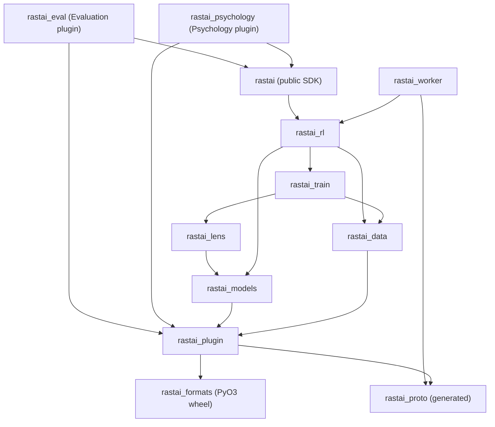
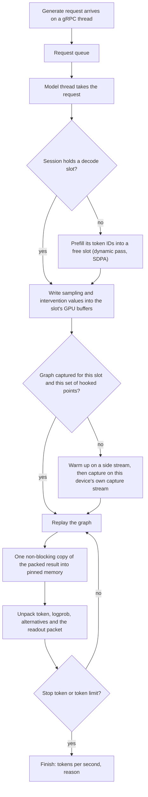
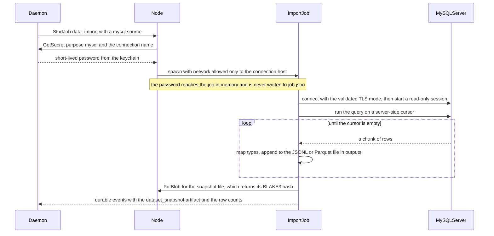
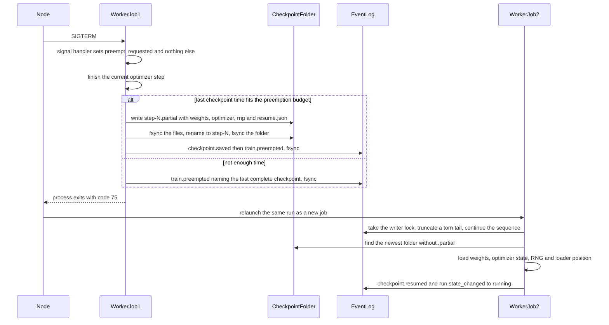
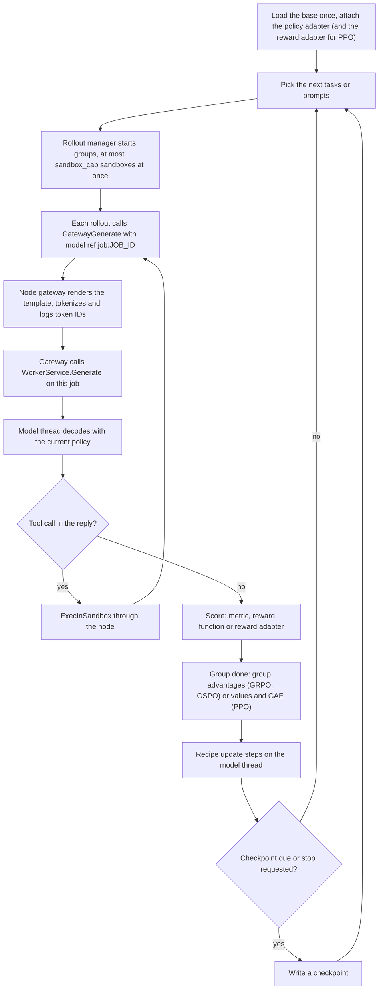
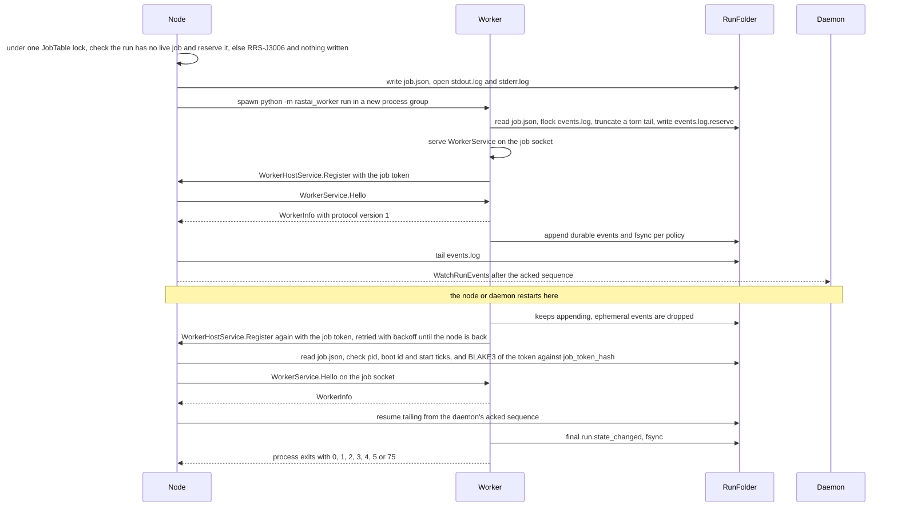
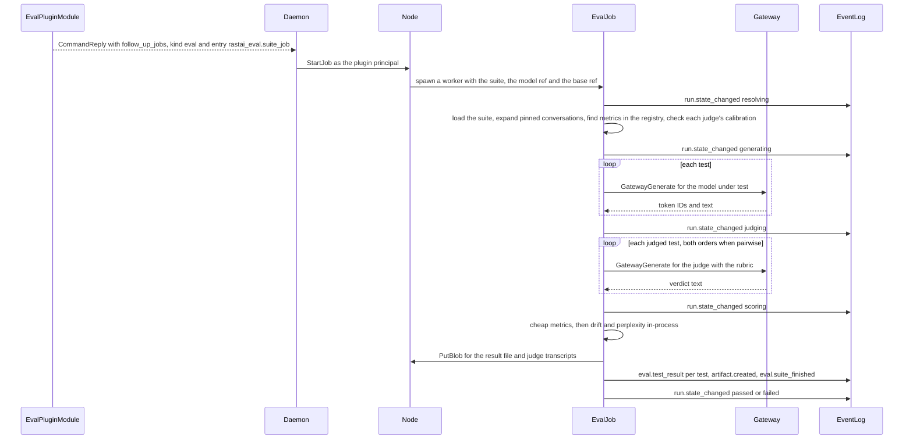

# Python Code Layout

**Status:** v1.2, 2026-10-10. Pre-build design. Built on spec v5.4 (`docs/spec/rastai_spec_v5.md`), the spike (`spike/README.md`) and the shared contracts v1.1 (`docs/architecture/contracts.md`), which is now the only list of shared names; this doc keeps no "New names" section. v1.2 applies the owner decisions of 2026-10-10: the MySQL dataset reader (section 4.9), `torchvision.io.decode_image` instead of in-house PNG and JPEG decoders, safetensors header checks delegated to the `rastai_formats` wheel, layer placement planned in Rust only (Python applies it), one golden fixture per op shared with Rust, anchors on by default for DPO, the judge trust bar (0.8 on 10 labels), blind votes as `evals/votes.rrsdata`, run-log readers with seeded mutation tests, ruff, and the approved §27 additions.

**Scope.** Every hand-written Python package that runs in a worker job or a notebook:
- `rastai_models`, `rastai_lens`, `rastai_data`, `rastai_train`, `rastai_rl`, `rastai_worker` (engines and the job runtime, in `python/`);
- `rastai` (the public SDK, in `python/`);
- `rastai_eval` (the Python side of the Evaluation plugin, in `plugins/evaluation/python/`, as contracts.md §1 decides);
- `python/envs/<backend>/` (the locked environments).

Out of scope, with their own layout docs: the generated packages (`rastai_proto`, `rastai_formats`), the plugin SDK (`rastai_plugin`), and the Psychology plugin module (`rastai_psychology`). This doc states what it assumes from them (section 1.6).

**How to read it.** Sections run bottom-up in import order. Every package section has the same parts: purpose, tree, public API, dependencies, boundary rules, tests, ported spike code, build order. Signatures are illustrative (no bodies) and follow the owner's style.

---

## 1. Overview

### 1.1 Packages at a glance

| Package | Folder | Runs in | Job kinds that use it | First needed (§31 step) |
|---|---|---|---|---|
| `rastai_models` | `python/rastai_models/` | worker jobs, notebooks | all GPU kinds, `compile`, `export`, `doctor_selftest` | 1 (TextCNN), 2 (runtime) |
| `rastai_lens` | `python/rastai_lens/` | worker jobs, notebooks | `serve_inspectable`, `lens`, `train` (SAE recipe) | 4 |
| `rastai_data` | `python/rastai_data/` | worker jobs | `data_import`, `data_check`, `train`, `gym` | 1 (TextCNN data), 5 |
| `rastai_train` | `python/rastai_train/` | worker jobs | `train`, `gym`, `export`, `doctor_selftest` | 1 (TextCNN), 5 |
| `rastai_rl` | `python/rastai_rl/` | worker jobs | `train` (PPO, GRPO, GSPO), `gym`, `data_import` (Harbor) | 5 (RLHF), 7 |
| `rastai_worker` | `python/rastai_worker/` | every Python job process | all Python kinds | 1 |
| `rastai` | `python/rastai/` | notebooks, plugin modules | via plugins: `eval`, `lens`, `plugin_module` | 4 (facades), 5, 6 (`load()`) |
| `rastai_eval` | `plugins/evaluation/python/rastai_eval/` | plugin module, `eval` jobs | `eval`, `plugin_module` | 5 |
| environments | `python/envs/<backend>/` | node (`EnsureEnvironment`) | all | 1 (`cpu`), 2 (`cuda13`, `rocm`, `cuda126`) |

### 1.2 Folder shape

```
python/
  pyproject.toml               uv workspace root; members = every package folder below (not envs/); ruff settings (lint and format)
  CLAUDE.md                    Python-wide hard rules (section 1.4) and the owner's style, for agents
  conftest.py                  shared pytest fixtures: fixture paths, tiny-model factory, the gpu marker
  <package>/
    pyproject.toml             distribution name, version = app version, sibling deps, build backend uv_build
    CLAUDE.md                  the package's local rules
    <package>/                 the import package (flat layout)
      __init__.py              re-exports the public names, nothing else
      errors.py                the package's one error class
      ...
    tests/
      test_<module>.py         unit tests (pytest), CPU only
  envs/<backend>/              section 11
tests/
  conftest.py                  fixtures shared by parity, gpu, crash and loop tests
  parity/  gpu/  crash/  loop/ section 12
```

- The build backend is `uv_build` (part of uv, a §27 foundation), so no extra build tool is needed.
- Version: every package carries the app version (§20: app, node and worker ship together).

### 1.3 Dependency graph



Arrows mean "may import". They are transitive: a package may import anything below it on a path, and nothing above it. This is contracts.md §2.2, drawn for the packages in scope.

Not obvious from the picture:
- `rastai_worker` and `rastai` sit side by side at the top. Neither imports the other. Plugin modules run inside a `rastai_worker` process, but the worker loads them by module name from the manifest (`importlib.import_module`), never by a static import.
- `rastai_lens` does not import `rastai_data` or `rastai_train`. Callers hand it tensors and token IDs.
- Only `rastai_worker` and `rastai_plugin` touch `rastai_proto`, with one exception: `rastai/connect_transport.py` decodes the binary `EventService.Subscribe` stream with the generated event messages, because Subscribe has no JSON form in the prototype (contracts 3.3). Engines take and return dataclasses, dicts and tensors (rule 1.4.7).
- `tools/checks/check-imports` enforces the graph. It fails the build on any import outside a package's allowed set.

### 1.4 Rules for every Python package

1. **No pickle.** No `pickle` import, no `torch.load`, no `torch.save`, no `multiprocessing` spawn with pickled arguments, no `*_object` collectives in `torch.distributed`, no `torch.distributed.checkpoint` (its metadata file is pickled), no `.bin` weights. CI greps for all of these.
2. **No runtime installs.** No `pip` or `uv pip` from a running process. Extra packages arrive only through a locked `uv sync` run by the node.
3. **Workers don't look things up.** They never read `settings.json`, `rastai.db`, `vault.db` or the keychain, and never build data paths. Settings arrive resolved inside `arguments_json`; paths arrive in `job.json` (section 7.3).
4. **BLAKE3 only through `rastai_formats`** (`hash_bytes`, `content_hash`); never a Python BLAKE3 package. Blob hashes still come from the node (`PutBlob` returns the hash; `job.json` carries model and environment hashes); the wheel's functions cover the rest, such as the hashes `rastai_worker` writes into run records.
5. **One error class per package** (`ModelError`, `LensError`, `DataError`, `TrainError`, `RlError`, `WorkerError`, `EvalError`, `RastaiError`). Each carries `code` (a constant from the generated `rastai_plugin.catalog`) and `message`. Only the edge (`rastai_worker/diagnostics.py`, the SDK's public functions, plugin command handlers) turns it into a `Diagnostic`.
6. **External libraries live in one wrapper module each** (table below). Everything else calls the wrapper.
7. **Wire types stay at the edge.** Engines never import `rastai_proto`. They emit events as `(event_type, dict)` and the worker converts.
8. **One GPU thread per job.** All GPU work in a job runs on its model thread (the main thread). gRPC handler threads only put requests on a queue or flip control flags.
9. **Captured code is capture-safe.** Anything that runs inside a captured decode step (hooks, readouts, sampling) uses tensor ops on preallocated buffers only: no `.item()`, `.cpu()`, `.tolist()`, no Python branch on a tensor value, no new CPU→GPU copy.
10. **Deterministic by construction.** Never Python's `hash()` (salted per process); use `zlib.crc32` or `hashlib.blake2b`. Randomness comes from a `torch.Generator` seeded from the run's seed, or from a private `random.Random` instance seeded with a string (as `epoch_order` does), never from the global `random` module.
11. **Owner's style.** Constants at the top of each file (with "(spike)" and the number when measured), readable names (`embedding_size`, `head_size`, `layer_count`), small functions, comments that explain why, a thin `main`. Data is `@dataclass`. No metaclasses, no decorators that change behavior except `@dataclass`, `@torch.inference_mode()` and `@torch.no_grad()`. Formatting and lint are automatic: `ruff format` and `ruff check` run inside `just check` (settings in `python/pyproject.toml`).
12. **One owner per algorithm** (contracts 2.4 rule 10). Never re-implement a Rust-owned check. Safetensors headers are validated by `rastai_formats.check_safetensors_header`; BLAKE3, GGUF bytes and document validation also go through the wheel; layer placement is planned only in Rust (`apply_placement` here only applies it); per-op shapes, parameter counts and FLOPs match one golden file per op, `fixtures/ops/<op>.json`, that Rust live stats match too.
13. **Every in-house parser of untrusted input has a seeded mutation test** marked `@pytest.mark.fuzz` (contracts 12.5): `rastai_eval`'s `yaml_subset.py`, the run-log readers, and the CSV and JSONL readers. The test mutates a fixture with a fixed seed and checks that the parser either returns rows or raises the package's error, and never hangs or raises anything else. Parsers that belong to an approved library (torchvision, PyMySQL, pyarrow, `tokenizers`) are not ours to fuzz, but their wrapper files get the same kind of test where they are the trust boundary.

| External (§27) | Only imported in | Used for |
|---|---|---|
| PyTorch (`torch`) | engines throughout (the foundation; not wrapped) | tensors, autograd, kernels, CUDA graphs |
| `torchvision` (`torchvision.io.decode_image`) | `rastai_data/image_decode.py` | decoding PNG and JPEG bytes (owner decision 5). Brings `pillow` and `numpy` into each lock as transitive packages that no Rastai file imports. |
| `torch.onnx` (with `onnx` and `onnxscript`, which its exporter imports) | `rastai_models/onnx_export.py` | ONNX export, `export` jobs only (plan M1-02 registers both packages under this row) |
| `torch.distributed` | `rastai_train/distributed.py`, `rastai_worker/distributed.py` | DDP, FSDP2, process-group setup |
| HF `transformers` (optional) | `rastai_models/compat/transformers_runtime.py`; `tests/parity/hf_reference.py` | compat runtime; parity reference |
| HF `tokenizers` | `rastai_data/tokenization.py` | plain-text encode/decode and token counts |
| `bitsandbytes` (optional) | `rastai_train/kernels/four_bit_linear.py` | 4-bit base weights for QLoRA |
| `grpcio` | `rastai_worker/worker_server.py` (and `rastai_plugin`'s host client) | the worker protocol |
| Python `protobuf` runtime | generated code, `rastai_worker/event_payloads.py`, `rastai_models/importers/onnx_proto/`, `rastai_data/run_logs/*_proto/` | event payload conversion; ONNX and run-log parsing with generated classes |
| `pyarrow` | `rastai_data/readers/parquet.py` | Parquet read/write |
| `PyMySQL` (MIT) | `rastai_data/readers/mysql_reader.py` | the MySQL dataset reader (option C of the MySQL decision, ADR-0035) |
| `pytest`, `ruff` (dev tooling) | tests and `just check` only | test runner; lint and format |

Every row is in the §27 table (approved 2026-10-10, contracts 2.5). Standard-library modules (`json`, `csv`, `tomllib`, `zlib`, `hashlib`, `http.client`, `mmap`, `struct`, `fcntl`, `signal`, `threading`, `queue`, `sqlite3`) need no entry. `deps/allowlist-python.json` lists `pillow` and `numpy` as transitive packages of `torchvision`; `check-imports` fails on any direct import of them.

### 1.5 Shared Python types

These cross package lines inside Python. Wire and document types are not repeated here; they come generated from `rastai_proto` and `rastai_formats`.

| Type | Defined in | Implemented or used by |
|---|---|---|
| `PointHook`, `DecodeReadout` (base classes) | `rastai_models/observation.py` | `rastai_lens` implements them; `rastai_models` calls them |
| `ForwardContext` | `rastai_models/forward_context.py` | every op module, lens and trainer |
| `CompiledModel` | `rastai_models/compiler/compiled_model.py` | everything above `rastai_models` |
| `SparseAutoencoder` | `rastai_lens/sae.py` | `rastai_train` (SAE recipe), `rastai_psychology` via `rastai.lens` |
| `TrainingExample`, `PreferencePair`, `LabeledExample`, `ImageExample`, `PromptExample` | `rastai_data/examples.py` | `rastai_train`, `rastai_rl` |
| `RolloutBatch` | `rastai_rl/rollout_batch.py` | `rastai_train` recipes `ppo`, `grpo` (passed in, not imported: recipes read its fields) |
| `EventLogWriter`, `LiveStream` | `rastai_worker/` | wrapped as `JobEvents` for engines and plugins |

**The job entry shape.** Every job kind and every plugin job entry is one function:

```python
def run_job(job: JobSpec, host: WorkerHost, events: JobEvents, control: JobControl) -> None:
    """Runs one job to completion. Raises the package's error on failure; the worker edge reports it."""
```

This is the signature in contracts.md §12.3. `JobEvents` and `JobControl` are `rastai_plugin` types, so plugin jobs never import `rastai_worker`.

### 1.6 What this doc assumes from `rastai_plugin`

`rastai_plugin` is documented elsewhere and its names are in contracts.md §15.2. These are the shapes this doc calls.

| Name | Shape assumed here |
|---|---|
| `Recipe` | `name`; `prepare(context)`, `training_step(batch) -> StepResult`, `resume_state() -> dict`, `restore_state(state: dict)` |
| `Metric` | `name`; `prepare(context: EvalContext)`, `score(case, output) -> MetricResult` |
| `Converter`, `RewardFunction`, `SaeLoader`, `NodeType`, `BenchmarkLoader`, `Sampler`, `Lens`, `Importer`, `Exporter`, `DataSource` | extension-point base classes from §13 (`Sampler` is the sampler and logits-processor point) |
| `TrainingContext`, `Batch`, `StepResult`, `EvalCase`, `ModelOutput`, `MetricResult`, `CommandCall`, `CommandReply` | plain dataclasses named in contracts.md §6.2 and §12.3. `CommandReply` carries `result_json`, diagnostics, `document_edits[]` and `follow_up_jobs[]`. |
| `PluginRegistry` | `register(kind, name, implementation)`, `find(kind, name)`, `names(kind)`; kinds are `REGISTRY_KINDS`, the manifest's `contributes` keys (`recipes`, `metrics`, ...) |
| `PluginHost` | `execute_command(command_id, arguments: dict) -> dict`, `put_blob(path) -> str`, `get_blob(hash, path)`, `gateway_generate(request: dict) -> Iterator[dict]` |
| `WorkerHost(PluginHost)` | `register()`, `job_file_path` (the job's `job.json`: the entry gets only the `JobSpec`, so a job reads its run folder and `resume_from` from here), `resize_lease(gpu_index, vram_bytes)`, `tokenize_chat(model_ref, conversations, add_generation_prompt, render_only=False) -> list[dict]`, `create_sandbox(spec: dict) -> str`, `exec_in_sandbox(sandbox_id, command: list[str], stdin: bytes) -> dict`, `remove_sandbox(sandbox_id)`, `list_tools(...)` and `call_tool(...)` (the node's MCP client, for harness tools), `resolve_model(model_ref) -> dict` (local: reads `job.json`); built by `connect_worker_host` |
| `JobEvents` | `emit_durable(event_type, payload: dict, blob_hashes: list[str] = [])`, `emit_ephemeral(event_type, payload: dict)` |
| `JobControl` | plain flags polled by engines: `preempt_requested` (SIGTERM), `stop_requested` (Control `STOP`), `cancel_requested` (Control `CANCEL` or SIGINT), `checkpoint_requested`, `paused`, `step_budget`. One flag per `JobSignal` because each ends differently (contracts §4.4). |
| `catalog`, `PluginError` | generated error-code constants (`RRS_M4001`, ...); the plugin SDK's error class |

A plugin module never starts a job itself. It returns `CommandReply.follow_up_jobs` (helper `reply_with_jobs`) and the daemon starts them as the plugin principal; there is no `start_job` call on the host (contracts 4.5). If a shape above differs from the plugin SDK layout doc, that doc wins and this one is fixed.

---

## 2. `rastai_models`: the Inspectable runtime

**Purpose.** Turns a ModelSpec into PyTorch modules and runs them: the block library (including MoE, MLA, ALiBi, AttnRes), model families, weight I/O (tensor bytes after the `rastai_formats` wheel has checked the safetensors header, sharded indexes, GGUF export, PEFT adapters), caches, static CUDA-graph decode, sessions, LoRA, applying a multi-GPU layer placement (never planning one), importers, Eject, ONNX export and the compat runtime. It *is* the Inspectable runtime (§17): the Designer's compiled model and an imported HF model are the same code.

### 2.1 Tree

```
python/rastai_models/
  pyproject.toml
  CLAUDE.md                     parity rules, capture-safety rules, the point-name convention
  rastai_models/
    __init__.py                 public names (section 2.2)
    errors.py                   ModelError with RRS-M codes; a safetensors rejection keeps the wheel's own RRS-E60xx code
    observation.py              PointHook and DecodeReadout base classes; standard point names; capture modes
    forward_context.py          ForwardContext: per-pass inputs every op module reads
    attention_kernel.py         SDPA by default; math or eager pinned for exact replay; eager where maps are captured
    model_traits.py             ModelTraits: has_moe, has_mla, has_alibi, has_attn_res, sliding layers, approximate lens
    loading.py                  load_model(): config or spec → compile on the meta device → fill weights → prepare; load_model_by_ref()
    hf_cache.py                 find snapshots in the user's HF cache (standalone SDK only; jobs get paths from job.json)
    lora.py                     LoRALinear with named adapters: float32 masters, compute in the input dtype; merge
    placement.py                apply_placement: put each graph node on the GPU the ModelSpec placement{} field names; device hand-off between segments. No planner (contracts 2.4 rule 10)
    decoding.py                 StaticDecoder: one static-shape step, CUDA graph per device with its own capture stream
    sampling.py                 capture-safe sampling buffers: temperature, top-k, top-p, repetition penalty, seed
    sessions.py                 SessionPool: decode slots, prefill, fork, close, re-prefill of evicted sessions
    generation.py               generate loop, stop tokens, greedy reference generator, load_stop_token_ids, next_token_log_probs
    onnx_export.py              the only torch.onnx import
    smoke.py                    smoke_forward(): the design.compile smoke forward; shapes, dtypes, finite outputs
    compiler/
      compile.py                compile_model(): ModelSpec → CompiledModel
      graph_order.py            expand block instances and repeats; topological order (the spec is already validated)
      op_table.py               (op, variant) → OpModule class; unknown ops are looked up as NodeType plugins
      compiled_model.py         CompiledModel(nn.Module): runs ordered steps, calls hooks, unembed(), prepare()
      weights.py                bind_weights(): fill parameters strictly from weight files (BindReport); seeded init for fresh designs
      train_modes.py            apply each graph node's train_mode: freeze, lora or train
    blocks/
      op_module.py              OpModule base class
      embedding.py              token embedding; optional scale (Gemma: sqrt(embedding_size) cast to the weight dtype)
      norms.py                  RMSNorm (scale_offset 0 or 1, computed in float32, multiply before casting down); LayerNorm
      linear.py                 linear with optional bias
      rope.py                   inverse frequencies on the CPU, float32 angles; linear, llama3 and yarn scaling
      alibi.py                  per-head distance bias as an additive attention mask
      attention.py              MHA, GQA, sliding; full-pattern and last-token capture; head_outputs point
      latent_attention.py       MLA: latent cache, plain and absorbed forms, patterns from the compressed keys
      feed_forward.py           dense and gated
      moe.py                    router, experts, shared experts; loop-over-experts prefill; gather-by-index decode
      attn_res.py               experimental depth attention over earlier layers' outputs
      residual.py               residual add
      unembed.py                tied or untied unembedding; final logit softcap
      convolution.py            conv1d, conv2d, pool (TextCNN, ViT patch embedding)
      recurrent.py              LSTM, GRU
      basic_ops.py              activation, dropout, concat
      fusion.py                 concat, cross-attention and late fusion of input-map encoders
      heads.py                  classifier head; scalar head (reward and value heads)
      block_instance.py         runs one stamped copy of a reusable block graph
      opaque.py                 runs a compat module; observable only at its input and output edges
    caches/
      kv_cache.py               KeyValueCache: preallocated; dynamic write and static write_at
      ring_cache.py             RingKeyValueCache: window-sized slots for sliding layers (512 for Gemma 3 1B)
      latent_cache.py           LatentCache for MLA layers
      cache_set.py              build_caches(): the right cache per layer from the model's traits
    families/
      family.py                 Family base class
      registry.py               FAMILIES list and find_family(config)
      gemma3.py                 Gemma 3 text: config fields, (1 + weight) norms, embedding scale, softcap, names
      llama.py                  Llama 2/3.x
      qwen.py                   Qwen2, Qwen2.5, Qwen3 dense
      mistral.py
      gpt2.py                   transposed Conv1D weights converted at load
      bert.py                   post-norm encoder
      vit.py
      mixtral.py
      qwen3_moe.py
      olmoe.py
      gpt_oss.py                MoE with sliding/full alternation; MXFP4 weights dequantized at load
      deepseek.py               DeepSeek-V2/V3 and Kimi: MLA + MoE; FP8 block-scaled weights dequantized at load
      bloom.py                  ALiBi
      mpt.py                    ALiBi
    importers/
      hf_config.py              config.json → ModelSpec through a family; an opaque node when no family matches; check_import_limits, mark_unsupported_features_opaque, check_weight_names, read_cached_headers (ImportReport)
      torch_export.py           an ExportedProgram from a live session → ModelSpec
      onnx_import.py            .onnx → ModelSpec; unmapped subgraphs become opaque nodes
      onnx_proto/               generated from proto/third_party/onnx/onnx.proto by buf (never edited)
    io/
      safetensors_reader.py     hands the length prefix and then the header to rastai_formats (read_safetensors_header_length, check_safetensors_header) and memory-maps the file only after the wheel accepted it; parses no header itself
      safetensors_writer.py     writer (spike port): sorted names, 8-byte aligned header, string metadata, fsync; every file it writes must pass the wheel's check
      weight_files.py           one file or a sharded index (model.safetensors.index.json)
      gguf_writer.py            GGUF export: tensor names, dtypes, metadata; the bytes are encoded by rastai_formats
      peft_adapters.py          LoRA adapters in PEFT layout, read and write (§14)
    compat/
      transformers_runtime.py   the only transformers import: opaque-node runtime; safetensors only; no remote code
    eject/
      eject.py                  design.eject: writes source, weights and a small loader into a folder
      source_writer.py          ModelSpec → readable PyTorch source in the owner's style
      loader_source.py          a small safetensors loader copied into ejected projects (no rastai import); it reads files Rastai just wrote and does no untrusted-input validation
  tests/
```

### 2.2 Public API

Observation (the contract between the runtime and every readout):

```python
CAPTURE_NO_ATTENTION = "none"
CAPTURE_LAST_TOKEN_ATTENTION = "last_token"   # fast SDPA output, plus the newest token's pattern on the side
CAPTURE_FULL_ATTENTION = "full"               # eager attention, every query's pattern

class PointHook:
    """Called at every observation point. Returns the tensor the model continues with.
    Readers return it unchanged; interventions return an edited tensor."""
    def at_point(self, point_name: str, tensor: Tensor) -> Tensor:
        return tensor

class DecodeReadout:
    """Plugs a readout into the static decode step. The fused logit lens implements it,
    so the unembedding matrix is read once per token, not twice (spike)."""
    def point_hook(self) -> PointHook: ...
    def finish_step(self, model: CompiledModel, final_hidden: Tensor) -> tuple[Tensor, Tensor]:
        """Returns (logits [vocabulary], packet [packet_size] float32), both still on the GPU."""
```

Point names follow contracts.md §5.3. A point name is the graph node's path. Families name their nodes so the standard names fall out (`embedding`, `blocks.<i>.attention_out`, `blocks.<i>.feedforward_out`, `blocks.<i>.residual_out`, `final_norm_out`). Ops with extra outputs emit sibling names in the same block: `attention_pattern`, `last_token_attention`, `head_outputs`, `router_logits`, `expert_choice`, `expert_gate_weights`, `latent_cache`, `depth_attention`. Designer nodes without a family name use their node path.

Compile and run:

```python
@dataclass
class ForwardContext:
    caches: CacheSet | None = None
    decode_position: Tensor | None = None        # 1-element GPU tensor: a static decode step
    attention_kernel: str = KERNEL_SDPA          # KERNEL_SDPA, KERNEL_MATH (pinned replay) or KERNEL_EAGER
    attention_capture: str = CAPTURE_NO_ATTENTION
    hook: PointHook | None = None
    last_position_only: bool = False
    unembed_output: bool = True                  # False: return the final normalized hidden state (fused lens)
    auxiliary_losses: list[Tensor] = field(default_factory=list)   # MoE load balancing, read by the trainer

def compile_model(spec: ModelSpec, device: str, dtype: torch.dtype) -> CompiledModel: ...
def load_model(model_folder: Path, device: str, dtype: torch.dtype, spec: ModelSpec | None = None) -> CompiledModel: ...
def load_model_by_ref(model_ref: str, host: WorkerHost | None, device: str, dtype: torch.dtype) -> CompiledModel: ...
    # in a job, the folder comes from host.resolve_model (job.json); with host None (a notebook), from the HF cache
def init_weights(model: CompiledModel, seed: int) -> None: ...
def bind_weights(model: CompiledModel, spec: ModelSpec, weight_files: list[SafetensorsFile], family: Family | None) -> BindReport: ...
    # strict: missing, unused or mis-shaped tensors stop the bind before any forward (RRS-M2002, RRS-M2003, RRS-M2004)
def smoke_forward(model: CompiledModel, spec: ModelSpec) -> SmokeResult: ...
    # shapes against the inferred shapes (RRS-M0002), finite outputs (RRS-M3001)

class CompiledModel(nn.Module):
    spec: ModelSpec
    traits: ModelTraits
    def forward(self, *inputs: Tensor, context: ForwardContext | None = None) -> Tensor: ...
    def final_norm(self, hidden: Tensor) -> Tensor: ...
    def unembed(self, normalized_hidden: Tensor) -> Tensor: ...
    def prepare(self, device: torch.device) -> None: ...      # build per-device tables before any graph capture
    def set_gradient_checkpointing(self, enabled: bool) -> None: ...
    def point_names(self) -> list[str]: ...
```

LoRA and adapters (one base model, several named adapters; §10 "one base model in VRAM"):

```python
LORA_MASTER_DTYPE = torch.float32   # tiny updates to bf16 weights round away (spike)

def attach_lora(model: CompiledModel, node_paths: list[str], adapter_name: str, rank: int, alpha: float) -> list[nn.Parameter]: ...
def set_active_adapter(model: CompiledModel, adapter_name: str | None) -> None: ...   # None = reference model
def adapter_tensors(model: CompiledModel, adapter_name: str) -> dict[str, Tensor]: ...
def load_adapter_tensors(model: CompiledModel, adapter_name: str, tensors: dict[str, Tensor]) -> None: ...
def merge_adapter(model: CompiledModel, adapter_name: str) -> None: ...                # for export only
```

Decode, sessions and generation (called by `rastai_worker/jobs/serve_inspectable.py` and `rastai_rl/policy_server.py`):

```python
DECODE_SLOT_COUNT = 2            # chat plus one branch side by side; other sessions re-prefill on demand
WARMUP_RUNS_BEFORE_CAPTURE = 2   # cuBLAS and friends allocate on first use (spike)

class StaticDecoder:
    def __init__(self, model: CompiledModel, slot: DecodeSlot, readout: DecodeReadout | None, use_cuda_graph: bool): ...
    def step(self) -> Tensor: ...    # pinned host tensor: token, logprob, top alternatives, readout packet

@dataclass(frozen=True)
class CapturedStep:
    graph: torch.cuda.CUDAGraph
    output: Tensor                   # static buffer the replayed graph writes into

def capture_step_graph(decoder: StaticDecoder, device: torch.device) -> CapturedStep: ...
    # builds the decode step from the decoder's own static buffers, so no function is passed in

class SessionPool:
    def __init__(self, model: CompiledModel, slot_count: int, max_length: int): ...
    def open_session(self, session_id: str, prompt_token_ids: list[int]) -> None: ...
    def fork_session(self, source_session_id: str, new_session_id: str, token_index: int) -> None: ...
    def close_session(self, session_id: str) -> None: ...
    def set_sampling(self, session_id: str, temperature: float, top_k: int, top_p: float, repetition_penalty: float, seed: int | None) -> None: ...
    def set_hook(self, session_id: str, hook: PointHook | None) -> None: ...   # a new set of hooked points recaptures
    def generate(self, session_id: str, max_new_tokens: int, stop_token_ids: list[int], readout: DecodeReadout | None) -> Iterator[DecodedToken]: ...

@dataclass
class DecodedToken:
    token_id: int
    logprob: float
    alternatives: list[tuple[int, float]]
    packet: Tensor | None      # CPU float32; rastai_lens unpacks it

def generate_greedy(model: CompiledModel, prompt_token_ids: list[int], max_new_tokens: int, stop_token_ids: set[int]) -> list[int]: ...
def load_stop_token_ids(model_folder: Path) -> set[int]: ...
def next_token_log_probs(model: CompiledModel, token_ids: list[int], first_position: int, last_position: int) -> Tensor: ...
    # log-softmax over the vocabulary at each position in the range; drift and perplexity read it
```

Families, importers and placement (called by `loading.py`, the `compile` job and `rastai.load()`):

```python
class Family:
    """Maps one HF architecture to ModelSpec blocks and weight names. One file per family."""
    name: str = ""
    model_types: tuple[str, ...] = ()
    def build_spec(self, config: dict) -> ModelSpec: ...
    def parameter_name(self, hf_name: str) -> str: ...                    # HF tensor name → graph parameter path
    def convert_tensor(self, hf_name: str, tensor: Tensor) -> Tensor: ... # transposes, MXFP4 / FP8 dequantization
    def gguf_architecture(self) -> str: ...
    def gguf_tensor_name(self, parameter_name: str) -> str: ...
    def gguf_metadata(self, config: dict) -> dict[str, object]: ...

def find_family(config: dict) -> Family | None: ...
def import_hf_config(config: dict, weights_source: str) -> ImportResult: ...     # ImportResult(spec, diagnostics)
def check_import_limits(config: dict, report: ImportReport) -> None: ...         # untrusted-import limits (RRS-E5xxx)
def mark_unsupported_features_opaque(spec: ModelSpec, config: dict, family: Family, report: ImportReport) -> None: ...
def check_weight_names(spec: ModelSpec, family: Family, headers: dict, report: ImportReport) -> None: ...
def read_cached_headers(weights_source: str) -> dict: ...                        # tensor names, dtypes and shapes; each header checked by the wheel
def import_onnx(path: Path) -> ImportResult: ...
def import_exported_program(program: torch.export.ExportedProgram) -> ImportResult: ...

def apply_placement(model: CompiledModel, placement: dict[str, int], default_device: str) -> None: ...
    # placement is the ModelSpec placement{} field (graph node id → GPU index). It is written only by plan_layer_placement
    # in rastai-server (contracts 2.4 rule 10); a job receives it in its spec snapshot, and the standalone SDK applies the
    # field it finds in the .rrsmodel. An empty map puts every node on default_device. This package contains no planner.
```

Weight I/O and export (called by `loading.py`, `rastai_train/checkpoints.py`, `rastai_train/export.py`, `rastai_lens` SAE loaders):

```python
class SafetensorsFile:
    """Memory-mapped. The header is checked by rastai_formats.check_safetensors_header before any tensor is touched
    (a rejection raises ModelError with the wheel's RRS-E60xx code and closes the mapping). Use as a context manager."""
    metadata: dict[str, str]
    def names(self) -> list[str]: ...
    def load(self, name: str, device: str = "cpu", dtype: torch.dtype | None = None) -> Tensor: ...
    def close(self) -> None: ...

def write_safetensors(path: Path, tensors: dict[str, Tensor], metadata: dict[str, str] | None = None) -> None: ...
def open_weight_files(model_folder: Path) -> list[SafetensorsFile]: ...
def write_gguf(path: Path, model: CompiledModel, family: Family, config: dict, tokenizer_json: dict, metadata: dict[str, str], tensor_dtype: str) -> None: ...
def read_peft_adapter(folder: Path, family: Family) -> tuple[dict[str, Tensor], int, float]: ...
def write_peft_adapter(folder: Path, tensors: dict[str, Tensor], family: Family, rank: int, alpha: float) -> None: ...
def export_onnx(model: CompiledModel, example_inputs: list[Tensor], path: Path, metadata: dict[str, str]) -> None: ...
def eject_design(spec: ModelSpec, weights_folder: Path | None, output_folder: Path) -> list[Path]: ...
def load_compat_module(model_folder: Path, compat_class: str, device: str, dtype: torch.dtype) -> nn.Module: ...
```

### 2.3 The static decode step



- **What the step does on the GPU.** It reads the token and position buffers, runs the model with the readout's hook, samples from the slot's sampling buffers with a graph-registered generator, writes the chosen token back into the token buffer and advances the position. A replay needs no CPU→GPU copy; the only CPU work per token is the one copy back (spike).
- **Capture stream per device.** `torch.cuda.graph`'s default capture stream is created once, on whichever GPU was current first, which broke the second GPU in the spike. `capture_step_graph` always creates `torch.cuda.Stream(device)` for the capture and another for warm-up.
- **Recapture triggers.** A new decode slot, a different set of hooked points (an intervention added at a new point, the live panel switched on) or a new readout layout. Changing values (steering strength, sampling settings) only rewrites buffers. Capture happens during the model state `warming` (contracts.md §9.3) for the first slot.
- **Sliding layers** use `RingKeyValueCache`: position `p` lives in slot `p % window_size`, keys are stored after RoPE so ring order doesn't matter, and the mask comes from a per-slot position buffer. The spike measured 110 vs 155 tok/s on long contexts without it.
- **Multi-GPU placement.** The plan is not made here: the daemon's `plan_layer_placement` writes `placement{}` and the runtime applies it. Each device segment gets its own captured graph on its own capture stream. The hidden state is copied into the next segment's static input buffer between replays. A tied embedding stays on the first device; the final hidden state moves back to it for the unembedding.
- **Plugin samplers** (the sampler/logits-processor extension point) run eagerly, so a session that uses one decodes without a graph. The UI shows the lower tokens/s honestly.
- **Failure branches.** A capture failure falls back to eager decode with the warning `RRS-M4001`, never a crash. A full cache raises RRS-M4xxx with the session's max length. OOM during prefill is mapped by the worker edge (RRS-H3xxx).
- **Nothing is persisted here.** Sessions live in GPU memory. Token IDs are logged by the gateway, not by the runtime.

### 2.4 Newer blocks (§17)

| Block | File | Implementation rules |
|---|---|---|
| MoE | `blocks/moe.py` | Router and each expert are separate graph nodes (routing is observable and editable). Prefill loops over experts that received tokens; grouped matmuls only after measurement. Decode gathers the k chosen experts' stacked weights by index, so the step keeps a static shape. Load-balancing loss appended to `context.auxiliary_losses`. Expert overrides are a router-logit bias buffer at `router_logits` (force = large positive, block = negative infinity). |
| MLA | `blocks/latent_attention.py`, `caches/latent_cache.py` | The cache holds the compressed latent. Decode uses the absorbed form (up-projections folded into the query and output projections). Parity is tested in both forms. Patterns are computed from the compressed keys; the latent cache is its own point. |
| ALiBi | `blocks/alibi.py` | Per-head slopes; the bias is passed to SDPA as a float mask, which rules out the flash kernel. Only BLOOM and MPT pay for it. |
| AttnRes | `blocks/attn_res.py` | A depth-attention node over earlier layers' outputs; emits `depth_attention`. `ModelTraits.approximate_lens = True`, so lens and SAE readouts are labeled approximate. Designer-only until public weights use it. |

### 2.5 Dependencies

- **Internal:** `rastai_formats` (generated `ModelSpec` dataclasses, `load_model_spec(json_bytes)` validation, `check_safetensors_header`, the GGUF byte encoder), `rastai_plugin` (`NodeType` lookup in the registry, catalog codes).
- **External:** `torch` (everything); `torch.onnx` (export); `transformers` optional (compat runtime only); Python `protobuf` (ONNX import, with classes generated from the vendored `onnx.proto`).

### 2.6 Boundary rules

- Never imports `rastai_proto`, `rastai_lens`, `rastai_data` or anything above it.
- Never downloads. Standalone use reads the HF cache in place (`hf_cache.py`); jobs get folders from `job.json`. Weights are never copied (§19).
- Never applies a chat template or tokenizes. Inputs are token IDs.
- Never loads `.bin` weights. The compat runtime passes `use_safetensors=True` and `trust_remote_code=False`; a repo without safetensors is refused (RRS-M2xxx).
- Exact replay uses `KERNEL_MATH` or `KERNEL_EAGER`. SDPA's fast kernels sum in a different order in bf16 and can flip near-ties (spike 01b).
- Every family must pass the parity suite before it ships (section 12).
- **Never parses a safetensors header.** `crates/rastai-formats/src/safetensors/header_check.rs` is the one owner; `safetensors_reader.py` calls the wheel and reads tensor bytes only after it accepts the header. Python and Rust therefore give the same verdict and `RRS-E60xx` code on every file in `fixtures/safetensors/`, because there is one implementation. `check-imports` fails if the module imports `struct` or `json` to read a header.
- **Never plans a layer placement.** `apply_placement` applies the ModelSpec field; the planner is `plan_layer_placement` in `rastai-server`.
- **Per-op numbers have one source.** Each op's output shape, parameter count and FLOPs match `fixtures/ops/<op>.json`, the same file Rust live stats (`compute_design_stats`) match.

### 2.7 Tests

| Test | What it proves |
|---|---|
| `tests/test_safetensors_reader.py` | all 33 files in `fixtures/safetensors/` give the verdict and code in its `expected.json` (6 valid, 27 malformed), the same corpus the Rust tests use; valid files return the expected tensor bytes; handles are closed on rejection |
| `tests/test_safetensors_delegation.py` | with the wheel's `check_safetensors_header` replaced by a function that rejects everything, the reader rejects every file, including the 6 valid ones: proof that it asks the wheel and decides nothing itself |
| `tests/test_safetensors_writer.py` | round trip for every dtype, metadata, 8-byte alignment, empty tensors; every written file passes the wheel's check |
| `tests/test_compile.py` | TextCNN template and a tiny decoder compile; parameter counts equal `fixtures/models/<family>/expected_counts.json`, the values Rust live stats also check |
| `tests/test_op_fixtures.py` | for every `fixtures/ops/<op>.json`: the compiled op module's output shape, parameter count and FLOPs (counted with `torch.utils.flop_counter.FlopCounterMode`) equal the golden values; the test walks `op_table.py`, so a new op without a fixture fails it. The fixture states the FLOP convention; a disagreement is a bug in whichever side differs, found here or in `crates/rastai-server/tests/` |
| `tests/test_kv_cache.py`, `test_ring_cache.py` | token-by-token decode equals one full pass; ring decode equals full-cache sliding decode on a prompt that crosses the window three times |
| `tests/test_decoding.py` | the static step (CPU, no graph) equals the dynamic step; sampling with a fixed seed repeats |
| `tests/test_sessions.py` | a fork at index i continues exactly like a fresh prefill of the same tokens; evicted sessions re-prefill |
| `tests/test_lora.py` | a fresh adapter changes nothing; adapter off equals the base; masters stay float32; merged equals adapter-on |
| `tests/test_moe.py`, `test_latent_attention.py`, `test_alibi.py`, `test_attn_res.py` | loop-over-experts equals gather-by-index; plain MLA equals absorbed; ALiBi bias values; depth attention shapes |
| `tests/test_families.py` | for each tiny config in `fixtures/models/<family>/`: every HF tensor name maps, every parameter is filled (strict load) |
| `tests/test_importers.py` | unknown `model_type` imports as an opaque node with diagnostics, never an exception |
| `tests/test_eject.py` | ejected source runs in a subprocess with only `torch` on the path and matches the compiled model's outputs |
| `tests/test_placement.py` | `apply_placement` puts each node on the device its `placement{}` entry names; an empty map puts everything on one device; a tiny config split across two `cpu` devices gives the same logits as the unsplit model. The planner is tested in Rust (`crates/rastai-server/tests/layer_placement.rs`); there is no Python planner to compare |
| `tests/parity/` | logits vs the HF reference per family (section 12) |
| `tests/gpu/test_cuda_graph_two_devices.py` | two models captured on GPU 0 and GPU 1 in one process (the spike's capture-stream bug) |
| `tests/gpu/test_gguf_llama_server.py` | an f16 GGUF export generates the same tokens in `llama-server` as our fp32 runtime (spike 04) |
| `tests/gpu/test_placement_two_gpus.py` | DeepSeek-V2-Lite across the 5080 and 3090 matches the reference within tolerance |

### 2.8 Ported from the spike

| Spike file | New home | Changes on the way |
|---|---|---|
| `gemma3.py` config, `load_config`, `check_supported`, name maps | `families/gemma3.py` | Builds a ModelSpec instead of a hand-written module tree. Gemma specifics become node attributes: RMSNorm `scale_offset = 1`, embedding scale cast to the weight dtype, final softcap. |
| `gemma3.py` `RMSNorm`, `FeedForward`, RoPE helpers, `Attention`, `DecoderBlock` | `blocks/norms.py`, `feed_forward.py`, `rope.py`, `attention.py`; the block becomes a family block graph | Keep the precision details that made fp32 bit-identical: float32 norms with multiply-before-cast, inverse frequencies on the CPU, float32 angles, float32 softmax cast back. Observer callable returning nothing becomes `PointHook.at_point` returning a tensor (needed for interventions). |
| `gemma3.py` `KeyValueCache` | `caches/kv_cache.py` | Unchanged API; `ring_cache.py` and `latent_cache.py` added. |
| `gemma3.py` `load_model` | `loading.py` + `compiler/weights.py` | Same meta-device build and strict `load_state_dict(assign=True)`; sharded indexes; per-family tensor conversion. |
| `decoding.py` `StaticDecoder` | `decoding.py` + `sampling.py` + `sessions.py` | Greedy argmax becomes in-graph sampling with logprob and alternatives packed. Lens modes naive and batched are dropped from the product (they stay as benchmark references in `tests/gpu/`); only the fused readout ships. Per-device capture stream and side-stream warm-up are kept as is. |
| `generation.py` | `generation.py` | Kept as the greedy reference (tests, drift, anchors). |
| `lora.py` | `lora.py` + `compiler/train_modes.py` | Attaches by graph node `train_mode` instead of hard-coded Gemma projection paths. One adapter becomes named adapters (policy, reward). Adds merge for export. |
| `safetensors_reader.py`, `safetensors_writer.py` | `io/`; the header checks went to `crates/rastai-formats/src/safetensors/header_check.rs` | The reader no longer parses headers: it calls the wheel and reads tensor bytes. Writer fsyncs. Sharded index support in `weight_files.py`. |
| `hf_cache.py` | `hf_cache.py` | SDK only. |

### 2.9 Build order

| Part | §31 step | Why then |
|---|---|---|
| `compiler/`, `blocks/` for TextCNN (embedding, conv1d, pool, linear, classifier head), `io/safetensors_*`, `errors.py`, `test_op_fixtures.py` for those ops | 1 | worker protocol v0 trains TextCNN (weeks 3–4); the wheel's `check_safetensors_header` must exist first (M1) |
| decoder blocks, `caches/` (incl. ring cache), `observation.py`, `forward_context.py`, `attention_kernel.py`, `loading.py`, `families/gemma3.py`, `families/llama.py`, parity suite | 2 | unified runtime (weeks 5–6) |
| `decoding.py`, `sampling.py`, `sessions.py`, `generation.py` | 3 | Inspectable runtime behind the gateway (weeks 7–8) |
| `lora.py`, `train_modes.py`, `io/gguf_writer.py`, `io/peft_adapters.py` | 5 | Teach it (weeks 11–12), export |
| `importers/hf_config.py`, `smoke.py`, `onnx_export.py` | 6 (week 13) | thin Designer: HF import, compile → train, ONNX export |
| remaining families, MoE, MLA, ALiBi, AttnRes, `placement.py` (`apply_placement`), `importers/torch_export.py`, `importers/onnx_import.py`, `eject/`, `compat/` | 6 | full Designer |

---

## 3. `rastai_lens`: observation readouts

**Purpose.** The readout engine on top of observation points: live packets with the fused logit lens, attention capture, entropy, the SAE runtime and loaders, the replay summary layer and `.rrsreplay` writing, tensor zoom, interventions (steering, feature edits, head ablation, expert overrides), and the analysis math behind Psychology's offline jobs (probes, projections, model diff, SAE fit check, attribution graphs, MoE routing, depth attention). Per contracts.md §1, the math lives here; the Psychology plugin (`rastai_psychology`) owns the commands, the job orchestration and the UI, and reaches this package only through `rastai.lens`.

### 3.1 Tree

```
python/rastai_lens/
  pyproject.toml
  CLAUDE.md                    capture-safety, honest labels, the packet budget
  rastai_lens/
    __init__.py
    errors.py                  LensError with RRS-L codes
    collector.py               LiveCollector (PointHook): newest token's residual per layer and attention row
    readouts.py                entropy and top-k probabilities on the GPU
    logit_lens.py              one batched unembedding for all layers; the fused form reuses the last row as the output
    attention.py               top attended positions per head and layer; full patterns for replay views
    live_packet.py             LivePanelReadout (DecodeReadout), PacketLayout, unpack_packet
    overhead.py                measure_overhead_percent(): the live-panel cost the UI shows and RRS-L1001 compares with the budget
    summary_layer.py           compact per-token summary stored in every .rrsreplay
    replay_writer.py           write .rrsreplay through rastai_formats: conversation, summary, optional activations
    recorder.py                TensorRecorder (PointHook): chosen points over a token range, chunked for FetchTensor
    interventions.py           InterventionHook (PointHook): steering, feature edits, head ablation, expert overrides
    sae.py                     SparseAutoencoder: JumpReLU (Gemma Scope 2), TopK and ReLU; encode and decode
    sae_loaders/
      gemma_scope.py           Gemma Scope 2 folders → SparseAutoencoder (spike port)
      llama_scope.py           Llama Scope → SparseAutoencoder
    feature_labels.py          Neuronpedia label files: load, look up, search by text
    edge_observer.py           forward hooks on any nn.Module's submodules (observe() and opaque nodes)
    probes.py                  linear probes on recorded activations
    projection.py              fit a 2D or 3D projection once (PCA), place new points into that fixed space
    model_diff.py              base vs checkpoint: feature frequency, lens shift per layer, routing shift; fills a ModelDiffReport
    sae_fit_check.py           variance unexplained and L0 vs the trained L0; stale below a threshold; fills a SaeFitCheckReport
    routing_lens.py            expert choice and gate weights per token and layer; usage, dead and overloaded experts
    depth_attention.py         AttnRes depth weights per layer
    attribution/
      replacement_model.py     freeze attention patterns and norms, swap feed-forwards for transcoders
      graph.py                 edges between tokens, features and logits from backward passes
      pruning.py               keep the nodes and edges that carry most of the influence
      transcoder_loaders.py    transcoder weights loaded as data
  tests/
```

### 3.2 Public API

Live panel (called by `rastai_worker/jobs/serve_inspectable.py`):

```python
FINAL_TOP_K = 10          # spike packet: entropy + top-10 guesses
LOGIT_LENS_TOP_K = 5      # per layer
ATTENTION_TOP_K = 8       # per head and layer, newest token only
SAE_TOP_K = 16            # settings psychology.top_k
MAX_EXACT_TOKEN_ID = 2**24  # token IDs travel in the float32 packet; exact below this
DEFAULT_OVERHEAD_BUDGET_PERCENT = 35   # default of psychology.overhead_budget_percent: +35% at CUDA-graph speed (owner decision 14)

class LiveCollector(PointHook): ...

class LivePanelReadout(DecodeReadout):
    """Fused: the logit lens's last row is the model's output, so the unembedding is read once (spike)."""
    def __init__(self, model: CompiledModel, autoencoders: list[SparseAutoencoder], layout: PacketLayout): ...

def measure_overhead_percent(tokens_per_second_panel_off: float, tokens_per_second_panel_on: float) -> float: ...
    # (off − on) / off × 100. The serve job measures both on the same session and reports the number, which the UI shows;
    # above the resolved setting it raises the warning RRS-L1001. The budget arrives in the job arguments (rule 1.4.3).

def packet_layout(model: CompiledModel, autoencoder_count: int, top_k: int) -> PacketLayout: ...
def unpack_packet(host_packet: Tensor, layout: PacketLayout) -> dict[str, Tensor]: ...
def prefill_packets(model: CompiledModel, token_ids: list[int], autoencoders: list[SparseAutoencoder], layout: PacketLayout) -> Tensor: ...
```

`unpack_packet` returns named tensors; the worker turns them into the `LivePacket` proto. With `LensRequest` on and `max_new_tokens = 0`, the serve job uses `prefill_packets` to emit one packet per prompt token, computed batched in one pass. That is how replay and step mode get per-token views without a separate RPC.

Replay, zoom and the summary layer (serve job, Psychology jobs, `rastai.observe`):

```python
SUMMARY_LENS_TOP_K = 5
SUMMARY_FEATURE_TOP_K = 16
# int32 ids + float16 values: about 1.1 KB per token for Gemma 3 1B with 3 SAEs,
# inside the 5 MB per 2k tokens target (§9). The live packet's attention rows are left out.

def compute_summary_layer(model: CompiledModel, token_ids: list[int], autoencoders: list[SparseAutoencoder]) -> SummaryLayer: ...
def write_replay(path: Path, contents: ReplayContents) -> None: ...

class TensorRecorder(PointHook):
    def __init__(self, point_names: list[str], first_token: int, last_token: int): ...
    def chunks(self, max_bytes: int) -> Iterator[TensorChunk]: ...   # FetchTensor caps a request at 64 MiB
```

Interventions (serve job, from `SetInterventions`):

```python
class InterventionHook(PointHook):
    """Every edit is a GPU buffer written before replay, so changing a strength never recaptures."""
    def __init__(self, model: CompiledModel): ...
    def set_steering(self, point_name: str, vector: Tensor, strength: float) -> None: ...
    def set_feature_edit(self, autoencoder: SparseAutoencoder, feature_index: int, strength: float) -> None: ...
    def set_head_ablation(self, layer_index: int, head_index: int) -> None: ...
    def set_expert_override(self, layer_index: int, expert_index: int, action: str) -> None: ...   # "force" or "block"
    def clear(self) -> None: ...
    def hooked_points(self) -> set[str]: ...   # a change in this set means a graph recapture
```

- **Sliders do not pass through the Psychology module.** The UI calls `chat.settings.set` (with `interventions`) directly; `psychology.intervention.set` is for validation and presets (contracts 2.4 rule 12). The M4 latency budget (p95 under 50 ms for the local UI → daemon → node → worker round trip) leaves this package a buffer write on the model thread and nothing more.
- A feature edit clamps one feature: delta = (strength − current activation) × the feature's decoder row, using only that feature's encoder column, so it stays cheap and capture-safe.
- Head ablation multiplies `head_outputs` by a per-head mask before the output projection.
- An expert swap is a block plus a force.

SAEs (serve job, SAE recipe, Psychology):

```python
@dataclass
class SparseAutoencoder:
    point_name: str
    width: int
    target_active_count: int   # the L0 it was trained for
    encoder_weight: Tensor
    encoder_bias: Tensor
    threshold: Tensor | None   # JumpReLU only
    decoder_weight: Tensor
    decoder_bias: Tensor
    activation: str            # "jump_relu", "topk" or "relu"
    license: str               # shown to the user (Gemma Scope 2 is CC-BY-4.0)
    def encode(self, residual: Tensor) -> Tensor: ...
    def decode(self, features: Tensor) -> Tensor: ...

def load_gemma_scope(folder: Path, device: str, dtype: torch.dtype) -> SparseAutoencoder: ...
def load_llama_scope(folder: Path, device: str, dtype: torch.dtype) -> SparseAutoencoder: ...
```

Analysis math (Psychology's `lens` jobs through `rastai.lens`; the Evaluation plugin reads the diff):

```python
def collect_readouts(model: CompiledModel, prompts: list[list[int]], autoencoders: list[SparseAutoencoder]) -> ReadoutSet: ...
def compare_models(base: ReadoutSet, checkpoint: ReadoutSet) -> ModelDiffReport: ...        # generated dataclass from rastai_formats
def check_sae_fit(model: CompiledModel, autoencoders: list[SparseAutoencoder], prompts: list[list[int]], stale_threshold: float) -> SaeFitCheckReport: ...
def train_probe(activations: Tensor, labels: Tensor, step_count: int, seed: int) -> Probe: ...
def fit_projection(activations: Tensor, dimension_count: int) -> Projection: ...
def place_points(projection: Projection, activations: Tensor) -> Tensor: ...
def routing_stats(model: CompiledModel, prompts: list[list[int]]) -> RoutingStats: ...
def build_attribution_graph(model: CompiledModel, transcoders: list[Transcoder], token_ids: list[int], target_position: int, node_budget: int) -> AttributionGraph: ...
def load_feature_labels(path: Path) -> FeatureLabels: ...
def search_feature_labels(labels: FeatureLabels, query: str, limit: int) -> list[FeatureLabel]: ...   # psychology.feature.search
```

- For a LoRA checkpoint, `collect_readouts` runs the same loaded model twice with the adapter off and on. One base model in VRAM.
- Attribution graphs start with Gemma 3 270M and 1B (§9). Transcoders are data: published ones where they exist, or trained by the SAE recipe in transcoder mode.

### 3.3 Dependencies

- **Internal:** `rastai_models` (hooks, compiled model, safetensors reader), `rastai_formats` (`.rrsreplay` writing), `rastai_plugin` (`SaeLoader` registration, catalog).
- **External:** `torch` only.

### 3.4 Boundary rules

- Never talks to the host or writes events. Callers decide what is streamed or stored.
- Never copies shared key heads for live capture: query heads that share a key head are stacked into one matmul (spike `grouped_attention_pattern`).
- Top-k runs on the GPU; one packed tensor and one copy per token. No extra sync per readout.
- Labels are honest: every readout on a model with `traits.approximate_lens` is flagged approximate, and every feature label carries its confidence and example inputs (§9).
- Never imports `rastai_data`, `rastai_train` or `rastai_proto`.

### 3.5 Tests

| Test | What it proves |
|---|---|
| `tests/test_logit_lens.py` | fused last row equals the model's own output logits bit for bit |
| `tests/test_live_packet.py` | layout math: for Gemma 3 1B geometry with 3 SAEs, chosen token plus panel is 2,071 floats = 8,284 bytes, as in the spike (logprob and alternatives add 1 + 2 × alternative count); pack then unpack round-trips |
| `tests/test_summary_layer.py` | size per 2k tokens is under 5 MB for Gemma 3 1B geometry |
| `tests/test_interventions.py` | zero strength is the identity; an ablated head contributes nothing; a blocked expert is never chosen; changing a strength leaves `hooked_points()` unchanged (so nothing recaptures) |
| `tests/test_overhead.py` | `measure_overhead_percent` on known rates; a value above the budget is what `RRS-L1001` is raised for |
| `tests/test_sae.py` | tiny random SAE in Gemma Scope layout (`fixtures/sae/`) loads; encode/decode shapes; bad hook points rejected |
| `tests/test_model_diff.py`, `test_sae_fit_check.py` | identical models give a zero diff; known reconstruction error is reported |
| `tests/test_probes.py`, `test_projection.py` | a separable synthetic set is learned; placing the fitted points reproduces their coordinates |
| `tests/test_attribution.py` | on a tiny model, attributions sum to the target logit minus the baseline within tolerance |
| `tests/gpu/test_live_panel_overhead.py` | Gemma 3 1B, CUDA graph, fused panel: overhead at most +35% (owner decision 14, `psychology.overhead_budget_percent`). Runs nightly on the GPU runner and **fails above the budget**; the UI shows the measured number. Spike measured +16–31%, peak 2.7 GiB |
| `tests/gpu/test_gemma_scope_sanity.py` | layers 7/13/22: measured L0 within 20% of trained, variance unexplained under 0.3 (spike: 0.03–0.24) |
| `tests/gpu/bench_lens_modes.py` | keeps the naive and batched modes as reference measurements (not a pass/fail test) |

### 3.6 Ported from the spike

| Spike file | New home | Changes on the way |
|---|---|---|
| `lenses.py` `LensCollector` | `collector.py` | Same "newest token only" rule; becomes a `PointHook`. |
| `lenses.py` `entropy`, `top_probabilities` | `readouts.py` | Unchanged. |
| `lenses.py` `logit_lens`, `packet` | `logit_lens.py`, `live_packet.py` | `packet(final_logits=None)` becomes `LivePanelReadout.finish_step`. Layout computed once into `PacketLayout`; MoE models append expert choice and gate weights per layer. |
| `lenses.py` `attention_top_positions` | `attention.py` | Unchanged; MLA patterns come from the latent. |
| `lenses.py` `unpack` | `live_packet.py` `unpack_packet` | Driven by `PacketLayout` instead of positional constants. |
| `lenses.py` `naive_packet` | `tests/gpu/bench_lens_modes.py` | Benchmark only. |
| `sae.py` | `sae.py` + `sae_loaders/gemma_scope.py` | Keyed by point name instead of layer index; adds TopK/ReLU variants and the license field. SAEs stay float32 as measured. |

### 3.7 Build order

| Part | §31 step |
|---|---|
| `collector.py`, `readouts.py`, `logit_lens.py`, `attention.py`, `live_packet.py`, `sae.py`, `sae_loaders/gemma_scope.py`, `interventions.py` (steering first), `summary_layer.py`, `replay_writer.py`, `recorder.py` | 4 (weeks 9–10: entropy, lens, SAEs on 3 layers, one steering slider, replay) |
| `model_diff.py`, `sae_fit_check.py` | 4, used by the loop in weeks 11–12 |
| `probes.py`, `projection.py`, `attribution/`, `feature_labels.py`, `edge_observer.py`, `sae_loaders/llama_scope.py` | 4 (advanced views) |
| `routing_lens.py`, `depth_attention.py`, expert overrides | 6 (with the MoE and AttnRes blocks) |

---

## 4. `rastai_data`: dataset tooling

**Purpose.** Everything between a dropped file and a training batch: source reading, task detection, preview with token counts, deterministic splits, MinHash dedupe, leakage check, PII flags and redaction, declarative and Python converters, chat tokenization through the gateway, loaders with a resumable position, synthetic Q&A, snapshots and export, plus two readers that go beyond local files: a MySQL query as a dataset source, and run-log import from W&B, TensorBoard, Trackio and the SDK spool.

### 4.1 Tree

```
python/rastai_data/
  pyproject.toml
  CLAUDE.md
  rastai_data/
    __init__.py
    errors.py                  DataError with RRS-D codes
    examples.py                TrainingExample, PreferencePair, LabeledExample, ImageExample, PromptExample
    tokenization.py            the only tokenizers import: load tokenizer.json, encode text, decode, count tokens
    chat_tokenization.py       chat rows → token IDs and target masks through WorkerHost.tokenize_chat; cached
    word_vocabulary.py         word-level vocabulary for from-scratch text models (TextCNN; replaces torchtext)
    sources.py                 open the local files the node fetched for each .rrsdata source (a mysql source is read by readers/mysql_reader.py instead)
    croissant.py               Croissant metadata (JSON-LD) ↔ .rrsdata: read on import, write on export
    image_decode.py            the only torchvision import: decode_image() wraps torchvision.io.decode_image for PNG and JPEG; resize; the decoded-image cache
    readers/
      jsonl.py
      csv_reader.py            stdlib csv; delimiter and header sniffing
      parquet.py               the only pyarrow import (read and write)
      mysql_reader.py          the only PyMySQL import: server-side cursor → rows, read-only session (TLS rule checked by the wheel), the type-mapping table
      text_folder.py           raw documents (txt, md)
      image_folder.py          class-per-folder image layouts, and HF Parquet image columns ({bytes, path})
      hf_dataset_files.py      HF dataset repos as local Parquet or JSONL shards; streaming reads shard by shard
    run_logs/                  run.import_logs (data_import, mode run_logs); in-house readers, each with a seeded mutation test
      import_run_logs.py       find source runs, write the metrics and config blobs, one run.imported per source run (idempotent by source id)
      tfrecord.py              TFRecord framing: length, masked CRC32C, data, CRC32C
      crc32c.py                small table-driven CRC32C (zlib only has CRC-32)
      tensorboard.py           tfevents scalars (simple_value and scalar tensors); images and histograms are counted and skipped
      tensorboard_proto/       generated from proto/third_party/tensorboard/ (never edited)
      wandb.py                 .wandb record log: 32 KiB blocks, CRC32C per record; history, config, summary; media skipped
      wandb_proto/             generated from proto/third_party/wandb/ (never edited)
      trackio.py               Trackio's local SQLite files through stdlib sqlite3; schema version checked
      spool.py                 the SDK's offline spool, ./rastai-runs/<run_id>.jsonl
    task_detection.py          columns and samples → classification (text or image), sft, dpo, pretraining or synthetic_qa
    chat_formats.py            Alpaca, ShareGPT, OpenAI messages, prompt/response → one chat-row shape
    preview.py                 first rows, column stats, token counts, split sizes
    splits.py                  deterministic split per row from a stable hash
    minhash.py                 MinHash signatures and LSH banding
    dedupe.py                  exact and near-duplicate groups within a split
    leakage.py                 test or validation rows that duplicate training rows
    pii.py                     PII and secret patterns, flags per column, redaction
    checks.py                  dataset.check: dedupe + leakage + PII, report blob, summary event
    converters/
      declarative.py           run a rastai.converter/1 file: column mapping, templates, filters
      generate.py              converter.generate: preview → declarative converter
      python_fallback.py       run a Converter plugin found in the registry
      known_formats/           built-in declarative converters, one JSON file each (alpaca, sharegpt, openai_messages, dpo_pairs)
    loaders.py                 BatchLoader and epoch_order: shuffle by (seed, epoch), right padding, target masks, resumable position
    synthetic_qa.py            raw documents → Q&A pairs through a generator model on the gateway
    snapshot.py                dataset.snapshot: PutBlob per source file (a mysql source is first streamed to a JSONL or Parquet file), record hashes → SnapshotInfo
    export.py                  dataset.export: JSONL or Parquet, PII redacted, croissant.json beside the files
  tests/
```

### 4.2 Public API

```python
@dataclass
class TrainingExample:
    token_ids: list[int]
    target_mask: list[bool]    # True where the token is a target: answer tokens and the end-of-turn token

@dataclass
class PreferencePair:
    prompt_ids: list[int]
    chosen_ids: list[int]
    rejected_ids: list[int]

@dataclass
class LabeledExample:
    token_ids: list[int]
    label_index: int

@dataclass
class ImageExample:
    pixels: Tensor             # uint8 [channels, height, width], already resized to the design's input size
    label_index: int

@dataclass
class PromptExample:
    messages: list[dict]       # for RL rollouts; the gateway templates them
    reference: dict            # task check, expected answer or nothing

# DatasetSpec, ConverterDocument and MysqlConnection are generated dataclasses from rastai_formats.generated (section 4.4)
def read_dataset(dataset: DatasetSpec, folders: dict[str, Path], split: str) -> Iterator[dict]: ...
def load_tokenizer(tokenizer_file: Path) -> Tokenizer: ...
def count_tokens(tokenizer: Tokenizer, text: str) -> int: ...
def detect_task(columns: list[str], sample_rows: list[dict]) -> TaskGuess: ...
def preview_dataset(dataset: DatasetSpec, folders: dict[str, Path], tokenizer: Tokenizer, row_limit: int) -> Preview: ...
def assign_split(row_key: str, ratios: dict[str, float], seed: int) -> str: ...   # zlib.crc32 of "<seed>:<row_key>"; splits taken in name order
def minhash_signature(text: str, permutation_count: int = 128) -> list[int]: ...
def find_near_duplicates(signatures: list[list[int]], band_count: int, rows_per_band: int, similarity_threshold: float) -> list[list[int]]: ...
def check_leakage(train_rows: list[dict], held_out_rows: list[dict], text_columns: list[str]) -> LeakageReport: ...
def scan_pii(rows: Iterator[dict], columns: list[str]) -> PiiReport: ...
def redact_pii(text: str) -> str: ...
def run_declarative_converter(converter: ConverterDocument, rows: Iterator[dict]) -> Iterator[dict]: ...
def generate_converter(preview: Preview, task: str) -> ConverterDocument: ...
def tokenize_chat_rows(host: WorkerHost, model_ref: str, rows: list[dict], cache_folder: Path) -> list[TrainingExample]: ...
def epoch_order(example_count: int, shuffle_seed: int, epoch: int) -> list[int]: ...   # same seed and epoch, same order on any machine
def make_loader(examples: list, batch_size: int, shuffle_seed: int, start_epoch: int, start_position: int) -> BatchLoader: ...

class BatchLoader:
    def next_batch(self) -> list | None: ...   # the next batch's examples in epoch order; None once at each epoch's end. The recipe builds its Batch from them
    def position(self) -> dict: ...     # {shuffle_seed, epoch, position}: the loader's part of resume.json's dataloader field; the trainer adds dataset_hash and split

# word_vocabulary.py: TextCNN's vocabulary without torchtext. UNKNOWN_ID (0) and PADDING_ID (1) are reserved.
@dataclass
class WordVocabulary:
    words: list[str]                  # words[id]; ids_by_word is built from it, so a saved word list restores it
def split_words(text: str) -> list[str]: ...                                        # lowercase words; punctuation dropped
def build_word_vocabulary(texts: Iterable[str], max_size: int) -> WordVocabulary: ...   # most frequent first, ties alphabetical
def encode_text(vocabulary: WordVocabulary, text: str) -> list[int]: ...            # unknown words → UNKNOWN_ID (0)

# readers/: rows as dicts, or DataError (RRS-D1001 unreadable content, RRS-D3001 missing file); never another exception
def read_jsonl_rows(path: Path) -> Iterator[dict]: ...    # one object per line; repeated keys, NaN, Infinity, numbers too big for a float and lone surrogates refused
def read_csv_rows(path: Path, has_header: bool | None = None) -> Iterator[dict]: ...   # None sniffs the header; the delimiter is always sniffed

@dataclass
class SnapshotInfo:
    dataset_hash: str
    source_hashes: dict[str, str]     # source location → BLAKE3 from PutBlob
    row_counts: dict[str, int]        # per split

@dataclass
class CroissantImport:
    columns: dict                     # .rrsdata columns{}, from recordSet fields
    sources: list[dict]               # .rrsdata sources[], from distribution (checksums kept)
    license: str                      # goes into the .rrsdata header
    croissant: dict                   # the full metadata, kept in .rrsdata croissant{} so export round-trips it
    warnings: list[str]               # fields we couldn't map, shown in the preview

def read_croissant(metadata_json: dict) -> CroissantImport: ...
def write_croissant(dataset: DatasetSpec, snapshot: SnapshotInfo) -> dict: ...   # dataset.export writes it as croissant.json

def decode_image(encoded: bytes, channel_count: int = 3) -> Tensor: ...  # uint8 [channels, height, width]; PNG or JPEG only; wraps torchvision.io.decode_image
def resize_image(pixels: Tensor, side: int) -> Tensor: ...              # torch interpolate, antialiased; keeps uint8
def read_image_folder(folder: Path) -> Iterator[dict]: ...              # {image_path, label} rows from class-named folders
def build_image_cache(rows: Iterator[dict], side: int, channel_count: int, cache_file: Path) -> list[ImageExample]: ...
```

Constants that carry decisions:

```python
MINHASH_PERMUTATION_COUNT = 128
LSH_BAND_COUNT = 16
LSH_ROWS_PER_BAND = 8          # (1/16)^(1/8) ≈ 0.71: pairs above this similarity become candidates
NEAR_DUPLICATE_THRESHOLD = 0.8 # candidates are confirmed on the signature estimate
SHINGLE_WORD_COUNT = 5
CHAT_TOKENIZE_BATCH_SIZE = 256 # rows per TokenizeChat call
MAX_ENCODED_IMAGE_BYTES = 64 * 1024 * 1024   # a larger file is refused before decoding; the job's memory cap is the backstop against decompression bombs
CROISSANT_CONTEXT_MARKER = "mlcommons.org/croissant"   # a JSON-LD @context containing this marks Croissant metadata
```

Called by: `rastai_worker/jobs/data_import.py` (`dataset.import` reads Croissant and builds the image cache, or reads a MySQL source (4.9); `dataset.export` writes Croissant; `run.import_logs` runs the `run_logs/` readers (4.10)) and `data_check.py`; `rastai_train` (loaders, examples, chat tokenization, image examples for the classification recipe); `rastai_rl` (prompt examples); `rastai_worker/jobs/serve_inspectable.py` (`decode_image` for a conversation's `image` parts when the model's input map has an image encoder); `rastai.data` (facade for plugins).

- **Croissant detection.** `dataset.import` reads Croissant when the dropped folder holds a `croissant.json`, or a `metadata.json` whose `@context` contains `CROISSANT_CONTEXT_MARKER`, or when the source is an HF dataset: the node fetches the Hub's Croissant endpoint into the job's inputs with the shards (this package opens local files only). `recordSet` fields become `columns{}`, `distribution` becomes `sources[]`, and the license goes into the header. The whole metadata is kept in `croissant{}`, so export writes back what import couldn't map. Export computes each file's `sha256` with stdlib `hashlib`, the checksum Croissant expects.
- **Image data.** `image_folder.py` reads two layouts: one folder per class (`<root>/<label>/<file>.png|jpg`), and HF Parquet image columns, whose cells are `{bytes, path}` structs. `build_image_cache` decodes every image once with `decode_image`, resizes it to the design's input side and writes one uint8 safetensors file in `cache_folder` (`images/<dataset_hash12>-<side>.safetensors`). Training reads that file, so decoding never runs per epoch.

### 4.3 Task detection rules

| Evidence | Task |
|---|---|
| a label column (few distinct values relative to rows) plus a text column | `classification` |
| an `image` column (HF Parquet image structs, or image files in class-named folders, where the folder name is the label) plus a label | `classification` with an `image` column |
| prompt/response, instruction/output, or a messages list | `sft` |
| chosen and rejected columns, or pairs with a preference flag | `dpo` |
| one long-text column, no targets | `pretraining` |
| documents (txt, md files) with no structure | `synthetic_qa` |

Each guess carries a confidence and the reasons, shown in the preview. The user can override it; the override is saved in `.rrsdata`.

**Croissant metadata** (spec §14, `.rrsdata` is Croissant-compatible) is read before these rules when present. Its `recordSet` field names and types become the columns the rules look at, and its declared data types win over sniffing (an `sc:ImageObject` field is an `image` column).

### 4.4 Dependencies

- **Internal:** `rastai_formats` (`.rrsdata` and `rastai.converter/1` dataclasses), `rastai_plugin` (`Converter` lookup, `WorkerHost.tokenize_chat`, catalog).
  - These document types come from `rastai_formats.generated`, never hand-written here: `DatasetSpec` (`crates/rastai-formats/src/documents/data.rs`), `ConverterDocument` (`rastai.converter/1`) and `MysqlConnection` (`mysql_connection.rs`, shared with the archive).
- **External:** `tokenizers` (plain text); `pyarrow` (Parquet); `torchvision` (image decoding); `PyMySQL` (MySQL reader); `torch` (image tensors, resize); stdlib `csv`, `json`, `hashlib`, `zlib`, `sqlite3` (Trackio), `struct`.
- **Image decoding is torchvision's** (owner decision 5), behind one function. The earlier plan for in-house PNG and JPEG decoders, about 5 days as its own epic, is gone.
  - Image refusals use the codes of ADR-0037 and contracts 10.3: a format other than PNG or JPEG is `RRS-D1001` (leading magic bytes checked first), more than 1% of rows failing to decode is `RRS-D1002`, and an image over the encoded-byte or decoded-pixel limits is `RRS-D1004` (the limits are constants at the top of the file).
  - `image_decode.py` is the only file that imports `torchvision`. Nothing in Rastai imports `PIL` or `numpy`; they arrive as torchvision's own dependencies and are listed in `deps/allowlist-python.json` as transitive packages.
  - `decode_image` accepts PNG and JPEG only, recognized by their signature bytes before anything is decoded. Everything else (GIF, WebP, AVIF, TIFF, and any other format a torchvision build happens to read) is refused with an RRS-D code naming the file. A file larger than `MAX_ENCODED_IMAGE_BYTES` is refused first.
  - It decodes to `channel_count` channels (1 or 3; alpha is dropped), applies EXIF orientation, and turns every torchvision error into `DataError`. A truncated or corrupt file is refused, never half-decoded.
  - Cost, stated honestly: torchvision adds its wheel, `pillow` and `numpy` to every environment lock. The sizes in section 11.2 were measured without them and need a new measurement in M2. libjpeg builds may round a pixel differently by 1, which is why the JPEG test has a tolerance.

### 4.5 Boundary rules

- **Never renders a chat template.** The gateway owns templates (§18). Chat rows go through `WorkerHost.tokenize_chat` (`WorkerHostService.TokenizeChat`, contracts 4.5), so a trained model sees exactly the tokens the gateway will send it. Rows that already carry token IDs (branches saved with "Prefer this branch", logged conversations) are used as they are, with no retokenization.
- **Plain text only through `tokenization.py`.** The Python `tokenizers` package wraps the same Rust library as the gateway; `test_tokenization.py` checks it against the gateway's expected IDs.
- **No network, with one exception.** Sources are fetched by the node; this package opens local files. `readers/mysql_reader.py` opens one connection to the host in the source's `MysqlConnection`, inside a `data_import` job the node started with network allowed only to that host (4.9).
- **No password at rest.** A MySQL password never enters `.rrsdata`, a snapshot, an event, a log line or an error message.
- **Never re-implements a Rust-owned check:** document validation and BLAKE3 go through `rastai_formats`.
- **Never edits source files.** Outputs go to the run's `outputs/` folder and the blob store.
- **Never reads `vault.db`.** Conversations arrive as `rastai.conversation/1` files the daemon wrote into the job's inputs.
- **Stable hashes only** (`hashlib.blake2b` with an 8-byte digest for MinHash bases, `zlib.crc32` for splits), so a check gives the same answer in every process.

### 4.6 Tests

| Test | What it proves |
|---|---|
| `tests/test_task_detection.py` | each sample in `fixtures/datasets/` (CSV, JSONL, Parquet, chat, DPO, text folder, image folder, Croissant) gets the right task |
| `tests/test_minhash.py` | the same signatures under two different `PYTHONHASHSEED` values; known near-duplicates found |
| `tests/test_leakage.py`, `test_dedupe.py` | exact and near-duplicate leaks across splits are reported with examples |
| `tests/test_pii.py` | a table of true and false positives; credit cards pass Luhn; redaction keeps text shape |
| `tests/test_declarative_converter.py` | every `known_formats/*.json` converts its fixture to the expected rows |
| `tests/test_loaders.py` | resuming at (epoch, position) yields exactly the batches an uninterrupted run would; `epoch_order` gives the same order for the same seed and epoch under two `PYTHONHASHSEED` values |
| `tests/test_splits.py` | split assignment is stable across runs and machines |
| `tests/test_tokenization.py` | the 162-case corpus in `fixtures/tokenizer/` gives the gateway's expected IDs |
| `tests/test_chat_tokenization.py` | with a fake host: batching, cache hits, target masks over answer tokens only |
| `tests/test_croissant.py` | every file in `fixtures/datasets/croissant/` round-trips: read → `.rrsdata` → write gives the same `recordSet`, `distribution` and license; unmapped fields survive through `croissant{}`; a `metadata.json` without the Croissant context is not taken for Croissant |
| `tests/test_image_decode.py` | the PNG and JPEG corpus in `fixtures/images/` decodes to the stored expected pixels (PNG exactly; JPEG within 1 per channel, a test constant, because libjpeg builds round differently); `channel_count` 1 and 3; EXIF orientation applied; GIF and WebP files are refused with their RRS-D code; a truncated file is refused, never half-decoded; an oversized file is refused before decoding. Marked `fuzz`: seeded mutations of the corpus either decode or raise `DataError`, never another exception |
| `tests/test_mysql_reader.py` | with a fake PyMySQL connection: a server-side cursor class is used and rows are consumed in `MYSQL_FETCH_ROWS` chunks (the fake counts rows held at once); the session is made read only; a connection the wheel refuses (`disabled` on a non-loopback host) opens no socket, and the reader only shows the wheel's verdict (no TLS table in Python); a failed connection's message never contains the password; every value in `fixtures/mysql/type-mapping/` maps to its golden result, the same file the Rust archive tests use |
| `tests/mysql/test_mysql_reader_live.py` | against real MySQL 8.4, 9.7 and MariaDB in the CI job `mysql-archive` (M11-E07): a 1,000,000-row table streams with flat memory into JSONL and Parquet snapshots; the snapshot hash is stable across two reads of an unchanged table |
| `tests/test_run_logs.py` | `fixtures/run-logs/` (one small run per source) imports to the expected metric tables; a re-import adds nothing; a truncated tfevents file imports every complete record and reports `RRS-D4002`; an untested format version gives `RRS-D4001`. Marked `fuzz`: seeded mutations of each fixture either import, skip with `RRS-D4002`, or raise `DataError` |
| `tests/test_reader_mutations.py` | marked `fuzz`: seeded mutations of the CSV and JSONL fixtures give rows or `DataError`, never a hang or another exception |
| `tests/test_image_folder.py` | `fixtures/datasets/images_tiny/` in both layouts (class folders, Parquet image column) gives the same labels and pixels; the cache file is reused on the second call |

### 4.7 Ported from the spike

Nothing is ported directly. Two spike lessons land here: answer-only targets (`TrainingExample.target_mask`, replacing the spike's `IGNORED_LABEL = -100` labels), and the spike's `make_batches` right padding with a loss mask only (causal attention means padding never influences real tokens), which moves into `loaders.py`. The spike's hard-coded Gemma turn strings are not carried over; templates belong to the gateway.

### 4.8 Build order

| Part | §31 step |
|---|---|
| `examples.py`, `readers/jsonl.py`, `readers/csv_reader.py`, `word_vocabulary.py`, `loaders.py`, `splits.py` | 1 (TextCNN through worker protocol v0) |
| `tokenization.py`, `chat_tokenization.py` | 5 (weeks 11–12: branch → DPO pair or SFT target → LoRA) |
| `croissant.py` (M5-E07's Croissant round trip) | 5 |
| everything else except images | 5 (data import with checks, converters) |
| `readers/mysql_reader.py` and the `mysql` source path in `snapshot.py` | 5 (M5-E07, option C: 2 days). Live tests join the `mysql-archive` CI job in M11-E07 |
| `run_logs/` (M5-E12) | 5 |
| `image_decode.py` (the torchvision wrapper), `readers/image_folder.py`, `ImageExample` | 6, before the ViT family (M6-E07: a ViT trains one step on `images_tiny` on CPU) |

### 4.9 MySQL sources (option C)

A `.rrsdata` source of kind `mysql` (contracts 5.2) holds a `MysqlConnection`, a `query` and a `snapshot_format` (`jsonl` or `parquet`). `dataset.import` can also build one from a query. The rows exist only on the server, so this is the one source the node does not fetch ahead of time: `readers/mysql_reader.py` connects from inside the `data_import` job.



```python
# python/rastai_data/readers/mysql_reader.py
MYSQL_FETCH_ROWS = 1000                 # rows per round trip; memory stays flat at any table size
MYSQL_CONNECT_TIMEOUT_SECONDS = 15

# No TLS check lives here. The TLS rule has one owner: rastai-formats (contracts 5.2, `check_connection_tls`). The job spec's
# connection document is validated through the wheel (`read_document`, which raises FormatsValidationError) before any socket opens.
def open_mysql_rows(connection: MysqlConnection, password: str, query: str) -> Iterator[dict]: ...
    # server-side cursor (SSDictCursor); the session is set to READ ONLY first, so a mistyped or hostile query cannot write
def preview_mysql_rows(connection: MysqlConnection, password: str, query: str, row_limit: int) -> list[dict]: ...
    # wraps the query as a LIMIT subquery: closing a half-read server-side cursor would make the driver read the rest
def map_mysql_value(value: object, column_type: int) -> object: ...
    # the shared type-mapping table; the goldens in fixtures/mysql/type-mapping/ own the expected result of every MySQL type

# python/rastai_data/readers/parquet.py
PARQUET_ROW_GROUP_ROWS = 50_000
def write_parquet_rows(rows: Iterator[dict], path: Path) -> int: ...      # returns the row count

# python/rastai_data/snapshot.py
def snapshot_mysql_source(source: dict, password: str, output_folder: Path) -> Path: ...   # writes the file named by source["snapshot_format"]
```

Not obvious:
- **The snapshot is the frozen copy.** The query runs once; the file's hash becomes the source hash and the dataset hash. Re-running later and getting different bytes is `RRS-D3003` (source changed), not a silent new dataset.
- **Where the password comes from.** The node asks the daemon for it with `NodeHubService.GetSecret` (purpose `mysql:<connection_name>`; the keychain account is `mysql.<connection_name>`) and passes it to this one job. `jobs/data_import.py` reads it from the environment variable and passes it as a plain argument to `open_mysql_rows`, so the hand-off is one function in `jobs/data_import.py`. The node passes it in `RASTAI_SOURCE_SECRET` (contracts 3.2); the job reads it once and removes it from the environment.
- **The sandbox is the node's.** The node, not this package, limits the job's network to the connection's host and port. The reader opens no other socket.
- **Parquet goes through `readers/parquet.py`** (`write_parquet_rows`, row groups of `PARQUET_ROW_GROUP_ROWS`), the only pyarrow import; JSONL is written with stdlib `json`.
- **Use a read-only MySQL user.** The READ ONLY session is a second layer, not the first.
- **Errors.** An unreachable server, a rejected login, a bad query and a TLS refusal all use the source codes `RRS-D3005`–`D3009` (contracts 10.3). The message names the host and database, never the password or the full query text.

### 4.10 Run-log import

`run.import_logs` runs as a `data_import` job in mode `run_logs` (training-evaluation flow 14.1 has the sequence). The readers are in-house because the formats are internal to their tools and no allowlisted library reads them:

| Source | Reader | Notes |
|---|---|---|
| TensorBoard `events.out.tfevents.*` | `tfrecord.py`, `crc32c.py`, `tensorboard.py` | scalars only; images and histograms are counted and skipped |
| W&B `wandb/run-*/run-*.wandb` | `wandb.py` | no network, no API key; media skipped |
| Trackio local SQLite | `trackio.py` | stdlib `sqlite3`; the schema is checked against the Trackio version we test |
| `rastai_spool` | `spool.py` | `./rastai-runs/<run_id>.jsonl`, written by `rastai.log()` when no daemon is reachable |

- Each source run becomes an ordinary run of kind `imported` with a `source{}` record; the source id is a hash of the source path and the original run id, so importing the same folder twice adds nothing.
- An untested format version fails with `RRS-D4001`; a corrupt record skips that source run with `RRS-D4002` and the rest import. These readers parse untrusted files, so each has a seeded mutation test (rule 1.4.13).


---

## 5. `rastai_train`: the trainer and recipes

**Purpose.** The in-house training loop on compiled modules: optimizer and schedules, answer-only and chunked losses, adaptation modes (full, LoRA, QLoRA), anchors, checkpoints and the resume contract, preemption, the capability matrix, multi-GPU wrapping, export, and every first-party recipe.

### 5.1 Tree

```
python/rastai_train/
  pyproject.toml
  CLAUDE.md                    memory defaults, resume contract, no-pickle checkpoints
  rastai_train/
    __init__.py
    errors.py                  TrainError with RRS-T codes
    context.py                 build_training_context(): model, data and split, loader, optimizer, settings (adapters: M5);
                               TrainingSettings, CheckpointPolicy, TrainingProgress
    loop.py                    train(): step loop, accumulation, clipping, metrics, validation, checkpoint cadence, stop
                               and preempt (preempt_at_step_boundary); TrainingOutcome
    optimizer.py               AdamW over trainable parameters; warmup + cosine schedule; state ↔ named tensors
    losses.py                  answer-only loss, chunked next-token loss, sequence log-probs, KL
    adaptation.py              apply full, lora or qlora per graph node; reference = adapters off
    anchors.py                 anchor examples: the base model's own answers to the anchor set; a node-local cache file plus an anchor_answers blob (ADR-0028)
    checkpoints.py             step-N.partial → fsync → rename; keep last 3 + best + pinned; latest complete; the
                               fallback past damaged checkpoints; checkpoint ids
    resume.py                  resume.json (rastai.resume/1), rng.safetensors, loader position, recipe state
    capability.py              recipe and adaptation availability per backend (the capability matrix)
    distributed.py             DDP and FSDP2 wrapping; full-state gather to rank 0 for checkpoints
    export.py                  checkpoint.export: merge adapters; safetensors, GGUF, Ollama Modelfile, HF folder
    model_card.py              generated model card with licenses carried through
    kernels/
      four_bit_linear.py       the only bitsandbytes import: 4-bit frozen base linear for QLoRA
    recipes/
      __init__.py              FIRST_PARTY_RECIPES table and register_first_party(registry)
      classification.py        cross-entropy on a classifier head (TextCNN, ViT, encoder + head)
      pretraining.py           next-token loss on every position, chunked
      sft.py                   answer-only loss; anchors mixed in by default (spike port)
      dpo.py                   DPO; reference log-probs with the adapter switched off; anchors on by default as an SFT term beside the DPO loss
      reward_model.py          scalar head + LoRA, Bradley-Terry loss on preference pairs
      ppo.py                   clipped policy loss, value loss, KL penalty against the reference
      grpo.py                  GRPO; GSPO option: importance ratio and clipping per sequence
      sae_training.py          SAEs and transcoders on recorded activations
      jepa.py                  context encoder, EMA target encoder, predictor, loss in latent space
  tests/
```

### 5.2 Public API

```python
ANSWER_TOKEN_LIMIT_FOR_ANCHORS = 96   # long enough to carry the base model's style, short enough to stay cheap (spike 03b)
ANCHORS_PER_EXAMPLE = 1.0             # spike: 40 facts + 40 anchors cut drift 83–87% (SFT only; DPO is unmeasured until test_dpo_anchor_drift.py runs)
DPO_ANCHOR_LOSS_WEIGHT = 1.0          # weight of the anchor SFT term in a DPO step; a starting value, tuned by the drift test before L2
LOSS_CHUNK_POSITIONS = 1024           # full-vocabulary logits for every position would cost gigabytes (spike)

def build_training_context(arguments: TrainStartArgs, run_id: str, run_folder: Path, settings: TrainingSettings,
                           device: str = "cpu") -> TrainingContext: ...
    # plain values, not WorkerLaunch: rastai_train can't import rastai_worker; the train job reads them from job.json
def train(context: TrainingContext, recipe: Recipe, events: JobEvents, control: JobControl) -> TrainingOutcome: ...
    # prepare_run, run.state_changed running, then train_from_current_step (which never writes running itself)
def prepare_run(context: TrainingContext, recipe: Recipe) -> None: ...   # recipe.prepare once per job, then the resume state
def train_from_current_step(context: TrainingContext, recipe: Recipe, events: JobEvents,
                            control: JobControl) -> TrainingOutcome: ...
    # the loop on a prepared run; a checkpoint a full disk refused (TrainingProgress.checkpoint_unwritten) is written first
def optimizer_step(context: TrainingContext, loss: Tensor) -> float: ...   # backward, clip, step; also used by RL updates
def preempt_at_step_boundary(context: TrainingContext, recipe: Recipe, events: JobEvents) -> TrainingOutcome: ...
    # SIGTERM: checkpoint if it fits the preemption budget, append train.preempted, return so the worker exits 75

def answer_only_loss(model: CompiledModel, token_ids: Tensor, target_mask: Tensor) -> Tensor: ...
def chunked_next_token_loss(model: CompiledModel, token_ids: Tensor, chunk_positions: int = LOSS_CHUNK_POSITIONS) -> Tensor: ...
def sequence_log_probs(model: CompiledModel, token_ids: Tensor, target_mask: Tensor) -> Tensor: ...
def kl_divergence(reference_log_probs: Tensor, policy_log_probs: Tensor, target_mask: Tensor) -> Tensor: ...   # PPO penalty, per sequence

def apply_adaptation(model: CompiledModel, mode: str, lora_rank: int, lora_alpha: float) -> list[nn.Parameter]: ...
def build_anchor_examples(model: CompiledModel, anchor_prompts: list[dict], host: WorkerHost, model_ref: str, cache_folder: Path) -> list[TrainingExample]: ...
def mix_anchors(examples: list[TrainingExample], anchors: list[TrainingExample], anchors_per_example: float, seed: int) -> list[TrainingExample]: ...

def write_checkpoint(run_folder: Path, step: int, context: TrainingContext, recipe_state: dict,
                     validation_loss: float | None) -> Path: ...
    # the validation loss goes into weights.safetensors' __metadata__, so a resumed run finds its best checkpoint again;
    # a NaN or infinite loss counts as none (never the best, never stored, left out of run.metrics)
def find_latest_checkpoint(run_folder: Path, skipped_steps: tuple[int, ...] = ()) -> Path | None: ...
def checkpoints_to_keep(steps: list[int], keep_last: int, best_step: int | None, pinned_steps: tuple[int, ...]) -> set[int]: ...
def load_resume_state(checkpoint_folder: Path, context: TrainingContext) -> ResumePoint: ...
    # weights, optimizer, loader and progress now; the recipe state and the RNG after recipe.prepare (the loop)
def resume_from_latest_checkpoint(run_folder: Path, context: TrainingContext) -> ResumePoint: ...
    # newest first, past damaged ones (RRS-T2002, listed in ResumePoint.damaged_checkpoints); none left: RRS-T2004
    # the ones passed stay on disk; their steps go into TrainingProgress.skipped_checkpoint_steps

def recipe_availability(hardware_profile: dict) -> dict[str, dict]: ...
def export_checkpoint(checkpoint_folder: Path, base_model_folder: Path, formats: list[str], provenance: dict[str, str], output_folder: Path) -> list[Path]: ...
```

A recipe, in the owner's style:

```python
class SftRecipe(Recipe):
    """Supervised fine-tuning: loss on answer tokens only, base-model anchors mixed in by default."""
    name = "sft"

    def prepare(self, context: TrainingContext) -> None: ...
    def training_step(self, batch: Batch) -> StepResult: ...   # returns the loss tensor and metrics; the loop does backward
    def resume_state(self) -> dict: ...
    def restore_state(self, state: dict) -> None: ...
```

DPO with anchors, the same style:

```python
class DpoRecipe(Recipe):
    """DPO on preference pairs. Anchors are on by default (training.anchors_default): a second, small loader of the base
    model's own answers feeds an answer-only SFT term in the same step, so a DPO run cannot drift unchecked."""
    name = "dpo"

    def prepare(self, context: TrainingContext) -> None: ...          # builds the pair loader's reference and the anchor loader
    def training_step(self, batch: Batch) -> StepResult: ...          # loss = dpo_loss + DPO_ANCHOR_LOSS_WEIGHT * answer_only_loss(next anchor batch)
    def resume_state(self) -> dict: ...                               # includes the anchor loader's position, like the pair loader's
    def restore_state(self, state: dict) -> None: ...
```

Called by: `rastai_worker/jobs/train.py` (`build_training_context`, `train`), `rastai_rl/rl_run.py` (`optimizer_step`, losses, checkpoints), `rastai_worker/jobs/export.py` (`export_checkpoint`), `rastai_worker/jobs/doctor_selftest.py` (`recipe_availability`), `rastai.train` (facade for plugin recipes).

### 5.3 Decisions inside the trainer

- **The loop owns backward and the optimizer.** A recipe returns a loss and metrics; accumulation, clipping, mixed precision and checkpoint cadence are the same for every recipe.
- **Memory defaults (spike, §10):** loss only at answer positions; LoRA masters in float32 with bf16 compute; gradient checkpointing on. Settings `training.answer_only_loss`, `training.gradient_checkpointing` and `training.lora{rank 16, alpha 32}` arrive resolved in the job arguments.
- **Anchors on by default** (`training.anchors_default`), for SFT and for DPO (owner decision 16). Anchors are stored as token IDs, not decoded text, so they never drift through retokenization. Generating them took 57 s in the spike, so they are cached in the node's `cache_folder` under the base model hash, the anchor set hash and the chat-template hash; the answers are also registered as an `anchor_answers` blob so a run record can name the anchors it trained on (ADR-0028). The default anchor set is `templates/evals/` (contracts.md §1).
- **Anchors with DPO are an SFT term beside the DPO loss,** not rows mixed into the pairs: each step takes one pair batch and one anchor batch, and the single optimizer step sees `dpo_loss + DPO_ANCHOR_LOSS_WEIGHT × anchor_loss`. The spike measured anchors only with SFT, so the DPO default is gated by `tests/gpu/test_dpo_anchor_drift.py`, built and passing before the core loop is called L2 (ADR-0017). Setting `training.anchors_default` to false, or `anchors` off in `TeachStartArgs`, gives pure DPO.
- **One base model for preference and RL training.** DPO and PPO reference = the same model with `set_active_adapter(model, None)`. PPO's value head shares the policy backbone. A reward model on the same base is a second adapter plus its scalar head.
- **GSPO** is `grpo.py` with `sequence_level_ratio = true`: ratio = exp(mean over the sequence's tokens of log π_new − log π_old), clipped per sequence. Recommended for MoE models.
- **Optimizer state as tensors.** AdamW state is saved by parameter name (`<parameter>.exp_avg`, `<parameter>.exp_avg_sq`, `<parameter>.step`), not by index, so a resume survives a reordering. Hyperparameters come back from the run record; only the schedule position goes in `resume.json`'s `scheduler{}`.
- **RNG without pickle.** `rng.safetensors` holds `torch_cpu` and `cuda_<index>` byte tensors. Shuffling is a pure function of (shuffle seed, epoch), so the loader needs no RNG state.
- **Checkpoint cadence** follows `checkpoint_policy_json` in the `JobSpec` (default `training.checkpoint{keep_last 3, interval_minutes 15}`; shorter on remote or preemptible nodes).
- **Capability matrix.** `capability.py` holds the rules (bf16 needs Ampere or newer; QLoRA needs a 4-bit kernel for the backend and architecture, checked on sm_120; FSDP2 needs two or more GPUs; CPU gets float32 and small models only). The doctor self-test job runs them on each node and reports the result; `recipe.list` reads the stored result, so the rules live in one place.
- **Multi-GPU.** DDP via `torch.distributed`, FSDP2 when the model doesn't fit per GPU. Checkpoints gather the full state to rank 0 and write safetensors; `torch.distributed.checkpoint` is not used (its metadata file is pickled).
- **Export.** `export.py` merges adapters into a copy of the base, then writes: safetensors with provenance in `__metadata__`; GGUF (f32, f16, bf16, Q8_0) through `rastai_models.io.gguf_writer`; an Ollama Modelfile that relies on the GGUF's `tokenizer.chat_template`; and the folder the node pushes to the HF Hub. K-quants (Q4_K_M and friends) are made node-side by the pinned llama.cpp build's `llama-quantize`, a §27 engine process. Base-model and dataset licenses go into the metadata and the model card.
- **Teach it keeps the 1B model.** The First Run default is 1B, and offline analyses keep it. If a train job's VRAM lease pauses the chat model, the UI says so plainly; the trainer never unloads anything on its own. Read-only CUDA IPC sharing of the frozen base between the chat job and the training job is on M5's completion list, behind a measurement gate: it ships only if it measurably cuts load time or VRAM, and only if the handle travels as plain bytes through the host (no pickle, rule 1.4.1). Otherwise it is dropped.
- **Chains live in the daemon.** Teach it (data + anchors → LoRA → Verify) and RLHF (pairs → reward model → PPO) are run by the daemon as one job per stage, with the run state `verifying` during Verify. Each Python job does one stage. Each stage adds a process start and a model load; measure the Teach it total against the 180 s budget in step 5 (the spike's training stage alone took about 10 s).

### 5.4 Preemption and resume



- **As built in M1 (M1-38):** the loop emits `run.state_changed running` (`train`, before the first step; the train job writes its own), `run.metrics` and `checkpoint.saved`; the worker's edge writes the final state. `train.preempted` and `checkpoint.resumed` are worker events from M5 (contracts 7.3), so until then the edge's `run.state_changed preempted` and exit 75 carry the preemption. A full disk at any checkpoint raises `RRS-T2001` with the `.partial` folder removed; the pause below joins with the train job (M1-46), which owns `pause_for_full_disk`. As built (M1-46): `jobs/train.py` calls `prepare_run` once and then `train_from_current_step`; it catches `RRS-T2001`, reports it, writes `run.state_changed paused` and waits for `RESUME`, then writes `running` again and calls `train_from_current_step` again from the same step: it doesn't prepare the run again (`Recipe.prepare` runs once per job) and writes the checkpoint the disk refused (still flagged in `TrainingProgress.checkpoint_unwritten`) before the next step, whatever asked for it: the last step, the timer, a step count or `CHECKPOINT_NOW`; a job already asked to end (SIGTERM, STOP, CANCEL) doesn't pause, so a preemption whose checkpoint doesn't fit fails the job, as below. STOP or SIGTERM while paused goes back into the loop only for that checkpoint, without `running`, and CANCEL ends at once, so the run goes from `paused` straight to the edge's final state, as an event-log pause (section 7.5) does.
- **SIGTERM is not `STOP`** (contracts §4.4, plan §10 row 24). SIGTERM sets `preempt_requested`: checkpoint only if the last checkpoint's write time fits `training.checkpoint.preemption_budget_seconds` (25 s), append `train.preempted`, exit 75; the run is `preempted` and resumable. Control `STOP` (`train.stop`) sets `stop_requested`: a final checkpoint with no budget, the run `completed` with reason `stopped`, exit 0. The loop checks `preempt_requested` first, because only SIGTERM has a deadline.
- **What is persisted where.** Weights, optimizer state and RNG go in the checkpoint folder as safetensors; step, epoch, samples seen, loader position and recipe state go in `resume.json` (`rastai.resume/1`, written through `rastai_formats`). Events go in the run's `events.log`. Nothing is in memory only.
- **Visibility.** A checkpoint exists only after the rename. `checkpoint.saved` is emitted after the rename, so the daemon never indexes a half-written folder.
- **Failure branches.** A kill -9 during the write leaves a `.partial` folder; the next job ignores it and the GC removes it. A second SIGTERM during the checkpoint is ignored. If the checkpoint itself fails (disk full), the worker emits `diagnostic.reported` (RRS-T2xxx or RRS-S3xxx) and exits 1, so the node marks the run failed instead of relaunching forever.
- **`CHECKPOINT_NOW`** and `train.checkpoint` set `checkpoint_requested`; the loop checkpoints at the next step boundary and continues.

### 5.5 Dependencies

- **Internal:** `rastai_models` (compiled models, LoRA, safetensors, GGUF), `rastai_data` (examples, loaders, chat tokenization), `rastai_lens` (`SparseAutoencoder` for SAE training; readouts for training-view snapshots), `rastai_formats` (resume and run-record dataclasses), `rastai_plugin` (`Recipe`, registry, `JobEvents`, `JobControl`).
- **External:** `torch`, `torch.distributed`; `bitsandbytes` optional (QLoRA; falls back to LoRA where unavailable, §28 risk 6).

### 5.6 Boundary rules

- Never decides placement or memory caps: it applies the lease the worker set and reports OOM; the node owns VRAM.
- Never imports `rastai_rl` (RL sits above it). PPO and GRPO recipes read a `RolloutBatch` they are handed.
- Never imports a plugin. Third-party recipes come from the registry.
- Never runs evaluation itself. Verify is a separate `eval` job started by the daemon's chain.
- Never writes outside the run folder and `cache_folder`; artifacts leave through `PutBlob`.

### 5.7 Tests

| Test | What it proves |
|---|---|
| `tests/test_loop.py` | TextCNN on `fixtures/datasets/textcnn_tiny.jsonl`: loss falls; `stop_requested` produces a final checkpoint (the edge then writes `completed`); `preempt_requested` produces a checkpoint only inside the budget (the edge then writes `preempted` and `EXIT_PREEMPTED`; `train.preempted` joins in M5); `cancel_requested` none; metrics emitted with steps; `checkpoint.saved` only after the rename; retention while training; three non-finite steps are `RRS-T3001` |
| `tests/test_resume.py` | CPU, deterministic mode: an interrupted-then-resumed run equals an uninterrupted one bit for bit (every step's loss, weights, optimizer state, RNG), after SIGTERM, after a kill following a periodic checkpoint, and across an epoch boundary; checkpoint cadence doesn't change the training stream |
| `tests/test_checkpoints.py` | no `.partial` is ever returned; a full disk leaves none; keep-last-3 + best + pinned policy; a damaged newer checkpoint is skipped; another run's is refused |
| `tests/test_losses.py` | answer-only equals full cross-entropy restricted to targets; chunked equals unchunked |
| `tests/test_optimizer.py` | AdamW state round-trips through named tensors |
| `tests/test_anchors.py` | anchors are token IDs; cache hit on the second call; the `anchor_answers` blob and the cache file agree; mix ratio honored |
| `tests/test_recipe_<name>.py` (one per recipe) | sft with anchors; dpo loss = log 2 at init, and with anchors the step loss is the DPO loss plus the weighted anchor loss (anchors off gives pure DPO; the anchor loader's position survives `resume_state`); reward model separates synthetic pairs; ppo KL = 0 at init; grpo vs gspo ratio math; classification on TextCNN, and one step of a tiny ViT on `fixtures/datasets/images_tiny/` (M6-E07); pretraining; SAE reconstruction improves; jepa loss falls |
| `tests/test_export.py` | merged weights give the same logits as adapter-on; provenance keys present |
| `tests/test_capability.py` | the matrix for sample hardware profiles (sm_86, sm_120, CPU, ROCm) |
| `tests/gpu/test_teach_it_budget.py` | 40 examples, 8 GiB cap, chat model resident: under 180 s; peak within 10% of the spike's 4.7 GiB |
| `tests/gpu/test_dpo_anchor_drift.py` | DPO on Gemma 3 1B with and without the anchor term: drift on the fixed prompt set is at least 50% lower with anchors (the Teach it budget test's bar; SFT measured 83–87% in the spike), new facts kept. Must pass before L2; nightly on the GPU runner |
| `tests/gpu/test_qlora.py`, `test_ddp_two_gpus.py` | QLoRA on sm_120 and sm_86; DDP on the 5080 + 3090 |
| `tests/crash/test_train_sigterm_resume.py`, `test_train_kill9.py` | the sequence in 5.4; kill -9 mid-checkpoint leaves no visible partial checkpoint |

### 5.8 Ported from the spike

| Spike file | New home | Changes on the way |
|---|---|---|
| `training.py` `next_token_loss` | `losses.py` `answer_only_loss` | Same idea: unembed only scored positions. Takes `target_mask` instead of `-100` labels. |
| `training.py` `train` | `loop.py` | Adds checkpoints, resume, preemption, accumulation, clipping, events, control flags. Gradient checkpointing still on by default. |
| `training.py` `TrainingSettings`, `tokenize_example`, `chat_prompt` | `recipes/sft.py`; tokenization moves to `rastai_data` | The hard-coded Gemma turn template is removed; the gateway renders templates. |
| `training.py` `make_batches` | `rastai_data/loaders.py` | Resumable position. |
| `experiments/03b_teach_it_drift.py` anchor logic | `anchors.py` | Token IDs instead of decoded text; cached. |

### 5.9 Build order

| Part | §31 step |
|---|---|
| `loop.py`, `optimizer.py`, `checkpoints.py`, `resume.py`, `recipes/classification.py` | 1 (TextCNN through worker protocol v0) |
| `losses.py`, `adaptation.py` (LoRA), `anchors.py`, `recipes/sft.py`, `recipes/dpo.py` (anchors on) | 5, weeks 11–12 (the loop); `test_dpo_anchor_drift.py` before L2 |
| remaining recipes except JEPA, QLoRA kernel, `capability.py`, `distributed.py`, `export.py`, `model_card.py` | 5 |
| `recipes/jepa.py` | 6 (with the JEPA template) |
| preemption hardening on remote nodes | 9 |

---

## 6. `rastai_rl`: the RL engine

**Purpose.** Rollouts and advantages for RL recipes: the rollout manager (groups, sandbox cap, step mode), the agent loop through the gateway and sandboxes, single-turn rollouts for RLHF, rewards, group advantages and GAE, the policy server that lets the gateway reach the policy being trained, live peek, and the Harbor task importer.

### 6.1 Tree

```
python/rastai_rl/
  pyproject.toml
  CLAUDE.md                   rollouts go through the gateway; sandboxes only through the node
  rastai_rl/
    __init__.py
    errors.py                 RlError with RRS-R codes
    rl_run.py                 run_rl_training(): rollouts → rewards → advantages → recipe update → checkpoint
    policy_server.py          serves generation for the job's own policy on the model thread (model ref job:<job_id>)
    rollout_manager.py        groups per task, at most sandbox_cap sandboxes at once, step-mode removal, partial groups
    agent_loop.py             one agent rollout: gateway turn → tool calls → ExecInSandbox → observation, until done
    single_turn.py            prompt-only rollouts for RLHF PPO and plain GRPO (no sandbox)
    rewards.py                reward from a metric, a reward-function plugin or the reward-model adapter
    advantages.py             group advantages (GRPO, GSPO) and GAE with the value head (PPO)
    rollout_batch.py          RolloutBatch: token IDs, masks, old log-probs, advantages, returns
    traces.py                 rollout trace → JSON-lines blob for gym.rollout_finished
    peek.py                   gym.peek_step events (ephemeral, rate-limited)
    harbor_import.py          Harbor task directories → rastai.harness/1 tasks (as data)
  tests/
```

### 6.2 Public API

```python
GROUP_ADVANTAGE_EPSILON = 1e-6
PEEK_EVENTS_PER_SECOND = 20     # live peek is read-only and must stay inside its overhead budget

def run_rl_training(context: TrainingContext, recipe: Recipe, plan: RlPlan, host: WorkerHost, events: JobEvents, control: JobControl) -> TrainingOutcome: ...
def run_group(task: dict, group_size: int, policy_ref: str, host: WorkerHost, limits: RolloutLimits, peek: PeekStream | None) -> RolloutGroup: ...
def run_agent_rollout(task: dict, policy_ref: str, host: WorkerHost, sandbox_id: str, limits: RolloutLimits, peek: PeekStream | None) -> Rollout: ...
def run_single_turn(prompt: PromptExample, policy_ref: str, host: WorkerHost, sample_count: int) -> list[Rollout]: ...
def score_rollout(rollout: Rollout, reward_settings: dict, host: WorkerHost) -> float: ...
def group_advantages(rewards: list[float]) -> list[float]: ...                  # (reward − mean) / (std + epsilon)
def generalized_advantages(rewards: list[float], values: list[float], discount: float, trace_decay: float) -> tuple[list[float], list[float]]: ...
def build_rollout_batch(groups: list[RolloutGroup], model: CompiledModel) -> RolloutBatch: ...
def import_harbor_tasks(folder: Path) -> list[dict]: ...    # task dicts for the rastai.harness/1 document

class PolicyServer:
    """Answers WorkerService.Generate for model ref job:<job_id> while the RL loop waits for rollouts."""
    def __init__(self, model: CompiledModel, session_pool: SessionPool): ...
    def serve_until(self, done: threading.Event) -> None: ...   # runs on the model thread
    def submit(self, request: dict) -> Iterator[dict]: ...       # called from gRPC threads
```

Called by: `rastai_worker/jobs/train.py` (PPO, GRPO, GSPO), `rastai_worker/jobs/gym.py`, `rastai_worker/jobs/data_import.py` (`gym.task.import`).

### 6.3 The RL loop



- **Why the gateway loop-back.** §12 requires rollouts to go through the gateway, which captures token IDs and logprobs and owns templates and tool-call parsing. The job serves its own policy, so the gateway needs a model ref for it: `job:<job_id>` (contracts 5.2, model refs). While rollouts run, the model thread serves `PolicyServer` requests; there is no second copy of the model.
- **Step mode** (`gym.step`) pauses one sandbox and removes it from the batch. Its group is recomputed without it or marked partial, as the recipe's `partial_group_rule` says (`recompute` or `mark_partial`); `gym.group_finished` carries the partial flag.
- **What is persisted where.** Each finished rollout's trace is a blob; `gym.rollout_finished` and `gym.group_finished` are durable events. The gateway logs token IDs into the run's event log (contracts.md §4.5). Checkpoints follow section 5.4.
- **Failure branches** (designer-gym-remote flow B3b and its open question 8):
  - A sandbox infra failure (the sandbox failed to start, the engine was lost, a tool server crashed twice, reward code raised) is retried in a new sandbox up to `infra_retry_limit` (default 1, `RRS-R2001`), then the rollout is excluded from its group and never scored. A broken container scored as 0 would teach the policy that the task is hard.
  - A group with fewer than `min_valid_group_members` (default 2) valid rollouts is dropped, with partial set (`RRS-R2002`).
  - A rollout that hits its time or turn cap, or runs out of memory inside the sandbox, is a normal agent outcome and is scored by the reward.
  - A node outage blocks gateway calls: the job retries with backoff up to `HOST_RECONNECT_TIMEOUT_SECONDS`, then checkpoints and exits 1 (RRS-J3xxx).
- **Prototype limit.** Policy requests decode one at a time at L1. Batched decode across a group's rollouts is the L2 step.

### 6.4 Dependencies

- **Internal:** `rastai_train` (recipes, `optimizer_step`, checkpoints), `rastai_models` (sessions for the policy server, LoRA switching), `rastai_data` (`PromptExample`), `rastai_formats` (harness dataclasses), `rastai_plugin` (registry for metrics and reward functions; `WorkerHost` for gateway and sandboxes).
- **External:** `torch`; stdlib `tomllib` for Harbor's `task.toml`.

### 6.5 Boundary rules

- Never talks to the container engine. Sandboxes exist only through `WorkerHost` calls, capped by the job's sandbox cap; containers never see a Rastai socket.
- Never imports `rastai_eval`. `pass_at_k`, judges and other metrics come from the registry by name (contracts.md §2.4 rule 6), so a harness's reward and its eval share one definition.
- Never parses chat templates or tool-call syntax. The gateway returns structured tool calls.
- Harbor is data. The importer reads task files and never runs Harbor code; solution scripts are kept out of anything the policy sees.
- Agent-gym training runs on Linux only (§0.6); the job refuses other platforms with RRS-R1xxx.

### 6.6 Tests

| Test | What it proves |
|---|---|
| `tests/test_advantages.py` | group advantages and GAE against hand-computed values; a group of identical rewards gives zeros, not NaN; excluded members are left out; a group below `min_valid_group_members` is dropped |
| `tests/test_infra_failure.py` | with a fake host that fails one sandbox: the rollout is retried, then excluded, and never scored; a rollout past its time cap is scored |
| `tests/test_rollout_manager.py` | with a scripted fake host: the sandbox cap holds; step-mode removal recomputes or marks partial |
| `tests/test_agent_loop.py` | tool call → exec → observation → final answer; turn and time limits stop a rollout |
| `tests/test_rewards.py` | registry lookup of a fake metric and a fake reward function; reward adapter scoring on a tiny model |
| `tests/test_harbor_import.py` | sample task folders in `fixtures/harbor/` become harness tasks; solutions are excluded |
| `tests/test_policy_server.py` | requests from several threads are served in order on one thread |
| `tests/gpu/test_gym_tiny.py` | tiny model, two tasks, two GRPO steps with Podman sandboxes (Linux) |
| `tests/gpu/test_gym_peek_overhead.py` | live peek at `PEEK_EVENTS_PER_SECOND` costs the rollout loop no more than its overhead budget (nightly on the GPU runner) |

### 6.7 Ported from the spike

Nothing. The spike didn't cover RL.

### 6.8 Build order

| Part | §31 step |
|---|---|
| `rl_run.py`, `single_turn.py`, `rewards.py` (reward adapter), `advantages.py`, `rollout_batch.py`, `policy_server.py` | 5 (RLHF chain; GRPO and GSPO recipes) |
| `rollout_manager.py`, `agent_loop.py`, `traces.py`, `peek.py`, `harbor_import.py` | 7 (Agent Gym) |

---

## 7. `rastai_worker`: the job runtime

**Purpose.** The process every Python job runs in. It reads the launch file, serves `WorkerService` on the job socket, connects to `WorkerHostService`, owns the run's event log (the one writer), keeps the ephemeral live stream, turns signals into control flags, applies the VRAM lease, maps failures to diagnostics and exit codes, dispatches job kinds to engines, hosts plugin modules, and launches extra ranks for multi-GPU training.

### 7.1 Tree

```
python/rastai_worker/
  pyproject.toml
  CLAUDE.md                     one writer per log, one GPU thread per job, exit codes
  rastai_worker/
    __init__.py
    __main__.py                 thin main: parse argv, then run_job_process, run_plugin_process, run_rank_process or run_check
    arguments.py                argv modes: run, plugin, rank, check
    check.py                    check subcommand: print torch version, backend, CUDA or HIP version and visible devices
                                as one JSON line; the node runs it with -I after uv sync (platform flow 1.3)
    launch.py                   the start order: control, job.json → WorkerLaunch, entry, event log, server, Register
    job_file.py                 WorkerLaunch dataclass and its reader
    worker_server.py            grpcio WorkerService on jobs/<job_id>.sock; handlers only enqueue or flip flags
    host_connection.py          WorkerHost client from rastai_plugin; Register with retry; reconnect backoff
    event_log.py                EventLogWriter: RRSEVLG1 header, frames, CRC-32, fsync policy, flock, torn-tail recovery;
                                the events.log.reserve file and pause_for_full_disk
    event_payloads.py           event_type + dict → typed protobuf payload (the only json_format use)
    live_stream.py              LiveStream: bounded queue of ephemeral events for WatchLive; drops oldest
    job_events.py               JobEvents implementation over EventLogWriter and LiveStream
    control.py                  JobControl updates from Control RPCs and signals; SIGTERM → preempt_requested, SIGINT, SIGHUP
    pause_points.py             the kill -9 tests' RASTAI_TEST_PAUSE_AT: SIGSTOP this process at a named point, once
    vram.py                     apply the granted lease (set_per_process_memory_fraction); resize through the host
    hardware_fingerprint.py     HardwareFingerprint for run records and replays (spike reporting.py port)
    diagnostics.py              exception → Diagnostic dict; traceback to stderr.log; exit code choice
    exit_codes.py               EXIT_OK, EXIT_FAILED, EXIT_BAD_LAUNCH, EXIT_CANCELLED, EXIT_EVENT_LOG_UNWRITABLE,
                                EXIT_EVENT_LOG_LOCKED, EXIT_PREEMPTED
    dispatch.py                 JOB_ENTRIES: job kind → `<module>:<function>` entry name (a plain dict)
    distributed.py              start rank processes, init the process group from a FileStore in the run folder
    plugin_module.py            plugin mode: import the manifest's module, serve HandleCommand
    proto_convert.py            engine results ↔ wire messages (DecodedToken → TokenEvent, packet → LivePacket, ...)
    jobs/
      __init__.py
      serve_inspectable.py      load model, SessionPool, readouts, interventions; Generate, Fork, Close, FetchTensor
      train.py                  build context, pick recipe, call rastai_train.train or rastai_rl.run_rl_training
      gym.py                    harness RL through rastai_rl.run_rl_training
      data_import.py            dataset (default) and run_logs modes: dataset.import (also from a MySQL query), snapshot, export, converter.test, gym.task.import, run.import_logs
      data_check.py             dataset.check
      compile_design.py         design.import, design.compile, design.eject (named so it does not shadow the builtin)
      export.py                 checkpoint.export, design.export_onnx, the folder for checkpoint.push
      doctor_selftest.py        numerical self-test against a CPU reference; capability matrix
      plugin_entry.py           eval and lens jobs: import JobSpec.entry and call it
  tests/
```

### 7.2 Public API

```python
WORKER_PROTOCOL_VERSION = 1
REGISTER_TIMEOUT_SECONDS = 60          # the node fails a job that hasn't registered by then (contracts.md §9.1)
HOST_RECONNECT_TIMEOUT_SECONDS = 300   # how long a job waits for a restarting node before giving up
METRICS_FSYNC_INTERVAL_SECONDS = 1.0   # metrics are batched; state changes and checkpoints fsync at once
LIVE_STREAM_CAPACITY = 4096            # ephemeral events kept for WatchLive before the oldest are dropped
EVENT_LOG_RESERVE_BYTES = 1024 * 1024  # freed on a full disk so the records that pause the run still fit (platform flow 6.1)

EXIT_OK = 0
EXIT_FAILED = 1                  # a diagnostic.reported event is in the log
EXIT_BAD_LAUNCH = 2              # job.json unreadable, protocol mismatch, missing environment
EXIT_CANCELLED = 3               # job.cancel honored
EXIT_EVENT_LOG_UNWRITABLE = 4    # the log can't be appended even after the reserve was freed; job failed, RRS-S3002 (plan §10 row 4)
EXIT_EVENT_LOG_LOCKED = 5        # another process holds the log's flock; nothing was written to it; job failed, RRS-J3006
EXIT_PREEMPTED = 75              # SIGTERM honored, checkpoint written if it fit the budget; every kind, even with nothing to save (EX_TEMPFAIL)

def main(argv: list[str]) -> int: ...
def run_job_process(job_file: Path) -> int: ...
def run_plugin_process(plugin_id: str, job_file: Path) -> int: ...
def run_rank_process(job_file: Path, rank: int) -> int: ...
def run_check() -> int: ...      # prints one JSON line; exit 0 when torch imports and sees the expected backend

class EventLogWriter:
    def __init__(self, path: Path, run_id: str, job_id: str): ...   # takes an exclusive flock; recovers the tail; writes the reserve
    def append(self, event_type: str, payload: Message, blob_hashes: list[str], fsync_now: bool) -> int: ...   # returns the sequence
    def flush_if_due(self) -> None: ...
    def close(self) -> None: ...      # also deletes events.log.reserve

def pause_for_full_disk(log: EventLogWriter, control: JobControl) -> None: ...
    # ENOSPC on an append: truncate a partial frame, delete the reserve, append diagnostic.reported (RRS-S3002)
    # and run.state_changed paused, fsync, wait for RESUME, then recreate the reserve before training continues

class LiveStream:
    def put(self, event_type: str, event: LiveEvent) -> None: ...
    def read(self, after_index: int, timeout_seconds: float) -> list[tuple[int, str, LiveEvent]]: ...
    def close(self) -> None: ...      # ends every WatchLive stream when the job exits

# <module>:<function>, the form of JobSpec.entry; a kind's module is imported only when a job of that kind starts,
# so a job imports only its own engine, and a kind whose module hasn't landed yet is a bad launch (RRS-J2001).
JOB_ENTRIES: dict[str, str] = {
    "serve_inspectable": "rastai_worker.jobs.serve_inspectable:run_job",
    "train": "rastai_worker.jobs.train:run_job",
    "gym": "rastai_worker.jobs.gym:run_job",
    # eval and lens jobs must name JobSpec.entry; plugin_entry.py is the one place that imports and calls it
    "eval": "rastai_worker.jobs.plugin_entry:run_job",
    "lens": "rastai_worker.jobs.plugin_entry:run_job",
    "data_import": "rastai_worker.jobs.data_import:run_job",
    "data_check": "rastai_worker.jobs.data_check:run_job",
    "compile": "rastai_worker.jobs.compile_design:run_job",
    "export": "rastai_worker.jobs.export:run_job",
    "doctor_selftest": "rastai_worker.jobs.doctor_selftest:run_job",
    # "plugin_module" runs in plugin mode
}
```

`main` is thin. The start order, as built (`launch.py`, which splits it into small functions):

```python
def run_job_process(job_file: Path) -> int:
    control = install_control()                    # first: a SIGTERM during the start is a flag, not a dead process
    launch = read_job_file(job_file)               # RRS-J2001 and exit 2 on a bad file
    entry = find_job_entry(launch.job_spec)        # RRS-J2001 and exit 2 on a kind this worker can't run
    job_token = job_token_from_environment(launch) # RASTAI_JOB_TOKEN; never in a file
    log = EventLogWriter(launch.event_log_path, launch.run_id, launch.job_id)   # exit 5 on a held lock
    live = LiveStream()
    events = WorkerJobEvents(log, live, control, launch.job_id)
    events.start_flusher()                         # fsyncs quiet metrics; stopped before the log closes
    # serve before Register: the node calls Hello as soon as Register arrives
    server = start_worker_server(launch, control, live, job_token)
    host = connect_to_host(launch, job_token)      # WorkerHostService.Register with the job token, with retry
    HostWatcher(host).start()                      # registers again after a node restart
    apply_vram_lease(launch)                       # M2
    return run_entry_with_diagnostics(entry, launch, host, events, control)   # final records, fsync, exit code
```

The final `run.state_changed` has one writer, `run_entry_with_diagnostics`: an entry emits metrics, checkpoints and artifacts, and the edge records how it ended (completed, with reason `stopped` after STOP; cancelled; preempted; or failed after a coded `diagnostic.reported`).

### 7.3 `job.json`: what the worker reads

The node writes `runs/<run_id>/job.json` before spawning the worker (contracts.md §8.4: it also holds reattach info, such as `pid`, `boot_id` and `job_token_hash`, which the worker ignores). The worker reads only these fields:

| Field | Meaning |
|---|---|
| `job_spec` | the `JobSpec` as protobuf JSON (kind, `arguments_json` with resolved settings, `entry`, resources, `checkpoint_policy_json`, `plugin_id`); a `train` job's `arguments_json` is a `TrainJobArgs` and its `checkpoint_policy_json` a `SettingsCheckpoint` (contracts 4.4) |
| `job_socket_path`, `worker_host_socket_path` | where to serve `WorkerService` and where `WorkerHostService` is |
| `run_folder`, `cache_folder` | the run's folder; a node-local cache that is safe to delete (anchors, drift base answers, tokenized datasets) |
| `environment_id`, `environment_lock_hash` | for the hardware fingerprint and run record |
| `hardware_profile` | the node's `HardwareProfile` as JSON (driver, GPU architecture) |
| `granted_leases[]` | `{gpu_index, vram_bytes, lease_class}` for the memory fraction |
| `resolved_models{}` | `model_ref → {model_folder, model_hash, adapter_file, spec_file}`; HF-cache folders are read in place |
| `plugins[]` | `{plugin_id, version, module, contributes}` for every plugin whose contributions this job may load |
| `resume_from` | non-empty when this job continues an existing run (`train.resume` or auto-resume), empty for a new run. The train job resumes from the run's newest complete checkpoint that loads (training-evaluation flow 5.2), so the value is a marker, not a choice; honoring a checkpoint the user picks is `train.resume`'s to define (M5) |

`RASTAI_JOB_TOKEN` and `RASTAI_RUN_ID` arrive as environment variables (contracts.md); the token never goes in a file, and only its BLAKE3 hash is in `job.json`. No secret is in `job.json`: a MySQL password for a `data_import` job reaches the job in memory only (section 4.9).

### 7.4 Command → job kind → entry

| Job kind | Started for | Entry | Main engine calls |
|---|---|---|---|
| `serve_inspectable` | `model.load` (inspectable runtime) | `jobs/serve_inspectable.py` | `rastai_models` sessions; `rastai_lens` readouts and interventions |
| `train` | `train.start`, `train.resume`, `teach.start` (training stage), `rlhf.start` (reward-model and PPO stages), `sweep.start` (one per trial), `run.rerun`, `psychology.preset.distill` | `jobs/train.py` | `rastai_train.train`; `rastai_rl.run_rl_training` for PPO, GRPO, GSPO |
| `gym` | `gym.start` | `jobs/gym.py` | `rastai_rl.run_rl_training` with a harness |
| `eval` | `eval.test`, `eval.judge.calibrate`, `eval.benchmark.*`, `eval.elo.fit`, `eval.perplexity.run`, `eval.drift.run` | `jobs/plugin_entry.py` → `rastai_eval.<module>:<function>` | `rastai_eval` |
| `lens` | `psychology.*` job commands | `jobs/plugin_entry.py` → `rastai_psychology...` | `rastai.lens` |
| `data_import` | `dataset.import`, `dataset.snapshot`, `dataset.export`, `converter.test`, `gym.task.import`; mode `run_logs` for `run.import_logs` | `jobs/data_import.py` | `rastai_data` (readers incl. `mysql_reader.py`, `run_logs/`); `rastai_rl.import_harbor_tasks` |
| `data_check` | `dataset.check` | `jobs/data_check.py` | `rastai_data.checks` |
| `compile` | `design.import`, `design.compile`, `design.eject` | `jobs/compile_design.py` | `rastai_models` importers, compiler, smoke, eject |
| `export` | `checkpoint.export`, `checkpoint.push` (prepares the folder; the node uploads), `design.export_onnx` | `jobs/export.py` | `rastai_train.export_checkpoint`; `rastai_models.export_onnx` |
| `doctor_selftest` | `system.doctor` | `jobs/doctor_selftest.py` | tiny forward pass GPU vs CPU; `rastai_train.recipe_availability` |
| `plugin_module` | `plugin.enable` for a plugin with a `python` entry | `plugin_module.py` | the plugin's `handle_command` |

`JobSpec.entry` is `<module>:<function>` (contracts 4.4), for example `rastai_eval.suite_job:run_suite_job`.

**The train job as built (M1-46).** `jobs/train.py`'s `run_job` reads job.json again through `WorkerHost.job_file_path` (the run folder and `resume_from`; the entry is given only the `JobSpec`), `arguments_json` as a `TrainJobArgs` and `checkpoint_policy_json` as the `training.checkpoint` section (contracts 4.4). Anything else, a plan made for another recipe than `start_arguments`', a GPU index that isn't a whole number, or a plan it can't train yet (only `full` in `fp32`, on the CPU or one GPU, until M5), is `RRS-J2001` before any record. Then it finds the recipe in a registry with the first-party recipes registered: an unknown name is `RRS-T0002`, also before any record, because like `RRS-J2001` it is a launch the job can't run, found without reading anything, so the run's history never says it was preparing. Then it writes `run.state_changed preparing`, builds the context, resumes from the run's newest checkpoint that loads when `resume_from` is set (each damaged newer one reported as `RRS-T2002`), and runs rastai_train's loop (`prepare_run` once, `run.state_changed running`, then `train_from_current_step`, which a full-disk pause calls again after `RESUME`, section 5.4). A key outside a type's fields is `RRS-J2001` too: the generated readers skip keys they don't know. A GPU run gets `CUBLAS_WORKSPACE_CONFIG` before CUDA starts. The edge writes the final state. The recipe's own settings (learning rate, warmup, validation share) keep `TrainingSettings`' defaults until recipe settings join `TrainJobArgs` (M5). The daemon writes `run.json` (training-evaluation flow 4.1); the job writes the run's records to `events.log`.

### 7.5 Start, reattach and exit



- **Serve, then register; register before Hello, also on reattach.** The worker serves `WorkerService` before it calls `Register`, because the node calls `Hello` as soon as `Register` arrives (platform flow 5.1). Registering first would let the first `Hello` find no socket. After a node restart the worker's `host_connection.py` registers again (`Register` with the same job token); the node checks the token hash and only then calls `Hello` (ADR-0034, contracts 3.2).

- **Orphan-proof by design.** The node starts the worker with `setsid` and points stdout and stderr at files, not pipes, so a dead node sends no SIGHUP or SIGPIPE. The worker also ignores SIGHUP.
- **The event log is the source of truth.** Durable events reach the daemon only through the file; a restart loses nothing. Ephemeral events (`job.progress`, live packets, peek steps) go through `LiveStream` and may be dropped.
- **Single writer.** `EventLogWriter` takes an exclusive `fcntl.flock` on `events.log`. A second writer (a relaunch racing a live job) fails with `RRS-J3006` instead of interleaving frames: `EventLogWriter` raises it before it reads or writes the log or `events.log.reserve`, the worker prints the diagnostic as one line to `stderr.log` (which the node opens for append) and exits with `EXIT_EVENT_LOG_LOCKED` (5) before `Register`, and the node fails that job with `RRS-J3006` and leaves the running copy, its log and its run state alone (platform flow 5.1, 5.5). The node refuses a second job on a live run before it spawns one: it checks for a live job of the run and reserves the run for the new job under one lock of its job table, and writes `job.json` only after that (contracts 9.1, "One live job per run"). So this is the backstop for a writer the node doesn't know is alive, such as a worker started by hand. That writer had no live `job.json`, so the `job.json` this worker read is its own job's, and the node finalizes it with `final_state` `failed` as on any terminal state, never over another live job's. Frames are `body_length u32 LE | CRC-32 u32 LE | EventRecord`, after the 8-byte `RRSEVLG1` header; the checksum is `zlib.crc32`, the same as the Rust reader's (contracts.md §7.1).
- **Frames are never rewritten.** A frame with a valid CRC keeps its sequence forever, so the optional long-term archive (contracts 8.7) can copy frames by `(log, sequence)` and a restore can write them back unchanged. Only a torn tail (a frame that never completed) is truncated.
- **fsync policy.** State changes, checkpoints, diagnostics and artifacts fsync at once; `run.metrics` is batched and fsynced at least once a second. A job can go quiet after its last metrics, so `WorkerJobEvents` runs a flusher thread that calls `EventLogWriter.flush_if_due` on a timer; the writer isn't thread-safe, so the flusher and the job's thread take one lock around it.
- **Disk-full reserve** (platform flow 6.1). At start `EventLogWriter` writes `runs/<run_id>/events.log.reserve`: `EVENT_LOG_RESERVE_BYTES` (1 MiB) of zeros, fsynced. An append that fails with ENOSPC calls `pause_for_full_disk`: the run pauses with `RRS-S3002` and the training state stays in memory until the user frees space and sends `RESUME`. The pause flag goes up before the `paused` record, so a `RESUME` sent as soon as the node reads that record isn't overwritten. The job stays `running` and keeps its lease. Only if those two pause records can't be written either does the worker exit with `EXIT_EVENT_LOG_UNWRITABLE` (4), and the node marks the job `failed` with `RRS-S3002`. A job already asked to end (STOP, CANCEL or SIGINT, SIGTERM) doesn't pause: it frees the reserve and tries the record once more, so it still ends `completed`, `cancelled` or `preempted`, and exits 4 only if that try fails too. Only a write that failed is tried again: when the frame was written and its fsync failed (ENOSPC or any other error), the record is already in the file, so the worker exits 4 instead of appending it twice, the same as a failed fsync of batched metrics on the flusher's timer. The reserve is deleted on exit.
- **Failure reporting.** On any exception the edge writes `diagnostic.reported` (a coded `Diagnostic`, never a bare traceback) and a final `run.state_changed`, fsyncs, prints the traceback to stderr.log, and exits 1. Two cases can't use the log: an event log that can't be written exits 4 (`EXIT_EVENT_LOG_UNWRITABLE`, above), and an event log another process holds exits 5 (`EXIT_EVENT_LOG_LOCKED`, single writer above) with the diagnostic in stderr.log only, because the log isn't this worker's to write. The node builds `job.state_changed` from the exit code and the last diagnostic. OOM maps to RRS-H3xxx with the requested and leased bytes; an unexpected exception (one that carries no catalog code) maps to `RRS-J1005`, with the error's type in the message and the traceback in stderr.log only.
- **Host outages.** `WorkerHost` calls retry with backoff for up to `HOST_RECONNECT_TIMEOUT_SECONDS`. Training keeps running meanwhile; only calls that need the host (gateway, sandboxes, blobs) wait.

### 7.6 Threads, signals and multi-GPU

- **Threads.** The main thread is the model thread. The metrics flusher (`job_events.py`) only fsyncs the event log, under the writer's lock. gRPC handler threads (grpcio's pool) do three things only: answer `Hello` from cached data, flip `JobControl` flags, and move requests or stream items through queues. `Generate` handlers put a request on the serve queue and stream results back from a per-request queue.
- **Signals and Control values.** Handlers only set flags; each `JobSignal` has its own (contracts §4.4):
  - SIGTERM → `preempt_requested`: checkpoint if it fits the preemption budget, `train.preempted`, exit 75 for every kind, even one with nothing to save (plan §10 row 24).
  - Control `STOP` → `stop_requested`: final checkpoint, run `completed` with reason `stopped`, exit 0.
  - Control `CANCEL`, or SIGINT when the RPC fails → `cancel_requested`: no checkpoint, exit 3.
  - SIGHUP is ignored.
- **Multi-GPU.** Rank 0 is the worker process. It starts ranks 1..N−1 as `python -m rastai_worker rank --job-file <path> --rank <n>` subprocesses in the same process group (plain argv, no multiprocessing pickling). The process group initializes from a `FileStore` at `runs/<run_id>/distributed.store`. Only rank 0 writes the event log, serves `WorkerService` and writes checkpoints.
- **Plugin modules** run as `python -m rastai_worker plugin --plugin <plugin_id> --job-file <path>`. The node starts a third-party module without network (a network namespace); where user namespaces are unavailable, a trusted preinstalled first-party module runs without the namespace and the node shows `RRS-P2005` (contracts 8.8). The worker doesn't enforce either rule; it just never opens sockets other than its two.
- **Environment check.** `python -I -m rastai_worker check` takes no job file and opens no socket. The node runs it after `uv sync` and writes `.rastai-ready` only if it exits 0 (platform flow 1.3, node layout §7.6); a failure gives `RRS-H2003` with the printed JSON attached.

### 7.7 Dependencies

- **Internal:** every engine package (`rastai_models`, `rastai_lens`, `rastai_data`, `rastai_train`, `rastai_rl`), `rastai_formats`, `rastai_plugin`, `rastai_proto`.
- **External:** `grpcio` (server); Python `protobuf` (payload conversion); `torch` (memory fraction, fingerprint); `torch.distributed` (rank setup); stdlib `fcntl`, `signal`, `zlib`.

### 7.8 Boundary rules

- Never imports `rastai` (the SDK) or a plugin package statically.
- Never opens `rastai.db`, `vault.db` or the blob store folder directly. Blobs move through `PutBlob` and `GetBlob`.
- Never writes another run's event log, and never writes the log from more than one process.
- Never sets `HSA_OVERRIDE_GFX_VERSION` or any backend override (§22); the doctor self-test fails if one is present.
- Never runs GPU work on a gRPC thread.

### 7.9 Tests

| Test | What it proves |
|---|---|
| `tests/test_event_log.py` | header, frames and checksums match `fixtures/event-logs/` (shared with the Rust reader); torn tail truncated; corrupt middle → RRS-S2002; flock blocks a second writer; fsync policy calls; the reserve file exists while open and is gone after close |
| `tests/test_full_disk.py` | with a fake file that raises ENOSPC: the reserve is freed, `diagnostic.reported` (RRS-S3002) and `run.state_changed paused` are written, the loop waits for `RESUME` and the reserve comes back; when the pause records fail too, the exit code is 4 |
| `tests/test_check.py` | `run_check` prints exactly one JSON line with the torch version, backend and devices on CPU |
| `tests/test_event_payloads.py` | every event type in contracts.md §7.3 that Python emits converts from its dict; unknown fields fail |
| `tests/test_live_stream.py` | the oldest event is dropped at capacity; readers resume by index |
| `tests/test_control.py` | SIGTERM sets only `preempt_requested`, SIGINT only `cancel_requested`; Control `STOP` sets `stop_requested`, never `preempt_requested`; the other Control values map to their flags |
| `tests/test_job_file.py`, `test_dispatch.py` | every job kind has an entry; bad files exit 2 with RRS-J2xxx |
| `tests/test_worker_server.py` | in-process grpcio over a temporary Unix socket: Hello, Control, WatchLive (HandleCommand (M4)), each refused without the job token; the whole process against a fake node: Register with the token, then STOP exits 0 and SIGTERM 75 |
| `tests/test_host_connection.py` | Register retried while the node is unreachable, never after a refusal; a replaced `worker-host.sock` registers again |
| `tests/test_diagnostics.py` | OOM → RRS-H3xxx; package errors keep their code; unknown exceptions → `RRS-J1005` with the traceback in stderr.log only; an event log another process holds → exit 5 with RRS-J3006 in stderr.log and the log's bytes unchanged |
| `tests/test_hardware_fingerprint.py` | all `HardwareFingerprint` fields filled on CPU |
| `tests/crash/test_worker_kill9.py` | kill -9 mid-append and mid-checkpoint: the next job recovers the log and ignores `.partial` |
| `tests/crash/test_worker_survives_node_restart.py` | kill the node mid-run; the worker keeps writing and registers again; the node checks the token hash, then reattaches with `Hello`; the daemon sees no gap (the weeks 3–4 exit criterion) |

### 7.10 Ported from the spike

| Spike file | New home | Changes on the way |
|---|---|---|
| `reporting.py` `environment_fingerprint`, `device_label` | `hardware_fingerprint.py` | Fills the `HardwareFingerprint` message. GPU names come from `torch.cuda.get_device_properties`; the `nvidia-smi` call is dropped (the node detects hardware). Adds environment hash, dtype, quantization, attention kernel, seed, deterministic flag. |
| `reporting.py` `write_results` | not ported | Experiments become tests and benchmarks (section 12). |

### 7.11 Build order

| Part | §31 step |
|---|---|
| `__main__`, `arguments`, `launch`, `job_file`, `worker_server` (Hello, Control, WatchLive), `host_connection`, `event_log`, `event_payloads`, `live_stream`, `job_events`, `control`, `diagnostics`, `exit_codes`, `dispatch`, `jobs/train.py` (TextCNN), `jobs/doctor_selftest.py`, `plugin_module.py` skeleton | 1 (worker protocol v0; exit: kill -9 the daemon, reattach, no lost events) |
| `vram.py`, `hardware_fingerprint.py`, `check.py` (the node's environment check, plan M2-16) | 2 |
| `jobs/serve_inspectable.py`, `proto_convert.py` (Generate, Fork, Close, SetInterventions, FetchTensor) | 3, live packets in 4 |
| `jobs/plugin_entry.py` | 4 (Psychology jobs) |
| `jobs/data_import.py`, `jobs/data_check.py`, `jobs/export.py`, `distributed.py` | 5 |
| `jobs/compile_design.py` | 6 (week 13 for import and compile) |
| `jobs/gym.py` | 7 |
| preemption relaunch across network drops | 9 |

---

## 8. `rastai`: the public SDK

**Purpose.** What a notebook or a plugin imports: `load()`, `observe()`, wandb-compatible `log()`, the daemon client, and the stable facades plugins use instead of engine packages (`rastai.runtime`, `rastai.lens`, `rastai.data`, `rastai.train`). Published to PyPI as `rastai` in Phase 2 (`pip install rastai` → `rastai.load("x.rrsmodel").to_torch()`, §11).

### 8.1 Tree

```
python/rastai/
  pyproject.toml                PyPI distribution "rastai"
  CLAUDE.md                     facade rules: re-exports only, no wrapper functions (ADR-0023); semver on every public name
  public_api.txt                snapshot of every public name; a test fails when it changes without a version note
  rastai/
    __init__.py                 load, observe, init, log, finish, config, connect, __version__
    errors.py                   RastaiError with a catalog code
    loading.py                  load(): .rrsmodel file or model ref → Design; Design.to_torch()
    observe.py                  observe(): ObservedModel (run, generate, steer, ablate, save_replay)
    tracking.py                 wandb-compatible init, log, finish, config, summary; background flush; spool file
    client.py                   DaemonClient: execute, list_commands, subscribe, wait_for_job
    connect_transport.py        Connect over HTTP/1.1 with stdlib http.client: unary JSON, binary server-stream envelopes (the one SDK file that imports rastai_proto)
    paths.py                    where the daemon is: reads RASTAI_DAEMON_SOCKET and RASTAI_URL only; builds no paths (ADR-0014)
    runtime.py                  plugin facade, re-exports: load_model_by_ref, generate_greedy, next_token_log_probs, set_active_adapter
    lens.py                     plugin facade, re-exports: readouts, interventions, replays, diff, SAE fit, probes, projection, attribution, routing
    data.py                     plugin facade, re-exports: read datasets, tokenizer, chat tokenization, loaders, PII
    train.py                    plugin facade for recipe authors, re-exports: losses, adapter switching, optimizer_step
  tests/
```

### 8.2 Public API

Notebook surface:

```python
def load(source: str | Path) -> Design: ...      # a .rrsmodel path or a model ref ("hf:google/gemma-3-1b-it@main")

class Design:
    spec: ModelSpec
    def to_torch(self, device: str = "cpu", dtype: str = "float32", with_weights: bool = True) -> torch.nn.Module: ...
    def parameter_count(self) -> int: ...

def observe(model: torch.nn.Module, saes: list[str] | None = None, tokenizer_folder: Path | None = None) -> ObservedModel: ...

class ObservedModel:
    def run(self, prompt: str | list[int]) -> Trace: ...
    def generate(self, prompt: str | list[int], max_new_tokens: int = 64) -> Trace: ...
    def steer(self, point_name: str, vector: torch.Tensor, strength: float) -> None: ...
    def ablate_head(self, layer_index: int, head_index: int) -> None: ...
    def clear_interventions(self) -> None: ...
    def point_names(self) -> list[str]: ...

class Trace:
    token_ids: list[int]
    def table(self) -> list[dict]: ...                    # entropy, top guesses, lens and features per token
    def save_replay(self, path: str | Path) -> Path: ...  # .rrsreplay with the summary layer; opens in the web viewer
    def open_in_app(self) -> None: ...                    # psychology.replay.import through the daemon, if running

def init(project: str | None = None, name: str | None = None, config: dict | None = None, tags: list[str] | None = None) -> Run: ...
def log(values: dict[str, float], step: int | None = None) -> None: ...
def finish() -> None: ...

def connect(url: str | None = None, token: str | None = None) -> DaemonClient: ...

class DaemonClient:
    def execute(self, command_id: str, arguments: dict) -> dict: ...
    def list_commands(self, section: str | None = None) -> list[dict]: ...
    def subscribe(self, event_types: list[str], subject_ids: list[str] | None = None, after_bus_sequence: int = 0) -> Iterator[dict]: ...
    def wait_for_job(self, job_id: str) -> dict: ...
```

- **`observe()` rules.** A compiled Rastai model gets full views. A model whose config a family can map (for example an HF `transformers` model passed in from a notebook) is rebuilt as a compiled model from its config and in-memory `state_dict`, with no file round trip, and gets full views. Anything else gets edge views: PyTorch's own `register_forward_hook` on each submodule, points named `<module path>.output`. Text prompts are tokenized as plain text; chat formatting needs token IDs or the daemon.
- **`log()` rules.** API-compatible with wandb for numbers: `init`, `log(dict, step)`, `finish`, `config`, `summary`. Non-numbers are skipped with one warning; media, artifacts and sweeps are out of scope. With a daemon, `init` runs `run.external.start` and a background thread flushes batches through `run.external.log` every second; `finish` runs `run.external.finish`. The daemon is the single writer of that run's event log. Without a daemon, records spool to `./rastai-runs/<run_id>.jsonl`, importable later with `run.import_logs` (source `rastai_spool`). Logging never blocks or crashes the caller's training loop.
- **Daemon client.** Connects over the socket named by `RASTAI_DAEMON_SOCKET` (`daemon.sock`; peer credentials, no token) or over loopback HTTP at `RASTAI_URL` with a scoped token from `RASTAI_TOKEN`. The user sets them, or whatever starts the script does (`rastai open --print-url` reports `runtime_dir`; the socket is `<runtime_dir>/daemon.sock`). With neither set, the SDK doesn't guess: `connect()` raises `RastaiError` (an `RRS-C` code, numbered in M1-13) whose fix names both variables, `init()` and `log()` spool to `./rastai-runs/` with one warning, and `load()` and `observe()` don't need a daemon. Connect JSON for unary calls; the 5-byte envelope framing for `EventService.Subscribe`, whose messages are binary protobuf in the prototype (contracts 3.3), decoded with the generated event messages of `rastai_proto`. Error responses become `RastaiError` with the diagnostic's code. Macros recorded in the UI are scripts against this client (§13).

Plugin facades (the stable Python plugin API). Each facade module is a list of explicit re-exports and nothing else: no wrapper functions, so there is no forwarding layer (ADR-0023). The names and signatures are the engines' own (sections 2.2, 3.2, 4.2, 5.2); `public_api.txt` is the guard.

```python
# rastai/runtime.py: used by rastai_eval and rastai_psychology
from rastai_models import load_model_by_ref, generate_greedy, next_token_log_probs, set_active_adapter

# rastai/lens.py: used by rastai_psychology
from rastai_lens import (
    LivePanelReadout, TensorRecorder, InterventionHook, SparseAutoencoder,
    compute_summary_layer, write_replay, load_gemma_scope, load_llama_scope,
    collect_readouts, compare_models, check_sae_fit, train_probe, fit_projection, place_points,
    routing_stats, build_attribution_graph, load_feature_labels, search_feature_labels,
)

# rastai/data.py: used by rastai_eval, rastai_psychology and converter plugins
from rastai_data import (
    read_dataset, load_tokenizer, count_tokens, tokenize_chat_rows, make_loader, scan_pii, redact_pii,
)

# rastai/train.py: used by third-party Recipe plugins
from rastai_train import answer_only_loss, sequence_log_probs, kl_divergence, optimizer_step
from rastai_models import set_active_adapter
```

- `load_model_by_ref` in a job resolves the ref through `host.resolve_model` (paths from `job.json`); in a notebook (`host=None`) it reads the HF cache through `rastai_models/hf_cache.py`.
- An engine rename changes a public name. `tests/test_public_api.py` then fails until `public_api.txt` and the version note are updated, so engine authors keep these names stable or keep the old name as a second re-export with a deprecation note.

### 8.3 Dependencies

- **Internal:** every engine package and `rastai_formats`, `rastai_plugin` (contracts.md §2.2: everything except `rastai_worker`).
- **External:** `torch`; stdlib `http.client`, `socket`, `json`, `threading`. No HTTP library. The only protobuf use is `connect_transport.py` decoding the event stream with `rastai_proto`; unary Connect JSON is plain dicts.

### 8.4 Boundary rules

- Talks only to the daemon. Never to a node, a worker socket or a database file.
- `load()` and `observe()` work with no daemon and no app.
- Facades are re-export lists: no wrapper functions and no logic. Behavior lives in the engines, so first-party and third-party code run the same path.
- `paths.py` builds no paths and reads no `HOME`, `XDG_*` or `RASTAI_HOME` (ADR-0014's "Checked by": in Python only the HF-cache module may). It reads `RASTAI_DAEMON_SOCKET` and `RASTAI_URL`, nothing else, so `rastai-core/src/paths.rs` stays the one place that knows the folder layout.

### 8.5 Tests

| Test | What it proves |
|---|---|
| `tests/test_loading.py` | the TextCNN template and a tiny Gemma spec become `nn.Module`s and run |
| `tests/test_observe.py` | full points on a compiled model; edge points on a plain `nn.Sequential`; steering at strength 0 is the identity |
| `tests/test_tracking.py` | against a fake daemon on a temporary socket: batching, ordering, spool when unreachable, `finish` flushes |
| `tests/test_connect_transport.py` | unary JSON, binary stream envelopes decoded into event dicts, an error envelope becomes `RastaiError` with its code |
| `tests/test_public_api.py` | the public names equal `public_api.txt` |
| `tests/test_paths.py` | only `RASTAI_DAEMON_SOCKET` and `RASTAI_URL` are read: with `RASTAI_HOME` and `XDG_RUNTIME_DIR` set and neither SDK variable set, `connect()` raises `RastaiError` with the fix text and `log()` spools; ADR-0014's source check passes on `python/rastai/` |

### 8.6 Ported from the spike

Nothing directly. `observe()` reuses `rastai_lens` readouts ported from `lenses.py`; `load()` reuses the compiler.

### 8.7 Build order

| Part | §31 step |
|---|---|
| `runtime.py`, `lens.py` facades, `observe.py` | 4 (the Psychology plugin needs them; `observe` is §26) |
| `client.py`, `connect_transport.py`, `paths.py`, `tracking.py`, `data.py`, `train.py` | 5 (runs table, Evaluation plugin, recipe plugins) |
| `loading.py` (`rastai.load()`) | 6 (§31 lists it under the Designer) |

---

## 9. `rastai_eval`: the Evaluation plugin's Python side

**Purpose.** Tests models the way a test suite tests code (§10): suites and the `eval.test` run, metrics (exact match, keyword, regex, LLM-as-a-judge, Pass@k, perplexity with bits per byte, drift, reward-model score), judge calibration, Bradley-Terry/Elo, blind A/B votes, benchmark import and runs, and per-checkpoint results with regression diffs. It is a first-party plugin built only on the public API, and the reference implementation of the eval-metric extension point (§13).

Location, per contracts.md §1: `plugins/evaluation/python/rastai_eval/`. The manifest, UI (`@rastai/eval-ui`) and catalog sit beside it and are covered by the plugins layout doc.

### 9.1 Tree

```
plugins/evaluation/
  rastai-plugin.json            manifest (plugins layout doc): commands, metrics[], python{module, lockfile}
  python/
    pyproject.toml              depends on rastai and rastai_plugin only
    uv.lock                     the per-plugin lockfile (§13); no packages beyond the base environment
    CLAUDE.md                   public-API-only rule, judge trust rules
    rastai_eval/
      __init__.py               handle_command and the job entries named in the manifest
      errors.py                 EvalError with RRS-V codes
      commands.py               handle_command: sync eval.* commands; job commands return CommandReply.follow_up_jobs (reply_with_jobs); eval.vote returns a document edit
      suites.py                 load .rrseval through rastai_formats; pinned conversations → tests; suite warnings
      suite_job.py              eval.test: resolving → generating → judging → scoring (EvalRunState)
      answers.py                answers for each test through host.gateway_generate (token IDs logged by the gateway)
      results.py                the result file per checkpoint; artifact registration; diff of two results
      votes.py                  eval.vote: a document edit appending one row to the project's evals/votes.rrsdata
      elo.py                    Bradley-Terry fit, Elo scale, bootstrap intervals
      metric_jobs.py            eval.drift.run, eval.perplexity.run, eval.elo.fit entries
      metrics/
        __init__.py             FIRST_PARTY_METRICS table, registered under contributes.metrics
        exact_match.py
        keyword.py              spike port
        regex_match.py
        judge.py                LLM-as-a-judge: rubric, reference answer, pairwise in both orders
        pass_at_k.py            n samples per task in sandboxes; unbiased estimator
        perplexity.py           perplexity and bits per byte
        drift.py                KL(base ‖ trained) on the fixed prompt set (spike port)
        reward_model_score.py   score with a trained reward-model adapter; best-of-n reranking
      judges/
        rubric_prompt.py        rubric + reference + answer(s) → judge messages
        verdict.py              parse a verdict; both-order rule: disagreement is a tie
        calibration.py          eval.judge.calibrate: agreement with hand labels; the trust bar (judge_is_trusted)
      benchmarks/
        lm_eval_import.py       lm-eval-harness task definitions → benchmark data
        yaml_subset.py          in-house reader for the YAML subset task files use
        prompt_fill.py          {{field}} substitution only
        benchmark_job.py        eval.benchmark.import and eval.benchmark.run entries
  tests/
    python/
      test_<module>.py
```

### 9.2 Public API

```python
JUDGE_BOTH_ORDERS = True             # §10: pairwise judges see both orders; disagreement counts as a tie
JUDGE_MIN_AGREEMENT = 0.8            # owner decision 15; arrives resolved as eval.judge_min_agreement (a suite's own min_agreement may only raise it)
JUDGE_MIN_LABELS = 10                # arrives resolved as eval.judge_min_labels
BOOTSTRAP_ROUNDS = 1000
ELO_SCALE = 400.0
ELO_ANCHOR_RATING = 1000.0
DRIFT_ANSWER_TOKEN_LIMIT = 48        # spike evaluation.py

def handle_command(call: CommandCall, host: PluginHost) -> CommandReply: ...

def run_suite_job(job: JobSpec, host: WorkerHost, events: JobEvents, control: JobControl) -> None: ...
def run_drift_job(job: JobSpec, host: WorkerHost, events: JobEvents, control: JobControl) -> None: ...
def run_perplexity_job(job: JobSpec, host: WorkerHost, events: JobEvents, control: JobControl) -> None: ...
def run_calibration_job(job: JobSpec, host: WorkerHost, events: JobEvents, control: JobControl) -> None: ...
def run_elo_job(job: JobSpec, host: WorkerHost, events: JobEvents, control: JobControl) -> None: ...
def run_benchmark_job(job: JobSpec, host: WorkerHost, events: JobEvents, control: JobControl) -> None: ...

class JudgeMetric(Metric): ...
class PassAtKMetric(Metric): ...
class PerplexityMetric(Metric): ...
class DriftMetric(Metric): ...
class KeywordMetric(Metric): ...

def pass_at_k(sample_count: int, passed_count: int, k: int) -> float: ...   # 1 − C(n−c, k) / C(n, k), as a stable product
def pairwise_verdict(verdict_a_first: str, verdict_b_first: str) -> str: ... # "a", "b" or "tie"
def judge_agreement(judge_verdicts: list[str], hand_labels: list[str]) -> float: ...   # matching verdicts over labeled examples
def judge_is_trusted(agreement: float, label_count: int, suite_min_agreement: float, min_label_count: int) -> bool: ...
    # the bar is max(suite_min_agreement, JUDGE_MIN_AGREEMENT as resolved), so a suite can raise it and never lower it;
    # True only at the bar or more on at least min_label_count hand-labeled examples; anything else is untrusted
def fit_bradley_terry(comparisons: list[Comparison], iteration_count: int = 200) -> dict[str, float]: ...
def elo_with_intervals(comparisons: list[Comparison], seed: int) -> list[EloRating]: ...
def drift_kl(base_log_probs: torch.Tensor, trained_log_probs: torch.Tensor) -> float: ...
def bits_per_byte(total_negative_log_likelihood_nats: float, byte_count: int) -> float: ...
def diff_results(earlier: dict, later: dict) -> ResultDiff: ...
```

- **Bradley-Terry** uses the minorization-maximization update (each strength = wins / Σ comparisons ÷ (own + opponent strength)), with ties as half a win each. It doesn't depend on comparison order. Elo = `ELO_SCALE` × log10(strength) shifted so the mean is `ELO_ANCHOR_RATING`; intervals are the 2.5th and 97.5th percentiles over bootstrap resamples.
- **Bits per byte** = total negative log-likelihood in nats ÷ ln 2 ÷ UTF-8 byte count. Perplexity alone isn't comparable across tokenizers (§10).
- **Drift** = mean KL(base ‖ trained) over the positions that predict the base model's own greedy answers on the fixed prompt set (`eval.drift_prompt_set`). For a LoRA checkpoint, base and trained are one loaded model with the adapter off and on. Base answers are cached by model hash in `cache_folder`.
- **Pass@k** samples go through the gateway; each sample's tests run in its own sandbox via `host.create_sandbox` / `exec_in_sandbox`.
- **Blind A/B votes are a project document,** like every other record a user makes. `eval.vote` returns one `CommandReply.document_edits` entry: a JSON Patch appending a row to the inline source of `evals/votes.rrsdata` (task `dpo`, created on the first vote). The row is the `.rrsdata` preference row of contracts 5.2 with `source = blind_vote`: `prompt` (messages and token IDs), `chosen` and `rejected` (text, token IDs, `model_ref` each), `chosen_side` (`a` or `b`, the screen position, kept so position bias can be checked) and `created_at`. The daemon validates and writes it with the usual atomic write, journal entry, undo step and `document.changed`, so a vote is undoable, votes are per project, travel in `.rrsproj` exports and carry lineage. The plugin module keeps no vote file of its own (`votes.jsonl` in plugin data is withdrawn, contracts 15.11).
- **Elo sources.** `eval.elo.fit` reads `evals/votes.rrsdata` like any preference dataset, together with branch-pick rows whose two `model_ref`s differ and pairwise judge verdicts in stored results.

### 9.3 The suite run



- **Generation goes through the gateway** for the model under test and for judges, so templates are the gateway's and every token is logged. If the model under test isn't loaded, the node loads it as for `model.load` (an assumption on the node doc).
- **Persisted.** The result file (per test: input ref, answer, metric scores, pass flag, judge prompt and verdict blob hashes, judge agreement rate) is a blob registered as an `eval_result` artifact with lineage to the checkpoint. `eval.result.list` and `eval.result.diff` read these artifacts through `host.execute_command("artifact.list", ...)`; the plugin keeps no database and no files of its own. Votes are rows in the project's `evals/votes.rrsdata`, written by the daemon from the plugin module's document edit (9.2).
- **Exit status.** `passed` and `failed` follow the suite's `pass_rule`; `errored` means the suite couldn't run (unreachable judge, missing model) and is never reported as a pass. `rastai eval test` exits non-zero on `failed` or `errored`.
- **Failure branches.** A judge that returns an unparseable verdict twice scores the test as `errored` for that test, with the transcript kept. A sandbox failure in Pass@k counts the sample as failed and records why.

### 9.4 Judge trust rules

- **The trust bar (owner decision 15).** A judge's verdicts count only after calibration reaches `eval.judge_min_agreement` (0.8) on at least `eval.judge_min_labels` (10) hand-labeled examples. `judge_is_trusted` is the one function that decides; the hand labels live in the suite (`judges[].calibration`), and `eval.judge.calibrate` stores a `judge_calibration` artifact keyed by judge model hash, rubric hash and examples hash, so a stale calibration is never reused.
- **Fewer than 10 labels, or none:** the judge is *uncalibrated*. Its verdicts are stored and shown flagged "uncalibrated" (warning `RRS-V1001`) and are not counted toward the suite's `pass_rule`.
- **Agreement below 0.8 on enough labels:** `RRS-V1002`; the suite is `errored`, because a judge that cannot be trusted cannot pass or fail a model.
- The agreement rate is shown next to every verdict of a trusted judge.
- Pairwise judging runs both orders; any disagreement is a tie.
- The judge's prompt and verdict are stored with every result.
- Keyword, regex and exact-match checks are never the only check on generated text: a suite that does that gets a warning at load (`RRS-V0101`), and `eval.test` runs drift alongside whenever a base model is known. This is the spike's lesson: keyword checks missed both a style change and an invented fact.

### 9.5 Benchmarks

- lm-eval-harness task files are read as data by `yaml_subset.py`: mappings, lists, scalars, quoted and block strings. Anchors, tags and anything else are rejected with `RRS-V3001`. This is an in-house parser of untrusted input, so it has a fuzz-marked mutation test.
- `!function` entries (Python code references) are rejected, never run.
- Prompt templates support `{{field}}` substitution only. Jinja blocks (``) and filters are rejected with a diagnostic naming the task, so unsupported tasks fail visibly instead of running wrong.
- Task data comes from HF dataset files the node fetched, read through `rastai.data`.

### 9.6 Dependencies

- **Internal:** `rastai` (facades `rastai.runtime`, `rastai.data`) and `rastai_plugin` only (contracts.md §2.2; `check-imports` enforces it).
- **External:** `torch` (KL, log-probs, Bradley-Terry math).

### 9.7 Boundary rules

- Never imports an engine package, `rastai_worker` or `rastai_proto`.
- Never loads a judge model itself; judges are gateway calls.
- Never executes code from benchmark files or task definitions.
- Never writes results anywhere but blobs, and never writes a file itself: votes and suite edits leave as `CommandReply.document_edits` for the daemon to apply.

### 9.8 Tests

Tests run on the `rastai_plugin` test host (mock worker, scripted gateway, fake sandboxes).

| Test | What it proves |
|---|---|
| `tests/python/test_judge.py` | both-order rule; disagreement is a tie; transcripts stored |
| `tests/python/test_calibration.py` | agreement rate against hand labels; the bar table: 9 labels at 1.0 agreement is untrusted, 10 labels at 0.8 is trusted, 10 labels at 0.7 is `RRS-V1002`, no labels is `RRS-V1001`; a suite at `min_agreement` 0.5 with 0.7 agreement is untrusted (`RRS-V1002`), and a suite at 0.9 raises the bar above 0.8; an uncalibrated judge's verdicts never count toward `pass_rule` |
| `tests/python/test_pass_at_k.py` | the estimator equals brute-force enumeration for small n |
| `tests/python/test_elo.py` | shuffled comparisons give the same ratings; seeded bootstrap repeats |
| `tests/python/test_votes.py` | `eval.vote` returns exactly one document edit appending a `blind_vote` row to `evals/votes.rrsdata` and writes no file; the Elo job counts that row as one comparison |
| `tests/python/test_perplexity.py`, `test_drift.py` | bits per byte on a known text; identical models give zero drift |
| `tests/python/test_keyword.py` | spike behavior kept |
| `tests/python/test_yaml_subset.py`, `test_lm_eval_import.py` | sample tasks in `fixtures/benchmarks/` import; `!function` and Jinja blocks are rejected. `test_yaml_subset.py` also has the seeded mutation test (marked `fuzz`, rule 1.4.13): mutated task files parse or are rejected with `RRS-V3001`, never hang or raise anything else |
| `tests/python/test_suite_job.py` | state order resolving → generating → judging → scoring; `errored` vs `failed` |
| `tests/python/test_invented_fact.py` | the spike's failure case (`fixtures/teach_it/`): keyword checks pass, the scripted judge fails the invented-fact answer, the suite fails (the weeks 11–12 exit criterion) |
| `tests/loop/` | the CPU loop runs a suite with a scripted judge |

### 9.9 Ported from the spike

| Spike file | New home | Changes on the way |
|---|---|---|
| `evaluation.py` `is_correct`, `accuracy` | `metrics/keyword.py` | A `Metric` subclass. |
| `evaluation.py` `answer_drift` | `metrics/drift.py` | Prompts are templated by the gateway (`tokenize_chat`) instead of the hard-coded Gemma turn; base answers cached; one model with the adapter off and on for LoRA checkpoints. |
| `evaluation.py` `answer`, `ask_all` | `answers.py` | Answers come through the gateway, not a local greedy loop. |
| `spike/data/general_prompts.json` | `templates/evals/` (drift prompt set and default anchor set) | Owned by the templates folder (contracts.md §1). |
| `spike/data/teach_it_rastai.json` | `fixtures/teach_it/` | Test data. |

### 9.10 Build order

| Part | §31 step |
|---|---|
| `commands.py`, `suites.py`, `suite_job.py`, `answers.py`, `results.py`, `metrics/keyword.py`, `metrics/exact_match.py`, `metrics/judge.py`, `judges/`, `metrics/drift.py` | 5, weeks 11–12 (v0: `rastai eval test`, a judge, drift) |
| `metrics/perplexity.py`, `metrics/regex_match.py`, `metrics/reward_model_score.py`, `elo.py`, `votes.py`, `metric_jobs.py`, `benchmarks/`, `metrics/pass_at_k.py` | 5 |
| Pass@k and judges scoring agent tasks for the gym | 7 |

---

## 10. Interaction summary

Who calls what across the packages, for the main flows:

| Flow | Path |
|---|---|
| Chat with the live panel | gateway → node → `WorkerService.Generate` (`serve_inspectable`) → `SessionPool.generate` with `LivePanelReadout` → `DecodedToken` → `proto_convert` → `TokenEvent` + `LivePacket` |
| Steering slider | the UI calls `chat.settings.set` (`interventions`) directly, never through the Psychology module (p95 under 50 ms, M4 latency test) → daemon → node `SetInterventions` → serve job → `InterventionHook` buffers (recapture only on a new point). `psychology.intervention.set` validates and resolves presets, then calls the same command |
| Replay | `psychology.replay.open` → serve job session with `max_new_tokens = 0` and the lens on → `prefill_packets`; zoom → `FetchTensor` → `TensorRecorder` |
| Teach it | daemon chain: `train` job (`rastai_data.tokenize_chat_rows` → `build_anchor_examples` → `SftRecipe` with LoRA) → `eval` job (`rastai_eval` suite + drift) → Psychology `lens` job (model diff) |
| RLHF | daemon chain: `train` job with `reward_model` → `train` job with `ppo` (`rastai_rl.run_rl_training`, single-turn rollouts, reward adapter on the same base) |
| Agent gym | `gym` job → `rastai_rl` → gateway loop-back to the policy → sandboxes through the node → `grpo` update |
| Notebook | `rastai.load()` / `rastai.observe()` (no daemon) → `rastai.log()` → `run.external.*` commands or the spool file |
| Layer placement | `design.stats` and job launch: `plan_layer_placement` (Rust, `rastai-server`) writes `placement{}` into the ModelSpec snapshot → job spec → `rastai_models.apply_placement` in the worker or in `rastai.load()`. Python never plans |
| Safetensors header | any reader or importer → `rastai_formats.check_safetensors_header` (Rust, through the wheel) → `safetensors_reader.py` reads tensor bytes. One implementation, one set of `RRS-E60xx` codes |
| MySQL dataset | `dataset.import` or `dataset.snapshot` with a `mysql` source → `data_import` job → `mysql_reader.py` (server-side cursor, read-only session) → JSONL or Parquet file → `PutBlob` → `SnapshotInfo` (section 4.9) |
| Run-log import | `run.import_logs` → `data_import` job in mode `run_logs` → `run_logs/` readers → metrics and config blobs, one `run.imported` per source run (section 4.10) |

---

## 11. `python/envs/<backend>/`: locked environments

**Purpose.** One uv project and one hash-pinned `uv.lock` per backend (ADR 9). The node syncs them into `<data>/envs/<environment_id>-<lock_hash12>/` with `uv sync --frozen`; nothing is resolved on the user's machine.

### 11.1 Tree

```
python/envs/
  README.md                   which backend gets which environment, how to update a lock, CI checks
  environments.json           per environment: selection rule, supported AMD gfx targets, expected download size
  cpu/
    pyproject.toml
    uv.lock
  tests/                      the cpu environment's smoke test (test_cpu_environment.py), run by `just test-python`, and
                              by `just test-python-portable` on macOS and Windows with the pure-compute packages' tests
  cuda13/                     default for NVIDIA (driver 580 or newer)
    pyproject.toml
    uv.lock
  cuda126/                    legacy build for Maxwell, Pascal and Volta
    pyproject.toml
    uv.lock
  rocm/                       one environment while there is one card (contracts.md §14 question 10)
    pyproject.toml
    uv.lock
  (mps/ later)
```

### 11.2 What each `pyproject.toml` holds

```toml
[project]
name = "rastai-env-cuda13"
requires-python = "==3.12.*"
dependencies = [
    "torch",            # from the pinned PyTorch index below (foundation, §27)
    "tokenizers",       # compatibility surface, same core as the gateway's crate
    "grpcio",           # the worker protocol (protobuf row of §27)
    "protobuf",         # runtime for generated code
    "pyarrow",          # Parquet
    "torchvision",      # image decoding, imported only by rastai_data/image_decode.py; brings pillow and numpy
    "PyMySQL",          # the MySQL dataset reader, imported only by rastai_data/readers/mysql_reader.py
    "onnx",             # imported by the torch.onnx exporter; export jobs only (plan M1-02, torch.onnx row)
    "onnxscript",       # same
    "rastai", "rastai_worker", "rastai_models", "rastai_lens", "rastai_train",
    "rastai_rl", "rastai_data", "rastai_plugin", "rastai_proto", "rastai_formats",
]

[project.optional-dependencies]
compat = ["transformers"]     # compat runtime only; synced on demand from the same lock
qlora = ["bitsandbytes"]      # cuda13 and cuda126 only, where the kernel exists

[dependency-groups]
dev = ["pytest", "ruff"]      # never installed on users' machines

[[tool.uv.index]]
name = "pytorch-cu130"
url = "https://download.pytorch.org/whl/cu130"
explicit = true

[tool.uv.sources]
torch = { index = "pytorch-cu130" }
torchvision = { index = "pytorch-cu130" }   # must come from the same index as torch so the two builds match
# workspace packages resolve by path in development and to built wheels in releases
```

| Environment id | PyTorch build | Extras offered | Measured cold install (spike) |
|---|---|---|---|
| `cpu` | CPU | `compat` | 3 s, 0.75 GB |
| `cuda13` | CUDA 13.x | `compat`, `qlora` | 33 s, 5.2 GB |
| `cuda126` | CUDA 12.6 | `compat`, `qlora` | not measured |
| `rocm` | ROCm for the card's architecture | `compat` (`qlora` once a 4-bit kernel exists for it) | 91 s, 16.5 GB |

Warm reinstall from the uv cache took under 1 s for every backend (spike). The cold-install numbers were measured with `torch` only; `torchvision`, `pillow`, `numpy` and `PyMySQL` add to them and the table is re-measured in M2 (open point 1).

### 11.3 Rules

- Every package in a lock must be in `deps/allowlist-python.json` (`tools/checks/check-deps`); `pillow` and `numpy` are listed there as transitive packages of `torchvision`, and no Rastai file may import them.
- CI resolves every lockfile on every change (§28 risk 11) and fails on a hash change it didn't expect.
- The installer shows the download size per backend before starting; the node sums the wheel sizes recorded in `uv.lock`, so no extra file is needed.
- Extras are synced from the same lock by `system.env.install` with an extras list; this is a locked sync, not a runtime install. Installed extras go in the hardware fingerprint.
- Plugin environments layer on top through a `.pth` file (contracts.md §8.1), each from its own lockfile.
- The node sets `TORCHINDUCTOR_CACHE_DIR` to `<cache>/torch/` and never sets `HSA_OVERRIDE_GFX_VERSION` (§22; the spike's integrated GPU returned silently wrong matmuls with it).

### 11.4 Build order

`cpu` in step 1 (worker protocol v0 and CI). `cuda13`, `cuda126` and `rocm` in step 2 (§31: "the uv environments"). M2 closes on NVIDIA; the AMD parity gate moves to M10, and the owner buys a discrete RDNA3+ card before it (§0.16, owner decision 11). Until then the `rocm` lock is resolved in CI but not run.

---

## 12. Cross-package tests

| Folder | Holds | Runs |
|---|---|---|
| `python/<package>/tests/`, `plugins/evaluation/tests/python/` | unit tests, CPU only | every CI run |
| `python/envs/tests/` | the cpu environment's smoke test: Python 3.12, the CPU build of torch, the direct runtime packages importable, installed versions equal to the pins | every CI run (`just test-python`) |
| `tests/workspace/` | vitest smoke tests of the JavaScript workspace: the checker settings in `jsconfig.base.json`, the pinned Node.js version, and the CI workflows against plan 8.4's required checks, the fuzz targets and the tool pins (`ci-workflows.test.js`). JavaScript, listed here so the repo-level `tests/` folders are all in one table | every CI run (`just test-js`) |
| `tests/parity/` | `hf_reference.py` (the only test-time `transformers` wrapper), `parity_prompts.py` (the spike's short, chat, code and long prompts; the long one crosses the 512-token window three times), `template_forced.py` (finds positions the chat template forces), and `test_<family>_parity.py` per family | CI with tiny random-weight configs from `fixtures/models/<family>/` (weights generated at test time with a seed and written with our writer); real weights nightly on GPU |
| `tests/gpu/` | `@pytest.mark.gpu` tests listed in each package section: two-device capture, live-panel overhead (`test_live_panel_overhead.py`, fails above +35%), DPO anchor drift (`test_dpo_anchor_drift.py`, before L2), gym peek overhead, Teach it budget, QLoRA on sm_120, DDP, real-weight parity (`test_real_weight_parity.py`: Gemma 3 1B, OLMoE-1B-7B on one GPU, DeepSeek-V2-Lite on both), GGUF vs `llama-server` | nightly on the self-hosted GPU runner (`nightly-gpu.yml`: schedule and manual triggers on `main` only, separate runner user). Gated weights use a read-only HF token once the repo is public; until then, by hand on the owner's box |
| `tests/mysql/` | the MySQL reader (and, from M11, the archive) against MySQL 8.4, 9.7 and MariaDB | the CI job `mysql-archive` only (M11-E07) |
| `python/<package>/tests/` marked `fuzz` | seeded mutation tests of in-house parsers (rule 1.4.13): `yaml_subset.py`, the `run_logs/` readers, the CSV and JSONL readers, the image-decode wrapper | every CI run, with a fixed seed and a small mutation count |
| `tests/crash/` | kill -9 and SIGTERM tests for workers (sections 5.4 and 7.5) | every CI run (CPU) |
| `tests/e2e/three_surfaces/` | the three-surfaces test (plan M1-49): one `rastai serve --headless` in a temporary `RASTAI_HOME`, the same commands over Connect JSON on HTTP, as `rastai` verbs and through `rastai mcp`, compared with each other and with `fixtures/mcp/e2e/`; standard library only, its own `pyproject.toml`; it kills every process group it started on every exit path | `just e2e-surfaces` (in `just check`; CI job `e2e-surfaces`), Linux |
| `tests/loop/` | the full CPU loop under 10 minutes: TextCNN design → compile → train → eval → ONNX export → re-import with matching outputs; and a tiny decoder: branch pair → DPO or SFT with anchors → suite with a scripted judge → drift | every CI run |
| `fixtures/ops/` | one golden file per ModelSpec op (shapes, parameter count, FLOPs), read by `rastai_models/tests/test_op_fixtures.py` and by Rust live stats | every CI run |

**Parity criteria** (§17 and spike 01): fp32 max |Δlogit| ≤ 5×10⁻³ with top-1 agreement on every scored position (eager attention is expected to be bit-identical for Gemma 3); bf16 drift from fp32 no worse than the reference's own; token-by-token decode equals one full pass within 5×10⁻³; positions whose next token the chat template forces are skipped; MLA parity in both plain and absorbed forms.

---

## 13. The spike: lessons and port map

### 13.1 Measured lessons and where they live

| Lesson (spike) | Where it is implemented | Guarded by |
|---|---|---|
| Decode must be a captured static-shape step; a Python loop is launch-bound (~70 vs 150–155 tok/s) | `rastai_models/decoding.py`, `sessions.py` | `tests/gpu/test_live_panel_overhead.py` (records tok/s with the panel off) |
| One capture stream per device; the default one lands on whichever GPU was first | `rastai_models/decoding.py` `capture_step_graph` | `tests/gpu/test_cuda_graph_two_devices.py` |
| Fused logit lens: the lens's last row is the output; the unembedding is read once | `rastai_lens/live_packet.py` `LivePanelReadout` via `DecodeReadout` | `rastai_lens/tests/test_logit_lens.py` |
| Batched unembedding, top-k on the GPU, one packed copy per token, last-token attention without copying shared key heads | `rastai_lens/collector.py`, `logit_lens.py`, `attention.py`, `live_packet.py` | `test_live_packet.py`; panel overhead test |
| 512-slot ring buffer for sliding-window layers (110 vs 155 tok/s on long contexts) | `rastai_models/caches/ring_cache.py` | `rastai_models/tests/test_ring_cache.py` |
| Exact replay pins the attention kernel (math or eager); fast kernels flip bf16 near-ties | `rastai_models/attention_kernel.py`; `pin_attention_kernel` in the serve job; `attention_kernel` in the fingerprint | parity suite; replay tests |
| Parity skips template-forced positions | `tests/parity/template_forced.py` | every family's parity test |
| Answer-only loss (262k-vocabulary logits everywhere cost gigabytes) | `rastai_train/losses.py`; `rastai_data/examples.py` `target_mask` | `rastai_train/tests/test_losses.py` |
| LoRA masters in float32, compute in bf16 | `rastai_models/lora.py` `LORA_MASTER_DTYPE` | `rastai_models/tests/test_lora.py` |
| Gradient checkpointing on by default | `CompiledModel.set_gradient_checkpointing`; `training.gradient_checkpointing` default | `tests/gpu/test_teach_it_budget.py` (peak memory) |
| Anchors cut drift 83–87% with no loss of new facts (SFT) | `rastai_train/anchors.py`, `recipes/sft.py` (on by default), `recipes/dpo.py` (on by default as an SFT term, unmeasured until the drift test passes) | `test_anchors.py`; Teach it budget test; `tests/gpu/test_dpo_anchor_drift.py` before L2 |
| Keyword checks miss regressions; drift KL is the default model-diff metric | `rastai_eval/metrics/drift.py`, `judge.py`, suite warning (9.4) | `test_invented_fact.py` |
| Strict safetensors contract (no duplicate keys, real integers, overflow-checked sizes, exact tiling, string metadata) | one implementation, `crates/rastai-formats/src/safetensors/header_check.rs`; `rastai_models/io/safetensors_reader.py` calls it through the wheel and reads tensor bytes | `test_safetensors_reader.py` and `test_safetensors_delegation.py` on the 33-file corpus |
| Self-test must check numbers against a CPU reference; never force ROCm with an override | `rastai_worker/jobs/doctor_selftest.py`; environment rules (11.3) | doctor self-test unit test with a fake wrong-matmul backend |
| Gemma Scope 2 SAEs are a check that the residual stream is right | `rastai_lens/sae_loaders/gemma_scope.py` | `tests/gpu/test_gemma_scope_sanity.py` |

### 13.2 Every spike file

| Spike file | Fate |
|---|---|
| `src/rastai_spike/gemma3.py` | `rastai_models`: `blocks/`, `caches/kv_cache.py`, `families/gemma3.py`, `loading.py` (2.8) |
| `decoding.py` | `rastai_models/decoding.py`, `sampling.py`, `sessions.py` (2.8) |
| `generation.py`, `hf_cache.py` | `rastai_models/generation.py`, `hf_cache.py` (2.8) |
| `lora.py` | `rastai_models/lora.py`, `compiler/train_modes.py` (2.8) |
| `safetensors_reader.py`, `safetensors_writer.py` | header checks: `crates/rastai-formats` (reached through the wheel); tensor bytes and the writer: `rastai_models/io/` (2.8) |
| `lenses.py`, `sae.py` | `rastai_lens/` (3.6) |
| `training.py` | `rastai_train/loop.py`, `losses.py`, `recipes/sft.py`; batching to `rastai_data/loaders.py` (5.8) |
| `evaluation.py` | `rastai_eval/metrics/keyword.py`, `drift.py`, `answers.py` (9.9) |
| `reporting.py` | `rastai_worker/hardware_fingerprint.py`; `write_results` retired (7.10) |
| `prompts.py` | `tests/parity/parity_prompts.py`; its `encode` helper is retired (the gateway owns templates) |
| `tokenizer_corpus.py`, `bakeoff_fixtures.py` | their outputs move to `fixtures/tokenizer/` and `fixtures/safetensors/` (contracts.md §1); the generators are not ported, and the corpora are maintained as files with expected results |
| `llama_server.py` | Rust: `crates/rastai-node/src/fast_runtime.rs` (contracts.md §1); no Python home |
| `experiments/01*`, `02`, `03*`, `04`, `05` | become `tests/parity/`, `tests/gpu/test_live_panel_overhead.py`, `tests/gpu/bench_lens_modes.py`, `tests/gpu/test_teach_it_budget.py`, `tests/gpu/test_gguf_llama_server.py`, and the environment size table in 11.2 |
| `data/general_prompts.json`, `data/teach_it_rastai.json` | `templates/evals/` (drift prompts, default anchors) and `fixtures/teach_it/` (9.9) |

---

## 14. Decisions this doc applies

Contracts.md v1.1 settled every item that used to be proposed here. This table lists what shapes the Python layout and where it is described, so a reviewer can check each against contracts.md and the ADR.

| # | Decision | Source | Where here |
|---|---|---|---|
| 1 | The offline analysis math (probes, projection, model diff, SAE fit check, attribution, routing) is in `rastai_lens`; the Psychology plugin owns commands, jobs and UI and calls `rastai.lens` | contracts 1 | 3 |
| 2 | One GGUF byte encoder, in `rastai-formats`; `gguf_writer.py` does the tensor side through the wheel | contracts 2.4 rule 10 | 2.1 |
| 3 | `run_job(job, host, events, control)`; `JobEvents` and `JobControl` are `rastai_plugin` types | contracts 12.3, plan §10 row 19 | 1.5 |
| 4 | Engines don't touch protobuf; payload dicts convert in `event_payloads.py` and `proto_convert.py` | contracts 2.4 | 1.4, 7 |
| 5 | Training chat templating goes through `WorkerHostService.TokenizeChat` (with a render-only mode) | contracts 4.5 | 4.5 |
| 6 | Safetensors header validation has one implementation, in `rastai-formats`; Python calls `check_safetensors_header` and reads tensor bytes. This replaces the earlier "deliberate twin" | owner's architect fix, contracts 2.4 rule 10 | 2.6, 2.7 |
| 7 | Layer placement is planned only by `plan_layer_placement` in Rust; Python has `apply_placement` | contracts 2.4 rule 10, plan §10 row 32 | 2.2, 2.3 |
| 8 | One golden fixture per op (`fixtures/ops/<op>.json`) shared by Rust live stats and the Python compiler | contracts 2.4 rule 10 | 2.6, 2.7 |
| 9 | `decoding.py` stays one file; sessions, sampling and generation are siblings | contracts 1 port map | 2.1 |
| 10 | The capability matrix is computed on the node by the doctor job and read by `recipe.list` | contracts 6.4 | 5.3 |
| 11 | Teach it and RLHF chains are sequenced by the daemon, one Python job per stage | contracts 9.5 | 5.3 |
| 12 | Job-kind mapping, including `run.import_logs` under `data_import` mode `run_logs` | contracts 9.1, 15.9 | 7.4 |
| 13 | `onnx` and `onnxscript` sit under the `torch.onnx` row, export jobs only; the in-house ONNX writer over the vendored `onnx.proto` stays the fallback if the packages churn | plan M1-02 | 1.4 |
| 14 | `torch.export` graphs import only from a live session; `.pt2` files are refused with `RRS-E7004` | contracts 15.2 | 2.1 |
| 15 | `rastai/paths.py` reads only `RASTAI_DAEMON_SOCKET` and `RASTAI_URL` | ADR-0014 | 8.4 |
| 16 | `ConverterDocument`, `MysqlConnection`, `ModelDiffReport` and `SaeFitCheckReport` are `rastai-formats` types, generated here as dataclasses | contracts 15.1 | 3.2, 4.4 |
| 17 | Image decoding is `torchvision.io.decode_image` behind `image_decode.py`; no in-house PNG or JPEG decoder | owner decision 5 | 4.4 |
| 18 | Blind A/B votes are a project document, `evals/votes.rrsdata`, undoable and journaled; Elo reads it like any preference dataset | owner decision 9 | 9.2 |
| 19 | Anchors are on by default for DPO, as an SFT term beside the DPO loss, behind `test_dpo_anchor_drift.py` before L2 | owner decision 16 | 5.3 |
| 20 | A judge's verdicts count only after 0.8 agreement on at least 10 hand-labeled examples | owner decision 15 | 9.4 |
| 21 | The live panel may cost at most +35% at CUDA-graph speed; the UI shows it; a nightly GPU test fails above it | owner decision 14 | 3.2, 3.5 |
| 22 | The MySQL dataset reader (option C): only PyMySQL import, server-side cursor into the snapshot path, runs in the node's `data_import` job, short-lived credential | owner decisions 17–19, ADR-0035 | 4.9 |
| 23 | Every in-house parser of untrusted input has a fuzz target; Python uses seeded mutation tests marked `fuzz` | owner decision 5, contracts 12.5 | 1.4, 4.10 |
| 24 | `EventService.Subscribe` is binary only in the prototype, so the SDK decodes it with `rastai_proto` | contracts 3.3 | 8.2 |
| 25 | The Python side of Psychology's sliders is a buffer write; the UI calls `chat.settings.set` directly | contracts 2.4 rule 12 | 3.2 |
| 26 | Ruff is dev tooling from M1; the §27 additions this package needs (pyarrow, protobuf, pytest, torchvision, PyMySQL) are approved | owner decisions 1 and 7 | 1.4 |

---

## 15. Open points

Defaults are followed until the owner or the owning doc decides. None blocks the M1 names.

1. **Environment sizes.** The install sizes in 11.2 were measured without `torchvision`, `pillow`, `numpy` and `PyMySQL`. Re-measure in M2 and update the installer's size display.
2. **Prefix checks in the wheel call.** Decided by M1-34 (`docs/architecture/contracts-changes/M1-34.md`). The wheel has two functions in `crates/rastai-formats/src/safetensors/header_check.rs`: `read_safetensors_header_length(length_prefix, file_length)` gives `RRS-E6001`–`E6003` (short file, length past the end, header over 100 MiB) from the file's first 8 bytes and its size, and `check_safetensors_header(header_bytes, data_length)` checks the header itself (`RRS-E6004`–`E6017`, plus `RRS-E6003` for a header slice over the cap). `safetensors_reader.py` calls the first, reads the header bytes it allows, then calls the second, so it still makes no judgment about the 8-byte length prefix. Rust's `ByteSource` reader (M2-13) calls the same two functions.
3. **`InterventionHook` owner.** Contracts.md 15.2 lists it under `rastai_models`; the inference flow and this doc put it in `rastai_lens` (`interventions.py`). Default: `rastai_lens`. Fix the contracts row.
4. **The safetensors writer.** Rust has `plan_safetensors` (header layout) but the wheel's function list shows no binding for it. Default: keep the Python writer, and test every file it writes with the wheel's check. If the owner wants one writer too, add the binding and drop `safetensors_writer.py`'s layout code.
5. **The ejected loader.** `eject/loader_source.py` is copied into the user's project and cannot import Rastai, so it cannot call the wheel. Default: it is a small reader for the files Eject just wrote, with no untrusted-input validation, and the ejected README says so.
6. **The SDK imports `rastai_proto`** in one file (`connect_transport.py`) for the binary event stream. If the owner would rather keep the SDK protobuf-free, the alternative is the generated proto-JSON codec contracts 3.3 plans for M9 or Phase 2.
