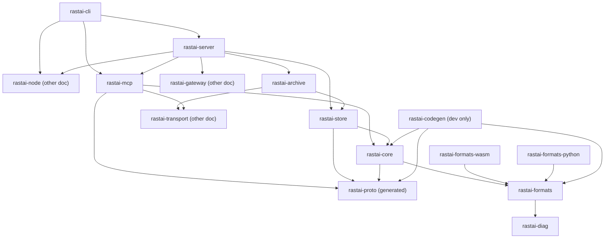
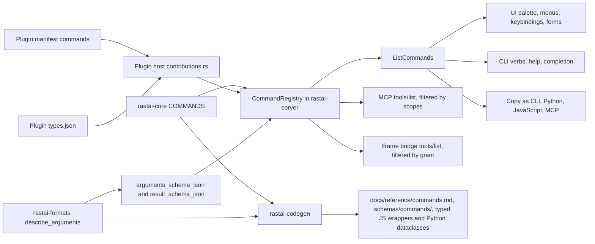
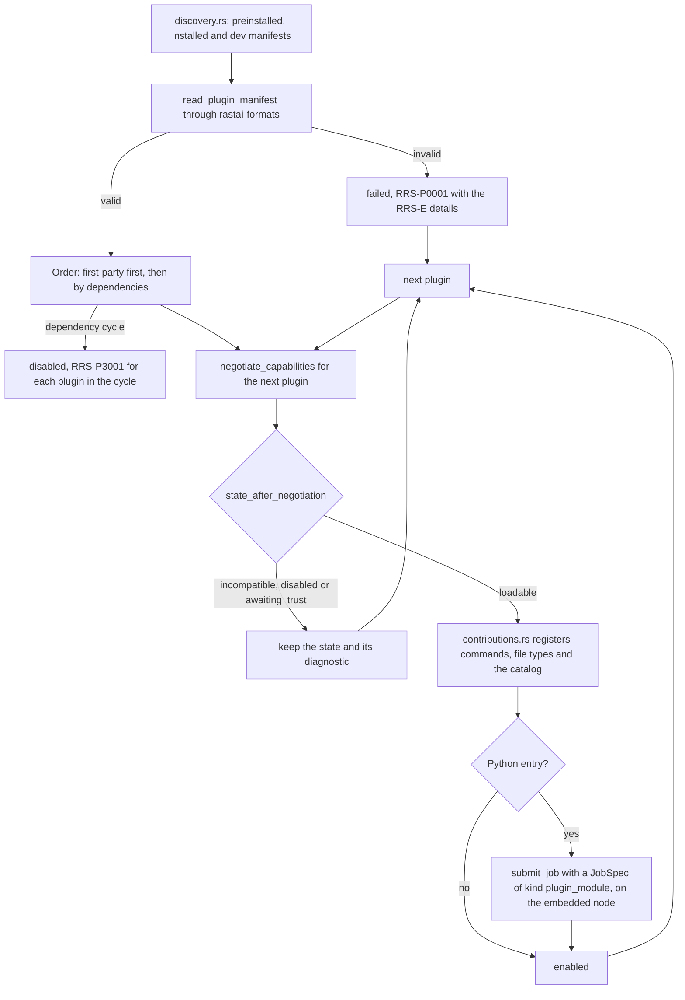
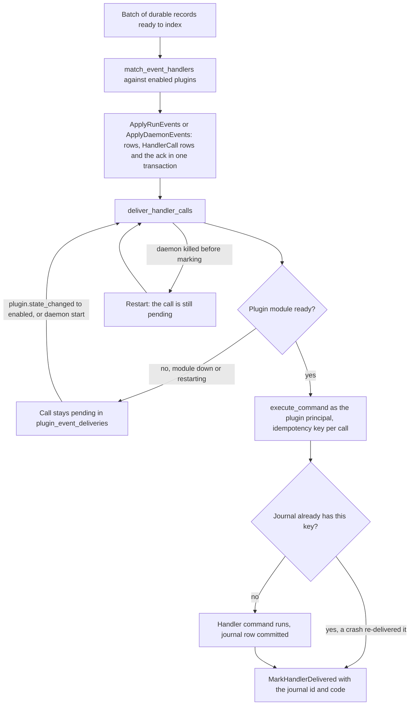
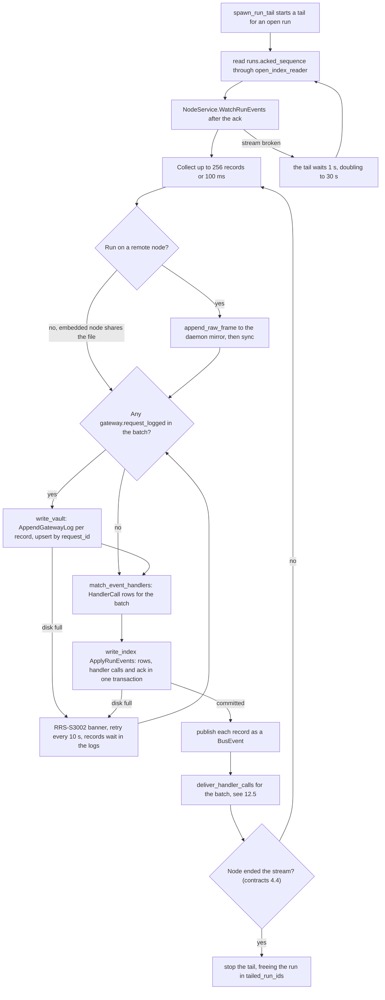
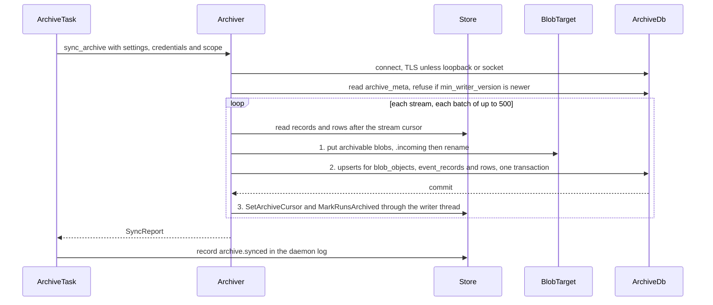
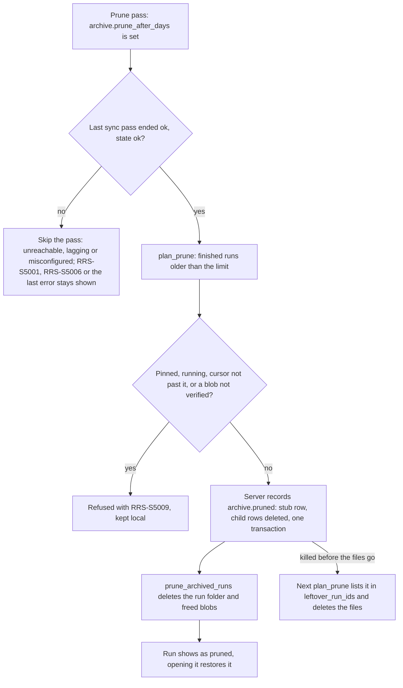

# Layout: the Rust control plane (`rastai-formats`, `rastai-core`, `rastai-store`, `rastai-diag`, `rastai-mcp`, `rastai-server`, `rastai-cli`, `rastai-archive`) and the workspace root

**Status:** v1.1, 2026-10-10. Pre-build design. Built on spec v5.4 (`docs/spec/rastai_spec_v5.md`), the spike (`spike/README.md`), the owner decisions of 2026-10-10 and 2026-10-11, and contracts v1.2 (`docs/architecture/contracts.md`). Every shared name comes from contracts, which is the only list of names; this doc keeps no "New names" list. Names that stay inside one crate (files, private functions, constants) are this doc's.

**Changes of 2026-10-11 (owner-approved):** `schemas/names.json`, `check-names` and `check-schema-diff` move into M1 (sections 2.8 and 4.9); the theme token group is `typography` everywhere (contracts §5.2 now says so; the open question is gone); the core event-type table, `ALIASES` and the CLI mode words live in `rastai-core` so the codegen can read them (contracts v1.2 §15.1).

**M1-01 alignments with the plan (2026-10-11):** `archive_cursors` arrives with M11's migration, not `0001` (plan M1-23); `tutorial.rs` and the `tutorial.*` commands are Phase 2, and `assistant.skill@1` is unsupported until then (plan §10 row 45); the `archive` settings section joins `SettingsDocument` in M11-E01; the settings precedence test uses `daemon.port`, a registered key (there is no `gateway.port`); `handlers/gym.rs` lands its `sandbox.*` arms at step 5 with M5-E10, because contracts 6.4 marks `sandbox.list`, `sandbox.kill` and `sandbox.cleanup` (M5), and its `harness.*` and `gym.*` arms at step 7 (8.8).

**Changes in v1.1:** the new `rastai-archive` crate (section 14, M11); `archive_cursors`, `runs.archive_state` and the `vault_changes` outbox in `rastai-store`; settings live only in files (no `settings` table); `unsafe` for one `statvfs` call (ADR-0033); `miniz_oxide` behind `zip/inflate.rs` and a fuzz target for every in-house parser of untrusted input; plain JavaScript codegen output (ADR-0036); `stability` on commands and event types; origin-bound sessions in the request gate (ADR-0034); 31 plugin capabilities; the one layer-placement planner and per-op golden files; (L2) tags.

This doc covers:
- the workspace root: Cargo workspace, `justfile`, lint and `cargo-deny` config, `catalog/`, `schemas/` (section 2);
- `crates/rastai-diag` (section 3);
- `crates/rastai-formats`, with its WASM and PyO3 builds and its codegen (section 4);
- `crates/rastai-core` (section 5);
- `crates/rastai-store` (section 6);
- `crates/rastai-mcp` (section 7);
- `crates/rastai-server` (section 8);
- `crates/rastai-cli` (section 9);
- four cross-cutting designs: the command registry and its generated surfaces (10), daemon HTTP API versioning (11), the plugin host (12), event indexing and the `rastai.db` rebuild (13);
- `crates/rastai-archive`, the optional long-term archive built in M11 (section 14).

It does not cover `rastai-proto`, `rastai-transport`, `rastai-sandbox`, `rastai-gateway` or `rastai-node` (`layout/rust-node-gateway-proto.md`), the Python packages (`layout/python.md`), or the JS packages and plugin SDKs (`layout/frontend-and-plugins.md`). The runtime behavior of startup, `Execute`, undo, the request gate, event durability, the rebuild, plugin install and GC is drawn in `flows/platform.md`; this doc gives the code that implements it and cites the flow sections instead of redrawing them.

Every crate section has the same parts: tree, public API, dependencies, boundary rules, tests, ported spike code, build-order step.

**(L2)** marks a part designed now but built only after the core loop reaches L2 (ADR-0017, contracts conventions). The minimal durable path comes first: event logs, reattach, atomic writes.

---

## 1. Overview

### 1.1 Crates at a glance

| Crate | Runs in | Owns | First needed (§31) |
|---|---|---|---|
| `rastai-diag` | every Rust process, WASM | `Diagnostic`, the compiled catalog, the text renderer, the JSON-lines logger | step 1, first crate written |
| `rastai-formats` | daemon, node, CLI, browser (WASM), Python (PyO3) | every document type, the 4 validation layers, migrations, canonical JSON and content hashes, safetensors, GGUF, streaming zip (ZIP64), importers, type descriptions | step 1 (header, run record, resume, settings, manifest, first command args); grows every step |
| `rastai-core` | daemon, node, CLI | command table and registry, ids, principals, scopes, shared state enums, settings resolution, data paths, protobuf JSON for wire types stored in documents | step 1 |
| `rastai-store` | daemon, node, CLI (offline rebuild) | `rastai.db`, `vault.db`, blob store, event-log reader and writer, the indexer, the rebuild, atomic config-file writes, free disk space | step 1 (`rastai.db`, logs, blobs); step 3 (`vault.db` with the `vault_changes` outbox table) |
| `rastai-mcp` | daemon (`/mcp`), CLI (`rastai mcp` bridge), node (gym tools) | MCP server and client, JSON-RPC 2.0 | step 1 (server, bridge); step 7 (client) |
| `rastai-server` | daemon | HTTP API, request gate and sessions, `Execute`, the bus, scheduling, `NodeHubService`, plugin host, import/export, ModelSpec analysis (the one layer-placement planner), data-policy check, secrets, the archiver task | step 1; grows every step |
| `rastai-cli` | the `rastai` binary | process modes, generated verbs, local commands | step 1 |
| `rastai-archive` | daemon | optional long-term archive: one-way, idempotent replication to the owner's MySQL or MariaDB; blob targets; prune, restore, verify, purge | M11, after the 90-day plan |



Arrows mean "may depend on" (contracts §2.1, §2.4). `rastai-server` is the composition root and also reaches the lower crates directly; those edges are left out. Every crate depends on `rastai-diag`; only the `rastai-formats` edge is drawn. `rastai-archive` also uses `rastai-core`, `rastai-formats` and `rastai-proto` (edges left out). The store never imports the archive (contracts §2.4 rule 7): the archive reads through the store's reader API and writes its cursors through the store's writer thread.

### 1.2 Conventions for these crates

These restate contracts §12 and `layout/rust-node-gateway-proto.md` §2, so the whole Rust tree reads the same way.

- **`src/lib.rs` is a list of `pub mod` lines** and nothing else. Each crate's public API is the `pub fn`s and `pub struct`s of its modules.
- **One error enum per crate** in `src/error.rs` (`FormatsError`, `CoreError`, `StoreError`, `McpError`, `ArchiveError`, `ServerError`, `CliError`), each with `fn code(&self) -> &'static str` returning a catalog code. `rastai-diag` has none: its functions can't fail. No `anyhow`, no `thiserror`.
- **Free functions over plain structs**: `append_event(&mut writer, &record)`, not `writer.append(...)` chains. Methods only for tiny accessors.
- **Closed sets are enums with a `match`** (`Document`, `IndexWrite`, `McpConnection`, `Mode`). Traits only for small synchronous interfaces with a few implementations: this doc adds two, `ByteSource` and `ByteSink` in `rastai-formats`; `LogSink` belongs to the gateway.
- **No `async fn` in traits behind `dyn`.** Async polymorphism is an enum.
- **Shared state** is a plain struct with tables behind `std::sync::Mutex`; a lock is never held across `.await`.
- **One wrapper file per external library** (contracts §2.4 rule 8); each crate section has a table naming it.
- **Constants at the top of each file**, with the reason or measurement in a comment.
- **Generated code** sits in a `generated/` folder, starts with a `// Generated by rastai-codegen. Do not edit.` line, and is checked in.
- **`unsafe` is forbidden** (workspace lint, section 2.3) with one exception: the `statvfs` call in `crates/rastai-store/src/disk_space.rs` (ADR-0033, section 6.4). Section 4.12 says why the spike's `mmap` is dropped.

---

## 2. Workspace root

### 2.1 Tree (Rust and shared files only)

```
RASTAI/
  Cargo.toml                 workspace: members, shared package fields, [workspace.dependencies], [workspace.lints],
                             [workspace.metadata.rastai.allowlist] (the §27 crate table, 2.4)
  Cargo.lock                 checked in; CI builds with --locked
  rust-toolchain.toml        pinned stable toolchain (1.99, the spike's), components rustfmt + clippy, wasm32 target
  .cargo/config.toml         [env] PYO3_BUILD_EXTENSION_MODULE = "1": cargo builds the wheel's module without libpython (4.7)
  rustfmt.toml               max_width = 120, edition = "2024" (matches the spike's line length)
  clippy.toml                too-many-lines-threshold = 60, too-many-arguments-threshold = 6, cognitive-complexity-threshold = 15
  deny.toml                  cargo-deny: licenses, advisories, sources, bans, single-owner wrappers (2.4)
  justfile                   every build, test, codegen and release task (2.5)
  catalog/                   error and term catalog sources (2.6)
  schemas/                   generated JSON Schemas and the names registry (2.7)
  tools/
    codegen/                 Rust crate `rastai-codegen` (dev only): bins rastai-formats-codegen, rastai-catalog-codegen,
                             rastai-names-codegen (4.9)
    checks/
      check-deps             reads `cargo metadata`, compares each member crate's direct deps with the allowlist table
      check-imports          (frontend doc) the wrapper-file and public-API rules for JS and Python
      check-generated        regenerate everything into a temp tree, diff, fail on any change; a generator that fails
                             is reported with its own error (and a recovery hint), and its outputs aren't compared
      check-unsafe           fails if any file outside the ADR exception list contains `unsafe`; the list has one file,
                             crates/rastai-store/src/disk_space.rs (ADR-0033)
      check-no-pickle        greps Python for `pickle` and `torch.load` (contracts §12.3)
      check-colors           (frontend doc) color literals in canvas, viz, sections and plugin UIs (contracts §5.6)
      check-no-typescript    (frontend doc) any .ts, .tsx or .d.ts outside generated folders (ADR-0036)
      check-fuzz-locks       runs `cargo metadata --locked` on every crates/*/fuzz workspace; fails on a stale
                             fuzz Cargo.lock (contracts §12.5)
      check-dco              (CI) Signed-off-by on every commit
      check-names            (M1) schemas/names.json against contracts §15 and the tables of §2.1-2.3, §5.2, §6, §7, §8, §10 and §11, both ways (2.8)
      check-schema-diff      (M1) schemas/commands/ and schemas/events/ against the base branch: contracts update required,
                             breaking change to a stable item refused (2.8, 11.1)
    hooks/
      pre-push               POSIX sh git hook: runs `just check` and refuses the push if it fails, the tree is not
                             clean, or a pushed ref is not HEAD (2.5, plan 3.6)
  fixtures/                  shared test inputs (contracts §12.5)
  tests/
    crash/                   Rust crate `rastai-crash-tests` (publish = false): the kill -9 matrix (flows/platform.md 6.5),
                             including the archiver rows 20–24 (section 14.9)
```

### 2.2 `Cargo.toml` (workspace)

```toml
[workspace]
resolver = "3"
members = [
  "crates/rastai-diag",
  "crates/rastai-proto",
  "crates/rastai-formats",
  "crates/rastai-formats/bindings/wasm",
  "crates/rastai-formats/bindings/python",
  "crates/rastai-core",
  "crates/rastai-plugin",
  "crates/rastai-store",
  "crates/rastai-transport",
  "crates/rastai-sandbox",
  "crates/rastai-gateway",
  "crates/rastai-mcp",
  "crates/rastai-node",
  "crates/rastai-archive",
  "crates/rastai-server",
  "crates/rastai-cli",
  "apps/desktop/src-tauri",
  "tools/codegen",
  "tests/crash",
]
# cargo-fuzz needs its own nightly workspace per crate (contracts §12.5); the spike is history and never built here.
exclude = [
  "crates/rastai-formats/fuzz", "crates/rastai-core/fuzz", "crates/rastai-store/fuzz", "crates/rastai-server/fuzz",
  "crates/rastai-mcp/fuzz", "crates/rastai-transport/fuzz", "crates/rastai-node/fuzz", "crates/rastai-archive/fuzz",
  "spike",
]

[workspace.package]
edition = "2024"
rust-version = "1.99"
license = "Apache-2.0"
version = "0.1.0"          # app, node and worker ship together under one version (§20)
publish = false            # nothing goes to crates.io; also lets cargo-deny accept path deps between our crates

[workspace.dependencies]
# Every external crate is declared here once, with an exact version. Member crates write `tokio = { workspace = true }`.
# The reason and allowed users of each one are in [workspace.metadata.rastai.allowlist] below.
tokio = { version = "=1.53.0", default-features = false }
axum = { version = "=0.8.9", default-features = false }
serde = { version = "=1.0.229", features = ["derive"] }
serde_json = "=1.0.151"
rusqlite = { version = "=0.40.2", features = ["bundled"] }
blake3 = "=1.x.y"           # exact version pinned when the crate is first added
miniz_oxide = "=0.x.y"      # inflate only, behind rastai-formats/src/zip/inflate.rs
libc = "=0.2.x"             # one statvfs call, rastai-store/src/disk_space.rs (ADR-0033)
mysql_async = { version = "=0.x.y", default-features = false, features = ["default-rustls-ring"] }   # M11, rastai-archive
# ... one line per allowlisted crate

[workspace.lints.rust]
unsafe_code = "deny"           # deny, not forbid, so ADR-0033 can allow one named function; check-unsafe keeps the list honest
unused_must_use = "deny"

[workspace.lints.clippy]
unwrap_used = "deny"           # tests opt out with #[allow] at the test module
expect_used = "warn"
dbg_macro = "deny"
todo = "deny"
print_stdout = "deny"          # only rastai-cli/src/output.rs and codegen bins print; they allow it per file
too_many_lines = "warn"        # 60 lines, from clippy.toml: small functions
cognitive_complexity = "warn"
```

- `version` exact-pins (`=`) every external crate, so `Cargo.lock` and the allowlist agree and an update is a deliberate PR.
- `default-features = false` on big crates; each member turns on only the features it uses (for example `tokio` features `rt-multi-thread`, `net`, `sync`, `time`, `process`, `fs`, `io-util`, `macros` in `rastai-server`; only `sync` in `rastai-store`).
- Each member's `Cargo.toml` has `[lints] workspace = true` and `publish.workspace = true`. cargo-deny accepts a path dependency between our own crates only when the crate can't be published, so a member without it fails `just deny` as soon as it depends on another rastai crate.

### 2.3 Lint and format rules

| Rule | Where | Why |
|---|---|---|
| `cargo fmt --check` | `just fmt-check` | one style; `rustfmt.toml` sets 120 columns |
| clippy with `-D warnings` | `just lint` | the lints above; `too_many_lines` keeps functions small |
| `unsafe_code = "deny"` + `tools/checks/check-unsafe` | workspace lints | contracts §12.2: `unsafe` only with an ADR naming the file; today only `rastai-store/src/disk_space.rs` (ADR-0033) |
| no `anyhow`, `thiserror`, `reqwest`, `memmap2`, `openssl`, `sqlx` | `deny.toml` `[bans]` | contracts §2.5, §12.2 |
| no `async-trait` | `deny.toml` `[bans]` | async polymorphism is an enum; tonic is its one allowed parent, for the generated service traits (contracts §12.2) |
| every direct dependency in the allowlist table, used only by the listed crates | `tools/checks/check-deps` | §27; one wrapper module per library |
| every name in code is registered in contracts, and every registered name is in code or marked with its milestone | `tools/checks/check-names` | one registry (contracts §15); agents and people can't invent a name unnoticed (2.8) |
| a change to a command or event schema comes with a contracts update, and a breaking change to a stable one is refused | `tools/checks/check-schema-diff` | what `buf breaking` can't see inside `arguments_json` and `result_json` (2.8, 11.1) |

### 2.4 `deny.toml` and the crate allowlist

`deny.toml` holds what cargo-deny checks well:
- `[licenses] allow = ["Apache-2.0", "MIT", "BSD-2-Clause", "BSD-3-Clause", "ISC", "Unicode-3.0", "Zlib", "CC0-1.0", "MPL-2.0", "BSL-1.0", "CDLA-Permissive-2.0"]` (the ADR-0015 #7 list); anything else fails. `confidence-threshold = 0.9`. `mysql_async` is MIT OR Apache-2.0; its transitive crates go through the same check on the M11-E01 PR that adds it.
- `[advisories]`: the RustSec database; `yanked = "deny"`. This is why `sqlx` is banned: RUSTSEC-2023-0071 reaches it through `rsa` (contracts §2.5).
- `[sources]`: crates.io only; no git dependencies.
- `[bans]`: `multiple-versions = "warn"`; `deny = ["anyhow", "thiserror", "reqwest", "memmap2", "openssl", "openssl-sys", "async-trait", "schemars", "sqlx"]`. `schemars` comes back only by the rule in contracts §5.4 (more than about 20 document types). `anyhow` and `async-trait` each have one allowed third-party parent, `prost-derive` and `tonic` (contracts §2.5).
- **Single-owner wrappers** (contracts §2.5 "Enforced owners"). A `[[bans.deny]]` entry with `wrappers = [<owner>]` lets only the owner depend on the crate directly:
  - `tokenizers`, `minijinja` → `rastai-gateway`
  - `rusqlite` → `rastai-store`
  - `pyo3` → `rastai-formats-python`; `wasm-bindgen` → `rastai-formats-wasm`
  - `keyring` → `rastai-server`
  - `blake3` → `rastai-formats`
  - `ed25519-dalek` → `rastai-node`
  - `mysql_async` → `rastai-archive`
  - `libc` → `rastai-store`; `miniz_oxide` → `rastai-formats`
- **`libc` and `miniz_oxide` also arrive under third-party crates** (`libc` under tokio and mio; `miniz_oxide` under `flate2`, which `mysql_async` may pull in). cargo-deny's `wrappers` checks every direct parent, so their entries also list those third-party parents by name, as `Cargo.lock` shows them. A new third-party parent then fails CI and gets a look in review. `check-deps` checks that no other workspace member depends on them directly, and `check-imports` checks the file (`disk_space.rs`, `zip/inflate.rs`).

The §27 table itself lives in `Cargo.toml` as data, so there is one place to read it:

```toml
[workspace.metadata.rastai.allowlist]
# crate = { category, reason, users }. check-deps fails if a member uses a crate not listed, or a crate a member isn't listed for.
tokio      = { category = "foundation", reason = "async runtime", users = ["rastai-server", "rastai-node", "rastai-gateway", "rastai-mcp", "rastai-transport", "rastai-sandbox", "rastai-plugin", "rastai-cli", "rastai-store", "rastai-archive"] }
rusqlite   = { category = "foundation", reason = "SQLite", users = ["rastai-store"] }
libc       = { category = "foundation", reason = "one statvfs call (ADR-0033)", users = ["rastai-store"] }
blake3     = { category = "security", reason = "content hashes, blob names", users = ["rastai-formats"] }   # every other crate hashes through rastai_formats::hashing
miniz_oxide = { category = "compatibility", reason = "zip inflate", users = ["rastai-formats"] }
ed25519-dalek = { category = "security", reason = "node and daemon identity, update signatures", users = ["rastai-node"] }   # the daemon signs through rastai_node::identity
mysql_async = { category = "compatibility", reason = "MySQL client for the long-term archive", users = ["rastai-archive"] }
serde      = { category = "foundation", reason = "document and JSON types", users = ["*"] }
pyo3       = { category = "foundation", reason = "the rastai-formats wheel", users = ["rastai-formats-python"] }
# ... one row per crate in §27 (contracts §2.5)
```

Dev-only crates (`libfuzzer-sys` for the fuzz crates) are listed with `category = "dev"`; `check-deps` rejects them in non-dev dependency sections of workspace members. The cargo-fuzz crates (`crates/<crate>/fuzz/`, excluded from the workspace) are dev-only as a whole: `check-deps` reads their manifests against the same allowlist and accepts a dev crate in their `[dependencies]`, where cargo-fuzz puts `libfuzzer-sys`.

### 2.5 `justfile` recipes

Every CI step is one recipe. Recipes owned by other docs (web, Python, proto) are listed in those docs; the ones below are the Rust and repo-wide ones.

| Recipe | Runs | Used by |
|---|---|---|
| `just check` | `fmt-check lint test-rust wasm codegen-check deny check-deps check-unsafe check-names check-schema-diff proto-check` plus `check-fuzz-locks`, the Python checks (ruff, pytest) and JS checks (`check-js`, prettier, `check-colors`, `check-no-typescript`) from their docs; while CI is manual-only, also the cpu-environment job tests `test-node-jobs`, `test-daemon-jobs` and `test-crash` | "done" means this passes (§29); the pre-push hook before every push, and the verifier on a fresh clone of the PR head (plan 3.6) |
| `just install-hooks` | `git config core.hooksPath tools/hooks` (this clone's config, never `--global`), so git runs `tools/hooks/pre-push` | dev: once per clone |
| `just build` | `cargo build --workspace --locked` | dev |
| `just test-rust` | `cargo test --workspace --locked` (unit + `crates/*/tests/`; MySQL tests skip themselves without a server) | CI on Linux, macOS, Windows runners (CPU) |
| `just test-crash` | `cargo test --locked -p rastai-crash-tests -- --ignored --test-threads=1` (the rows run the real worker in the cpu environment, so they are `#[ignore]`d in a plain `cargo test`), then pytest in `tests/crash/` (the worker's kill -9 tests) | CI on Linux (`test-crash`); `just check` while CI is manual-only (plan 3.6) |
| `just test-archive` | `rastai-archive` tests and crash rows 20–24 against the MySQL 8.4 and 9.7, MariaDB and MinIO containers (section 14.9) | CI job `mysql-archive` (M11-E07) |
| `just fuzz <crate> <target> [seconds]` | `cargo +nightly fuzz run <target> -- -max_total_time=<seconds>` in `crates/<crate>/fuzz` (the targets of contracts §12.5), against that folder's checked-in `Cargo.lock`, which `check-fuzz-locks` keeps current | nightly CI, 10 minutes per target |
| `just codegen` | `buf generate` (proto doc; protobuf-es with target `js+dts`), then `cargo run -p rastai-codegen --bin rastai-catalog-codegen`, then `--bin rastai-formats-codegen`, then `--bin rastai-names-codegen` (last: it reads the catalog, the tables and the migrations) | after any catalog, document or command change |
| `just codegen-check [base]` | `tools/checks/check-generated`, then `cargo test -p rastai-codegen -- --ignored` with `RASTAI_BASE_REF=<base>` (default `origin/main`): the catalog's merge-base check and the outputs check (4.9), which need git history and both environments | CI |
| `just wasm` | `cargo build -p rastai-diag --target wasm32-unknown-unknown` (M1, section 3.4); from M4 also `cargo build -p rastai-formats-wasm --target wasm32-unknown-unknown --release`, then `wasm-bindgen --target web --no-typescript --out-dir packages/formats/src/wasm/` | `just check`; `packages/formats` build, the viewer |
| `just wheel` | `maturin build --release --locked` in `python/rastai_formats/` (its `pyproject.toml` names the binding crate), with the cpu environment's maturin and Python 3.12, into `python/rastai_formats/dist/` | the uv environments |
| `just deny` | `cargo deny check` | CI |
| `just check-deps` | `tools/checks/check-deps` | CI |
| `just check-names` | `tools/checks/check-names` (2.8) | CI, and in `just check` (M1) |
| `just check-schema-diff` | `tools/checks/check-schema-diff` against `RASTAI_BASE_REF` (default `origin/main`) (2.8) | CI, and in `just check` (M1) |
| `just serve-dev` | `RASTAI_HOME=.dev cargo run -p rastai-cli -- serve --headless` | dev: a throwaway data directory under the repo (git-ignored) |
| `just web-embed` | `pnpm --filter @rastai/web build` (frontend doc), so `rastai-server` embeds a fresh `apps/web/dist/` | release builds |
| `just release-linux` | `tools/release/` AppImage and `.deb` | release |

### 2.6 `catalog/`

```
catalog/
  errors/
    RRS-E.json     formats and validation         (owner rastai-formats)
    RRS-P.json     plugins                         (plugin host in rastai-server, SDKs)
    RRS-C.json     commands and API                (rastai-core, rastai-server, rastai-mcp)
    RRS-S.json     storage and durability          (rastai-store; 5000–5999 rastai-archive)
    RRS-N.json     nodes, transport, remote
    RRS-H.json     hardware and environments
    RRS-J.json     jobs and worker protocol
    RRS-G.json     gateway and inference
    RRS-M.json     model runtime
    RRS-T.json     training
    RRS-D.json     data
    RRS-R.json     agent gym and sandboxes
    RRS-U.json     UI client
  terms/
    terms.json     plain-English definitions shown by the UI (the glossary, contracts §13)
  README.md        how to add a code: add it to contracts §10.3 first, pick the next free number in the owning range,
                   never reuse, retire instead; also maps withdrawn draft numbers (contracts §10.2)
```

`RRS-L` and `RRS-V` live in `plugins/psychology/catalog/errors.json` and `plugins/evaluation/catalog/errors.json` (contracts §10), with each plugin's terms in `catalog/terms.json` beside it; the catalog codegen reads them too. Every catalog file is a JSON array of entries, read by `rastai-formats`' strict reader (a key written twice is an error), and every entry has exactly the fields below (`fix_command_id` may be left out). A source that doesn't exist yet holds no entries, so the generated tables are empty until M1-13 writes the files. One entry:

```json
{
  "code": "RRS-S3001",
  "severity": "error",
  "title": "Not enough free disk space",
  "message": "{operation} needs {needed_bytes} bytes on {volume}, but only {free_bytes} are free.",
  "basic_text": "Your disk is almost full, so Rastai can't save this.",
  "fix_text": "Free up space, or let Rastai delete old checkpoints and unused files.",
  "fix_command_id": "storage.gc",
  "docs_anchor": "rrs-s3001",
  "retired": false
}
```

- Placeholders are `{snake_case}` names. The codegen test checks that every placeholder used in Rust call sites exists in the entry, and that the entry uses no placeholder the call doesn't fill (it scans for `diagnostic("RRS-...", &[("name", ...)])` with a plain text search; no macro). The code may be a string literal or a `const` of the same file, and the values an inline array or `&values` where the closest `let values = [...]` above the call is the array; a call that builds its values another way (`error_values(...)`, `borrow_values(...)`) is skipped, and its own tests check its message. With it, the `RRS-` source scan checks that every code first-party source names outside its tests is in the catalog (both in `catalog_checks.rs`, M1-13).
- The catalog and contracts §10.3 hold the same codes with the same severities; a row marked for a later milestone (the plugins' `RRS-L` (M4) and `RRS-V` (M5)) may wait for its entry (`catalog_checks.rs`, M1-13).
- `fix_command_id`, when set, must be a command the fix button can run: a row of the core table, or a command contracts §6.4 registers with the milestone marker of the task that builds it (`storage.gc` (M5)), which may wait for its row. Checked by `catalog_checks.rs` (M1-22). First-party manifests join the rule when the first one lands.
- `docs_anchor`, when set, is a lowercase kebab-case slug, used once among the error entries and once among the terms. An error entry's anchor is its code in lowercase (`rrs-s3001`), so a link stays valid when the title changes; a term's is its own slug. It becomes an HTML id in `docs/reference/errors.md`. Checked by `catalog_checks.rs` (M1-12).
- Terms: `{"term_id": "logit_lens", "title": "Logit lens", "basic_text": "...", "advanced_text": "...", "docs_anchor": "..."}`. Each `term_id` is listed once (`catalog_checks.rs`, M1-12).

### 2.7 `schemas/`

Generated by `rastai-formats-codegen` from the type descriptions (section 4.9). Checked in; never edited.

```
schemas/
  rastai.model/1.json              one file per document type and schema version (contracts §5.1)
  rastai.harness/1.json
  rastai.data/1.json
  rastai.eval/1.json
  rastai.replay/1.json
  rastai.plugin/1.json
  rastai.project/1.json
  rastai.lock/1.json
  rastai.conversation/1.json
  rastai.run_record/1.json
  rastai.resume/1.json
  rastai.steering_preset/1.json
  rastai.layout/1.json
  rastai.keybindings/1.json
  rastai.settings/1.json
  rastai.converter/1.json          step 5 (declarative dataset converters)
  rastai.eval_result/1.json        step 5 (an eval run's result file)
  rastai.model_diff/1.json         step 4 (Psychology model diff report)
  rastai.sae_fit_check/1.json      step 4 (Psychology SAE fit check report)
  rastai.theme/1.json              step 1, M1 (the full token row, contracts §5.6); theme plugins use it from M8
  rastai.tutorial/1.json           Phase 2 (built-in tutorials; plan §10 row 45)
  rastai.icon_set/1.json           M8 (icon-set plugins)
  commands/
    rastai.command.model.load/1.json      arguments and result of each core command (two `$defs`: arguments, result),
                                          plus `x-rastai-kind` and `x-rastai-stability` copied from the descriptor
    ...
  events/
    job.state_changed.json                one file per core event type: the table row (type, class, payload message,
                                          emitter, `x-rastai-stability`, since_version) and the payload's fields
    ...
  names.json                        the names registry, written by rastai-names-codegen (2.8, 4.9); M1
  index.json                        every schema id with its file and content hash (the Phase 2 publish step reads this)
```

- Old versions stay forever (`rastai.model/1.json` is kept when `/2` appears), because migrations read old files.
- The `$id` in each file is the stable URL `https://schemas.rastai.dev/<type>/<version>.json` (contracts §14 row 8); nothing serves it until Phase 2.
- Shared types without a header (`InterventionSet`, `MysqlConnection`) have no file of their own; they appear as `$defs` inside the documents and commands that use them.
- **`schemas/commands/` is what `buf breaking` can't see.** `arguments_json` and `result_json` are strings to protobuf. From M1, `tools/checks/check-schema-diff` compares `schemas/commands/` and `schemas/events/` against the base branch (section 2.8). Every change needs a contracts update in the same PR, and a breaking change to a `stable` item fails. Until Phase 2 chooses the stable subset, every command and event type is `preview`, so the check only demands the contracts update.
- **`schemas/names.json` is generated, never edited.** One sorted list per kind of name. `check-generated` keeps it current; `check-names` compares it with contracts (section 2.8).

### 2.8 `tools/checks`: `check-names` and `check-schema-diff` (M1, owner decision of 2026-10-11)

Contracts §15 is the only name registry, and `buf breaking` can't see inside `_json` payloads. These two checks make both rules mechanical. Both run in `just check` and in the `checks` job of `ci.yml` (about 2 size-days together, in M1). Contracts §12.6 owns the format of `names.json` and the rules below; this section says how the code is laid out to meet them.

**Where each fact comes from.** `rastai-names-codegen` (section 4.9) writes `schemas/names.json` from the code, never from a hand-kept list:

| Key in `names.json` | Read from |
|---|---|
| `command_ids` | `rastai_core::commands::COMMANDS` and the `commands[]` of each first-party manifest (`plugins/*/rastai-plugin.json`) |
| `cli_verbs` | `cli_words()` of every command id, plus `CLI_MODE_WORDS` and `ALIASES` (both in `rastai-core/src/commands/naming.rs`), so the registry and the CLI can't differ |
| `event_types` | `rastai_core::event_types::EVENT_TYPES` (`rastai-core/src/event_types.rs`) and the event types each first-party manifest declares (`plugins/*/rastai-plugin.json`; none yet, contracts 12.6) |
| `error_codes` | `catalog/errors/*.json` and `plugins/*/catalog/` |
| `tables` | per database (`rastai.db`, `vault.db`), table to columns: read from the store's migration files (`rastai-store/src/index/migrations/*.sql`, `vault/migrations/*.sql`) by a small in-house reader of `CREATE TABLE` and `ALTER TABLE ... ADD COLUMN` (`tools/codegen/src/sql_names.rs`). `rastai-store/tests/index_migrations.rs` runs the real migrations and compares `PRAGMA table_info` with the same reader, so the reader can't drift |
| `settings_keys` | the `rastai.settings/1` type description, flattened to `<section>.<key>` (nested objects stop at the key: `training.lora`) |
| `document_schema_ids` | `rastai_formats::describe::describe_all_types()`, document types only (command argument and result types are covered by `command_ids`) |
| `crates`, `js_packages`, `python_packages` | `cargo metadata --no-deps --format-version 1`; the `name` of each `package.json` in the pnpm workspace; the import packages (folders with `__init__.py`) directly inside each Python project folder: every uv workspace member under `python/` and every `plugins/*/python/` |

**`check-names`.** Reads `schemas/names.json` and parses contracts §15 plus the tables of §2.1-2.3 (crates and packages), §5.2 (document schema ids), §6.4 (commands), §7.3 (events), §8.2 and §8.3 (tables and columns), §10.3 (error codes) and §11.2 (settings keys) with a plain Markdown table reader (contracts §12.6 lists the exact columns). A heading or table that moves so the reader can't find it fails the check. It compares both ways:

| Case | Result |
|---|---|
| in code, not in contracts | fails: "unregistered name" |
| in contracts with a milestone marker (`(M<n>)`, `(L2)`, `(Phase 2)` or `(Phase 3)`), not yet in code | allowed |
| in contracts without a marker, not in code | fails: "stale name" (the code dropped it, or the marker is missing) |
| in both | passes |

The fix for a failure is always a contracts edit in the same PR (or a code edit that removes the stray name). The check prints the file that holds the name, so the author lands on the right line.

**`check-schema-diff`.** Compares `schemas/commands/` and `schemas/events/` with the same folders at the merge base of `RASTAI_BASE_REF` (default `origin/main`; CI passes the PR base). Reading the base uses `git show`, so the check needs no network. A new file has no base and counts as an addition.

| Rule | Applies to | Result |
|---|---|---|
| Any added, changed or removed schema file needs a matching contracts update in the same PR: `contracts.md` is part of the diff, and a changed line names the command id, the event type, or its argument, result or payload type | every item | fails without it |
| A breaking change: a removed or renamed field, a changed field type, a newly required field, a removed or renamed command or event type, a changed command `kind` or event class, or a stability downgrade | `stable` items (and `deprecated` ones until retired, 11.2) | fails |
| The same changes | `preview` items | allowed, with the contracts update |

The stability comes from `x-rastai-stability` in the file, so the check needs no Rust. Because the schemas are generated, a PR that changes a command's arguments changes the file too, and `check-generated` stops anyone editing a schema by hand.

**Tests** (`tools/checks/tests/`): `check-names` against a fixture pair of `names.json` and a contracts excerpt (one case per row of the table above); `check-schema-diff` against fixture pairs of base and head schema trees (one case per rule, including a `preview` break that passes and a `stable` break that fails).

Agents that build against these checks follow the build protocol in the plan: the contracts, the generated schemas and the owning layout section go into every task prompt, and every PR gets a separate reviewer agent with a naming and schema lens.

---

## 3. `rastai-diag`: catalog, renderer, logger

**Purpose.** The bottom crate. It holds the `Diagnostic` type every other crate returns, the compiled catalog that gives each code its text and fix, the compiler-style renderer, and the JSON-lines logger. It has no rastai dependencies and builds for `wasm32-unknown-unknown`, so the browser validator renders the same messages as the CLI.

### 3.1 Tree

```
crates/rastai-diag/
  Cargo.toml
  CLAUDE.md                   local rules: no rastai deps, WASM-safe, every user-facing text comes from the catalog
  src/
    lib.rs                    pub mod lines only
    diagnostic.rs             Severity, Diagnostic, diagnostic(), diagnostic_at(), has_errors()
    path.rs                   the Diagnostic.path grammar: build and split "<file>:<line>:<column>#<json pointer>"
    catalog.rs                CatalogEntry, find_entry(), fill_placeholders(); RuntimeCatalog for third-party PLG- codes
    terms.rs                  TermEntry, find_term()
    render_text.rs            compiler-style text: code and title, location, source snippet with a caret, fix lines
    render_basic.rs           Basic-mode text: basic_text plus the fix label
    render_json.rs            Diagnostic as a JSON object (CLI --json, logs)
    logger.rs                 JSON-lines logger: init_logger(), log_info(), log_warn(), log_error(), file rotation
    generated/
      mod.rs                  pub mod lines for the two tables
      catalog_table.rs        pub const CATALOG: &[CatalogEntry], from catalog/errors/*.json and the first-party plugin catalogs
      terms_table.rs          pub const TERMS: &[TermEntry], from catalog/terms/terms.json
  tests/
    render_snapshots.rs       each fixtures/diagnostics/<case>.json renders to <case>.txt (plain) and <case>.basic.txt
```

### 3.2 Public API

```rust
// diagnostic.rs
pub enum Severity { Error, Warning, Info }

/// The in-process twin of rastai.common.v1.Diagnostic. Same fields, same meaning.
/// rastai-core/src/wire.rs converts between the two; a test checks the field lists match (section 5.5).
pub struct Diagnostic {
    pub code: String,               // "RRS-E2004", or "PLG-<plugin_id>-0001" for third-party plugins
    pub severity: Severity,
    pub message: String,            // the catalog message with placeholders filled
    pub path: String,               // see path.rs; empty when the problem has no location
    pub fix_text: String,
    pub fix_command_id: String,     // drives the fix button; empty when there is none
    pub fix_arguments_json: String,
}

/// Builds a diagnostic from the catalog. Severity, message and fix come from the entry, so call sites never write user-facing text.
pub fn diagnostic(code: &str, values: &[(&str, &str)]) -> Diagnostic
pub fn diagnostic_at(code: &str, values: &[(&str, &str)], path: &str) -> Diagnostic
pub fn has_errors(diagnostics: &[Diagnostic]) -> bool

// path.rs
pub struct DiagnosticPath { pub file: String, pub line: u32, pub column: u32, pub json_pointer: String }
pub fn format_path(path: &DiagnosticPath) -> String       // "designs/textcnn.rrsmodel:14:9#/inputs/1/range"
pub fn parse_path(text: &str) -> DiagnosticPath

// catalog.rs
pub struct CatalogEntry {
    pub code: &'static str, pub severity: Severity, pub title: &'static str, pub message: &'static str,
    pub basic_text: &'static str, pub fix_text: &'static str, pub fix_command_id: &'static str,
    pub docs_anchor: &'static str, pub retired: bool,
}
pub fn find_entry(code: &str) -> Option<&'static CatalogEntry>
pub fn fill_placeholders(template: &str, values: &[(&str, &str)]) -> String

/// Third-party plugin codes, loaded at runtime by the plugin host from the plugin's catalog/errors.json.
pub struct PluginCatalogEntry { pub code: String, pub severity: Severity, pub title: String, pub message: String,
                                pub basic_text: String, pub fix_text: String, pub fix_command_id: String }
pub struct RuntimeCatalog { pub plugin_entries: Vec<PluginCatalogEntry> }
pub fn add_plugin_catalog(catalog: &mut RuntimeCatalog, plugin_id: &str, entries: Vec<PluginCatalogEntry>) -> Vec<Diagnostic>
pub fn remove_plugin_catalog(catalog: &mut RuntimeCatalog, plugin_id: &str)
pub fn plugin_diagnostic(catalog: &RuntimeCatalog, code: &str, values: &[(&str, &str)]) -> Diagnostic

// render_text.rs, render_basic.rs, render_json.rs
pub enum RenderStyle { Plain, Color }
pub fn render_text(diagnostic: &Diagnostic, source_text: Option<&str>, style: RenderStyle) -> String
pub fn render_basic(diagnostic: &Diagnostic) -> String
/// The same renderers with the catalog text passed in, for a code the compiled catalog doesn't hold
/// (a third-party PLG- code, and the snapshot tests, which must not depend on the real catalog's wording).
pub fn render_text_with_title(diagnostic: &Diagnostic, title: &str, source_text: Option<&str>, style: RenderStyle) -> String
pub fn render_basic_with_text(diagnostic: &Diagnostic, basic_text: &str) -> String
pub fn render_json(diagnostic: &Diagnostic) -> serde_json::Value

// logger.rs
pub enum LogLevel { Debug, Info, Warn, Error }
pub struct LoggerSettings { pub process_name: String, pub file_path: Option<PathBuf>, pub level: LogLevel,
                            pub max_file_bytes: u64, pub keep_files: u32 }
pub fn init_logger(settings: LoggerSettings)
pub fn log_info(message: &str, fields: &[(&str, &str)])
pub fn log_warn(message: &str, fields: &[(&str, &str)])
pub fn log_error(message: &str, fields: &[(&str, &str)])
pub fn log_diagnostic(diagnostic: &Diagnostic, fields: &[(&str, &str)])
```

The text renderer's output, for a meaning-layer error in a design:

```
error[RRS-E2004]: Input ranges overlap
  --> designs/textcnn.rrsmodel:14:9  #/inputs/1/range
   |
14 |         "range": [0, 128],
   |         ^^^^^^^^^^^^^^^^^ overlaps input "title" (0..64)
   = fix: shrink one of the ranges, or merge the two inputs
```

- **Callers:** every crate builds diagnostics with `diagnostic()`. `rastai-cli/src/output.rs` renders them (`render_text` with `Color` on a TTY, `render_basic` unless `--verbose`). The WASM build calls `render_basic` for form hints. The plugin host owns the `RuntimeCatalog`. `rastai-server` and `rastai-node` call `init_logger` once in their entry functions; run ids travel into Python as `RASTAI_RUN_ID` (contracts §15.9). The logger is in-house (spec v5.4 §25); there is no `tracing`.
- **Log line:** `{"unix_ms":..., "level":"info", "process":"daemon", "message":"...", "run_id":"...", ...fields}` in `<state>/logs/daemon.jsonl` or `node.jsonl`; rotated to `.1.jsonl` ... at `logging.max_file_bytes`, keeping `logging.keep_files`. One `std::sync::Mutex<File>` guards the file; each line is one `write_all`.
- **Unknown code:** `diagnostic()` with a code missing from the catalog returns severity `Error`, the code itself, and message `"unknown diagnostic code"`, and logs a warning. The codegen test (4.9) makes this unreachable for first-party code: it scans the source for `"RRS-` literals and checks each against the catalog.

### 3.3 Dependencies

| Kind | Name | Used for | Wrapper file |
|---|---|---|---|
| Internal | none | | |
| External | serde, serde_json | `render_json`, log lines | `render_json.rs`, `logger.rs` |

### 3.4 Boundary rules

- Never depends on another rastai crate. Never depends on tokio.
- No I/O except `logger.rs` (and only when `init_logger` was given a file).
- Never holds user-facing text outside `generated/`. A new message is a new catalog entry, not a string literal.
- Must build for `wasm32-unknown-unknown`; CI builds it in `just wasm`.

### 3.5 Tests

| Test | Where | What |
|---|---|---|
| Unit | bottom of `path.rs`, `catalog.rs`, `render_text.rs` | path round trip; a missing placeholder value stays visible as `{name}`; snippet and caret at line 1, at the last line, with tabs and multi-byte characters |
| Snapshots | `tests/render_snapshots.rs`, `fixtures/diagnostics/` (new) | plain, color-stripped and Basic output for one case per severity and path shape |
| Catalog rules | `tools/codegen/tests/catalog_checks.rs` | codes well formed and unique; each code in its owner's range (contracts §10); `catalog_ranges.rs` equals the contracts §10.1 table (prefixes, areas, ranges); docs anchors are kebab-case slugs used once; term ids unique (all M1-12); the catalog's codes and severities equal contracts §10.3; every `RRS-` code in first-party source is in the catalog; placeholders in call sites exist in the entry and the other way round (M1-13); every `fix_command_id` is a row of the core table or a contracts §6.4 command with its milestone marker (M1-22), or in a first-party manifest (when the first one lands) |
| Append-only | `tools/codegen/tests/catalog_checks.rs` (the `#[ignore]`d merge-base test, run by `just codegen-check`) | a code present at the merge base can be marked `retired` but never deleted or renumbered |

### 3.6 Ported from the spike

Nothing is ported. The lesson carried over: the spike's three readers (Python, Rust, Java) agreed on the 33-file corpus by comparing error *strings*, which broke on every wording change. Codes replace strings as the thing tests compare.

### 3.7 Build-order step

Step 1, before any other crate: the first `Execute` returns diagnostics. `RuntimeCatalog` arrives with third-party plugins at step 8.

---

## 4. `rastai-formats`: documents, validation, safetensors, GGUF

**Purpose.** The single source of truth for every document type (§15, §23). It parses bytes into typed Rust structs in four validation layers, collects every diagnostic in one pass, migrates old files, writes files back with a content hash, and describes each type as plain data so JSON Schema, JSDoc typedefs, typed JS command wrappers and Python dataclasses are generated from it. It also owns the byte formats Rastai reads and writes: safetensors (the one header validator, contracts §2.4 rule 10), GGUF and zip (inflate through `miniz_oxide`). The same code runs in the daemon, the node, the CLI, the browser (WASM) and Python (PyO3).

### 4.1 Tree

```
crates/rastai-formats/
  Cargo.toml                  rlib only; the two builds are the binding crates below
  CLAUDE.md                   local rules: bytes in, typed data out; no tokio; no path-based file access; WASM-safe
  src/
    lib.rs
    error.rs                  FormatsError, typed errors for internal callers, each with code()
    limits.rs                 ImportLimits and its defaults: file size, JSON depth, JSON value count, graph node count,
                              parameter count, zip caps
    byte_source.rs            ByteSource trait (length, read_at) with SliceSource and FileSource;
                              ByteSink trait (write_bytes) with VecSink and FileSink
    hashing.rs                the only blake3 import: hash_bytes, StreamHasher, content_hash_of_value, model_hash
    crc32.rs                  the one CRC-32/IEEE table (equal to Python's zlib.crc32): zip entries and event-log frames
    semver.rs                 in-house semver: parse a version, parse a range, version_matches
    json/
      reader.rs               strict JSON reader: duplicate keys rejected, depth limit, NaN and Infinity rejected, positions kept
      positions.rs            PositionMap: JSON pointer to line and column, filled by the reader
      pointer.rs              JSON pointer escape, join, lookup
      canonical.rs            canonical JSON (sorted keys, no whitespace, UTF-8), the input to content hashes
      pretty.rs               stable pretty writer for files on disk: 2-space indent, fields in description order
      patch.rs                JSON Patch subset (add, remove, replace, move): apply and diff, for undo (flows/platform.md 3.4)
    describe/
      types.rs                TypeDescription, FieldDescription, FieldKind, and the field() / list_of() / enum_of() helpers
      registry.rs             describe_all_types(), find_description(name)
      structure_check.rs      layer 2: walk a JSON value against a description, collect every mismatch with its path;
                              a FieldKind::Proto field is only checked to be a JSON object (contracts §4)
      json_schema.rs          a description as a JSON Schema value (runtime: MCP tool lists, ListCommands; build time: schemas/)
      plugin_types.rs         read a plugin's types.json into TypeDescriptions (frontend doc 10.4)
    header.rs                 SharedHeader (contracts §5.1) and its describe; header checks every document shares
    documents/
      mod.rs                  Document enum, the DocumentType rows (DOCUMENT_TYPES), type detection from extension and "type"
      model.rs                ModelSpec, ModelGraph, GraphNode, GraphEdge, InputRange, InputSpan, OutputHead, Objective,
                              ModelDefaults, WeightsSource (M1-18); BlockDefinition joins with blocks (M2-01)
      model_ops.rs            the op vocabulary (contracts §5.3) and each op's attribute description
      harness.rs              Harness, HarnessTool, HarnessEnvironment, HarnessReward, HarnessTask
      data.rs                 DatasetSpec, DataSource (path, hf, url, blob, inline, mysql), Splits, DataChecks
      mysql_connection.rs     MysqlConnection (shared type, no header): the one TLS rule for the archive and the MySQL
                              reader, check_connection_tls() (step 5, with the MySQL reader; M11 for the archive)
      eval.rs                 EvalSuite, EvalTest, Expectation, JudgeSpec, BenchmarkSpec, DriftSpec
      replay.rs               ReplayManifest (replay.json) and the replay zip layout constants
      plugin_manifest.rs      PluginManifest and its contribution entries (frontend doc 10.1)
      project.rs              Project (project.json) and the folder layout constants
      lock.rs                 LockFile (rastai.lock)
      conversation.rs         ConversationHeader, ConversationMessage, MessagePart; JSONL read and write
      run_record.rs           RunRecord
      resume.rs               ResumeState
      steering_preset.rs      SteeringPreset and InterventionSet (the shared type, defined once here)
      layout.rs               WorkspaceLayout
      keybindings.rs          Keybindings
      settings.rs             SettingsDocument (the keys of contracts §11.2; the `archive` section joins in M11-E01 and
                              `eval.judge_min_*` in M5-E01, as their contracts markers say); the only settings store is
                              the files, written atomically by rastai-store's write_config_file
      converter.rs            ConverterDocument (rastai.converter/1): column mapping, templates, filters (step 5)
      theme.rs                ThemeDocument (rastai.theme/1): the full token row of contracts §5.6 (step 1, M1; 4.2a)
      tutorial.rs             Tutorial (rastai.tutorial/1): steps, checks, show-me commands (Phase 2, plan §10 row 45)
      eval_result.rs          EvalResult (rastai.eval_result/1): answers, token ids, scores, pass flags, judge hashes (step 5)
      model_diff.rs           ModelDiffReport (rastai.model_diff/1): feature, lens and routing shifts, eval deltas (step 4)
      sae_fit_check.rs        SaeFitCheckReport (rastai.sae_fit_check/1): reconstruction quality per layer (step 4)
      plans.rs                dry-run results: ModelDownloadPlan, EnvironmentInstallPlan, PluginInstallPlan, StorageGcPlan, UpdatePlan
    commands/
      mod.rs                  describe_arguments(id), describe_result(id), parse_arguments(), result_json()
      system.rs               one <Name>Args and <Name>Result struct + describe fn per command in the area
      ...                     one file per core area of contracts §6.1: settings.rs, token.rs, secret.rs, hf.rs, storage.rs,
                              archive.rs (M11), artifact.rs, project.rs, file.rs, document.rs, workspace.rs, command.rs,
                              job.rs, model.rs, chat.rs, conversation.rs, adapter.rs, gateway.rs, train.rs (train, teach,
                              rlhf, sweep), recipe.rs, run.rs, checkpoint.rs, design.rs, harness.rs, gym.rs, sandbox.rs,
                              plugin.rs, node.rs, transfer.rs, dataset.rs, converter.rs, tutorial.rs (Phase 2)
    validate/
      mod.rs                  read_document(): layers 1 to 3 plus migration, in one pass
      syntax.rs               layer 1: run json::reader, turn its errors into RRS-E0xxx with line and column
      structure.rs            layer 2: header first, then the body description; RRS-E1xxx with pointer and line
      meaning/
        mod.rs                check_meaning(document): one match arm per document type
        model_graph.rs        references resolve, block refs exist, repeat counts, acyclic unless an rnn op closes the loop
        model_shapes.rs       shape inference per op along the graph; shape errors on the edge that breaks
        input_map.rs          input ranges don't overlap, every range has an encoder, fusion inputs exist
        harness.rs            tool names unique, reward refers to a known kind, task ids unique
        data.rs               split ratios sum to 1, converter ref present, source hashes well formed
        eval.rs               test ids unique, thresholds in range, judge ids referenced exist
        plugin_manifest.rs    plugin id format, command ids inside the plugin's namespace, no reserved areas; the id
                              rules of contracts §6.1 (is_plugin_id, is_command_id, CORE_AREAS), which rastai-core's
                              naming.rs and scopes.rs call, so the manifest and the registry share one implementation
        project.rs            the name isn't blank; default_node is local or a node id (the data policy lives in the
                              project's settings.json, contracts §11.1, and read_document sees no folder listing)
        theme.rs              color values are #rrggbb; (M8) the accessibility check: WCAG 2.2 AA contrast 4.5:1 for
                              text, 3:1 for UI parts and the focus ring, 24 px targets
        mysql_connection.rs   tls.mode disabled only with a loopback host or a Unix socket
      environment.rs          layer 4: EnvironmentFacts in, RRS-E3xxx warnings out
    migrate/
      mod.rs                  the chain runner: read schema_version, apply each step, mark newer files read-only (RRS-E4001)
      chain_table.rs          one row per (type, from_version) naming its step function; empty until a v2 exists
    zip/
      reader.rs               central directory (ZIP64 too), stored and deflate entries, limits, zip-slip check, before any
                              entry is read; copy_zip_entry streams one entry into a ByteSink
      inflate.rs              the only miniz_oxide import: streaming inflate in fixed-size chunks, stopped at the declared
                              uncompressed size; the in-house limits stay around it
      writer.rs               stored-only streaming writer with fixed entry order and timestamps, so archives are
                              reproducible; ZIP64 records when a size, an offset or the entry count needs them
    safetensors/
      mod.rs                  a list of pub mod lines
      dtypes.rs               dtype names and element sizes
      header_check.rs         the one header validator for Rust and Python (spike port, M1-34): read_safetensors_header_length
                              and check_safetensors_header; Python calls both through the wheel
      reader.rs               strict reader over a ByteSource (M2-13): calls header_check.rs before any tensor is read
      writer.rs               layout planner: sorted names, header padded with spaces to 8 bytes, string metadata
    gguf/
      reader.rs               header-only GGUF v3 reader: key-values and tensor infos, no tensor bytes (node lease sizing)
      writer.rs               GGUF v3 encoder: header, key-values, tensor infos, 32-byte aligned data offsets
      quantize.rs             Q8_0 block encoding; f32, f16 and bf16 are copies or casts
    importers/
      chatgpt_export.rs       ChatGPT conversations.json to rastai.conversation/1, keeping the mapping tree's branches
      claude_export.rs        Claude export to rastai.conversation/1
      openai_jsonl.rs         OpenAI messages JSONL, with tool calls and results
      sharegpt.rs             ShareGPT
      mcp_client_config.rs    .mcp.json, Claude Desktop and VS Code configs to harness tools
      mcp_server_json.rs      MCP Registry server.json references to harness tools
      mcpb_bundle.rs          .mcpb bundle manifest (read through zip/) to a harness tool
      agent_skills.rs         Agent Skills folder listing to harness tools
      mcp_exporters.rs        harness tools back to the MCP client config formats (harness.export)
  bindings/
    wasm/                     crate rastai-formats-wasm (cdylib): the only wasm-bindgen user (4.5)
      Cargo.toml
      src/lib.rs
    python/                   crate rastai-formats-python (cdylib), module rastai_formats._native: the only pyo3 user (4.6)
      Cargo.toml
      src/lib.rs
  fuzz/                       cargo-fuzz crate, own workspace, nightly; one target per in-house parser of untrusted input
    Cargo.toml
    fuzz_targets/
      json_reader.rs
      read_document.rs        read_document on arbitrary bytes, once per extension
      safetensors_header.rs
      gguf_header.rs
      zip_reader.rs
      inflate.rs              the miniz_oxide wrapper with its size cap: never writes past the declared size
      conversation_import.rs
  tests/
    documents_corpus.rs       fixtures/documents/<type>/{valid,invalid}: verdicts, codes and paths
    safetensors_corpus.rs     fixtures/safetensors/: the 33 files and their expected codes
    round_trip.rs             read, write, read: equal values and a stable content hash; seeded random documents
    describe_matches_struct.rs every description lists exactly the struct's serde fields, with matching kinds
    migrations.rs             every fixture of an old version opens and upgrades to the current one
    commands_described.rs     every id in rastai-core's COMMANDS has an Args and a Result description
    op_shapes.rs              shape inference for each op equals the output shapes in fixtures/ops/<op>.json
    theme_tokens.rs           the built-in light and dark themes of @rastai/ui read as valid rastai.theme/1; a locked key
                              (--rr-locked-*) or an unknown role is RRS-E1003
    importers.rs              fixtures/conversations/* and fixtures/harness-import/* to their expected outputs
    gguf_writer.rs            header bytes against a golden file; Q8_0 blocks against reference values
    gguf_reader.rs            our writer's output and a llama.cpp-made K-quant fixture read back; truncated and lying headers
    zip.rs                    stored and deflate archives, zip slip, zip bomb, truncated central directory
    zip64.rs                  nightly: a 5 GB sparse source round-trips through ZIP64 with peak RSS under 64 MiB
```

### 4.2 How a document type is written

Each type is a plain struct with serde derives plus one hand-written `describe_<type>()` next to it (contracts §5.4). No proc macros of our own, no schema library. If more than about 20 document types make the tables a recurring review cost, the owner may allowlist `schemars` instead (owner decision 6); until then the tables stay.

```rust
// documents/eval.rs (shortened)
const EVAL_SCHEMA_ID: &str = "rastai.eval/1";

#[derive(Serialize, Deserialize, Clone)]
pub struct EvalTest {
    pub test_id: String,
    pub input: TestInput,
    pub expectation: Expectation,
    pub metric: String,
    pub pass_threshold: f64,
}

pub fn describe_eval_test() -> TypeDescription {
    TypeDescription {
        name: "EvalTest".into(),
        schema_id: EVAL_SCHEMA_ID.into(),
        doc: "One model test: an input, an expectation and a pass threshold.".into(),
        fields: vec![
            field("test_id", FieldKind::String, REQUIRED, "Stable id, unique in the suite."),
            field("input", FieldKind::Type("TestInput".into()), REQUIRED, "Messages, or a conversation reference."),
            field("expectation", FieldKind::Type("Expectation".into()), REQUIRED, "What a passing answer looks like."),
            field("metric", FieldKind::String, REQUIRED, "Metric name from the registry, e.g. judge or keyword."),
            field("pass_threshold", FieldKind::Number, REQUIRED, "Score at or above this passes."),
        ],
    }
}
```

```rust
// describe/types.rs
pub struct TypeDescription { pub name: String, pub schema_id: String, pub doc: String, pub fields: Vec<FieldDescription> }

pub struct FieldDescription {
    pub name: String,
    pub kind: FieldKind,
    pub required: bool,
    pub doc: String,
    pub secret: bool,                 // the command journal redacts it (flows/platform.md 3.1)
    pub cli_position: Option<u32>,    // `rastai eval test <suite>`: positional CLI argument (section 9.4)
}

/// Same kinds as a plugin's types.json (frontend doc 10.4), plus Json, Enum and Proto.
pub enum FieldKind {
    String, Integer, Number, Boolean,
    Json,                             // free-form JSON checked by the meaning layer (op attributes, recipe settings)
    Enum(Vec<String>),
    List(Box<FieldKind>),
    Map(Box<FieldKind>),              // string keys
    Type(String),                     // another described type, by name
    Proto(String),                    // a wire type stored as its protobuf JSON, e.g. "rastai.common.v1.HardwareFingerprint";
                                      // layer 2 only checks it is a JSON object (contracts §4)
}

pub const REQUIRED: bool = true;
pub const OPTIONAL: bool = false;
pub fn field(name: &str, kind: FieldKind, required: bool, doc: &str) -> FieldDescription
pub fn list_of(kind: FieldKind) -> FieldKind
pub fn enum_of(values: &[&str]) -> FieldKind
```

- **Descriptions do two jobs:** the codegen writes schemas and types from them, and layer 2 checks raw JSON against them. Because layer 2 runs before `serde_json::from_value`, every structure problem is reported with a path, all at once, and serde never sees bad input. A `from_value` failure after a clean layer 2 is a description bug; `describe_matches_struct.rs` catches it in CI.
- Unknown fields are a structure error (`RRS-E1003`), so a typo never silently drops data. Forward compatibility comes from `schema_version`, not from ignoring fields.
- Enums in documents are Rust enums with `#[serde(rename_all = "snake_case")]` and an `Enum` description listing the same names.
- **Wire types inside documents** (contracts §4, §5.4): `run.json` `job_spec` (`rastai.node.v1.JobSpec`) and `hardware_fingerprint`, replay `hardware_fingerprint` (`rastai.common.v1.HardwareFingerprint`), and conversation message `settings` (`rastai.node.v1.SamplingSettings`) are described as `FieldKind::Proto("<package>.<Message>")`. The struct field is a `serde_json::Value` holding the object, never a re-declared struct, because `rastai-formats` can't depend on `rastai-proto` (WASM). Each consumer treats it the same way:
  - `structure_check.rs` (layer 2): the value must be a JSON object, else `RRS-E1002` at the field's path.
  - `json_schema.rs`: `{"type": "object"}` with a `description` naming the message.
  - `python_dataclasses.rs` and `javascript_types.rs`: a plain `dict` in Python and a plain `object` in the JSDoc `@typedef`, each with a comment naming the message, so `rastai_formats` and `@rastai/formats` don't depend on the proto packages.
  - Rust readers decode it with `rastai-core/src/proto_json.rs` (section 5.2) into the generated message; a decode failure is an `RRS-E1xxx` diagnostic at the field's path.

### 4.2a The theme document (owner decision N1)

`theme.rs` holds `ThemeDocument`, the full `rastai.theme/1` row of contracts §5.2 and §5.6. It lands in M1 with the token contract, so the built-in themes, the generated JSDoc type and the CSS variables agree from the first UI commit; theme plugins use it from M8.

```rust
// documents/theme.rs (shortened)
const THEME_SCHEMA_ID: &str = "rastai.theme/1";

#[derive(Serialize, Deserialize, Clone)]
pub struct ThemeDocument {
    // the shared header fields ($schema, type, schema_version, id, content_hash, ...) come first, as on every document
    pub name: String,
    pub base: ThemeBase,                     // light or dark: missing keys and the locked set come from it
    pub colors: ThemeColors,                 // one optional "#rrggbb" field per role key of contracts §5.6
    pub typography: ThemeTypography,         // the key is `typography`, never `type`: `type` is the shared header field
    pub density: ThemeDensity,               // comfortable and compact spacing scales
    pub radius_px: ThemeRadius,
    pub motion: ThemeMotion,                 // fast_ms, slow_ms, easing
    pub focus_ring: ThemeFocusRing,          // width_px, offset_px; its color is the focus_ring role
    pub elevation: ThemeElevation,           // three shadow levels
}
```

- **Role keys are struct fields, not a free map.** `ThemeColors` has one `Option<String>` per role (`background` … `canvas_port`, and `confidence_tint`). A typo, an unknown role or a `--rr-locked-*` name is an unknown field, so layer 2 refuses it with `RRS-E1003`. That is how a theme can never set a locked security-UI token (owner decision N7).
- **Values** are checked in layer 3 (`meaning/theme.rs`): every color is `#rrggbb`. The M8 accessibility check (WCAG 2.2 AA: 4.5:1 for text, 3:1 for UI parts and the focus ring, 24 px targets) lives in the same file, so the theme picker, `plugin lint` and the plugin host all get the same verdict.
- **One owner.** The role list is defined here once. The codegen writes it into `@rastai/formats` as a JSDoc `@typedef`; `@rastai/ui` reads that, holds the color values of the built-in themes, and maps fields to `--rr-*` variables (frontend doc). `tests/theme_tokens.rs` reads the built-in theme files through `read_document`.
- **Settings:** `ui.theme` (`system` default, `light`, `dark`, `high_contrast` (the built-in high-contrast theme), or a plugin theme id from M8) and `ui.density` (`comfortable`, `compact`) are `SettingsDocument` fields (contracts §11.2).

### 4.3 Public API

```rust
// validate/mod.rs: the one entry point for untrusted bytes
pub struct ReadOutcome {
    pub document: Option<Document>,      // None when layer 1 or 2 found errors
    pub diagnostics: Vec<Diagnostic>,    // every layer's findings, collected in one pass
    pub read_only: bool,                 // the file is from a newer schema version (RRS-E4001)
    pub migrated_from_version: u32,      // 0 when no migration ran
}

pub fn read_document(file_name: &str, source: &dyn ByteSource, limits: &ImportLimits) -> ReadOutcome
pub fn check_environment(document: &Document, facts: &EnvironmentFacts) -> Vec<Diagnostic>
pub fn write_document(document: &Document) -> Result<Vec<u8>, FormatsError>   // fills content_hash, pretty JSON
pub fn document_content_hash(document: &Document) -> String

pub enum Document {
    Model(ModelSpec), Harness(Harness), Data(DatasetSpec), Eval(EvalSuite), Replay(ReplayManifest),
    PluginManifest(PluginManifest), Project(Project), Lock(LockFile), RunRecord(RunRecord), Resume(ResumeState),
    SteeringPreset(SteeringPreset), Layout(WorkspaceLayout), Keybindings(Keybindings), Settings(SettingsDocument),
    Converter(ConverterDocument), Theme(ThemeDocument), Tutorial(Tutorial), EvalResult(EvalResult),
    ModelDiff(ModelDiffReport), SaeFitCheck(SaeFitCheckReport),
}

/// Plain facts the caller looked up; rastai-formats never queries the machine itself.
pub struct EnvironmentFacts {
    pub enabled_plugins: Vec<(String, String)>,     // (plugin_id, version)
    pub host_capabilities: Vec<String>,             // "designer.node@1"
    pub gpu_memory_bytes: Vec<u64>,
    pub adapters: Vec<String>,
}

// Typed readers for files Rastai wrote itself (run records, resume state, settings). Same layers, shorter call.
pub fn read_run_record(bytes: &[u8]) -> Result<RunRecord, Vec<Diagnostic>>
pub fn read_resume_state(bytes: &[u8]) -> Result<ResumeState, Vec<Diagnostic>>
pub fn read_settings(bytes: &[u8]) -> Result<SettingsDocument, Vec<Diagnostic>>
pub fn read_plugin_manifest(bytes: &[u8]) -> Result<PluginManifest, Vec<Diagnostic>>

// conversation.rs: JSONL, one message per line
pub fn read_conversation(source: &dyn ByteSource, limits: &ImportLimits) -> Result<Conversation, Vec<Diagnostic>>
pub fn write_conversation(conversation: &Conversation) -> Vec<u8>

// commands/mod.rs
// the only generic helpers: each command handler calls one of these with its own arguments struct
pub fn parse_arguments<T: DeserializeOwned>(command_id: &str, arguments_json: &str) -> Result<T, Vec<Diagnostic>>
pub fn result_json<T: Serialize>(result: &T) -> String
pub fn describe_arguments(command_id: &str) -> Option<TypeDescription>
pub fn describe_result(command_id: &str) -> Option<TypeDescription>

// describe/
pub fn describe_all_types() -> Vec<TypeDescription>
pub fn json_schema_for(description: &TypeDescription, all_types: &[TypeDescription]) -> serde_json::Value
pub fn read_plugin_types(bytes: &[u8]) -> Result<Vec<TypeDescription>, Vec<Diagnostic>>

// hashing.rs
pub fn hash_bytes(bytes: &[u8]) -> String                     // "blake3:<64 hex>"
pub struct StreamHasher { /* wraps blake3::Hasher */ }
pub fn new_stream_hasher() -> StreamHasher
pub fn update_stream_hasher(hasher: &mut StreamHasher, bytes: &[u8])
pub fn finish_stream_hasher(hasher: StreamHasher) -> String
pub fn content_hash_of_value(document: &serde_json::Value) -> String   // canonical JSON without the content_hash key
pub fn model_hash(weight_files: &[(String, String)]) -> String         // contracts §8.6: sorted "<name> <hash>" lines

// crc32.rs: one table for zip entries and event-log frames (contracts §7.1)
pub fn crc32(bytes: &[u8]) -> u32
pub fn update_crc32(running: u32, bytes: &[u8]) -> u32                // streaming, for zip entries read in chunks

// documents/mysql_connection.rs: one TLS rule for the archive and the MySQL dataset reader (contracts §5.2)
pub struct MysqlConnection { pub name: String, pub host: String, pub port: u16, pub socket_path: String, pub database: String,
                             pub user: String, pub password_secret: String, pub tls: MysqlTls }   // a keychain account, never a password
pub fn check_connection_tls(connection: &MysqlConnection) -> Result<(), Diagnostic>   // `disabled` only for loopback or a socket

// json/patch.rs (undo)
pub struct JsonPatchOperation { pub op: PatchOp, pub path: String, pub from: String, pub value: serde_json::Value }
pub fn apply_patch(document: &serde_json::Value, patch: &[JsonPatchOperation]) -> Result<serde_json::Value, FormatsError>
pub fn diff_values(before: &serde_json::Value, after: &serde_json::Value) -> Vec<JsonPatchOperation>

// semver.rs
pub struct Version { pub major: u64, pub minor: u64, pub patch: u64, pub pre_release: String }
pub fn parse_version(text: &str) -> Result<Version, FormatsError>
pub fn version_matches(range: &str, version: &Version) -> Result<bool, FormatsError>  // ">=1.2, <2", "^1.2", "=1.2.3"

// byte_source.rs: a small sync trait with two implementations
pub trait ByteSource {
    fn length(&self) -> u64;
    fn read_at(&self, offset: u64, buffer: &mut [u8]) -> Result<(), FormatsError>;
}
pub struct SliceSource<'a> { pub bytes: &'a [u8] }      // WASM, tests, small files
pub struct FileSource { pub file: std::fs::File }       // native only; the caller opened the file

// byte_source.rs: the write side, so archives stream to disk instead of building in memory
pub trait ByteSink {
    fn write_bytes(&mut self, bytes: &[u8]) -> Result<(), FormatsError>;
}
pub struct VecSink { pub bytes: Vec<u8> }               // WASM, tests, small archives
pub struct FileSink { pub file: std::fs::File }         // native only; the caller created the file
```

**Callers:** `rastai-server` (every `file.*`, `document.*`, `design.*` command, the plugin host, `Execute` argument parsing); `rastai-node` (run records, resume state, conversation and harness reads on the node); `rastai-cli` (`rastai validate`); `rastai-store` (run records during a rebuild, `crc32` for event-log frames); `rastai-archive` (`MysqlConnection`, hashing for blob verification); `rastai-mcp` (JSON Schemas for tools); `@rastai/formats` through WASM; `rastai_formats` and every Python package through PyO3.

### 4.4 The four layers, as code

```rust
// validate/mod.rs
pub fn read_document(file_name: &str, source: &dyn ByteSource, limits: &ImportLimits) -> ReadOutcome {
    let mut diagnostics = Vec::new();
    let Some(raw) = read_raw_json(file_name, source, limits, &mut diagnostics) else {   // layer 1, zip containers opened here
        return failed_outcome(diagnostics);
    };
    let migration = migrate_to_current(&raw.value, &mut diagnostics);                    // RRS-E4xxx
    check_structure(&migration.value, &raw.positions, file_name, &mut diagnostics);      // layer 2
    if has_errors(&diagnostics) {
        return failed_outcome(diagnostics);
    }
    let document = build_document(&migration.value);                                     // serde from_value, cannot fail here
    check_meaning(&document, file_name, &raw.positions, &mut diagnostics);              // layer 3: warnings and errors
    finished_outcome(document, diagnostics, migration)
}
```

| Layer | Code range | Examples | Blocks loading? |
|---|---|---|---|
| 1 syntax | `RRS-E0001`–`0999` | not UTF-8, bad token, duplicate key, NaN | yes |
| 2 structure | `RRS-E1001`–`1999` | missing required field, wrong kind, unknown field, value not in enum | yes |
| 3 meaning | `RRS-E2001`–`2999` | unresolved reference, shape mismatch, cycle, overlapping input ranges | no: the document opens with errors shown; compile and train refuse it |
| 4 environment | `RRS-E3001`–`3999` | plugin missing, doesn't fit the GPU, adapter can't run it | no: warnings, an action that needs the thing fails then |
| versions | `RRS-E4001`–`4999` | newer file opened read-only, migration step failed | only a failed migration |
| untrusted limits | `RRS-E5001`–`5999` | zip slip, zip bomb, file too big, too deep, too many graph nodes | yes, checked before allocating |

Layer 4 is a separate call because only the caller knows the environment. The daemon runs it after `read_document` for `file.open` and `file.validate`; the WASM build never runs it.

### 4.5 Byte formats: safetensors, GGUF, zip

```rust
// safetensors/header_check.rs (spike port, section 4.12; M1-34) and reader.rs (M2-13)
pub const HEADER_LENGTH_BYTES: u64 = 8;
pub const MAX_HEADER_BYTES: u64 = 100 * 1024 * 1024;   // same cap as the reference implementation (spike)

pub struct TensorEntry { pub name: String, pub dtype: SafetensorsDtype, pub shape: Vec<u64>, pub start: u64, pub end: u64 }
pub struct SafetensorsHeader { pub entries: Vec<TensorEntry>, pub metadata: Vec<(String, String)>, pub data_start: u64 }

pub fn read_safetensors_header(source: &dyn ByteSource) -> Result<SafetensorsHeader, Diagnostic>
pub fn read_safetensors_header_length(length_prefix: &[u8], file_length: u64) -> Result<u64, Diagnostic>   // RRS-E6001-6003
pub fn check_safetensors_header(header_bytes: &[u8], data_length: u64) -> Result<SafetensorsHeader, Diagnostic>
pub fn read_tensor_bytes(source: &dyn ByteSource, header: &SafetensorsHeader, entry: &TensorEntry, buffer: &mut Vec<u8>) -> Result<(), Diagnostic>

// safetensors/writer.rs: plans the layout; the caller streams the tensor bytes in entry order
pub struct TensorPlan { pub name: String, pub dtype: SafetensorsDtype, pub shape: Vec<u64> }
pub struct SafetensorsLayout { pub header_bytes: Vec<u8>, pub entries: Vec<TensorEntry> }   // entries sorted by name
pub fn plan_safetensors(tensors: &[TensorPlan], metadata: &[(String, String)]) -> Result<SafetensorsLayout, FormatsError>

// gguf/writer.rs
pub const GGUF_ALIGNMENT_BYTES: u64 = 32;
pub enum GgufValue { U32(u32), I32(i32), U64(u64), F32(f32), Bool(bool), Text(String), TextList(Vec<String>), I32List(Vec<i32>), F32List(Vec<f32>) }
pub enum GgufTensorType { F32, F16, Bf16, Q8_0 }
pub struct GgufTensorPlan { pub name: String, pub shape: Vec<u64>, pub source_dtype: SafetensorsDtype, pub target_type: GgufTensorType }
pub struct GgufLayout { pub header_bytes: Vec<u8>, pub tensor_offsets: Vec<u64> }
pub fn plan_gguf(metadata: &[(String, GgufValue)], tensors: &[GgufTensorPlan]) -> Result<GgufLayout, FormatsError>
pub fn encode_gguf_tensor(plan: &GgufTensorPlan, source_bytes: &[u8]) -> Result<Vec<u8>, FormatsError>

// gguf/reader.rs: header only, for the node's Fast-model lease sizing (node layout §12 Q9). Untrusted input.
pub struct GgufTensorInfo { pub name: String, pub shape: Vec<u64>, pub ggml_type: u32, pub offset: u64 }
pub struct GgufHeader { pub version: u32, pub metadata: Vec<(String, GgufValue)>, pub tensors: Vec<GgufTensorInfo>,
                        pub data_start: u64 }
pub fn read_gguf_header(source: &dyn ByteSource) -> Result<GgufHeader, Diagnostic>      // RRS-E65xx
pub fn gguf_tensor_bytes(tensor: &GgufTensorInfo) -> Result<u64, Diagnostic>           // block-size table per ggml type, K-quants included

// zip/reader.rs and writer.rs: streaming, so multi-GB offline bundles and replays never sit in memory
pub struct ZipEntry { pub path: String, pub compressed_bytes: u64, pub uncompressed_bytes: u64, pub method: ZipMethod,
                      pub data_offset: u64, pub crc32: u32 }
pub struct ZipSource { pub path: String, pub reader: Box<dyn ByteSource>, pub size_bytes: u64 }
pub fn list_zip_entries(source: &dyn ByteSource, limits: &ImportLimits) -> Result<Vec<ZipEntry>, Diagnostic>   // all caps checked here
pub fn copy_zip_entry(source: &dyn ByteSource, entry: &ZipEntry, sink: &mut dyn ByteSink, limits: &ImportLimits) -> Result<(), Diagnostic>
pub fn read_zip_entry(source: &dyn ByteSource, entry: &ZipEntry, limits: &ImportLimits) -> Result<Vec<u8>, Diagnostic>  // documents only
pub fn write_zip_stored(destination: &mut dyn ByteSink, entries: &mut dyn Iterator<Item = ZipSource>) -> Result<(), FormatsError>
pub fn write_small_zip(entries: &[(String, Vec<u8>)]) -> Result<Vec<u8>, FormatsError>   // in memory, for a few small documents

// zip/inflate.rs: the miniz_oxide wrapper; the reader calls it, nothing else does
pub struct InflateStream { /* miniz_oxide state, bytes written, declared size */ }
pub fn new_inflate_stream(declared_uncompressed_bytes: u64) -> InflateStream
pub fn inflate_chunk(stream: &mut InflateStream, input: &[u8], sink: &mut dyn ByteSink) -> Result<InflateProgress, Diagnostic>
// RRS-E5002 if the output would pass the declared size; the CRC is checked by reader.rs at the end
```

- **Strict safetensors contract (§23, spike):** no duplicate JSON keys; integers must be real integers; byte sizes use `checked_mul`; tensors tile the data section exactly; metadata maps strings to strings. One code per corpus class (contracts §10.3, `RRS-E6001`–`6017`).
- **One owner of the header check** (contracts §2.4 rule 10). `rastai_models/io/safetensors_reader.py` calls `read_safetensors_header_length` and `check_safetensors_header` through the wheel (4.7) and reads tensor bytes only after it accepts the header, so Python gets the same codes by construction. The corpus test runs through the wheel as well as in Rust (4.11).
- **GGUF** covers f32, f16, bf16 and Q8_0. K-quants are made by the pinned `llama-quantize` on the node (`layout/python.md` 5.3); the format writer never does them. The tensor side (names, metadata, vocabulary) is in `rastai_models/io/gguf_writer.py`, which calls these two functions through the wheel, so GGUF has one byte encoder.
- **GGUF header reader** (`gguf/reader.rs`, step 3): reads the magic, version, key-values and tensor infos and stops at `data_start`; it never reads tensor bytes. The node sums `gguf_tensor_bytes` and reads the context length and KV-head keys to size a Fast model's lease. GGUF files are untrusted (downloads), so counts and string and array lengths are checked against `ImportLimits` before anything is allocated. Key-value types that `GgufValue` has no variant for (u8, i16, f64 and the like) are skipped by size, not refused. Codes are in contracts §10.3 (`RRS-E6501`–`6506`).
- **Zip container code is in-house; DEFLATE is not** (owner decision 5). The central directory, ZIP64 records, limits, zip-slip checks and the stored writer are ours. Decompression is `miniz_oxide`, behind `zip/inflate.rs`, so the RFC 1951 decoder (about 400 lines of fiddly bit handling) isn't ours to fuzz and maintain. Reading supports stored and deflate (other tools write deflate: `.mcpb`, `.pt2`, exported projects from other machines). Writing is stored-only: replays are mostly safetensors, which barely compress, and stored archives are reproducible byte for byte. Deflate writing comes only if a measurement shows a size problem.
- **Zip streams.** Offline `.rrsproj` bundles carry model weights (`weights/`, several GB; flows/platform.md 10.2) and `.rrsreplay` files can carry `activations/*.safetensors`, so nothing builds a whole archive in memory:
  - `write_zip_stored` takes one `ZipSource` at a time. It reads each source twice: once for the CRC-32, then to copy it after a complete local header (no data descriptors, so every unzip tool reads the result). Only the central-directory list (path, CRC, sizes, offset per entry) is kept in memory.
  - **ZIP64:** when any size or offset passes `u32::MAX`, or there are more than 65,535 entries, the writer adds the ZIP64 extra fields, the ZIP64 end-of-central-directory record and its locator. The reader accepts the same.
  - `copy_zip_entry` unpacks one entry into a sink in fixed-size chunks (`project.import` writes `weights/` straight into the `.importing` folder). Inflate stops at the declared size, and the CRC is checked at the end.
  - `read_zip_entry` and `write_small_zip` stay for documents and small archives (`system.bundle`, tests); `read_zip_entry` refuses an entry over the `ImportLimits` file-size cap with `RRS-E5003`.
- **Zip limits** are checked from the central directory before any entry is inflated: entry count, total uncompressed size, per-entry ratio (zip bomb, `RRS-E5002`), and `..`, absolute paths or backslashes in names (zip slip, `RRS-E5001`). `inflate.rs` also stops at the declared uncompressed size, so a lying header can't exceed it; the CRC-32 (`crc32.rs`) is checked when the entry ends.

### 4.6 WASM build: `rastai-formats-wasm`

`crates/rastai-formats/bindings/wasm/src/lib.rs` is the only file that imports `wasm-bindgen`. Every function takes and returns plain strings and byte arrays, so the JavaScript side needs no generated glue beyond the `.js` module `wasm-bindgen` writes. `just wasm` passes `--no-typescript`, so no `.d.ts` file appears outside a generated folder (ADR-0036); the hand-written `packages/formats/src/validator.js` wraps these functions with short JSDoc types (frontend doc).

```rust
#[wasm_bindgen(js_name = readDocument)]
pub fn read_document_js(file_name: &str, bytes: &[u8]) -> String          // JSON: { document_json, diagnostics, read_only, migrated_from_version }

#[wasm_bindgen(js_name = contentHash)]
pub fn content_hash_js(document_json: &str) -> String

#[wasm_bindgen(js_name = renderBasic)]
pub fn render_basic_js(diagnostic_json: &str) -> String

#[wasm_bindgen(js_name = listZipEntries)]
pub fn list_zip_entries_js(zip_bytes: &[u8]) -> String                    // JSON entries or diagnostics

#[wasm_bindgen(js_name = readZipEntry)]
pub fn read_zip_entry_js(zip_bytes: &[u8], entry_path: &str) -> Vec<u8>

#[wasm_bindgen(js_name = readSafetensorsHeader)]
pub fn read_safetensors_header_js(bytes: &[u8]) -> String                 // the viewer reads the replay summary layer
```

- **Callers:** `@rastai/formats` (early form feedback in the Designer and editors; the daemon still validates) and `apps/viewer` (opens `.rrsreplay` and `.rrsmodel` with no daemon). Output goes to `packages/formats/src/wasm/` and is a build artifact, not checked in.
- Layer 4 (environment) is never run in WASM.
- **Size budget:** under 1.5 MB gzipped. The build uses `opt-level = "s"` for this crate only.

### 4.7 PyO3 build: `rastai-formats-python`

`crates/rastai-formats/bindings/python/src/lib.rs` is the only file that imports `pyo3`. It builds the native module `rastai_formats._native`; `python/rastai_formats/` wraps it with the generated dataclasses (contracts §2.2). Arguments and results are `bytes` and `str`; failures raise one exception type carrying diagnostics JSON.

```rust
#[pyfunction]
fn read_document(file_name: &str, data: &[u8]) -> String                  // same JSON as the WASM readDocument

#[pyfunction]
fn load_model_spec(json_bytes: &[u8]) -> PyResult<String>                 // validated, migrated, canonical ModelSpec JSON (§16 parsing boundary)

#[pyfunction]
fn write_document(document_json: &str) -> PyResult<Vec<u8>>               // fills content_hash; used for run.json, resume.json, .rrsdata

#[pyfunction]
fn content_hash(document_json: &str) -> PyResult<String>

#[pyfunction]
fn hash_bytes(data: &[u8]) -> String

#[pyfunction]
fn model_hash(weight_files: Vec<(String, String)>) -> String

#[pyfunction]
fn read_safetensors_header_length(length_prefix: &[u8], file_length: u64) -> PyResult<u64>  // before any header byte is read

#[pyfunction]
fn check_safetensors_header(header_bytes: &[u8], data_length: u64) -> PyResult<String>  // the one strict-contract check; Python
                                                                                       // reads tensor bytes only after it passes

#[pyfunction]
fn plan_gguf(metadata_json: &str, tensors_json: &str) -> PyResult<(Vec<u8>, Vec<u64>)>

#[pyfunction]
fn encode_gguf_tensor(plan_json: &str, source_bytes: &[u8]) -> PyResult<Vec<u8>>

#[pyfunction]
fn write_zip_stored(destination_path: &str, entries: Vec<(String, String)>) -> PyResult<()>
// .rrsreplay archives from rastai_lens: (path in the archive, source file path) pairs. The binding opens each file as a
// FileSource and the destination as a FileSink, so activations stream to disk and never cross into Python as bytes.

// exception: rastai_formats._native.FormatsValidationError(diagnostics_json)
```

- **Callers:** `rastai_worker` (job specs, run records, resume state), `rastai_models` (`load_model_spec`, `read_safetensors_header_length` and `check_safetensors_header` before every tensor read, GGUF), `rastai_lens` (replay archives), `rastai_train` (resume and run records), `rastai_data` (`MysqlConnection` through the generated dataclass, validated by `read_document`), `rastai.load()` in notebooks.
- **Paths in the binding only.** `write_zip_stored` is the one function here that takes paths. The binding crate opens them; `rastai-formats` itself still only sees a `FileSource` and a `FileSink` (4.10).
- Built by `just wheel` with maturin (§27 dev tooling) for CPython 3.12, `abi3` off: one wheel per platform in each `envs/<backend>/uv.lock`, by hash. Nothing installs at runtime. In development the cpu environment installs `python/rastai_formats` editable, built without build isolation by the maturin its lock pins; `just env-cpu` rebuilds the module on every sync.
- The GIL is released (`py.detach`, pyo3 0.29's name for the older `allow_threads`) around anything that can take more than a millisecond (Q8_0 encoding, large documents).

### 4.8 Dependencies

| Kind | Name | Used for | Wrapper file |
|---|---|---|---|
| Internal | `rastai-diag` | diagnostics | |
| External | serde, serde_json | document structs, JSON values, the canonical and pretty writers | `json/` (the reader is in-house; serde_json holds the values) |
| External | blake3 | content hashes, model hashes, stream hashing | `hashing.rs` |
| External | miniz_oxide | DEFLATE decoding for zip entries (ADR-0037) | `zip/inflate.rs` |
| External (binding crates only) | wasm-bindgen | WASM build | `bindings/wasm/src/lib.rs` |
| External (binding crates only) | pyo3 | Python build | `bindings/python/src/lib.rs` |
| Dev | libfuzzer-sys (via cargo-fuzz) | fuzz targets | `fuzz/` |
| Dev tooling | wasm-bindgen-cli, maturin | build the two artifacts | `justfile` |

All of these are on the §27 allowlist (owner decision 1, contracts §2.5).

### 4.9 Codegen: `tools/codegen` (`rastai-codegen`)

A dev-only crate (`publish = false`) with three binaries. It never ships. Generated output is checked in, and `check-generated` fails CI if regenerating changes anything.

```
tools/codegen/
  Cargo.toml                  depends on rastai-formats, rastai-core, rastai-proto, rastai-diag, serde_json (cargo
                              metadata is run as a process by the names bin; no crate for it)
  src/
    lib.rs                    pub mod lines only
    bin/
      rastai_formats_codegen.rs   main: load descriptions, then write each output in turn
      rastai_catalog_codegen.rs   main: read catalog JSON, then write each output in turn; --output <folder> writes
                                  into another tree laid out like the repository (check-generated uses it)
      rastai_names_codegen.rs     main: collect every name, then write schemas/names.json (M1)
    error.rs                  CodegenError: the file at fault and a sentence (no catalog code: the catalog is the output)
    output_root.rs            read_output_root: the `--output <folder>` option every bin takes
    repo_root.rs              find_repo_root: two folders above this crate's folder, read from CARGO_MANIFEST_DIR at
                              run time (compile-time path only as a fallback); refuses a folder without the manifests
    catalog_source.rs         read_catalog: catalog/errors/*.json, catalog/terms/terms.json and plugins/*/catalog/ into
                              ErrorRecord and TermRecord lists, sorted; exact fields, strict JSON
    catalog_ranges.rs         CATALOG_PREFIXES: contracts §10.1 as data (prefix, owner's file, ranges); split_code
    literals.rs               the generated-file notice, string literals for Rust and for JSON (JavaScript, Python)
    command_source.rs         CommandDescription rows for the formats outputs, from rastai_core::commands::COMMANDS,
                              with each row's type names from rastai-formats' describe_arguments and describe_result
    type_modules.rs           which generated module a type goes into: one per schema id (`rastai.run_record/1` is
                              run_record; the shared header's empty id is shared), the same for JavaScript and Python
    json_schema_files.rs      schemas/<type>/<version>.json, schemas/commands/*, schemas/events/*, schemas/index.json;
                              each command and event file carries `x-rastai-stability`
    names_registry.rs         NameRegistry: one sorted list per kind (2.8), collected from the tables, catalog, store
                              migrations, the settings description, document descriptions and workspace manifests
    sql_names.rs              reads table and column names from the migration .sql files (CREATE TABLE, ALTER TABLE ADD COLUMN)
    descriptor_set.rs         reads the payload fields of each event type from the `buf build` descriptor set (buf
                              writes it as JSON, the protobuf JSON mapping, so there is no wire decoder)
    event_source.rs           EventDescription rows for schemas/events/, from rastai_core::event_types::EVENT_TYPES,
                              each with its payload's fields from descriptor_set.rs
    javascript_types.rs       packages/formats/src/generated/*.js: one JSDoc @typedef module per type (@property lines,
                              string-literal unions for enums, Proto fields as a plain object with a line naming the message)
    javascript_commands.rs    packages/client/src/generated/commands.js: one typed wrapper per core command,
                              modelLoad(executor, args), each taking a CommandExecutor (contracts §12.4)
    python_dataclasses.rs     python/rastai_formats/rastai_formats/generated/*.py (frozen keyword-only @dataclass per type,
                              <type>_from_json and <type>_to_json; Proto fields as dict with a comment naming the message)
    catalog_rust.rs           crates/rastai-diag/src/generated/: mod.rs (marks both tables #[rustfmt::skip]),
                              catalog_table.rs and terms_table.rs
    catalog_javascript.rs     packages/catalog/src/generated/catalog.js (entries plus a JSDoc @typedef for one entry)
    catalog_python.rs         python/rastai_plugin/rastai_plugin/catalog/generated.py (constants RRS_E1003, frozen
                              dataclasses CatalogEntry and TermEntry, CATALOG and TERMS)
    reference_docs.rs         docs/reference/commands.md (with each command's stability), errors.md, settings.md
    write_if_changed.rs       write a file only when its bytes differ, so timestamps stay stable; in a folder a
                              generator owns whole, delete the files it no longer writes
  tests/
    catalog_checks.rs         the catalog rules of 3.5 (well formed, unique, owner's file and range, never deleted
                              since the merge base); catalog_ranges.rs equals the contracts §10.1 table; the codes
                              equal contracts §10.3; the RRS- source scan and the call-site placeholder scan; the
                              merge-base test is #[ignore]d and run by `just codegen-check`
    names_registry.rs         a sample tree yields the expected names.json; output is sorted and stable; a dropped
                              column or a renamed command shows in the diff
    outputs_check.rs          the generated JS passes `just check-js` (tsc --noEmit in checkJs mode), the generated JS and
                              Python read back the entries they came from, and the shared header and every field kind
                              round-trip through the formats outputs (#[ignore]d; run by `just codegen-check`, not a
                              plain cargo test, because it needs both environments)
```

```rust
// tools/codegen/src/bin/rastai_formats_codegen.rs: a thin main
fn main() -> ExitCode {
    let repo_root = find_repo_root();
    let types = rastai_formats::describe::describe_all_types();
    let commands = command_descriptions(&rastai_core::commands::COMMANDS);
    let events = event_descriptions(&rastai_core::event_types::EVENT_TYPES);
    write_json_schema_files(&repo_root, &types, &commands, &events);
    write_javascript_types(&repo_root, &types);
    write_javascript_commands(&repo_root, &commands);
    write_python_dataclasses(&repo_root, &types);
    write_reference_docs(&repo_root, &commands);
    ExitCode::SUCCESS
}

// tools/codegen/src/bin/rastai_names_codegen.rs: a thin main
fn main() -> ExitCode {
    let repo_root = find_repo_root();
    let registry = collect_names(&repo_root);      // commands, events, codes, tables, settings keys, schema ids, crates, ...
    write_names_registry(&repo_root, &registry);   // schemas/names.json, sorted, via write_if_changed
    ExitCode::SUCCESS
}
```

What the generated JavaScript looks like (never hand-edited, not reviewed; contracts §2.4 rule 2):

```js
// packages/formats/src/generated/eval.js (generated by rastai-codegen)
/**
 * One model test: an input, an expectation and a pass threshold.
 * @typedef {object} EvalTest
 * @property {string} test_id Stable id, unique in the suite.
 * @property {TestInput} input Messages, or a conversation reference.
 * @property {Expectation} expectation What a passing answer looks like.
 * @property {string} metric Metric name from the registry, e.g. judge or keyword.
 * @property {number} pass_threshold Score at or above this passes.
 */
export {};

// packages/client/src/generated/commands.js (generated by rastai-codegen)
/**
 * Load model. Stability: preview.
 * @param {CommandExecutor} executor DaemonClient or PluginHost
 * @param {ModelLoadArgs} args
 * @returns {Promise<ExecuteOutcome>}
 */
export function modelLoad(executor, args) {
  return executor.execute("model.load", args);
}
```

- **JSDoc, not TypeScript.** The output is `.js` with `@typedef` and `@param` lines only (ADR-0036). Fields keep the JSON's `snake_case`. The JSDoc stays plain: no conditional or mapped types, no `@template` chains. `just check-js` type-checks the hand-written code against it.
- **Wrappers take a `CommandExecutor`** (owner decision N5), the one object shape `@rastai/client` defines and both `DaemonClient` and `PluginHost` satisfy, so the same wrapper works in the app, a plugin panel and a script. `@rastai/plugin` re-exports them; `rastai plugin codegen` writes the same kind of file for a plugin's own commands from its `types.json`.
- **Stability travels with the command.** Each wrapper's doc line, `docs/reference/commands.md` and the schema file's `x-rastai-stability` show the descriptor's `stability`; `ListCommands` returns it. All are `preview` until Phase 2 (owner decision N3); `check-schema-diff` (2.8) guards each one from the day it becomes `stable`.
- **Names registry (M1).** `schemas/names.json` is written from the code by `rastai-names-codegen` (the sources are in the table in 2.8). It is checked in like every generated file, so `check-generated` fails if it is stale, and `check-names` compares it with contracts. Run order matters: the names bin goes last because it reads the catalog and the migrations.
- **Event schemas (M1).** `schemas/events/<event_type>.json` comes from the core event-type table. The payload's fields come from the descriptor set `just proto-check` already builds with `buf build`, read by `descriptor_set.rs` (question 17). `buf breaking` guards those fields on the wire; the file adds stability and the contracts coupling of `check-schema-diff`.
- **protobuf-es** output (`packages/proto/src/generated/`) comes from `buf generate` with target `js+dts` (proto doc). Those `.d.ts` files live only in that generated folder, which `check-no-typescript` allows.

Order inside `just codegen`: proto first (`buf generate`), then the catalog (rastai-diag must compile before the rest), then formats, then the names registry.

### 4.10 Boundary rules

- **Bytes in, typed data out.** Never opens a path. File access is only through a `FileSource` the caller opened. Never touches the network, SQLite or the environment.
- Never depends on tokio, `rastai-core`, `rastai-proto` or any other rastai crate except `rastai-diag`. The one exception is a dev-dependency: `tests/commands_described.rs` reads `rastai-core`'s `COMMANDS` to check that every row has its types here (4.11). Only that integration test uses it; the library, its WASM and Python builds never link `rastai-core`.
- Every document type is defined here once. JSDoc typedefs, Python dataclasses and JSON Schema are generated. Nobody else declares a document or command-argument struct (contracts §2.4 rule 3). Plugin command types come from the plugin's `types.json`, read by `read_plugin_types`.
- **Content hashes are computed only here** (any build). JavaScript and Python never hash documents themselves, because canonical JSON number formatting must match exactly.
- **One owner per check** (contracts §2.4 rule 10): the safetensors header check, GGUF byte encoding, BLAKE3 and document validation live here; Python and the browser call this code through the wheel and WASM and never re-implement it.
- Untrusted-import limits are checked before allocating (`ImportLimits`), never after.
- Must build for `wasm32-unknown-unknown` (CI).

### 4.11 Tests

| Test | Where | What |
|---|---|---|
| Unit | bottom of each file | JSON reader positions; canonical JSON key order and number output; semver ranges; JSON Patch apply and diff; inflate against known streams |
| Document corpus | `tests/documents_corpus.rs` + `fixtures/documents/<type>/{valid,invalid}/` | each invalid file has `<name>.expected.json` with the expected codes and paths (contracts §12.5); all are reported in one pass |
| Safetensors corpus | `tests/safetensors_corpus.rs` + `fixtures/safetensors/` | 6 valid, 27 malformed; the code for each from `expected.json` |
| Round trip | `tests/round_trip.rs` | read, write, read: equal; content hash stable across runs; random documents from a seeded in-house generator (no property-testing crate) |
| Descriptions | `tests/describe_matches_struct.rs` | for each type, a filled fixture serialized by serde has exactly the described fields |
| Migrations | `tests/migrations.rs` | every `fixtures/documents/<type>/v<n>/` file opens and upgrades; newer files open read-only |
| Commands | `tests/commands_described.rs` | every core command id has Args and Result descriptions and a schema file |
| Importers | `tests/importers.rs` + `fixtures/conversations/`, `fixtures/harness-import/` (new) | ChatGPT branches kept; Claude, OpenAI JSONL, ShareGPT; MCP configs both ways |
| GGUF | `tests/gguf_writer.rs`, `tests/gguf_reader.rs` | header bytes against a golden file; Q8_0 against reference blocks; the reader reads our own output and a K-quant fixture made by the pinned `llama-quantize`, and refuses truncated or oversized headers with `RRS-E65xx`; the GPU test that runs the file in `llama-server` is in `layout/python.md` |
| ZIP64 | `tests/zip64.rs` (nightly: it writes about 5 GB to a temp dir) | a 5 GB sparse source file goes through `write_zip_stored`, and `copy_zip_entry` into a test-only hashing sink gives the source's BLAKE3; `list_zip_entries` reads the ZIP64 records; the test process's peak RSS stays under 64 MiB; a 70,000-entry archive of empty files also round-trips |
| Op goldens | `tests/op_shapes.rs` + `fixtures/ops/<op>.json` | shape inference per op equals the golden output shapes; the same files hold parameter counts and FLOPs, which `rastai-server`'s live stats and the Python compiler must also match (contracts §2.4 rule 10) |
| Theme | `tests/theme_tokens.rs`, `meaning/theme.rs` unit tests | built-in themes valid; a locked key or unknown role is `RRS-E1003`; a color that isn't `#rrggbb` is refused; (M8) contrast below 4.5:1 for text or 3:1 for UI parts and the focus ring is refused |
| MySQL connection | bottom of `meaning/mysql_connection.rs` | `tls.mode = disabled` passes for `127.0.0.1`, `::1`, `localhost` and a socket path, and fails for any other host |
| Fuzz | `fuzz/fuzz_targets/` | the seven targets in the tree (contracts §12.5), nightly, 10 minutes each; crashes become corpus files. A new parser of untrusted input lands with its target in the same PR (ADR-0037) |
| Parity across builds | `python/rastai_formats/tests/test_parity.py`, `packages/formats/src/validator.test.js` | the same document and safetensors corpora through the wheel and WASM give identical codes, paths and content hashes |

### 4.12 Ported from the spike

| Spike file | Goes to | Changes on the way |
|---|---|---|
| `spike/bakeoff/rust/src/safetensors.rs` | `src/safetensors/header_check.rs` (M1-34), `src/safetensors/reader.rs` (M2-13) | `memmap2` and its `unsafe` block are dropped: the header is read with `read_at`, tensors are read on demand into the caller's buffer (contracts §2.5 bans `memmap2`; the daemon only reads headers and streams tensors). String errors become `Diagnostic`s with `RRS-E60xx` codes and a path naming the tensor. The serde duplicate-key visitor is replaced by the in-house JSON reader, which every document uses. `crc-fast` and the `read`/`validate` benchmark commands are dropped; the corpus test replaces `validate_command`. |
| `spike/src/rastai_spike/safetensors_writer.py` (layout rules only) | `src/safetensors/writer.rs` | Same layout: sorted names, header padded with spaces to 8 bytes, string-only metadata. The Python writer itself moves to `rastai_models/io/`. |
| `spike/bakeoff/fixtures/safetensors/*`, `safetensors_expected.json` | `fixtures/safetensors/`, `expected.json` | Expected strings become codes. `shape_overflows_64_bits` must give `RRS-E6012` in Python too: the spike's Python reader (arbitrary-precision ints) reported a size mismatch instead of an overflow. |
| Lesson from spike 07 | `json/reader.rs` | Header NaN and trailing garbage are syntax errors in every reader, so all three languages agree on what "valid JSON" means. |

### 4.13 Build-order step

| Part | First needed (§31) | Why then |
|---|---|---|
| `json/`, `hashing.rs`, `crc32.rs`, `header.rs`, `describe/`, `validate/` layers 1–2, `run_record.rs`, `resume.rs`, `settings.rs`, `project.rs`, `lock.rs`, `plugin_manifest.rs`, `semver.rs`, `commands/` for the skeleton commands, the PyO3 build, `rastai-codegen` with the JavaScript outputs, `schemas/names.json`, `schemas/events/`, `check-names` and `check-schema-diff` (2.8) | 1 | the daemon, plugin host and worker protocol v0 (weeks 3–4); `crc32.rs` because event-log frames need it |
| `theme.rs` (the full token row, value checks) | 1 (M1, owner decision N1) | the token contract lands with the first UI commit |
| `model.rs` with the TextCNN ops, `model_shapes.rs` for them, their `fixtures/ops/` goldens | 1 | worker v0 trains TextCNN from a ModelSpec |
| `safetensors/`, `model_hash`, the Gemma and Llama ops, `zip/reader.rs` and `zip/inflate.rs` | 2 | unified runtime, `model.inspect`; zip in M2-22 (plan §10 row 16) |
| `conversation.rs`, conversation importers, `gguf/reader.rs` | 3 | the conversation tree, `conversation.import`; Fast-model lease sizing |
| `replay.rs`, `steering_preset.rs`, `zip/writer.rs` (streaming, ZIP64), `model_diff.rs`, `sae_fit_check.rs`, the WASM build | 4 | replays and the web viewer; Psychology reports |
| `data.rs`, `converter.rs`, `eval.rs`, `eval_result.rs`, `gguf/writer.rs`, `plans.rs` for downloads | 5 | data import, Evaluation, export |
| `mysql_connection.rs` and its meaning check | 5 (M5-E07) | the MySQL dataset reader; the archive reuses it in M11 |
| full `meaning/` for ModelSpec (input map, blocks, repeat), MoE/MLA/ALiBi/AttnRes ops, `layout.rs`, `keybindings.rs` | 6 | Designer |
| `harness.rs`, MCP importers and exporters | 7 | Agent Gym |
| `plugin_types.rs`, full manifest contributions, the theme accessibility check in `meaning/theme.rs`, `rastai.icon_set/1` | 8 | plugin SDK, theme and icon-set plugins |
| crates.io release, schemas served at stable URLs | Phase 2 | §31 |
| `tutorial.rs` and the `tutorial.*` commands | Phase 2 | tutorials are L3 work (ADR-0017 decision 3; plan §10 row 45) |

---

## 5. `rastai-core`: command registry and domain types

**Purpose.** The shared vocabulary of the Rust processes that is not a document: the core command table and the registry that merges plugin commands into it, the generated-surface naming rules, ids, principals and scopes, state-machine helpers, settings resolution, data paths and version constants. It is synchronous and does no I/O beyond reading environment variables and OS randomness.

### 5.1 Tree

```
crates/rastai-core/
  Cargo.toml
  CLAUDE.md                   local rules: sync only, no files, no sockets, no SQLite; COMMANDS holds core commands only
  src/
    lib.rs
    error.rs                  CoreError
    versions.rs               APP_VERSION, PLUGIN_API_VERSION, NODE_PROTOCOL_VERSION, WORKER_PROTOCOL_VERSION, API_PACKAGES
    paths.rs                  DataPaths, PathEnvironment, resolve_paths(), one function per well-known path, hf_cache_dir()
    ids.rs                    IdPrefix, id_prefix_text(), new_id(), id_has_prefix(), node_id_from_public_key()
    crockford.rs              Crockford base32 encode and decode (ids, node ids)
    random.rs                 random_bytes() from the OS: /dev/urandom on Linux and macOS (Windows later)
    time.rs                   now_unix_ms(), format_rfc3339(), parse_rfc3339() (in-house, UTC only)
    principal.rs              PrincipalKind, Principal, owner_principal(), principal_label()
    scopes.rs                 Scope, scope_name(), parse_scope(), token presets, scopes_allow()
    states.rs                 names and transition tables for the proto state enums (contracts §9)
    settings.rs               SettingsSource, SettingsLayer, ResolvedSettings, resolve_settings(), typed getters,
                              NodeSettings and node_settings(), GatewaySettings and gateway_settings()
    settings_defaults.rs      the compiled default layer (contracts §11.1), built as a serde_json value in code
    event_types.rs            pub const EVENT_TYPES: &[EventTypeRow]: type, class, payload message, emitter, stability, since_version
                              (contracts §7.3; the daemon adds plugin types from manifests; the codegen reads this table)
    proto_json.rs             hand-written protobuf JSON for the wire types stored in documents (contracts §4):
                              JobSpec, HardwareFingerprint, SamplingSettings and their nested messages
    commands/
      descriptor.rs           CommandRow, the static table row; its kind is the generated CommandKind
      table.rs                pub const COMMANDS: &[CommandRow], one line per core command (contracts §6.4)
      registry.rs             CommandRegistry, load_core_commands(), add_plugin_commands(), remove_plugin_commands(),
                              find_command(), list_commands(), check_scope()
      naming.rs               cli_words(), command_id_from_cli_words(), flag_name(), mcp_tool_name(),
                              command_id_from_mcp_tool_name(), javascript_wrapper_name(), check_command_id() (over
                              rastai-formats' id rules); the CLI's fixed words:
                              ALIASES and CLI_MODE_WORDS (read by rastai-cli's modes.rs and by rastai-names-codegen)
      output.rs               CommandOutput (result_json, job_id, warnings)
    wire.rs                   rastai-diag Diagnostic to and from the proto Diagnostic; CommandRow to the proto CommandDescriptor
  tests/
    command_table.rs          every row well formed, unique, in a core area, valid scope and kind, since_version set
    naming_round_trip.rs      every core id survives cli_words and mcp_tool_name round trips; fixtures/command-golden/copy-as.json
    settings_precedence.rs    defaults < user < project < environment < flags, per key
    wire_round_trip.rs        the Diagnostic and CommandRow twins list the proto messages' fields; golden round trip
    proto_json_golden.rs      proto_json output equals fixtures/proto-golden/ JSON from protobuf-es, and decodes back
  fuzz/                       cargo-fuzz crate, own workspace, nightly (contracts §12.5)
    fuzz_targets/
      base32_decode.rs        decode_base32 on any text never panics; what it accepts re-encodes to the same text
      rfc3339_parse.rs        parse_rfc3339 on any text never panics; format_rfc3339 output always parses back
```

### 5.2 Public API

```rust
// commands/descriptor.rs
use rastai_proto::commands::v1::{CommandDescriptor, CommandKind};   // generated: one owner (contracts §2.4 rule 3)
use rastai_proto::common::v1::Stability;

/// One row of the core table: the one allowed in-process twin of the proto CommandDescriptor, because a const table
/// can't hold Strings. Same field names as the message; it leaves out only what registration fills in
/// (plugin_id, arguments_type, result_type and the two schema strings). tests/wire_round_trip.rs pins the field list.
pub struct CommandRow {
    pub command_id: &'static str,
    pub title: &'static str,
    pub summary: &'static str,
    pub section: &'static str,
    pub scope: Scope,
    pub kind: CommandKind,                 // the generated enum, not one of our own
    pub stability: Stability,              // generated enum; every row is Preview until Phase 2 (owner decision N3)
    pub undoable: bool,
    pub basic: bool,                       // shown in Basic mode
    pub default_shortcut: &'static str,    // "" when none
    pub experimental: bool,
    pub since_version: &'static str,
}

// commands/table.rs
pub const COMMANDS: &[CommandRow] = &[
    CommandRow { command_id: "system.status", title: "Show status", summary: "Daemon, nodes, versions.", section: "settings",
                 scope: Scope::Read, kind: CommandKind::Sync, stability: Stability::Preview, undoable: false, basic: true,
                 default_shortcut: "", experimental: false, since_version: "0.1.0" },
    // one row per core command
];

// commands/registry.rs
/// What the registry holds: the generated proto CommandDescriptor, with arguments_schema_json and result_schema_json
/// (contracts §4.2). Core rows become descriptors at startup (wire.rs); plugin descriptors are built from manifests,
/// and a plugin command is always Preview until plugin API 1.0.
pub struct CommandRegistry { pub commands: Vec<CommandDescriptor> }
pub struct CommandFilter { pub section: String, pub include_experimental: bool, pub basic_only: bool }

pub fn load_core_commands() -> CommandRegistry                                  // schema strings empty; rastai-server fills them
pub fn add_plugin_commands(registry: &mut CommandRegistry, plugin_id: &str, commands: Vec<CommandDescriptor>) -> Result<(), Vec<Diagnostic>>
pub fn remove_plugin_commands(registry: &mut CommandRegistry, plugin_id: &str)
pub fn find_command<'a>(registry: &'a CommandRegistry, command_id: &str) -> Option<&'a CommandDescriptor>
pub fn list_commands<'a>(registry: &'a CommandRegistry, filter: &CommandFilter) -> Vec<&'a CommandDescriptor>
pub fn check_scope(principal: &Principal, command: &CommandDescriptor) -> Result<(), Diagnostic>   // RRS-C1005

// wire.rs
pub fn descriptor_from_row(row: &CommandRow) -> CommandDescriptor
pub fn diagnostic_to_proto(diagnostic: &Diagnostic) -> rastai_proto::common::v1::Diagnostic
pub fn diagnostic_from_proto(message: &rastai_proto::common::v1::Diagnostic) -> Diagnostic

// proto_json.rs: one encode and one decode per message stored in documents (contracts §4); prost has no proto3 JSON
pub fn job_spec_to_json(spec: &JobSpec) -> serde_json::Value
pub fn job_spec_from_json(value: &serde_json::Value, path: &str) -> Result<JobSpec, Diagnostic>          // RRS-E1xxx at `path`
pub fn hardware_fingerprint_to_json(fingerprint: &HardwareFingerprint) -> serde_json::Value
pub fn hardware_fingerprint_from_json(value: &serde_json::Value, path: &str) -> Result<HardwareFingerprint, Diagnostic>
pub fn sampling_settings_to_json(settings: &SamplingSettings) -> serde_json::Value
pub fn sampling_settings_from_json(value: &serde_json::Value, path: &str) -> Result<SamplingSettings, Diagnostic>

// commands/naming.rs (section 10.3 has the rules)
pub fn cli_words(command_id: &str) -> Vec<String>                          // "eval.suite.add_conversation" -> eval suite add-conversation
pub fn command_id_from_cli_words(registry: &CommandRegistry, words: &[String]) -> Option<(String, usize)>  // longest match, words used
pub fn flag_name(field_name: &str) -> String                              // "fail_fast" -> "--fail-fast"
pub fn mcp_tool_name(command_id: &str) -> String                          // "eval.suite.edit" -> "eval__suite__edit"
pub fn command_id_from_mcp_tool_name(tool_name: &str) -> String
pub fn javascript_wrapper_name(command_id: &str) -> String                 // "eval.suite.add_conversation" -> "evalSuiteAddConversation"
pub fn check_command_id(command_id: &str, plugin_id: &str) -> Result<(), Diagnostic>   // form, reserved areas, plugin prefix
pub const ALIASES: &[(&str, &str)] = &[("doctor", "system.doctor"), ("rerun", "run.rerun")];   // short word -> command id
/// The CLI's fixed words (contracts §15.1): process modes and local commands, none of them registry commands.
pub const CLI_MODE_WORDS: &[&str] = &["open", "serve", "node serve", "node init", "node check-update", "tunnel", "mcp", "validate", "version", "storage rebuild-index", "help"];   // node check-update is (L2)

// commands/output.rs
pub struct CommandOutput { pub result_json: String, pub job_id: String, pub warnings: Vec<Diagnostic> }
// Handlers return Result<CommandOutput, Vec<Diagnostic>>; errors are always catalog diagnostics (flows/platform.md 3.1).

// principal.rs and scopes.rs
pub enum PrincipalKind { Owner, Token, Plugin, Node }
pub struct Principal { pub kind: PrincipalKind, pub id: String, pub scopes: Vec<Scope> }
pub fn owner_principal() -> Principal                                     // every scope
pub fn principal_label(principal: &Principal) -> String                   // "owner", "token:tok_...", "plugin:eval", "node:node_..."

pub enum Scope {
    Read, Chat, ConversationsRead, GatewaySpend, InferenceManage, Psychology, Training, Eval, Designer, Gym,
    SandboxSpawn, Data, Project, PluginsManage, Remote, Secrets, SystemAdmin,
    Plugin(String),                        // a third-party plugin's own scope, named by its plugin id
}
pub fn scope_name(scope: &Scope) -> String                               // "conversations.read"
pub fn parse_scope(text: &str) -> Result<Scope, Diagnostic>
pub fn token_preset_scopes(preset: &str) -> Option<Vec<Scope>>          // "chat-only", "mcp-default" (contracts §6.3)
pub fn scopes_allow(held: &[Scope], needed: &Scope) -> bool

// ids.rs
pub enum IdPrefix { Run, Job, Checkpoint, Artifact, Conversation, Message, Request, Lease, Sandbox, Transfer,
                    Project, Document, Journal, Token, Session, Rollout, Group }
pub fn id_prefix_text(prefix: IdPrefix) -> &'static str                   // "run", "ckpt", "ro"
pub fn new_id(prefix: IdPrefix) -> Result<String, CoreError>               // "run_01JA2B3C4D5E6F7G8H9J0K1M2N"; fails only if /dev/urandom does
pub fn id_has_prefix(id: &str, prefix: IdPrefix) -> bool
pub fn node_id_from_public_key(public_key: &[u8; 32]) -> String

// states.rs: the enums are rastai-proto's (one owner); these are the plain helpers around them
pub fn job_state_name(state: JobState) -> &'static str
pub fn parse_job_state(text: &str) -> Option<JobState>
pub fn job_transition_allowed(from: JobState, to: JobState) -> bool        // contracts §9.1 plus flows/platform.md additions
pub fn is_terminal_job_state(state: JobState) -> bool
// the same four functions for RunState, ModelState, LeaseState, NodeState, SandboxState, PluginState, EvalRunState

// settings.rs
pub enum SettingsSource { Default, User, Project(String), Environment, Flag }
pub struct SettingsLayer { pub source: SettingsSource, pub values: serde_json::Value }
pub struct ResolvedSettings { pub values: serde_json::Value, pub sources: Vec<(String, SettingsSource)> }  // dotted key -> layer
pub fn default_settings() -> SettingsLayer
pub fn settings_from_environment(variables: &[(String, String)]) -> SettingsLayer   // RASTAI_<SECTION>__<KEY>
pub fn settings_from_flags(set_flags: &[String]) -> Result<SettingsLayer, Diagnostic> // --set section.key=value
pub fn resolve_settings(layers: &[SettingsLayer]) -> ResolvedSettings
pub fn setting_bool(settings: &ResolvedSettings, key: &str) -> bool
pub fn setting_u64(settings: &ResolvedSettings, key: &str) -> u64
pub fn setting_text(settings: &ResolvedSettings, key: &str) -> String

/// What rastai-node reads (compute.*, nodes.*, sandbox.*, storage.*, hf.*). Plain fields, so the node never parses keys.
pub struct NodeSettings {
    pub vram_reserve_bytes: u64,               // compute.vram_reserve_bytes
    pub chat_gpu_indices: Vec<u32>,            // compute.gpu_assignment.chat; empty = any
    pub training_gpu_indices: Vec<u32>,        // compute.gpu_assignment.training; empty = any
    pub sandbox_cap: u32,                      // compute.sandbox_cap
    pub heartbeat_seconds: u64,                // nodes.heartbeat_seconds
    pub missed_heartbeats_unreachable: u32,    // nodes.missed_heartbeats_unreachable
    pub ssh_binary: String,                    // nodes.ssh_binary
    pub sandbox_engine_socket: String,         // sandbox.engine_socket; "" = auto (Podman, then Docker)
    pub sandbox_default_cpu_count: u32,        // sandbox.default_caps.cpu
    pub sandbox_default_ram_bytes: u64,        // sandbox.default_caps.ram_bytes
    pub sandbox_default_time_seconds: u64,     // sandbox.default_caps.time_seconds
    pub storage_quota_bytes: u64,              // storage.quota_bytes; 0 = none
    pub free_space_margin_bytes: u64,          // storage.free_space_margin_bytes
    pub hf_cache_dir_override: Option<PathBuf>, // hf.cache_dir; None = hf_cache_dir(&environment) below
    pub hf_offline: bool,                      // hf.offline (HF_HUB_OFFLINE=1 is honored by the node's download client)
}

/// What rastai-gateway reads (gateway.*, inference.sampling).
pub struct GatewaySettings {
    pub enabled: bool,                         // gateway.enabled
    pub retention_days: u32,                   // gateway.retention_days
    pub incognito_default: bool,               // gateway.incognito_default
    pub redact_pii_on_export: bool,            // gateway.redact_pii_on_export
    pub default_adapter: String,               // gateway.default_adapter
    pub default_sampling: SamplingSettings,    // inference.sampling, as the generated proto message
    pub default_max_tokens: u32,               // inference.sampling.max_tokens (not a SamplingSettings field)
}

pub fn node_settings(resolved: &ResolvedSettings) -> NodeSettings
pub fn gateway_settings(resolved: &ResolvedSettings) -> GatewaySettings      // re-run on settings.set; the gateway swaps its copy

// paths.rs: the only place paths are built (contracts §8.1)
pub struct PathEnvironment { pub rastai_home: Option<PathBuf>, pub home: PathBuf, pub xdg_config_home: Option<PathBuf>,
                             pub xdg_data_home: Option<PathBuf>, pub xdg_cache_home: Option<PathBuf>,
                             pub xdg_state_home: Option<PathBuf>, pub xdg_runtime_dir: Option<PathBuf>,
                             pub hf_hub_cache: Option<PathBuf>, pub hf_home: Option<PathBuf>,
                             pub user_id: Option<u32> }       // names /tmp/rastai-<uid> without XDG_RUNTIME_DIR (contracts §8.1)
pub struct DataPaths { pub config: PathBuf, pub data: PathBuf, pub cache: PathBuf, pub state: PathBuf, pub runtime: PathBuf }
pub fn read_path_environment() -> Result<PathEnvironment, CoreError>    // home: HOME, the user database, else RASTAI_HOME; HomeNotFound with none
pub fn resolve_paths(environment: &PathEnvironment) -> DataPaths
pub fn rastai_db_path(paths: &DataPaths) -> PathBuf
pub fn vault_db_path(paths: &DataPaths) -> PathBuf
pub fn blobs_dir(paths: &DataPaths) -> PathBuf
pub fn run_dir(paths: &DataPaths, run_id: &str) -> PathBuf
pub fn run_events_log_path(paths: &DataPaths, run_id: &str) -> PathBuf
pub fn daemon_events_log_path(paths: &DataPaths) -> PathBuf                // <data>/daemon/events.log
pub fn daemon_socket_path(paths: &DataPaths) -> PathBuf                     // <runtime>/daemon.sock
pub fn daemon_lock_path(paths: &DataPaths) -> PathBuf
pub fn daemon_port_path(paths: &DataPaths) -> PathBuf
pub fn owner_token_path(paths: &DataPaths) -> PathBuf
pub fn daemon_key_path(paths: &DataPaths) -> PathBuf                       // <data>/identity/daemon.key
pub fn node_key_path(paths: &DataPaths) -> PathBuf                         // <data>/identity/node.key
pub fn node_socket_path(paths: &DataPaths) -> PathBuf                      // <runtime>/node.sock
pub fn node_hub_socket_path(paths: &DataPaths) -> PathBuf                  // <runtime>/node-hub.sock
pub fn worker_host_socket_path(paths: &DataPaths) -> PathBuf               // <runtime>/worker-host.sock
pub fn job_socket_path(paths: &DataPaths, job_id: &str) -> PathBuf         // <runtime>/jobs/<job_id>.sock
pub fn remote_node_socket_path(paths: &DataPaths, node_id: &str) -> PathBuf   // <runtime>/remote/<node_id>/node.sock, the ssh -L end
pub fn plugin_dir(paths: &DataPaths, plugin_id: &str, version: &str) -> PathBuf
pub fn rastai_db_pre_update_path(paths: &DataPaths, version: &str) -> PathBuf   // <data>/rastai.db.pre-<version>
pub fn vault_db_pre_update_path(paths: &DataPaths, version: &str) -> PathBuf    // <data>/vault.db.pre-<version>
pub fn rastai_db_broken_path(paths: &DataPaths, unix_ms: i64) -> PathBuf         // <data>/rastai.db.broken-<unix_ms>
pub fn daemon_events_segment_path(paths: &DataPaths, segment_number: u64) -> PathBuf   // <data>/daemon/events-<n>.log
// ... one function per remaining row of contracts §8.1 (contracts §15.1 lists the rows that get theirs later)
pub fn hf_cache_dir(environment: &PathEnvironment) -> PathBuf             // HF_HUB_CACHE, else HF_HOME/hub, else ~/.cache/huggingface/hub

// versions.rs
pub const APP_VERSION: &str = env!("CARGO_PKG_VERSION");
pub const PLUGIN_API_VERSION: &str = "0.1.0";       // frozen as 1.0.0 in Phase 2, extracted from first-party code (§13)
pub const NODE_PROTOCOL_VERSION: u32 = 1;          // integer + capability flags in the handshake (§20)
pub const WORKER_PROTOCOL_VERSION: u32 = 1;
pub const API_PACKAGES: &[&str] = &["rastai.commands.v1", "rastai.events.v1"];   // section 11
```

**Callers:** `rastai-server` (registry, scopes, settings, paths, every id, `proto_json` for `run.json`), `rastai-cli` (naming, paths, settings flags), `rastai-mcp` (naming, principals), `rastai-node` (paths, ids, states, versions, `node_settings`, `proto_json` for `run.json` and replays), `rastai-gateway` (`gateway_settings`, principals), `rastai-store` (paths, ids, states), `rastai-codegen` (the command and event tables, for `docs/reference/commands.md`, `schemas/commands/`, `schemas/events/` and `schemas/names.json`).

### 5.3 Dependencies

| Kind | Name | Used for | Wrapper file |
|---|---|---|---|
| Internal | `rastai-diag` | diagnostics | |
| Internal | `rastai-formats` | `TypeDescription` for argument schemas, semver, the id rules of contracts §6.1 (`is_plugin_id`, `is_command_id`, `CORE_AREAS`) that `naming.rs` and `scopes.rs` share with the manifest check | |
| Internal | `rastai-proto` | state enums, `Diagnostic`, `CommandDescriptor`, `CommandKind` and `Stability`; `JobSpec`, `HardwareFingerprint`, `SamplingSettings` for proto JSON | `wire.rs`, `states.rs`, `commands/descriptor.rs`, `commands/registry.rs` (it holds descriptors), `proto_json.rs` |
| External | serde, serde_json | settings values, the default layer, proto JSON values | `settings.rs`, `settings_defaults.rs`, `proto_json.rs` |

### 5.4 Boundary rules

- Synchronous. Never depends on tokio, axum, tonic, rusqlite or any network crate.
- No file or socket I/O. The only OS reads are environment variables (`read_path_environment`, `settings_from_environment`), the owner of `/proc/self` (the user id, read by `read_path_environment` for `/tmp/rastai-<uid>`) and `/dev/urandom`.
- `COMMANDS` lists core commands only. Plugin commands come from manifests at runtime (section 12).
- Never defines a document or command-argument type (those are `rastai-formats`) or a wire type (those are `rastai-proto`). State enums are proto's; this crate only adds names and transition tables.
- No other crate builds a data path or reads `RASTAI_*`/`XDG_*`/`HF_*` path variables (contracts §8.1).

### 5.5 Tests

| Test | Where | What |
|---|---|---|
| Unit | bottom of `ids.rs`, `crockford.rs`, `time.rs`, `scopes.rs`, `states.rs` | ids sort by creation time and round-trip through base32; RFC 3339 for leap years and epoch edges; every transition in contracts §9 allowed and a sample of illegal ones refused |
| Command table | `tests/command_table.rs` | ids follow contracts §6.1 and sit in a core area; no duplicates; scope, kind and section valid; `since_version` set; every row `Stability::Preview` until Phase 2 chooses the stable subset (`check-schema-diff` guards a row from then on, 2.8) |
| Naming | `tests/naming_round_trip.rs` | every id survives `cli_words` → `command_id_from_cli_words` and `mcp_tool_name` → back; the CLI and MCP columns of `fixtures/command-golden/copy-as.json` (frontend doc) match |
| Settings | `tests/settings_precedence.rs` | a later layer overrides single keys, not whole sections; `RASTAI_DAEMON__PORT=8899` sets `daemon.port`; bad `--set` text gives a diagnostic |
| Wire | `tests/wire_round_trip.rs` | the rastai-diag `Diagnostic` and `CommandRow` list the proto messages' fields (`CommandRow` minus the five registration fields); `fixtures/proto-golden/common/Diagnostic.json` round-trips, and the golden row becomes `fixtures/proto-golden/commands/CommandDescriptor.json` |
| Proto JSON | `tests/proto_json_golden.rs` | `JobSpec`, `HardwareFingerprint` and `SamplingSettings` encode to the protobuf-es JSON in `fixtures/proto-golden/` (64-bit integers as strings, enums as names) and decode back; a wrong kind gives `RRS-E1002` at the given path |
| Paths | bottom of `paths.rs` | `RASTAI_HOME` puts all five roots under one folder, and stands in for a missing home folder; XDG fallbacks; `/tmp/rastai-<uid>` without `XDG_RUNTIME_DIR`; every socket path fits in 107 bytes; HF cache order |
| Fuzz | `fuzz/fuzz_targets/` | `base32_decode` and `rfc3339_parse` (contracts §12.5), nightly, 10 minutes each |

### 5.6 Ported from the spike

| Spike file | Goes to | Changes on the way |
|---|---|---|
| `spike/src/rastai_spike/hf_cache.py` (`cache_directory`) | `paths.rs` `hf_cache_dir()` | Same order (`HF_HUB_CACHE`, `HF_HOME/hub`, `~/.cache/huggingface/hub`), so we find what the HF tools downloaded. Snapshot lookup (`refs/<revision>`) moves to `rastai-node`'s download code. |

### 5.7 Build-order step

Step 1. The table starts with the skeleton's commands (`system.status`, `command.list`, `job.list`, `job.get`, `job.cancel`, `train.start` for TextCNN, `settings.get`) and grows with each step; every new row lands in a contract PR first (§29). `proto_json.rs` lands at step 1 with `JobSpec` and `HardwareFingerprint`, because the first `run.json` carries both; `SamplingSettings` follows at step 3 with conversations. `NodeSettings` lands at step 1 (the embedded node), `GatewaySettings` at step 3.

---

## 6. `rastai-store`: databases, blobs, event logs, indexing

**Purpose.** Everything the daemon persists, behind plain functions: `rastai.db` (the index) and `vault.db` (conversations and gateway logs), each with one writer thread; the BLAKE3-named blob store; the event-log frame reader and writer; the indexer that turns `EventRecord`s into index rows; and the offline rebuild. It is the only crate that touches SQLite.

### 6.1 Tree

```
crates/rastai-store/
  Cargo.toml
  CLAUDE.md                   local rules: the only SQLite user; writes only through writer threads; row first, file second
  src/
    lib.rs
    error.rs                  StoreError with RRS-S codes
    store.rs                  Store (the handles), open_store(), close_store(), startup cleanup, open_index_readers()
    sqlite.rs                 the only rusqlite import: open with pragmas, migrations, quick_check, transactions, savepoints
    writer_thread.rs          one std thread per database file: request channel, batching, savepoint per request, oneshot replies
    reader_pool.rs            a few read-only connections per database, each behind a Mutex
    data_dir_lock.rs          take_daemon_lock(): File::try_lock on <runtime>/daemon.lock
    disk_space.rs             free_bytes(), check_free_space(): the one statvfs call and the only unsafe in the
                              workspace (ADR-0033, section 6.4)
    config_files.rs           write_config_file(): temp file, fsync, rename, fsync the folder (contracts §11.1)
    backups.rs                (L2) daily VACUUM INTO snapshots into <data>/backups/ and the vault salvage
    index/
      migrations/0001_initial.sql   every rastai.db table of contracts §8.2 (no settings table) except archive_cursors,
                                    including log_cursors, plugin_event_deliveries and runs.archive_state (default
                                    'local'); M11's migration only adds the empty archive_cursors table, so it moves no
                                    live data (plan M1-23)
      migrations/0002_journal_arguments_hash.sql   command_journal.arguments_hash, the keyed hash the idempotency
                                    check compares (M1-27, contracts §8.2)
      writes.rs               IndexWrite enum and apply_index_write(): one match arm per variant
      reads.rs                IndexReader, IndexReaderGuard and open_index_reader()
      runs.rs                 rows and functions for runs (with archive_state), jobs, run_metrics, run_tags, checkpoints
      artifacts.rs            artifacts, artifact_copies, lineage, models
      documents.rs            documents, undo_steps
      journal.rs              command_journal, including idempotency_key, result_json, job_id, arguments_hash
      kept_tables.rs          tokens, nodes, plugins, projects (the tables a rebuild copies, 13.2)
      transfers.rs            transfers
      log_cursors.rs          acked sequence of the daemon's own event log
      handler_calls.rs        HandlerCall rows of plugin_event_deliveries: queue, list pending, mark delivered, drop (12.5)
      archive_cursors.rs      (M11) one position per archive stream; written only after the archive's commit (section 14)
    vault/
      migrations/0001_initial.sql   conversations, messages, annotations, gateway_log (contracts §8.3) with the
                                    gateway_log columns run_id, finish_reason, stop_kind, and the vault_changes outbox
      writes.rs               VaultWrite enum and apply_vault_write()
      changes.rs              the vault_changes outbox: one row per changed row, in the same transaction, only while an
                              archive is configured (M3-E02)
      reads.rs                VaultReader, VaultReaderGuard, open_vault_reader(), conversation tree and gateway-log queries
      token_ids.rs            token ids as little-endian u32 blobs
      retention.rs            delete gateway_log rows older than gateway.retention_days
    blobs/
      blob_store.rs           BlobStore, put_bytes(), put_file(), uploads, open_blob(), has_blob(), verify_blob()
      incoming.rs             write to .incoming/, fsync, rename into ab/<hash>, fsync the folder
      quarantine.rs           move a mismatched blob to .quarantine/ (RRS-S1001)
      gc.rs                   blob sweep: not in the live set and untouched for BLOB_GC_GRACE_HOURS
    event_log/
      mod.rs                  the pub mod lines
      daemon_log.rs           DaemonLogSegment, daemon_log_segments(), daemon_log_name(): the daemon log's segments and
                              their log_cursors names, shared by the daemon and the rebuild
      frame.rs                EVENT_LOG_HEADER, encode_frame(), decode_frame_header(); checksums through
                              rastai_formats::crc32 (the one CRC-32 table, contracts §7.1)
      writer.rs               EventLogWriter: create, open for append (truncates a torn tail), append, raw append, sync
      reader.rs               EventLogReader, open_event_log(), open_event_log_at(), read_next_frame() -> FrameRead
                              (flows/platform.md 6.1)
    indexer.rs                apply_event_record(): one EventRecord to its rastai.db rows, inside the writer's transaction;
                              the one indexing path for live, rebuilt and restored records;
                              vault_writes_for_records(): the vault.db rows a batch carries (gateway.request_logged)
    rebuild.rs                rebuild_index(): flows/platform.md 6.4
  fuzz/                       cargo-fuzz crate, own workspace, nightly
    fuzz_targets/
      event_frame.rs          read_next_frame on arbitrary bytes never panics and never reads past a frame
  tests/
    common/mod.rs             test_paths(), remove_test_folder(): fresh data folders per test, removed at its end
    writer_thread.rs
    index_migrations.rs
    event_log_fixtures.rs
    python_log_compat.rs
    indexer_idempotent.rs
    handler_calls.rs
    rebuild_index.rs
    blob_store.rs
    gc.rs
    vault.rs
    vault_changes.rs
    secure_delete.rs
    disk_space.rs
    config_files.rs
```

### 6.2 Public API

```rust
// store.rs
pub struct Store {
    pub index: IndexWriter,
    pub vault: VaultWriter,
    pub index_readers: ReaderPool,
    pub vault_readers: ReaderPool,
    pub blobs: BlobStore,
    pub daemon_log: std::sync::Mutex<EventLogWriter>,   // <data>/daemon/events.log, the daemon's durable records
}
/// Opens both databases (WAL, quick_check, migrations), starts the writer threads, opens the daemon log for append,
/// and deletes stale .incoming/ files. Synchronous: called once at startup before anything is served.
pub fn open_store(paths: &DataPaths) -> Result<Store, StoreError>
pub async fn close_store(store: Store)                  // waits for both writer threads to drain and commit
/// Read-only connections to a running daemon's rastai.db from another process (the kill -9 tests): never creates,
/// migrates or writes the file, so it is never a second writer.
pub fn open_index_readers(paths: &DataPaths) -> Result<ReaderPool, StoreError>

// writer_thread.rs and index/writes.rs
pub struct IndexWriter { /* std::sync::mpsc::Sender<IndexRequest> */ }
pub enum IndexWrite {
    JournalStarted(JournalStartedRow),
    MarkUnfinishedJournalRows,                          // at startup: RRS-C0005
    // rows + handler calls + runs.acked_sequence, one transaction; records at or below the ack are skipped
    ApplyRunEvents { run_id: String, records: Vec<EventRecord>, handler_calls: Vec<HandlerCall> },   // handler_calls (M5)
    // rows + handler calls + log_cursors of log_name ("daemon:<segment>": each segment has its own cursor)
    ApplyDaemonEvents { log_name: String, records: Vec<EventRecord>, handler_calls: Vec<HandlerCall> },
    MarkHandlerDelivered { call: HandlerCall, journal_id: String, code: String },   // code "" when the command succeeded
    DropHandlerCalls { plugin_id: String },             // the user disabled or uninstalled the plugin
    UpsertRun(RunRow),
    UpsertJob(JobRow),
    UpsertDocument(DocumentRow),
    RecordUndoStep(UndoStepRow),
    SetUndoPosition { document_id: String, position: u32 },   // (M4) with document.undo; documents has no column for it yet (#188)
    ClearUndoSteps { document_id: String },
    UpsertNode(NodeRow),
    UpsertPlugin(PluginRow),
    InsertToken(TokenRow),                              // a token:<id> creator must be live, else TokenCreatorRevoked (RRS-C1006)
    RevokeToken { token_id: String, revoked_unix_ms: i64 },   // the token and every live token its created_by chain reaches
    RevokePluginTokens { plugin_id: String, revoked_unix_ms: i64 },   // every live token whose chain leads to plugin:<id>
    UpsertProject(ProjectRow),
    UpsertTransfer(TransferRow),
    DeleteCollected(GcDeletion),                        // GC: rows go before files
    SetArchiveCursor { stream: String, position: i64 }, // (M11) only after the archive committed that position
    MarkRunsArchived { run_ids: Vec<String> },          // (M11) archive_state local → archived, batched with the cursor
    ResetArchiveCursors,                                // (M11) archive.configure to a different database
    Batch(Vec<IndexWrite>),                             // several writes, one transaction
}
// There is no settings write: settings live only in files (contracts §11.1), written with write_config_file below.
// Pruning and restoring change rows through ApplyDaemonEvents, because archive.pruned and archive.restored are durable
// daemon records (6.4); that is what lets a rebuild bring the stubs back.
pub async fn write_index(writer: &IndexWriter, write: IndexWrite) -> Result<(), StoreError>
pub fn writer_batch_count(writer: &IndexWriter) -> u64   // batches applied, one transaction each (the convoy test)

pub struct VaultWriter { /* same shape, plus the outbox switch below */ }
pub enum VaultWrite {
    CreateConversation(ConversationRow),
    AppendMessage(MessageRow),
    ReplaceMessage(MessageRow),                         // a streamed assistant message finished
    SetConversationFlags { conversation_id: String, flags: ConversationFlags },
    RenameConversation { conversation_id: String, title: String },
    DeleteConversation { conversation_id: String },
    AddAnnotation(AnnotationRow),
    AppendGatewayLog(GatewayLogEntry),                  // the generated proto entry; upsert by request_id, so a re-sent record is a no-op
    DeleteGatewayLogBefore { unix_ms: i64 },
    RestoreConversation(RestoredConversation),          // (M11) archive.restore: conversation, messages, annotations
    TrimVaultChanges { up_to_change_id: i64 },          // (M11) drop outbox rows the archive acknowledged
    Batch(Vec<VaultWrite>),                             // several writes, one transaction (assistant message + its log row)
}
/// The outbox switch. rastai-server turns it on while an archive is configured (archive.enabled) and off otherwise.
/// When on, apply_vault_write adds one vault_changes row (table_name, row_id, op, project_id) per row it changes,
/// in the same transaction. A delete always gets its row, so a delete made while the archive is down still reaches it.
pub fn set_vault_change_recording(writer: &VaultWriter, on: bool)
/// The vault writer's commit reply. The error is the catalog code as text, so a crate that must not import the store
/// (rastai-gateway's LogCommit) can hold the receiver.
pub struct VaultCommit { pub committed: tokio::sync::oneshot::Receiver<Result<(), String>> }
pub async fn write_vault(writer: &VaultWriter, write: VaultWrite) -> Result<(), StoreError>         // queue, then wait
pub fn queue_vault_write(writer: &VaultWriter, write: VaultWrite) -> VaultCommit                    // never blocks: for sync callers (VaultLogSink)
pub async fn wait_for_commit(commit: VaultCommit) -> Result<(), StoreError>

// index/reads.rs, vault/reads.rs: blocking; async callers wrap them in spawn_blocking.
// A guard is one pooled read-only connection; it derefs to the reader and goes back to the pool on drop.
pub fn open_index_reader(pool: &ReaderPool) -> Result<IndexReaderGuard<'_>, StoreError>
pub fn open_vault_reader(pool: &ReaderPool) -> Result<VaultReaderGuard<'_>, StoreError>
//   let reader = open_index_reader(&store.index_readers)?;
//   let runs = list_runs(&reader, &filter)?;
pub fn list_runs(reader: &IndexReader, filter: &RunFilter) -> Result<Vec<RunRow>, StoreError>
pub fn get_run(reader: &IndexReader, run_id: &str) -> Result<Option<RunRow>, StoreError>
pub fn list_run_metrics(reader: &IndexReader, run_id: &str, names: &[String], after_sequence: u64) -> Result<Vec<MetricRow>, StoreError>
pub fn find_journal_by_idempotency_key(reader: &IndexReader, principal: &str, key: &str) -> Result<Option<JournalRow>, StoreError>
pub fn find_token_by_hash(reader: &IndexReader, token_hash: &str) -> Result<Option<TokenRow>, StoreError>
pub fn get_document(reader: &IndexReader, document_id: &str) -> Result<Option<DocumentRow>, StoreError>
pub fn list_undo_steps(reader: &IndexReader, document_id: &str) -> Result<Vec<UndoStepRow>, StoreError>
pub fn artifact_lineage(reader: &IndexReader, artifact_id: &str, depth: u32) -> Result<Vec<LineageRow>, StoreError>
pub fn get_job(reader: &IndexReader, job_id: &str) -> Result<Option<JobRow>, StoreError>     // and get_journal, get_project,
                                                                                         // get_node, get_plugin (M1-23)
pub fn get_log_cursor(reader: &IndexReader, log_name: &str) -> Result<Option<u64>, StoreError>
pub fn read_index_schema_version(reader: &IndexReader) -> Result<i64, StoreError>
pub fn list_table_columns(reader: &IndexReader) -> Result<Vec<TableColumns>, StoreError>  // PRAGMA table_info, every table
pub fn list_table_rows(reader: &IndexReader, table_name: &str) -> Result<Vec<Vec<String>>, StoreError>  // one table as
                                                                    // sorted text rows: idempotence and rebuild checks
pub fn list_every_table_rows(reader: &IndexReader) -> Result<Vec<TableRows>, StoreError>  // every table, its columns
                                                                    // and rows as text: whole indexes compared
pub fn get_conversation_tree(reader: &VaultReader, conversation_id: &str) -> Result<Option<ConversationTree>, StoreError>
pub fn list_conversations(reader: &VaultReader, filter: &ConversationFilter) -> Result<Vec<ConversationRow>, StoreError>
pub fn list_gateway_log(reader: &VaultReader, filter: &GatewayLogFilter) -> Result<Vec<GatewayLogEntry>, StoreError>
pub fn list_pending_handler_calls(reader: &IndexReader, plugin_id: &str) -> Result<Vec<HandlerCall>, StoreError>
// (M11) what rastai-archive reads: the store never imports the archive (contracts §2.4 rule 7)
pub fn list_archive_cursors(reader: &IndexReader) -> Result<Vec<ArchiveCursorRow>, StoreError>
pub fn list_journal_rows_after(reader: &IndexReader, after_row_id: i64, limit: u32) -> Result<Vec<JournalRow>, StoreError>
pub fn list_vault_changes_after(reader: &VaultReader, after_change_id: i64, limit: u32) -> Result<Vec<VaultChangeRow>, StoreError>
pub fn list_prune_candidates(reader: &IndexReader, finished_before_unix_ms: i64) -> Result<Vec<RunRow>, StoreError>
// ... one read function per query a command needs; each takes a filter struct, never raw SQL

// index/handler_calls.rs: one row of plugin_event_deliveries (section 12.5)
pub struct HandlerCall {
    pub plugin_id: String,
    pub handler_id: String,       // "<event_type>:<command_id>", unique per plugin
    pub command_id: String,
    pub event_type: String,
    pub log_name: String,         // "run:<run_id>" or "daemon:<segment>": with sequence, the key of the record
    pub sequence: u64,
    pub run_id: String,           // "" for daemon records
    pub subject_id: String,       // the BusEvent subject id of the record
}

// indexer.rs
pub fn apply_event_record(transaction: &SqliteTransaction, record: &EventRecord) -> Result<(), StoreError>
pub fn vault_writes_for_records(records: &[EventRecord]) -> Vec<VaultWrite>   // AppendGatewayLog per gateway.request_logged

// vault/token_ids.rs
pub fn encode_token_ids(token_ids: &[u32]) -> Vec<u8>
pub fn decode_token_ids(bytes: &[u8]) -> Result<Vec<u32>, StoreError>

// blobs/ (M1-25 builds put, open, has and verify; the size cap, with a catalog code of its own, and the uploads
// arrive with the first upload path, PUT /api/blobs. The caller checks free space first: the margin is a setting.)
pub struct BlobStore { pub root: PathBuf }
pub enum PutMode { Copy, HardLink }                     // hard link when pinning a checkpoint on the same filesystem
pub fn put_bytes(store: &BlobStore, bytes: &[u8], media_type: &str) -> Result<BlobRef, StoreError>
pub fn put_file(store: &BlobStore, source: &Path, mode: PutMode, media_type: &str) -> Result<BlobRef, StoreError>
pub struct BlobUpload { /* temp file, StreamHasher, bytes written */ }
pub fn start_upload(store: &BlobStore) -> Result<BlobUpload, StoreError>
pub fn write_upload(upload: &mut BlobUpload, bytes: &[u8]) -> Result<(), StoreError>
pub fn finish_upload(store: &BlobStore, upload: BlobUpload, expected_hash: &str, media_type: &str) -> Result<BlobRef, StoreError>
pub fn open_blob(store: &BlobStore, hash: &str) -> Result<std::fs::File, StoreError>     // RRS-S1002 when missing
pub fn has_blob(store: &BlobStore, hash: &str) -> bool
pub fn verify_blob(store: &BlobStore, hash: &str) -> Result<(), StoreError>             // re-hash; quarantine on mismatch
pub fn collect_blob_garbage(store: &BlobStore, live_hashes: &HashSet<String>, dry_run: bool) -> Result<BlobGcReport, StoreError>

// event_log/frame.rs: the one file that encodes or decodes frame bytes (prost's wrapper)
pub const EVENT_LOG_HEADER: &[u8; 8] = b"RRSEVLG1";
pub const FRAME_HEADER_BYTES: usize = 8;                       // body_length u32 LE, checksum u32 LE
pub const EVENT_RECORD_FORMAT_VERSION: u32 = 1;
pub struct FrameHeader { pub body_length: u32, pub checksum: u32 }
pub fn encode_frame(record: &EventRecord) -> Option<Vec<u8>>   // None only for a body over the u32 length field
pub fn decode_frame_header(bytes: &[u8; 8]) -> FrameHeader
pub fn body_matches_header(header: &FrameHeader, body: &[u8]) -> bool   // length and CRC-32 (rastai_formats::crc32)
pub fn decode_frame_body(body: &[u8]) -> Option<EventRecord>   // None: not an EventRecord, or format_version != 1

// event_log/reader.rs
pub enum FrameRead { Record(EventRecord), EndOfFile, Incomplete { valid_bytes: u64 }, Corrupt { offset: u64 } }
pub fn open_event_log(path: &Path) -> Result<EventLogReader, StoreError>
/// Reads on from a frame an earlier reader of the same file reached (its reader_offset after record next_sequence - 1),
/// so the node's tail resumes without reading the log again (node layout 7.5). An offset inside the header opens at the start.
pub fn open_event_log_at(path: &Path, offset: u64, next_sequence: u64) -> Result<EventLogReader, StoreError>
pub fn read_next_frame(reader: &mut EventLogReader) -> Result<FrameRead, StoreError>  // a sequence gap is Err (RRS-S2003)
pub fn reader_offset(reader: &EventLogReader) -> u64             // where the whole frames read so far end
/// (M11) The archive copies frames verbatim (contracts §7.1): the decoded record plus its exact body bytes and CRC,
/// so rastai-archive needs no protobuf encoder of its own.
pub struct RawFrame { pub record: EventRecord, pub body: Vec<u8>, pub crc32: u32 }
pub enum RawFrameRead { Frame(RawFrame), EndOfFile, Incomplete { valid_bytes: u64 }, Corrupt { offset: u64 } }
pub fn read_next_raw_frame(reader: &mut EventLogReader) -> Result<RawFrameRead, StoreError>
// event_log/writer.rs
pub enum SyncPolicy { Now, Batched }                            // Batched: fsync once METRICS_FSYNC_INTERVAL_SECONDS passed
pub fn create_event_log(path: &Path) -> Result<EventLogWriter, StoreError>              // never overwrites; fsyncs the folder
pub fn open_event_log_for_append(path: &Path) -> Result<EventLogWriter, StoreError>     // truncates a torn tail (RRS-S2001)
pub fn truncated_tail_bytes(writer: &EventLogWriter) -> u64     // what that open cut off; the caller logs RRS-S2001
pub fn append_event(writer: &mut EventLogWriter, record: &mut EventRecord, sync: SyncPolicy) -> Result<u64, StoreError>  // sets sequence
pub fn append_raw_frame(writer: &mut EventLogWriter, frame_bytes: &[u8]) -> Result<(), StoreError>   // daemon mirror of a remote
                                                                                                    // run; archive restores
pub fn frame_bytes_from_body(body: &[u8], crc32: u32) -> Vec<u8>    // length, checksum, body: the inverse of RawFrame
pub fn sync_event_log(writer: &mut EventLogWriter) -> Result<(), StoreError>

// rebuild.rs, data_dir_lock.rs, disk_space.rs, config_files.rs
pub struct RebuildOptions { pub verify_blobs: bool, pub pause_at: String }   // pause_at: tests only (contracts 15.9);
                                                    // hf_cache_dir joins with the models scan (M2)
pub struct RebuildReport { pub runs: u64, pub records: u64, pub artifacts: u64, pub old_index_path: Option<PathBuf>,
                           pub diagnostics: Vec<Diagnostic> }   // documents (M4), models (M2) and pruned_run_stubs
                                                    // (M11, stubs from archive.pruned; the daemon fills them, 13.2)
pub fn rebuild_index(paths: &DataPaths, options: &RebuildOptions) -> Result<RebuildReport, StoreError>  // caller holds daemon.lock
pub fn rebuilt_table_differences(live: &[TableRows], rebuilt: &[TableRows]) -> Vec<String>  // none when a rebuild matches
                                                    // live, leaving out COLUMNS_NOT_REBUILT and TABLES_NOT_REBUILT
pub fn take_daemon_lock(paths: &DataPaths) -> Result<DaemonLock, StoreError>           // RRS-S0001 when held; RRS-S0007 for a runtime folder or lock file another user could reach
pub fn free_bytes(path: &Path) -> Result<u64, StoreError>                              // f_bavail × f_frsize (ADR-0033)
pub fn check_free_space(path: &Path, needed_bytes: u64, margin_bytes: u64) -> Result<(), StoreError>  // RRS-S3001
pub fn write_config_file(path: &Path, bytes: &[u8]) -> Result<(), StoreError>         // settings, keybindings, layouts
```

**Callers:** `rastai-server` (everything: journal, documents, runs, tokens, plugins, vault through its `VaultLogSink`, the indexing loop, GC, `write_config_file` for `settings.set`, `workspace.keybindings.set` and `workspace.layout.save`), `rastai-node` (`EventLogReader` to tail runs, `free_bytes` before downloads and for telemetry), `rastai-archive` (the reader functions above, `open_blob`, `write_index`, `write_vault`, the event-log writer for restores), `rastai-cli` (`take_daemon_lock` and `rebuild_index` for `rastai storage rebuild-index`), `tests/crash`.

### 6.3 The writer thread

The spike's lesson (07): a `Mutex<Connection>` locked from tokio's blocking pool convoys at high concurrency; one thread that owns the connection does not.

```rust
// writer_thread.rs
const WRITER_BATCH_MAX: usize = 256;      // flows/platform.md INDEX_BATCH_RECORDS: one fsync per batch, not per request

struct IndexRequest { write: IndexWrite, committed: tokio::sync::oneshot::Sender<Result<(), StoreError>> }

fn run_index_writer(connection: SqliteConnection, requests: std::sync::mpsc::Receiver<IndexRequest>) {
    while let Ok(first) = requests.recv() {
        let batch = drain_more_requests(first, &requests, WRITER_BATCH_MAX);
        let outcomes = apply_batch_in_one_transaction(&connection, &batch);   // a savepoint per request
        reply_to_each(batch, outcomes);
    }
}
```

- A savepoint per request means one bad write fails only its own caller; the rest of the batch commits.
- Some errors (a full disk, an I/O error, out of memory) make SQLite roll back the whole transaction, not only the write that hit them. The batch stops there and every caller in it gets that write's own error (`RRS-S3002` for a full disk), since none of their rows was committed (`transaction_is_open` in `sqlite.rs`).
- A reader's failure on a healthy file (an I/O error, the busy timeout) is `RRS-S0006`, a failed read; the writer connection's failures are failed writes (`RRS-S3005`, or `RRS-S3002` for a full disk).
- Callers `await` the oneshot, so a command returns only after its rows are committed.
- The thread exits when every `IndexWriter` clone is dropped; `close_store` drops them and joins.

| Pragma | `rastai.db` | `vault.db` | Why |
|---|---|---|---|
| `journal_mode` | WAL | WAL | readers never block the writer (§19) |
| `synchronous` | NORMAL | FULL | `rastai.db` is an index: WAL + NORMAL never corrupts, and a power cut only loses commits the logs restore. `vault.db` is primary data |
| `foreign_keys` | ON | ON | |
| `busy_timeout` | 5000 ms | 5000 ms | readers during a checkpoint |
| `secure_delete` | OFF | ON | a deleted conversation must not linger in free pages (`tests/secure_delete.rs`, flows/inference-psychology.md) |

### 6.4 What the indexer writes

`apply_event_record` runs inside the writer's transaction, for live records and for the rebuild alike, so both produce the same rows. Every write is an upsert keyed by ids, and `run_metrics` is keyed by (`run_id`, `sequence`, `name`), so a re-sent record never counts twice.

A run's log is untrusted (contracts 7.1): the job writes it, and a remote run's log is mirrored from another machine. So `ApplyRunEvents` checks each record before it writes a row and refuses, with `RRS-S2004`, one that names another run, one whose payload only the daemon's log carries (the rows below marked "daemon", and `job.state_changed`), a `checkpoint.saved` whose id isn't a `ckpt_` id or is another run's, and an `artifact.created` whose id isn't an `art_` id, that names an existing artifact and would change any of its rows (a column, its time included, its home copy or its lineage), or that gives a parent a relation whose child isn't an artifact (`checkpoint_of`, `branch_of`, `trained_on`). Nothing of that batch commits, the ack stays before the record, and the log counts as damaged there. `ApplyDaemonEvents` applies the daemon's own log as it is.

| `event_type` | Rows |
|---|---|
| `job.state_changed` (daemon, from the node's heartbeats) | `jobs` state, exit code, error code |
| `run.state_changed` | `runs.state`; `finished_unix_ms` set on `completed`, `failed` or `cancelled` (an eval run: `passed`, `failed`, `errored`, `cancelled`) and cleared on any other state, so a resumed run has none (contracts 9.5, 9.6) |
| `run.metrics` | one `run_metrics` row per value |
| `checkpoint.saved` | `checkpoints` |
| `artifact.created` | `artifacts`, `artifact_copies` (home node), `lineage` from the payload's parents |
| `transfer.finished` | `transfers` |
| `download.finished` | `models` (ref, revision, `model_hash`, `size_bytes` from the payload: the node hashes each file with BLAKE3 and computes the model hash when the download ends, flows/platform.md 1.5) |
| `node.state_changed` | `nodes.state` |
| `plugin.state_changed` | nothing: `plugins.state` is the user's decision, saved with `UpsertPlugin` when it is made (a load that enables the plugin, `disable_plugin`); the host's own outcomes are decided again at every start (12.1) |
| `document.changed` | `documents` hash and time |
| `command.finished` | `command_journal` finished columns |
| `run.tags_changed` (daemon) | `run_tags` for the run, replaced |
| `pin.changed` (daemon) | `pinned` on `runs`, `checkpoints` or `artifacts` |
| `lineage.linked` (daemon) | one `lineage` row |
| `run.deleted` (daemon) | removes the run's rows (`runs`, `jobs`, `run_metrics`, `run_tags`, `checkpoints`); the archive turns the same record into a tombstone (section 14) |
| `archive.pruned` (daemon, M11) | for each run id: `runs.archive_state = pruned`; the run's `run_metrics` and `checkpoints` rows are deleted, the `runs` row stays as a stub. The files go after the commit (row first, file second) |
| `archive.restored` (daemon, M11) | for a restored run: `runs.archive_state = archived`. The restored frames themselves were indexed through this same function before the record was written |
| `archive.status_changed`, `archive.synced`, `archive.purged` (daemon, M11) | no rows (status lives in memory; positions are in `archive_cursors`, written separately) |
| `gateway.request_logged` (worker) | `gateway_log` in **`vault.db`**, not `rastai.db`: one `VaultWrite::AppendGatewayLog` per record, keyed by `request_id` so a re-sent record is a no-op. Written by the run tail before the batch's `ApplyRunEvents` (section 13.1), because the index writer can't reach the vault. The entry carries `run_id`, `finish_reason` and `stop_kind` |
| `conversation.changed`, `conversation.deleted` (daemon) | no `rastai.db` rows (the vault holds the conversation); recorded in the daemon log so plugin event handlers see them (12.5) and a removal waiting for an unreachable node survives a restart |
| everything else | no rows: live state (leases, loaded models, sandboxes) comes from heartbeats, plugin events are the plugin's |

Then the same transaction inserts the batch's `HandlerCall` rows into `plugin_event_deliveries` (section 12.5) and sets `runs.acked_sequence` (run logs) or `log_cursors.acked_sequence` (the daemon log).

A run's `archive_state` moves `local` → `archived` when the archiver's cursor passed its log and rows and its archived blobs are verified (contracts §9.9). The archiver writes that as `IndexWrite::MarkRunsArchived` in the same `Batch` as its `SetArchiveCursor`, so the state and the cursor can't disagree. Neither is rebuilt: a rebuilt run starts `local`, `archive_cursors` starts empty, and the next sync re-sends everything (the upserts absorb it) and marks the runs again.

Models found only by scanning the HF cache (the rebuild, `model.list`) still get `model_hash` lazily from `model.inspect`, since the HF cache names blobs by SHA-256, not BLAKE3.

**Free space** (ADR-0033). Std has no free-space API, so `disk_space.rs` holds the workspace's only `unsafe`: one `libc::statvfs` call inside one small function marked `#[allow(unsafe_code)]`. Everything else keeps `unsafe_code` denied, and `check-unsafe` fails on `unsafe` in any other file.

```rust
// disk_space.rs
// The only `unsafe` in the workspace (ADR-0033): std has no free-space API.
#[cfg(unix)]
#[allow(unsafe_code)]
pub fn free_bytes(path: &Path) -> Result<u64, StoreError> {
    let c_path = CString::new(path.as_os_str().as_bytes()).map_err(|_| StoreError::BadPath(path.to_path_buf()))?;
    // SAFETY: c_path is NUL-terminated and outlives the call; statvfs only writes into `stats`.
    let (result, stats) = unsafe {
        let mut stats: libc::statvfs = std::mem::zeroed();
        let result = libc::statvfs(c_path.as_ptr(), &mut stats);
        (result, stats)
    };
    if result != 0 {
        return Err(StoreError::FreeSpaceUnknown(path.to_path_buf()));
    }
    Ok(stats.f_bavail as u64 * stats.f_frsize as u64)     // what an unprivileged user can actually write
}
```

- **One free-space path.** `free_bytes` and `check_free_space` serve the daemon and the node (downloads, telemetry, hardware detection); nobody runs `df` (plan §10 row 15).
- **Unknown is "not enough".** A failed call returns `StoreError::FreeSpaceUnknown`, and `check_free_space` then fails with `RRS-S3001` instead of skipping the check.
- **Windows** gets a body that returns a typed "not supported yet" error until tier 2 work starts. If ADR-0033 is ever withdrawn, the same signature runs `df -B1 --output=avail` (already on §27); no caller changes.

### 6.5 Dependencies

| Kind | Name | Used for | Wrapper file |
|---|---|---|---|
| Internal | `rastai-core` | paths, ids, states | |
| Internal | `rastai-formats` | `hashing.rs` for blob and stream hashes, `crc32.rs` for event-log frames, run records during the rebuild | |
| Internal | `rastai-proto` | `EventRecord`, `BlobRef`, payload messages | `event_log/frame.rs`, `indexer.rs` |
| Internal | `rastai-diag` | diagnostics | |
| Internal (dev only) | `rastai-codegen` | `tests/index_migrations.rs` compares `PRAGMA table_info` with what `sql_names.rs` reads from the migration files (2.8); rastai-codegen never depends on this crate | |
| External | rusqlite (bundled SQLite) | both databases | `sqlite.rs` |
| External | serde_json | the JSON list columns (`tokens.scopes`, `nodes.capabilities`, `plugins.granted_permissions`) | `index/kept_tables.rs` |
| External | prost | decode and encode `EventRecord` frame bodies | `event_log/frame.rs` |
| External | tokio (`sync` feature only) | oneshot replies from the writer threads | `writer_thread.rs` |
| External | libc | one `statvfs` call (ADR-0033) | `disk_space.rs` |

There is no `blake3` here: hashing goes through `rastai_formats::hashing`, so BLAKE3 has one wrapper in the workspace (contracts §2.5).

### 6.6 Boundary rules

- The only crate that opens `rastai.db` or `vault.db`, and `sqlite.rs` is the only file that imports rusqlite. Callers pass row structs and filters, never SQL.
- Writes only through the writer threads. Never blocks a tokio worker: writes are awaited on a oneshot; reads are blocking functions the caller runs in `spawn_blocking`.
- Never decides who writes a run's `events.log`. The job, or for chain runs (kind `teach`, `rlhf`, `sweep`) the daemon's chain driver, is the only writer (§19; plan §10 row 18). The store provides the writer functions; it is called for the daemon's own log, the daemon's mirrors of remote runs, and chain runs (`record_chain_event`, section 8.3).
- Index rows go before files on delete (GC); files go before rows on create (blobs, checkpoints). A crash leaves an unreferenced file, never a dangling row.
- Never decides policy. Incognito, retention age, quotas, what is pinned and whether the outbox records changes are decided by `rastai-server` and handed in as data.
- **Never imports `rastai-archive`** and never talks to MySQL (contracts §2.4 rule 7). The archive reads through the reader functions and writes its cursors and states through the writer thread.
- Never touches the network, spawns processes or reads settings files. It writes them only when asked, through `write_config_file`, and keeps no copy in `rastai.db` (there is no settings table).
- `disk_space.rs` is the only file with `unsafe` and the only one importing `libc` (ADR-0033).

### 6.7 Tests

| Test | Where | What |
|---|---|---|
| Unit | bottom of `frame.rs`, `token_ids.rs`, `incoming.rs` | frame round trip (the CRC test vector lives with `rastai-formats/src/crc32.rs`); token-id blobs round trip |
| Free space | `tests/disk_space.rs` | `free_bytes` on a temp directory equals `df -B1 --output=avail` on the CI runner within one block; a missing path gives the typed error and `check_free_space` then fails with `RRS-S3001` (ADR-0033) |
| Config files | `tests/config_files.rs` | a write leaves the old file or the new one, never a truncated one (a test hook stops between fsync and rename); the folder is fsynced |
| Outbox | `tests/vault_changes.rs` | with recording off no rows are added; with it on, every changed row adds exactly one `vault_changes` row in the same transaction; a `DeleteConversation` adds `delete` rows for every message; `TrimVaultChanges` keeps later rows |
| Writer thread | `tests/writer_thread.rs`; bottom of `writer_thread.rs` and `sqlite.rs` | 256 concurrent tasks commit without convoying (p99 bound, spike 07, and far fewer transactions than writes by `writer_batch_count`); one bad write in a batch fails alone; a `Batch` lands whole or not at all; a full disk (`PRAGMA max_page_count`) fails every write of its batch with `RRS-S3002` and commits none; a reader's failure is `RRS-S0006` |
| Migrations | `tests/index_migrations.rs`; bottom of `store.rs` | the migrated tables and columns equal contracts 8.2's, with no `settings` table; a fresh database equals the migration chain applied to the oldest fixture (from the second migration); a newer `schema_migrations` → `RRS-S0002`, file unchanged; migration `0003` on a version-2 file fills `tokens.created_by` from the journal and revokes the tokens whose chain leads to a revoked token or a disabled plugin, keeping valid ones valid (both in `store.rs`, because an older or newer file is made with the crate-private migration functions) |
| Token creators | `tests/token_creators.rs` | a revoke sweeps the whole `created_by` chain under a token or a plugin with one time and nothing beside it; an insert under a revoked or missing creator is `TokenCreatorRevoked` (`RRS-C1006`) and writes nothing (contracts 8.2) |
| Event logs | `tests/event_log_fixtures.rs`, `fixtures/event-logs/` | good, torn-tail (`Incomplete`), corrupt-middle (`Corrupt`, `RRS-S2002`), sequence gap (`RRS-S2003`); append after a torn tail truncates first; a bad checksum on the last frame, a damaged length on the last frame, a zero-filled tail and a whole header with a zeroed or half-written body and zeros after it are torn tails; a damaged length (or a damaged header and body start) with whole frames after it and a checksum-valid record of another format version (last or in the middle) are corrupt, and so is a zeroed body with a record after it; a frame quoted inside a torn record's text is not proof, so that record stays a torn tail; a missing log is `RRS-S0006`; a corrupt or gapped log refuses an append and is left unchanged; the committed fixtures equal their recipes |
| Python compatibility | `tests/python_log_compat.rs`, `fixtures/event-logs/from_python.log` | a log written by `rastai_worker` reads frame for frame |
| Indexer | `tests/indexer_idempotent.rs` | the same batch applied twice gives the same rows and one `HandlerCall` per (handler, record); ack moves only forward; a `gateway.request_logged` applied twice leaves one `gateway_log` row |
| Handler calls | `tests/handler_calls.rs` | pending calls list per plugin in log order; `MarkHandlerDelivered` removes one from the pending list; `DropHandlerCalls` clears a plugin's |
| Rebuild | `tests/rebuild_index.rs`, `fixtures/data-dirs/` (new) | index a data directory live, rebuild it, compare every rebuildable table row by row; prune a run with an adapter, rebuild: the adapter's `artifacts` and `lineage` rows remain |
| Blobs | `tests/blob_store.rs`, `tests/gc.rs` | dedupe touches the existing blob; a flipped byte is quarantined; GC keeps pinned, live and young blobs |
| Vault | `tests/vault.rs`, `tests/secure_delete.rs` | conversation tree with branches; retention deletes by age; deleted text is absent from the file bytes |
| Crash | `tests/crash/` rows 2, 6, 9, 10, 11, (L2) 18 and 19 (flows/platform.md 6.5) | the matrix rows that land in this crate; row 22 (prune between the index transaction and the file delete) runs through it from `rastai-archive` |
| Fuzz | `fuzz/fuzz_targets/event_frame.rs` (cargo-fuzz, own workspace) | `read_next_frame` on arbitrary bytes never panics and never reads past a frame |

### 6.8 Ported from the spike

| Spike code | Goes to | Changes on the way |
|---|---|---|
| `spike/bakeoff/rust/src/gateway.rs`: `start_log_writer`, `log_token_ids` (one thread, oneshot commit) | `writer_thread.rs` | Two writers (index, vault) with an enum of writes each; batching with a savepoint per request; errors are replied to the caller instead of `eprintln!`. |
| `gateway.rs`: `open_log` (`CREATE TABLE IF NOT EXISTS`, WAL, NORMAL) | `sqlite.rs`, `vault/migrations/` | Numbered migrations in `schema_migrations`; `synchronous = FULL` and `secure_delete` for the vault. |
| `gateway.rs`: token ids stored as JSON text | `vault/token_ids.rs` | Little-endian u32 blobs (contracts §8.3): 4 bytes per token instead of up to 7, and no parsing on replay. |
| spike lesson: library choice swamps language choice (crc-fast) | `rastai-formats/src/crc32.rs`, called by `event_log/frame.rs` | An in-house table CRC-32/IEEE, one table for frames and zip entries. Frames are small, so the table version is fast enough; `tools/bench/` gets a micro-benchmark before anything faster is considered. |

### 6.9 Build-order step

| Part | First needed (§31) |
|---|---|
| `sqlite.rs`, `writer_thread.rs`, `reader_pool.rs`, `data_dir_lock.rs`, `index/` (journal, runs, jobs, metrics, documents, the kept tables), `event_log/`, `indexer.rs`, the daemon log, `blobs/blob_store.rs` and `incoming.rs`, `disk_space.rs`, `config_files.rs` | 1 (weeks 3–4: kill -9 the daemon mid-run, no lost events). The minimal durable path first: event logs, reattach, atomic writes |
| `rebuild.rs` | 1 (the fix offered for `RRS-S0003`) |
| `vault/` with the `vault_changes` table and `changes.rs`, `retention.rs`, `vault_writes_for_records` | 3 (conversation tree, gateway logs, node-gateway log records; the outbox is M3-E02, 0.5 day) |
| `artifacts.rs` lineage queries | 4 (branch → pair → dataset lineage) |
| `blobs/gc.rs`, checkpoint pinning (`PutMode::HardLink`), `handler_calls.rs` (queue, deliver once, retry on restart) | 5 (checkpoints accumulate; Evaluation auto-run) |
| `transfers.rs` | 9 (remote) |
| `archive_cursors.rs`, the archive variants of `IndexWrite` and `VaultWrite`, the archive reader functions, the `archive.*` rows of the indexer | M11 (section 14) |
| (L2) `backups.rs`: daily `VACUUM INTO` snapshots and the vault salvage behind `storage.vault.recover` | after the core loop reaches L2 |
| SQLCipher for `vault.db` (same schema, no migration) | Phase 2 |

---

## 7. `rastai-mcp`: MCP server and client

**Purpose.** The in-house MCP implementation (§21, §27): JSON-RPC 2.0 messages, the server side that turns registry commands into MCP tools, the client side that harnesses use to call MCP servers, and the stdio bridge behind `rastai mcp`. The server side never executes anything itself: it hands each tool call back to `rastai-server`, so every MCP call goes through the same `execute_command` as the UI and the CLI.

### 7.1 Tree

```
crates/rastai-mcp/
  Cargo.toml
  CLAUDE.md                   local rules: no axum, no command execution, no policy decisions
  src/
    lib.rs
    error.rs                  McpError
    protocol_versions.rs      SUPPORTED_PROTOCOL_VERSIONS (MCP revision dates, newest first), pick_protocol_version()
    jsonrpc.rs                JsonRpcId, JsonRpcMessage, parse_message() (strict JSON, size cap), message_json(),
                              error_reply(), diagnostic_reply()
    server/
      session.rs              McpSession, new_session(), initialize and initialized handling
      handle.rs               handle_message() -> McpStep
      tools.rs                McpTool, tool_from_command(), tools_for_principal(), tools_list_result(), tool_call_reply()
    client/
      connection.rs           McpConnection enum, initialize(), list_tools(), call_tool(), close_connection()
      line_channel.rs         LineChannel: newline-delimited JSON over two tokio channels; any byte stream adapts to it
      stdio_process.rs        start a local stdio MCP server as a child process and adapt it to a LineChannel
      http_connection.rs      Streamable HTTP client over rastai-transport's HTTP client
    bridge.rs                 run_stdio_bridge(): `rastai mcp`, stdin and stdout to POST /mcp on daemon.sock;
                              run_bridge(), the same over any line stream (the tests)
  fuzz/                       cargo-fuzz crate, own workspace, nightly
    fuzz_targets/
      jsonrpc_decode.rs       parse_message on arbitrary text never panics; oversize input refused before parsing
  tests/
    server_transcripts.rs     fixtures/mcp/server/*.jsonl: request lines and the exact expected replies
    client_protocol.rs        client against an in-process fake server over a LineChannel
    stdio_process.rs          a child process speaking the protocol through /bin/sh, including a crash mid-call
    bridge.rs                 bridge against an in-process fake /mcp, including a lost session after a daemon restart
```

### 7.2 Public API

```rust
// jsonrpc.rs
const MAX_MESSAGE_BYTES: usize = 4 * 1024 * 1024;   // checked before parsing: MCP input is untrusted

pub enum JsonRpcId { Number(i64), Text(String) }
pub enum JsonRpcMessage {
    Request { id: JsonRpcId, method: String, params: serde_json::Value },
    Notification { method: String, params: serde_json::Value },
    Response { id: JsonRpcId, result: serde_json::Value },
    Error { id: Option<JsonRpcId>, code: i64, message: String, data: serde_json::Value },
}
pub fn parse_message(text: &str) -> Result<JsonRpcMessage, McpError>      // RRS-C3001 on malformed input
pub fn message_json(message: &JsonRpcMessage) -> String
pub fn error_reply(id: Option<JsonRpcId>, error: &McpError) -> JsonRpcMessage     // the diagnostic in `data`
pub fn diagnostic_reply(id: Option<JsonRpcId>, json_rpc_code: i64, diagnostic: &Diagnostic) -> JsonRpcMessage

// server/
pub struct McpSession { pub session_id: String, pub protocol_version: String, pub principal: Principal,
                        pub client_name: String, pub initialized: bool, pub last_used_unix_ms: i64 }
pub struct McpTool { pub name: String, pub title: String, pub description: String, pub command_id: String,
                     pub input_schema: serde_json::Value, pub output_schema: serde_json::Value, pub read_only: bool }

/// What the caller must do next. Plain data out, so rastai-mcp needs no callback into the daemon.
pub enum McpStep {
    Reply(JsonRpcMessage),
    ExecuteTool { request_id: JsonRpcId, command_id: String, arguments_json: String },
    NoReply,                                                  // notifications
}
pub struct ToolOutcome { pub ok: bool, pub result_json: String, pub job_id: String, pub diagnostics: Vec<Diagnostic> }

pub fn new_session(principal: Principal) -> Result<McpSession, McpError>     // a random id: RRS-C0502 without one
pub fn handle_message(session: &mut McpSession, message: JsonRpcMessage, tools: &[McpTool]) -> McpStep
pub fn tool_from_command(command: &CommandDescriptor) -> McpTool             // the registry's generated descriptor
pub fn tools_for_principal(registry: &CommandRegistry, principal: &Principal, include_experimental: bool) -> Vec<McpTool>
pub fn tools_list_result(tools: &[McpTool]) -> serde_json::Value
pub fn tool_call_reply(request_id: JsonRpcId, outcome: &ToolOutcome) -> JsonRpcMessage

// client/
pub enum McpTransportConfig {
    Stdio { command: Vec<String>, environment: Vec<(String, String)> },
    Http { url: String, headers: Vec<(String, String)> },
}
pub enum McpConnection { Lines(LinesConnection), Http(HttpConnection) }
pub struct RemoteTool { pub name: String, pub description: String, pub input_schema: serde_json::Value }
pub struct RemoteToolResult { pub is_error: bool, pub content_json: String }

pub async fn start_stdio_process(command: &[String], environment: &[(String, String)]) -> Result<McpConnection, McpError>
pub fn connection_from_lines(channel: LineChannel) -> McpConnection        // the node wraps a sandbox exec stream this way
pub async fn connect_http(url: &str, headers: &[(String, String)], client: &HttpClient) -> Result<McpConnection, McpError>
pub async fn initialize(connection: &mut McpConnection, client_name: &str) -> Result<String, McpError>   // negotiated revision
pub async fn list_tools(connection: &mut McpConnection) -> Result<Vec<RemoteTool>, McpError>
pub async fn call_tool(connection: &mut McpConnection, tool_name: &str, arguments: serde_json::Value, timeout: Duration) -> Result<RemoteToolResult, McpError>
pub async fn close_connection(connection: McpConnection)

// bridge.rs
pub struct DaemonEndpoint { pub socket_path: PathBuf }
pub async fn run_stdio_bridge(daemon: &DaemonEndpoint, token: &str)       // ends when the client closes stdin
pub async fn run_bridge(daemon: &DaemonEndpoint, token: &str, input: impl AsyncBufRead + Unpin,
                        output: &mut (impl AsyncWrite + Unpin))
```

- **Server methods:** `initialize`, `notifications/initialized`, `ping`, `tools/list`, `tools/call`. Anything else gets JSON-RPC error `-32601`. `resources/*` for `ui://` panels comes with two-way MCP Apps, which is deferred (§33).
- **Tool list:** one tool per command the session's principal may run (`tools_for_principal`, through `check_scope`), named by `mcp_tool_name`. A `tools/call` isn't checked against the list: any name becomes `ExecuteTool` with `command_id_from_mcp_tool_name`, and `execute_command` decides (7.5; flows/platform.md 3.2), so a missing scope is `RRS-C1005` and an unknown command `RRS-C0001`, each replied as `isError`. `inputSchema` is the command's `arguments_schema_json`; `outputSchema` its `result_schema_json` when that schema has `"type": "object"` (MCP's rule; left out otherwise); `annotations.readOnlyHint` is true for `read`-scope commands. Experimental commands are listed only when `plugins.experimental_apis` is on.
- **Tool results:** `structuredContent` is the command's result object and `content` holds the same JSON as one text item. A `job` command returns `{job_id}` at once, with a text note to poll `job.get`. A failed command returns `isError: true` with each diagnostic rendered by `render_basic` and its code, so an agent can act on the code.
- **Errors:** every JSON-RPC error carries its diagnostic (`render_json`) as `data`: `-32700` and `-32600` for a malformed message, `-32601` for an unknown method, `-32602` for `tools/call` params without a string `name` or with `arguments` that aren't an object, `-32000` for a Rastai diagnostic (`RRS-C3002`, the daemon unreachable, a refusal from the request gate).
- **The bridge:** a line that isn't a valid message (not UTF-8, over `MAX_MESSAGE_BYTES`, or refused by `parse_message`) is answered by the bridge itself with `RRS-C3001`; without a token every request is answered `RRS-C3002` and the daemon is never contacted. Messages go one at a time, in order. A new `initialize` from the client starts a new session and forgets the old one. After a 404 to its session id it replays the client's `initialize` (and `notifications/initialized`, if the client sent it for this session) once, then retries the message once.
- **Transport:** Streamable HTTP on `/mcp`. Every reply is a single `application/json` body in the prototype (no command needs server-pushed progress yet). `GET /mcp` answers 405. The session id travels in `Mcp-Session-Id`; sessions idle for 24 h are dropped.
- **Callers:** `rastai-server/src/http/mcp_endpoint.rs` (server side), `rastai-cli` (`rastai mcp` → `run_stdio_bridge`), `rastai-node` (gym and Pass@k tools: `connection_from_lines` over `ExecInSandbox`, `connect_http` for remote MCP servers the harness allows).

### 7.3 How a tool call flows through the code

```rust
// rastai-server/src/http/mcp_endpoint.rs: the axum handler is the only async glue. `principal` is the bearer token's
// (the gate's bearer check, on daemon.sock too, where the gate alone would admit the peer as the owner); the two
// headers are empty when absent.
pub async fn handle_mcp_post(server: &Server, principal: &Principal, session_id: &str, protocol_version: &str,
                             body: &[u8]) -> McpHttpReply {
    let message = match read_message(body) {
        Ok(message) => message,
        Err(error) => return error_http_reply(HTTP_BAD_REQUEST, None, &error),     // RRS-C3001
    };
    // ... an MCP-Protocol-Version this server doesn't speak is 400 with RRS-C3001
    // `registry` and `experimental` (setting_bool of plugins.experimental_apis) are read under their locks (8.2).
    let tools = principal_tools(server, principal);                          // tools_for_principal
    // `initialize` opens a new session; anything else runs in the one Mcp-Session-Id names (400 without the
    // header, 404 for a session this daemon doesn't hold or another principal opened). handle_message runs under
    // the sessions' lock, which is never held across an .await.
    let (step, new_session_id) = match step_in_session(server, principal, session_id, message, &tools) {
        Ok(found) => found,
        Err(reply) => return reply,
    };
    match step {
        McpStep::Reply(reply) => json_http_reply(&reply, new_session_id),   // 200, application/json
        McpStep::NoReply => accepted_reply(new_session_id),                 // 202, no body
        McpStep::ExecuteTool { request_id, command_id, arguments_json } => {
            // An experimental command while plugins.experimental_apis is off is RRS-C0001: it isn't listed, so it
            // stays unknown to MCP. Anything else goes through execute_command (flows/platform.md 3.2).
            let outcome = execute_tool(server, principal, &command_id, &arguments_json).await;
            json_http_reply(&tool_call_reply(request_id, &outcome), new_session_id)
        }
    }
}
```

### 7.4 Dependencies

| Kind | Name | Used for | Wrapper file |
|---|---|---|---|
| Internal | `rastai-core` | `Principal`, naming, scopes | |
| Internal | `rastai-proto` | `CommandDescriptor`, the registry's row type (contracts §2.1) | `server/tools.rs` |
| Internal | `rastai-formats` | the strict JSON reader for incoming messages | |
| Internal | `rastai-transport` | HTTP client for remote servers and for the bridge over `daemon.sock` | |
| Internal | `rastai-diag` | diagnostics, `render_basic` | |
| External | tokio (`process`, `io-util`, `io-std`, `sync`, `time`) | child processes, line I/O, timeouts; the bridge's stdin and stdout | `client/stdio_process.rs`, `client/line_channel.rs`, `bridge.rs` |
| External | serde_json | message values | `jsonrpc.rs` |

### 7.5 Boundary rules

- Never executes a command and never checks scopes for execution: it returns `ExecuteTool`, and `rastai-server` runs it through `execute_command` (gate, scope, arguments, journal).
- Never reads tokens or secrets. The bridge gets its token as an argument; `rastai-cli` reads `RASTAI_TOKEN`. The bridge never falls back to the owner (flows/platform.md 4.3, `RRS-C3002`).
- Never decides network or sandbox policy. The node checks a harness's `network_hosts` before `connect_http` (§12: remote HTTP MCP servers are network permissions).
- No axum and no HTTP serving; `rastai-server` owns the route.
- Messages over `MAX_MESSAGE_BYTES` are refused before parsing.

### 7.6 Tests

| Test | Where | What |
|---|---|---|
| Unit | bottom of `jsonrpc.rs`, `protocol_versions.rs` | ids as numbers and strings; batch arrays refused (removed from MCP); revision negotiation picks the client's if supported, else ours |
| Server transcripts | `tests/server_transcripts.rs`, `fixtures/mcp/server/` (new) | initialize, tools/list for `mcp-default` scopes, a successful call, a call outside the scopes, a malformed line |
| Client | `tests/client_protocol.rs`, `tests/stdio_process.rs` | handshake, listing, call with timeout, server crash mid-call gives a typed error, stderr noise ignored |
| Bridge | `tests/bridge.rs` | lines in order; a 404 session after a daemon restart replays `initialize` once and retries |
| Fuzz | `fuzz/fuzz_targets/jsonrpc_decode.rs` | nightly, 10 minutes (contracts §12.5) |
| End to end | `tests/e2e/` (flows/platform.md 4.3) | a golden transcript through the real `rastai mcp` against a running daemon |

### 7.7 Ported from the spike

Nothing; the spike had no MCP code.

### 7.8 Build-order step

| Part | First needed (§31) |
|---|---|
| `jsonrpc.rs`, `server/`, `bridge.rs` | 1 (weeks 3–4: the 3 skeleton commands reachable over HTTP, the CLI and MCP) |
| `client/` | 7 (harness tools in sandboxes; Pass@k on agent tasks) |
| `resources/*` for `ui://` panels | after the prototype (two-way MCP Apps, §33) |

---

## 8. `rastai-server`: the daemon

**Purpose.** The control plane (§16): the HTTP API and its request gate, `Execute` and the command handlers, the event bus, run-log indexing, job scheduling, the node links and `NodeHubService`, the plugin host, the gateway's vault sink, import/export, ModelSpec analysis and secrets. It is the composition root: it is the only crate that wires the others together. Its public API is one function, `run_daemon`; everything else is internal and shown here so implementers know the module seams.

### 8.1 Tree

```
crates/rastai-server/
  Cargo.toml
  CLAUDE.md                   local rules: handlers take Args and return CommandOutput; no HTTP types below http/
  build.rs                    one job: embed apps/web/dist as a table of include_bytes! (placeholder page when missing)
  src/
    lib.rs
    error.rs                  ServerError
    daemon.rs                 run_daemon(): the startup steps of flows/platform.md 2.1, one call each
    server_state.rs           Server, the plain struct every handler reads (8.2)
    shutdown.rs               SIGTERM and SIGINT: close streams, detach from workers, flush writers, release the lock
    auth_files.rs             ensure_owner_token: owner.token written atomically on the first start (owner.token.tmp opened
                              create_new at 0600, synced, renamed); on every start its mode must be exactly 0600 (RRS-C1008
                              refuses any other, plan §10 row 36) and its text 64 lowercase hex characters with at most one
                              trailing newline (RRS-C1010 refuses a malformed, unreadable or uncreatable token); daemon.key
                              through rastai_node::identity (load_or_create_identity, sign_challenge, verify_challenge), the
                              one Ed25519 wrapper
    secrets.rs                the only keyring import: get, set, delete, list names; kernel keyring and encrypted-file fallbacks
    policy.rs                 check_data_policy(): the one data-policy check (RRS-C1009, plan §10 row 37), called by chat.*,
                              dataset.import, StartJob on a remote node, NodeHubService.GatewayGenerate, /v1 (routing.rs)
                              and the archiver for every project it would send
    crash_reports.rs          the panic hook's file and local crash reports; (L2) the per-kind rate limit
                              (CRASH_REPORT_MIN_INTERVAL_MINUTES)
    archive_task.rs           (M11) the archiver task: triggers, credentials from secrets.rs, calls into rastai-archive,
                              records the archive.* events, publishes progress and egress.active (section 14.6)
    http/
      router.rs               build_router(): every route of contracts §3.3, plus rastai-gateway's /v1 routes
      listeners.rs            loopback TCP on 47820–47829 and daemon.sock; TCP_NODELAY on every connection; writes daemon.port
      gate.rs                 check_request_gate() (flows/platform.md 4.2): loopback Host, Origin, origin-bound sessions,
                              the Sec-Fetch-Site rule, the session request key (8.3a)
      sessions.rs             one-time login codes, sessions bound to the Origin that redeemed them, the hash of each
                              session's request key, idle expiry
      connect.rs              Connect protocol: unary and server-streaming envelopes, content-type selection
      connect_json.rs         hand-written proto JSON for the CommandService messages (section 11.3)
      command_endpoints.rs    CommandService.Execute and ListCommands
      event_endpoint.rs       EventService.Subscribe and ListEventTypes
      blob_endpoints.rs       GET /api/blobs/<hash> with Range; PUT /api/blobs; hardened response headers (8.3b)
      health.rs               GET /api/health
      mcp_endpoint.rs         /mcp (section 7.3)
      plugin_assets.rs        /plugins/<plugin_id>/<version>/ui/*
      web_assets.rs           / : the embedded web app, cache headers, CSP (frontend doc)
    commands/
      execute.rs              execute_command(), run_command() (flows/platform.md 3.1, 3.2)
      dispatch.rs             dispatch(): one match arm per core command; plugin ids fall through to the plugin host
      context.rs              CommandContext
      arguments.rs            check_arguments(): layer 2 against the command's description or the plugin's types.json
      journal.rs              journal rows, secret redaction, idempotency lookup by a keyed arguments hash
      undo.rs                 undoable edits, document.undo and document.redo (flows/platform.md 3.4)
      handlers/
        system.rs             system.*, secret.*, hf.*, storage.*
        settings.rs           settings.*
        token.rs              token.*
        archive.rs            (M11) archive.configure, status, sync, restore, verify, purge
        artifact.rs           artifact.*
        project.rs            project.*, file.*, document.*, workspace.*
        command.rs            command.list
        job.rs                job.*
        model.rs              model.*
        chat.rs               chat.*, conversation.*
        adapter.rs            adapter.*, gateway.*
        train.rs              recipe.*, train.*, teach.*, rlhf.*, sweep.*
        run.rs                run.*, checkpoint.*
        design.rs             design.*
        gym.rs                harness.*, gym.*, sandbox.* (the sandbox.* arms land first, at step 5; 8.8)
        plugin.rs             plugin.*
        node.rs               node.*, transfer.*
        dataset.rs            dataset.*, converter.*
    events/
      bus.rs                  Bus: the last BUS_BUFFER_EVENTS events, bus_sequence, publish(), events_after(), subscribe()
      daemon_events.rs        record_daemon_event(): append to the daemon log, index, then publish
      event_types.rs          ListEventTypes: the rastai-core table (`EVENT_TYPES`, 5.1) plus the plugin types added from manifests;
                              every row Preview until Phase 2
    indexing/
      run_tail.rs             one task per open run: WatchRunEvents after the ack, mirror for remote runs, index, publish
      daemon_log_replay.rs    at startup: index daemon-log records after log_cursors.acked_sequence
    scheduler/
      queue.rs                submit_job (run.json, the runs and jobs rows, queued); run_scheduler: first in, first out
                              per node, woken on a submit, a connect and a job's end; Scheduler.job_state_lock
                              and Scheduler.launch_lock
      placement.rs            pick the node and GPUs from compute settings and the latest telemetry (M1: the node
                              compute.default_node names, `local` = the embedded node; the CPU)
      launch.rs               write run.json with the JobSpec at submit; launch: read it back, NodeService.StartJob,
                              start the run's tail at sequence 0
      chains.rs               Teach it, RLHF and sweep chains: next_chain_action(), start the next step, record_chain_event();
                              the only writer of a chain run's events.log
      daemon_tasks.rs         job kind daemon_task (flows/platform.md): plugin.install, storage.gc, project.export, ...
    nodes/
      node_links.rs           NodeLink per node: transport, handshake, state (contracts §9.2), every NodeService call
                              with the session token, missed heartbeats → unreachable, reconnect with backoff;
                              NodeConnection, the node's RunEventSource
      node_hub.rs             NodeHubService server: Heartbeat, ExecuteCommand (M1: RRS-P1004), GatewayGenerate,
                              GetSecret; refuses a call without the session token (RRS-N0009)
      reconcile.rs            after a connect: ListJobs, the open runs' tails, then the list against the jobs
                              table; heartbeats' job states as job.state_changed; the run end the daemon writes
                              (contracts 9.5)
      pairing.rs              node.pair and node.unpair over SSH (rastai-transport)
    plugin_host/
      discovery.rs            find preinstalled, installed and dev plugins; read their manifests
      capabilities.rs         HOST_CAPABILITIES, FIRST_PARTY_CAPABILITIES, negotiate_capabilities()
      load.rs                 load_all_plugins(), load_plugin(): the decision chain of flows/platform.md 7.3
      contributions.rs        commands from manifests and types.json into the registry; file types; plugin catalogs
      install.rs              plugin.install plan and apply (flows/platform.md 7.1)
      lifecycle.rs            plugin state transitions and plugin.state_changed
      plugin_data.rs          creates <data>/plugin-data/<plugin_id>/; (L2) the downgrade guard: plugin-data.json
                              last_version, RASTAI_PLUGIN_DATA_READ_ONLY and RRS-P3005
      forward.rs              forward_command(): NodeService.HandleCommand to the plugin's Python module
      event_handlers.rs       contributes.event_handlers[]: match_event_handlers(), deliver_handler_calls(), pending calls (12.5)
    gateway_glue/
      vault_log_sink.rs       VaultLogSink: rastai-gateway's LogSink; queues the vault write and returns its commit
      routing.rs              mount the /v1 routes; build the gateway routing table from models, adapters and served presets
    modelspec_analysis/
      stats.rs                parameter count, weight bytes and FLOPs per token, per graph node and in total; per op it
                              must match fixtures/ops/<op>.json, the golden the Python compiler matches too
      memory.rs               activation and KV-cache memory for batch × sequence, per dtype; the training estimate and
                              largest_micro_batch() (training-evaluation flow 3)
      fits.rs                 fits check per compute target, from node GPU memory
      time_estimate.rs        time ≈ FLOPs ÷ (GPUs × peak FLOPS × MFU) (§22)
      layer_placement.rs      plan_layer_placement() over PlacementUnits and GpuBudgets → LayerPlacement (designer-gym-remote
                              A8a): the only layer-placement planner in the project; its map is the only writer of the
                              ModelSpec placement{} field (contracts §2.4 rule 10)
    import_export/
      file_routing.rs         file.open: extension to handler and route, including plugin file types
      project_archive.rs      .rrsproj export and import through rastai-formats zip
      conversations.rs        conversation.import and export through rastai-formats importers
    storage_tasks.rs          storage.gc live set, gateway-log retention timer, free-space checks before work;
                              (L2) the daily database snapshot timer (storage.db_snapshot_days, storage.db_snapshot_hour)
  fuzz/                       cargo-fuzz crate, own workspace, nightly
    fuzz_targets/
      request_gate.rs         header parsing in check_request_gate never panics; every malformed head is refused
      connect_json.rs         the hand-written Connect JSON decoder on arbitrary bytes
  tests/
    gate.rs                   one request head per branch of flows/platform.md 4.2, then the same rules through a running daemon
    startup.rs                owner.token created 0600 or refused (RRS-C1008 for any mode but 0600, RRS-C1010 for an unreadable
                              or malformed token) before anything starts; port fallback and daemon.port; healthy within 1 s; a clean stop removes the runtime files and frees the lock
    restart.rs                a stop with a Subscribe stream open frees the lock at once; a refused start waits out a lock a forked child holds for a moment (issue #250)
    connect_protocol.rs       envelopes and JSON against fixtures/proto-golden/
    execute_paths.rs          one row per branch of flows/platform.md 3.2
    dispatch_complete.rs      every core command id reaches its own arm, never the plugin fall-through
    undo_property.rs          random edits then full undo give the original bytes
    bus_resume.rs             replay inside the buffer; RRS-C0401 outside it
    run_tail.rs               remote mirror before index; restart re-indexes from the mirror
    plugin_host.rs            fixture plugins through discovery, negotiation and registration
    plugin_event_handlers.rs  module down when the event fires, then delivered once on enable; re-sent records queue nothing new
    mcp_endpoint.rs           sessions, scope filtering, tool calls through execute_command
    modelspec_stats.rs        TextCNN and tiny Gemma and Llama configs: parameter counts equal the PyTorch module counts;
                              every op's parameter count and FLOPs equal fixtures/ops/<op>.json
    layer_placement.rs        fake GPUs (16 GB + 24 GB): tied embeddings, a unit too big, a dtype gap, a hand-set map over
                              budget (checked, never rewritten)
    data_policy.rs            the policy-by-target table of 8.3, one row per cell
    chains.rs                 next_chain_action over child outcomes, gates and optional steps
    event_types.rs            every durable event type of contracts §7.3 has a row in the core table; every row is Preview
    archive_task.rs           (M11) triggers coalesce; credentials never reach a log or event; a local-only project is
                              skipped with RRS-C1009 in archive.status
```

### 8.2 The `Server` struct and the thin startup

```rust
// server_state.rs: one plain struct, shared as Arc<Server>. Tables sit behind std locks never held across .await.
pub struct Server {
    pub paths: DataPaths,
    pub settings: RwLock<ResolvedSettings>,
    pub store: Store,
    pub registry: RwLock<CommandRegistry>,
    pub bus: Bus,
    pub nodes: NodeLinks,
    pub plugins: PluginHost,
    pub plugin_host_lock: tokio::sync::Mutex<()>, // contracts 8.2: a plugin's token.create against its disable
    pub token_create_pause: Mutex<Option<TokenCreatePause>>, // test seam, None in a daemon: stops a create in that window
    pub catalog: RwLock<RuntimeCatalog>,          // third-party plugin codes
    pub gateway: GatewayState,                    // from rastai-gateway
    pub auth: AuthState,                          // login codes, sessions, cached token hashes
    pub mcp_sessions: Mutex<Vec<McpSession>>,
    pub scheduler: Scheduler,
    pub identity: NodeIdentity,                   // daemon.key, through rastai_node::identity (the one Ed25519 wrapper)
    pub archiver: ArchiverHandle,                 // (M11) wake-up signal, status and lag; idle when archive.enabled is false
    pub shutdown: watch::Sender<bool>,            // request_shutdown sets it: the signal handler, system.shutdown
}

// daemon.rs
pub struct DaemonOptions { pub headless: bool, pub port: Option<u16>, pub set_flags: Vec<String>, pub open_browser: bool }

pub async fn run_daemon(options: DaemonOptions) -> Result<(), ServerError> {
    let paths = resolve_paths(&read_path_environment()?);
    let running = start_daemon(paths, &options).await?;
    stop_on_signals(&running.server);                             // SIGTERM, SIGINT; tests call request_shutdown instead
    wait_for_shutdown(running).await                              // shutdown.rs: stop serving, remove daemon.port and
}                                                                 // daemon.sock, close the store, release the lock

// Everything up to serving, so tests start a daemon on temporary folders. RunningDaemon holds the server, the port,
// the serve tasks and the daemon lock.
pub async fn start_daemon(paths: DataPaths, options: &DaemonOptions) -> Result<RunningDaemon, ServerError> {
    let settings = load_settings_layers(&paths, options)?;        // M1-26: defaults, environment, --set; the files with M1-27
    let daemon_lock = take_daemon_lock(&paths)?;                  // RRS-S0001
    start_logger(&paths, &settings);                              // after the lock: one daemon rotates the log file
    let owner_token_hash = ensure_owner_token(&paths)?;           // RRS-C1008 for any mode but 0600, RRS-C1010 when it
                                                                  // can't be read or created or isn't 64 lowercase hex
                                                                  // characters; never rewritten
    let store = open_store(&paths)?;                              // migrations, writer threads
    let identity = load_or_create_identity(&daemon_key_path(&paths))?;   // rastai_node::identity
    let node = start_embedded_node(&paths, &settings, &identity).await?;
    let auth = new_auth_state(owner_token_hash, &daemon_id_prefix);   // login codes, sessions (http/sessions.rs)
    let server = Arc::new(build_server(paths, settings, store, auth, identity));
    discover_plugins(&server)?;                                   // manifests and saved states only, so replayed records match handlers (12.5)
    replay_daemon_log(&server).await?;                            // index records after the cursor
    connect_to_node(&server, &node).await?;                       // handshake, reconcile (Register before Hello), resume run tails
    load_all_plugins(&server).await;                              // failures disable plugins, never stop the daemon
    revoke_tokens_of_gone_plugins(&server).await?;                // contracts 8.2: tokens of a plugin gone or disabled
    resume_chains(&server).await;                                 // index unacked chain records, then next_chain_action
    start_background_tasks(&server);                              // scheduler, heartbeat watch, retention, GC timer,
                                                                  // pending plugin handler calls (12.5), (M11) the archiver
                                                                  // with its catch-up pass, (L2) the snapshot timer
    let http = listen_http(&server, preferred_port, listen_address).await?;   // writes daemon.port; health ok from here
    Ok(RunningDaemon { server, http_port: http.tcp_port, serve_tasks: http.serve_tasks, daemon_lock })
}
```

M1-26 part 1 builds the lock, the owner token, the store, `build_server` (with `auth`) and `listen_http`. M1-47 loads `daemon.key` in `start_daemon` (the `identity` field of `Server`; the cookie's prefix, `rastai_session_<prefix>`, is the first 8 characters of the daemon id's base32 in lower case), starts the embedded node and connects to it; every other step lands with the task that builds it.

**The embedded node as built (M1-47).** `start_embedded_node` loads `<data>/identity/node.key` for the node's id, pins the daemon's key in `paired_daemons.json`, and runs `rastai_node::node::run_node` on a thread of its own with its own tokio runtime (`EmbeddedNode`; `RunningDaemon.embedded_node`). Its environments are the folders of `<data>/envs/`, one per `<environment_id>-<lock_hash12>` name, until uv environments (M2-16); a developer links `.dev/envs/cpu` there. `serve_node_hub` binds `node-hub.sock` before the handshake names it; `connect_to_node` waits up to 20 s for `node.sock` while the node detects hardware and reattaches, handshakes, then reconciles; a failure is logged and left to `watch_node_links`, so the daemon starts without a node rather than not at all. `start_background_tasks` runs the scheduler and the link watch; both end on the shutdown flag. `wait_for_shutdown` stops the embedded node after the listeners (its jobs run on in their own process groups) and waits up to the grace period for the last task to let the server go before closing the store.

This is the function `flows/platform.md` 2.1 sketches as `run_serve`; `rastai-cli` calls it for `rastai serve`. The `owner.token` check runs before the databases open, so a refused start leaves nothing half started. Ports: `--port`, else `daemon.port`, is tried first, then 47820–47829 in order (`candidate_ports`); only a port in use moves on to the next, and none free is `RRS-C1001`. Any other bind error (a `daemon.listen` address this machine doesn't have, a port this user may not open) would fail on every port alike, so it stops the search and is `RRS-C0002`, naming the address and the operating system's reason. `daemon.listen` that isn't an IP address falls back to loopback, and a non-loopback one logs a warning at every start.

### 8.3 Module APIs

```rust
// auth_files.rs: before the store opens (8.2). Returns the token's hash; never rewrites an existing file. A missing
// token is written to owner.token.tmp (create_new, mode 0600 at open), synced, renamed into place and the folder
// synced (contracts 8.1, 11.1). RRS-C1008: any mode but 0600. RRS-C1010: unreadable, uncreatable, or text that isn't
// 64 lowercase hex characters with at most one trailing newline. The auth folder must be writable only to create it.
pub fn ensure_owner_token(paths: &DataPaths) -> Result<String, ServerError>
pub fn lowercase_hex(bytes: &[u8]) -> String

// commands/execute.rs: every caller (HTTP, daemon.sock, MCP, NodeHubService.ExecuteCommand, plugin forwards) ends here
pub async fn execute_command(server: &Server, principal: &Principal, request: ExecuteRequest) -> ExecuteResponse

// commands/arguments.rs: layer 2 for core and plugin commands alike, so every caller gets RRS-C0002 with paths
pub fn check_arguments(command: &CommandDescriptor, arguments_json: &str) -> Result<(), Vec<Diagnostic>>

// commands/context.rs
pub struct CommandContext<'a> {
    pub server: &'a Server,
    pub principal: &'a Principal,
    pub command: &'a CommandDescriptor,           // the registry's generated descriptor
    pub journal_id: String,
    pub project_id: String,
    pub idempotency_key: String,
    pub dry_run: bool,
}

// commands/dispatch.rs: a plain match, no reflection (contracts §6.2)
pub async fn dispatch(context: &CommandContext<'_>, arguments_json: &str) -> Result<CommandOutput, Vec<Diagnostic>> {
    let command_id = context.command.command_id.as_str();
    match command_id {
        "system.status" => handlers::system::status(context, parse_arguments(command_id, arguments_json)?).await,
        "model.load" => handlers::model::load(context, parse_arguments(command_id, arguments_json)?).await,
        "chat.send" => handlers::chat::send(context, parse_arguments(command_id, arguments_json)?).await,
        // one arm per row of COMMANDS
        _ => plugin_host::forward_command(context, arguments_json).await,
    }
}

// commands/handlers/model.rs: every handler has this shape
pub async fn load(context: &CommandContext<'_>, arguments: ModelLoadArgs) -> Result<CommandOutput, Vec<Diagnostic>>

// commands/undo.rs
pub async fn apply_document_edit(context: &CommandContext<'_>, document_id: &str, edit: DocumentEdit) -> Result<CommandOutput, Vec<Diagnostic>>
pub async fn undo_document(context: &CommandContext<'_>, document_id: &str) -> Result<CommandOutput, Vec<Diagnostic>>
pub async fn redo_document(context: &CommandContext<'_>, document_id: &str) -> Result<CommandOutput, Vec<Diagnostic>>

// events/ (after_bus_sequence 0 is a new stream, which starts with the next event)
pub struct BusFilter { pub event_types: Vec<String>, pub subject_ids: Vec<String> }
pub fn publish(bus: &Bus, event: BusEvent) -> u64                          // assigns bus_sequence
pub fn events_after(bus: &Bus, after_bus_sequence: u64, filter: &BusFilter) -> Result<Vec<BusEvent>, Diagnostic>   // RRS-C0401
pub fn subscribe(bus: &Bus) -> tokio::sync::broadcast::Receiver<BusEvent>
pub async fn record_daemon_event(server: &Server, record: EventRecord) -> Result<(), StoreError>   // log, index, publish, deliver handler calls

// indexing/run_tail.rs: the node a run's records come from. The node links (M1-47) implement it over
// NodeService.WatchRunEvents; tests use a fake node. The channel closes when the node ends the stream; an Err item
// means the stream broke, and the tail itself watches again after the ack (1 s doubling to 30 s): reconnecting to the
// node is the node link's job, re-watching a run is the tail's. A source is one long-lived object per node that
// survives reconnects, never one per connection: a tail keeps its claim and re-watches through the source it started
// with, so a new object per connection would leave the run skipped and the old tail retrying a dead link.
pub trait RunEventSource: Send + Sync {
    fn node_id(&self) -> &str;
    fn is_remote(&self) -> bool;                                                 // remote runs get a daemon mirror
    fn watch_run_events(&self, run_id: &str, after_sequence: u64) -> mpsc::Receiver<Result<EventRecord, Diagnostic>>;
}
pub fn spawn_run_tail(server: &Arc<Server>, node: &Arc<dyn RunEventSource>, run_id: &str) -> Option<JoinHandle<()>>
                                    // one task per open run, claimed before it returns; None if the run has one
// A record with sequence 0 is the node's report, never a log record (contracts 4.4, node layout 7.5): it is the stream's
// last, is neither mirrored, indexed nor acknowledged, and marks the run's index incomplete (RRS-S2002, RRS-S2003, RRS-S0006).
pub fn start_run_tails(server: &Arc<Server>, node: &Arc<dyn RunEventSource>) -> Vec<(String, JoinHandle<()>)>
                                    // after (re)connect, for every open run on that node without a live tail
                                    // (Server.tailed_run_ids): each run id and its task; reconcile_node settles each
                                    // run when its task ends

// scheduler/queue.rs: the job is the generated JobSpec (contracts §2.4 rule 3); no second job struct. With `run`, the
// job starts a new run: its run.json (with the JobSpec) and runs row (created) are written before the jobs row (queued).
pub async fn submit_job(server: &Server, spec: JobSpec, node_id: &str, run: Option<RunStart>) -> Result<String, Vec<Diagnostic>>
                                                                                 // fills spec.job_id and returns it
pub async fn run_scheduler(server: Arc<Server>)                                  // wakes on submit, connect and job end
// scheduler/launch.rs: Scheduler.launch_lock is held from the queue check to the recorded answer, StartJob included,
// so job.cancel of a queued job comes first (never started) or finds it started (signals the node). The job lock
// (Scheduler.job_state_lock) is taken only to check and to record, never across a node call, so heartbeats never
// wait on StartJob. Lock order: launch_lock, then job_state_lock.
pub struct RunStart { pub project_id: String, pub kind: RunKind, pub recipe: String, pub seed: Option<u64> }
pub async fn launch_job(server: &Arc<Server>, job: &JobRow)                      // read run.json, StartJob, tail the run

// scheduler/chains.rs (training-evaluation flow 6)
pub struct ChainStep {
    pub step_name: String,       // "train", "verify", "diff"
    pub child_run_id: String,    // assigned at chain creation, so a restart never starts a step twice
    pub command_id: String,      // "train.start", "eval.test", "psychology.diff.run"
    pub arguments_json: String,
    pub gate: Option<StepGate>,  // e.g. the reward model's accuracy in RLHF
    pub optional: bool,          // skipped with an info diagnostic when its plugin is disabled
}
pub enum ChainAction { StartStep(usize), Wait, Finish(RunState), Fail(Diagnostic) }
pub fn next_chain_action(steps: &[ChainStep], child_outcomes: &[Option<ChildRunOutcome>]) -> ChainAction   // pure
pub async fn start_next_chain_step(server: &Server, finished_run_id: &str)      // reads the chain, calls next_chain_action
/// The chain driver is the only writer of a chain run's events.log (plan §10 row 18). Appends with SyncPolicy::Now
/// (create_event_log at chain creation, open_event_log_for_append after), then ApplyRunEvents and publish, like
/// record_daemon_event. Chain runs have no job, so no run tail: the driver indexes what it writes.
pub async fn record_chain_event(server: &Server, chain_run_id: &str, record: EventRecord) -> Result<(), StoreError>
pub async fn resume_chains(server: &Server)          // startup: index records after each open chain's ack, then act

// nodes/ (M1-47 as built; only node_links.rs and node_hub.rs import tonic, so the calls are functions here, never a
// client handed out)
pub enum NodeTransport { Embedded { socket_path: PathBuf } }                     // Ssh { host, user } joins in M9
pub struct NodeLink { pub node_id: String, pub state: NodeState, pub transport: NodeTransport,
                      pub protocol_version: u32, pub capabilities: Vec<String>, pub session_token: String,
                      pub last_heartbeat_unix_ms: i64, pub telemetry: Option<NodeTelemetry>,
                      pub retry_at_unix_ms: i64, pub retry_backoff_seconds: u64,
                      pub was_unreachable: bool,                        // until the next connect logs RRS-N2003
                      pub connection: Arc<NodeConnection> }
pub async fn connect_node(server: &Arc<Server>, node_id: &str) -> Result<(), Diagnostic>   // dial, handshake, reconcile
pub async fn start_job_on_node(server: &Server, node_id: &str, spec: JobSpec) -> Result<JobInfo, Diagnostic>
pub async fn signal_job_on_node(server: &Server, node_id: &str, job_id: &str, signal: JobSignal) -> Result<(), Diagnostic>
pub async fn list_jobs_on_node(server: &Server, node_id: &str) -> Result<Vec<JobInfo>, Diagnostic>
pub async fn watch_node_links(server: Arc<Server>)        // missed heartbeats → unreachable, jobs lost; due reconnects
pub fn serve_node_hub(server: &Arc<Server>) -> Result<JoinHandle<()>, ServerError>   // tonic server on node-hub.sock,
                                                                                 // holding the server weakly
// nodes/reconcile.rs
pub async fn reconcile_node(server: &Arc<Server>, node_id: &str)   // ListJobs, start_run_tails, then compare
pub async fn apply_job_snapshot(server: &Arc<Server>, node_id: &str, jobs: &[JobInfo], scope: SnapshotScope)
pub async fn settle_run(server: &Server, run_id: &str)   // the daemon-written end, once the run's tail is over
pub fn daemon_written_run_end(current: RunState, job_state: JobState, error_code: &str) -> Option<RunState>   // pure

// gateway_glue/vault_log_sink.rs: the gateway's LogSink is sync; it queues and hands the commit back (node layout §6.2)
pub struct VaultLogSink { pub vault: VaultWriter }
impl LogSink for VaultLogSink {
    /// queue_vault_write(&self.vault, vault_write_for_entry(entry)), with its VaultCommit receiver returned in LogCommit.
    /// The gateway awaits it before it sends the final chunk.
    fn log_request(&self, entry: GatewayLogEntry) -> LogCommit;
}
/// A chat.send entry (conversation_id and message_id set) becomes Batch[AppendMessage(assistant row), AppendGatewayLog],
/// one transaction (inference flow 1.1); any other entry is AppendGatewayLog alone.
fn vault_write_for_entry(entry: GatewayLogEntry) -> VaultWrite
// conversation.changed: handlers/chat.rs calls record_daemon_event after run_chat returns, which is after the gateway
// awaited the commit, so the event never announces a row that isn't there.

// modelspec_analysis/
pub struct DesignStats { pub parameter_count: u64, pub trainable_parameter_count: u64, pub active_parameter_count: u64,
                         pub weight_bytes: u64, pub flops_per_token: u64, pub per_node: Vec<NodeStats> }
pub fn compute_design_stats(spec: &ModelSpec, shapes: &InferredShapes) -> DesignStats
pub fn estimate_memory_bytes(spec: &ModelSpec, stats: &DesignStats, batch_size: u64, sequence_length: u64, dtype: &str) -> MemoryEstimate
pub fn check_fits(estimate: &MemoryEstimate, gpus: &[GpuInfo]) -> Vec<FitResult>
pub fn estimate_time_seconds(stats: &DesignStats, tokens: u64, gpus: &[GpuInfo], utilization: f64) -> f64

// modelspec_analysis/memory.rs: the training estimate (training-evaluation flow 3)
pub struct TrainingMemoryEstimate {
    pub weights_bytes: u64,                // frozen base in its dtype (4-bit plus scales for QLoRA)
    pub trainable_state_bytes: u64,        // float32 master + gradient + AdamW moments per trainable parameter
    pub activation_bytes_per_sample: u64,  // with gradient checkpointing
    pub logits_bytes_per_sample: u64,      // answer positions only (spike)
    pub workspace_bytes: u64,              // CUDA context and kernel workspaces
}
pub fn estimate_training_memory(model: &ModelSpec, method: TrainingMethod, dtype: Dtype, sequence_length: u32,
                                answer_tokens_per_sample: u32) -> TrainingMemoryEstimate
pub fn largest_micro_batch(estimate: &TrainingMemoryEstimate, budget_bytes: u64) -> u32   // never over the budget

// modelspec_analysis/layer_placement.rs (designer-gym-remote A8a): the server plans, the worker applies
pub struct PlacementUnit { pub graph_node_ids: Vec<String>, pub memory_bytes: u64, pub tied_to_embedding: bool }   // never splits a block
pub struct GpuBudget { pub gpu_index: u32, pub free_bytes: u64 }   // VRAM − compute.vram_reserve_bytes − pinned leases
pub struct LayerPlacement {
    pub gpu_by_graph_node: Vec<(String, u32)>,   // the ModelSpec placement{node_id: gpu_index}
    pub bytes_per_gpu: Vec<(u32, u64)>,          // what each GPU's lease must hold
}
pub fn plan_layer_placement(units: &[PlacementUnit], gpus: &[GpuBudget]) -> Result<LayerPlacement, Vec<Diagnostic>>

// policy.rs: one data-policy check for every place data can leave the machine (plan §10 row 37)
pub enum PolicyTarget {
    ThisMachine,                               // the embedded node, local llama-server
    PairedNode { node_id: String },            // allowed from trusted-remote
    ArchiveDatabase { host: String },          // (M11) the owner's MySQL or MariaDB and its blob target; from trusted-remote
    ThirdPartyApi { adapter_name: String },    // allowed only by any (inference flow 1.3)
    ProviderMachine { node_id: String },       // allowed only by any; Phase 3
}
pub fn check_data_policy(policy: DataPolicy, target: &PolicyTarget) -> Result<(), Diagnostic>   // RRS-C1009, fix settings.set privacy.data_policy
pub fn policy_target_for_route(route: &RouteTarget) -> PolicyTarget          // the gateway's resolved route, for chat.* and /v1

// secrets.rs
pub fn get_secret(account: &str) -> Result<Option<String>, ServerError>         // account names from contracts §8.5,
                                                                                // archive.mysql and archive.objects included
pub fn set_secret(account: &str, value: &str) -> Result<(), ServerError>
pub fn delete_secret(account: &str) -> Result<(), ServerError>
pub fn list_secret_names() -> Result<Vec<String>, ServerError>
```

### 8.3a The request gate (ADR-0034)

`http/gate.rs` and `http/sessions.rs` implement flows/platform.md 4.1 and 4.2. The gate is one plain function that runs first on every HTTP request and every `daemon.sock` connection.

```rust
// http/gate.rs
const LOOPBACK_HOSTS: &[&str] = &["127.0.0.1", "localhost", "[::1]"];   // any port: SSH tunnels forward other ports
const LOGIN_PATH: &str = "/api/login";
const SAFE_METHODS_WITHOUT_ORIGIN: &[&str] = &["GET", "HEAD"];
const SEC_FETCH_SITES_WITHOUT_ORIGIN: &[&str] = &["same-origin", "none"];
const METHODS_WITHOUT_SESSION_KEY: &[&str] = &["GET", "HEAD"];        // static files and blobs only (ADR-0034 decision 10)

pub struct RequestHead { pub method: String, pub path: String, pub host: String, pub origin: Option<String>,
                         pub sec_fetch_site: Option<String>, pub cookie_session_id: Option<String>,
                         pub session_key: Option<String>,              // the Rastai-Session-Key header
                         pub bearer_token: Option<String> }
pub enum Listener { LoopbackTcp, DaemonSocket { peer_uid: u32 } }

pub fn check_request_gate(request: &RequestHead, listener: &Listener, auth: &AuthState) -> Result<Option<Principal>, Diagnostic> {
    if let Listener::DaemonSocket { peer_uid } = listener {
        return check_socket_peer(*peer_uid);                         // same uid only; the folder is 0700
    }
    check_loopback_host(&request.host)?;                             // RRS-C1003: blocks DNS rebinding
    check_origin_matches_host(request)?;                             // RRS-C1004 when present and not http:// + Host, or null
    if is_public_path(&request.path) {
        return Ok(None);                                             // health, plugin UI assets, the web app
    }
    if request.path == LOGIN_PATH {
        return require_origin_for_login(request).map(|_| None);     // the session will record this Origin
    }
    match (&request.cookie_session_id, &request.bearer_token) {
        (Some(session_id), _) => check_session(request, session_id, auth),
        (None, Some(token)) => check_bearer(token, auth),            // owner token or a scoped token by BLAKE3 hash
        (None, None) => Err(diagnostic("RRS-C1002", &[])),
    }
}

fn check_session(request: &RequestHead, session_id: &str, auth: &AuthState) -> Result<Option<Principal>, Diagnostic> {
    let session = find_live_session(auth, session_id)?;              // RRS-C1002 when unknown or idle for 24 h
    check_session_origin(request, &session)?;                         // RRS-C1004
    if !METHODS_WITHOUT_SESSION_KEY.contains(&request.method.as_str()) {
        check_session_key(request, &session)?;                        // RRS-C1002
    }
    Ok(Some(owner_principal()))
}

/// A cookie request must come from the origin that redeemed the login code. Browsers send cookies to every port on
/// 127.0.0.1, so without this a page on another loopback port could forward requests with the owner's cookie.
fn check_session_origin(request: &RequestHead, session: &Session) -> Result<(), Diagnostic> {
    match &request.origin {
        Some(origin) if *origin == session.bound_origin => Ok(()),
        Some(_) => Err(diagnostic("RRS-C1004", &[])),               // another loopback port
        None if allowed_without_origin(request) => Ok(()),
        None => Err(diagnostic("RRS-C1004", &[])),
    }
}

/// Origin and Sec-Fetch-Site are enforced only by browsers. A non-browser process on another loopback port that
/// receives the cookie can forge both, but it never sees the key, which the web app keeps in memory only.
fn check_session_key(request: &RequestHead, session: &Session) -> Result<(), Diagnostic> {
    match &request.session_key {
        // The key travels as 64 lowercase hex characters; the session stored hash_bytes of that same text at login.
        Some(key) if hash_bytes(key.as_bytes()) == session.key_hash => Ok(()),
        _ => Err(diagnostic("RRS-C1002", &[])),                      // missing or wrong key
    }
}

/// GET or HEAD with Sec-Fetch-Site same-origin or none: the app's own blob downloads and images, a typed URL.
/// An  on a page from another loopback port arrives as same-site and is refused.
fn allowed_without_origin(request: &RequestHead) -> bool {
    let safe_method = SAFE_METHODS_WITHOUT_ORIGIN.contains(&request.method.as_str());
    let safe_site = request.sec_fetch_site.as_deref().is_some_and(|site| SEC_FETCH_SITES_WITHOUT_ORIGIN.contains(&site));
    safe_method && safe_site
}
```

- **Sessions record their origin.** `POST /api/login` must carry Origin; `redeem_login_code` stores it in the session (`bound_origin`). Sessions live in memory only and expire after `SESSION_IDLE_EXPIRY_HOURS` (24); a restart signs everyone out.
- **Sessions also hold a request key** (ADR-0034 decision 10, contracts §3.2). `redeem_login_code` takes 32 bytes from `random_bytes(32)` and encodes them as 64 lowercase hex characters; that text is the key. The login response body is `{"session_key": "<64 lowercase hex>"}` (contracts §3.3). The session keeps only `hash_bytes` of the hex text as sent (`key_hash`), the same rule as job tokens, so the gate hashes the header's text without decoding it; a header of any other form simply doesn't match. Every cookie request other than `GET` or `HEAD` (`Execute`, `Subscribe`, `PUT /api/blobs`) must send the key as `Rastai-Session-Key`; a missing or wrong key is `RRS-C1002`. The cookie alone reads only static files and blobs. Bearer requests don't use the key.
- **Bearer requests** may omit Origin (curl, Navi, scripts); if they send one, the Origin rule applies. Origin `null` (a sandboxed iframe) is refused.
- **Cross-origin browser clients are refused in v1.** Two routes are designed for Phase 2 and not built: alternative UIs hosted by the daemon on its own origin, and an origin allowlist with pairing (CORS only on demand).
- **`owner.token`** with any mode other than 0600 (one group or others can read, or write) stops the start with `RRS-C1008` and the fix `chmod 600 <path>` (`auth_files.rs`); one that can't be read, or whose text isn't 64 lowercase hex characters with at most one trailing newline, stops it with `RRS-C1010`, so a damaged or hand-edited short token never becomes a guessable owner credential. The daemon never rotates or rewrites it.
- **Header parsing** is fuzzed (`fuzz/fuzz_targets/request_gate.rs`): a malformed header is a refusal, never a panic. `read_request_head(method, path, headers, cookie_name)` builds the `RequestHead`; a Host, Origin, `Sec-Fetch-Site`, `Rastai-Session-Key` or `Authorization` header that is sent twice or isn't visible ASCII is refused with the code of the rule it feeds (`RRS-C1003`, `RRS-C1004`, `RRS-C1002`), and two different values for this daemon's session cookie (a page on another loopback port can set a cookie of that name) are `RRS-C1002`: the gate never guesses which one is meant.
- **Public paths are plain.** Health, `/plugins/...` and the web app are public; `/api/`, `/rastai.`, `/v1` and `/mcp` never are, and neither is any path with `..`, `//`, `%` or `\`, so a crafted path can't reach the API through the public rule. The router puts the gate in front of the fallback too, so an unknown path is refused like a known one.
- **Refusals** are the diagnostic as JSON (`render_json`) with 401 for `RRS-C1002` and `RRS-C1007`, 403 for `RRS-C1003` and `RRS-C1004`, and 400 for a login body without a code (`RRS-C0002`); on the Connect paths (`/rastai.`) they come in the Connect error envelope instead, with the diagnostic as its one detail (`connect.rs`, 11.3). Sign-in answers carry `Cache-Control: no-store`.

- **Async handlers, sync helpers.** Handlers are `async fn` because they await the store, nodes or the gateway; everything they call that doesn't wait (stats, argument building, row building) is a plain sync function.
- **`active_parameter_count`** differs from the total only for MoE designs (§11: total vs active parameters).
- **Secrets** never enter logs, events, the journal (`secret` fields are redacted) or `.rrsproj`. `NodeHubService.GetSecret` hands out short-lived values for named purposes only.
- **Data policy** (`policy.rs`). `DataPolicy` is the `rastai-formats` enum from `project.json` (`local-only`, `trusted-remote`, `any`); the project's policy applies inside a project and `privacy.data_policy` outside one. Callers, each before anything starts or moves: `chat.*` on the prepared route, before the user row is written (inference flow 1.1); `dataset.import` and `train.start` before data goes to another node; `submit_job` when `node_id` is not the embedded node; `node_hub.rs` for `GatewayGenerate` to an API adapter (judges); `gateway_glue/routing.rs` for `/v1`, which resolves the request's model with the gateway's `route_model` and checks it before the gateway sees the request (HTTP 403 with `RRS-C1009`, inference flow 1.2). The gateway never checks the policy itself.

| `PolicyTarget` | `local-only` | `trusted-remote` | `any` |
|---|---|---|---|
| `ThisMachine` | yes | yes | yes |
| `PairedNode` | `RRS-C1009` | yes | yes |
| `ArchiveDatabase` (M11) | skipped, listed in `archive.status` with `RRS-C1009` | yes | yes |
| `ThirdPartyApi` | `RRS-C1009` | `RRS-C1009` | yes |
| `ProviderMachine` (Phase 3) | `RRS-C1009` | `RRS-C1009` | yes |

- **The archive is a remote destination** (contracts §8.7). `archive_task.rs` checks each project's policy before a pass and hands the archiver the list of projects it may send; rows with no project follow `privacy.data_policy`. A `local-only` project is skipped, not failed, so one strict project never stalls the rest. Its `RRS-C1009` fix sets the policy in one click (owner decision 13). Conversations need the project's `archive.include_conversations` as well, and never go for a `local-only` project.
- **Layer placement has one writer** (contracts §2.4 rule 10). `scheduler/launch.rs` calls `plan_layer_placement` when a ModelSpec loads or compiles on two or more GPUs and the file's `placement{}` is empty, and puts the map into the job's ModelSpec snapshot; `design.stats` returns the same plan, which the user can keep in the file. A map already in `placement{}` is checked against the budgets and never rewritten (`RRS-M5001` when it doesn't fit). Python only applies a map (`apply_placement`); nothing else plans one.

### 8.3b Blob response hardening

A blob can hold HTML or SVG: a user upload through `PUT /api/blobs`, an imported dataset, a model output or a plugin artifact. Served on the daemon's own origin and opened top-level (for example from a link in chat Markdown), it would run script with the owner's cookie, which is full API access. So `blob_endpoints.rs` hardens every response, through one function:

```rust
// http/blob_endpoints.rs: the one place that decides the headers of a blob response
const INLINE_MEDIA_TYPES: [&str; 4] = ["image/png", "image/jpeg", "application/octet-stream", "application/json"];
pub fn blob_response_headers(stored_media_type: &str, content_hash: &str) -> Vec<(String, String)>
```

- **Every blob response sets** `X-Content-Type-Options: nosniff`, `Content-Security-Policy: sandbox; default-src 'none'`, `Cross-Origin-Resource-Policy: same-origin` and `Content-Disposition: attachment; filename=<hash>`.
- **Only the allowlist renders inline.** `INLINE_MEDIA_TYPES` are inert types the UI shows in place; for them alone the attachment disposition is left out.
- **Everything else is an attachment.** `text/html`, `image/svg+xml` and any unknown type are served as `attachment` with type `application/octet-stream`, whatever the upload claimed.

### 8.4 Dependencies

| Kind | Name | Used for | Wrapper file |
|---|---|---|---|
| Internal | every crate except `rastai-plugin` (contracts §2.1) | composition root | |
| Internal | `rastai-node` (`identity.rs`) | daemon identity and handshake signatures through the one Ed25519 wrapper | `auth_files.rs` |
| External | axum | HTTP routing | `http/router.rs` (handlers take axum extractors only in `http/`) |
| External | tokio | runtime, tasks, signals, broadcast | |
| External | tonic | `NodeHubService` server, `NodeService` clients | `nodes/node_hub.rs`, `nodes/node_links.rs` |
| External | http-body | the frame type of `Subscribe`'s streamed body (`ChannelBody`, axum's `HttpBody`) | `http/connect.rs` |
| External | prost | Connect message encoding | `http/connect.rs` |
| External | serde_json | Connect JSON, handler results | `http/connect_json.rs` |
| External | keyring | OS keychain (§27, owner decision 1) | `secrets.rs` |

`ed25519-dalek` is not a dependency of this crate (contracts §2.5): the daemon key is loaded, and challenges signed and verified, by `rastai_node::identity`. `mysql_async` isn't either: only `rastai-archive` talks to MySQL, and this crate hands it credentials as plain values.

### 8.5 Boundary rules

- **Handlers never see HTTP.** They take `(&CommandContext, Args)` and return `Result<CommandOutput, Vec<Diagnostic>>`. Only `http/` imports axum. That's what makes the CLI, MCP and plugin forwards behave the same as the UI.
- Never parses a `.rrs` file or a command's arguments itself: always `rastai-formats`.
- Never opens SQLite: always `rastai-store` functions.
- Never imports `tokenizers` or `minijinja`: tokenization and chat templates are `rastai-gateway`'s.
- **Never starts a process for a job.** Every job, even on the local machine, goes through a node over `NodeService` (§16: local and remote never drift). The only in-process work is `daemon_task` jobs (flows/platform.md).
- Never runs third-party plugin code in-process. Plugin Python runs under the node; plugin UI runs in the browser.
- **No domain logic waits for the UI** (contracts §2.4 rule 9). Anything stateful or computed that a screen shows (a validation, a statistic, a plan, a filter) is a command here, so the CLI, MCP and scripts get it too.
- Never imports `mysql_async` and never builds archive SQL; it reads the archive credentials from the keychain and passes them to `rastai-archive` per pass, never into a log, event or journal row.
- Never listens on a non-loopback interface unless `daemon.listen` says so, and then logs a warning at every start.
- Every error that leaves the daemon is a catalog `Diagnostic`; HTTP status codes are used only for credential problems (401, 403) and transport errors.

### 8.6 Tests

| Test | Where | What |
|---|---|---|
| Gate | `tests/gate.rs` | the table of flows/platform.md 4.2; DNS rebinding with `Host: attacker.test`; Origin `null`; a cookie redeemed at port 47820 sent with Host and Origin on port 9000 → `RRS-C1004`; a cookie GET with no Origin and `Sec-Fetch-Site: same-origin` passes, `same-site` → `RRS-C1004`; a cookie POST with no Origin → `RRS-C1004`; a login POST without Origin → `RRS-C1004` and the code still works afterwards; a cookie POST with the right Origin and no `Rastai-Session-Key`, or a wrong one → `RRS-C1002`; a cookie GET of a blob with no key passes |
| Startup | `tests/startup.rs` | first start writes `owner.token` 0600 (folder 0700) and `daemon.port`, healthy within 1 s; a 0644 token → `RRS-C1008` with no socket, port file or database, the file unchanged, and after it is deleted the next start writes a new 0600 token; a 0620 token → `RRS-C1008` too; a folder, an unreadable (0000) file, or a file that isn't 64 lowercase hex characters (empty, `3f`, truncated, uppercase) in its place → `RRS-C1010`, the file unchanged; a valid token in a read-only `auth` folder starts; unit tests in `auth_files.rs`: the temporary file is 0600 before a byte is written, the first write leaves only a 0600 `owner.token`, a leftover `owner.token.tmp` is replaced, and every mode but 0600 (0620, 0602, 0640, 0644, 0400, 0700, 04600) is `RRS-C1008`; a busy port falls back into 47820–47829 and `daemon.port` names it; no free port → `RRS-C1001`; a second daemon → `RRS-S0001`; a clean stop removes `daemon.port` and `daemon.sock` and frees the lock |
| Restart | `tests/restart.rs` | a stop with a Subscribe stream open frees the lock at once, and a start right after it runs; a refused start (`RRS-C1008`) waits out a lock a forked child holds for 300 ms, never `RRS-S0001` (issue #250) |
| Blob headers | `tests/blob_headers.rs` | an uploaded HTML blob is served as an attachment with type `application/octet-stream` and the sandbox CSP; the same for SVG and an unknown type; `image/png` is inline but still carries `nosniff` and `Cross-Origin-Resource-Policy: same-origin` |
| Fuzz | `fuzz/fuzz_targets/request_gate.rs`, `connect_json.rs` | nightly, 10 minutes each (contracts §12.5) |
| Connect | `tests/connect_protocol.rs` | JSON equals the goldens of `fixtures/proto-golden/commands/` and `common/Diagnostic`, and matches protobuf-es byte for byte, accepted input for accepted input and refusal for refusal (`commands/connect_json/cases.json`); with M1-27, unary binary and JSON through the endpoints, stream envelopes and the end-of-stream trailer |
| Execute | `tests/execute_paths.rs` | each decision branch of flows/platform.md 3.2 with its code; idempotent `train.start`; secret redaction |
| Dispatch | `tests/dispatch_complete.rs` | a context whose plugin forward returns a sentinel: no core command id may reach it |
| Undo | `tests/undo_property.rs` | seeded random edit sequences, then undo all: the original bytes; outside edit gives `RRS-C2002` |
| Bus | `tests/bus_resume.rs` | gap replayed from the buffer; too old gives `RRS-C0401`; first sequence after start is start ms × 1,000 |
| Indexing | `tests/run_tail.rs` | a fake node streams records; mirror is written before the index; restart re-indexes from the mirror once |
| Node link | `tests/node_link.rs` | the daemon starts its node and reaches it over node.sock; `node.list`, `node.status` and heartbeat telemetry; the hub refuses a heartbeat without the session token (`RRS-N0009`); `RRS-J0005` and `RRS-N0008`; a `read` token can't cancel a train job (`RRS-C1005`) and the job keeps running; a queued job is cancelled with its run; a job the node refuses fails and the daemon ends its run `failed` |
| Train jobs | `tests/train_jobs.rs` (`#[ignore]`d; `just test-daemon-jobs`, cpu environment) | `train.start` answers a job id at once and the TextCNN job succeeds with every metric indexed exactly once; a `read` token's `job.cancel` is refused (`RRS-C1005`) while the job trains on, and the owner's ends job and run `cancelled`; a daemon restart mid-run reconciles through `ListJobs` and the tail goes on from the ack |
| Plugins | `tests/plugin_host.rs`, `fixtures/plugins/` | the tests listed in flows/platform.md 7.1–7.3 |
| Event handlers | `tests/plugin_event_handlers.rs`, `tests/crash/` | a fixture plugin's module is down when `checkpoint.saved` is indexed: the call stays pending, and on `plugin.state_changed → enabled` it runs exactly once; a re-sent record queues no second call; a call whose command already finished is not run again (idempotency key); kill -9 the daemon between the index commit and the delivery: after restart the handler runs once (a new row for the flows/platform.md 6.5 matrix) |
| Analysis and policy | `tests/layer_placement.rs`, `tests/data_policy.rs`, `tests/chains.rs` | placement tables on fake GPUs; every cell of the 8.3 policy table; `next_chain_action` over child outcomes, gates and optional steps |
| MCP | `tests/mcp_endpoint.rs` | tools filtered by token scopes; a call lands in the journal with the token principal |
| Token creators | `tests/token_creators.rs` | threat model R28 over HTTP and `/mcp`: revoking a token revokes what it made and nothing above or beside it; a create after or racing its creator's revoke leaves no live token; a token that sets `acting_plugin_id` is `RRS-C1005` and makes nothing; a dev or installed plugin's tokens die when it is disabled, and a dropped dev path's at the next start; a disable put between a plugin's create's check and its insert (`Server.token_create_pause`) still sweeps the new token |
| Analysis | `tests/modelspec_stats.rs` | parameter counts match `fixtures/models/<family>/expected_counts.json` (written by a Python test from the real modules); per-op parameter counts and FLOPs match `fixtures/ops/<op>.json`, the same goldens the Python compiler checks |
| End to end | `tests/e2e/`, `tests/crash/` | the same command through HTTP, CLI and MCP; the kill -9 matrix |

### 8.7 Ported from the spike

| Spike code | Goes to | Changes on the way |
|---|---|---|
| `spike/bakeoff/rust/src/main.rs` `serve_on_loopback` (TCP_NODELAY on every accepted socket) | `http/listeners.rs` | Same `tap_io` hook. Without it, streaming small chunks stalled ~40 ms per reply in both bake-off gateways (spike 07). Also binds `daemon.sock` and tries ports 47820–47829. |
| `gateway.rs` `chat_completions` (axum handler, SSE body from a channel) | `rastai-gateway` (other doc); the router mount is `gateway_glue/routing.rs` | The gateway keeps the handler; the daemon only mounts it behind the gate. |
| `gateway.rs` logging to SQLite | `gateway_glue/vault_log_sink.rs` + `rastai-store` | The gateway no longer owns a database: it calls `LogSink`, and this sink writes the vault (contracts §2.4 rule 7). |

### 8.8 Build-order step

| Part | First needed (§31) |
|---|---|
| `daemon.rs`, `server_state.rs`, `shutdown.rs`, `auth_files.rs`, `http/` (minus blobs and mcp), `commands/` (execute, dispatch, journal) with the skeleton handlers (`handlers/job.rs`; `handlers/train.rs` with `train.start`; `handlers/node.rs` with `node.list` and `node.status`), `events/`, `indexing/`, `scheduler/` (queue, placement, launch), `nodes/` (embedded link, hub, reconcile), `plugin_host/` (discovery, capabilities, load, contributions, lifecycle) | 1 (weeks 3–4; plugins load through the host from day one) |
| `http/mcp_endpoint.rs` | 1 (skeleton exit) |
| `secrets.rs`, `handlers/system.rs` HF login and license checks | 2 (gated model downloads) |
| `gateway_glue/`, `handlers/chat.rs`, `handlers/model.rs`, `handlers/adapter.rs`, `import_export/conversations.rs`, `http/blob_endpoints.rs`, `policy.rs` | 3 (Inference; API adapters are the first data leaving the machine) |
| `plugin_host/forward.rs` | 4 (Psychology is the first plugin module) |
| `commands/undo.rs` | 4 (`psychology.branch.prefer` is the first undoable command), used heavily at 6 |
| `scheduler/chains.rs`, the rest of `handlers/train.rs`, `handlers/run.rs`, `storage_tasks.rs` GC, `modelspec_analysis/memory.rs` training estimate, `plugin_host/event_handlers.rs`, `handlers/gym.rs` with only its `sandbox.*` arms (`sandbox.list`, `sandbox.kill`, `sandbox.cleanup`; M5-E10, calling the node's `sandbox_service.rs`) | 5 (Teach it, RLHF, checkpoints, Evaluation auto-run, Pass@k sandboxes) |
| `modelspec_analysis/` (stats, fits, time, `layer_placement.rs`), `handlers/design.rs` | 6 (Designer; placement across the 5080 and the 3090) |
| `handlers/gym.rs` `harness.*` and `gym.*` arms | 7 |
| `plugin_host/install.rs` for third-party archives, `handlers/plugin.rs` dev and test, the M8 capability rows (themes, icon sets, macros, chat templates) | 8 |
| `nodes/pairing.rs`, SSH `NodeTransport`, the rest of `handlers/node.rs` (pair, unpair, update, caches) | 9 |
| `archive_task.rs`, `handlers/archive.rs`, `PolicyTarget::ArchiveDatabase` | M11 (section 14) |
| (L2) the snapshot timer in `storage_tasks.rs`, the crash-report rate limit, the plugin-data downgrade guard, handler-delivery tools beyond Evaluation auto-run | after the core loop reaches L2 |

---

## 9. `rastai-cli`: the `rastai` binary

**Purpose.** The one binary (§16). It picks a process mode from the first words (daemon, standalone node, node init, MCP bridge, open the UI, SSH tunnel to a headless box), runs the few commands that must work without a daemon, and turns every other invocation into a registry command: words to a command id, flags to arguments JSON, `Execute` over `daemon.sock`, then the result, the job or the stream until it ends. No verb is hand-written.

### 9.1 Tree

```
crates/rastai-cli/
  Cargo.toml                  [[bin]] name = "rastai"
  CLAUDE.md                   local rules: no business logic; only output.rs prints; verbs come from the registry
  src/
    main.rs                   the thin main (9.2)
    error.rs                  CliError
    exit_codes.rs             EXIT_* constants (9.5)
    arguments.rs              in-house parser: words, --flag value, --flag=value, --no-flag, --, global flags
    modes.rs                  Mode, choose_mode(); the mode words and ALIASES come from rastai-core's naming module
    serve.rs                  `rastai serve` -> rastai_server::run_daemon
    node_serve.rs             `rastai node serve` -> rastai-node's entry function (other doc)
    node_init.rs              `rastai node init --daemon-key <key>`: create the node identity, pin the daemon key, print the
                              node id (designer-gym-remote C1; run over SSH by node.pair)
    node_check_update.rs      (L2) `rastai node check-update`: the systemd ExecStartPre watchdog step; calls rastai-node's
                              rollback check (node layout) and exits; a thin mode, no logic here
    mcp_bridge.rs             `rastai mcp` -> rastai_mcp::run_stdio_bridge with RASTAI_TOKEN
    open_ui.rs                `rastai` and `rastai open`: ensure the daemon, token.login_code.create, open the browser;
                              --print-url prints one DesktopLaunchInfo JSON line instead; --replace-older-daemon stops an
                              older daemon with system.shutdown and starts this version (flows/platform.md 9.2)
    tunnel.rs                 `rastai tunnel <user@host>`: run `rastai open --print-url` on the box over SSH, forward a free
                              local port in 47830–47839 with ssh -N -L, open the browser on the rewritten URL (designer-gym-remote C8)
    daemon_client.rs          Connect client over daemon.sock (rastai-transport); health; ensure_daemon_running()
    verbs.rs                  run_verb(): words to command, arguments, Execute, then print, follow or stream
    verb_arguments.rs         flags to arguments JSON from the command's schema (kinds, positionals, lists, maps)
    follow.rs                 follow a job or a stream through EventService.Subscribe until it ends
    command_cache.rs          <cache>/commands-<app version>.json: the last ListCommands, for help when the daemon is down
    help.rs                   help text from descriptors and schemas; control characters dropped from descriptor text
    completion.rs             bash, zsh and fish completion scripts from the cached command list
    local_commands.rs         no daemon needed: validate, version, storage rebuild-index
    output.rs                 the only stdout and stderr writer: results as text or --json, diagnostics via rastai-diag
  tests/
    arguments.rs              the parser table
    verbs.rs                  every CLI line in fixtures/command-golden/copy-as.json parses to its command id and arguments
    exit_codes.rs             each outcome kind maps to its exit code, against a fake daemon on a temp socket
    follow_real_daemon.rs     a job that ended before its follower subscribed is read with the real daemon's job.get
    local_commands.rs         `rastai validate` gives the corpus codes; rebuild-index refuses while a daemon holds the lock
    rebuild_index.rs          the real daemon indexes a data folder, rebuild-index rebuilds it, every rebuildable table
                              matches row by row; a rebuild killed at each pause point leaves the old index whole
```

### 9.2 Public surface

```rust
// main.rs: a thin main
fn main() -> ExitCode {
    let arguments = parse_command_line(std::env::args().skip(1).collect());
    let mode = choose_mode(&arguments);
    let outcome = run_mode(mode, &arguments);        // starts a tokio runtime only for the modes that need one
    report_and_exit(outcome)
}

// modes.rs
pub enum Mode {
    OpenUi(OpenFlags),         // `rastai`, `rastai open [--print-url] [--replace-older-daemon]`
    Serve(ServeFlags),         // `rastai serve [--headless] [--port N]`
    NodeServe(NodeServeFlags), // `rastai node serve`
    NodeInit(NodeInitFlags),   // `rastai node init --daemon-key <key>`
    NodeCheckUpdate,           // (L2) `rastai node check-update`, run by the node's systemd unit before each start
    Tunnel(TunnelFlags),       // `rastai tunnel <user@host>`
    McpBridge,                 // `rastai mcp`
    Local(LocalCommand),       // `rastai validate <file>...`, `rastai version`, `rastai storage rebuild-index [--verify-blobs]`
    Help(Vec<String>),         // `rastai help [words]`, `--help` anywhere
    Verb(Vec<String>),         // everything else: a registry command
}
use rastai_core::commands::naming::{ALIASES, CLI_MODE_WORDS};   // the words live in rastai-core so the names codegen can read them
pub fn choose_mode(arguments: &ParsedArguments) -> Mode

// verbs.rs
pub async fn run_verb(client: &DaemonClient, paths: &DataPaths, words: &[String], arguments: &ParsedArguments) -> Result<VerbOutcome, CliError>
pub enum VerbOutcome { Finished(ExecuteResponse),   // sync, a refusal, and (until M3) a stream command's session id
                       JobEnded { job_id: String, final_state: JobState, from_state: JobState, diagnostics: Vec<Diagnostic> },
                       StreamEnded { diagnostics: Vec<Diagnostic> },   // (M3) with chat.send, the first stream command
                       Detached { job_id: String } }

// verb_arguments.rs
pub fn build_arguments_json(command: &CommandDescriptor, schema: &serde_json::Value, arguments: &ParsedArguments) -> Result<String, Vec<Diagnostic>>
// command comes from ListCommands; schema is its arguments_schema_json, parsed once per invocation
```

### 9.3 A verb, step by step

1. **Daemon.** `GET /api/health` on `daemon.sock`. No answer: spawn `rastai serve` detached and wait up to `DAEMON_LOCK_WAIT_SECONDS` (10, flows/platform.md), unless `--no-start`. A daemon from a different app version prints warning `RRS-C0006` and continues (section 11.4).
2. **Registry.** `ListCommands`, cached in `command_cache.rs` per daemon version.
3. **Words to id.** `command_id_from_cli_words` takes the longest match (`rastai eval suite add-conversation x` → `eval.suite.add_conversation`, one word left as a positional). No match prints the three closest ids by edit distance and exits `EXIT_USAGE`.
4. **Flags to arguments** (9.4), validated locally against the schema for a fast message; the daemon validates again.
5. **Execute** with a random idempotency key per invocation (`--idempotency-key` to set one, so a retried script never starts two runs).
6. **Result.** `sync`: print it. `job`: print the job id, then follow `job.state_changed`, `job.progress` and `job.log_line` until a terminal state, unless `--detach`. `stream` (M3): print tokens or packets as they arrive (`rastai chat send` prints the reply as it streams); until the first stream command lands, its result, the session id, is printed like a `sync` one's.
7. **Exit code** from the outcome (9.5).

### 9.4 Flags and arguments

| Field kind (from the schema) | Command line | Example |
|---|---|---|
| string, integer, number | `--name value` or `--name=value` | `--model ckpt:ckpt_01JA...` |
| boolean | `--name` / `--no-name` | `--fail-fast` |
| enum | `--name value`, checked against the list | `--runtime fast` |
| list | repeat the flag | `--gpu 0 --gpu 1` |
| map | repeat `--name key=value` | `--set-env HF_HUB_OFFLINE=1` |
| object, json | only through `--arguments-json '<json>'` or `--arguments-file <path>` | |
| a field with `cli_position` (core) or `x-rastai-cli-position` (plugin `types.json`) | positional, in order, or as a flag | `rastai eval test evals/facts.rrseval --model ckpt:...` |

- Field names map to flags by `flag_name` (`fail_fast` → `--fail-fast`). Flags override `--arguments-json` and `--arguments-file` key by key.
- `--arguments-file` is read at most one byte past the import limit (the cap `validate` uses), so a FIFO or a huge file is refused with `RRS-E5003` before any JSON parse; a file that isn't UTF-8 is refused as not an object.
- `--help` on a verb line wins: the verb's global flags (`--dry-run`, `--detach`, `--arguments-json`, ...) are ignored in help mode rather than refused. Words after `--` keep their refusal, and without `--help` the flags are still refused in a mode that doesn't read them.
- Descriptor text printed by `help.rs` (titles, summaries, descriptions, flag words) drops every control character except the line break, so a plugin's text can't write escape sequences to the terminal.
- A job that ended while the follower was reopening (`job.get`) reports its row's `error_code`, when it has one, as a diagnostic whose message is the catalog title, since the row carries no placeholder values.
- **Global flags** are reserved; `tests/command_table.rs` and the plugin host refuse a command field that collides with one: `--json`, `--detach`, `--no-start`, `--node`, `--project`, `--set`, `--verbose`, `--dry-run`, `--idempotency-key`, `--arguments-json`, `--arguments-file`, `--help`.
- "Copy as CLI" in the UI (frontend doc) always writes flags, never positionals, so a copied line is unambiguous. `tests/verbs.rs` parses every CLI line of `fixtures/command-golden/copy-as.json` back to the same arguments.

### 9.5 Exit codes

| Constant | Code | When |
|---|---|---|
| `EXIT_OK` | 0 | success; a job that `succeeded`; an eval suite that `passed` |
| `EXIT_FAILED` | 1 | the command ran and failed: `ok: false`, a job `failed` or `cancelled`, an eval suite `failed` (§10: a suite can gate CI), `rastai validate` found errors |
| `EXIT_USAGE` | 2 | unknown verb, bad flag, arguments invalid before sending |
| `EXIT_DAEMON_UNAVAILABLE` | 3 | the daemon can't be reached or started, or it lacks an API package this CLI needs |
| `EXIT_NOT_PERMITTED` | 4 | `RRS-C1xxx` (auth, scope) |
| `EXIT_ERRORED` | 5 | the work couldn't run at all: an eval run `errored`, a job that failed before starting |

### 9.6 Dependencies

| Kind | Name | Used for |
|---|---|---|
| Internal | `rastai-server`, `rastai-node` | `serve`, `node serve`, `node init` and (L2) `node check-update` modes |
| Internal | `rastai-transport` | the SSH child process for `rastai tunnel` (also the socket client below) |
| Internal | `rastai-mcp` | `rastai mcp` |
| Internal | `rastai-store` | `take_daemon_lock` and `rebuild_index` for the offline rebuild |
| Internal | `rastai-core`, `rastai-formats`, `rastai-transport`, `rastai-proto`, `rastai-diag` | naming, local validation, the socket client, Connect messages, rendering |
| External | tokio | runtime for the async modes |
| External | prost | binary Connect for `Subscribe` |
| External | serde_json | arguments JSON, results, the command cache and `--json` output (a foundation, contracts §2.5) |

`rastai-archive` is not a dependency: `rastai archive sync` and the other `archive.*` verbs are generated registry commands that the daemon runs, so the CLI never holds archive credentials.

The argument parser is in-house (contracts §2.1); there is no CLI-parsing crate.

### 9.7 Boundary rules

- No business logic. Every verb is a registry command run by the daemon; the CLI never has its own list of verbs beyond the modes and `ALIASES`, and those words come from `rastai-core`.
- Local commands are only those that must work without a daemon: `validate` (pure `rastai-formats`), `version`, `help`, completion, and `storage rebuild-index` (needs the daemon stopped; holds `daemon.lock`).
- Talks to the daemon only over `daemon.sock` as the owner (peer credentials). Never reads `owner.token`; never opens `rastai.db` except inside `rebuild_index` with the lock held.
- `output.rs` is the only file that prints (workspace lint `print_stdout`).
- `--json` output is one JSON object per line: results, events while following, and a final `{"exit_code": n, "diagnostics": [...]}`.

### 9.8 Tests

Listed in the tree (9.1). The end-to-end checks that need a real daemon (`rastai eval test` exit codes on a failing suite, `rastai mcp` transcript, `rastai serve` startup time) live in `tests/e2e/` and `tests/crash/`.

### 9.9 Ported from the spike

| Spike code | Goes to | Changes on the way |
|---|---|---|
| `spike/bakeoff/rust/src/main.rs`: match on the first word, `argument()` helper, `ExitCode` | `modes.rs`, `arguments.rs`, `main.rs` | The match covers only process modes; verbs come from the registry. String errors become diagnostics; `eprintln!` moves into `output.rs`. |

### 9.10 Build-order step

| Part | First needed (§31) |
|---|---|
| `main.rs`, `arguments.rs`, `modes.rs`, `serve.rs`, `mcp_bridge.rs`, `daemon_client.rs`, `verbs.rs`, `verb_arguments.rs`, `follow.rs`, `output.rs`, `local_commands.rs`, `exit_codes.rs` | 1 (skeleton: 3 commands over HTTP, CLI and MCP) |
| `open_ui.rs` | 1 (with the web shell) |
| `help.rs`, `command_cache.rs` | 1 |
| `node_serve.rs`, `node_init.rs`, `tunnel.rs` | 9 (standalone nodes, pairing, the headless box; the embedded node needs no mode) |
| `completion.rs` | 8 (with the plugin SDK verbs) |
| (L2) `node_check_update.rs` | after the core loop reaches L2, with the node's update watchdog |

---

## 10. Commands: registration and generated surfaces

### 10.1 Where a command is defined

| Piece | Core command | Plugin command (first- or third-party) |
|---|---|---|
| Descriptor (id, title, scope, kind, stability, undoable, basic, shortcut) | one row in `rastai-core/src/commands/table.rs` | one entry in the manifest's `contributes.commands[]`; stability is always `preview` until plugin API 1.0 |
| Argument and result types | `<Name>Args` / `<Name>Result` + `describe_*` in `rastai-formats/src/commands/<area>.rs` | the plugin's `types.json` (frontend doc) |
| Handler | one `match` arm in `rastai-server/src/commands/dispatch.rs` calling `handlers::<area>::<verb>` | the module's `handle_command` (contracts §6.2), reached through `plugin_host::forward_command` |
| Error codes | `catalog/errors/RRS-<letter>.json` | `RRS-L`/`RRS-V` for first-party, `PLG-<plugin_id>-nnnn` for third-party |
| Generated files | `just codegen`: `schemas/commands/`, JSDoc typedefs, typed JS wrappers over `CommandExecutor` (`packages/client/src/generated/commands.js`), Python dataclasses, `docs/reference/commands.md` | `rastai plugin codegen` (frontend doc): the plugin's `ui/src/generated/commands.js` |

**Adding a core command** touches exactly those files plus a test. The table row, the types and the catalog codes land first in a contract PR (§29); the handler follows. Three tests keep the pieces in step: `rastai-core/tests/command_table.rs` (row is valid), `rastai-formats/tests/commands_described.rs` (types exist), `rastai-server/tests/dispatch_complete.rs` (an arm exists).

### 10.2 From definitions to surfaces



- At startup the server copies `COMMANDS` into the registry and fills each row's two schema fields from `describe_arguments` / `describe_result` through `json_schema_for`. The plugin host adds plugin rows as each plugin loads and removes them when it is disabled, then publishes `plugin.state_changed` so UIs refetch `ListCommands` (frontend doc).
- Every surface reads the registry; none keeps its own list. Adding a command or enabling a plugin adds the palette entry, the CLI verb and the MCP tool at once (§13: "every plugin feature becomes an MCP tool and a CLI verb automatically").
- The UI and CLI read `ListCommands`; MCP and the iframe bridge read the registry in-process. All of them call `Execute` (or `execute_command` in-process), so scope checks, argument checks and the journal are the same for all.
- What's persisted: nothing. The registry is rebuilt at every start; `<cache>/commands-<version>.json` in the CLI is only a help cache.
- Failure branches: a plugin command id outside the plugin's namespace or in a reserved area is refused at load (`RRS-P0004`), and only that command is skipped; a plugin command whose `arguments_type` is missing from `types.json` is skipped with `RRS-P0005`. The plugin still loads.

### 10.3 Naming rules, one implementation each

| Surface | Rule | Implemented in | Checked by |
|---|---|---|---|
| CLI verb | segments as words, `_` as `-`: `eval.suite.add_conversation` → `rastai eval suite add-conversation` | `rastai_core::commands::naming::cli_words` | `naming_round_trip.rs` |
| CLI flag | field name with `_` as `-`, prefixed `--` | `flag_name` | same |
| MCP tool | dots as `__`: `eval__suite__edit` (contracts §6.1) | `mcp_tool_name` | same |
| Palette entry | `title`; Basic mode shows `basic` rows; experimental hidden unless `plugins.experimental_apis` | `apps/web` (frontend doc) | frontend tests |
| Typed JS wrapper | camelCase of the segments taking a `CommandExecutor`: `evalSuiteAddConversation(executor, args)` (contracts §6.1) | `javascript_wrapper_name`, called by `rastai-codegen` `javascript_commands.rs` | `naming_round_trip.rs` (no two ids share a wrapper); `just check-js` over the generated file |
| Copy as | flags only for CLI; `rastai.connect().execute(...)` for Python; `client.execute(...)` for JavaScript (a `DaemonClient` with a bearer credential; any `CommandExecutor` works); a `tools/call` body for MCP | `apps/web/src/commands/copy-as.js` | `fixtures/command-golden/copy-as.json`, read by both `copy-as.test.js` and `rastai-cli/tests/verbs.rs` |

The copy-as formatter is JavaScript because only the UI copies; the CLI proves it can parse every golden line back. The MCP column is checked against `mcp_tool_name` in `naming_round_trip.rs`. There is no TypeScript column: TypeScript isn't a language the project writes (ADR-0036).

### 10.4 Kinds and what each surface does with them

| Kind | `Execute` returns | UI | CLI | MCP |
|---|---|---|---|---|
| `sync` | `result_json` | shows the result | prints it | `structuredContent` |
| `job` | `job_id` at once | `JobProgress` toast with a link | follows events to the end unless `--detach`; exit code from the final state | `{job_id}` and a note to poll `job.get` |
| `stream` | a session id at once; ephemeral events follow | navigates to the view that shows the stream | prints the stream until it ends | the final result only, after the stream ends (agents don't need tokens one by one) |

---

## 11. Daemon HTTP API versioning

The daemon serves four kinds of API on one port and one socket (contracts §3.3). Each has its own versioning rule; none uses a `/v2` URL for the prototype.

### 11.1 What is versioned how

| Surface | Version carrier | Compatible change | Breaking change |
|---|---|---|---|
| `CommandService`, `EventService` (Connect) | protobuf package in the path: `rastai.commands.v1`, `rastai.events.v1` | new fields, new RPCs, new enum values; `buf breaking` enforces this in CI | a new package (`v2`) served beside `v1` for at least one minor release; `/api/health` lists both |
| Commands | the command id plus `since_version` on its descriptor | new optional argument fields with defaults; new result fields; new commands | a new command id; the old id is retired (11.2) |
| Events | `event_type` names and payload messages | new event types; new payload fields. Clients ignore types they don't know | a new event type name; the old one keeps being emitted for one minor release |
| `/api/*` (health, login, blobs) | none | additive JSON fields only | not allowed in 1.x; would need a new path |
| `/v1/*` gateway | OpenAI and Anthropic's own versions (their paths; `anthropic-version` header accepted) | follow their additions | follow theirs |
| `/mcp` | MCP revision, negotiated in `initialize` (section 7.2) | add a newer revision to `SUPPORTED_PROTOCOL_VERSIONS` | drop the oldest revision after one minor release |
| Plugin API | semver `PLUGIN_API_VERSION`, matched against `engines.rastai` | minor bump | major bump; the previous major is kept 12 months (§13), from 1.0 on |

**Stability** (owner decision N3). Every `CommandDescriptor` and `EventTypeDescriptor` carries `stability`: `preview`, `stable` or `deprecated` (contracts §4.1). Every command and event type is `preview` until Phase 2, when the stable commands API 1.0 subset is chosen.
- `preview` may change between minor releases; clients see the value in `ListCommands` and `ListEventTypes`, and the generated wrappers and `docs/reference/` show it.
- `stable` follows the "Compatible change" column above with no exceptions.
- `deprecated` keeps working and is listed with its replacement until it is retired (11.2).
- **What `buf breaking` can't see.** Command arguments and results cross the wire as `arguments_json` and `result_json`, which are strings to protobuf, so `buf breaking` never sees a field removed from `ModelLoadArgs`. `tools/checks/check-schema-diff` (M1, section 2.8) compares `schemas/commands/` and `schemas/events/` against the base branch. It requires a contracts update with every change and fails on a breaking change (a removed or renamed field, a changed type, a newly required field) to a `stable` item. `preview` items may break but still need the contracts update. Until Phase 2 chooses the stable subset, `tests/command_table.rs` refuses any row that isn't `preview`.

### 11.2 Retired commands

`rastai-core/src/commands/table.rs` keeps a second table:

```rust
/// Commands that were replaced. Calls to the old id fail with RRS-C0007, whose fix button runs the new id.
pub const RETIRED_COMMANDS: &[RetiredCommand] = &[
    // RetiredCommand { id: "old.id", replaced_by: "new.id", retired_in: "0.4.0" },
];
```

Retired ids are never reused (like catalog codes). `ListCommands` doesn't list them; `Execute` on one returns `RRS-C0007` with `fix_command_id` set to the replacement.

### 11.3 Content types

- `CommandService` accepts `application/proto` (the UI's default, via connect-es) and `application/json` (curl, scripts, the CLI). The JSON codec is hand-written in `http/connect_json.rs` for the six messages involved (`ExecuteRequest`, `ExecuteResponse`, `Diagnostic`, `ListCommandsRequest`, `ListCommandsResponse`, `CommandDescriptor`), because prost has no proto3 JSON mapping and §27 lists no crate for it. `tests/connect_protocol.rs` compares its output with `fixtures/proto-golden/commands/*.json`, which protobuf-es produces, and with `fixtures/proto-golden/commands/connect_json/cases.json`, protobuf-es's exact text and verdicts, which `packages/proto/src/golden.test.js` checks against protobuf-es itself. The codec:
  - writes what protobuf-es's `toJsonString` writes with `useProtoFieldName`: proto field names, field-number order, compact; a field at its default left out; enums by name, and an enum number this build has no name for as the number;
  - reads what `fromJsonString` reads: each field by its proto name or its lowerCamelCase JSON name (connect-es sends the second), `null` as the default, an enum by name or by any 32-bit integer;
  - refuses what protobuf-es refuses, through rastai-formats' strict reader (`RRS-E0001`–`E0004`, the `RRS-E5xxx` caps), with `RRS-E0003` for a field named in both spellings, `RRS-E1003` for a key no field has, `RRS-E1002` for a value of the wrong kind and `RRS-E1004` for an enum name or number the enum can't hold; the path is the JSON pointer of the value. The `connect_json` fuzz target checks that any bytes are refused with one of these codes or decode to a message that writes and reads back unchanged.
- `EventService.Subscribe` accepts only `application/connect+proto` in the prototype. Its payloads are a large `oneof`; a hand-written JSON codec for all of them isn't worth it. The CLI uses binary for `Subscribe`. If a client that can't use protobuf needs the stream, a **generated** proto-JSON codec is added (M9 if needed, else Phase 2; contracts §4).
- Errors in the Connect envelope (`{"code": "unauthenticated", ...}`) are used only for gate failures; everything else is `ExecuteResponse{ok: false, diagnostics}` with HTTP 200 (flows/platform.md 3.1).

### 11.4 Discovering versions and handling skew

`GET /api/health` (no auth) carries the version fields of contracts §3.3:

```json
{ "status": "ok", "version": "0.3.0", "apis": ["rastai.commands.v1", "rastai.events.v1"], "plugin_api": "0.1.0", "node_protocol": 1 }
```

| Client | Can it differ from the daemon? | Rule |
|---|---|---|
| Web app | no: the daemon serves it (`/`) | none needed; `index.html` is `no-store` so a reload after an update gets the new app |
| Tauri shell | yes, briefly, during an update | it only loads the daemon URL; nothing to check |
| CLI | yes: a daemon started before an update keeps running | compares `version`; different → warning `RRS-C0006` ("restart the daemon") and continue; a missing entry in `apis` → error, `EXIT_DAEMON_UNAVAILABLE` |
| Scripts, SDKs, MCP clients | yes | read `apis` and each descriptor's `since_version` and `stability`; send `Rastai-Client: <name>/<version>`, which the daemon logs |
| Nodes | yes | integer protocol version + capability flags in `Handshake` (§20); mismatch → `incompatible` and `node.update` (rust-node doc) |

---

## 12. Plugin host: manifests and capability negotiation

The plugin host is `rastai-server/src/plugin_host/`. Its runtime decisions are drawn in flows/platform.md 7.1 (install), 7.2 (states) and 7.3 (load and negotiation); this section gives the code that makes them and the data it uses.

### 12.1 Where plugins come from, and load order

| Source | Location | Trust |
|---|---|---|
| Preinstalled (first-party: `psychology`, `eval`) | `.rrsplugin` archives shipped next to the binary in `<install prefix>/share/rastai/plugins/`, unpacked into `<data>/plugins/<plugin_id>/<version>/` on first start and after an app update | trusted; no prompt; `ui.kind = in_process` allowed |
| Installed | `plugins` rows plus `<data>/plugins/<plugin_id>/<version>/` | the permissions granted at install |
| Dev | folders in `plugins.dev_paths[]` (unpacked); `just serve-dev` points them at `plugins/psychology` and `plugins/evaluation` | as installed; first-party ids keep `in_process` |



- First-party plugins load first because they provide capabilities (`psychology.lens@1`, `eval.metric@1`) that third-party plugins require.
- Each plugin's outcome is recorded in the daemon log and published as `plugin.state_changed` (lifecycle.rs, through `record_daemon_event`); only the user's decisions (a load that enables it, `disable_plugin`) are saved in `plugins.state`, so an outcome the host decided is decided again at the next start. A failure never stops the loop or the daemon.
- The module start is asynchronous: commands are registered from the manifest at once, and calls made before the module registers wait up to 30 s (flows/platform.md 2.1, `RRS-P4002`).
- **Modules without user namespaces** (contracts §8.8). Ubuntu 23.10 and later restrict unprivileged user namespaces; the `.deb` ships an AppArmor profile (`tools/release/apparmor/rastai`) that grants `userns` to the installed binary. Where namespaces are still unavailable (AppImage, other distributions, a removed profile), the node decides per module and the host records the outcome:
  - a **trusted first-party** module (source `Preinstalled`, content hash equal to the release's) runs without the network namespace; the host shows warning `RRS-P2005` on the plugin;
  - a **third-party** module without network permission is refused: the plugin goes `failed` with `RRS-P2001`, whose fix text names the AppArmor profile or the network grant;
  - a third-party module that declares network permission runs as before.
- **(L2) Plugin data across a downgrade.** `plugin_data.rs` keeps `plugin-data.json` (`last_version`) in `<data>/plugin-data/<plugin_id>/`; an older plugin version opens it read-only (`RASTAI_PLUGIN_DATA_READ_ONLY=1`) with `RRS-P3005`. Until then the folder is created and passed (`RASTAI_PLUGIN_DATA_DIR`) without the guard.

### 12.2 The capability table

A manifest's `requires_capabilities` lists `"<name>@<major>"`. Each contribution key maps to one capability, and a plugin must require the capability of every key it uses (`rastai plugin lint` checks it; the host refuses with `RRS-P0006` if not).

The rows are contracts §5.5's table, which owns the names and each one's status: 31 capabilities, one per manifest contribution key. This file encodes that table as data and nothing more.

```rust
// plugin_host/capabilities.rs
/// What the host does with a capability in this build. A row moves from Unsupported to Supported in the PR that
/// lands its feature (themes, icon sets, macros and chat templates in M8), and only then.
pub enum CapabilityStatus { Supported, Experimental, Unsupported }

pub struct HostCapability { pub name: &'static str, pub majors: &'static [u32], pub contribution_key: &'static str,
                            pub status: CapabilityStatus }
pub struct FirstPartyCapability { pub plugin_id: &'static str, pub name: &'static str, pub majors: &'static [u32],
                                  pub contribution_key: &'static str }

pub const HOST_CAPABILITIES: &[HostCapability] = &[
    HostCapability { name: "commands", majors: &[1], contribution_key: "commands", status: CapabilityStatus::Supported },
    HostCapability { name: "ui.section", majors: &[1], contribution_key: "sections", status: CapabilityStatus::Supported },
    HostCapability { name: "ui.theme", majors: &[1], contribution_key: "themes", status: CapabilityStatus::Unsupported },   // M8
    HostCapability { name: "ui.icon_set", majors: &[1], contribution_key: "icon_sets", status: CapabilityStatus::Unsupported },  // M8
    HostCapability { name: "ui.locale", majors: &[1], contribution_key: "locales", status: CapabilityStatus::Unsupported },  // Phase 2
    HostCapability { name: "ui.macro", majors: &[1], contribution_key: "macros", status: CapabilityStatus::Unsupported },  // M8
    HostCapability { name: "inference.chat_template", majors: &[1], contribution_key: "chat_templates",
                     status: CapabilityStatus::Unsupported },                                                   // M8, files only
    HostCapability { name: "events.handler", majors: &[1], contribution_key: "event_handlers", status: CapabilityStatus::Supported },
    // ... one row per row of contracts §5.5
];

pub const FIRST_PARTY_CAPABILITIES: &[FirstPartyCapability] = &[
    FirstPartyCapability { plugin_id: "psychology", name: "psychology.lens", majors: &[1], contribution_key: "lenses" },
    FirstPartyCapability { plugin_id: "psychology", name: "psychology.sae_loader", majors: &[1], contribution_key: "sae_loaders" },
    FirstPartyCapability { plugin_id: "eval", name: "eval.metric", majors: &[1], contribution_key: "metrics" },
    FirstPartyCapability { plugin_id: "eval", name: "eval.benchmark_loader", majors: &[1], contribution_key: "benchmark_loaders" },
];
```

- **Every contribution key has a row**, so no key is silently accepted: a plugin using `icon_sets` must require `ui.icon_set@1` (`RRS-P0006` otherwise), and before M8 the host refuses that capability with `RRS-P1002`. `tests/plugin_host.rs` checks that the table's keys equal the manifest description's `contributes` keys exactly.
- **The four declarative rows of owner decision N2, plus `assistant.skill@1`,** and what the host does once each is supported:

| Capability | Key | Status now | When supported, the host |
|---|---|---|---|
| `ui.icon_set@1` | `icon_sets` | unsupported until M8 | reads each set through `read_document` (`rastai.icon_set/1`) and serves its files under the plugin's assets path; the UI swaps icons by id |
| `ui.locale@1` | `locales` | unsupported; Phase 2 (prototype strings are English; catalog text is keyed) | registers the locale's string tables; `ui.locale` picks one |
| `assistant.skill@1` | `assistant_skills` | unsupported; Phase 2 with the tutorials (plan §10 row 45) | hands the skills to the UI through `plugin.list`; nothing runs a skill without the user |
| `ui.macro@1` | `macros` | supported from M8 (M8-E05) | lists each macro in the palette; running one runs its command calls in order through `execute_command`, each journaled, each as the plugin principal |
| `inference.chat_template@1` | `chat_templates` | supported from M8 (files only) | reads each template file and hands the matching models' overrides to the gateway and the nodes as `TokenizationOverride`s; two plugins matching one model means neither is used (`RRS-G1007`) |

- **Experimental rows** (`data.source@1`, `inference.tokenizer@1`, `inference.adapter@1`, `compute.target@1`) load only with `plugins.experimental_apis` (`RRS-P1003` otherwise), and registry plugins can't use them.
- `events.handler@1` is what the Evaluation plugin requires for auto-run (`eval.checkpoint.evaluate` on `checkpoint.saved`, training-evaluation flow 10.1) and for pinned conversations (`eval.suite.add_conversation` on `conversation.changed`, inference flow 9); without it the first-party manifest would be refused with `RRS-P0006`.

A major version is added to `majors` when an extension point changes incompatibly; the host keeps serving the previous major for 12 months after plugin API 1.0 (§13).

### 12.3 Negotiation as plain data

```rust
// plugin_host/capabilities.rs
pub struct AvailableCapability { pub name: String, pub major: u32, pub experimental: bool,
                                 pub provider_disabled: bool }   // a known first-party plugin that isn't enabled

pub struct NegotiationResult {
    pub engines_ok: bool,                          // engines.rastai covers PLUGIN_API_VERSION, else RRS-P1001
    pub missing_capabilities: Vec<String>,         // RRS-P1002, each named: incompatible
    pub capabilities_of_disabled_plugins: Vec<String>, // RRS-P1002 too, but disabled: enabling that plugin is the fix
    pub experimental_capabilities: Vec<String>,    // RRS-P1003 unless plugins.experimental_apis is on
    pub undeclared_contribution_keys: Vec<String>, // RRS-P0006
    pub missing_dependencies: Vec<String>,         // RRS-P3001
    pub new_permissions: Vec<String>,              // back to awaiting_trust
}

pub fn available_capabilities(enabled_first_party: &[String], disabled_first_party: &[String]) -> Vec<AvailableCapability>
pub fn negotiate_capabilities(manifest: &PluginManifest, available: &[AvailableCapability],
                              enabled_plugins: &[(String, Version)], granted_permissions: &[String]) -> NegotiationResult
pub fn state_after_negotiation(result: &NegotiationResult, experimental_allowed: bool) -> PluginState   // Enabled: may load
pub fn negotiation_diagnostics(manifest: &PluginManifest, result: &NegotiationResult,
                               experimental_allowed: bool) -> Vec<Diagnostic>
```

`negotiate_capabilities` is a pure function; `tests/plugin_host.rs` runs it over a table of manifests without touching disk. A capability of a first-party plugin the host knows but that isn't enabled leaves the plugin `disabled` with `RRS-P1002` rather than `incompatible` (platform flow 7.3: disabling Psychology disables lens plugins), so it loads again once that plugin is enabled. Only the user's decisions reach a `plugins` row (a load that enabled the plugin, and `disable_plugin`); the host's own outcomes stay in memory and are decided again at every start.

### 12.4 What registration does on the daemon side

| Contribution | `contributions.rs` does | Who uses it |
|---|---|---|
| `commands` + `types.json` | `check_command_id` (namespace, reserved areas), schemas from `read_plugin_types` → `json_schema_for`, scope capped by the grant, `add_plugin_commands` | every surface (section 10) |
| `file_types`, `importers`, `exporters` | rows in the file-routing table (`import_export/file_routing.rs`) | `file.open`, drag-drop, `plugin.suggest` |
| plugin `catalog/errors.json` | `add_plugin_catalog` (codes must be `PLG-<plugin_id>-nnnn`) | every renderer |
| `recipes`, `metrics`, `lenses`, `sae_loaders`, `reward_functions`, `converters`, `node_types` | names kept in the plugin's `LoadedPlugin` so `recipe.list`, `converter.list` and the environment facts for validation can list them | the Python registry loads the implementations by name inside jobs (`rastai_plugin`) |
| `sections`, `panels`, `settings_pages`, `layouts`, `keybindings`, `templates` | nothing beyond serving `ui/` assets and returning the manifest in `plugin.list` | the UI registers them (frontend doc) |
| `themes` (M8) | each `tokens_file` through `read_document` as `rastai.theme/1`: a locked `--rr-locked-*` key or an unknown role fails layer 2 (`RRS-E1003`), and the accessibility check (`meaning/theme.rs`) must pass before the theme is offered | the theme picker; `ui.theme` names the theme id |
| `icon_sets`, `locales`, `macros`, `chat_templates` | the N2 rows of 12.2, each only once its capability is supported | the UI (icons, strings, palette macros); the gateway and nodes (templates) |
| `compute_targets` | Phase 3: start the provider process | the scheduler |
| `event_handlers` `[]{event_type, command_id}` | kept in `LoadedPlugin`; each `command_id` must be one of the plugin's own commands (`RRS-P0004` otherwise) and `event_type` a durable type. After the indexer commits a matching durable record, the server runs `execute_command(command_id)` as the plugin principal (12.5) | `plugin_host/event_handlers.rs` |

```rust
// plugin_host/load.rs
pub struct LoadedPlugin { pub plugin_id: String, pub version: String, pub source: PluginSource, pub folder: PathBuf,
                          pub manifest: Option<PluginManifest>,   // None when it couldn't be read: failed, RRS-P0001
                          pub state: PluginState, pub granted_permissions: Vec<String>, pub content_hash: String,
                          pub diagnostics: Vec<Diagnostic>, pub manifest_problems: Vec<Diagnostic>,
                          pub event_handlers: Vec<EventHandlerContribution> }   // manifest type from rastai-formats: event_type, command_id
pub enum PluginSource { Preinstalled, Installed, Dev }
pub struct PluginHost { pub plugins: Vec<LoadedPlugin>, pub state_changes: Vec<PluginStateChanged> }   // Server.plugins
pub fn discover_plugins(server: &Server) -> Result<(), ServerError>   // discovery.rs: manifests and saved states into PluginHost; starts nothing
pub async fn load_all_plugins(server: &Server)
pub async fn load_plugin(server: &Server, plugin_id: &str) -> PluginState
pub async fn unload_plugin(server: &Server, plugin_id: &str)       // removes commands, file types, catalog; stops the module
pub async fn disable_plugin(server: &Server, plugin_id: &str) -> PluginState   // unload, disabled, its tokens revoked (contracts 8.2), then re-check the others in load order until nothing changes
pub async fn revoke_tokens_of_gone_plugins(server: &Server) -> Result<(), StoreError>   // lifecycle.rs, at start: tokens of a plugin not held or held disabled (contracts 8.2)
pub fn check_module_isolation(plugin: &LoadedPlugin, namespaces_available: bool,
                              release_content_hash: &str) -> Result<Vec<Diagnostic>, Diagnostic>   // contracts 8.8
pub async fn forward_command(context: &CommandContext<'_>, arguments_json: &str) -> Result<CommandOutput, Vec<Diagnostic>>
```

- **Principal for plugin calls:** `{kind: plugin, id: <plugin_id>}` with the scopes from its granted `commands:[scopes]` permission. Nested calls from the module (`WorkerHostService.ExecuteCommand` → `NodeHubService.ExecuteCommand`) carry it, so a plugin can't escalate (flows/platform.md 3.3).
- **Document edits from modules** come back as JSON Patch in `CommandReply.document_edits` and go through `commands/undo.rs`, so plugins never write files or rows directly.

### 12.5 Plugin event handlers

A manifest's `contributes.event_handlers[]{event_type, command_id}` runs one of the plugin's commands when a durable event is indexed. The Evaluation plugin uses it for auto-run (`checkpoint.saved` → `eval.checkpoint.evaluate`) and for pinned conversations (`conversation.changed` → `eval.suite.add_conversation`). The effect of a user action must not be lost when the daemon crashes between indexing and the handler, or when the plugin's module is down, so every call is queued durably in the same transaction as the record it answers.

```rust
// plugin_host/event_handlers.rs
/// Pure: one HandlerCall per (enabled plugin's handler, matching durable record). log_name is "run:<run_id>" or
/// "daemon:<segment>"; with the record's sequence it is the call's key, so a re-sent record never queues twice.
pub fn match_event_handlers(plugins: &PluginHost, log_name: &str, records: &[EventRecord]) -> Vec<HandlerCall>
/// Runs each call through execute_command as the plugin principal, with idempotency key
/// "handler:<plugin_id>:<handler_id>:<log_name>:<sequence>", then writes MarkHandlerDelivered.
pub async fn deliver_handler_calls(server: &Server, calls: Vec<HandlerCall>)
/// At startup and on plugin.state_changed → enabled: list_pending_handler_calls, then deliver_handler_calls.
pub async fn deliver_pending_handler_calls(server: &Server, plugin_id: &str)
```



- **Queued with the record, delivered after it.** The `HandlerCall` rows commit in the same transaction as the record's index rows and ack (13.1), so an indexed record always has its calls. A daemon crash after that commit leaves them pending; delivery resumes at the next start. `deliver_handler_calls` runs in its own task, so a slow or absent module never holds up indexing.
- **Exactly once in effect.** A call marked delivered is never run again. A call that ran but wasn't marked (crash between the journal commit and `MarkHandlerDelivered`) is re-sent with the same idempotency key, and `execute_command` returns the journaled outcome instead of running it again (flows/platform.md 3.2). A command interrupted mid-run (`RRS-C0005` at startup) is retried with the key suffixed `:retry<n>`, so **handler commands must be idempotent**: `eval.suite.add_conversation` ignores an id already in the suite, and `eval.checkpoint.evaluate` coalesces by checkpoint id.
- **Which plugins.** Calls are queued only for plugins that are `enabled` when the record is indexed. A module that is down or restarting keeps its calls pending (`RRS-P4002`); they go out on the next `plugin.state_changed → enabled` and at daemon start. `DropHandlerCalls` clears a plugin's pending calls only on the user's `plugin.disable` or `plugin.uninstall`: turning a plugin off means it shouldn't act on what happened meanwhile. When the host itself disables a module that keeps crashing, the calls stay pending for the next enable.
- **At startup** `discover_plugins` reads every manifest and the saved `plugins.state` before `replay_daemon_log` and the run tails index anything, so a record indexed during startup queues the same calls as one indexed later. The calls are delivered once `load_all_plugins` has started the modules.
- **Arguments.** Every handler command takes `HandlerEventArgs{event_type, log_name, sequence, run_id, subject_id}` (a `rastai-formats` command type, `core:HandlerEventArgs` in a plugin's `types.json`). The handler reads details through ordinary commands (`checkpoint.list`, `conversation.get`), so no event payload needs a JSON codec.
- **Failures.** A command that fails with any code other than "module not ready" (`RRS-P4002`) or "interrupted" (`RRS-C0005`) is marked delivered with its code and logged; it is not retried, because retrying a deterministic failure would loop. The failure is in the journal like any other command.
- **Persisted:** `plugin_event_deliveries` in `rastai.db` (contracts §8.2). It is not rebuilt (13.2): a rebuild starts it empty, so old events never fire handlers twice.
- **What M5 builds, and what is (L2).** M5 builds only what Evaluation auto-run and pins need: queue with the record, deliver once, retry on restart, drop on the user's disable. Backlog views, per-plugin limits and redelivery tools are (L2).
- **Tests:** `tests/plugin_event_handlers.rs` and the kill -9 row in section 8.6.

---

## 13. Event indexing and rebuilding `rastai.db`

`rastai.db` is an index (§19). Everything in it except `tokens`, `nodes`, `plugins`, `projects` and `archive_cursors` can be rebuilt (contracts §8.2) from three sources: the run folders (`run.json` and `events.log`), the daemon's own event log, and the blob store, plus a scan of the projects and the HF cache. When an archive is configured, the rows of pruned runs come back from it too (ADR-0035). The runtime flows are flows/platform.md 6.1 (live indexing) and 6.4 (rebuild); this section is the code that implements them.

### 13.1 Live indexing



- **The ack is the cursor.** `runs.acked_sequence` is committed in the same transaction as the rows it covers, so a crash anywhere re-sends records that the upserts absorb (6.4 lists the keys).
- **One tail per run.** A tail holds its run in `Server.tailed_run_ids` from its start to its end. The tail re-watches a broken stream itself, and `start_run_tails`, which `reconcile_node` calls after every connect and reconnect (it settles each run whose tail ends, 8.3), skips a run whose tail still runs, so a run never has two tails indexing it, publishing it twice or writing its mirror from two writers.
- **Vault rows before the ack.** `gateway.request_logged` records go to `vault.db` `gateway_log` (with `run_id`, `finish_reason`, `stop_kind`), which the index writer can't reach. The tail writes them with `vault_writes_for_records` and waits for that commit before `ApplyRunEvents` commits the ack. A crash between the two re-sends the batch, and the upsert by `request_id` absorbs it.
- **Handler calls with the ack.** The batch's `HandlerCall` rows commit in the same `ApplyRunEvents` transaction, then go out after the commit (12.5), so an indexed `checkpoint.saved` always reaches the Evaluation plugin's handler, even across a crash.
- **Run logs are untrusted.** `ApplyRunEvents` refuses a record the run's log may not carry with `RRS-S2004` (6.4, contracts 7.1) and commits nothing of its batch. The tail then sends the records before it again, stops tailing that log and reports `RRS-S2004`; after a restart it stops at the same record. Only that run's indexing stops.
- **Chain runs have no tail.** The chain driver writes and indexes their records itself (`record_chain_event`, 8.3); `resume_chains` indexes anything after their ack at startup.
- **The daemon's own durable records** (`job.state_changed`, made from the node's heartbeats, `command.finished`, daemon-made `artifact.created`, `lineage.linked`, `document.changed`, `node.state_changed`, `plugin.state_changed`, `download.finished`, `transfer.finished`, `conversation.changed`, `conversation.deleted`, `run.tags_changed`, `pin.changed`, `run.deleted`, `chain.*` and the `archive.*` events) go through `record_daemon_event`: append to `<data>/daemon/events.log` with `SyncPolicy::Now`, then `ApplyDaemonEvents` (rows, handler calls and `log_cursors`), then publish, then deliver handler calls. At startup `daemon_log_replay.rs` indexes anything after the cursor before the HTTP listener opens. `conversation.changed` carries ids and flags only, never text, and incognito conversations emit none.
- **User decisions are records,** so a rebuild keeps them: `run.tags_changed` from `run.tag`, `pin.changed` from the pin commands (without it a rebuild would forget pins and the next GC could delete pinned data), `run.deleted` from `run.delete`, and `archive.pruned` from a prune (so the stubs come back).
- **The archiver wakes on the commit** (M11). After each committed batch the tail and `record_daemon_event` signal `server.archiver`; a signal during a pass sets one pending flag, so a burst of batches costs one extra pass, not one per batch. The archiver never runs inside the indexing transaction.
- **Rotation:** the daemon log rolls to `events-<n>.log` at 256 MiB (flows/platform.md); each segment has its own sequence and its own `log_cursors` row, `daemon:<n>`, numbered from 1 when the segment is started, so the name survives the roll (the live `events.log` is the rolled segments plus 1). A live file that can't be appended to (a corrupt frame, a sequence gap) is rolled the same way, so the damage stays in a closed segment.

### 13.2 Rebuild

`rastai storage rebuild-index` (CLI-only, offline) takes `daemon.lock` and calls `rastai_store::rebuild_index`.

```rust
// rastai-store/src/rebuild.rs: a thin sequence; each step adds counts and diagnostics to the report
pub fn rebuild_index(paths: &DataPaths, options: &RebuildOptions) -> Result<RebuildReport, StoreError> {
    let mut report = new_rebuild_report();
    let fresh = create_fresh_index(paths)?;                         // rastai.db.rebuilding, migrated
    let old_database = open_old_database(paths)?;                   // whatever a copy of rastai.db (rastai.db.salvage,
                                                                    // migrated if older) still reads; the old file
                                                                    // itself is never written
    copy_kept_tables(&old_database, &fresh, &mut report);           // tokens, nodes, plugins, projects
    rebuild_from_run_folders(paths, &fresh, &mut report)?;          // run.json, then events.log or its mirror
    rebuild_from_daemon_log(paths, &fresh, &mut report)?;           // every segment, in order; archive.pruned makes stubs
    drop_rows_with_missing_blobs(paths, &fresh, options, &mut report)?;   // keeps blobs freed by archive.pruned records; --verify-blobs re-hashes and quarantines
    rebuild_documents_from_projects(&fresh, &mut report)?;          // header id and content_hash per document file
    rebuild_models_from_hf_cache(&options.hf_cache_dir, &fresh, &mut report)?;
    finish_index(&fresh)?;                                          // quick_check, one file, fsync
    swap_in_rebuilt_index(paths)?;                                  // copy the old to rastai.db.broken-<unix_ms>,
                                                                    // then rename the new over rastai.db
    Ok(report)                                                      // archive_cursors stays empty
}
```

| Table | Rebuilt from |
|---|---|
| `runs` | `run.json` (record, hash, node, parent) + `run.state_changed`; `acked_sequence` = last valid sequence. A run whose folder was pruned comes back as a stub (`archive_state = pruned`) from its `archive.pruned` record; `run.deleted` removes it |
| `jobs` | `job.state_changed` (final states) |
| `run_metrics` | `run.metrics` |
| `run_tags` | `run.tags_changed` (daemon log) |
| `checkpoints` | `checkpoint.saved`; `pinned` from `pin.changed` |
| `artifacts`, `artifact_copies`, `lineage` | `artifact.created` in run logs and the daemon log; copies from `transfer.finished`; `pinned` from `pin.changed`; rows whose blob is missing locally and whose home is this machine are dropped with `RRS-S1002`; a row whose blob hash is listed in an `archive.pruned` record is kept (its bytes are in the archive and come back on use, flows/platform.md 8.9, 8.11) |
| `command_journal` | `command.finished` (commands that never finished are not rebuilt) |
| `documents` | a scan of the projects in `projects`, reading each document's header through `rastai-formats` |
| `models` | `download.finished` (with `model_hash` and `size_bytes`) plus a scan of the HF cache; `model_hash` filled lazily only for models the scan found |
| `undo_steps`, `transfers` | not rebuilt (flows/platform.md 6.4): undo stacks start empty; transfers restart from their partial files |
| `plugin_event_deliveries` | not rebuilt: starts empty, so a rebuild never re-runs plugin handlers on old events (12.5). Calls pending at the time of the loss are dropped |
| `archive_cursors` (M11) | not rebuilt: starts empty, so the next sync re-sends from the start, which the idempotent upserts absorb; `archive_state` of synced runs is set again by that sync |
| `tokens`, `nodes`, `plugins`, `projects` | copied from the old file when readable; otherwise empty, and plugins are re-discovered `disabled` with no grants |

Settings are not in this table because they aren't in `rastai.db`: they live in the files of contracts §11.1, which a rebuild never touches.

- **Same code as live indexing.** Steps 3 and 4 call `apply_event_record` on a transaction of the fresh connection, so live and rebuilt rows can't differ. `tests/rebuild_index.rs` (in rastai-store, and in rastai-cli against the real daemon) compares them row by row with `rebuilt_table_differences`, skipping only `COLUMNS_NOT_REBUILT`, the columns no durable source holds (contracts 15.1).
- **Crash-safe (M1-33).** Nothing replaces `rastai.db` until the new index is whole: it is written to `rastai.db.rebuilding`, checked, left in one file, then the old file is copied to `rastai.db.broken-<unix_ms>` and the new one renamed over `rastai.db`. A kill at any point leaves the old index or the new one, and the next rebuild removes a leftover `rastai.db.rebuilding` or `rastai.db.salvage`. Every finished rebuild keeps one `rastai.db.broken-<unix_ms>`, and a rebuild killed after the link leaves one too; they are the user's to delete, and the report names the one this rebuild made.
- **The old index is kept as it was.** The kept tables are read from `rastai.db.salvage`, a copy of the old file and its `-wal`, which the read migrates when it is older and which is removed once read. SQLite never opens the old file, so the kept `rastai.db.broken-<unix_ms>` is the user's file byte for byte, even one that failed `quick_check`. The kept copy is a copy of its own, never a hard link to the live file, so the daemon's later writes can't reach it; the files the rebuild creates (`.rebuilding`, `.salvage`, `broken-*`) are never written through a symbolic link planted at their path. A copy that can't be made stops the rebuild before it changes anything, since going on would drop every token and node: an old file (or its `-wal`) that can't be read, by a permission or an I/O error, is `RRS-S0006` naming it, since it may read again once the cause is fixed (or the user moves it aside to rebuild with those four tables empty); a copy that can't be written is `RRS-S0004` naming the data folder when a permission refuses it, `RRS-S3005` with the file and the io error for any other failure, or `RRS-S3002` for a full disk. A copy this build can open but not read as a database, or a table in it it can't read, is reported and starts empty.
- **A `run.json` the rebuild can't use** leaves its run out: none at all quietly (a kill between making the folder and writing the record; `submit_job` writes it before the run's row, so the live index never had the run), one the file system won't read with `RRS-S0006`, a value the rebuild can't use (a run id that isn't its folder's, a `created_at` that isn't a time) with `RRS-E2006` at that value. A `job_spec` naming another run's job, or none, leaves that job out the same way (`RRS-E2006` at `/job_spec/job_id`).
- **Reading is tolerant.** A torn tail ends that log; a corrupt frame ends it with `RRS-S2002` in the report, and a record its run's log may not carry (6.4) with `RRS-S2004`, since step 3 applies run logs through the same check as `ApplyRunEvents`; the rebuild continues with the next run.
- **Pruned runs come back from the archive** (M11; ADR-0035 decision 8, amending ADR-0002 decision 7). Their local folders are gone, so the offline rebuild can only make the stubs (`RebuildReport.pruned_run_stubs`). The last step, pulling each stub's rows (`runs` columns, `run_tags`, final `jobs` states, `checkpoints` metadata, `artifacts` and `lineage`; not `run_metrics`, which prune freed) from the archive, runs at the next daemon start, before the first sync: the store never imports the archive (contracts §2.4 rule 7), and only the daemon holds archive credentials, which live in the keychain behind `rastai-server`. `rastai storage rebuild-index` prints that step as pending; until it runs, a stub opens with its restore offer like any pruned run.
- **Persisted:** the new `rastai.db`; the old file stays beside it until the user deletes it. `vault.db` is never touched: it is primary data, not an index. So the rebuild skips the vault side of `gateway.request_logged`, and `gateway_log` rows that retention deleted stay deleted.

---

## 14. `rastai-archive`: the optional long-term archive (M11)

**Purpose.** One-way, idempotent replication of what a daemon already keeps to the owner's own MySQL or MariaDB, for years of runs across machines in one queryable place (ADR-0035, contracts §8.7). SQLite stays the live store; nothing reads the archive to serve a live request except restore and the rebuild's last step. The crate also copies blobs to an archive blob target, prunes local copies the archive holds and has verified, restores them, verifies the archive and purges it. Only the daemon runs it, and only when `archive.enabled` is true; with no archive configured nothing changes.

Built in M11, after the 90-day plan. Earlier work: the names (M1-01), the `vault_changes` outbox (M3-E02, section 6) and `MysqlConnection` with the MySQL dataset reader (M5-E07, section 4 and `layout/python.md`).

### 14.1 Tree

```
crates/rastai-archive/
  Cargo.toml
  CLAUDE.md                   local rules: daemon only; mysql.rs is the only mysql_async import; every write statement comes
                              from build_upsert; object first, row second, cursor last; never reads the keychain
  src/
    lib.rs                    pub mod lines only
    error.rs                  ArchiveError, each variant with its RRS-S5xxx code
    settings.rs               ArchiveSettings from the resolved `archive` section; ArchiveCredentials (plain values, per pass)
    mysql.rs                  the only mysql_async import: connect with the one TLS rule, run statements in one transaction,
                              fixed queries, GET_LOCK and RELEASE_LOCK, the server flavor and its encryption report
    upsert.rs                 build_upsert(): every write statement the archive runs, for both server flavors
    tables.rs                 ArchiveTable: name, key columns and value columns of each table of contracts §8.7
    queries.rs                the fixed SELECT texts (cursor positions, verified blobs, frames to restore, row counts)
    type_mapping.rs           Rastai value kinds to MySQL column types and back; goldens in fixtures/mysql/type-mapping/
    migrations/
      mod.rs                  run_archive_migrations(): lock, read archive_meta, apply missing steps, release
      steps.rs                MIGRATION_STEPS: one row per schema version, each statement idempotent
    streams.rs                Stream: the archive_cursors keys and how to read each stream after its position
    batch.rs                  one stream's next batch to statements: event_records, the index rows its records touched,
                              vault rows, blob_objects; filtered by SyncScope
    sync.rs                   sync_archive(): one pass over every stream
    objects/
      mod.rs                  ArchiveTarget (Folder, later S3), ObjectClass, put_object(), read_object(), delete_object()
      folder.rs               ab/<hash> layout, .incoming/ then rename, read back and hashed before its row; vault/<source_id>/ for vault-class blobs
      s3.rs                   (later, M11-E04) S3-compatible PUT, GET, HEAD, DELETE over rastai-transport HTTPS
      sigv4.rs                (later, M11-E04) in-house AWS Signature Version 4; HMAC-SHA256 from rastai-transport
    prune.rs                  plan_prune(), prune_archived_runs()
    restore.rs                restore_from_archive()
    verify.rs                 verify_archive()
    purge.rs                  purge_archive() with admin credentials passed once
    backoff.rs                next_backoff_seconds(): 5 s doubling to 300 s
    status.rs                 ArchiveState, ArchiveStatus, lag per stream
  fuzz/                       cargo-fuzz crate, own workspace, nightly
    fuzz_targets/
      archived_frame.rs       frames read back from the archive on restore: CRC check and decode never panic
  tests/
    upsert_sql.rs             golden SQL text per table and flavor (no server needed)
    type_mapping.rs           fixtures/mysql/type-mapping/ round trips
    sync_idempotent.rs        (server) one batch sent twice leaves identical rows
    migrations.rs             (server) re-run is a no-op; a second migrator waits on the lock; a newer min_writer_version stops writes
    refusals.rs               (server) TLS, encryption, credentials, local-only projects
    folder_target.rs          object first; read-back and byte flips; stale .incoming files; vault-class paths
    s3_target.rs              (MinIO, later) objects round trip; SigV4 against the published AWS test vectors (no network)
    prune.rs                  eligibility rules, stubs, leftover files
    restore.rs                (server) restore then rebuild equals the original index; bad frame, bad blob
    delete_propagation.rs     (server) outbox deletes, tombstones, purge
```

Tests marked "(server)" need a MySQL or MariaDB server and skip themselves without one, printing why; in the `mysql-archive` CI job a skip fails the job (14.9).

### 14.2 Public API

```rust
// error.rs
pub enum ArchiveError {
    Unreachable(String),                                   // RRS-S5001: retried with backoff
    SchemaTooNew { min_writer_version: String },           // RRS-S5002: this daemon stops writing
    TlsRequired,                                           // RRS-S5003
    TableNotEncrypted { table: String },                   // RRS-S5004: conversations are not sent there
    CredentialsRejected,                                   // RRS-S5005
    BlobHashMismatch { content_hash: String },             // RRS-S5007
    FrameChecksumMismatch { log_id: String, sequence: u64 },   // RRS-S5008: restore stops
    PruneRefused { run_id: String, reason: String },       // RRS-S5009
    PurgeNeedsAdmin,                                       // RRS-S5010
    MigrationLockBusy,                                     // RRS-S5011 (info): another daemon is migrating
    TargetUnavailable(String),                             // RRS-S5012
    Store(StoreError),                                     // the store's own code
}
impl ArchiveError { pub fn code(&self) -> &'static str }

// settings.rs
pub struct ArchiveSettings {
    pub connection: MysqlConnection,        // rastai-formats; password_secret names the keychain account, never the password
    pub target: ArchiveTarget,
    pub interval_seconds: u64,              // archive.interval_seconds (60)
    pub prune_after_days: Option<u32>,      // None: local pruning is off
    pub backoff_min_seconds: u64,           // 5
    pub backoff_max_seconds: u64,           // 300
    pub lag_warning_hours: u64,             // 24
}
pub fn archive_settings(resolved: &ResolvedSettings) -> Result<ArchiveSettings, Vec<Diagnostic>>

/// Read from the keychain by rastai-server for one call and dropped after it. No Debug or Serialize derive, so it
/// can't reach a log line or an event by accident.
pub struct ArchiveCredentials { pub mysql_password: String, pub object_access_key: String, pub object_secret_key: String }

/// What the daemon allows this pass to send, decided by check_data_policy (section 8.3). Plain data in.
pub struct SyncScope {
    pub source_id: String,                  // daemon_<base32 of the daemon key> (contracts §8.6)
    pub projects: Vec<ProjectRule>,         // projects whose policy is trusted-remote or any
    pub rows_without_project: bool,         // privacy.data_policy allows it
}
pub struct ProjectRule { pub project_id: String, pub include_conversations: bool }

// objects/mod.rs
pub enum ArchiveTarget { Folder(FolderTarget), S3(S3Target) }   // S3 arrives with M11-E04
pub struct FolderTarget { pub root: PathBuf }
pub struct S3Target { pub endpoint: String, pub bucket: String, pub region: String, pub prefix: String }
pub enum ObjectClass { Run, Vault }                    // Vault objects go under vault/<source_id>/

// upsert.rs
pub enum ServerFlavor { Mysql, Mariadb }               // read once per connection from the server's version string
pub enum SqlValue { Null, Integer(i64), Unsigned(u64), Float(f64), Text(String), Bytes(Vec<u8>) }
pub struct ArchiveRow { pub values: Vec<SqlValue> }    // in the table's column order (tables.rs), source_id first
pub struct ArchiveKey { pub values: Vec<SqlValue> }    // the table's key columns, source_id first
pub enum ArchiveWrite { Upsert(ArchiveRow), Delete(ArchiveKey) }
pub struct SqlStatement { pub text: String, pub parameters: Vec<SqlValue> }
pub fn build_upsert(flavor: ServerFlavor, table: ArchiveTable, writes: &[ArchiveWrite]) -> Vec<SqlStatement>

// sync.rs
pub struct SyncReport { pub rows_written: u64, pub objects_written: u64, pub streams_done: Vec<String>,
                        pub skipped_projects: Vec<String>, pub lag_seconds_per_stream: Vec<(String, u64)>,
                        pub wrote_only_archive_records: bool, pub diagnostics: Vec<Diagnostic> }
pub async fn sync_archive(store: &Store, settings: &ArchiveSettings, credentials: &ArchiveCredentials,
                          scope: &SyncScope, progress: &ProgressSender) -> Result<SyncReport, ArchiveError>

// migrations/mod.rs
pub async fn run_archive_migrations(connection: &mut ArchiveConnection, writer_version: &str) -> Result<MigrationReport, ArchiveError>

// prune.rs
pub struct PrunePlan { pub run_ids: Vec<String>, pub blob_hashes: Vec<String>, pub leftover_run_ids: Vec<String>,
                       pub refused: Vec<Diagnostic> }
pub async fn plan_prune(store: &Store, settings: &ArchiveSettings, credentials: &ArchiveCredentials,
                        now_unix_ms: i64) -> Result<PrunePlan, ArchiveError>          // reads only
pub fn prune_archived_runs(store: &Store, plan: &PrunePlan) -> Result<PruneReport, ArchiveError>   // deletes local files

// restore.rs
pub enum RestoreRequest {
    Run { run_id: String },
    Conversation { conversation_id: String },
    Artifact { artifact_id: String },
    Source { source_id: String },                      // `--source <id> --all`: everything another daemon archived
    PrunedRunRows { run_ids: Vec<String> },            // the rebuild's last step: stub rows only (every index row but run_metrics), no frames or files (13.2)
}
pub async fn restore_from_archive(store: &Store, paths: &DataPaths, settings: &ArchiveSettings,
                                  credentials: &ArchiveCredentials, request: &RestoreRequest) -> Result<RestoreReport, ArchiveError>

// verify.rs, purge.rs
pub async fn verify_archive(store: &Store, settings: &ArchiveSettings, credentials: &ArchiveCredentials) -> Result<VerifyReport, ArchiveError>
pub struct AdminCredentials { pub user: String, pub password: String }   // a `secret` argument of archive.purge, used once
pub enum PurgeSelection { Tombstoned, Source { source_id: String }, Ids { kind: String, ids: Vec<String> } }
pub async fn purge_archive(settings: &ArchiveSettings, admin: &AdminCredentials, selection: &PurgeSelection) -> Result<PurgeReport, ArchiveError>

// status.rs, backoff.rs
pub enum ArchiveState { Off, Ok, Lagging, Unreachable, Misconfigured }  // the values of archive.status_changed
pub struct ArchiveStatus { pub state: ArchiveState, pub lag_seconds_per_stream: Vec<(String, u64)>,
                           pub last_error: Option<Diagnostic>, pub pending_outbox_rows: u64,
                           pub skipped_projects: Vec<(String, Diagnostic)> }    // RRS-C1009 with its one-click fix
pub fn next_backoff_seconds(previous_seconds: u64, settings: &ArchiveSettings) -> u64
```

- **Callers:** only `rastai-server` (`archive_task.rs` and `handlers/archive.rs`, 14.6).
- **Async where it waits on the network,** sync where it doesn't (`build_upsert`, `prune_archived_runs`, the batch builders). No async traits: the target is an enum with a `match` in each `objects/` function.
- **`build_upsert` is the one SQL writer.** Upserts are multi-row `INSERT ... ON DUPLICATE KEY UPDATE` that set every non-key column from the new row, so a re-sent batch leaves the same rows. The two flavors differ in exactly one place, and it's here: MySQL gets the row-alias form (`AS new ... column = new.column`, since `VALUES()` is deprecated there), MariaDB the `VALUES(column)` form. Deletes are by full key. `tests/upsert_sql.rs` pins the text for both flavors; the dialect run executes them on real servers (14.9).

### 14.3 One sync pass

```rust
// sync.rs: a thin sequence; each step is a small function
const ARCHIVE_BATCH_RECORDS: usize = 500;     // rows per transaction: well under the servers' default 64 MiB packet

/// The read-only inputs of one pass, bundled so no function takes more than a few arguments.
struct Pass<'a> { store: &'a Store, settings: &'a ArchiveSettings, credentials: &'a ArchiveCredentials,
                  scope: &'a SyncScope, progress: &'a ProgressSender }

pub async fn sync_archive(store: &Store, settings: &ArchiveSettings, credentials: &ArchiveCredentials,
                          scope: &SyncScope, progress: &ProgressSender) -> Result<SyncReport, ArchiveError> {
    let pass = Pass { store, settings, credentials, scope, progress };
    let mut connection = connect_archive(&settings.connection, &credentials.mysql_password).await?;  // TLS rule first
    check_writer_version(&mut connection).await?;                     // archive_meta.min_writer_version, RRS-S5002
    let mut report = new_sync_report();
    for stream in list_streams(store, scope)? {                        // contracts §8.2 keys, oldest data first
        sync_stream(&pass, &mut connection, &stream, &mut report).await?;
    }
    Ok(report)
}

async fn sync_stream(pass: &Pass<'_>, connection: &mut ArchiveConnection, stream: &Stream,
                     report: &mut SyncReport) -> Result<(), ArchiveError> {
    loop {
        let batch = read_batch_after_cursor(pass.store, stream, pass.scope, ARCHIVE_BATCH_RECORDS)?;   // store reader API
        if batch.is_empty() {
            return Ok(());
        }
        put_batch_objects(pass, &batch).await?;                                       // 1. bytes, then rename
        let statements = batch_statements(connection.flavor, &batch);                 // build_upsert per table
        run_in_transaction(connection, &statements).await?;                           // 2. one MySQL transaction
        write_index(&pass.store.index, cursor_writes(stream, &batch)).await?;        // 3. cursor (+ MarkRunsArchived)
        add_batch_to_report(report, stream, &batch, pass.progress);
    }
}
```



- **The numbered order is the crash contract.** A kill between 2 and 3 re-sends rows the archive already has; the upserts absorb them (kill -9 row 20). A kill between 1 and 2 leaves an object with no row; the cursor didn't move, so the next pass writes the same object again under the same name, then its row (row 21).
- **What goes with a batch.** A run-log batch carries its `event_records` rows plus the index rows its records touched (`runs`, final `jobs` states, `checkpoints`, `run_metrics`, `eval_results` from `eval.test_result`, `artifacts`, `lineage`), read back from the index so the latest state wins. A daemon-log batch carries `run_tags`, `lineage`, pins and, for `run.deleted`, a `tombstones` row plus `runs.deleted_unix_ms`.
- **Which blobs.** Pinned checkpoints (their files are blobs once pinned, contracts §8.4), LoRA adapters (`artifact.created` kind `adapter`) and dataset snapshots (`dataset_snapshot`). Never intermediate checkpoints, never HF weights (only `model_ref` and hash).
- **Never archived:** `tokens`, `nodes`, `plugins`, `projects`, settings, `undo_steps`, `transfers`, secrets. `tables.rs` has no table for them, so there is no code path that could send them.
- **Policy per record.** A run whose project isn't in `scope.projects` is skipped whole and its cursor is never written, so a later policy change sends it from the start. A daemon-log record is sent only if its subject's project is allowed (or, with no project, `rows_without_project`); its cursor still moves past a skipped record. Except delete records: `run.deleted` for a run whose `archive_state` is `archived` or `pruned` is always sent (ids only, a `tombstones` row and `runs.deleted_unix_ms`), whatever `SyncScope` says, mirroring the vault rule in 14.4.
- **Persisted:** the archive's rows and objects; `archive_cursors` and `runs.archive_state` locally.
- **Failure branches:** server down → `RRS-S5001`, backoff (14.6); credentials rejected → `RRS-S5005`; schema too new → `RRS-S5002`, writes stop until this daemon updates; blob target unwritable → `RRS-S5012`, the stream waits and nothing after it is sent.

### 14.4 Streams and cursors

One `archive_cursors` row per stream (contracts §8.2). A position is written only after the archive committed it.

| Stream key | Reads | Position | Sends |
|---|---|---|---|
| `log:<log_name>` | a daemon-log segment, with `read_next_raw_frame` | sequence | `event_records`, and the rows its records touched |
| `run_log:<run_id>` | a run's `events.log`, or the daemon's mirror of a remote run | sequence | `event_records`, the run's index rows, its archivable blobs |
| `table:command_journal` | finished `command_journal` rows (secret fields already redacted) | SQLite row id | `command_journal` |
| `vault_changes` | the vault outbox, `list_vault_changes_after` | `change_id` | `conversations`, `messages`, `annotations`, `gateway_log` of opted-in projects, into encrypted tables only; deletes for every project |
| `blobs` | the `archive.verify` sweep over `blob_objects` | rows done in the current sweep, in content-hash order | `verified_unix_ms`, so a long verify resumes where it stopped |

- **Frames are copied verbatim:** key (`source_id`, `log_id`, `sequence`), the exact protobuf body and its CRC (contracts §7.1). The archive never re-encodes a record.
- **The outbox is trimmed** (`VaultWrite::TrimVaultChanges`) only after the archive committed past it.
- **Vault rows need two things:** the project's `archive.include_conversations` (project layer only, never for `local-only`), and a table that reports encryption (MySQL `ENCRYPTION='Y'`, MariaDB `ENCRYPTED=YES`). The four vault tables are created, encrypted, by their migration step; if `information_schema` doesn't report encryption, `RRS-S5004` and no conversation is sent. Each pass re-reads the report.
- **A delete always goes.** A `delete` outbox row is sent even for a project that never opted in, because a copy might exist from before an opt-out.

### 14.5 Archive schema and migrations

```rust
// migrations/steps.rs
const MIGRATION_LOCK_NAME: &str = "rastai_archive_migrate";
const MIGRATION_LOCK_WAIT_SECONDS: u32 = 30;     // then RRS-S5011 (info) and the next pass tries again

pub struct MigrationStep { pub schema_version: u32, pub min_writer_version: &'static str, pub statements: &'static [&'static str] }
pub const MIGRATION_STEPS: &[MigrationStep] = &[
    MigrationStep { schema_version: 1, min_writer_version: "0.1.0", statements: &[
        "CREATE TABLE IF NOT EXISTS archive_meta (...)",
        "CREATE TABLE IF NOT EXISTS event_records (...)",
        // one CREATE TABLE IF NOT EXISTS per table of contracts §8.7, then the views v_runs and v_metrics
    ] },
];
```

- **Under one lock.** `run_archive_migrations` takes `GET_LOCK('rastai_archive_migrate', 30)`, reads `archive_meta`, applies each missing step and updates `schema_version` after each one, then releases the lock. Several daemons can start at once; one migrates, the others wait.
- **Additive and idempotent.** MySQL commits DDL statement by statement, so a step can't be atomic. Every statement is safe to run twice instead: `CREATE ... IF NOT EXISTS`, and an added column or index is guarded by an `information_schema` check in `steps.rs`. That is what makes kill -9 row 24 safe: the server drops the dead session's lock, `schema_version` is unchanged, and the next start re-runs the whole step.
- **`min_writer_version`** rises only when a step changes meaning in a way older daemons would get wrong. An older daemon then stops writing with `RRS-S5002`; additive steps leave it alone.
- **Stable views.** `v_runs` and `v_metrics` are what "export runs and metrics to MySQL" means (option C). Their columns change only additively, so other tools can query them across versions.
- **Types** come from `type_mapping.rs` (ids `VARCHAR`, hashes `CHAR(71)`, times `BIGINT`, bodies `MEDIUMBLOB`, JSON columns `JSON`). The same table, as golden files in `fixtures/mysql/type-mapping/`, is checked by `rastai_data/readers/mysql_reader.py`, so the archive and the dataset reader map types the same way.

### 14.6 How the daemon drives it

`rastai-server/src/archive_task.rs` owns the archiver's life; `handlers/archive.rs` runs the commands. The archive crate itself never reads the keychain, never decides policy and never writes an event.

| Trigger | What runs |
|---|---|
| The indexer's commit (13.1) | a pass, unless one is running; then one pending flag |
| A timer, `archive.interval_seconds` (60) | a pass |
| `archive.sync` (`rastai archive sync`) | a pass now, as a `daemon_task` job |
| Daemon start | the rebuild's pending row pulls (13.2), stale `.restoring` files removed, then a catch-up pass |

| Command | Kind | Handler does |
|---|---|---|
| `archive.configure` | sync | `check_connection_tls`; reads the password from the keychain account named by `connection.password_secret` (`archive.mysql`, stored beforehand with `secret.set`, so the password never passes through this command or its journal row); connects; checks the blob target is writable (`RRS-S5012`); runs the migrations; writes the `archive` section with `write_config_file`; turns the vault outbox on (`set_vault_change_recording`); a different database resets the cursors. A missing or rejected secret is `RRS-S5005` |
| `archive.status` | sync | the in-memory `ArchiveStatus`, cursor positions, pending outbox rows, skipped projects with `RRS-C1009` |
| `archive.sync` | job | one pass |
| `archive.restore` | job | `restore_from_archive`, then records `archive.restored` |
| `archive.verify` | job | `verify_archive` |
| `archive.purge` | job | `purge_archive` with the admin credentials from its `secret` argument (journal-redacted, never stored), then records `archive.purged` |

- **Credentials per call.** Before each pass the task reads `archive.mysql` (and `archive.objects` for S3) with `get_secret`, builds `ArchiveCredentials`, and drops them after the call. They never reach a node: `NodeHubService.GetSecret` has no archive purpose.
- **Scope per pass.** The task runs `check_data_policy(policy, PolicyTarget::ArchiveDatabase)` for each project (section 8.3) and passes the allowed ones in `SyncScope`.
- **Events.** The task records `archive.status_changed` when `ArchiveState` changes, `archive.synced` after a pass that wrote something other than `archive.*` records (otherwise every pass would archive the previous pass's record, forever), and publishes `archive.progress` and `egress.active` (purpose `archive`, the server's host) while a pass runs, so the egress badge shows.
- **Server down.** Backoff from `archive.backoff_min_seconds` (5) doubling to `archive.backoff_max_seconds` (300); state `unreachable`; lag grows in `archive.status`. After `archive.lag_warning_hours` (24) the state is `lagging` with `RRS-S5006`, and pruning pauses until the archive catches up. Pruning pauses in every state but `ok`, so it is already paused while the state is `unreachable`.
- **Delete reaches the archive.** `conversation.delete` writes `DeleteConversation`, whose `delete` outbox rows go out on the next pass (or wait in the outbox while the archive is down); its `ConversationDeleteResult` lists the archive copy as an item of kind `archive` (contracts §6.5). `run.delete` records `run.deleted`, which the daemon-log stream turns into a tombstone; `archive.purge` removes tombstoned rows and their objects physically.

### 14.7 Blob targets

```
<archive.objects.folder_path>/
  ab/abcdef…(64 hex)          one file per blob, named by its BLAKE3 hash (the blob store's layout)
  .incoming/<random>          writes land here, fsync, then rename into place
  vault/<source_id>/ab/<hash> conversation-derived (vault-class) blobs, kept apart so a purge of one source is a folder
```

- **Folder first** (NAS, USB, NFS, SMB mounts). `put_object` streams from `open_blob`, hashes while copying, fsyncs, renames, fsyncs the folder, then reopens the object and hashes it with BLAKE3 (flows/platform.md 8.8). An object that already exists under its name is read back and hashed the same way, never trusted for its name: a target can hold wrong bytes under a right name. A mismatch deletes the object, is `RRS-S5007`, and writes no row.
- **S3-compatible later** (M11-E04). Key `<prefix>/ab/<hash>`; requests go through `rastai-transport`'s HTTPS client with egress tag `archive`; signing is in-house SigV4 in `objects/sigv4.rs`, using the HMAC-SHA256 that `rastai-transport` exposes from the rustls crypto provider (no new crate). Access keys come from the keychain account `archive.objects`. CI runs it against MinIO.
- **Object first, row second.** A `blob_objects` row (content hash, size, media type, target, `verified_unix_ms`, first writer's `source_id`) is upserted only in the transaction after its object is in place and its read-back hashed to its name. `verified_unix_ms` comes from that read, never from the bytes sent, because prune trusts it (ADR-0035 decision 7). A blob whose verified row already exists is skipped. Any archive user can write that row (threat model R13), so whether prune may count on it alone is threat-model open question 8, decided with M11-E05 (R23).
- **Leftovers.** A pass deletes `.incoming/` files older than `STALE_TEMP_AGE_HOURS` (`rastai-store`'s constant, 1 h), which covers kill -9 row 21.
- **Every byte read back is checked.** Restore and verify hash with `rastai_formats::hashing`; a mismatch is `RRS-S5007` and the byte is never used.

### 14.8 Prune, restore, verify, purge



- **Prune frees local space only** and is off until `archive.prune_after_days` is set. Prune runs only right after a pass that ended in state `ok`; in every other state it pauses. It touches only runs the archive acknowledged and verified, never pinned items or running jobs. Row first, files second: the `archive.pruned` record commits the stub before any file is deleted, so a crash leaves a stub with files, never a run row pointing at nothing (kill -9 row 22).
- **Restore** (`RestoreRequest::Run`): reads the run's frames in sequence order, checks each body's CRC-32 with `rastai_formats::crc32` against the stored value (`RRS-S5008` stops the restore before anything is indexed), writes them with `append_raw_frame` to `runs/<run_id>/events.log.restoring`, writes `run.json` from the archived record once `read_document` (layers 1–3) accepts it, fetches the run's archived blobs with a BLAKE3 check, renames the log into place, then indexes it through `apply_event_record` (`ApplyRunEvents`), the live path. The server then records `archive.restored`. A kill mid-write leaves a `.restoring` file that start-up deletes; the run stays `pruned` and the restore can run again (kill -9 row 23).
- **Conversations** restore through `VaultWrite::RestoreConversation`, which writes no `vault_changes` rows for rows restored from the archive (otherwise this daemon would re-archive them under its own `source_id`, duplicating them and splitting later deletes across two ids); later local edits of those rows are sent under the original `source_id`, which the restore records per conversation; **artifacts** through `finish_upload` with the expected hash; **`Source`** restores everything one `source_id` archived, for a replacement machine.
- **The rebuild's last step** is `RestoreRequest::PrunedRunRows`: stub rows only (`runs` columns, `run_tags`, final `jobs` states, `checkpoints` metadata, `artifacts` and `lineage` rows; no `run_metrics`, which prune freed, and no frames or files), run by the daemon at its next start (13.2). Each stub row passes the id-kind and own-run checks `ApplyRunEvents` applies to a record (6.4) before it is written, because the archive is another writer (threat model R26). A rebuilt stub equals a live stub.
- **Verify** re-hashes objects in the target (resuming from the `blobs` cursor) and compares row counts per run with the local index. An object that doesn't hash to its name is `RRS-S5007` and its row loses `verified_unix_ms`, so prune stops trusting it and the next pass copies it again from a local copy if one exists (flows/platform.md 8.8). Row-count differences are reported, never fixed silently.
- **Purge** connects with the admin credentials given to that one call (`RRS-S5010` without them), deletes tombstoned rows (or one source's, or chosen ids) through `build_upsert` deletes, then the objects. It is the only physical removal from the archive.

### 14.9 Tests

| Test | Where | What |
|---|---|---|
| Unit | bottom of `upsert.rs`, `tables.rs`, `backoff.rs`, `streams.rs` | every key starts with `source_id`; backoff gives 5, 10, 20, 40, 80, 160, 300, 300; stream keys round-trip |
| SQL text | `tests/upsert_sql.rs` | golden statements per table for MySQL and MariaDB, upserts and deletes |
| Type mapping | `tests/type_mapping.rs`, `fixtures/mysql/type-mapping/` | each golden value written and read back unchanged; the Python reader checks the same files |
| Idempotence | `tests/sync_idempotent.rs` | one batch sent twice leaves identical rows in every table; a cursor written only after the commit |
| Migrations | `tests/migrations.rs` | running all steps twice changes nothing; two migrators at once: one waits (`RRS-S5011`); a newer `min_writer_version` stops writes with `RRS-S5002` and writes nothing |
| Refusals | `tests/refusals.rs` | a non-loopback connection without TLS → `RRS-S5003` before any packet; conversations into an unencrypted table → `RRS-S5004`; a wrong password → `RRS-S5005`; a `local-only` project is skipped and listed with `RRS-C1009`; nothing in the "never" class reaches any table |
| Blob targets | `tests/folder_target.rs`, `tests/s3_target.rs` | object before row; a fixture target that flips one byte on write → `RRS-S5007`, the object deleted and no row; an existing object is read back and hashed before its row is written, and one with wrong bytes under its name gets no row; stale `.incoming/` files go; vault-class objects land under `vault/<source_id>/`; SigV4 matches AWS's published test vectors; MinIO round trip |
| Prune | `tests/prune.rs` | pinned, running, unacknowledged and unverified runs refused with `RRS-S5009`; `archive.verify` after a byte flip on the target → `RRS-S5007`, the object's row loses `verified_unix_ms`, and a run that needs that blob is refused; nothing pruned while `archive.prune_after_days` is unset or the archive state isn't `ok` (unreachable, lagging, misconfigured); stubs open with a restore offer |
| Restore | `tests/restore.rs` | restore then `rebuild_index` equals the original index row by row; a rebuilt stub equals a live stub row by row (no `run_metrics`); `restore --source <id> --all` then a sync adds no conversation rows under this daemon's `source_id`; a flipped frame byte → `RRS-S5008` and nothing indexed; a flipped blob byte → `RRS-S5007`; a crafted `run.json` that `read_document` refuses and a stub row naming another run's id are refused and write nothing |
| Delete | `tests/delete_propagation.rs` | `conversation.delete` while the server is down reaches the archive after it returns; `run.delete` leaves a tombstone; `run.deleted` for an archived run whose project has since become `local-only` still reaches the archive as a tombstone; `archive.purge` without admin credentials → `RRS-S5010`, with them the rows and objects are gone |
| Crash | `tests/crash/` rows 20–24 (flows/platform.md 6.5) | below |
| Fuzz | `fuzz/fuzz_targets/archived_frame.rs` | nightly, 10 minutes (contracts §12.5) |

**Kill -9 rows 20–24.** Each pauses at a named point (`RASTAI_TEST_PAUSE_AT`), kills the daemon, restarts it and checks:

| Row | Killed | Then |
|---|---|---|
| 20 | after the MySQL `COMMIT`, before `archive_cursors` is written | the catch-up re-sends that batch; every archive table has the same row count as after a clean pass |
| 21 | mid blob upload to a folder target | no `blob_objects` row; the `.incoming/` file goes once stale; the next pass copies the object and writes its row |
| 22 | a prune between the index transaction and the file delete | the run is a `pruned` stub; its leftover files go in the next prune pass; opening it restores it |
| 23 | `archive.restore` mid-write of a run's `events.log` | job `failed` with `RRS-J3005`; the `.restoring` file is deleted at start; the run is still `pruned`; a second restore succeeds |
| 24 | an archive migration mid-statement | the server dropped the lock; `schema_version` is unchanged; the next start re-runs the step and every statement succeeds |

**CI matrix** (M11-E07). The `mysql-archive` job runs `just test-archive`: the "(server)" tests, rows 20–24 and the Python MySQL reader's tests, against MySQL 8.4, MySQL 9.7, MariaDB 11.4 (contracts §14 row 18) and MinIO, as service containers. It runs on pull requests that touch `crates/rastai-archive/`, `rastai-store`'s archive code or `rastai_data/readers/mysql_reader.py`, and nightly on main. In this job a skipped server test fails the run, so a broken container can't pass silently. MySQL, MariaDB and MinIO are test services only; Rastai never bundles or ships them.

### 14.10 Dependencies

| Kind | Name | Used for | Wrapper file |
|---|---|---|---|
| Internal | `rastai-core` | paths, ids, `ResolvedSettings` | |
| Internal | `rastai-formats` | `MysqlConnection`, `check_connection_tls`, `hashing`, `crc32` | |
| Internal | `rastai-proto` | `EventRecord` fields (read only; frames are copied as bytes) | `batch.rs` |
| Internal | `rastai-store` | reader functions, `read_next_raw_frame`, `append_raw_frame`, `open_blob`, `finish_upload`, `write_index`, `write_vault` | |
| Internal | `rastai-transport` | HTTPS and HMAC-SHA256 for the S3 target (later) | `objects/s3.rs`, `objects/sigv4.rs` |
| Internal | `rastai-diag` | diagnostics | |
| External | mysql_async (feature `default-rustls-ring`, default features off; MIT OR Apache-2.0) | the MySQL protocol, TLS through rustls | `mysql.rs` |
| External | tokio | timers, file I/O for objects | |

Not `sqlx` (RUSTSEC-2023-0071 through `rsa`, banned in `deny.toml`), not Oracle's connectors, not `mysqlclient` (contracts §2.5).

### 14.11 Boundary rules

- **Only the daemon calls it.** `rastai-server` (`archive_task.rs`, `handlers/archive.rs`) is its only caller. `rastai-cli` links it through `rastai-server` but never calls it directly (CLI verbs go through `archive.*` commands), and `rastai-node` and plugins never depend on it. `check-deps` enforces that only `rastai-server` lists it as a dependency. Nodes never get archive credentials.
- **`mysql.rs` is the only file that imports `mysql_async`**: `deny.toml` `wrappers` pins the crate to `rastai-archive` and `check-imports` pins the file.
- **Every write statement comes from `build_upsert`.** No other file formats SQL for writes; reads are the fixed texts in `queries.rs`.
- **Object first, row second, cursor last.** Nothing is pruned before the cursor passed it and its blobs have a verified `blob_objects` row.
- **Never reads the keychain** (`keyring` is `rastai-server`'s) and never holds credentials beyond one call; never logs them.
- **Never decides data policy.** It sends only what `SyncScope` allows.
- **Never opens SQLite.** It reads through `rastai-store`'s reader API and writes cursors, states and restored rows through the store's writer threads. The store never imports it (contracts §2.4 rule 7).
- **TLS is required** except for a loopback host or a Unix socket (`check_connection_tls`, `RRS-S5003`), before any credential is sent.

### 14.12 Ported from the spike

Nothing; the spike had no archive.

### 14.13 Build-order step

| Part | When (plan) | Size-days |
|---|---|---|
| Names in contracts, ADR-0035 | M1-01 | 0.5 |
| The `vault_changes` outbox in `rastai-store` (section 6) | M3-E02 | 0.5 |
| `MysqlConnection` in `rastai-formats`, the MySQL dataset reader (`layout/python.md`) | M5-E07 | 2 |
| E01: `tables.rs`, `upsert.rs`, `type_mapping.rs`, `migrations/` | M11 | 2 |
| E02: `mysql.rs`, `streams.rs`, `batch.rs`, `sync.rs`, `backoff.rs`, `status.rs`; the server's `archive_task.rs` and `archive.configure`, `status`, `sync`, for run and daemon logs | M11 | 5 |
| E03: the `vault_changes` stream, the encryption check, opt-in, delete propagation and tombstones | M11 | 3 |
| E04: `objects/folder.rs`, then `objects/s3.rs` and `sigv4.rs` | M11 | 4 |
| E05: `prune.rs`, `restore.rs`, `verify.rs`, `purge.rs`, the rebuild's pull step, kill -9 rows 20–24 | M11 | 4 |
| E06: Settings > Storage > Archive (frontend doc) | M11 | 2 |
| E07: the `mysql-archive` CI job | M11 | 1 |

M11 comes after the 90-day plan. It depends on M3-E02, M5-E04 and M9-E03, and it does not gate M10.

---

## 15. Test map for the control plane

| Kind | Location | Runs | Covers |
|---|---|---|---|
| Unit | `#[cfg(test)] mod tests` at the bottom of each file | `just test-rust` on Linux, macOS and Windows CPU runners | pure functions: parsers, naming, hashing, CRC, semver, paths, stats, SQL text |
| Crate integration | `crates/<crate>/tests/<topic>.rs` | same | the per-crate tables in sections 3–9 and 14 |
| Corpora | `fixtures/documents/`, `fixtures/safetensors/`, `fixtures/event-logs/`, `fixtures/conversations/` | same, plus the wheel and WASM parity tests | one verdict and code per file, identical in Rust, Python and WASM |
| Golden | `fixtures/proto-golden/`, `fixtures/command-golden/copy-as.json`, `fixtures/mcp/server/`, `fixtures/diagnostics/`, `fixtures/ops/`, `fixtures/mysql/type-mapping/` | same | wire bytes, Connect JSON, CLI/MCP naming, MCP transcripts, rendered diagnostics, per-op shapes, counts and FLOPs, MySQL type mapping |
| Fuzz | `fuzz/` in `rastai-formats`, `rastai-store`, `rastai-server`, `rastai-mcp`, `rastai-archive` | nightly, 10 minutes per target | `json_reader`, `read_document`, `safetensors_header`, `gguf_header`, `zip_reader`, `inflate`, `conversation_import`, `event_frame`, `request_gate`, `connect_json`, `jsonrpc_decode`, `archived_frame` (contracts §12.5) |
| Crash | `tests/crash/` (`rastai-crash-tests`) | `just test-crash` on Linux; rows 20–24 in `just test-archive` | the kill -9 matrix of flows/platform.md 6.5; rows 1–3, 6, 7, 9, 10, (L2) 18 and 19, and 20–24 exercise these crates |
| Archive | `crates/rastai-archive/tests/`, the `mysql-archive` CI job | `just test-archive` against MySQL 8.4, 9.7, MariaDB and MinIO (M11-E07) | section 14.9 |
| End to end | `tests/e2e/` | Playwright and CLI scripts against a real daemon (frontend doc) | one command through HTTP, CLI and MCP; `rastai eval test` exit codes; the headless tunnel |
| Rebuild equality | `crates/rastai-store/tests/rebuild_index.rs`, `fixtures/data-dirs/` | `just test-rust` | live index equals rebuilt index, table by table |

Fixtures this doc relies on are listed in contracts §12.5 and §15.8: `fixtures/diagnostics/`, `fixtures/mcp/server/`, `fixtures/data-dirs/`, `fixtures/harness-import/`, `fixtures/documents/<type>/v<n>/`, `fixtures/models/<family>/expected_counts.json`, `fixtures/gguf/`, `fixtures/ops/`, `fixtures/mysql/type-mapping/`.

Windows and macOS runners build and test every crate in this doc. Unix-only pieces (`daemon.sock` peer credentials, `statvfs`) sit behind one function each with a `#[cfg(unix)]` body and a Windows body that returns a typed "not supported yet" error, so tier 2 compiles from day one (§4).

---

## 16. Contracts follow-ups

Contracts v1.1 folded in every name this doc used to list (its "New names" section is gone; contracts §15 holds them). Two points it doesn't settle yet; each needs a contracts PR before code uses it.

Row 3 settled: contracts §15.1 lists the archive-path names with their milestone markers (M3-E02, M11).

| # | Contracts section | Point | This doc's default |
|---|---|---|---|
| 1 | §15.9 | The `mysql-archive` job's tests need the addresses of the MySQL, MariaDB and MinIO services. | The draft variables `RASTAI_TEST_MYSQL_URL`, `RASTAI_TEST_MARIADB_URL` and `RASTAI_TEST_S3_URL` (contracts §14 row 20, §15.9), settled by M11-E07. Until then the tests skip. |
| 2 | §8.2 rebuild rule | "Rebuild gains a last step that pulls the rows of pruned runs from the archive." The offline rebuild can't reach the archive: the store never imports it and only the daemon holds its credentials. | The offline rebuild makes the stubs; the pull runs at the next daemon start, before the first sync (section 13.2). The wording in contracts could say so. |

---

## 17. Open questions

Each has the default this doc uses until the owner decides. Row numbers are stable; decided rows are removed.

**Decided on 2026-10-11 and removed:** row 14 (the theme token group is `typography`; contracts §5.2 now says so), row 15 (the core event-type table is in `rastai-core/src/event_types.rs`, contracts §15.1).

**Decided on 2026-10-10 and removed:** row 2 (`statvfs`: ADR-0033), row 3 (`EventService` JSON: binary in the prototype, a generated codec later, contracts §4), row 4 (DEFLATE: `miniz_oxide`, ADR-0037), row 7 (one safetensors header check, in `rastai-formats`, contracts §2.4 rule 10), row 10 ("Copy as Python" uses `rastai.connect()`, contracts §15.2), row 11 (one CRC-32 table in `rastai-formats/src/crc32.rs`, contracts §7.1).

| # | Question | Default |
|---|---|---|
| 1 | `rastai-diag::Diagnostic` mirrors `rastai.common.v1.Diagnostic` field for field. Is that "a type defined twice"? | Keep the twin, which contracts §2.4 rule 3 allows: `rastai-diag` must stay free of `rastai-proto` (WASM size). `wire.rs` converts and a test pins the field lists. |
| 5 | OS randomness without a crate. | `/dev/urandom` now; add `getrandom` to §27 when Windows (tier 2) work starts. |
| 6 | Where preinstalled plugins ship. | `<install prefix>/share/rastai/plugins/`; to confirm with the packaging scripts in `tools/release/`. |
| 8 | Embedding the web app. | `build.rs` writes an `include_bytes!` table of `apps/web/dist/`. Alternative: serve from `<install prefix>/share/rastai/web/` and drop `build.rs`. |
| 9 | Protocol version constants live in `rastai-core` (`NODE_PROTOCOL_VERSION`, `WORKER_PROTOCOL_VERSION`). | Keep them in core: the daemon and the node both read them (contracts §15.1). |
| 12 | Pinned conversations become tests through an event handler (12.5). Reading `conversation.list {pinned: true}` when a suite runs needs no event at all. | Keep the handler, which makes the pin visible in the suite file at once and is durable through `plugin_event_deliveries`. The Evaluation plugin may also read pins at run time as a safety net; that is its owner's call (`rastai_eval/suites.py`). |
| 13 | The identity type is `NodeIdentity` (node layout) although the daemon uses it for `daemon.key` too. | Keep the node layout's name. Rename to `Identity` only if a third key holder appears. |
| 16 | `archive.synced` is itself a durable daemon record, which the next pass archives. | Record it only after a pass that wrote something other than `archive.*` records (section 14.6), so an idle archive doesn't write one record per interval forever. |
| 17 | Where `schemas/events/` gets each event payload's fields. | From the `buf build` descriptor set, which buf writes as JSON (the protobuf JSON mapping), read by `tools/codegen/src/descriptor_set.rs`: no wire decoder, and the input is our own build output, not untrusted input. Built this way in M1-58. Alternative: the proto layout doc generates a field list next to `rastai-proto`; to confirm with that doc's owner before M1. |
