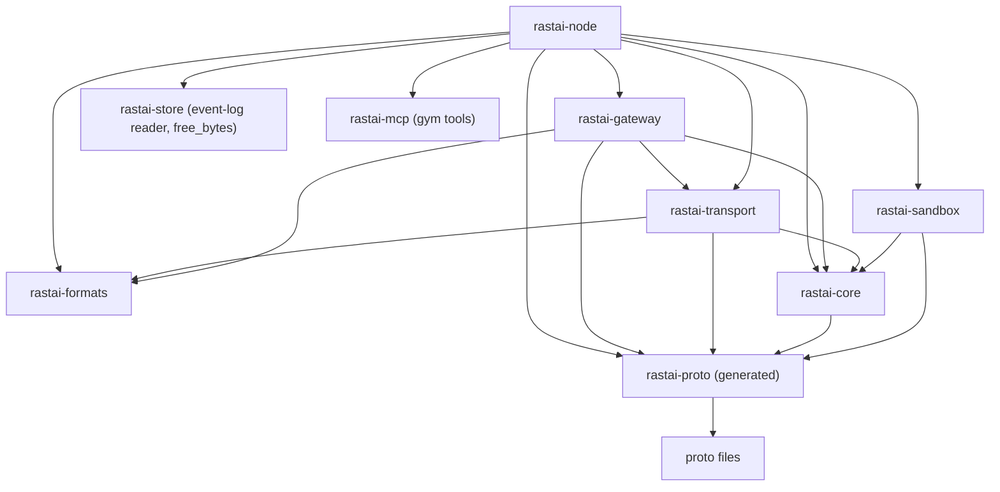
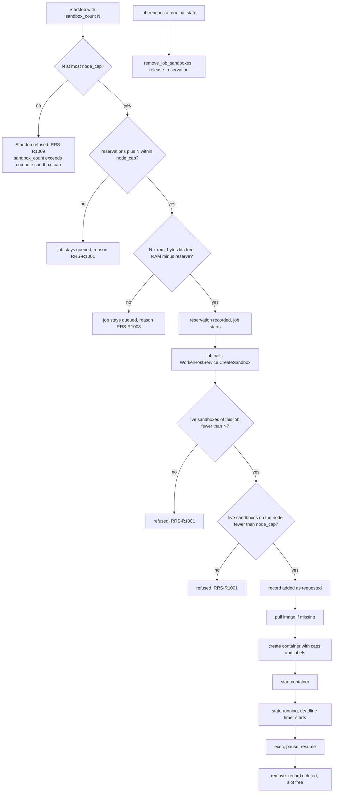
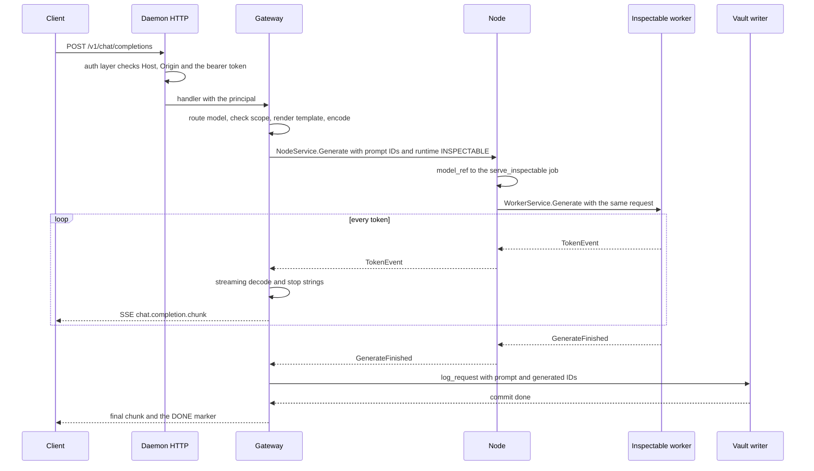
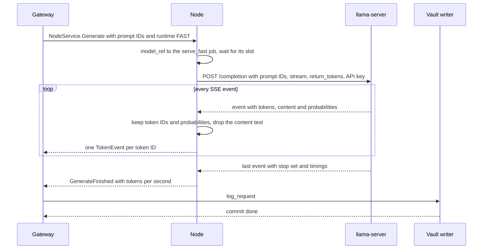
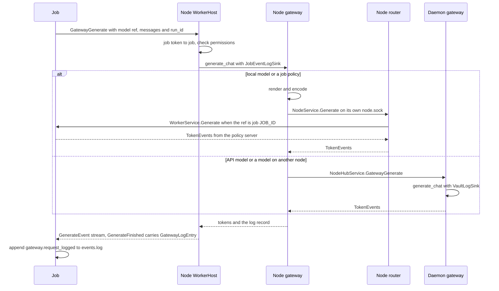
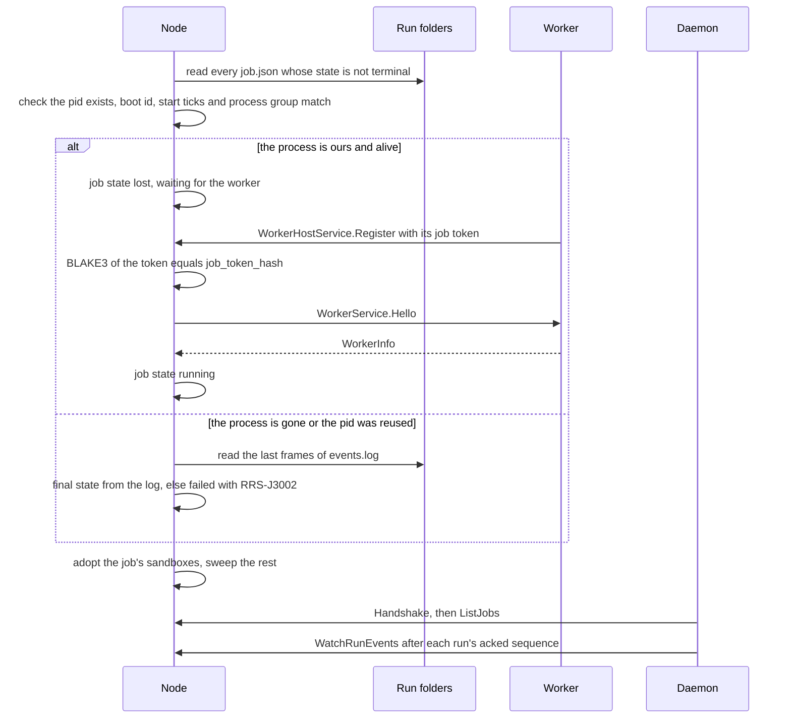
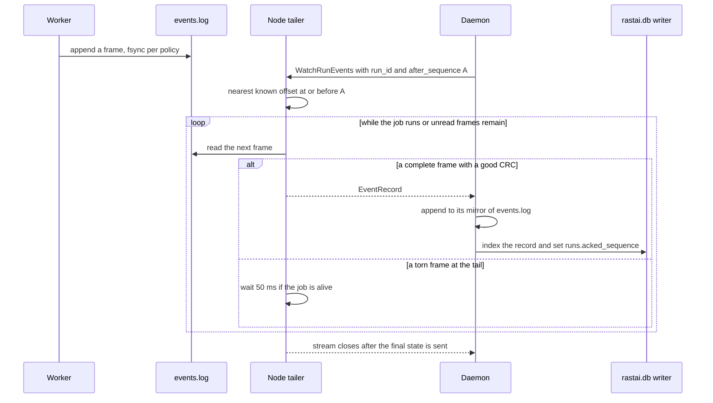
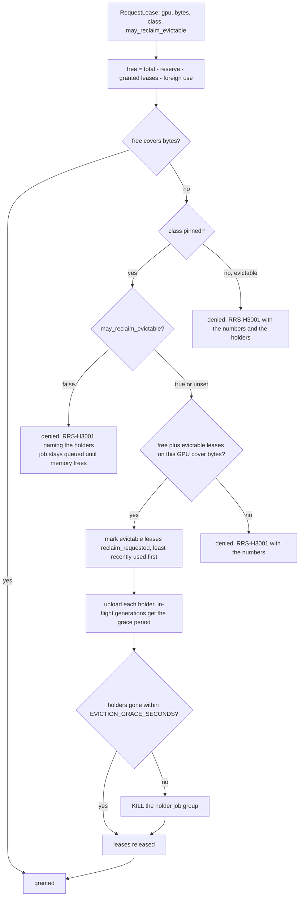
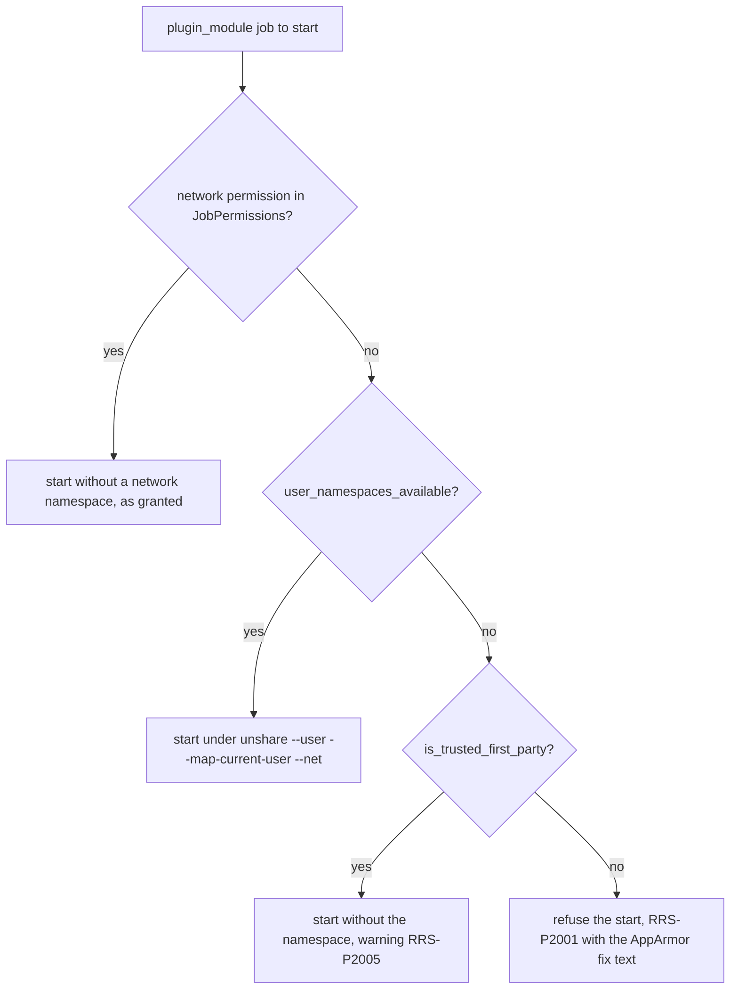

# Layout: the Rust node and edge (`rastai-node`, `rastai-sandbox`, `rastai-transport`, `rastai-gateway`) and `proto/`

**Status:** v1.1, 2026-10-10. Pre-build design. Built on spec v5.4 (`docs/spec/rastai_spec_v5.md`), the spike (`spike/README.md`) and contracts v1.2 (`docs/architecture/contracts.md`), which is the only list of shared names. Names from contracts are used exactly; this doc keeps no "New names" list (section 11 says where each kind of name lives).

Owner decisions of 2026-10-10 applied here:
- the managed vLLM engine is out of the prototype, and an external vLLM goes through `OpenAiAdapter` as a proxy-fidelity endpoint (6.5, 6.10, 7.8);
- plugin modules under the AppArmor rule: a profile in the `.deb`, a warned fallback for trusted first-party modules, a refusal for third-party ones (7.9);
- a `stability` field on command and event descriptors (3.2);
- the MySQL dataset reader gets its credential through `GetSecret` (7.9);
- generated client code is JavaScript, not TypeScript (3.4).

This doc covers:
- `proto/` and the generated code it produces (section 3);
- `crates/rastai-transport` (section 4);
- `crates/rastai-sandbox` (section 5);
- `crates/rastai-gateway` (section 6);
- `crates/rastai-node` (section 7).

It does not cover the daemon side of the same conversations (`rastai-server`: `NodeHubService`, the node connection manager, `VaultLogSink`), the store (`rastai-store`), the optional long-term archive (`rastai-archive`, M11, contracts 8.7), or the Python worker (`rastai_worker`). Those have their own layout docs. Nodes never get archive credentials and never read the archive. Where this doc depends on them, it names the function or type it needs.

Every crate section has the same parts: tree, public API, dependencies, boundary rules, tests, ported spike code, build-order step.

---

## 1. Where each crate runs

| Crate | Runs in | Serves | Calls |
|---|---|---|---|
| `rastai-transport` | daemon, node, CLI | nothing on its own; it opens sockets and channels for the others | OpenSSH binary, HTTPS hosts, local sockets |
| `rastai-sandbox` | node | nothing; it is a library under `SandboxService` | Docker or Podman engine socket |
| `rastai-gateway` | daemon (the `/v1/*` endpoints), node (rollout and judge gateway, no HTTP) | `/v1/chat/completions`, `/v1/completions`, `/v1/models`, `/v1/messages` (mounted by `rastai-server`) | `NodeService.Generate`, third-party APIs and OpenAI-compatible endpoints (an external vLLM included), `NodeHubService.GatewayGenerate` (from a node) |
| `rastai-node` | daemon (embedded node, own tokio runtime) and `rastai node serve` | `NodeService` + `SandboxService` on `node.sock`; `WorkerHostService` on `worker-host.sock` | `WorkerService` on `jobs/<job_id>.sock`, `NodeHubService`, llama-server, HF Hub, uv, and `unshare` for network-off plugin modules |



Arrows mean "may depend on", as in contracts §2.4. Not shown: every crate also depends on `rastai-diag`. `rastai-sandbox` does not depend on `rastai-transport` (contracts §2.1), so it has its own small HTTP-over-Unix-socket file (section 5). `rastai-transport` and `rastai-node` reach `rastai-formats` for one thing that matters here: every BLAKE3 hash goes through `rastai_formats::hashing`, the one blake3 wrapper (contracts §2.4 rule 8). Two edges are easy to miss and are in contracts 2.1: `rastai-sandbox` to `rastai-proto` (it uses the generated sandbox types) and `rastai-transport` to `rastai-formats` (hashing).

---

## 2. Conventions shared by these four crates

These restate contracts §12 where it matters for this code, and add the rules these crates need.

**Files**
- Constants at the top of each file, with the measurement or reason in a comment.
- `src/lib.rs` is a list of `pub mod` lines and nothing else.
- `src/error.rs` holds the crate's one error enum (`TransportError`, `SandboxError`, `GatewayError`, `NodeError`) with `fn code(&self) -> &'static str` returning a catalog code. No `anyhow`, no `thiserror`.
- One wrapper file per external library (contracts §2.4 rule 8). The table in each crate section names it.

**Functions and state**
- Free functions that take a plain struct by reference: `start_job(&state, spec)`. Methods are fine for tiny accessors.
- Shared state is a plain struct whose tables sit behind `std::sync::Mutex`. A lock is never held across `.await`. Each table has small functions that lock, copy or change, and unlock.
- Closed sets are enums with a `match` (adapters, transports, job kinds, HTTP targets). Traits only for small synchronous interfaces with a few implementations (`LogSink`, `SecretReader`).
- No `async fn` in traits behind `dyn` (contracts §12.2). Async polymorphism is an enum.
- Long-running loops (heartbeat, telemetry, event tailing, deadline timers) are one `tokio::spawn` each, started from the crate's thin entry function, so a reader sees every background task in one place.

**Spike lessons that apply everywhere here**
- Any socket that streams small chunks sets `TCP_NODELAY`. Without it, both bake-off gateways stalled ~40 ms per reply (spike 07).
- SQLite writes go through one writer thread per database and the caller awaits a oneshot commit (spike 07). None of these crates opens SQLite; they hand records to `rastai-store` or to a `LogSink`.
- Library choice can swamp language choice (spike 07). Hot paths (tokenizer, CRC, hashing) get a micro-benchmark in `tools/bench/` before a library is picked.

**Errors at the edge**
- Library functions return the crate's error enum.
- The tonic service files and the axum handlers are the edge: they turn the error into a `rastai.common.v1.Diagnostic` with the catalog code. gRPC status stays `OK` when the call itself ran (contracts §4).
- Every code these crates raise is listed in contracts 10.3 (section 11 maps files to codes). A code is named in this doc only after it is there.

---

## 3. `proto/` and its generated code

### 3.1 Tree

`buf.yaml` and `buf.gen.yaml` sit at the repo root (contracts §1). One `.proto` file per service plus one per group of related messages. Each file is described here by what it holds; field lists follow contracts §4 and are not repeated unless this doc adds a field.

```
proto/rastai/
  common/v1/
    diagnostic.proto          Diagnostic, Severity (ERROR, WARNING, INFO)
    blob.proto                BlobRef
    hardware.proto            HardwareProfile, GpuInfo, HardwareFingerprint, NodeTelemetry, GpuTelemetry
    resources.proto           ResourceRequest, LeaseClass
    states.proto              JobState, RunState, ModelState, LeaseState, NodeState, SandboxState, PluginState,
                              EvalRunState, EventClass, Stability (PREVIEW, STABLE, DEPRECATED), RuntimeKind
  commands/v1/
    command_service.proto     CommandService (Execute, ListCommands); ExecuteRequest, ExecuteResponse,
                              CommandDescriptor (with stability), CommandKind (SYNC, JOB, STREAM), ListCommandsRequest/Response
  events/v1/
    event_service.proto       EventService (Subscribe, ListEventTypes); SubscribeRequest, BusEvent,
                              EventTypeDescriptor (with stability), ListEventTypesRequest/Response
    event_record.proto        EventRecord (one events.log frame body, contracts §7.1; also the bytes the archive stores, 3.3)
    payloads.proto            one message per event type in contracts §7.3 (JobStateChanged, JobProgress,
                              JobLogLine, RunStateChanged, RunMetrics, CheckpointSaved, ...,
                              GatewayRequestLogged, EgressActive, the archive.* events of M11), plus PluginEventPayload;
                              EventPayload, the one oneof over them that EventRecord and BusEvent share (contracts 4.3)
  node/v1/
    node_service.proto        NodeService: the RPC list only, plus the small per-RPC request messages
                              (HandshakeRequest/Response, GetHardwareRequest/Response, HandleCommandRequest, ...)
    jobs.proto                JobSpec, JobInfo, JobKind, JobSignal, SignalJobRequest/Response, ListJobsRequest/Response,
                              WatchRunEventsRequest
    environments.proto        EnsureEnvironmentRequest, EnvironmentProgress, EnvironmentInfo
    leases.proto              Lease, RequestLeaseRequest, ReleaseLeaseRequest, ListLeasesRequest/Response
    models.proto              LoadModelRequest, ModelLoadProgress, UnloadModelRequest, ModelInfo,
                              TokenizationOverride
    generation.proto          GenerateRequest (with interventions_json), SamplingSettings, LensRequest,
                              GenerateEvent, TokenEvent, TokenAlternative, GenerateFinished, GatewayLogEntry,
                              LivePacket (and its parts), ForkSessionRequest, CloseSessionRequest,
                              SetInterventionsRequest (session_id, interventions_json), FetchTensorRequest,
                              TensorChunk. No InterventionSet message: it is a rastai-formats type (contracts §4.4)
    live.proto                WatchLiveRequest, LiveEvent (oneof over the ephemeral payloads)
    files.proto               FileChunk, FileStat, GetFileRequest, StatFileRequest, UpdateChunk
    sandbox_service.proto     SandboxService; SandboxSpec, SandboxCaps, SandboxInfo, ExecFrame,
                              SandboxIdRequest, ListSandboxesRequest/Response
    node_hub_service.proto    NodeHubService; HeartbeatRequest/Response, GatewayGenerateRequest,
                              GetSecretRequest/Response (purposes in 3.2; ExecuteCommand reuses commands.v1 messages)
  worker/v1/
    worker_service.proto      WorkerService; HelloRequest, WorkerInfo, ControlRequest/Response (WatchLive reuses
                              node.v1's WatchLiveRequest and LiveEvent)
    worker_host_service.proto WorkerHostService; RegisterRequest/Response, ResizeLeaseRequest/Response,
                              BlobChunk, GetBlobRequest, TokenizeChatRequest/Response (TokenizeChat is defined in layout/python.md),
                              ListToolsRequest/Response, CallToolRequest/Response (gym tools in sandboxes)
    command_call.proto        CommandCall, CommandReply, DocumentEdit
  provider/v1/
    provider_service.proto    ProviderService (Phase 3): Offer, ProvisionRequest, MachineInfo, BillableResource
```

**Nothing in `proto/` is for the archive** (M11, contracts 8.7). The daemon talks to MySQL or MariaDB with the MySQL protocol and to the blob target with files; neither is protobuf (contracts 4.7). The archive touches `proto/` in three ways only: its `archive.*` events (payloads in `payloads.proto`), the `stability` field its commands carry like every command, and `EventRecord`, whose bytes the archive stores in `event_records.body` (3.3). A node never sees an archive message.

### 3.2 What this doc adds to the messages

Contracts §4 defines the services and the main messages, and 4.9 fixes the fields of the ones below. This table explains why each exists and adds the few details contracts leaves to this doc.

| Message | Fields | Why |
|---|---|---|
| `NodeTelemetry` | `sampled_unix_ms`, `repeated GpuTelemetry gpus`, `ram_used_bytes`, `ram_total_bytes`, `disk_free_bytes` | carried in `Heartbeat` and `GetHardware` |
| `GpuTelemetry` | `gpu_index`, `utilization_percent`, `vram_used_bytes`, `vram_total_bytes`, `temperature_celsius`, `power_watts`, `repeated ProcessVram processes` | per-process VRAM lets the node see a holder above its lease |
| `ProcessVram` | `pid`, `vram_bytes` | from `nvidia-smi --query-compute-apps` / `rocm-smi --showpids` |
| `JobKind` | enum of contracts §9.1 kinds: `SERVE_INSPECTABLE`, `TRAIN`, `EVAL`, `GYM`, `LENS`, `DATA_IMPORT`, `DATA_CHECK`, `COMPILE`, `EXPORT`, `DOCTOR_SELFTEST`, `PLUGIN_MODULE`, `DOWNLOAD`, `TRANSFER`, `SERVE_FAST`, `DAEMON_TASK` | `JobSpec.kind`; `DAEMON_TASK` jobs run inside the daemon and never reach a node (flows/platform.md) |
| `JobSignal` | `CANCEL`, `STOP`, `PAUSE`, `RESUME`, `CHECKPOINT_NOW`, `STEP`, `TERMINATE`, `KILL` | `SignalJob`; what each one does is the table in section 7.4 |
| `SignalJobRequest` | `job_id`, `JobSignal signal`, `sandbox_id`, `arguments_json` | `sandbox_id` and `arguments_json` (`{"action": "hold" \| "step" \| "release"}`) target one sandbox with `STEP` (designer flow B5) |
| `ControlRequest` | `action` (`CANCEL`, `STOP`, `PAUSE`, `RESUME`, `CHECKPOINT_NOW`, `STEP`), `sandbox_id`, `arguments_json` | `WorkerService.Control`; the node copies the two STEP fields from `SignalJobRequest` |
| `HandshakeRequest` | adds `hub_socket_path`, `repeated TokenizationOverride tokenization_overrides` | the per-session reverse-forward socket the node dials (section 4.3); the tokenization overrides the node gateway must use before any job starts (section 6.8) |
| `HeartbeatRequest` / `HeartbeatResponse` | request adds `tokenization_overrides_hash`; response adds `repeated TokenizationOverride tokenization_overrides`, filled only when that hash differs from the daemon's | keeps the node gateway's overrides in step after a user override or plugin install (section 6.8) |
| `TokenizationOverride` | `model_hash`; `template_source` (`user` or `plugin:<plugin_id>/<template_id>`), `template_text`, `template_hash`; `tokenizer_source` (`plugin:<plugin_id>/<tokenizer_id>`), `tokenizer_folder` (under `<cache>/tokenizers/`). Empty template or tokenizer fields mean "the model's own files" | what the daemon resolved for one model's chat template and tokenizer files (section 6.8); the node never reads plugin manifests or `<config>` itself |
| `ResourceRequest` | adds `optional bool may_reclaim_evictable` (training-evaluation §16); unset reads as `true` | a pinned job may opt out of reclaiming evictable leases: auto-run evals and analysis jobs set `false`, so they never evict chat (plan §10 row 25). `optional` because a proto3 bool defaults to `false`, which would silently stop every pinned job from reclaiming |
| `RequestLeaseRequest` | `gpu_index`, `vram_bytes`, `lease_class`, `holder_job_id`, `optional bool may_reclaim_evictable` (unset reads as `true`) | the node copies the flag from the job's `ResourceRequest` at admission and on `ResizeLease`; `decide_lease` reads it (section 7.7) |
| `SetInterventionsRequest` | `session_id`, `interventions_json` | the `InterventionSet` crosses the wire only as JSON; its type lives in `rastai-formats` `documents/steering_preset.rs` (contracts §4.4, §20) |
| `EgressActive` | `purpose`, `host`, `subject_id` | payload of the ephemeral `egress.active` event, built from one `EgressReport` (section 4.6) |
| `ModelInfo` | adds `engine_build` (`llama-server <build>`; empty for Inspectable) | which Fast engine serves the model, for the UI and `gateway_log.sampling_json` (section 7.8). Only llama-server exists in the prototype; the field is what lets a second engine arrive later without a wire change |
| `EnvironmentInfo` | `environment_id`, `lock_hash`, `path`, `python_version`, `torch_version`, `size_bytes`, `ready` | result of `EnsureEnvironment`, listed by `system.env.list` |
| `GatewayLogEntry` | the `gateway_log` row fields from contracts §8.3, with `prompt_ids` and `generated_ids` as `repeated uint32`, plus `run_id`, `finish_reason` (section 6.2 names), `stop_kind`, and for a `chat.send` turn `conversation_id`, `message_id` and the assistant `parts_json` | the one log-record type: the gateway's `LogSink` takes it, and `GenerateFinished.gateway_log` returns it to a job, the only writer of its `events.log` (section 6.6) |
| `GatewayGenerateRequest` | `model_ref` or `served_model_name`, `messages_json` (`rastai.conversation/1` messages) or `prompt_token_ids`, `prior_token_ids`, `SamplingSettings`, `max_new_tokens` (0 = prefill only), `stop_token_ids`, `return_logprobs`, `LensRequest lens`, `pin_attention_kernel`, `session_id`, `run_id`, `purpose` (`rollout`, `judge`, `command`, `replay`) | node and job requests to a gateway: replay sends token IDs only with `max_new_tokens = 0`, lens mode `ALL_POSITIONS`, a pinned kernel and a new session (inference flow 6.1); gym rollouts send `prior_token_ids` plus only the new messages (designer flow B3a) |
| `ListToolsRequest` / `ListToolsResponse` | `sandbox_id` → `tools[]{name, description, input_schema_json}`, `Diagnostic` | the worker lists a harness's MCP tools in its sandbox (designer flow B2) |
| `CallToolRequest` / `CallToolResponse` | `sandbox_id`, `tool_name`, `arguments_json` → `result_json`, `is_error`, `Diagnostic` | one tool call through the node's `rastai-mcp` client (designer flow B3a) |
| `LiveEvent` | `job_id`, `session_id`, `emitted_unix_ms`, oneof: `JobProgress`, `JobLogLine`, `LivePacket`, `GymPeekStep`, `TransferProgress`, `DownloadProgress`, `EgressActive` | the `WatchLive` stream; `EgressActive` is how a node's egress reports reach the daemon's bus |
| `SandboxCaps` | `cpu_count`, `ram_bytes`, `time_seconds`, `pids_limit`, `disk_bytes` | `SandboxSpec.caps` |
| `ExecFrame` | oneof `start{command[], environment[], working_directory}`, `stdin`, `stdout`, `stderr`, `exit{exit_code, timed_out}` | `ExecInSandbox` bidi stream |
| `TensorChunk` | `point`, `shape[]`, `dtype`, `offset_bytes`, `bytes`, `last` | `FetchTensor` |
| `BlobChunk` | `hash` (first chunk), `offset_bytes`, `bytes`, `last` | `PutBlob` / `GetBlob` |
| `HandleCommandRequest` | `plugin_id`, `CommandCall call` | `NodeService.HandleCommand` |
| `Stability` | enum `PREVIEW`, `STABLE`, `DEPRECATED`, plus the zero value `STABILITY_UNSPECIFIED` (3.3); the zero value reads as `PREVIEW` | `CommandDescriptor.stability` and `EventTypeDescriptor.stability` (owner decision N3). Every command and event type is `PREVIEW` until Phase 2. The daemon fills the field from the registry (`descriptor_from_row`); a client that gets the zero value from an older daemon treats it as `PREVIEW` |
| `CommandDescriptor` | adds `stability` (`Stability`) after `kind`; every other field is in contracts 4.2 | the registry row as the UI, CLI and MCP see it |
| `EventTypeDescriptor` | `event_type`, `event_class`, `payload_type`, `emitter`, `stability`, `since_version`, `plugin_id` | the item of `EventService.ListEventTypes`; plugin-defined event types carry `stability` too, `PREVIEW` until Phase 2 |
| `GetSecretRequest` / `GetSecretResponse` | request `purpose`, `job_id`; response `value`, `expires_unix_ms`, `Diagnostic` | `NodeHubService.GetSecret`. Purposes: `hf_download`, `hf_upload`, `adapter:<name>`, `mysql:<connection_name>`. The MySQL purpose is for the dataset reader (7.9). The value lives in the node's memory until `expires_unix_ms` and is never written to `job.json`, a log or an event. The fields are drafted in contracts 4.9; M5-E07 settles them and M2-12 writes the M2 subset (contracts §14 row 19) |

### 3.3 Rules for the `.proto` files

- **Domain messages are passed directly** where contracts says so: `rpc StartJob(JobSpec) returns (JobInfo)`. No wrapper layer. `buf.yaml` therefore uses the STANDARD lint set minus `RPC_REQUEST_STANDARD_NAME`, `RPC_RESPONSE_STANDARD_NAME` and `RPC_REQUEST_RESPONSE_UNIQUE`.
- **An RPC with no arguments still takes its own empty `<Rpc>Request`**, so fields can be added without a breaking change.
- **Packages may import each other, files may not form a cycle.** `node.v1` imports `events.v1` (for `EventRecord`) and `events.v1/payloads.proto` imports `node.v1/generation.proto` (for `LivePacket`) and `node.v1/leases.proto` (for `Lease`). prost, protobuf-es and Python handle cross-package imports. A file-level cycle fails `buf build`.
- `oneof` for "one of several payloads". Enums start with `<ENUM>_UNSPECIFIED = 0`.
- Times are `int64 *_unix_ms`, sizes `uint64 *_bytes`, hashes `string` `blake3:<hex>`, documents `string *_json` (contracts §4).
- **No proto message re-declares a `rastai-formats` type** (§20). A document type that crosses the wire is a `*_json` string, validated at both ends. `InterventionSet` is the case that matters here: `GenerateRequest.interventions_json` and `SetInterventionsRequest.interventions_json`, never a message.
- Field numbers are never reused; removed fields become `reserved`.
- **A oneof comes last in its message, field numbers included.** prost writes a oneof after the other fields, while buf, Python and protobuf-es write in field-number order; only this order gives byte-identical goldens (contracts 4.3). Maps are written in key order: `buf.gen.yaml` gives prost `BTreeMap` (`btree_map`), and Python and buf sort map keys.
- **`stability` is data, not a proto option.** `buf breaking` checks field numbers and types. It can't see `arguments_json`, `result_json` or any other `_json` payload (contracts 4). `check-schema-diff` (M1-58, ADR-0038) diffs `schemas/commands/` and `schemas/events/` against the base branch: every change needs a contracts.md update, and a breaking change to a `stable` item fails CI. Every item stays `PREVIEW` until the Phase 2 stable subset, so until then every `CommandDescriptor` and `EventTypeDescriptor` says `PREVIEW`, and no wire rule depends on the other two values.
- **`EventRecord` is read for years.** The archive keeps raw `EventRecord` bytes in `event_records.body` (contracts 8.7), and a restore decodes them with the schema of the day. Its field numbers are frozen like any other, and when a field is added the golden test keeps decoding the older `.binpb` files beside the new one.

### 3.4 Generated code

| Output | Folder | Tool (dev tooling, §27) | Notes |
|---|---|---|---|
| Rust | `crates/rastai-proto/src/generated/rastai.<package>.v1.rs` | buf with the prost and tonic plugins | `crates/rastai-proto/src/lib.rs` is the one hand-written file: a module tree that `include!`s each generated file. No `build.rs`, so building never needs `protoc`. The tonic plugin skips `CommandService` and `EventService`: the daemon serves them as Connect with prost alone (control-plane layout 8.4, 11.3), so tonic arrives with the first gRPC service, `NodeService` (M1-10). The plugin runs with `no_transport`: the clients get no `connect(url)`, because `rastai-transport` opens every channel over a Unix socket itself (`grpc_channel.rs`), so `rastai-proto` needs only tonic's `codegen` feature, plus `tonic-prost`, the codec the generated code calls. The plugin also runs with `no_include`: `lib.rs` includes each `rastai.<package>.v1.tonic.rs` behind the crate's `grpc` feature, off by default, so tonic and `tonic-prost` are optional dependencies. Only the crates that serve or call a gRPC service turn `grpc` on; `rastai-core` takes the messages alone and never builds tonic (control-plane layout 5.4). The crate's own tests turn it on through a dev-dependency on itself. The generated server traits are `#[async_trait]` traits; a handler implements one with `#[tonic::async_trait]` (contracts 12.2). |
| Python | `python/rastai_proto/rastai_proto/<package>/v1/*_pb2.py`, `*_pb2_grpc.py` | buf with the protobuf and grpcio plugins | protoc writes `from rastai.common.v1 import ...`, which would collide with the public `rastai` SDK package. `tools/codegen/rewrite_python_imports` rewrites `rastai.` to `rastai_proto.` in generated imports. It has its own test. |
| JavaScript | `packages/proto/src/generated/rastai/<package>/v1/*_pb.js` and `*_pb.d.ts` | buf with protoc-gen-es, `target=js+dts` | protobuf-es v2 emits service descriptors that connect-es uses directly from JavaScript. The `.d.ts` files are generated, never edited and not part of review; `tools/checks/check-no-typescript` allows them only in generated folders (ADR-0036). Nobody writes TypeScript. |

`just codegen` runs all three. `tools/checks/check-generated` fails CI if regenerating changes any file.

The typed command wrappers in `@rastai/client` are not made by buf. Arguments are `_json` strings to protobuf, so the wrappers come from the command registry's schemas (control-plane layout), written against the `CommandExecutor` interface that `DaemonClient` and `PluginHost` both satisfy.

### 3.5 Tests

| Test | Where | What |
|---|---|---|
| Lint and breaking | CI step `just proto-check` | `buf lint`; `buf breaking --against` the main branch |
| Golden messages | `fixtures/proto-golden/<package>/<MessageName>.binpb` and `.json` | one filled instance per message; round-tripped in `crates/rastai-proto/tests/golden.rs`, `python/rastai_proto/tests/test_golden.py`, `packages/proto/src/golden.test.js`; binary bytes must match exactly across the three |
| Unset stability | `fixtures/proto-golden/{commands,events}/without_stability/`: a `CommandDescriptor` and an `EventTypeDescriptor` without the field | decode as `STABILITY_UNSPECIFIED`, the zero value every reader treats as `PREVIEW` (3.2), and round-trip unchanged, in Rust, JS and Python; the filled goldens decode as `STABILITY_PREVIEW` |
| Service stubs | `crates/rastai-proto/tests/services.rs`, `python/rastai_proto/tests/test_services.py` | a tonic server stub of every service builds and serves under its proto name; every service has exactly the RPCs of its build-order step (3.6); every grpcio servicer registers on a server, and `WorkerService` answers `Hello` and `WatchLive` over a Unix socket |
| Import rewrite | `tools/codegen/tests/` | a generated file with nested imports rewrites correctly and imports cleanly |
| Generated-code freshness | `tools/checks/check-generated` | regenerate, diff, fail on change |

### 3.6 Build-order step

| Files | First needed at §31 step |
|---|---|
| `common/v1/*` (with `Stability`), `commands/v1/*`, `events/v1/*` (with `EventTypeDescriptor` and `ListEventTypes`) | 1 (Foundation: the command layer and durability) |
| `node/v1/node_service.proto` (Handshake, GetHardware, StartJob, SignalJob, ListJobs, WatchRunEvents, WatchLive), `jobs.proto`, `live.proto`, `node_hub_service.proto` (Heartbeat, ExecuteCommand) | 1 (daemon + embedded node; weeks 3–4 skeleton) |
| `worker/v1/worker_service.proto` (Hello, Control, WatchLive), `worker_host_service.proto` (Register) | 1 (worker protocol v0 runs TextCNN training) |
| `environments.proto`; `EgressActive` in `payloads.proto` and `LiveEvent`; `NodeHubService.GetSecret` with purpose `hf_download` (gated models need the token) | 2 (uv environments; HF downloads are the first egress) |
| `leases.proto` (with `RequestLeaseRequest.may_reclaim_evictable`), `ResourceRequest.may_reclaim_evictable`, `models.proto` (with `ModelInfo.engine_build`), `generation.proto` (minus `interventions_json`, tensors and sessions) | 3 (Inference) |
| `TokenizationOverride`, `HandshakeRequest.tokenization_overrides`, `HeartbeatRequest.tokenization_overrides_hash`, `HeartbeatResponse.tokenization_overrides` | 3 (user overrides); plugin templates and tokenizers use them from 8 |
| `generation.proto`: `GenerateRequest.interventions_json`, `SetInterventionsRequest`, `FetchTensor`, sessions; `WorkerService.SetInterventions`, `FetchTensor` | 4 (Psychology) |
| `worker_host_service.proto`: `GatewayGenerate`, `TokenizeChat`, `PutBlob`, `GetBlob`, `ResizeLease`; `NodeHubService.GatewayGenerate`; `GetSecret` purposes `hf_upload` and `mysql:<connection_name>` (the MySQL dataset reader, M5-E07) | 5 (Training and Evaluation: judges, checkpoints, data import) |
| `sandbox_service.proto`, `WorkerHostService` sandbox RPCs | 5 (Pass@k needs sandboxes), completed at 7 |
| `WorkerHostService.ListTools`, `CallTool`, `PauseSandbox`, `ResumeSandbox`; `sandbox_id` and `arguments_json` on `SignalJobRequest` and `ControlRequest`; `GatewayGenerateRequest.prior_token_ids` | 7 (Agent Gym: tools in sandboxes, step mode, multi-turn rollouts) |
| `GatewayGenerateRequest.lens`, `.pin_attention_kernel`, `.session_id`; `max_new_tokens = 0` | 4 (Psychology replay through the node gateway) |
| `command_call.proto`, `HandleCommand`, `WorkerHostService.ExecuteCommand` | 4 (Psychology is the first plugin module); used by every plugin at 8. `WorkerHostService.StartJob` is not built in the prototype: modules return `CommandReply.follow_up_jobs` and the daemon starts them (plan §10 row 31) |
| `files.proto`, `PutFile`, `GetFile`, `StatFile`, `UpdateNode` | 9 (Remote) |
| the `archive.*` payloads in `payloads.proto` | M11 (long-term storage, after the 90-day plan; M11-E01 is the contracts epic) |
| `provider/v1/*` | Phase 3 |

Each row lands as its own contract PR before the code that uses it (§29).

---

## 4. `crates/rastai-transport`

Opens every byte pipe the backend uses: local sockets, gRPC channels over them, the OpenSSH child process, outbound HTTP(S), server-sent-event parsing, and resumable whole-file transfers. It decides nothing about what flows through them.

### 4.1 Tree

```
crates/rastai-transport/
  CLAUDE.md                 local rules (below)
  Cargo.toml
  src/
    lib.rs                  pub mod list
    error.rs                TransportError -> RRS-N codes
    local_socket.rs         bind and connect local sockets: Unix sockets now, named pipes later; 0700 parent dir
    peer.rs                 PeerIdentity (uid, pid) of a local socket peer; same-user check
    grpc_channel.rs         tonic Channel to a local socket path; tonic server on a LocalListener
    node_connection.rs      NodeTarget (local / ssh) -> NodeConnection; opens the NodeService channel
    ssh.rs                  OpenSSH child process: forwards (-L, -R), remote commands, file upload over stdin
    http_client.rs          the one hyper wrapper: HTTPS (rustls), plain HTTP to loopback, streaming bodies
    sse.rs                  server-sent-event line reader (ported from the spike's take_complete_lines)
    transfer.rs             resumable whole-file transfers: chunk reader, PartialFile, BLAKE3 verify (via rastai_formats::hashing)
  tests/
    local_socket.rs         bind, connect, peer credentials, 0700 directory (one another user owns, or a looser mode,
                            is refused: /tmp/rastai-<uid>, contracts 8.1), stale socket file replaced
    grpc_local.rs           a tiny tonic service over a Unix socket, unary and streaming
    transfer_resume.rs      interrupt a transfer mid-file, resume from offset, hash matches
    ssh_loopback.rs         real OpenSSH against a test sshd (ignored unless RASTAI_TEST_SSH is set)
    http_client.rs          against a local axum test server: chunked streaming, timeouts, TLS refusal of bad certs
  fuzz/
    fuzz_targets/sse_reader.rs   arbitrary bytes in arbitrary chunk sizes never panic; the events equal a one-chunk parse (nightly, 10 minutes)
```

`quic.rs` (iroh) is added in Phase 2 next to `ssh.rs`. Windows named pipes are a branch inside `local_socket.rs` (tokio provides them), added with tier 2.

### 4.2 Public API

```rust
// local_socket.rs
pub const SOCKET_DIRECTORY_MODE: u32 = 0o700;

pub enum LocalListener { Unix(tokio::net::UnixListener) /* NamedPipe later */ }
pub enum LocalStream { Unix(tokio::net::UnixStream) /* NamedPipe later */ }

pub fn bind_local_socket(socket_path: &Path) -> Result<LocalListener, TransportError>;
pub async fn accept_local(listener: &LocalListener) -> Result<(LocalStream, PeerIdentity), TransportError>;
pub async fn connect_local_socket(socket_path: &Path) -> Result<LocalStream, TransportError>;

// peer.rs
pub struct PeerIdentity { pub user_id: u32, pub process_id: Option<i32> }
pub fn check_same_user(peer: &PeerIdentity) -> Result<(), TransportError>;

// grpc_channel.rs
pub async fn connect_grpc_channel(socket_path: &Path) -> Result<tonic::transport::Channel, TransportError>;
pub async fn serve_grpc_on_socket(listener: LocalListener, router: tonic::transport::server::Router) -> Result<(), TransportError>;

// node_connection.rs
pub enum NodeTarget {
    Local { socket_path: PathBuf },
    // remote_hub_socket is <remote runtime>/node-hub-<session_id>.sock: a fresh name per SSH session (section 4.3)
    Ssh { user_at_host: String, remote_node_socket: String, remote_hub_socket: String },
}
pub enum NodeConnection {
    Local { channel: Channel },
    Ssh { channel: Channel, session: SshSession },
}
pub async fn open_node_connection(target: &NodeTarget, paths: &DataPaths) -> Result<NodeConnection, TransportError>;
pub fn node_channel(connection: &NodeConnection) -> Channel;
pub async fn close_node_connection(connection: NodeConnection);

// ssh.rs
pub struct SshSession { pub child: tokio::process::Child, pub local_forward_socket: PathBuf, pub started_unix_ms: i64 }
pub struct SshOptions { pub ssh_binary: String, pub known_hosts_file: PathBuf, pub identity_file: Option<PathBuf> }
pub async fn start_ssh_forwarding(target_host: &str, forwards: &SshForwards, options: &SshOptions) -> Result<SshSession, TransportError>;
pub async fn ssh_session_alive(session: &mut SshSession) -> bool;
pub async fn stop_ssh_session(session: SshSession);
pub async fn run_remote_command(target_host: &str, command: &[String], options: &SshOptions) -> Result<RemoteOutput, TransportError>;
pub async fn upload_over_ssh(target_host: &str, local_path: &Path, remote_path: &str, options: &SshOptions) -> Result<(), TransportError>;

// http_client.rs
pub const EGRESS_REPORT_INTERVAL_SECONDS: u64 = 5;   // the UI's egress badge expects a refresh at least this often

pub enum HttpTarget { Https { host: String, port: u16 }, LoopbackHttp { port: u16 } }
/// Who is sending data off the machine and why. Every Https request carries one; the owner of the
/// channel (the daemon's bus or the node's WatchLive) turns each report into an ephemeral egress.active event.
pub struct EgressTag { pub purpose: String, pub subject_id: String, pub reports: tokio::sync::mpsc::Sender<EgressReport> }
pub struct EgressReport { pub purpose: String, pub host: String, pub subject_id: String }
pub struct HttpRequest { pub method: String, pub target: HttpTarget, pub path: String, pub headers: Vec<(String, String)>, pub body: Vec<u8>, pub timeout_ms: u64, pub egress: Option<EgressTag> }
pub struct HttpResponse { pub status: u16, pub headers: Vec<(String, String)>, pub body: Vec<u8> }
pub struct HttpStream { /* status, headers, and the body as it arrives */ }
pub async fn send_request(request: HttpRequest) -> Result<HttpResponse, TransportError>;
pub async fn open_response_stream(request: HttpRequest) -> Result<HttpStream, TransportError>;
pub async fn next_body_chunk(stream: &mut HttpStream) -> Result<Option<Vec<u8>>, TransportError>;

// sse.rs
pub struct SseEvent { pub event_name: Option<String>, pub data: String }
pub struct SseReader { buffer: Vec<u8> }
pub fn new_sse_reader() -> SseReader;
pub fn push_bytes(reader: &mut SseReader, bytes: &[u8]) -> Vec<SseEvent>;

// transfer.rs
pub const TRANSFER_CHUNK_BYTES: usize = 1024 * 1024;
pub struct PartialFile { pub final_path: PathBuf, pub partial_path: PathBuf, pub bytes_written: u64 }
pub fn open_partial_file(final_path: &Path) -> Result<PartialFile, TransportError>;          // resumes an existing .partial
pub fn append_chunk(partial: &mut PartialFile, offset_bytes: u64, bytes: &[u8]) -> Result<(), TransportError>;
pub fn finish_partial_file(partial: PartialFile, expected_hash: &str) -> Result<FileStat, TransportError>; // fsync, verify BLAKE3, rename
pub fn read_chunk(path: &Path, offset_bytes: u64, length: usize) -> Result<Vec<u8>, TransportError>;
// "blake3:<hex>". Reads TRANSFER_CHUNK_BYTES at a time into rastai_formats::hashing::{new_stream_hasher,
// update_stream_hasher, finish_stream_hasher}; this crate never imports blake3 itself (contracts §2.4 rule 8).
pub fn hash_file(path: &Path) -> Result<String, TransportError>;
```

Who calls what:

| Caller | Uses |
|---|---|
| `rastai-node` | `bind_local_socket` + `serve_grpc_on_socket` for `node.sock` and `worker-host.sock`; `connect_grpc_channel` for `jobs/<job_id>.sock` and `node-hub.sock`; `send_request` / `open_response_stream` + `sse` for llama-server and HF Hub; `transfer` for `PutFile` / `GetFile` |
| `rastai-server` | `open_node_connection` per paired node; `run_remote_command` + `upload_over_ssh` during `node.pair`; `bind_local_socket` for `daemon.sock` and `node-hub.sock`; `transfer` for the client side of resumable transfers |
| `rastai-gateway` | `send_request` / `open_response_stream` + `sse` for the OpenAI and Anthropic adapters |
| `rastai-cli` | `connect_local_socket` for `daemon.sock` |
| `rastai-mcp` | `http_client` for remote HTTP MCP servers |
| `rastai-archive` (M11) | `send_request` / `open_response_stream` for an S3-compatible blob target (M11-E04), with an `EgressTag` of purpose `archive`. MySQL traffic never passes through this crate: `mysql_async` opens its own TLS socket, so `rastai-archive` builds the `EgressReport`s for it itself, one every `EGRESS_REPORT_INTERVAL_SECONDS` while a sync runs |

### 4.3 How SSH carries both directions

One OpenSSH process per remote node (contracts §14 question 5). The daemon starts it; the node never opens a port.

```
ssh -N -T
    -o ExitOnForwardFailure=yes -o ServerAliveInterval=5 -o ServerAliveCountMax=3
    -o StrictHostKeyChecking=yes -o UserKnownHostsFile=<data>/node/ssh_known_hosts
    -o StreamLocalBindUnlink=yes
    -L <runtime>/remote/<node_id>/node.sock:<remote runtime>/node.sock
    -R <remote runtime>/node-hub-<session_id>.sock:<runtime>/node-hub.sock
    user@host
```

- `-L` carries `NodeService` and `SandboxService` (daemon to node). `-R` carries `NodeHubService` (node to daemon).
- **A fresh `-R` socket name per SSH session** (`<session_id>` is new for every `start_ssh_forwarding`). After an unclean drop, `sshd` can keep the old reverse socket bound for a while; a new name never waits for it. The daemon sends the path in `HandshakeRequest.hub_socket_path` and the node dials that path (designer flow C3).
- `StrictHostKeyChecking=yes` with our own known-hosts file: the host key is pinned at pairing and never auto-accepted after. The Ed25519 handshake inside gRPC then proves the node identity on top (contracts §3.2).
- `ServerAliveInterval=5` with 3 misses matches the 5 s heartbeat and 3-miss rule (§22), so a dead link is noticed at the same time by both layers.
- If the process exits, `ssh_session_alive` returns false. Reconnect with backoff is the daemon's job (`rastai-server`), not this crate's.
- Remote commands for pairing (`run_remote_command`) use the same options, so the pinned key applies there too. `upload_over_ssh` streams the file into `cat > <path>.partial && mv` on the remote, so no `scp` or `sftp` is needed.

### 4.4 Resumable transfers (prototype: whole-file)

- The receiver keeps `<target>.partial` and reports `bytes_written`. A resumed transfer starts at that offset.
- Each chunk is written at its declared offset. A chunk whose offset doesn't match `bytes_written` is refused (`RRS-N3002`), so a retry can never leave a hole.
- `finish_partial_file` fsyncs, hashes the whole file with BLAKE3, compares with the hash the sender announced in `StatFile`, and renames. A mismatch deletes the partial file and returns `RRS-N3003`.
- Chunked, deduplicated transfers are Phase 2 and replace only this file's internals.

### 4.5 Dependencies

| Internal | Why |
|---|---|
| `rastai-core` | `DataPaths` and its path functions (`paths.rs`), ids |
| `rastai-formats` | `hashing::{new_stream_hasher, update_stream_hasher, finish_stream_hasher}` for `transfer.rs` (listed in contracts 2.1) |
| `rastai-proto` | `FileStat`, `FileChunk` types used by `transfer.rs` |
| `rastai-diag` | catalog codes, JSON logger |

| External (§27) | Used in | For |
|---|---|---|
| tokio | everywhere | sockets, child processes, timers |
| tonic | `grpc_channel.rs` | channels and servers over local sockets |
| tower | `grpc_channel.rs` | `service_fn` connector that tonic's `Endpoint::connect_with_connector` takes |
| hyper, hyper-util | `http_client.rs` only | HTTP/1.1 client |
| rustls, tokio-rustls, webpki-roots | `http_client.rs` only | TLS for HTTPS (never in-house crypto, §24). The same file serves the SHA-256 and HMAC-SHA256 helpers from the rustls crypto provider (HF file checks, llama-server builds, and SigV4 for the archive's S3 target in M11); no extra crate |
| OpenSSH binary | `ssh.rs` | remote access (foundation, §27); found through settings `nodes.ssh_binary` |

Every external library above is on the §27 list approved on 2026-10-10 (contracts 2.5) and is imported in the one file named.

### 4.6 Boundary rules

- Never opens a database, never reads settings files; callers pass paths and options in.
- Never implements crypto, TLS or SSH. It runs OpenSSH as a process and uses rustls.
- Never listens on a non-loopback interface. `bind_local_socket` takes a path; there is no TCP bind function in this crate (the daemon's TCP listener is in `rastai-server`).
- Never builds a path itself; every path comes from `rastai-core/src/paths.rs`.
- Only `http_client.rs` imports hyper or rustls. Only `grpc_channel.rs` imports tower. Nothing imports blake3: file hashes go through `rastai_formats::hashing`.
- **Every outbound HTTPS request reports itself.** `send_request` and `open_response_stream` refuse an `Https` target with no `EgressTag` (a bug, `RRS-N3008`). They send one `EgressReport` when the connection opens and one every `EGRESS_REPORT_INTERVAL_SECONDS` while the body streams. The report is plain data on a channel; this crate never publishes events itself. The UI's egress badge listens only to the resulting `egress.active` events (frontend layout 8.4).
- No retries inside this crate. A failed call returns an error; the caller decides whether to retry (heartbeat loop, transfer job).

### 4.7 Tests

- Unit tests at the bottom of `sse.rs` (split lines across chunk boundaries, `\r\n`, multi-line `data:`, comment lines), `peer.rs`, `transfer.rs` (offset mismatch refused, bad hash refused).
- The `sse_reader` fuzz target is one of the fuzz targets contracts 12.5 requires for every in-house parser of untrusted input.
- Integration tests listed in the tree. `ssh_loopback.rs` runs in CI against an OpenSSH server in a container with a throwaway key; on a laptop it's skipped unless `RASTAI_TEST_SSH` is set.
- The 12-week exit test "a remote job survives a network drop" (§32) lives in `tests/e2e/remote_network_drop.rs`: it kills the SSH child mid-run and checks that the daemon reconnects and loses no events. It exercises this crate, `rastai-node` and `rastai-server` together.

### 4.8 Ported spike code

| Spike | Here | What changes |
|---|---|---|
| `bakeoff/rust/src/gateway.rs` `take_complete_lines` | `sse.rs` | becomes a reader struct that also parses `event:` and multi-line `data:` fields (Anthropic streams name their events); returns typed `SseEvent`s instead of raw lines |
| `bakeoff/rust/src/gateway.rs` `reqwest::Client` | `http_client.rs` | reqwest is not carried over (contracts 2.5, "Never carried over from the spike"); plain hyper behind four functions |
| `src/rastai_spike/llama_server.py` `urllib` calls | `http_client.rs` `LoopbackHttp` target | same requests, now with per-request timeouts and streaming |

### 4.9 Build-order step

| Part | Step |
|---|---|
| `local_socket.rs`, `peer.rs`, `grpc_channel.rs`, `node_connection.rs` (Local only) | 1 (daemon + embedded node over `node.sock`) |
| `http_client.rs` | 2 (HF downloads) |
| `sse.rs` | 3 (llama-server and API adapters stream) |
| `ssh.rs`, `node_connection.rs` (Ssh), `transfer.rs` | 9 (Remote); weeks 11–12 in §32 |

---

## 5. `crates/rastai-sandbox`

The in-house sandbox manager (§12, §27): a client for the Docker Engine HTTP API that works with Docker and Podman. It creates labeled containers with caps, runs commands in them, pauses them for step mode, and removes orphans. It runs only inside the node.

### 5.1 Tree

```
crates/rastai-sandbox/
  CLAUDE.md
  Cargo.toml
  src/
    lib.rs
    error.rs              SandboxError -> RRS-R1xxx codes
    engine_http.rs        the one hyper file: HTTP/1.1 over the engine's Unix socket, and the upgraded exec stream
    engine.rs             find the engine socket (Podman first, then Docker), ping, check the API version
    docker_api.rs         one small function per Engine API call we use; JSON in, JSON out
    container_spec.rs     SandboxSpec + caps + labels -> the create-container JSON body
    caps.rs               default caps, clamping to the host, RAM arithmetic for reservations
    labels.rs             label keys; read ids back from a container's labels
    exec_stream.rs        Docker's multiplexed stream frames (8-byte header) <-> ExecFrame
    manager.rs            SandboxManager: the node's sandbox table, the node cap, per-job reservations
    deadlines.rs          per-sandbox time cap, counting running time only
    orphan_sweep.rs       labeled containers and networks with no live owner -> removed
    egress_proxy.rs       per-run internal engine network + in-house HTTP CONNECT proxy with a host allowlist (5.4)
  tests/
    container_spec.rs     golden create-container JSON per case in fixtures/sandbox/specs/
    exec_stream.rs        parser against recorded engine bytes in fixtures/sandbox/exec/
    engine_live.rs        real engine: create, exec, pause, resume, remove (skipped without a socket)
    cap.rs                reservations and the node cap, including paused sandboxes; a request over the cap is refused
    orphan.rs             orphan sweep after a simulated node crash
    deadline.rs           time cap kills a busy container; paused time is not counted
    egress_proxy.rs       allowlist table (unit); real engine: a listed host connects, any other host and plain HTTP are refused
  fuzz/
    fuzz_targets/connect_request.rs   the egress proxy's CONNECT line parser, fed bytes a sandbox container could send: never panics, never accepts a host that host_allowed refuses
    fuzz_targets/exec_stream.rs       the multiplexed stream parser on arbitrary bytes
```

### 5.2 Public API

The crate uses the generated `SandboxSpec`, `SandboxCaps`, `SandboxInfo`, `SandboxState` and `ExecFrame` from `rastai-proto` directly, so no sandbox type is defined twice (§20). That puts `rastai-proto` in this crate's internal deps, as contracts 2.1 lists.

```rust
// engine.rs
pub const DOCKER_API_VERSION: &str = "v1.41";   // the newest version Podman's compat API serves; Docker still accepts it
pub const PODMAN_SOCKET_NAME: &str = "podman/podman.sock";
pub const DOCKER_SOCKET_PATH: &str = "/var/run/docker.sock";

pub struct DockerEngine { pub socket_path: PathBuf, pub engine_name: String, pub engine_version: String }
pub async fn find_engine(configured_socket: Option<&Path>, paths: &DataPaths) -> Result<DockerEngine, SandboxError>;

// labels.rs
pub const LABEL_NODE_ID: &str = "rastai.node_id";
pub const LABEL_RUN_ID: &str = "rastai.run_id";
pub const LABEL_SANDBOX_ID: &str = "rastai.sandbox_id";
pub const LABEL_JOB_ID: &str = "rastai.job_id";

// manager.rs
pub struct SandboxManager {
    pub engine: DockerEngine,
    pub node_id: String,
    pub node_cap: u32,                       // settings compute.sandbox_cap (default 8)
    pub default_caps: SandboxCaps,           // settings sandbox.default_caps
    pub table: Mutex<SandboxTable>,
}
pub struct SandboxTable { pub sandboxes: Vec<SandboxRecord>, pub reservations: Vec<SandboxReservation> }
pub struct SandboxRecord { pub info: SandboxInfo, pub job_id: String, pub container_id: String, pub running_ms: u64 }
pub struct SandboxReservation { pub job_id: String, pub count: u32, pub ram_bytes_each: u64 }

pub enum ReservationOutcome { Reserved, WaitForSlots(Diagnostic) }   // RRS-R1001 or RRS-R1008: the job stays queued
// Err(RRS-R1009) when count > node_cap: no amount of waiting could ever fit it, so StartJob is refused
pub fn reserve_sandboxes(manager: &SandboxManager, job_id: &str, count: u32, caps: &SandboxCaps, free_ram_bytes: u64) -> Result<ReservationOutcome, SandboxError>;
pub fn release_reservation(manager: &SandboxManager, job_id: &str);
pub async fn create_sandbox(manager: &SandboxManager, job_id: Option<&str>, run_id: &str, spec: SandboxSpec) -> Result<SandboxInfo, SandboxError>;
pub async fn exec_in_sandbox(manager: &SandboxManager, sandbox_id: &str, frames_in: mpsc::Receiver<ExecFrame>, frames_out: mpsc::Sender<ExecFrame>) -> Result<(), SandboxError>;
pub async fn pause_sandbox(manager: &SandboxManager, sandbox_id: &str) -> Result<(), SandboxError>;
pub async fn resume_sandbox(manager: &SandboxManager, sandbox_id: &str) -> Result<(), SandboxError>;
pub async fn remove_sandbox(manager: &SandboxManager, sandbox_id: &str) -> Result<(), SandboxError>;
pub async fn remove_job_sandboxes(manager: &SandboxManager, job_id: &str) -> Result<(), SandboxError>;
pub async fn list_sandboxes(manager: &SandboxManager) -> Result<Vec<SandboxInfo>, SandboxError>;   // includes orphans

// orphan_sweep.rs
pub async fn adopt_existing_containers(manager: &SandboxManager, live_job_ids: &[String]) -> Result<(), SandboxError>;
pub async fn sweep_orphans(manager: &SandboxManager, live_job_ids: &[String]) -> Result<Vec<String>, SandboxError>;

// egress_proxy.rs (section 5.4)
pub const EGRESS_NETWORK_PREFIX: &str = "rastai-egress-";   // + run_id; labeled like the containers
pub const EGRESS_ALLOWED_PORTS: &[u16] = &[443];            // CONNECT only; plain HTTP is refused
pub struct EgressNetwork { pub run_id: String, pub network_name: String, pub proxy_address: SocketAddr, pub allowed_hosts: Vec<String> }
pub async fn start_egress_network(manager: &SandboxManager, run_id: &str, allowed_hosts: &[String]) -> Result<EgressNetwork, SandboxError>;
pub async fn stop_egress_network(manager: &SandboxManager, run_id: &str) -> Result<(), SandboxError>;
pub fn host_allowed(allowed_hosts: &[String], requested_host: &str, requested_port: u16) -> bool;   // exact names, no wildcards
```

Who calls what (all from `rastai-node`):

| Caller in the node | Calls |
|---|---|
| `jobs/supervisor.rs`, at `StartJob` with `ResourceRequest.sandbox_count > 0` | `reserve_sandboxes` (refuses `count > node_cap` with `RRS-R1009`); on a terminal job state, `remove_job_sandboxes`, `stop_egress_network`, then `release_reservation` |
| `worker_host_service.rs` (`CreateSandbox`, `ExecInSandbox`, `RemoveSandbox` from a job) | `create_sandbox` with the job's id, `exec_in_sandbox`, `remove_sandbox`; `start_egress_network` before the run's first sandbox whose `network_hosts` is non-empty |
| `worker_host_service.rs` (`PauseSandbox`, `ResumeSandbox` from the job's own worker in step mode) | `pause_sandbox`, `resume_sandbox`, only for the calling job's sandboxes |
| `worker_host_service.rs` (`ListTools`, `CallTool`) | `gym_tools.rs` in the node, which uses `exec_in_sandbox` for the tool server's stdio |
| `sandbox_service.rs` (`SandboxService` from the daemon: `sandbox.list`, `sandbox.kill`, `sandbox.cleanup`) | `list_sandboxes`, `remove_sandbox`, `sweep_orphans` |
| `node.rs` start-up, after job reattach | `adopt_existing_containers`, then `sweep_orphans` |

**`gym.step` never goes through `SandboxService`.** The daemon sends `SignalJob STEP` with `sandbox_id` and `arguments_json` (`hold`, `step` or `release`); the node passes it to the worker as `WorkerService.Control`. The worker detaches its rollout at the next token boundary and only then calls `WorkerHostService.PauseSandbox`, so a container is never frozen with an exec in flight (designer flow B5). `SandboxService.PauseSandbox` and `ResumeSandbox` stay in the service (contracts §4.4) but the prototype has no caller.

### 5.3 How the node enforces the per-node sandbox cap



- **Refuse what can never fit.** A job asking for more sandboxes than `compute.sandbox_cap` is refused at `StartJob` with `RRS-R1009`, whose fix text names the setting. Only a job that fits the cap but finds the slots busy waits in `queued`; otherwise it would wait forever.
- **Two layers.** The reservation, taken when the job starts, is the real cap: a job that can't get its sandboxes waits in `queued` instead of failing halfway through a GRPO group. The live count check at each create is a second guard for bugs and for daemon-side `SandboxService.CreateSandbox` calls that have no job (they may only use the headroom no job has reserved).
- **What counts as live:** `requested`, `pulling`, `creating`, `running`, `paused`, `stopping`. Paused sandboxes count, because step mode keeps their memory.
- **RAM check:** the reservation multiplies the per-sandbox RAM cap by the count and compares it with free RAM (from telemetry) minus `RAM_RESERVE_BYTES` (4 GiB, a constant at the top of `caps.rs`, kept for the daemon, node and workers). This stops eight 4 GiB sandboxes from pushing the training job into the OOM killer.
- **Per-container caps** go into the create body (section 5.4). The engine enforces them; the node only enforces the count and the time cap.
- **Persisted where:** the table is in memory. Labels on the containers are the durable record. After a node restart, `adopt_existing_containers` rebuilds the table from labels for jobs that reattached, and `sweep_orphans` removes the rest. Reattach must run first, or a restart would kill the sandboxes of a gym run that is still alive.
- **Failure branches:** a pull failure or a container that exits at once moves the record to `failed`, then `removed`, and returns `RRS-R1004` or `RRS-R1005` to the job. The job's GRPO group is recomputed or marked partial by the recipe (§12).

### 5.4 The create-container body

`container_spec.rs` writes this JSON, one field per line, from plain inputs:

| Engine field | Value | Why |
|---|---|---|
| `Image` | `SandboxSpec.image`, pinned by digest when the harness gives one | reproducible rollouts |
| `Cmd` | `["sleep", "infinity"]` | keeps the container up for `exec`; an image without `sleep` fails fast with `RRS-R1005` |
| `Labels` | the four `rastai.*` labels | orphan sweep and adoption |
| `HostConfig.NanoCpus` | `cpu_count × 1e9` | CPU cap |
| `HostConfig.Memory`, `MemorySwap` | `ram_bytes`, both equal | RAM cap with no swap |
| `HostConfig.PidsLimit` | `pids_limit` (default 512) | fork bombs |
| `HostConfig.NetworkMode` | `none`; when `network_hosts` is non-empty, the run's internal network `rastai-egress-<run_id>` (see below) | network off unless the harness lists hosts, and then only those hosts (§24, ADR-0031 #3) |
| `Env` | `HTTPS_PROXY` and `https_proxy` = `http://<proxy_address>`, only on the internal network | tools reach listed hosts through the proxy |
| `HostConfig.CapDrop`, `SecurityOpt` | `["ALL"]`, `["no-new-privileges"]` | least privilege |
| `HostConfig.Init` | `true` | reaps zombie processes left by agent commands |
| `HostConfig.StorageOpt.size` | `disk_bytes`, only when the storage driver supports it | otherwise logged once and skipped |
| `HostConfig.AutoRemove` | `false` | we remove explicitly, so the exit state can still be read |

**Network allowlists: the egress proxy** (`egress_proxy.rs`, designer flow B6). Docker and Podman have no host allowlist, so the node enforces one itself:
1. Before a run's first sandbox with `network_hosts`, `start_egress_network` creates an engine network with `Internal: true` named `rastai-egress-<run_id>`, labeled `rastai.node_id` and `rastai.run_id`. An internal network has no route out of its subnet.
2. The node runs an in-house HTTP CONNECT proxy (tokio, one task per connection) that listens only on that network's gateway address, read back from the network's IPAM config. It's the one listener the node opens outside a Unix socket, and it's reachable only from that run's containers.
3. Each `CONNECT host:port` is checked with `host_allowed`: the exact host must be in the harness's `network_hosts` and the port in `EGRESS_ALLOWED_PORTS`. Allowed: the proxy resolves the name itself and pipes bytes. Refused: `403` and one structured-log line with the host. Plain HTTP requests (non-CONNECT) are refused.
4. The container joins only the internal network, with `HTTPS_PROXY` set. DNS isn't needed inside: the proxy resolves.
5. When the run's last sandbox is removed, `stop_egress_network` stops the listener and deletes the network. The orphan sweep removes labeled networks with no live owner, like containers.

Each allowed CONNECT also sends an `EgressReport` (purpose `sandbox`, the host, the sandbox id), so the egress badge shows it. If the gateway address can't be bound (some rootless Podman network backends keep it inside their own namespace), sandbox creation fails with `RRS-R1010`; it never falls back to an open network. The node writes the allowed hosts into its structured log when it creates the network, for the audit trail.

### 5.5 Dependencies

| Internal | Why |
|---|---|
| `rastai-core` | `DataPaths` and its path functions, ids (`sbx_...`) |
| `rastai-proto` | the sandbox wire types (listed in contracts 2.1) |
| `rastai-diag` | codes, logger |

| External (§27) | Used in | For |
|---|---|---|
| tokio | everywhere | Unix socket, timers, channels; the egress proxy's TCP listener and byte copy |
| hyper, hyper-util | `engine_http.rs` only | HTTP/1.1 over the engine socket, the upgraded exec connection |
| serde_json | `docker_api.rs`, `container_spec.rs` | Engine API JSON |
| Docker or Podman engine | at run time | containers (foundation, §27) |

### 5.6 Boundary rules

- Only the node links this crate. The daemon reaches sandboxes through `SandboxService`.
- Never talks to a sandbox except through `exec`. Containers never see a Rastai socket or token (contracts §3.2).
- Never touches a container without `rastai.node_id` equal to this node's id. The sweep filters by label in the API call, then checks again in code.
- Never removes a container whose `rastai.job_id` belongs to a live or `lost` job. `lost` jobs may still reattach.
- Never pulls an image the harness didn't name; never builds images.
- No `docker` CLI: only the HTTP API, so Podman and Docker behave the same.
- Never gives a container a route out except through the egress proxy. A sandbox with `network_hosts` that can't get its internal network and proxy fails (`RRS-R1010`); it never gets the engine's normal bridge network.
- The egress proxy binds only a run's internal-network gateway address and serves only `CONNECT` to listed hosts on allowed ports. It never forwards to an address the harness didn't name by host.

### 5.7 Tests

- Unit tests at the bottom of `caps.rs` (clamping, RAM arithmetic) and `labels.rs`.
- Golden create bodies in `fixtures/sandbox/specs/<case>.json` with `<case>.expected.json`.
- Real-engine tests run in CI on Docker (the Linux runner has it) and nightly on the owner's box on rootless Podman. They pull one tiny pinned image listed in `fixtures/sandbox/images.json`.
- Crash test `tests/crash/node_kill_with_sandboxes.rs`: start a gym-like fake job with 3 sandboxes, `kill -9` the node, restart. Expected: the job reattaches, its 3 sandboxes are adopted, and a fourth container labeled for a dead job is swept.
- Egress (`tests/egress_proxy.rs`, real engine, Linux): a container on a run's internal network reaches a listed host through the proxy; an unlisted host gets `403`; a direct connection without the proxy fails; a container of a sandbox without `network_hosts` can't resolve or connect (ADR-0031's network test). Unit tests at the bottom of `egress_proxy.rs` cover `host_allowed` (case, trailing dot, ports, IP literals refused).
- The two fuzz targets are in the tree. The CONNECT parser reads bytes written by sandboxed, untrusted code, so it is the most exposed parser in this doc (contracts 12.5 asks for a target on every in-house parser of untrusted input).
- Pass@k uses this crate through the Evaluation plugin's job; its tests in `plugins/evaluation/tests/` cover the end-to-end path.

### 5.8 Ported spike code

None. The spike didn't build a sandbox manager. The style follows the spike's Rust gateway: plain functions, one file per concern.

### 5.9 Build-order step

| Part | Step |
|---|---|
| `engine*.rs`, `docker_api.rs` (create, start, exec, remove, list), `container_spec.rs`, `caps.rs`, `labels.rs`, `exec_stream.rs`, `manager.rs` (reservations, cap), `deadlines.rs`, `orphan_sweep.rs` | 5 (Training and Evaluation: Pass@k samples run in sandboxes, §10) |
| `pause_sandbox` / `resume_sandbox` (step mode), image-pull progress events, MCP tool servers inside sandboxes (`rastai-node/src/gym_tools.rs`), `egress_proxy.rs` | 7 (Agent Gym: harnesses that list `network_hosts`) |

---

## 6. `crates/rastai-gateway`

The in-house model gateway (§18, §27). It owns chat templates and tokenization, routes each request to an adapter, streams tokens back, and logs token IDs. It runs in two places with the same code:
- **in the daemon**, behind the `/v1/*` endpoints and behind `chat.send` (the app's own chat);
- **in each node**, with no HTTP routes, behind `WorkerHostService.GatewayGenerate` and `TokenizeChat` (rollouts, judges on local models, training-data tokenization).

### 6.1 Tree

```
crates/rastai-gateway/
  CLAUDE.md
  Cargo.toml
  src/
    lib.rs
    error.rs                GatewayError -> RRS-G codes; also writes OpenAI and Anthropic error bodies
    gateway.rs              Gateway (state); prepare_chat, run_chat (generate_chat = both), generate_completion, tokenize_chat
    chat_request.rs         ChatRequest, PreparedPrompt, CompletionRequest, StreamItem, StreamedToken, TokenSink, GenerateSummary,
                            FinishReason, StopKind
    routes.rs               gateway_routes(): the axum Router that rastai-server mounts
    openai_types.rs         serde structs for the OpenAI request and response JSON (published API shapes)
    openai_endpoints.rs     /v1/chat/completions, /v1/completions, /v1/models handlers; OpenAI chunk writer
    anthropic_types.rs      serde structs for the Anthropic Messages JSON
    anthropic_endpoints.rs  /v1/messages handler; Anthropic event writer
    streaming.rs            SSE response body fed from a channel; keepalive comments; cancel on client disconnect
    served_models.rs        ServedModel and ServedPreset lists, kept fresh by the server or node; /v1/models
    model_router.rs         model name -> RouteTarget (adapter, model_ref, runtime, node, preset)
    tokenizer.rs            the only `tokenizers` import: load, encode, decode, streaming decode, TokenizerCache
    chat_template.rs        with template_methods.rs, the only files importing `minijinja`: pick the template source (6.8), load and render HF templates
    template_methods.rs     Python string and dict methods HF templates call (strip, startswith, items, ...), in-house
    prompt.rs               messages -> PromptTokens: render, encode, BOS rule, context-length check
    target_mask.rs          per-token target mask for training rows (TokenizeChat)
    stop_rules.rs           stop token ids from generation_config.json; text stop strings on detokenized output
    tool_calls.rs           per-family tool-call parsers (Llama 3 JSON, Qwen tags, ...)
    sampling.rs             request params -> SamplingSettings, defaults from settings, range checks
    steering_presets.rs     served preset -> session with an InterventionSet on the Inspectable runtime
    privacy.rs              incognito decisions, retention cutoff, what may appear in structured logs
    token_log.rs            LogSink, LogCommit, build_log_entry() (fills the generated GatewayLogEntry)
    adapters/
      mod.rs                Adapter enum, AdapterRequest, AdapterResult, generate() match
      node_runtime.rs       NodeRuntimeAdapter: token IDs -> NodeService.Generate (Inspectable or Fast)
      openai.rs             OpenAiAdapter: OpenAI and any OpenAI-compatible endpoint (an external vLLM, Ollama, ...)
      anthropic.rs          AnthropicAdapter
      daemon_forward.rs     DaemonForwardAdapter (node only): NodeHubService.GatewayGenerate
      secrets.rs            SecretReader trait: an API key per request
  tests/
    support/mock_node_runtime.rs   NodeService.Generate stand-in that answers instantly (from the spike's mock_upstream.rs)
    support/mock_api_server.rs     fake OpenAI and Anthropic endpoints over local TLS with a test CA
    tokenizer_parity.rs            the 162-case corpus vs expected IDs; no truncation; streaming decode round trip
    chat_templates.rs              rendered prompts vs HF apply_chat_template output, per family and case; source order
                                   (user override, plugin, jinja file, config); two matching plugins fall through with RRS-G1007
    target_mask.rs                 masks match fixtures; prefix-unstable templates are refused
    openai_endpoints.rs            request validation, response and chunk shapes, logprobs, tool calls, errors
    anthropic_endpoints.rs         event sequence and shapes, errors
    logging.rs                     exactly one log record per request, including client disconnects; none when incognito
    streaming_latency.rs           inter-chunk gap with an instant upstream (the TCP_NODELAY guard)
    steering_presets.rs            a preset routes to Inspectable, sets interventions, always closes its session
    openai_external.rs             OpenAiAdapter against a fake vLLM-style server over loopback HTTP: text in, text and logprobs out, log record has empty token-ID columns, fidelity proxy
  fuzz/
    fuzz_targets/tool_call_parse.rs   tool_calls.rs on arbitrary model output never panics
```

### 6.2 Public API

```rust
// gateway.rs
pub const MAX_LOADED_TOKENIZERS: usize = 3;     // a Gemma tokenizer is ~250 MiB in memory (262k vocabulary; spike 07)
pub const CHUNK_CHANNEL_CAPACITY: usize = 64;   // from the spike gateway; enough to absorb a slow client for ~0.4 s

pub struct Gateway {
    pub place: GatewayPlace,                      // Daemon or Node: decides which adapters exist
    pub adapters: Mutex<Vec<NamedAdapter>>,       // configured API adapters and node runtimes
    pub served_models: Mutex<Vec<ServedModel>>,
    pub served_presets: Mutex<Vec<ServedPreset>>,
    pub tokenizers: Mutex<TokenizerCache>,
    pub tokenization_overrides: Mutex<Vec<TokenizationOverride>>,   // generated proto type; resolved by the daemon (6.8)
    pub settings: Mutex<GatewaySettings>,         // gateway.* and inference.sampling, resolved by rastai-core
}
pub enum GatewayPlace { Daemon, Node }

// Two phases, so chat.send can tokenize first and commit the user row in between (inference flow 1.1).
pub fn prepare_chat(gateway: &Gateway, request: &ChatRequest) -> Result<PreparedPrompt, GatewayError>;   // route, render, encode, BOS rule, context check, seed
pub async fn run_chat(gateway: &Gateway, principal: &Principal, prepared: PreparedPrompt, request: &ChatRequest, tokens: TokenSink, log_sink: &dyn LogSink) -> Result<GenerateSummary, GatewayError>;
pub async fn generate_chat(gateway: &Gateway, principal: &Principal, request: ChatRequest, tokens: TokenSink, log_sink: &dyn LogSink) -> Result<GenerateSummary, GatewayError>;   // prepare_chat, then run_chat: /v1 and node requests
pub async fn generate_completion(gateway: &Gateway, principal: &Principal, request: CompletionRequest, tokens: TokenSink, log_sink: &dyn LogSink) -> Result<GenerateSummary, GatewayError>;
pub fn tokenize_chat(gateway: &Gateway, model_ref: &str, conversations: &[Vec<ConversationMessage>], add_generation_prompt: bool) -> Result<Vec<TokenizedChat>, GatewayError>;

// served_models.rs (called by rastai-server when model.state_changed or a preset changes; by the node for its own models)
pub struct ServedModel { pub served_name: String, pub model_ref: String, pub model_hash: String, pub runtime: RuntimeKind, pub engine_build: String, pub node_id: String, pub tokenizer_files: TokenizerFiles, pub context_length: u32 }
// interventions is the rastai-formats type (documents/steering_preset.rs); it goes to the node as interventions_json
pub struct ServedPreset { pub served_name: String, pub model_hash: String, pub interventions: rastai_formats::InterventionSet }
pub fn set_served_models(gateway: &Gateway, models: Vec<ServedModel>);
pub fn set_served_presets(gateway: &Gateway, presets: Vec<ServedPreset>);
pub fn set_tokenization_overrides(gateway: &Gateway, overrides: Vec<TokenizationOverride>);   // replaces the whole list (6.8)

// chat_request.rs
pub struct ChatRequest {
    pub request_id: String,                       // req_<ulid> (contracts §8.6)
    pub model_name: String,                       // as the client wrote it
    pub messages: Vec<ConversationMessage>,       // the rastai.conversation/1 message type; with prior_token_ids, only the new turns
    pub prompt_token_ids: Option<Vec<u32>>,       // set: skip templating and use these IDs as the prompt (replay)
    pub prior_token_ids: Option<Vec<u32>>,        // set: render only the new turns and append their IDs (multi-turn rollouts)
    pub tools_json: Option<String>,
    pub sampling: SamplingSettings,               // generated proto type
    pub max_new_tokens: u32,                      // 0 = prefill only: no token is generated (replay with ALL_POSITIONS)
    pub stop_strings: Vec<String>,
    pub return_logprobs: bool,
    pub top_logprob_count: u32,
    pub lens: Option<LensRequest>,                // chat.send with the live panel on, or a replay; always None on /v1
    pub pin_attention_kernel: bool,               // exact replays and eval answers: eager or math attention (spike 01b)
    pub session_id: Option<String>,               // chat.send reuses the conversation's session (KV cache)
    pub incognito: bool,
    pub conversation_id: Option<String>,
    pub message_id: Option<String>,               // chat.send: the assistant message this turn fills
    pub run_id: Option<String>,                   // set for rollouts, judges and replays inside a run
}
/// What prepare_chat hands back. chat.send commits the user row between prepare_chat and run_chat.
pub struct PreparedPrompt {
    pub route: RouteTarget,
    pub prompt_token_ids: Vec<u32>,
    pub chat_template_hash: String,               // empty for API routes and for prompt_token_ids requests
    pub sampling: SamplingSettings,               // the seed is always filled
}
pub struct TokenSink { pub sender: tokio::sync::mpsc::Sender<StreamItem> }
pub enum StreamItem { Token(StreamedToken), LivePacket(LivePacket) }
pub struct StreamedToken { pub token_id: u32, pub text: String, pub logprob: Option<f32>, pub top_alternatives: Vec<TokenAlternative> }
/// Same snake_case names as messages.finish_reason and gateway_log.finish_reason: stop, length, cancelled,
/// client_disconnected, error, evicted. A chat.send turn never ends client_disconnected: its generation belongs to the daemon.
pub enum FinishReason { Stop, Length, Cancelled, ClientDisconnected, Error, Evicted }
pub enum StopKind { StopToken, StopString }       // only when finish_reason is Stop
pub struct GenerateSummary { pub request_id: String, pub finish_reason: FinishReason, pub stop_kind: Option<StopKind>, pub prompt_token_count: u32, pub generated_token_count: u32, pub tokens_per_second: f32, pub log_entry: Option<GatewayLogEntry> }
pub struct TokenizedChat { pub token_ids: Vec<u32>, pub target_mask: Vec<u8> }

// token_log.rs: the record is the generated proto GatewayLogEntry (section 3.2), never a second struct
pub struct LogCommit { pub committed: Option<tokio::sync::oneshot::Receiver<Result<(), String>>> }
pub trait LogSink {
    fn log_request(&self, entry: GatewayLogEntry) -> LogCommit;
}
pub fn build_log_entry(request: &ChatRequest, prepared: &PreparedPrompt, summary: &GenerateSummary, generated_ids: &[u32]) -> GatewayLogEntry;

// adapters/mod.rs
pub enum Adapter {
    NodeRuntime(NodeRuntimeAdapter),
    OpenAi(OpenAiAdapter),
    Anthropic(AnthropicAdapter),
    DaemonForward(DaemonForwardAdapter),
}
pub struct NamedAdapter { pub adapter_name: String, pub adapter: Adapter }
pub async fn generate(adapter: &Adapter, request: &AdapterRequest, tokens: &TokenSink) -> Result<AdapterResult, GatewayError>;

// adapters/secrets.rs
pub trait SecretReader {
    fn read_api_key(&self, adapter_name: &str) -> Result<String, GatewayError>;   // keychain in the daemon, read per request
}

// routes.rs
pub fn gateway_routes(gateway: Arc<Gateway>, log_sink: Arc<dyn LogSink + Send + Sync>) -> axum::Router;
```

`LogSink::log_request` returns a `LogCommit` (contracts 12.2; plan §10 row 20): it carries the writer thread's oneshot, so the gateway can await the commit before it sends the final chunk (6.3, step 6). It takes the generated `GatewayLogEntry`, so the log record is defined once, in `proto/` (§20). The four adapter names are the ones in contracts 12.2 and 15.1.

Who calls what:

| Caller | Calls |
|---|---|
| `rastai-server` (startup) | builds the daemon `Gateway`, `gateway_routes(gateway, vault_log_sink)` merged into its axum router behind the auth layer |
| `rastai-server` (`chat.send`, `chat.regenerate`, `psychology.branch.create`) | `prepare_chat`; on success it commits the user row; then `run_chat` with a `TokenSink` whose receiver publishes `chat.token` and `psychology.packet` bus events. A template or length error from `prepare_chat` writes nothing (inference flow 1.1: tokenize first, then write) |
| `rastai-server` (model and preset changes, node connect) | `set_served_models`, `set_served_presets`, updates `NodeRuntimeAdapter` channels |
| `rastai-server` (start, a file change in `<config>/chat-templates/`, plugin enable or disable) | `set_tokenization_overrides` on its own gateway; the same list goes to every node in `Handshake` and `HeartbeatResponse` (6.8) |
| `rastai-node` (`Handshake`, a `HeartbeatResponse` with overrides) | `set_tokenization_overrides` on the node `Gateway` |
| `rastai-server` (`NodeHubService.GatewayGenerate`) | `generate_chat` for a node's request to an API model or a model on another node |
| `rastai-node` (`WorkerHostService.GatewayGenerate`, `TokenizeChat`) | `generate_chat`, `tokenize_chat` on the node `Gateway` |
| `rastai-node` (`fast_runtime.rs`, at Fast model load) | `tokenizer.rs` encode, for the engine's tokenizer parity probe (section 7.8) |

### 6.3 The request path

Every request, from any surface, runs the same steps. Each step is one small function. `prepare_chat` runs steps 1 to 3 and returns a `PreparedPrompt`; `run_chat` runs steps 4 to 6. `generate_chat` is the two in a row, for `/v1` and node requests; `chat.send` commits the user row between them.

1. `check_request`: model name present, message list (or `prompt_token_ids`) not empty, sampling in range (`sampling.rs`). Fails with `RRS-G0001`.
2. `route_model` (`model_router.rs`): the name resolves to a `RouteTarget`. Order: served presets, then served local models, then `<adapter>/<model>` for API adapters, then `job:<job_id>` (an RL policy served by its own job; node gateway only). Unknown names fail with `RRS-G0002`.
3. For local routes, `build_prompt` (`prompt.rs`): render the template, encode, apply the BOS rule, check the context length (`RRS-G1005`), fill a missing seed. With `prompt_token_ids` set, the IDs are used as given (only the context check runs). With `prior_token_ids` set, only the new turns are rendered and their IDs appended (section 6.8). API routes skip this: the provider tokenizes and only text is logged (§18).
4. `check_scope`: `chat` for local models, plus `gateway.spend` for API adapters. Fails with `RRS-C1xxx` (owned by the server's scope table).
5. `generate` on the adapter. Tokens flow into the `TokenSink` as they arrive. The gateway detokenizes each token ID with a streaming decoder and checks text stop strings. `max_new_tokens = 0` is a prefill-only request: no token is generated; with `LensRequest` mode `ALL_POSITIONS` the worker returns one live packet per prompt position (inference flow 6.1).
6. On the last token, a stop, an error or a client disconnect: `build_log_entry`, call `log_sink.log_request` unless incognito, await its `LogCommit`, then send the final chunk.

Model names on `/v1`:
- a local model is served as its repo name (`google/gemma-3-1b-it`), using the runtime it is loaded on;
- a `:inspectable` or `:fast` suffix picks the runtime when the model is loaded on both;
- API models are `<adapter_name>/<model>` (`openai/gpt-5`), the same text as an `api:<adapter>/<model>` model ref;
- a steering preset is its `served_model_name`.

### 6.4 Talking to the Inspectable runtime (a Python worker)

The gateway never talks to a worker directly. It sends token IDs to the node that holds the model, and the node forwards to the `serve_inspectable` job.



- **Only token IDs cross.** The worker never sees text and never tokenizes (§18). The node passes `GenerateRequest` and `GenerateEvent` through unchanged; it only picks the job and checks the lease is still granted.
- **Sessions.** `chat.send` passes the conversation's `session_id`, so the worker reuses its KV cache across turns. `/v1` requests have none: the worker opens a temporary session and closes it when the stream ends.
- **The live panel** rides the same stream. With `LensRequest` set, the worker interleaves a `LivePacket` after each `TokenEvent`; the gateway passes it to the `TokenSink` as `StreamItem::LivePacket`, and the server publishes `psychology.packet`. `/v1` never asks for packets.
- **Remote node:** the same diagram, with `NodeService.Generate` going through the SSH-forwarded `node.sock`. Per token, only a few dozen bytes cross the link (about 8.3 KB more with the live panel; spike 02).
- **Persisted where:** one `gateway_log` row in `vault.db` per request, written by the vault writer thread in `rastai-store` through `VaultLogSink` (in `rastai-server`). `chat.send` also writes the message rows; `/v1` requests write only the log row. When an archive is configured, the same transaction also writes a `vault_changes` outbox row (contracts 8.3); that is the store's job, and the gateway never knows.
- **Failure branches:**
  - the node is unreachable or the model isn't `ready`: no generation starts; the client gets `RRS-G0006` or `RRS-G0005` as an HTTP error with the OpenAI or Anthropic error body;
  - the worker crashes mid-stream: the node sends `GenerateFinished` with the job's `Diagnostic`; the gateway logs the partial record (`finish_reason = error`) and sends an error event in the stream;
  - the client disconnects: `streaming.rs` sees the send fail, the gateway drops the node stream, tonic cancels it, and the worker stops at its next decode step. The partial record is logged with `client_disconnected`. (The spike returned without logging here; that is fixed.)
  - the model's lease is reclaimed during a request: the node lets in-flight generations finish for up to `EVICTION_GRACE_SECONDS` (section 7.7) and then cancels them with `RRS-H3004`; the record is logged with `finish_reason = evicted`.

### 6.5 Talking to a managed llama-server (the Fast runtime)

The gateway's "llama-server adapter" is the same `NodeRuntimeAdapter` with `runtime = FAST`. The HTTP half lives in the node (`rastai-node/src/fast_runtime.rs`, contracts §4.7), because llama-server listens on the node's loopback with a random key, and on a remote node nothing else can reach it.



- **One text source.** The node drops llama-server's `content` text. The gateway's own streaming decoder produces the text for both runtimes, so a transcript doesn't change with the runtime toggle. The spike found 0 detokenization mismatches between the two (spike 04).
- **What Fast can't do:** live packets, interventions, `ForkSession`, `FetchTensor` and steering presets need the Inspectable runtime. Those requests fail with `RRS-G3004`, whose fix button runs `chat.runtime.set` to Inspectable.
- **Persisted where:** as in section 6.4: one `gateway_log` row, with `runtime = FAST` and the GGUF's model hash. llama-server itself keeps nothing we rely on; its prompt cache is a speed-up only.
- **Slots.** The prototype starts llama-server with one slot (`FAST_RUNTIME_SLOTS = 1` in `fast_runtime.rs`). Requests queue in the node, first in first out, up to `FAST_QUEUE_LIMIT = 16`; beyond that the gateway returns `RRS-G3006` (HTTP 429 on `/v1`).
- **Failure branches:** llama-server dies mid-stream (EOF without `stop`): the node sends `GenerateFinished` with `RRS-G3003`, marks the `serve_fast` job `failed`, moves the model to `failed` then `unloaded`, and releases the lease. The gateway logs the partial record. A malformed event fails the request with `RRS-G3007` instead of being skipped (the spike skipped it silently).
- **No managed vLLM in the prototype** (owner decision 8). The node starts only llama-server for the Fast runtime. A managed vLLM engine comes after the prototype as a second engine behind the same `NodeRuntimeAdapter`; the gateway would see no difference, so it has no vLLM code. An external vLLM server is reached through `OpenAiAdapter` (6.10).

### 6.6 The node gateway: rollouts, judges and training data

Inside a node, jobs reach a gateway through `WorkerHostService`. The node builds its own `Gateway` (`place = Node`) with two adapters: `NodeRuntime` (a channel to its own `node.sock`) and `DaemonForward`.



- **Logged exactly once, by the gateway that ran the adapter.** The daemon gateway logs to `vault.db`. The node gateway can't: the job is the only writer of its `events.log` (contracts §7.1), and the node never writes `vault.db`. So `JobEventLogSink` (in `rastai-node`) captures the record and the node returns it as `GenerateFinished.gateway_log`. The job appends a durable `gateway.request_logged` event, and the daemon indexes it into `vault.db` `gateway_log` (with `run_id`) when it mirrors the run's log. For the `DaemonForward` branch the daemon has already logged, so the entry comes back empty.
- **Large token lists** (long agent traces) go to the blob store: the job uses `PutBlob` and the event carries the `BlobRef` (spec §19: events carry only the hash).
- **`job:<job_id>`** (a policy served live by an RL job; defined in `layout/python.md`) resolves only in the node gateway, and only for a job on the same node. Its tokenizer files come from the job's base model in `job.json`.
- **`TokenizeChat`** (contracts 4.5; its use by training is in `layout/python.md`) calls `tokenize_chat` on the node gateway, so training rows get exactly the tokens the gateway would send at inference. No generation, no log record.
- **Cloud credentials never leave the daemon** (§24): API models are always reached through `DaemonForward`.

### 6.7 Token-ID logging, incognito and retention

**What is logged.** One `GatewayLogEntry` (the generated proto message, section 3.2) per request: the `gateway_log` columns from contracts §8.3, plus `run_id`, `finish_reason` and `stop_kind` (columns in contracts 8.3). A `chat.send` entry also carries `conversation_id`, `message_id` and the assistant `parts_json`, so the daemon's `VaultLogSink` writes the assistant row and the log row in one transaction (inference flow 1.1). Token IDs are little-endian `u32` blobs and logprobs little-endian `f32` blobs, as in `messages.token_ids`. `sampling_json` holds the sampling settings, the stop rules, the chat template hash and `template_source` (6.8), the Fast engine's `engine_build` (from `ModelInfo`, 7.8) and, for presets, `preset: <served name>@<content_hash>`, so a replay knows steering was on.

**When.** Once per request, after the last token, also on errors and disconnects. The final chunk is sent only after the commit, as in the spike: a client that has seen the end marker knows the row exists.

**Incognito** is decided in `privacy.rs` and enforced by the gateway:
- the flag comes from the conversation (`chat.create` with `incognito`), from the `X-Rastai-Incognito: 1` header on `/v1`, or from `gateway.incognito_default`;
- an incognito request never calls `LogSink` and returns `log_entry = None`; the server writes no conversation rows for it. Nothing reaches the vault, so nothing can reach the archive either (contracts 8.3);
- requests to API adapters still send text to the provider; the egress badge shows it (§24).

**Structured logs** (the JSON-lines logger in `rastai-diag`) never contain prompts, generated text or token IDs, incognito or not. `privacy.rs` has the one function that builds a request's log fields: request id, model ref, runtime, counts, timings, code.

**Retention.** `retention_cutoff_unix_ms(settings, now_unix_ms)` in `privacy.rs` turns `gateway.retention_days` (default 30) into a cutoff. A daily timer in `rastai-server` deletes `gateway_log` rows older than the cutoff through `rastai-store`. Retention touches only `gateway_log`; conversations are deleted by the user, run logs with their run. Retention is housekeeping, not user intent, so by default it deletes locally and does not enqueue a delete for the archive (section 12, question 20).

### 6.8 Chat templates and tokenization

The gateway's one job that must be byte-exact (§27 category 3). Each rule below exists because a mismatch would silently change a model's input.

**Files** (`TokenizerFiles`): `tokenizer.json`, `tokenizer_config.json`, an optional `chat_template.jinja`, an optional `generation_config.json`. They are resolved from the model folder in the HF cache. For a model on a remote node, the server copies these small files once into `<cache>/tokenizers/<model_hash12>/` with `GetFile`. A GGUF-only Fast model takes them from its GGUF repo if present, else from its replay twin; with neither, loading fails with `RRS-G1003` and a fix button for `model.twin.set`.

**`tokenizer.rs`**
- `Tokenizer::from_file`, then truncation and padding explicitly switched off. The spike found Java's tokenizer silently truncating 7 of 162 cases by default; a test feeds the longest corpus case (the whole spec) and checks the length.
- Encode with `add_special_tokens = false`. Special tokens written in the rendered template (`<bos>`, `<start_of_turn>`) are parsed as special tokens, as in the spike.
- Streaming decode with the library's incremental decoder, skipping special tokens, so multi-byte characters split across tokens come out whole.
- `TokenizerCache` keys by the BLAKE3 of `tokenizer.json` (`rastai_formats::hashing::hash_bytes`) and keeps at most `MAX_LOADED_TOKENIZERS`, least recently used out.
- **Plugin tokenizers are files only.** Spec §13 lists the tokenizer as a code extension point, but Rust code can't be loaded from a plugin until the WASM tier. So the prototype's extension point is `contributes.tokenizers[]{tokenizer_id, match{family, model_ref_glob}, files[]}` (`tokenizer.json`, optionally `tokenizer_config.json`), loaded by this file with the same crate, settings and checks. The daemon resolves the match like a template (two matches: neither is used, `RRS-G1007`), copies the files to every node with `PutFile` into `<cache>/tokenizers/plugins/<plugin_id>/<tokenizer_id>/` (an allowed root, 7.9; the embedded node included), and names that folder in the model's `TokenizationOverride` (below). A gateway loads a model's tokenizer from the named folder when the override has one, else from the model's own files. Disabling the plugin drops the entry from the list; GC removes folders no entry names. The Fast parity probe (7.8) runs against the chosen tokenizer, so a plugin tokenizer that disagrees with the engine fails the load with `RRS-G1004`. Code tokenizers are Phase 2, with the WASM tier.

**`chat_template.rs` and `template_methods.rs`**
- Source order (`pick_chat_template`, first match wins). The first two cover models that ship no template or a broken one (spec §13 lists chat templates as a declarative extension point):
  1. user override: `<config>/chat-templates/<model_hash12>.jinja`;
  2. plugin: an enabled plugin's `contributes.chat_templates[]{template_id, match{family, model_ref_glob}, file}`. If two enabled plugins match one model, neither is used: the model falls through to its own files and `RRS-G1007` (warning) names both, so the user settles it with an override. Picking one silently would change the model's input;
  3. `chat_template.jinja`;
  4. `tokenizer_config.json` `chat_template` (a string, or a list of named templates: `tool_use` when tools are given, else `default`).
- Who resolves what: sources 1 and 2 need `<config>` and the plugin registry, which only the daemon has. `rastai-server` resolves them per model, together with any plugin tokenizer (above), into one `TokenizationOverride` per model and calls `set_tokenization_overrides`. Nodes get the same list in `HandshakeRequest.tokenization_overrides`, so the node gateway has it before any job starts, and again in a `HeartbeatResponse` whenever the node's `tokenization_overrides_hash` is stale. A model missing from the list uses its own files. A rollout on a node therefore renders and encodes exactly what the daemon would.
- The chosen source goes into `gateway_log.sampling_json.template_source` (`user`, `plugin:<plugin_id>/<template_id>`, `chat_template.jinja`, or `tokenizer_config.json:<name>`), next to the template hash. A replay never re-renders (it uses logged IDs), so a later override can't change it.
- Environment settings match HF's: `trim_blocks` and `lstrip_blocks` on, loop controls on, lenient undefined values.
- Globals: `messages`, `tools`, `add_generation_prompt`, `bos_token`, `eos_token` and the other special tokens from `tokenizer_config.json`, `raise_exception(message)` (fails with `RRS-G1002` carrying the template's message), `strftime_now(format)`.
- `template_methods.rs` implements the Python methods HF templates call on values (`strip`, `lstrip`, `rstrip`, `startswith`, `endswith`, `split`, `upper`, `lower`, `title`, `replace`, `items`, `keys`, `values`, `get`), one small function each. An unknown method fails with `RRS-G1002` naming it.
- `tojson` is our own filter matching Python's `json.dumps(ensure_ascii=False)` with its default separators. minijinja's built-in `tojson` escapes `<`, `>` and `&`, which would change tool schemas inside prompts.
- The template hash (BLAKE3 of the template text) goes into the log record and into `messages.chat_template_hash`.

**`prompt.rs`: the BOS rule.** Render, encode, then: if the tokenizer config says `add_bos_token` and the first ID isn't BOS, prepend it; if the IDs start with two BOS tokens (the template and the tokenizer both added one), drop one and log a warning once per model. The spike hard-coded `BEGIN_TEXT_ID = 2` for Gemma; that constant is gone.

**`prompt.rs`: given and prior token IDs.**
- `prompt_token_ids` set: no template, no BOS rule. The IDs are the prompt; only the context length is checked. Replays use this (inference flow 6.1), so a replay sees exactly the logged tokens.
- `prior_token_ids` set: `messages` holds only the new turns (a tool result and the next assistant header). The gateway renders just that segment as designer flow B3a describes, encodes it with no BOS, and appends its IDs to `prior_token_ids`. Generated tokens are never re-encoded, so the sequence the loss is computed on never changes through text. A template that can't render a segment on its own fails with `RRS-G1006`, the same rule `target_mask.rs` uses.

**`target_mask.rs`** (for `TokenizeChat`): render the prefix up to each assistant turn's start (with `add_generation_prompt`) and up to its end; tokens in between are targets, including the end-of-turn token so the model learns to stop. This needs each prefix's IDs to be a prefix of the full conversation's IDs. When a template breaks that, the conversation fails with `RRS-G1006` and is skipped with a diagnostic.

**`stop_rules.rs`:** stop IDs are `generation_config.json` `eos_token_id` (a number or a list) plus the tokenizer's EOS (ported from the spike's `load_stop_token_ids`). Text stop strings are checked on the decoded text; a match trims the text, cancels the node stream, and finishes with `stop` and `stop_kind = stop_string` (a stop ID gives `stop_kind = stop_token`).

**`tool_calls.rs`:** `ToolCallFormat` is an enum per family (`None`, `Llama3Json`, `QwenTags`, ...), chosen from the model's family. Tool calls are parsed from the finished generation at L1; streamed tool-call deltas are L2. A request with `tools` for a family whose format is `None` (Gemma 3 has no native one) fails with `RRS-G0007`.

**Golden fixtures:** `fixtures/chat-templates/<family>/<case>.json` holds messages, tools, `add_generation_prompt`, the expected text and the expected IDs. The dev script `tools/fixtures/render_chat_templates.py` regenerates them with HF `transformers` `apply_chat_template` (a test-time reference only, §17).

### 6.9 Steering presets

- `psychology.preset.serve` makes the server call `set_served_presets`. A preset is served under its `served_model_name`.
- A request to a preset routes to the base model on the Inspectable runtime with the same `model_hash`. The gateway opens a session (`ses_...`), calls `NodeService.SetInterventions` with the preset's `InterventionSet` written as `interventions_json` (the `rastai-formats` writer), then `Generate` on that session with the same `interventions_json` (contracts §4.4: a worker that lost the session still applies it), then `CloseSession`. `close_preset_session` runs on every exit path, errors included.
- If the base model is loaded only on Fast, or not at all, the request fails with `RRS-G0004`; the fix runs `model.load` with the Inspectable runtime.
- Distilling a preset into a LoRA (`psychology.preset.distill`) is a training job; the gateway's only part is the generation it serves for the data.

### 6.10 Talking to API providers

- `OpenAiAdapter` covers OpenAI and any OpenAI-compatible endpoint by base URL: Ollama (an external adapter, §22) or a **vLLM server the user runs themselves**. `AnthropicAdapter` covers the Messages API.
- **An external endpoint is not the Fast runtime.** It takes text, holds no VRAM lease, and its chats replay as `proxy`, like any API model.
- **An external vLLM is a proxy-fidelity endpoint** (owner decision 8). Rastai doesn't start, stop, lease memory for or re-adopt it, and it sends no token IDs: the request is chat text, the answer is text and logprobs. Reach it with a base URL that is `http://127.0.0.1:<port>` (this machine, or a port the user forwards with their own SSH tunnel; `HttpTarget::LoopbackHttp`) or `https://` (`HttpTarget::Https`, with an egress tag of purpose `api_adapter`). The data policy decides whether a request may go there, as for any adapter (`check_data_policy`, `RRS-C1009`); this crate doesn't special-case vLLM. A managed vLLM that the node starts, leases VRAM for and feeds token IDs is a later feature (7.8).
- HTTPS through `rastai-transport` `http_client.rs`; events through `sse.rs`.
- The API key comes from `SecretReader` on every request (keychain account `adapter.<adapter_name>.api_key`, contracts §8.5). It is never cached, logged or written to disk.
- Messages translate from `ConversationMessage` parts to the provider's JSON in one function per provider. Logprobs are requested when the provider has them (OpenAI's `logprobs` and `top_logprobs`); Anthropic returns none.
- Retries: one retry on a connect error before any byte arrives; never after the first byte. HTTP 429 maps to `RRS-G2003`, other provider errors to `RRS-G2002` with the provider's message.
- The log record holds text and logprobs, with empty token-ID columns. Replays of API chats are labeled `proxy` (§8).

### 6.11 Dependencies

| Internal | Why |
|---|---|
| `rastai-core` | `Principal`, scopes, ids, `GatewaySettings` from the resolved settings |
| `rastai-formats` | `ConversationMessage`, `SteeringPreset`, `InterventionSet` (the type behind `ServedPreset.interventions` and every `interventions_json`), BLAKE3 hashing (`hashing.rs`) |
| `rastai-proto` | `GenerateRequest`, `GenerateEvent`, `LivePacket`, `TokenizationOverride`, `NodeService` and `NodeHubService` clients |
| `rastai-transport` | `http_client.rs`, `sse.rs`, `connect_grpc_channel` |
| `rastai-diag` | codes, logger |

| External (§27) | Used in | For |
|---|---|---|
| axum | `routes.rs`, `*_endpoints.rs`, `streaming.rs` | handlers and SSE bodies (no listener: the server owns it) |
| tokio | everywhere | channels, tasks |
| tokenizers (HF) | `tokenizer.rs` only | exact token IDs; features as in the spike (`onig`, no default features) |
| minijinja | `chat_template.rs` and `template_methods.rs` only | HF chat templates |
| serde, serde_json | types and endpoint files | API JSON |
| tonic | `adapters/node_runtime.rs`, `adapters/daemon_forward.rs` | gRPC clients |

### 6.12 Boundary rules

- Never imports `rastai-store`; never opens `vault.db` or `rastai.db`. Logging goes through `LogSink` (contracts §2.4 rule 7).
- Never reads the keychain or settings files; `SecretReader` and `GatewaySettings` come in from the caller.
- Never talks to llama-server or a worker directly. Local generation always goes through `NodeService.Generate`.
- Never sends text to a local runtime; only token IDs (§18).
- Never writes prompts, generated text or token IDs to structured logs.
- Never binds a socket. `rastai-server` mounts the routes, so auth, Host and Origin checks and `TCP_NODELAY` live in one place.
- Never retries a streamed request after the first byte reached the client.

### 6.13 Tests

- Unit tests at the bottom of `sampling.rs`, `stop_rules.rs`, `privacy.rs` (cutoff arithmetic, field filtering), `model_router.rs` (name resolution order), `template_methods.rs`, `tool_calls.rs`.
- Fuzz: `tool_call_parse` (nightly, 10 minutes). Tool calls are parsed from model output, which is untrusted text.
- Integration tests listed in the tree. They run on CPU with no model weights: tokenizer and template fixtures are small files, and the node runtime is mocked.
- `tests/gpu/twin_token_parity.rs` (nightly): the same prompt IDs through the Inspectable runtime in fp32 and the Fast runtime with an f16 GGUF give identical greedy tokens, as in spike 04.
- `tests/e2e/navi_chat.rs`: an OpenAI client library talks to `/v1`, with the runtime toggle flipped between turns; exit criterion of weeks 7–8 (§32).
- Load floor (nightly, `tools/bench/gateway-load/`): with the instant mock node runtime, at least 80% of the spike's numbers (17,868 req/s at 64 clients, p99 28 ms at 256 clients). The 20% allows for the added gRPC hop.

### 6.14 Ported spike code

| Spike (`spike/bakeoff/rust/src/`) | Here | What changes |
|---|---|---|
| `gateway.rs` `render_chat_template` (hard-coded Gemma turns) | `chat_template.rs` | real HF templates through minijinja with HF's environment settings; no per-family code |
| `gateway.rs` `BEGIN_TEXT_ID = 2`, `prompt_token_ids` | `prompt.rs` | BOS from the tokenizer config, double-BOS guard, context-length check |
| `gateway.rs` `relay_upstream` | `adapters/node_runtime.rs` (gRPC to the node) and `rastai-node/src/fast_runtime.rs` (HTTP to llama-server) | fixed `temperature 0, top_k 1` become `SamplingSettings`; `cache_prompt` on; a failed upstream call was a silent `return` and a bad event a silent `continue`, both now coded errors to the client; llama-server's text is dropped for our own decoder |
| `gateway.rs` `openai_chunk` | `openai_endpoints.rs` | adds `created`, `model`, `system_fingerprint` (the model hash), logprobs, usage in the last chunk, error chunks; non-streaming responses too |
| `gateway.rs` client-gone `return` | `streaming.rs`, `gateway.rs` | a disconnect now logs the partial generation |
| `gateway.rs` `start_log_writer`, `LogRecord`, the oneshot commit | `rastai-store` vault writer thread, reached through `VaultLogSink` in `rastai-server` | one writer thread and the awaited commit are kept. The unbounded std channel becomes a bounded tokio channel read with `blocking_recv`, so a slow disk pushes back instead of growing memory. Token IDs move from JSON text to `u32` blobs. `expect` on prepare becomes a startup error. |
| `gateway.rs` request counter `chatcmpl-<n>` | `gateway.rs` | `req_<ulid>` ids (contracts §8.6); the OpenAI `id` is `chatcmpl-<request_id>` |
| `main.rs` `serve_on_loopback` with `TCP_NODELAY` | `rastai-server` listener | the gateway has no listener; `tests/streaming_latency.rs` guards the setting end to end |
| `mock_upstream.rs` | `tests/support/mock_node_runtime.rs`; `rastai-node/tests/support/mock_llama_server.rs` | one fake per protocol |
| `load.rs` | `tools/bench/gateway-load/` | reqwest replaced by `rastai-transport` `http_client.rs` |
| `tokenize_bench.rs` | `tests/tokenizer_parity.rs` (parity), `tools/bench/tokenizer/` (speed; spike: 2.83 M tok/s on one thread) | |
| `spike/src/rastai_spike/generation.py` `load_stop_token_ids` | `stop_rules.rs` | also accepts the tokenizer's EOS |

### 6.15 Build-order step

| Part | Step |
|---|---|
| Endpoints, `prepare_chat` / `run_chat`, `NodeRuntime` adapter (both runtimes), tokenizer, templates, BOS rule, stop rules, sampling, logging, incognito, retention, `/v1/models` | 3 (Inference; weeks 7–8) |
| `OpenAi` and `Anthropic` adapters, `SecretReader` | 3 |
| `tool_calls.rs` for families with a native format (Llama) | 3 at L1; streamed deltas at L2 |
| `pick_chat_template` with user overrides, `set_tokenization_overrides`, `template_source` in the log | 3 |
| Plugin chat templates and tokenizer files (`contributes.chat_templates[]`, `contributes.tokenizers[]`) | 8 (Plugins) |
| `LivePacket` passthrough, steering presets, `prompt_token_ids`, `pin_attention_kernel`, prefill-only `max_new_tokens = 0` (replay) | 4 (Psychology) |
| Node gateway: `DaemonForward`, `JobEventLogSink`, `GatewayGenerate` for judges, `TokenizeChat` and `target_mask.rs` for Teach it data | 5 (Training and Evaluation; weeks 11–12) |
| `job:<job_id>` policy routing for rollouts, `prior_token_ids` for multi-turn rollouts | 7 (Agent Gym) |

---

## 7. `crates/rastai-node`

The node agent (§16, §22): supervises jobs in their own process groups, manages uv environments, grants VRAM leases, reads GPU telemetry, tails each run's event log for the daemon, manages llama-server (the only managed Fast engine in the prototype), downloads weights, receives transfers, and hosts the sandbox manager and the node gateway. The same crate runs embedded in the daemon (own tokio runtime, serving `node.sock`) and as `rastai node serve`.

### 7.1 Tree

```
crates/rastai-node/
  CLAUDE.md
  Cargo.toml
  src/
    lib.rs
    error.rs                 NodeError -> RRS-N, RRS-H, RRS-J, RRS-G3xxx and RRS-P2xxx codes
    node.rs                  run_node(): the thin entry; NodeState (all tables); start-up order
    identity.rs              Ed25519 key: load or create, node_id, sign and verify challenges (the daemon reuses it)
    handshake.rs             protocol version, capability flags, daemon key pinning, session token
    node_service.rs          tonic NodeService: one short function per RPC, each calling its owning module
    sandbox_service.rs       tonic SandboxService -> rastai-sandbox
    worker_host_service.rs   tonic WorkerHostService: job token -> job, permission check, then the owning module
    hub_client.rs            NodeHubService client: heartbeats, ExecuteCommand, GatewayGenerate, GetSecret (HF token, MySQL dataset credential)
    heartbeat.rs             build a HeartbeatRequest from the tables; send now on any state change
    permissions.rs           JobPermissions from a JobSpec: network hosts, sandbox count, plugin scopes, the secret purposes the job may ask for
    jobs/
      supervisor.rs          JobTable, start_job, the job state machine (contracts §9.1), clean-up on terminal states
      spawn.rs               worker command line and environment; new session and process group; output to files
      job_file.rs            job.json read and atomic write
      signals.rs             TERMINATE (SIGTERM) and KILL (SIGKILL) as process-group signals; CANCEL, STOP, PAUSE, RESUME,
                             CHECKPOINT_NOW, STEP via Control
      exit_cause.rs          exit code, signal, kernel OOM, last diagnostic -> JobStateChanged reason and code
      reattach.rs            on start: live jobs from job.json, pid identity check, wait for re-Register, Hello
      log_lines.rs           follow stdout.log and stderr.log -> job.log_line (ephemeral)
    run_events.rs            WatchRunEvents: tail events.log after a sequence; in-memory read positions
    live.rs                  WatchLive: per-subject bounded queues that drop the oldest item
    environments.rs          uv environments: pick the backend, uv sync --frozen, check, .rastai-ready marker, list, plugin layering
    engines.rs               pinned llama-server builds: download, SHA-256 check, unpack, record
    hardware.rs              GPUs, driver, CPU, RAM, disk (rastai_store::free_bytes) -> HardwareProfile; environment choice; hardware_profile.json
    telemetry.rs             long-running nvidia-smi and periodic rocm-smi readers -> NodeTelemetry
    vram_leases.rs           LeaseTable: decide, grant, deny, reclaim, release, resize (contracts §9.4)
    models.rs                ModelTable: LoadModel, UnloadModel, the model state machine (contracts §9.3); FastEngine (one member today)
    generation_router.rs     Generate, ForkSession, CloseSession, SetInterventions, FetchTensor -> worker or llama-server
    fast_runtime.rs          llama-server: launch, health, generate, stop, re-adopt after a node restart, tokenizer parity probe
    hf_cache.rs              HF cache layout: snapshot paths, refs, blobs (Rust twin of the spike's hf_cache.py)
    downloads.rs             in-house HF Hub client: revision, file list, resumable downloads, gated-model errors,
                             huggingface_hub's per-file lock (section 7.9)
    hf_upload.rs             checkpoint.push: create the repo (private), upload files, skip files whose SHA-256 the Hub has
    transfers.rs             PutFile, GetFile, StatFile server side; allowed destination roots
    node_cache.rs            node.cache.list and node.cache.wipe; teardown of unpinned remote data
    plugin_modules.rs        plugin_module jobs: namespace probe, network-off launch or the first-party fallback, restarts, HandleCommand forwarding (section 7.9)
    gateway_host.rs          the node's Gateway, JobEventLogSink, job: model refs, TokenizeChat
    gym_tools.rs             MCP tool servers inside sandboxes through rastai-mcp's client; WorkerHostService ListTools, CallTool
    self_update.rs           UpdateNode: verify the release signature, swap the binary, restart; (L2) the watchdog and rollback
  tests/
    support/fake_worker.py        a tiny WorkerService for tests (stdlib + rastai_proto), scripted by a JSON file
    support/mock_llama_server.rs  llama-server stand-in: /health, streaming /completion, /tokenize
    jobs.rs                       start, signals, cancel grace, process-group kill, exit causes
    reattach.rs                   node restart mid-run: reattach, no lost events, PID reuse refused (start ticks, process group,
                                  boot id); llama-server re-adopted
    run_events.rs                 good, torn-tail and corrupt-middle logs from fixtures/event-logs/
    hf_upload.rs                  upload to a local fake Hub, cut mid-upload, resume skips finished files; 403 refused
    leases.rs                     grant, deny, reclaim with grace, pinned never reclaimed, foreign VRAM counted; a pinned
                                  request with may_reclaim_evictable false is denied and its job stays queued; unset reads as true
    fast_runtime.rs               launch, stream, crash mid-stream, slot queue, parity probe mismatch
    plugin_modules.rs             a fake unshare on PATH: namespaces available -> unshare used; unavailable and third party -> RRS-P2001;
                                  unavailable and first party (archive hash in a test release manifest) -> starts, RRS-P2005;
                                  network permission -> no unshare; a fourth crash in 5 minutes stops the restarts
    secrets.rs                    a GetSecret purpose outside JobPermissions is refused; the value never appears in job.json, logs or events (grep)
    environments.rs               backend choice table; uv sync with a fake uv on PATH
    downloads.rs                  resume after interrupt, gated 401 and 403, disk-space refusal (local HTTP fake); two concurrent
                                  download jobs for one file both finish, the file is fetched once and its hash matches; a lock
                                  held by another process makes the job wait with RRS-N3010
    handshake.rs                  version mismatch -> incompatible; unknown daemon key refused
  fuzz/
    fuzz_targets/handshake.rs     arbitrary Handshake requests and signatures never panic and never pair an unknown key (M9-E02, nightly)
```

### 7.2 Public API

```rust
// node.rs
pub struct NodeOptions { pub mode: NodeMode, pub paths: DataPaths, pub settings: NodeSettings }
pub enum NodeMode { Embedded, Standalone }

pub struct NodeState {
    pub node_id: String,
    pub identity: NodeIdentity,
    pub paths: DataPaths,                       // files are found through rastai-core's path functions (node_key_path, job_socket_path, ...)
    pub settings: Mutex<NodeSettings>,          // compute.*, nodes.*, sandbox.*, storage.*, hf.*: rastai_core::node_settings()
    pub hardware: Mutex<HardwareProfile>,
    pub telemetry: Mutex<NodeTelemetry>,
    pub jobs: Mutex<JobTable>,
    pub leases: Mutex<LeaseTable>,
    pub models: Mutex<ModelTable>,
    pub run_events: Mutex<RunEventPositions>,
    pub live: LiveHub,
    pub sandboxes: SandboxManager,              // rastai-sandbox
    pub gateway: Gateway,                       // rastai-gateway, place = Node
    pub hub: Mutex<Option<HubConnection>>,      // NodeHubService client once a daemon has handshaken
}

pub async fn run_node(options: NodeOptions) -> Result<(), NodeError>;

// jobs/supervisor.rs
pub struct JobRecord { pub info: JobInfo, pub spec: JobSpec, pub run_folder: PathBuf, pub token_hash: String, pub worker: Option<WorkerLink> }
pub struct WorkerLink { pub job_token: String, pub channel: tonic::transport::Channel }
pub async fn start_job(state: &NodeState, spec: JobSpec) -> Result<JobInfo, NodeError>;
pub async fn signal_job(state: &NodeState, job_id: &str, signal: JobSignal) -> Result<(), NodeError>;
pub fn list_jobs(state: &NodeState) -> Vec<JobInfo>;
pub fn register_worker(state: &NodeState, job_token: &str, job_socket_path: &Path) -> Result<String, NodeError>;   // returns job_id
pub fn set_job_state(state: &NodeState, job_id: &str, to: JobState, reason: &str, diagnostic: Option<Diagnostic>);

// run_events.rs
pub async fn watch_run_events(state: &NodeState, run_id: &str, after_sequence: u64, sender: mpsc::Sender<EventRecord>) -> Result<(), NodeError>;

// environments.rs
pub fn pick_environment_id(hardware: &HardwareProfile) -> EnvironmentChoice;           // id plus the reason shown to the user
pub async fn ensure_environment(state: &NodeState, request: EnsureEnvironmentRequest, progress: mpsc::Sender<EnvironmentProgress>) -> Result<EnvironmentInfo, NodeError>;
pub fn list_environments(state: &NodeState) -> Vec<EnvironmentInfo>;

// vram_leases.rs
pub const EVICTION_GRACE_SECONDS: u64 = 10;
pub enum LeaseDecision { Grant, ReclaimFirst(Vec<String>), Deny(Diagnostic) }
// Pure: reads request.lease_class and request.may_reclaim_evictable (unset = true); ReclaimFirst only for a pinned
// request that may reclaim. Unit-tested as a table at the bottom of vram_leases.rs.
pub fn decide_lease(table: &LeaseTable, telemetry: &NodeTelemetry, request: &RequestLeaseRequest) -> LeaseDecision;
pub async fn request_lease(state: &NodeState, request: RequestLeaseRequest) -> Result<Lease, NodeError>;
pub fn release_lease(state: &NodeState, lease_id: &str);
pub async fn resize_lease(state: &NodeState, lease_id: &str, vram_bytes: u64) -> Result<Lease, NodeError>;

// models.rs
/// Closed set with one member today. The engine follows from the model's files, so no wire field picks it (section 7.8).
/// A managed vLLM, after the prototype, would be a second member.
pub enum FastEngine { LlamaServer }
pub async fn load_model(state: &NodeState, request: LoadModelRequest, progress: mpsc::Sender<ModelLoadProgress>) -> Result<ModelInfo, NodeError>;
pub async fn unload_model(state: &NodeState, model_ref: &str, runtime: RuntimeKind) -> Result<(), NodeError>;
// a .gguf -> LlamaServer; anything else -> RRS-G3008 (no GGUF for the Fast runtime)
pub fn pick_fast_engine(snapshot_folder: &Path) -> Result<FastEngine, NodeError>;

// generation_router.rs
pub async fn route_generate(state: &NodeState, request: GenerateRequest, events: mpsc::Sender<GenerateEvent>) -> Result<(), NodeError>;

// fast_runtime.rs (section 7.8)
pub async fn start_llama_server(state: &NodeState, launch: LlamaServerLaunch) -> Result<LlamaServerProcess, NodeError>;
pub async fn generate_fast(server: &LlamaServerProcess, request: &GenerateRequest, events: mpsc::Sender<GenerateEvent>) -> Result<(), NodeError>;
pub async fn check_tokenizer_parity(server: &LlamaServerProcess, gateway: &Gateway, model_ref: &str) -> Result<(), NodeError>;
pub async fn stop_llama_server(server: LlamaServerProcess);          // SIGTERM, then KILL after LLAMA_STOP_GRACE_SECONDS
pub async fn reattach_llama_servers(state: &NodeState);              // after a node restart: re-adopt or fail each serve_fast job
pub async fn reattach_llama_server(state: &NodeState, job: &JobRecord) -> Result<LlamaServerProcess, NodeError>;

// plugin_modules.rs (section 7.9)
pub async fn user_namespaces_available() -> bool;                          // runs `unshare --user --map-current-user --net -- true`; the answer is never cached
pub fn is_trusted_first_party(paths: &DataPaths, spec: &JobSpec) -> bool;  // preinstalled archive whose hash is in the signed release manifest
pub async fn start_plugin_module(state: &NodeState, spec: JobSpec) -> Result<JobInfo, NodeError>;

// identity.rs: the one Ed25519 wrapper in the workspace; rastai-server uses it for daemon.key and release signatures
pub struct NodeIdentity { pub signing_key: ed25519_dalek::SigningKey, pub public_id: String }
pub fn load_or_create_identity(key_path: &Path) -> Result<NodeIdentity, NodeError>;
pub fn sign_challenge(identity: &NodeIdentity, challenge: &[u8]) -> Vec<u8>;
pub fn verify_challenge(public_key: &[u8], challenge: &[u8], signature: &[u8]) -> Result<(), NodeError>;
```

Who calls what:

| Caller | Calls |
|---|---|
| `rastai-server` (embedded node) | `run_node` with `NodeMode::Embedded` on its own tokio runtime; then talks to it only over `node.sock`, like a remote node |
| `rastai-cli` (`rastai node serve`) | `run_node` with `NodeMode::Standalone` |
| `rastai-server` (identity) | `load_or_create_identity`, `sign_challenge`, `verify_challenge` for `daemon.key` and the handshake |
| Daemon, over gRPC | every `NodeService` and `SandboxService` RPC (contracts §4.4) |
| Worker jobs, over gRPC | every `WorkerHostService` RPC (contracts §4.5), plus `TokenizeChat` |

### 7.3 Start-up order

`run_node` is a list of calls. The order matters, so it is spelled out:

```rust
pub async fn run_node(options: NodeOptions) -> Result<(), NodeError> {
    let identity = load_or_create_identity(&node_key_path(&options.paths))?;
    let hardware = detect_hardware(&options.paths).await?;   // also compares with hardware_profile.json (7.9)
    let state = build_node_state(options, identity, hardware).await?;
    serve_worker_host(&state)?;                 // first, so live jobs can re-Register
    reattach_jobs(&state).await;                // section 7.4
    reattach_llama_servers(&state).await;       // pid, boot id, start ticks and /health with the saved key; re-adopt, never reload (7.8)
    adopt_and_sweep_sandboxes(&state).await;    // only after reattach (section 5.3)
    start_telemetry(&state);
    start_heartbeat_loop(&state);
    serve_node_services(&state).await           // NodeService + SandboxService on node.sock, until shutdown
}
```

- The embedded node and the standalone node run the same function. The only difference is `NodeMode`, which picks where logs go and whether `UpdateNode` is allowed (standalone only; the embedded node updates with the app).
- A second `rastai node serve` on the same machine fails at `bind_local_socket` with `RRS-N0003` (socket in use and answering).

### 7.4 Jobs in process groups

**Starting a Python job** (`start_job`, kinds from contracts §9.1):
1. Check admission: environment ready, leases granted for `ResourceRequest.vram_bytes` on `gpu_indices`, sandbox reservation for `sandbox_count` (section 5.3). Anything missing keeps the job `queued` with the reason; nothing is half-started.
2. Make a job token (32 bytes from `/dev/urandom`, hex). Keep it in memory; write only its BLAKE3 hash (`rastai_formats::hashing::hash_bytes`) to `job.json`.
3. Write `runs/<run_id>/job.json` atomically (write `job.json.tmp` with mode 0600, fsync, rename). Fields: the ones the worker reads (`layout/python.md` §7.3) plus the node's own: `job_id`, `run_id`, `kind`, `state`, `pid`, `process_group_id`, `process_start_ticks`, `boot_id` (from `/proc/sys/kernel/random/boot_id`), `job_token_hash`, `granted_leases[]`, `started_unix_ms`, and `final_state` (empty until the job ends). A `serve_fast` job adds `api_key` and `port` (section 7.8), which is why every `job.json` is 0600.
4. Spawn (`spawn.rs`), then rewrite `job.json` with the pid, process group, start ticks and boot id.
5. State `starting`. The worker must call `WorkerHostService.Register` within `WORKER_REGISTER_TIMEOUT_SECONDS` (60; contracts §9.1), or the job fails with `RRS-J0002` and its group is killed.
6. On `Register`, the node connects to `jobs/<job_id>.sock`, calls `Hello`, and moves the job to `running`.

**How `spawn.rs` launches a worker:**

| Setting | Value | Why |
|---|---|---|
| Command | `setsid <env>/bin/python -m rastai_worker run --job-file <run folder>/job.json` (`plugin --plugin <plugin_id>` for plugin modules) | `setsid` (util-linux) gives a new session and process group with the same pid and no `unsafe` code; std's `process_group(0)` is the tier-2 fallback where `setsid` is missing |
| stdin | `/dev/null` | |
| stdout, stderr | `runs/<run_id>/stdout.log`, `stderr.log`, opened for append | files, not pipes: a dead node sends no SIGPIPE, and a full pipe can't block the job (the spike's llama-server wrapper piped stderr and read it only on failure) |
| Environment | cleared, then: `PATH`, `HOME`, `LANG`, `TZ`, `XDG_*`; `RASTAI_JOB_TOKEN`, `RASTAI_RUN_ID`; `CUDA_DEVICE_ORDER=PCI_BUS_ID`; `CUDA_VISIBLE_DEVICES` (or `HIP_VISIBLE_DEVICES`) = the leased GPUs in ascending physical order; `HF_HUB_OFFLINE=1`; `UV_OFFLINE=1`, `PIP_NO_INDEX=1`; `TORCHINDUCTOR_CACHE_DIR`, `TRITON_CACHE_DIR` under `<cache>/torch/` | GPU numbering matches `nvidia-smi`; a job sees only its GPUs; jobs never download or install (§13, §27) |
| Added for some jobs | A plugin module, or any job with `JobSpec.plugin_id`: `RASTAI_PLUGIN_DATA_DIR` = `<data>/plugin-data/<plugin_id>/`. (L2) Also `RASTAI_PLUGIN_DATA_READ_ONLY=1` when `plugin-data.json` `last_version` is newer than the plugin being started (the downgrade guard, contracts 8.1). A `data_import` job with a MySQL source: its short-lived credential (7.9) | a plugin writes its private files only in its own folder; a downgraded plugin must not rewrite newer data; the MySQL password never touches disk |
| Removed if present | `HSA_OVERRIDE_GFX_VERSION` | forcing ROCm on an unsupported chip gave silently wrong matmuls (spike 05). Removing it logs `RRS-H4002` once. |

**Signals** (`signals.rs`). Rust's std has no `killpg`, and `libc` would need `unsafe`, which contracts 12.2 allows only for ADR-0033's one `statvfs` file. So group signals run the `kill` binary: `kill -s <SIGNAL> -- -<pgid>`. Signals are rare, so one process spawn each is fine. Before any group signal, the node re-checks the pid's boot id, start ticks and process group (see "Reattach" below), so it never signals a reused pid.

| `JobSignal` | Node action | Worker does | Used by |
|---|---|---|---|
| `CANCEL` | `WorkerService.Control(CANCEL)`; if the RPC fails, `SIGINT` to the group (the worker's cancel flag). After `STOP_GRACE_SECONDS = 120` without exit, `SIGKILL` to the group. | stops at the next step boundary, no new checkpoint, exit 3 | `job.cancel`; unloading an Inspectable model |
| `STOP` | `WorkerService.Control(STOP)`; the same SIGKILL escalation after `STOP_GRACE_SECONDS` | final checkpoint, run `completed` with reason `stopped`, exit 0 | `train.stop` (and a chain's running child) |
| `PAUSE`, `RESUME`, `CHECKPOINT_NOW`, `STEP` | `WorkerService.Control` only; `STEP` carries `sandbox_id` and `arguments_json` | as named | whole-run gym pause (designer flow B5), `train.checkpoint`, `gym.step` |
| `TERMINATE` | `kill -s TERM -- -<pgid>` | treats it as preemption: checkpoint if it fits the budget, `train.preempted`, exit 75 | deliberate preemption that `train.resume` continues (flows/platform.md 5.2); the OS's own SIGTERM at shutdown takes the same worker path |
| `KILL` | `SIGKILL` to the group at once | nothing; it writes no final record. Job `cancelled` (`RRS-J1003`); the daemon records the run `cancelled` (contracts §4.4). `train.resume` can reopen it from its last checkpoint (training-evaluation §4.2) | lease reclaim timeout (7.7); a `CANCEL` or `TERMINATE` past its grace; llama-server after its stop grace (7.8) |

Node shutdown never stops jobs. They keep running and are reattached on the next start. The systemd user unit that runs the daemon or node uses `KillMode=process`, so restarting the unit doesn't kill the jobs' process groups.

**Exit causes** (`exit_cause.rs`), using the worker's exit codes from `layout/python.md` §7:

| Observation | Job state | Code |
|---|---|---|
| exit 0 | `succeeded` | |
| exit 1 | `failed` | the last `diagnostic.reported` in the log |
| exit 2 (bad launch) | `failed` | `RRS-J2001` |
| exit 3 (cancel honored) | `cancelled` | |
| exit 4 (the event log can't be written, so no diagnostic could be logged) | `failed` | `RRS-S3002` (disk full), with the stderr tail and the free-space numbers from telemetry |
| exit 75 (checkpoint written after SIGTERM) | `cancelled`, reason `preempted` | the daemon decides whether to resume |
| killed by `SIGKILL` the node sent | `cancelled` | `RRS-J1003` |
| killed by `SIGKILL` the node didn't send, and the cgroup's `memory.events` `oom_kill` count went up | `failed` | `RRS-J1002` (kernel OOM, with RAM numbers) |
| killed by another signal | `failed` | `RRS-J1001` with the signal name |
| a reattached job's process is gone (not our child, so no exit code) | from the final `run.state_changed` in its log if present, else `failed` | `RRS-J3002` |

On every terminal state: release the job's leases, remove its sandboxes and release the reservation, close its live queues, rewrite `job.json` with `final_state`, and send a heartbeat at once.

**Reattach after a node or daemon restart** (`reattach.rs`):



- **PID reuse:** the node checks that `boot_id` equals the current boot (`/proc/sys/kernel/random/boot_id`), compares field 22 of `/proc/<pid>/stat` (start time in clock ticks since boot) with `process_start_ticks`, and checks that the process group id matches. Start ticks count from boot, so without the boot id a pid reused after a reboot could carry the same ticks. Any mismatch means the pid was reused; the node never signals it.
- **Token after restart:** the node only stored the hash, so it waits for the worker to re-register. The worker's host connection retries for up to `HOST_RECONNECT_TIMEOUT_SECONDS = 300` (`layout/python.md`), then checkpoints and exits. After a valid `Register` the node has the token again and can call `Hello`. `layout/python.md` §7.5 draws the same order (plan §10 row 5).
- **Exit watching:** a reattached job isn't the node's child, so the node polls `/proc/<pid>` once a second instead of waiting on it.
- **Persisted where:** `job.json` per run (with `final_state` once the job ends); nothing else is needed. The daemon's `jobs` table is rebuilt from `ListJobs` and heartbeats.
- **Failure branches:** a worker that never re-registers within 300 s stays `lost`; the node then marks it `failed` with `RRS-J3003` and kills its group (boot id, start ticks and process group checked first).

### 7.5 Event-log tailing and acknowledgement

The job is the only writer of `runs/<run_id>/events.log` (contracts §7.1). The node reads it with `rastai-store`'s event-log reader and streams records to the daemon; the daemon's `after_sequence` is the acknowledgement.



- **Positions** (`RunEventPositions`, in memory): per run, the byte offset of every 1,000th sequence and of the last frame read. On a reconnect the node seeks to the nearest offset at or before `after_sequence` and skips forward by frame length without decoding bodies. After a node restart the table is empty, so the first watch scans from the 8-byte header the same way.
- **Polling:** the node checks the file size every `TAIL_POLL_MS = 50` while the job is alive. A 50 ms poll on a few files costs nothing and needs no inotify dependency.
- **The node keeps no acks.** The daemon stores `runs.acked_sequence` after indexing (contracts §7.1). If the daemon dies before indexing, it asks again from its last ack and receives the same records; indexing is idempotent by `(run_id, sequence)`.
- **Torn tail:** while the job is alive, an incomplete frame means the writer is mid-write, so the node waits. Once the job is dead it means the writer died mid-write: the node stops there and never modifies the file. A relaunched worker truncates the torn tail itself before appending (`layout/python.md`).
- **Corruption:** a bad checksum before the last frame stops the stream with `RRS-S2002` in a `diagnostic.reported` sent to the daemon. The daemon marks the run's index as incomplete; nothing is guessed.
- **Ephemeral events** never touch the file. They flow through `WatchLive` (`live.rs`): one bounded queue per subject (`LIVE_QUEUE_CAPACITY = 4096`), dropping the oldest item when a slow daemon falls behind.
- **Node-originated durable state** (job, lease, model and sandbox states) isn't in any event log (contracts §7.3). The node sends a heartbeat at once on any such change, coalesced to one per 100 ms, besides the regular 5 s beat. The daemon turns the differences into `job.state_changed`, `lease.state_changed`, `model.state_changed` and `sandbox.state_changed`.

### 7.6 uv environments

**Which environment** (`pick_environment_id` in `environments.rs`, from `hardware.rs` data):

| Hardware | Environment id | Note |
|---|---|---|
| NVIDIA, compute capability 7.5 or newer, driver 580 or newer | `cuda13` | the default (§22) |
| NVIDIA Maxwell, Pascal or Volta (compute capability below 7.5), or driver below 580 | `cuda126` | the second case also suggests a driver update |
| AMD with a gfx target listed as supported in `python/envs/environments.json` | `rocm` | |
| AMD with an unlisted target (for example the Ryzen iGPU, gfx1036) | `cpu` | never `HSA_OVERRIDE_GFX_VERSION` (spike 05); `rastai doctor` explains why |
| no usable GPU | `cpu` | |

**Install** (`ensure_environment`):
- Runs `uv sync --frozen --no-dev --project <envs>/<environment_id>` with `UV_PROJECT_ENVIRONMENT=<data>/envs/<environment_id>-<lock_hash12>`, `UV_CACHE_DIR=<cache>/uv`, `UV_PYTHON=3.12`, `UV_PYTHON_INSTALL_DIR=<data>/python`, `UV_NO_CONFIG=1` (the user's own uv config never changes our environment).
- `--frozen` installs exactly the lockfile, with hashes. The node is the only process that runs uv, and only through `EnsureEnvironment`, never while a job uses that folder.
- The `uv` binary ships next to the `rastai` binary (pinned in `deps/engines/uv.json`, used by the release tooling). The daemon pushes both to paired nodes.
- `<lock_hash12>` is the first 12 hex digits of the lockfile's BLAKE3. A new lockfile makes a new folder, so a running job keeps its environment; the old folder is removed by GC once no job uses it.
- Progress: uv's stderr lines are parsed into `EnvironmentProgress` phases (resolving, downloading, installing, verifying). Before starting, the node reports the expected download size from `python/envs/environments.json` (measured in spike 05: CUDA 5.2 GB, ROCm 16.5 GB, CPU 0.75 GB), so the installer can show it (§6).
- Verify: run `<env>/bin/python -I -m rastai_worker check`, which prints one JSON line (torch version, backend, CUDA or HIP version, visible devices; `layout/python.md` §7.1). `-I` keeps the user's site-packages and current folder out. The numerical self-test is the separate `doctor_selftest` job.
- **Ready marker:** after the check passes, write `<data>/envs/<environment_id>-<lock_hash12>/.rastai-ready` (holding the lock hash), fsync it and its folder. It is written last, so a folder without it is garbage: `ensure_environment` deletes such a folder and syncs again from the warm uv cache, and GC removes any it finds (flows/platform.md 1.3, plan §10 row 12). A folder with the marker and the right lock hash is reused without running uv.
- Plugin environments: the same command on the plugin's lockfile into `<data>/plugins/<plugin_id>/<version>/env/`, plus the `.pth` file that layers it on the base environment (contracts §8.1). `EnsureEnvironmentRequest` carries an optional `plugin_id` and `plugin_version` for this.
- Failure branches: uv missing or its hash wrong → `RRS-H2001`; lockfile can't be satisfied on this platform → `RRS-H2002`; disk space below the expected size plus `storage.free_space_margin_bytes` → `RRS-S3001` before anything downloads; the `check` fails → `RRS-H2003`, no marker is written, and the folder is kept until the next ensure so `rastai doctor --bundle` can include its output.

### 7.7 VRAM leases and GPU telemetry

**Telemetry** (`telemetry.rs`):
- NVIDIA: one long-running `nvidia-smi --query-gpu=index,utilization.gpu,memory.used,memory.total,temperature.gpu,power.draw --format=csv,noheader,nounits -l 5` child, read line by line, plus `nvidia-smi --query-compute-apps=pid,gpu_bus_id,used_memory --format=csv,noheader,nounits` every 5 s for per-process VRAM. A long-running reader avoids one process spawn per sample.
- AMD: `rocm-smi --showuse --showmemuse --showtemp --showpower --showpids --json` every 5 s.
- The result is `NodeTelemetry` in `NodeState`, sent in every heartbeat and in `GetHardware`. If the tool is missing or dies, telemetry shows "unavailable" for that GPU and leases fall back to total VRAM from the hardware profile; jobs are not affected.

**Leases** (`vram_leases.rs`, states from contracts §9.4):



- **Free memory** is computed from leases, not from current use: `total − compute.vram_reserve_bytes − granted leases − foreign use`. Foreign use is VRAM held by processes that aren't ours (from per-process telemetry), so a game or another tool on the GPU is accounted for.
- **Classes:** `evictable` (chat, Psychology: `serve_inspectable`, `serve_fast`) and `pinned` (training, gym). Pinned leases are never reclaimed. Only a pinned request reclaims (contracts §9.4, flows/platform.md 5.3), and only when its `may_reclaim_evictable` is true or unset. Auto-run evals and Psychology analysis jobs set it `false` (plan §10 row 25; training flow 10.1, inference flow 4.2, 4.5 and 6.5): their request is denied, the job stays `queued` with the reason, and admission retries when a lease is released, so they never close the user's chat. The node copies the flag from the job's `ResourceRequest` into each `RequestLeaseRequest` it builds at admission and on `ResizeLease`. An evictable request is granted or denied with `RRS-H3001`, whose message names the holders. Switching chat models is the daemon's job: `model.unload` of the idle model, then `model.load` (inference flow 2.1, SWAP); the node never evicts one chat model for another.
- **Reclaim** unloads the holder model: the Inspectable job gets `CANCEL`, llama-server gets `stop_llama_server`. In-flight generations may finish for up to `EVICTION_GRACE_SECONDS = 10`; then they are cancelled with `RRS-H3004` (`finish_reason = evicted`). A holder still alive after the grace gets `KILL` (SIGKILL to its group). `EVICTION_GRACE_SECONDS` is the one grace constant for reclaim; there is no separate reclaim wait (plan §10 row 7).
- **Enforcement inside processes:** the worker applies `set_per_process_memory_fraction` from its granted bytes (§22, `layout/python.md`). llama-server has no such switch, so its lease is sized from an estimate and corrected by measurement (section 7.8).
- **Over-lease:** a holder whose measured VRAM exceeds its lease by more than 10% for 3 samples in a row gets `RRS-H3005` as a warning diagnostic. An evictable holder is then reclaimed; a pinned one is only reported.
- **Resize:** `WorkerHostService.ResizeLease` runs the same decision for the extra bytes.
- **Persisted where:** in memory only. Leases are rebuilt at start-up from reattached jobs (their `job.json` lists `granted_leases`), and the daemon sees them in every heartbeat.
- **Spike check:** Teach it with the chat model resident peaked at 4.7 GiB under an 8 GiB cap on the 5080 (spike 03). `tests/gpu/leases_chat_and_teach.rs` repeats that run with leases on: an evictable chat lease and a pinned training lease on one GPU.

### 7.8 Models and the managed Fast engine (llama-server)

**Model load** (`models.rs`, states from contracts §9.3):
1. `downloading` if the weights are missing from the HF cache (`downloads.rs`, section 7.9).
2. `waiting_for_lease` with an estimate:
   - Inspectable: weight bytes from the safetensors headers (`rastai-formats` reader; header only) + KV cache for the context length + `INSPECTABLE_OVERHEAD_PERCENT = 15`. The worker resizes the lease to its measured peak after warm-up.
   - Fast on llama-server: GGUF file size + KV cache from the GGUF header (layer count, KV heads, head size, context) + `FAST_COMPUTE_BUFFER_BYTES = 512 MiB`. After warm-up the node measures the process's VRAM and resizes the lease to that plus 5%.
3. `loading`: start a `serve_inspectable` job, or a `serve_fast` node-native job (llama-server; `pick_fast_engine` refuses anything without a GGUF with `RRS-G3008`).
4. `warming`: the worker captures its CUDA graphs (one capture stream per device; spike 02); llama-server passes its health check and the tokenizer parity probe.
5. `ready`: the node sends a heartbeat at once; the daemon updates the gateway's served models.

**llama-server** (`fast_runtime.rs`):

```rust
pub const FAST_RUNTIME_SLOTS: u32 = 1;           // one sequence at a time in the prototype; requests queue in the node
pub const FAST_QUEUE_LIMIT: usize = 16;
pub const STARTUP_TIMEOUT_SECONDS: u64 = 120;    // from the spike's llama_server.py
pub const HEALTH_POLL_MS: u64 = 500;
pub const LLAMA_STOP_GRACE_SECONDS: u64 = 30;     // SIGTERM, then KILL (SIGKILL to the group), as in the spike
pub const ALL_LAYERS_ON_GPU: &str = "999";
pub const PORT_RETRY_COUNT: u32 = 3;

pub struct LlamaServerLaunch { pub gguf_path: PathBuf, pub gpu_index: Option<u32>, pub context_size: u32, pub build: EngineBuild, pub log_path: PathBuf }
pub struct LlamaServerProcess { pub job_id: String, pub pid: u32, pub process_group_id: u32, pub port: u16, pub api_key: String, pub queue: Mutex<FastQueue> }
```

| Launch detail | Value | Why |
|---|---|---|
| Binary | `<data>/engines/llama-server/<build>/llama-server`, the build pinned in `deps/engines/llama-server.json` per backend and checked by SHA-256 when installed (`engines.rs`) | official CUDA 13 builds ship their runtime libraries, so no CUDA toolkit (spike 04) |
| `--host 127.0.0.1 --port <free port>` | free port from binding port 0 and closing it; on a bind failure at start-up, retry with a new port up to `PORT_RETRY_COUNT` times | loopback only (§21); the spike used a fixed port |
| `--api-key <random>` | 32 random bytes, hex; kept in memory and in the `serve_fast` job's `job.json` (mode 0600) | another local user's process can't use our server; the saved key lets a restarted node re-adopt it |
| `CUDA_VISIBLE_DEVICES=<gpu>` and `--device CUDA0` (ROCm: `HIP_VISIBLE_DEVICES`, `ROCm0`); no device flag on CPU | one visible GPU, always device 0 | llama.cpp's device order needn't match `nvidia-smi`'s; this sidesteps it |
| `--n-gpu-layers 999 --ctx-size <n> --parallel 1 --no-webui` | | |
| `LD_LIBRARY_PATH=<build folder>` | as in the spike | the bundled CUDA runtime libraries |
| stdout, stderr | `<state>/logs/llama-server/<job_id>.log` | a pipe that nobody reads can fill and block the server |
| process group | `setsid`, like workers | `KILL` reaches the whole group |
| `job.json` | written at launch, mode 0600: `api_key`, `port`, `pid`, `process_group_id`, `process_start_ticks`, `boot_id` | re-adoption after a node restart (below) |

| Request mapping (`POST /completion`) | From `GenerateRequest` |
|---|---|
| `prompt` | `prompt_token_ids` (never text) |
| `n_predict` | `max_new_tokens` |
| `stream`, `return_tokens` | always true |
| `temperature`, `top_k`, `top_p`, `repeat_penalty`, `seed` | `SamplingSettings` (`seed` -1 when unset) |
| `n_probs` | the top-alternatives count when `return_logprobs` |
| `cache_prompt` | true, except when `pin_attention_kernel` is set (exact runs) |
| stop tokens | llama-server stops on its end-of-generation tokens; for any other `stop_token_ids` the node watches the token stream and closes the connection |

- **Tokenizer parity probe** (`check_tokenizer_parity`) at warm-up: a fixed set of probe strings (taken from the spike's 162-case corpus: emoji joiner sequences, combining marks, control characters, special tokens written as text, source code) is encoded by the gateway's tokenizer and by llama-server's `/tokenize` (`add_special: false`, `parse_special: true`). Any mismatch fails the load with `RRS-G1004`, because then the gateway's token IDs wouldn't mean the same thing to the engine. The spike found 0 mismatches on 49,035 tokens; this catches a different GGUF conversion.
- **Re-adoption after a node restart** (`reattach_llama_servers`, ADR-0001 #6, flows/platform.md 2.3). llama-server is supervised like a worker job. For each non-terminal `serve_fast` job in its `job.json`:
  1. check that `boot_id` is the current boot, that `pid` exists and its start ticks equal `process_start_ticks`, and that the process group matches (the same PID-reuse guard as workers, 7.4);
  2. call `GET /health` on `127.0.0.1:<port>` with the saved `api_key`;
  3. healthy: rebuild `LlamaServerProcess` and the lease from `job.json`; the model stays `ready` with the same pid and no reload (inference flow 4.4 and 4.8; `tests/crash/serve_reattach`);
  4. otherwise: the job ends `failed` with `RRS-J3002`, the model goes `failed` then `unloaded`, and the lease is released. If the pid is still ours but unhealthy, it gets `KILL` first.
- **Why the key may sit on disk:** `job.json` is 0600 in the user's own data folder, the same trust boundary as `owner.token`; the server listens on loopback only. The key is never logged and never leaves the node.
- **Failure branches:** binary hash mismatch → `RRS-G3005` and the build is re-downloaded once; not healthy within 120 s → `RRS-G3002` with the last 2,000 bytes of its log (as the spike did); crash while serving → `RRS-G3003`, the model goes `failed` then `unloaded` and its lease is released.

**Not in the prototype: a managed vLLM engine** (owner decision 8). The Fast runtime is llama-server only, so a safetensors model can't be loaded on `FAST`: the load fails with `RRS-G3008`, whose fix is to download a GGUF or run `checkpoint.export`. Everything a managed vLLM needed is gone from this layout and from the plan: its own uv environment, a second launch file and test double, a capability flag, a lease sized from `--gpu-memory-utilization`, and the error `RRS-G3011`. What stays is the seam: `FastEngine` is a closed enum, `ModelInfo.engine_build` names the engine, and `gateway_log.sampling_json.engine_build` records it, so a second engine can be added after the prototype without a wire change. A vLLM server the user runs themselves is an `OpenAiAdapter` endpoint with `proxy` replays (6.10); the node knows nothing about it.

**Generation routing** (`generation_router.rs`): `Generate` looks up the model by `model_ref` and `runtime` in `ModelTable`, or the job for a `job:<job_id>` ref, then calls `WorkerService.Generate` on the job's channel, or `generate_fast` for a Fast model (`FastEngine` is a `match` with one arm today). `ForkSession`, `CloseSession`, `SetInterventions` and `FetchTensor` go only to Inspectable jobs; on a Fast model they return `RRS-G3004`. The router also refuses a request whose model lease is in `reclaim_requested` (`RRS-H3004`), so new work doesn't start on a model being evicted.

### 7.9 The other node parts

**Handshake and heartbeats** (`handshake.rs`, `hub_client.rs`, `heartbeat.rs`)
- `NodeService.Handshake`: protocol version 1 plus capability flags. The flags are the list in contracts 8.6: `generate.inspectable`, `generate.fast`, `lens.live`, `sandbox.engine` (an engine socket was found), `transfer.resume`, `self_update` (standalone only) and `gym`. The request also carries the daemon's resolved `tokenization_overrides` (6.8). A version the node can't speak returns `RRS-N0001`; the daemon moves the node to `incompatible` and offers `node.update`.
- Both sides sign the other's random challenge with Ed25519 (`identity.rs`). The node accepts only daemon keys pinned in `<data>/node/paired_daemons.json`; any other key gets `RRS-N0002`. The embedded node also checks socket peer credentials. The node returns a session token (random, in memory) that the daemon sends as gRPC metadata on later calls and the node sends on `NodeHubService` calls.
- Heartbeat every `nodes.heartbeat_seconds` (5), and at once on any state change (section 7.5). A failed heartbeat is retried on the next tick. Jobs never stop because the daemon is gone.

**Hardware detection** (`hardware.rs`)
- NVIDIA: `nvidia-smi --query-gpu=index,pci.bus_id,name,driver_version,memory.total,compute_cap --format=csv,noheader,nounits` (the spike's query plus bus id and compute capability).
- AMD: `rocm-smi --showproductname --showmeminfo vram --showbus --json`, and the gfx target from `/sys/class/kfd/kfd/topology/nodes/*/properties`.
- CPU from `/proc/cpuinfo`, RAM from `/proc/meminfo`, free disk from `rastai_store::free_bytes` (the one `statvfs` call in the workspace, ADR-0033). The node doesn't call `df` or `libc` itself.
- Every detection tool runs under `DETECTION_TOOL_TIMEOUT_SECONDS` (5). A tool that fails or times out leaves a partial profile and `RRS-H0002` (warning); no usable GPU gives `RRS-H0001` (info) and the `cpu` environment.
- Output: `HardwareProfile`. The numerical self-test is the `doctor_selftest` Python job; this file only reads.

**Downloads** (`downloads.rs`, `hf_cache.rs`) — node-native job kind `download`:
- In-house HF Hub client over `rastai-transport` `http_client.rs`: `GET /api/models/<repo>/revision/<revision>` for the commit and file list, then `GET /<repo>/resolve/<commit>/<file>` with `Range` to resume.
- Writes the standard cache layout (contracts §8.1): `blobs/<etag>.incomplete` then renamed to `blobs/<etag>`, `snapshots/<commit>/<file>` as a relative symlink, `refs/<revision>`. Other HF tools see the files; weights are never copied (§19).
- **Takes huggingface_hub's per-file lock.** The cache is shared with notebooks, `huggingface-cli` and transformers, and two Rastai jobs can fetch the same repo at once (First Run plus `psychology.sae.load`). Two writers appending to one `.incomplete` corrupt it: the hash check then fails on every retry, or the other tool's cache is poisoned. So, before opening `blobs/<etag>.incomplete`:
  1. create `<cache>/.locks/<repo folder>/` (the cache's own folder name, `models--<org>--<name>`) and open `<etag>.lock` in it, the same path huggingface_hub locks;
  2. take an exclusive `flock` with `std::fs::File::try_lock` (stable std, no `libc`; huggingface_hub's `filelock` also uses `flock`, so each side sees the other's lock);
  3. busy: report progress "waiting for another download" (info `RRS-N3010`) and retry every `HF_LOCK_POLL_SECONDS = 1` for up to `HF_LOCK_WAIT_SECONDS = 600`, then fail with `RRS-N3011`, partial file untouched;
  4. once locked, check `blobs/<etag>` again: if the other writer finished it, skip the download and only link the snapshot;
  5. hold the lock through the append, the hash check and the rename, then drop it.
- LFS files are checked against their SHA-256 (the `X-Linked-Etag`), computed with the rustls crypto provider's SHA-256, so no new crate (contracts 2.5).
- The HF token comes from `NodeHubService.GetSecret` (purpose `hf_download`) for this job only and is never written down.
- Disk space is checked first: missing bytes + `storage.free_space_margin_bytes` against `rastai_store::free_bytes`, else `RRS-S3001`.
- A dropped connection resumes with backoff (1 s doubling to 60 s) up to `DOWNLOAD_RETRY_LIMIT` (10) tries; then `RRS-N3009`, and the `.incomplete` file stays so a later job resumes it.
- Gated model without access (401 or 403) → `RRS-N3005`, whose fix runs `hf.license.check`. Missing repo or file → `RRS-N3004`. `HF_HUB_OFFLINE=1` or `hf.offline` → `RRS-N3006` without any network call.
- Progress goes out as ephemeral `download.progress` on `WatchLive`.

**Transfers** (`transfers.rs`): `PutFile`, `GetFile`, `StatFile` on top of `rastai-transport` `transfer.rs`. Destinations are limited to `<data>/runs/<run_id>/`, `<data>/blobs/.incoming/`, `<cache>/uploads/` (private local data uploaded from the laptop, §22) and `<cache>/tokenizers/plugins/` (plugin tokenizer files, 6.8). Paths with `..`, absolute paths, or paths that resolve outside a root are refused with `RRS-N3001`. A cancelled transfer keeps its `.partial` file and reports `RRS-N3012` (info).

**Node cache** (`node_cache.rs`): `node.cache.list` reports HF cache models, uploads and run folders with sizes and pinned flags; `node.cache.wipe` and `node.unpair` delete unpinned items. Pinned state comes from the daemon in the request; the node keeps no catalog.

**Secrets for jobs** (`hub_client.rs`, `permissions.rs`). Cloud and archive credentials never leave the daemon. A node gets only short-lived values from `NodeHubService.GetSecret`, named by purpose (`hf_download`, `hf_upload`, `adapter:<name>`, `mysql:<connection_name>`; contracts 4.4). The node gateway doesn't ask for `adapter:<name>` itself: API models go through `DaemonForward` (6.6).

- **The MySQL dataset reader** (`rastai_data/readers/mysql_reader.py`, M5-E07) runs in a `data_import` job. The job's `JobSpec.network_hosts` holds the one MySQL host, and `JobPermissions` lists `mysql:<connection_name>` as the only secret purpose the job may ask for. Before it spawns the worker, the node calls `GetSecret` for that purpose, keeps the value in memory and hands it to that one process (never `job.json`, `stdout.log` or an event; the hand-over is the `RASTAI_SOURCE_SECRET` environment variable, contracts 15.9; M5-E07 settles the details). The daemon refuses the request unless the purpose, the connection name and the job's `network_hosts` agree. The archive's credentials are different keychain accounts (`archive.mysql`, `archive.objects`) and are never returned here.
- **Egress.** While that job runs, the node sends an `EgressReport` every `EGRESS_REPORT_INTERVAL_SECONDS` with purpose `mysql:<connection_name>`, the host and the job id, so the egress badge shows the read.
- **What the node can't enforce.** It has no packet filter for ordinary worker jobs. The host list is a permission: the daemon releases a credential only for a host in `network_hosts`, and the reader connects only there. TLS is required except over loopback or a Unix socket, the same policy as the archive (contracts 8.7); the reader enforces it, and its failures use the `RRS-D3xxx` sources range owned by the Python layout. Plugin modules are stricter (below).

**Plugin modules** (`plugin_modules.rs`, contracts 8.8). A `plugin_module` job runs with the network off unless its manifest declares a network permission. The isolation is a new user and network namespace made by `unshare`. The job's Unix sockets are files, so they still work inside the empty namespace and nothing else does.



- **Why a namespace can be unavailable.** Ubuntu 23.10 and later restrict unprivileged user namespaces. The `.deb` installs an AppArmor profile (`tools/release/apparmor/rastai`, installed as `/etc/apparmor.d/rastai`) that grants `userns` to the installed `rastai` binary. `unshare` is the process that actually creates the namespace, so the profile must let it run under the same profile (an inherited exec rule for `unshare`); a grant that covered only the node binary would change nothing. A release test on a clean Ubuntu 24.04 install starts a module that has no network permission. An AppImage or another distribution has no profile to install and ends in the fallback below.
- **The probe.** `user_namespaces_available` runs `unshare --user --map-current-user --net -- true` before each module start. Nothing is cached, so installing the profile takes effect without restarting the node.
- **Trusted first party** (`is_trusted_first_party`): the module's archive is one of the preinstalled `.rrsplugin` files in `<install prefix>/share/rastai/plugins/`, and its content hash equals the hash in the signed release manifest (`release.json`), checked with the `RELEASE_PUBLIC_KEY` that `self_update.rs` already holds. A node whose own install does not hold the archive can't prove this, so it treats the module as third party.
- **The two outcomes that are not a clean start.** The fallback starts the module without the namespace, and the job's transition to `running` carries `RRS-P2005` (warning) in its `Diagnostic`, so the Plugins section shows it. The refusal returns the job `failed` with `RRS-P2001` and the fix text (install the AppArmor profile, or grant the plugin network permission); the plugin host disables the plugin with that diagnostic. A third-party module without network permission is never started without isolation.
- **Restarts.** A crashed module restarts after 1 s, 5 s, then 30 s (`PLUGIN_MODULE_RESTART_DELAYS_SECONDS`). A fourth crash within 5 minutes stops the restarts and the daemon disables the plugin. `HandleCommand` forwards to the module's `WorkerService.HandleCommand`.

**Gym tools** (`gym_tools.rs`): starts a harness's MCP tool servers inside the rollout's sandbox through `exec`, and connects `rastai-mcp`'s client to their stdio through the exec stream. Remote HTTP MCP servers are network permissions (§12), not sandbox tools.

**Self-update** (`self_update.rs`, standalone node only): `UpdateNode` streams a header (version, Ed25519 signature by the release key over the binary's BLAKE3) and then the bytes into `<data>/node/rastai-<version>.partial`. The node checks the signature against `RELEASE_PUBLIC_KEY` (a constant in this file), marks the file executable, renames it over the installed binary, and exits with `RESTART_EXIT_CODE = 75`; the systemd unit restarts it on the new binary. Jobs survive (`KillMode=process`) and are reattached. Build only this minimal path first.

**(L2) The update watchdog.** Before the swap the node copies the running binary to `<data>/node/rastai.previous` and writes `<data>/node/update-attempt.json` (`from_version`, `to_version`, `starts`, `first_start_unix_ms`, `state`). The standalone unit runs `ExecStartPre=-<data>/node/rastai.previous node check-update`, which counts starts and puts the previous binary back when the new one has made `NODE_UPDATE_MAX_STARTS` (3) starts without a healthy handshake inside `NODE_UPDATE_HEALTH_SECONDS` (60). The node then reports `RRS-N4005`. None of this is on the path to L2 of the core loop, so it is built after it (contracts, Changes in v1.1, item 17).

### 7.10 Dependencies

| Internal | Why |
|---|---|
| `rastai-core` | `DataPaths` and its path functions, settings resolution, ids, random bytes, principals |
| `rastai-formats` | safetensors and GGUF header readers (lease estimates), `JobSpec` argument documents passed through untouched, zip reader for llama-server builds; `hashing::hash_bytes` and the stream hasher for token, lockfile, update and downloaded-file hashes (the one blake3 wrapper, contracts §2.4 rule 8) |
| `rastai-proto` | every service it serves or calls |
| `rastai-store` | the event-log reader (`EventLogReader`) and `free_bytes`; never the databases |
| `rastai-transport` | local sockets, gRPC channels, `http_client.rs`, `sse.rs`, `transfer.rs` |
| `rastai-sandbox` | `SandboxManager` |
| `rastai-gateway` | the node `Gateway`, the tokenizer for the parity probe |
| `rastai-mcp` | MCP client for gym tools |
| `rastai-diag` | codes, logger |

| External (§27) | Used in | For |
|---|---|---|
| tokio | everywhere | processes, timers, channels, sockets |
| tonic | `*_service.rs`, `hub_client.rs` | gRPC servers and clients |
| ed25519-dalek | `identity.rs`, `self_update.rs` | node identity, update signatures |
| rustls crypto provider (via `rastai-transport`) | `downloads.rs`, `engines.rs` | SHA-256 checks for HF LFS files and llama-server builds |
| uv, llama-server | `environments.rs`, `fast_runtime.rs` | external binaries (§27 foundation and engine) |
| nvidia-smi, rocm-smi | `hardware.rs`, `telemetry.rs` | read-only tools from the GPU drivers |
| `setsid`, `kill`, `unshare` | `spawn.rs`, `signals.rs`, `plugin_modules.rs` | OS tools (util-linux, procps), so the crate needs no `unsafe` and no `libc`. `df` is approved in §27 but not used here: free space is `rastai_store::free_bytes` |

### 7.11 Boundary rules

- Never opens `rastai.db` or `vault.db`. The node's durable state is `job.json` files, event logs it only reads, and whatever the daemon asks it to keep.
- Never writes a job's `events.log`. Only reads it.
- Never runs uv or pip for a job at run time, and sets `UV_OFFLINE` and `PIP_NO_INDEX` in every job's environment.
- Never sets `HSA_OVERRIDE_GFX_VERSION`, and strips it from job environments.
- Never holds cloud or archive credentials, and never reads the archive. A `GetSecret` value (the HF token, the MySQL dataset credential) lives in memory for one job and is never written down.
- Never starts a third-party plugin module without its network namespace unless the module holds network permission (7.9).
- Never listens on TCP. llama-server is bound to `127.0.0.1` with a random key.
- Never signals a process unless the pid, process group, start ticks and boot id match what it recorded.
- Never imports blake3. Hashes go through `rastai_formats::hashing`.
- Never takes an HF cache file without huggingface_hub's per-file lock (7.9).
- Never schedules across nodes; it only admits or queues work on itself (leases, sandbox reservations). Placement is the daemon's job.
- Never parses `.rrs` documents itself; `JobSpec.arguments_json` passes to the worker untouched.
- Never imports `tokenizers` or `minijinja`; it uses `rastai-gateway` for anything token-related.

### 7.12 Tests

- Unit tests at the bottom of `vram_leases.rs` (`decide_lease` table cases), `exit_cause.rs`, `environments.rs` (`pick_environment_id` table), `handshake.rs`, `run_events.rs` (position table), `hf_cache.rs`, `permissions.rs`.
- Integration tests listed in the tree. They use `tests/support/fake_worker.py` in the CPU environment and the llama-server stand-in, so they need no GPU.
- Crash tests in `tests/crash/` (run in every CI build, spec §29):

| Test | Checks |
|---|---|
| `daemon_kill_embedded_node.rs` | kill -9 the daemon (which also kills the embedded node) during TextCNN training; restart; the job reattaches and the daemon has every sequence with no gaps. This is the weeks 3–4 exit criterion (§32). |
| `node_kill_mid_run.rs` | the same with a standalone node over a local socket |
| `worker_kill_mid_frame.rs` | the node stops at a torn tail, the job is `failed` with the worker's last diagnostic or `RRS-J3002` |
| `pid_reuse.rs` | a `job.json` pointing at an unrelated live pid is never signaled and ends `failed`; so does one whose `boot_id` is from an earlier boot, even with matching start ticks |
| `llama_server_kill.rs` | kill llama-server mid-stream: `RRS-G3003`, model `failed` then `unloaded`, lease released |
| `node_kill_with_sandboxes.rs` | section 5.7 |

- GPU tests in `tests/gpu/` (nightly, `nightly-gpu.yml`, on the self-hosted runner under its own OS user; AMD from M10): `leases_chat_and_teach.rs` (section 7.7), `fast_runtime_cuda.rs` (real llama-server with the pinned CUDA 13 build, parity probe, token stream equal to the spike's f16 run), `two_gpu_jobs.rs` (chat on GPU 0, training on GPU 1, each seeing only its own GPU).
- CI for llama-server uses the pinned CPU build and a tiny random-weight GGUF written by our own GGUF writer (`rastai-formats`).

### 7.13 Ported spike code

| Spike | Here | What changes |
|---|---|---|
| `src/rastai_spike/llama_server.py` | `fast_runtime.rs` | fixed port 18089 → free port with retry; no API key → random key; stderr pipe → log file; context manager → explicit start and stop plus clean-up on node start; `--device CUDA0` with `CUDA_VISIBLE_DEVICES`; greedy-only `complete_greedy` → full `SamplingSettings` and streaming; `cache_prompt` on; `/tokenize` kept only for the parity probe, `/detokenize` dropped (the gateway decodes); `LD_LIBRARY_PATH` to the build folder kept; vendor folder → verified `<data>/engines/` |
| `src/rastai_spike/hf_cache.py` | `hf_cache.rs` | same lookup order (`HF_HUB_CACHE`, `HF_HOME/hub`, default) through `rastai-core/src/paths.rs`; adds writing the layout for downloads |
| `src/rastai_spike/reporting.py` `gpu_inventory` | `hardware.rs` | adds bus id and compute capability; AMD and CPU detection |
| `experiments/05_env_install_timing.py` | `environments.rs` | `uv venv` + `uv pip install` from package names → `uv sync --frozen` from per-backend lockfiles; the per-backend index URLs move into each environment's `pyproject.toml`; measured sizes move into `python/envs/environments.json` |
| `bakeoff/rust/src/safetensors.rs` | `rastai-formats` (owned by its layout doc); the node calls its header reader for lease estimates | the strict contract and its 33-file corpus are kept as is. `memmap2` and its `unsafe` block go: the header is two plain reads (8 bytes, then the header length checked against the 100 MB limit and the file size), and tensor bytes are read on demand by offset. `String` errors become `RRS-E6xxx` codes, one per contract rule. `crc-fast` goes too: the CRC was only the bake-off's checksum; content hashing is BLAKE3. |
| `bakeoff/rust/src/mock_upstream.rs` | `tests/support/mock_llama_server.rs` | adds `/health` and `/tokenize`; can be told to stall or die mid-stream |

### 7.14 Build-order step

| Part | Step |
|---|---|
| `node.rs`, `identity.rs`, `handshake.rs` (local), `node_service.rs` (jobs, run events, live), `worker_host_service.rs` (`Register`), `hub_client.rs`, `heartbeat.rs`, `jobs/*`, `run_events.rs`, `live.rs`, `hardware.rs`, `telemetry.rs` | 1 (daemon + embedded node; weeks 3–4: kill -9 and reattach with no lost events) |
| `environments.rs`, `downloads.rs`, `hf_cache.rs` | 2 (Unified runtime: uv environments, model downloads including gated ones; weeks 5–6) |
| `vram_leases.rs`, `models.rs`, `generation_router.rs`, `fast_runtime.rs`, `engines.rs` | 3 (Inference; weeks 7–8) |
| Sessions, `SetInterventions`, `FetchTensor` routing; `plugin_modules.rs` (the namespace probe and the first-party fallback; the AppArmor profile ships with the `.deb`) | 4 (Psychology; the first plugin module) |
| `gateway_host.rs` (`GatewayGenerate`, `TokenizeChat`, `JobEventLogSink`), `ResizeLease`, blob RPCs, `sandbox_service.rs` and sandbox RPCs in `worker_host_service.rs`, the `mysql:` secret for the MySQL reader (M5-E07) | 5 (Training and Evaluation; judges, Pass@k, data import) |
| `gym_tools.rs`, step-mode signals, `job:` refs | 7 (Agent Gym) |
| `transfers.rs`, `node_cache.rs`, `self_update.rs` (minimal path; the watchdog is L2), SSH handshake and key pinning, the `handshake` fuzz target | 9 (Remote; weeks 11–12: `rastai node` over SSH, a remote job survives a network drop) |

---

## 8. Build-order summary

One table for the plan. Each row is what this doc's crates must deliver for that §31 step; the details are in each crate's build-order table.

| §31 step (§32 weeks) | `proto/` | `rastai-transport` | `rastai-sandbox` | `rastai-gateway` | `rastai-node` |
|---|---|---|---|---|---|
| 1 Foundation (3–4) | common (with `Stability`), commands, events (with `ListEventTypes`); node jobs, run events, live, heartbeat; worker Hello, Control, Register | local sockets, gRPC channels, local `NodeConnection` | | | entry, identity, local handshake, jobs and reattach, event tailing, live, hardware, telemetry, heartbeats |
| 2 Unified runtime (5–6) | environments, `EgressActive`, `GetSecret` (`hf_download`) | `http_client.rs` | | | uv environments, HF downloads (with the HF cache lock), HF cache |
| 3 Inference (7–8) | leases (with `may_reclaim_evictable`), models, generation, `TokenizationOverride` | `sse.rs` | | endpoints, both runtimes through the node, API adapters, templates (with user overrides), tokenizer, logging, incognito, retention | leases, models, routing, llama-server |
| 4 Psychology (9–10) | `interventions_json`, tensors, sessions, `command_call.proto` | | | live packets, steering presets | session routing, plugin modules (namespace probe, first-party fallback) |
| 5 Training and Evaluation (11–12) | `GatewayGenerate`, `TokenizeChat`, blobs, `ResizeLease`, `GetSecret` (`hf_upload`, `mysql:`), sandbox service | | create, exec, remove, caps, labels, deadlines, orphan sweep | node gateway, `DaemonForward`, target masks | `gateway_host.rs`, sandbox RPCs, blob RPCs, the MySQL reader's credential |
| 7 Agent Gym | | | pause and resume, pull progress, the egress proxy for `network_hosts` (plan §10 row 27) | `job:` refs, tool-call deltas (L2) | gym tools, step mode |
| 8 Plugins | | | | plugin chat templates and tokenizer files | |
| 9 Remote (11–12) | files, `UpdateNode` | `ssh.rs`, SSH `NodeConnection`, `transfer.rs` | | | transfers, node cache, self-update (minimal path), key pinning |
| 11 Long-term storage (after the 90 days) | the `archive.*` event payloads | `http_client.rs` for an S3 target (M11-E04) | | | nothing: the node never talks to the archive |
| Phase 2 / 3 | `provider/v1` (Phase 3) | `quic.rs` (iroh), named pipes | | | |

Step 6 (Designer) needs nothing new from these crates beyond what earlier steps built.

---

## 9. What this doc needs from other docs

These crates call into components owned by other layout docs. Names that contracts 15.1 already lists are used as written there; the ones it doesn't are requests, collected in section 12, question 22.

| Owner | Needed | Used by |
|---|---|---|
| `rastai-core` | `DataPaths` and a path function for every path in sections 4–7 (the ones contracts 15.1 doesn't list yet are `chat_template_override_path` and `hf_lock_path`); `random_bytes(count)` from `/dev/urandom`; `new_id(prefix)`; `Principal`; resolved `NodeSettings` and `GatewaySettings` | all four crates |
| `rastai-store` | `EventLogReader` with a frame read that reports complete, torn or corrupt, and the next offset; `free_bytes` (the one `statvfs` call, used by the node's hardware profile and download checks); the vault writer's oneshot commit, which also writes the `vault_changes` outbox row when an archive is configured; `delete_gateway_log_older_than(cutoff_unix_ms)` (local only, 12 question 20); indexing of `gateway.request_logged` into `gateway_log` | node, server's `VaultLogSink` |
| `rastai-formats` | safetensors header reader; a header-only GGUF reader (`read_gguf_header`); zip reader with zip-slip and zip-bomb limits; `ConversationMessage`; `SteeringPreset` and `InterventionSet` with their JSON writer; `hashing::{hash_bytes, new_stream_hasher, update_stream_hasher, finish_stream_hasher}`; plugin manifest entries `contributes.chat_templates[]` and `contributes.tokenizers[]` | node, gateway, transport |
| `rastai-server` | `VaultLogSink`; a keyring-backed `SecretReader`; the auth layer that puts a `Principal` on gateway requests; the TCP listener with `TCP_NODELAY`; SSH reconnect with backoff; `NodeHubService` (heartbeat diffs into state events, `GatewayGenerate`, `GetSecret`); served-model and preset updates; the daily retention timer; copying tokenizer files to `<cache>/tokenizers/`; resolving chat template overrides (user files and plugin matches) into `TokenizationOverride` values and sending them in `Handshake` and `HeartbeatResponse`; pushing plugin tokenizer files to every node with `PutFile`; turning `EgressReport`s and node `EgressActive` items into `egress.active` bus events; offering the Fast runtime only for a model with a GGUF (inference flows 2.1 and 2.2 already assume this, with a twin); releasing a `GetSecret` value only when the purpose, the connection and the job's `network_hosts` agree; disabling a plugin with the node's `RRS-P2001` diagnostic when the node refuses its module | gateway, node |
| `tools/release/` | the AppArmor profile `tools/release/apparmor/rastai`, installed by the `.deb` as `/etc/apparmor.d/rastai`: `userns` for the `rastai` binary, and an inherited exec rule so `unshare` runs under the same profile | node (7.9) |
| `rastai_data` (`layout/python.md`) | `readers/mysql_reader.py` reads the credential the node hands over and connects only to the host in `network_hosts` | node (7.9) |
| `rastai_worker` (`layout/python.md`) | re-`Register` after a node restart before `Hello`; physical-to-visible GPU index mapping; writing `gateway.request_logged` from `GenerateFinished.gateway_log`; serving `Generate` for `job:` refs; the exit codes in section 7.4 | node, gateway |

---

## 10. Spike port summary

| Spike file | Destination | Section |
|---|---|---|
| `spike/bakeoff/rust/src/gateway.rs` | `rastai-gateway` (endpoints, templates, prompt, streaming); `rastai-store` (writer thread); `rastai-transport/src/sse.rs` | 6.14, 4.8 |
| `spike/bakeoff/rust/src/safetensors.rs` | `rastai-formats` (other doc); used by the node for lease estimates | 7.13 |
| `spike/bakeoff/rust/src/main.rs` (`serve_on_loopback`, `TCP_NODELAY`) | `rastai-server` listener; guarded by `rastai-gateway/tests/streaming_latency.rs` | 6.14 |
| `spike/bakeoff/rust/src/mock_upstream.rs` | `rastai-gateway/tests/support/mock_node_runtime.rs`, `rastai-node/tests/support/mock_llama_server.rs` | 6.14, 7.13 |
| `spike/bakeoff/rust/src/load.rs`, `tokenize_bench.rs` | `tools/bench/gateway-load/`, `tools/bench/tokenizer/`, `rastai-gateway/tests/tokenizer_parity.rs` | 6.14 |
| `spike/src/rastai_spike/llama_server.py` | `rastai-node/src/fast_runtime.rs` | 7.13 |
| `spike/src/rastai_spike/hf_cache.py`, `reporting.py` (`gpu_inventory`) | `rastai-node/src/hf_cache.rs`, `hardware.rs` | 7.13 |
| `spike/src/rastai_spike/generation.py` (`load_stop_token_ids`) | `rastai-gateway/src/stop_rules.rs` | 6.14 |
| `spike/experiments/05_env_install_timing.py` | `rastai-node/src/environments.rs`, `python/envs/environments.json` | 7.13 |

---

## 11. Where the names live

Contracts v1.2 is the only list of shared names, so this doc keeps no "New names" list. If a name you need isn't in contracts: a wire, document or command shape goes in first, in its own PR; any other name goes in the same PR as the code (ADR-0038; `check-names` enforces it).

| Kind of name | Where it is |
|---|---|
| Wire messages, fields and RPCs | contracts 4 and 4.9; the file layout is section 3.1 here |
| Documents and their types | contracts 5 |
| Commands, events, tables | contracts 6, 7 and 8 |
| Paths | contracts 8.1 |
| Ids, hashes, capability flags, container labels | contracts 8.6 |
| Rust names by crate | contracts 15.1 |
| Constants other docs depend on | contracts 15.10; each also sits at the top of the file that owns it |
| Settings (`compute.*`, `nodes.*`, `sandbox.*`, `gateway.*`, `hf.*`, `archive.*`) | contracts 11.2 |
| Fixtures, CI jobs, environment variables | contracts 12.5, 15.8, 15.9 |
| Names that were proposed and replaced, including every managed-vLLM name | contracts 15.11 |
| Error codes and their titles | contracts 10.3 |

### 11.1 Which file raises which code

Numbers only; titles are in contracts 10.3. A file may raise a code only if it is in its range (contracts 10.1).

| Place | Codes |
|---|---|
| `rastai-transport` `transfer.rs`, `http_client.rs` | `RRS-N3002`, `RRS-N3003`, `RRS-N3008`, `RRS-N3012` |
| `rastai-sandbox` | `RRS-R1001` to `RRS-R1013` (cap, engine, API version, pull, start, time cap, pause, RAM, over-cap request, egress network, socket permission, memory cap, engine failure) |
| `rastai-gateway` | `RRS-G0001`, `G0002`, `G0004` to `G0007`, `G0009`, `G0010`, `G1001` to `G1007`, `G2001` to `G2004`, `G3004`, `G3006`, `G4001` |
| `rastai-node` handshake, hardware, downloads, transfers | `RRS-N0001` to `N0004`, `N3001`, `N3004` to `N3007`, `N3009` to `N3011`, `RRS-H0001`, `H0002`, `RRS-S3001` |
| `rastai-node` environments, leases | `RRS-H2001` to `H2006`, `RRS-H3001`, `H3004` to `H3007`, `RRS-H4002` |
| `rastai-node` jobs and reattach | `RRS-J0001`, `J0002`, `J1001` to `J1004`, `J2001` to `J2003`, `J3002`, `J3003`, `RRS-S2002`, `RRS-S3002` |
| `rastai-node` Fast runtime | `RRS-G1003`, `G1004`, `G3002`, `G3003`, `G3005`, `G3007`, `G3008` |
| `rastai-node` plugin modules | `RRS-P2001`, `RRS-P2005` |
| `rastai-node` self-update | `RRS-N4001` to `N4004`; `RRS-N4005` (L2) |

`RRS-G3011` (vLLM unavailable) is withdrawn with the managed engine (contracts 10.2).

---

## 12. Open questions

Each has the default this doc follows until the owner decides. Row numbers are stable and match the numbering of earlier drafts; decided rows are removed, not renumbered. Rows 1 to 6, 8 to 11 and 14 to 17 of the first draft were settled by contracts v1.1 or the owner decisions of 2026-10-10 and are gone: the sandbox crate's `rastai-proto` dependency, `tower`, the sandbox network proxy, `LogCommit`, the `gateway_log` columns, the reattach order, SHA-256 from the rustls provider, the header-only GGUF reader, uv distribution, the OS tools, BLAKE3 only through `rastai_formats::hashing`, the managed vLLM engine (out of the prototype), `contributes.chat_templates[]` and `tokenizers[]`, and `may_reclaim_evictable` as an `optional bool`. Rows 18 and 19 were settled on 2026-10-11: the fields are drafted in contracts 4.9, the variable is `RASTAI_SOURCE_SECRET` (15.9), and both are owned by M5-E07 (contracts §14 row 19; M2-12 writes the M2 fields).

| # | Question | Default |
|---|---|---|
| 7 | `CUDA_VISIBLE_DEVICES` hides other GPUs, so a job's visible index differs from the physical `gpu_index` in `job.json` `granted_leases`. | Visible order is ascending physical index; `rastai_worker/vram.py` maps it. |
| 12 | One llama-server slot. | Keep for the prototype (L1). Revisit at L2 when Navi and the app chat at the same time; `--parallel N` needs per-slot queueing in the node. |
| 13 | Node-originated durable state travels in heartbeats sent at once on change. | Keep one path. Revisit if heartbeats grow large (many sandboxes) by adding a node event stream. |
| 20 | **Retention versus the archive.** `gateway.retention_days` deletes old `gateway_log` rows locally. Contracts 8.3 says a `delete` in `vault_changes` always reaches the archive. | Retention is housekeeping, not user intent: it writes no `delete` outbox row, and archived `gateway_log` rows (opt-in per project) stay until `archive.purge`. A user who wants age-based removal in the archive too would add a setting; not in M11. |
| 21 | **Who proves "first-party" for a plugin module.** Contracts 8.8 says "content hash matching the release", but a `JobSpec` has no field for it. | The node proves it itself (7.9): the archive sits in `<install prefix>/share/rastai/plugins/` and its hash is in the signed `release.json`. A remote node whose install lacks the archive treats the module as third party. |
| 22 | **Cross-crate names this doc uses that contracts 15.1 doesn't list.** `chat_template_override_path`, `hf_lock_path`, `random_bytes`, `new_id`, `delete_gateway_log_older_than`, `retention_cutoff_unix_ms`, `set_served_models`, `set_tokenization_overrides`, `gateway_routes`, `GenerateSummary`, `StopKind`, the SHA-256 and HMAC-SHA256 helpers in `http_client.rs`. | Add them to contracts 15.1 in the next contracts PR. Until then this doc's sections name them where they are used. |
| 23 | **Fuzz targets for `rastai-sandbox` (`connect_request`, `exec_stream`) and `rastai-gateway` (`tool_call_parse`)** are not in contracts 12.5 or the repo tree (`fuzz/` is listed for `rastai-node` and others, not these). | Add the rows. The CONNECT parser reads bytes from sandboxed code, so it is the one that matters most. |
