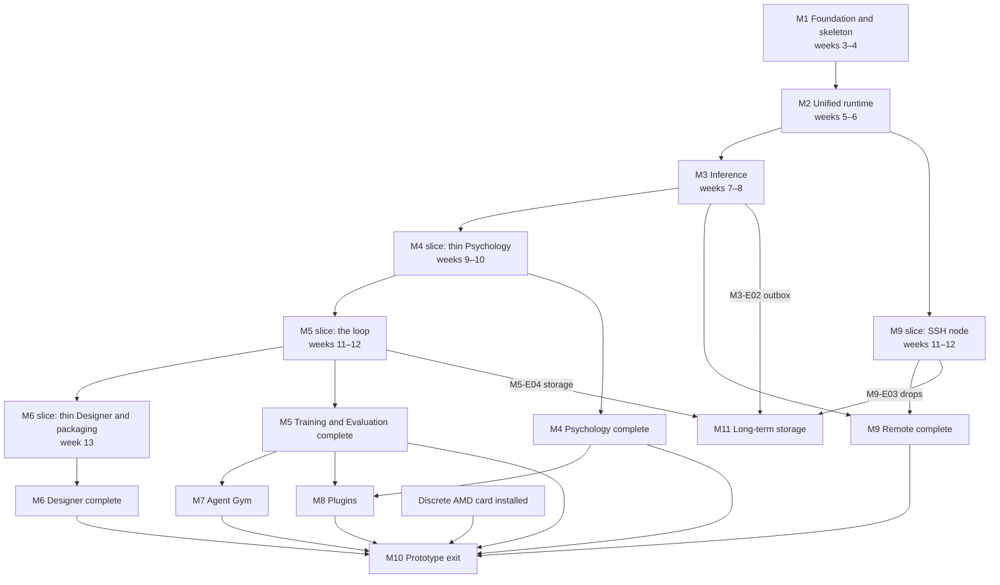
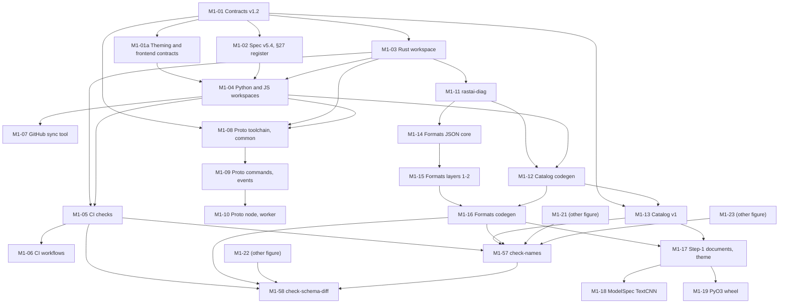
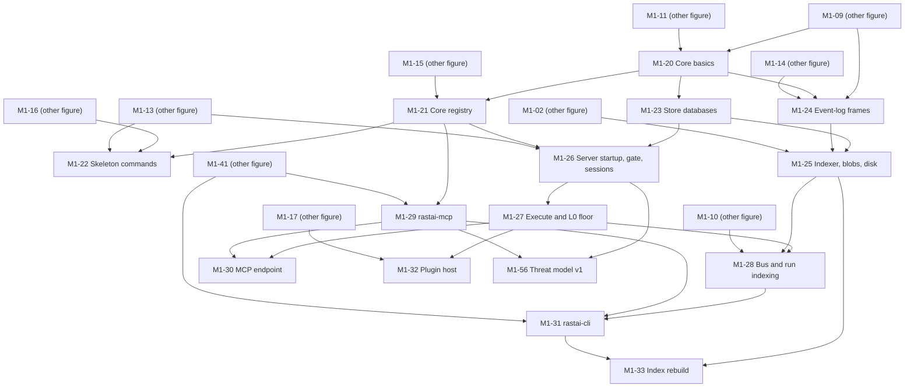
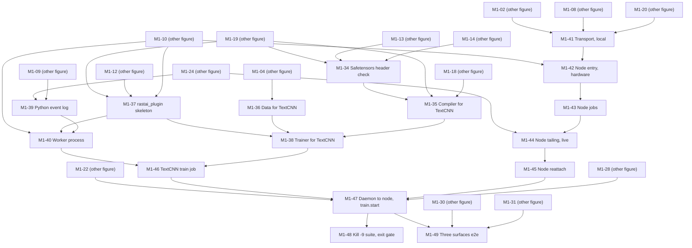
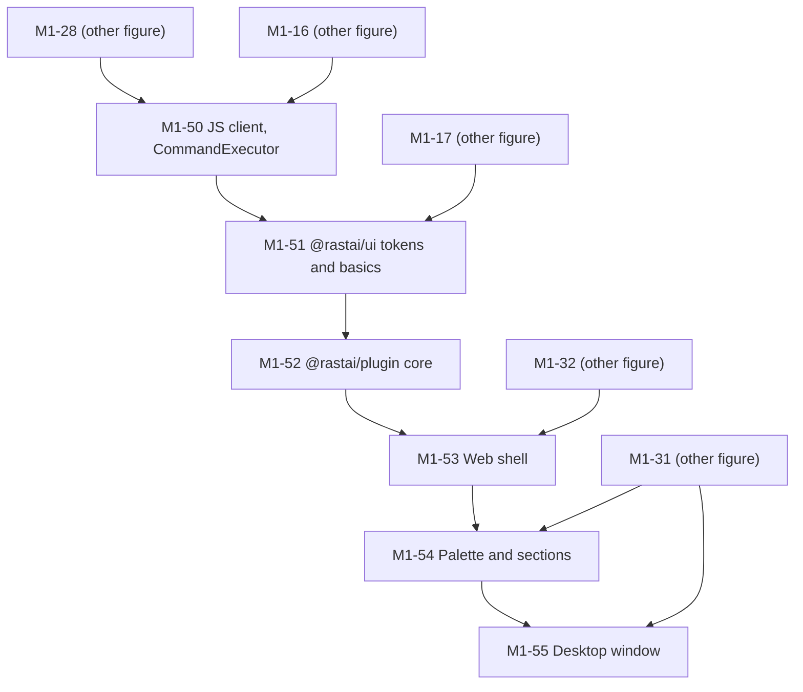
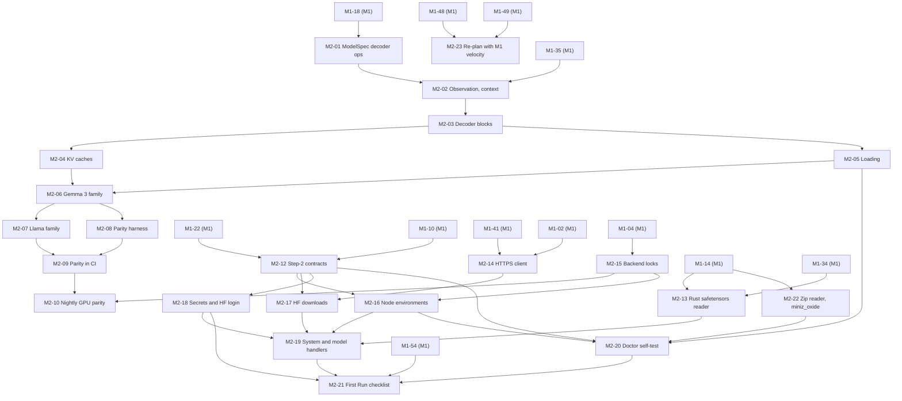

# Rastai Research Studio: Implementation Plan

**Status:** v1.4, 2026-10-11. Pre-build. The steps from today (spike done) to the prototype exit (spec §5, §31, §32), and the long-term storage milestone after it.

v1.4 applies the owner decisions of 2026-10-11 (ADR-0038, contracts v1.2):
- **Names and schemas are enforced in M1** (about 2 size-days): M1-57 (`check-names`, the generated `schemas/names.json` against contracts) and M1-58 (`check-schema-diff`, moved from Phase 2). They land early, so the exit gate moves by one lane-day (3.4).
- **Agent build protocol** (3.5) and **verification before closing** (3.6): an issue closes only with green CI, a reviewer agent that isn't the author confirming every acceptance criterion, and that evidence as the closing comment. The definition of done (3.3) and the PR template lines (8.5) carry both.
- **Owner approvals:** the §27 additions in M1-02 (`@vitest/browser`, axe-core, the Tauri CLI, the Tauri updater plugin, MinIO as a test-only CI service, the named pillow license entry); `node-over-ssh` stays nightly (8.7); the contracts v1.1 names are accepted; the theme token group is `typography`; five small contract gaps are left to the tasks that build them, each named in its backlog issue (3.2).

Earlier versions: v1.1 applied the cross-doc review (section 10 rows 23–37, ADR-0034, M3-E11, M4-E12, M5-E04 storage and lineage, `node-over-ssh`). v1.2 applied the second review (rows 2, 5, 29, 30, 32, 35 and 37, the threat model, M5-E15, tier-2 test runners, more feature rows). v1.3 applied the owner decisions of 2026-10-10 (contracts v1.1 "Changes", spec v5.4, ADR-0033 to ADR-0037):
- **M1-01 blocks every other task**, and after it contracts.md is the only list of names: section 11 no longer lists names, and section 10's rows all have answers (contracts §16). M1-01a lands the theming and frontend-contract docs right after it.
- **Plain JavaScript frontend** (ADR-0036): every task says JavaScript and JSX, `jsconfig.json` with `checkJs` replaces `tsconfig`, and the `typescript` package is a dev-time checker only. JSDoc costs about 8 size-days across the UI tasks and epics (3.4).
- **Theming "do now"** (owner decision 20, about 3.5 size-days): the token contract, `setColors` on renderers, locked security UI, `stability`, origin-bound sessions, the credential option and `CommandExecutor`. The "later" items are in M8-E06 and the Phase 2 list (6.10).
- **Long-term archive** (ADR-0035): half a day in M1-01, half a day in M3-E02 (the outbox), 2 days in M5-E07 (the MySQL dataset reader) and a new milestone, M11 Long-term storage (21 days), which doesn't gate M10.
- **Schedule:** two lanes and a re-plan after M1 with measured velocity (M2-23); M2 closes on NVIDIA and the AMD parity gate moves to M10 (M2-11); the GPU runner policy (8.8); no managed vLLM in the prototype; `miniz_oxide` replaces the in-house DEFLATE (M2-22) and torchvision decodes images (M6-E07); the Rust safetensors header check moves into M1 (M1-34); (L2) hardening collected in M10-E04; the M4 latency budget test; CUDA IPC sharing behind a measurement gate (M5-E16).

**Built on:** spec v5.4 (`docs/spec/rastai_spec_v5.md`), the spike results (`spike/README.md`), the shared names in contracts v1.2 (`docs/architecture/contracts.md`), the four layout docs (`docs/architecture/layout/`), the four flow docs (`docs/architecture/flows/`) and ADRs 0001–0038. Every name in this plan comes from contracts.md; a name it lacks is added there as 3.3 rule 3 says, and from M1-57 `check-names` enforces it.

**Companion file:** [`backlog.json`](backlog.json) holds one GitHub issue per M1 and M2 task and one per later epic. It is generated from the same data as the tables below, so the two can't disagree. M1-07 turns it into GitHub issues. Ids never change, because GitHub issues map to them (`github-issues.json`); a moved task keeps its id and changes its milestone.

## Contents

1. [Starting point and target](#1-starting-point-and-target)
2. [Milestones](#2-milestones)
3. [Ways of working](#3-ways-of-working)
4. [M1 Foundation and skeleton](#4-m1-foundation-and-skeleton)
5. [M2 Unified runtime](#5-m2-unified-runtime)
6. [M3–M11: epics](#6-m3m11-epics)
7. [Tracking L0–L3](#7-tracking-l0l3)
8. [GitHub setup](#8-github-setup)
9. [Schedule risks](#9-schedule-risks)
10. [Conflicts between docs, and the answers M1-01 adopts](#10-conflicts-between-docs-and-the-answers-m1-01-adopts)
11. [Names](#11-names)
12. [Open questions](#12-open-questions)

---

## 1. Starting point and target

### 1.1 Today

- **The spike is done** (§0.13). The unified-runtime bet holds: in-house Gemma 3 1B is bit-identical to HF in fp32 with eager attention; the live panel costs +16–31% at CUDA-graph speed; the gateway tokenizer and llama.cpp agree on 49,035 tokens; Teach it takes about 10 s; the WebGL2 canvas holds the refresh cap at 50,000 nodes; the backend stays Rust.
- **The design is written:** spec v5.4, contracts v1.2, four layout docs, four flow docs, 38 ADRs. The owner decided every open design-review question on 2026-10-10, and approved the names and schema enforcement (ADR-0038) on 2026-10-11; M1-01 and M1-01a land those docs as the first two PRs.
- **The repo has one scaffold commit:** README, LICENSE, DCO, CONTRIBUTING, CLAUDE.md, the PR template and two issue templates. No product code, no CI, no GitHub settings yet.

Spike items this plan carries:

| Item | State | Where it lands |
|---|---|---|
| TextCNN ported off torchtext and `.pt` (§32 weeks 1–2 exit) | Not done; `spike/README.md` doesn't cover it | M1-18 (template), M1-35, M1-36, M1-38, M1-46 |
| AMD numbers | Wait on a discrete RDNA3+ card, which the owner buys before M10 (owner decision 11) | M2-11 (moved to M10), M10-E01 |
| 5080 timings taken while Steam's shader cache was running | Treat as pessimistic; re-measure on an idle box | the nightly GPU jobs from M2-10 on |
| The bake-off safetensors reader used `memmap2` and `unsafe` | Dropped in the port; the header check is ported into `rastai-formats` in M1 so Python can call it through the wheel | M1-34, M2-13 |
| The spike canvas's hard-coded `#101318` | Removed; it seeds the built-in dark theme's `canvas_background`, and `check-colors` fails any color literal in the renderers | M1-51, M1-05 |

### 1.2 Target: the prototype exit (§5)

| Condition | Proved by |
|---|---|
| Every section is at L1 | The feature level table (7.3) names a passing test for every L1 row; M10-E03 |
| The core loop is at L2: chat → see inside → steer or branch → train → verify | The L2 list (7.4); M10-E02 |
| It runs on Linux NVIDIA, Linux AMD and a paired SSH box | M2-11 and M10-E01 (AMD), M9 (SSH), M10-E03 (the same suite on all three) |

M11 Long-term storage (§31 step 10) comes after the 90-day plan and is not part of the prototype exit.

### 1.3 How this plan is organized

- **One milestone per §31 build step** (M1–M9), plus M10 for the exit checks that span every step, plus M11 for §31 step 10, the optional long-term archive.
- **§32's 90-day plan cuts thin slices** through M4 (weeks 9–10), M5 and M9 (weeks 11–12) and M6 (week 13). Issues in those slices carry the `gate:90-day` label.
- **M1 and M2 are cut into PR-sized tasks** (half a day to two days). Later milestones are epics of about 1–7 days; each is cut into tasks when its milestone starts.
- **Two re-plans with measured velocity:** after M1 (M2-23, owner decision 10) and at week 13 (M6-E06).
- **Weeks are estimates; exit criteria close a milestone** (§0.8, §32). Section 3.4 states the estimate honestly.

---

## 2. Milestones

### 2.1 At a glance

| Milestone | §31 step | §32 weeks | Goal | Work | Exit gate (the test that closes it) |
|---|---|---|---|---|---|
| M1 Foundation and skeleton | 1 | 3–4 | Monorepo, CI, contracts in code, the command layer over HTTP, CLI and MCP, durable storage, daemon with embedded node, worker protocol v0 running TextCNN, plugin host, the theme token contract and locked security UI, web shell in plain JavaScript, threat model v1, the names and schema checks | 59 tasks, 80.5 size-days | kill -9 the daemon mid-run; it restarts and reattaches with no lost events (M1-48) |
| M2 Unified runtime | 2 | 5–6 | Re-plan with M1's velocity, ModelSpec compiler, Gemma 3 and Llama with parity, uv environments per backend, `rastai doctor`, model downloads including gated ones | 22 tasks, 28.5 size-days | both families pass parity in fp32 and bf16 on NVIDIA (M2-10); the AMD half moved to M10 (M2-11) |
| M3 Inference | 3 | 7–8 | Gateway and tokenization, both runtimes, VRAM leases, the conversation tree and the archive outbox, `/v1` endpoints, the Inference section; then projects | 42.5 of 46.5 epic-days in the 90-day plan | Navi chats through `/v1` with token-ID logging and the runtime toggle working (M3-E07) |
| M4 Psychology | 4 | 9–10 (thin slice) | Live lenses, SAEs, steering, replay; then branching, diff and the advanced views | 34.5 of 51.5 epic-days in the 90-day plan | slice: First Run minutes 3–7 on an 8 GB budget, the slider round trip under 50 ms p95; full: every `psychology.*` command at L1 |
| M5 Training and Evaluation | 5 | 11–12 (the loop) | Teach it, the Evaluation plugin, chains; then every recipe, RLHF, data import with the MySQL reader, export, plugin event handlers, CUDA IPC sharing if it measures well | 27.5 of 72.5 epic-days in the 90-day plan | slice: the loop in under 10 minutes from cold; the invented fact caught; full: every recipe and metric at L1 |
| M6 Designer | 6 | 13 (thin slice and packaging) | Canvas, stats, import, compile, ONNX; then all families and blocks, templates, Eject | 23 of 51 epic-days in the 90-day plan | slice: design → train → ONNX export from the UI, AppImage and `.deb`, the months-4+ plan; full: every family passes the import golden test |
| M7 Agent Gym | 7 | after the 90 days | RL engine on harnesses with sandboxes, peek and step mode, Harbor import | 24 epic-days | GRPO on a harness end to end on Linux; step mode keeps advantages correct |
| M8 Plugins | 8 | after the 90 days | SDK basics, `rastai plugin new, dev, test, pack`, local install, the iframe bridge, theme plugins and icon sets | 25.5 epic-days | every template goes through new, codegen, lint, test and pack in CI |
| M9 Remote | 9 | 11–12 (SSH slice) | SSH pairing, headless serve, resumable transfers, jobs that survive drops | 11 of 26 epic-days in the 90-day plan | slice: a remote job survives a network drop; full: first remote run under 15 minutes from pairing |
| M10 Prototype exit | (spans all) | after the 90 days | AMD parity and tier 1, the core loop at L2, the level audit on three platforms; then the (L2) hardening | 17 epic-days and M2-11 (1 size-day) | §5: every section L1, the loop L2, on NVIDIA, AMD and an SSH box |
| M11 Long-term storage | 10 | after the 90 days | The optional archive in the owner's MySQL or MariaDB: one-way sync of run and daemon logs, vault opt-in and delete propagation, blob targets, prune, restore and rebuild, Settings > Storage > Archive, CI against MySQL and MariaDB | 21 epic-days (plus 3 size-days earlier: M1-01, M3-E02, M5-E07) | `just test-archive` green against MySQL 8.4, MySQL 9.7, MariaDB 11.4 and MinIO, with kill -9 rows 20–24 (M11-E05, M11-E07). Doesn't gate M10 |

A **size-day** is one size-M PR: about a day of agent work plus the owner's review. Size S is half, L is two. A task whose scope grew with the decisions of 2026-10-10 shows the extra as, for example, `M + 0.25`; its GitHub label is the letter (`size:M`). A task over two days (`L + 0.25` and up) ships as two PRs under its one issue (3.3 rule 10). Epics are counted in the same unit.

### 2.2 Milestone dependencies

**Figure 2.1**



- **The critical path is M1 → M2 → M3 → the M4 slice → the M5 slice.** Every later section runs on the unified runtime (M2) and the gateway (M3), which is why §31 puts the runtime second.
- **The M9 slice runs beside the M5 slice** as the second lane in weeks 11–12. It needs only the skeleton's jobs and M2's environments, not inference.
- **Completion work overlaps.** After week 13, M4–M6 are finished and M7–M9 are built, two lanes at a time, in the order M5 (it feeds M7 and M8), M4, M6, M9, M7, M8.
- **M11 hangs off three epics, not off M10.** It needs the vault outbox (M3-E02), run storage and lineage (M5-E04) and remote logs that survive drops (M9-E03). It never gates the prototype exit; it is scheduled after the 90 days, when a lane is free.
- **The AMD gate is in M10** (owner decision 11). M2 closes on NVIDIA; M2-11 moved to M10 with its id unchanged, and the owner buys a discrete RDNA3+ card before M10.
- **What is persisted:** each milestone is a GitHub milestone (8.2); its state is its issues. Levels live in section 7 of this file.
- **Failure branches:** a slice gate that fails blocks the next slice, never the lane: the lane switches to completion epics of the same milestone while the gate is fixed. If the AMD card hasn't arrived, only M10 waits; M2-11 and M10-E01 stay open. If the archive's CI services break, only M11 waits.

### 2.3 The 90-day plan by lane

| §32 weeks | Lane A | Lane B | Gate |
|---|---|---|---|
| 3–4 | M1: contracts v1.2, proto, diag, formats, core, `check-schema-diff`, server, CLI, Python worker, the theme token contract, the JavaScript web shell | M1: the §27 register, the frontend-contract docs, tooling, CI, store, `check-names`, transport, node, Python TextCNN stack, crash suite, threat model | M1 exit |
| 5–6 | M2: node environments, downloads, secrets, doctor, First Run checklist | M2: the re-plan with M1's velocity (M2-23), ModelSpec ops, runtime, Gemma 3 and Llama, parity on NVIDIA | M2 exit (NVIDIA) |
| 7–8 | M3: gateway core, endpoints and chat, API adapters, Inference UI | M3: vault and its archive outbox, leases, Inspectable serving, llama-server, twins | M3 exit |
| 9–10 | M4 slice: contracts, Basic lenses UI with `setColors` on the charts, replay and viewer | M4 slice: plugin modules, live readouts, steering with the latency budget | M4 slice gate |
| 11–12 | M5 slice: contracts, node gateway, Teach it training, chains, Eval v0, loop UI; M4-E07 and E08 | M9 slice: contracts, SSH pairing, network drops; then Teach it and Eval v0 with lane A | M5 and M9 slice gates |
| 13 | M6 slice: contracts, stats, canvas with `setColors`, import, compile, ONNX | M6 slice: packaging with the AppArmor profile; the months-4+ plan | M6 slice gate |

---

## 3. Ways of working

### 3.1 Two lanes, two worktrees

§28 risk 1: one human reviewer. So at most two lanes merge at once, each in its own git worktree (§29). The owner confirmed two lanes on 2026-10-10 (decision 10) and re-plans after M1 with measured velocity (M2-23).

```
git fetch origin
git worktree add ../rastai-lane-a -b lane-a/M1-01-contracts-v1-1 origin/main
git worktree add ../rastai-lane-b -b lane-b/M1-02-spec-27-register origin/main
```

- **A lane is a merge queue, not a technology.** Lane A is mostly contracts, the control plane and the UI; lane B is mostly Python compute, the node and integration. Tasks move between lanes when that shortens the path (sections 4.7 and 5.7 show the result).
- **M1-01 merges before anything else.** Lane B may draft M1-02 and M1-01a while M1-01 is in review, but nothing else merges until M1-01 has.
- **One PR open for review per lane.** A lane may stack its next branch on the open one while it waits, but merges in order and rebases the next branch on `main` after each merge.
- **Branch names:** `lane-a/<task id>-<slug>`, `lane-b/<task id>-<slug>`. PR titles start with the task id: `M1-14: rastai-formats JSON core`. A task shipped as two PRs uses `part 1` and `part 2` in the title.
- **More agents, same two lanes.** Extra agents may draft in a third worktree (for example, research for the next milestone), but nothing merges outside the two lanes.
- **Cross-lane dependencies** are in every task's "depends on" list. A lane that is blocked takes its next unblocked task; the week tables in 4.7 and 5.7 come from simulating exactly that.

### 3.2 Contracts first

- **M1-01 is the contract for everything.** It lands contracts v1.2 (v1.1 plus the 2026-10-11 decisions), the only list of shared names. Every later task uses those names. A name contracts.md lacks is added there first: a wire, document or command shape (and a catalog code) in its own contract PR, any other name in the PR that first uses it (3.3 rule 3).
- **Every milestone opens with a contract PR** (§29): proto, document schemas, command rows and their argument types, catalog codes. Contract tasks carry `type:contract`.
- **New commands land as honest L0 stubs:** they exist in the registry, the CLI, MCP and the palette, and return their area's "not available yet" catalog code until the handler lands (ADR-0017). The L0 floor test (M1-27) keeps this true. Every command and event type is `stability: preview` until Phase 2.
- **CI holds the contracts from M1** (ADR-0038). `check-names` (M1-57) fails a name in code that contracts.md doesn't list, and a name in contracts that isn't in code and has no milestone mark such as "(M4)". `check-schema-diff` (M1-58) fails a change to `schemas/commands/` or `schemas/events/` without a matching contracts.md change in the same PR, and a breaking change to a `stable` item. A PR that lands a name marked with its milestone removes the mark.
- **A lane that needs an unplanned contract change** opens a small contract PR first; the other lane rebases after it merges.

**Contract gaps left to the tasks that build them** (owner decision of 2026-10-11). Each is small and is an acceptance item in its task's backlog issue, so it can't be lost. Contracts §14 rows 19–23 hold the draft each task starts from; the task settles the names in contracts.md in its contract PR, before code uses them, and removes the milestone mark.

| Gap | Owning task |
|---|---|
| `GetSecretRequest` and `GetSecretResponse` fields, and the environment variable that hands a job its secret | M5-E07 (data import; open question 15) |
| MySQL source error codes in the `RRS-D3xxx` range | M5-E07 |
| The message and fix text of the Designer's layer-4 warning "parameters exceed dataset tokens" (it uses `RRS-E3003`, contracts §10.3) | M6-E02 (live stats) |
| `ConversationDeleteResult`'s archive-pending field | M11-E03 |
| The test-only environment variables for the archive's CI service addresses | M11-E07 |

### 3.3 Definition of done per PR

A PR is done when all of these hold. Reviewers check the PR template's boxes (8.5). A merged PR doesn't close its issue; 3.6 does.

1. `just check` passes locally and every required CI job is green (§29). From M1-05 that includes `check-js` (`tsc --noEmit` over `jsconfig.json`, checkJs), prettier, ruff, `check-colors` and `check-no-typescript`; from M1-57 and M1-58, `check-names` and `check-schema-diff`.
2. It adds a test that fails without the change. The one exception is a docs-only PR (spec, contracts prose, ADRs, this plan), which has no code to test.
3. Wire and document contract changes (proto, document schemas, command rows and their argument types, catalog codes) were merged first, in their own PR. Any other new name (a table or column, a settings key, a module, a CLI verb) goes into contracts.md in the same PR that first uses it (ADR-0038).
4. Every new user-facing error has a catalog code (`catalog_checks` and the source scan enforce it from M1-12).
5. New external dependencies are in §27 and the allowlists (`check-deps`), each imported in its one wrapper file (contracts §2.5).
6. No pickle, no runtime installs (`check-no-pickle`), no `unsafe` outside ADR-0033's one file (`check-unsafe`).
7. House style: simple functions and plain data, constants at the top, readable names, small functions, a thin main (ADR-0023; clippy's `too_many_lines` at 60). Frontend code is plain JavaScript and JSX with short JSDoc types, never TypeScript syntax (ADR-0036).
8. Every commit is signed off (the `dco` job).
9. It links its backlog issue with `Refs #n`, never `Closes #n`, so the merge doesn't close the issue (3.6). If it claims a level, it names the feature and the tests that prove it (section 7).
10. One topic, within two days of work. Bigger work is split before review; a task sized over two days ships as two PRs.
11. A new in-house parser of untrusted input lands with its fuzz target in the same PR (ADR-0037).
12. Every name it uses is registered in contracts.md (§15 and the §2.1–2.3, §5.2, §6, §7, §8, §10 and §11 tables), or added there in this PR. It reuses a registered name rather than inventing a near-duplicate. A schema change carries its contracts update (`check-schema-diff`).
13. A reviewer agent that is not the author reviewed it with the naming and schema, style and tests lenses (3.5), and every finding is fixed or answered in the PR.
14. The issue closes only after independent verification (3.6): CI green, including `just check` with `check-names` and `check-schema-diff`; a reviewer agent that is not the author confirms each acceptance criterion against the code and command output; that evidence is the closing comment.

### 3.4 Sizes and the honest estimate

- M1 is 80.5 size-days (41.75 on lane A, 38.75 on lane B). M2 is 28.5 (14.5 and 14).
- **What the decisions of 2026-10-10 added to M1 (5.5 size-days):** the archive names in M1-01 (0.5); the theming and frontend-contract work (3: M1-01a 1, M1-05 0.25, M1-09 0.25, M1-17 0.25, M1-26 0.25, M1-50 0.25, M1-51 0.5, M1-52 0.25); JSDoc instead of TypeScript (1.5: M1-50, M1-52, M1-53 and M1-54 0.25 each, M1-51 0.5); the Rust safetensors header check moved into M1 (0.5, M1-34). M2 lost M2-11 (moved to M10) and half of M2-22 (no in-house DEFLATE), and gained M2-23 (the re-plan) and 0.5 of JSDoc in M2-21.
- **What the decisions of 2026-10-11 added to M1 (2 size-days):** M1-57 (`check-names`, 1) and M1-58 (`check-schema-diff`, 1), ADR-0038. They are placed as early as their inputs allow (lane-days 16.25–19), so the server, node, worker and UI tasks are checked from their first PR. That moves everything after them by one lane-day. Placed last, they would cost nothing on the schedule but leave most of M1 unchecked. The reviewer agent per PR (3.5) and the verification comment (3.6) add review time per PR, not size-days; M2-23 measures it.
- **The theming "do now" work is 3.5 size-days:** the 3 in M1 above, plus 0.5 in the first renderer PRs (`setColors` on the viz classes in M4-E04 and on `GraphRenderer` in M6-E03, 0.25 each).
- **JSDoc costs about 8 size-days** (ADR-0036): 1.5 in M1, 0.5 in M2-21, and 6 in the UI epics (M3-E09 1, M4-E04 0.75, M4-E06 0.5, M4-E10 1, M5-E06 0.5, M5-E12 1, M6-E03 0.75, M8-E04 0.5).
- Simulating the two lanes with every dependency, at one size-day per lane per working day, with M2 tasks waiting for M1's exit gate: M1-01 merges at lane-day 2.5; M1's exit gate (M1-48, M1-49) lands at lane-day 39.25, all of M1 at 44.25 (M1-55 and M1-56 run on lane B beside the first M2 tasks), M2's NVIDIA parity gate (M2-10) at 55.25 and all of M2 at 56.25.
- §32 gives M1 and M2 four weeks (20 working days). Meeting that needs about 2.7 size-days merged per lane per working day: agents write and self-test the PRs, and the owner reviews about five PRs a day.
- The whole 90-day plan (M1, M2 and the `gate:90-day` epics of M3, M4, M5, M6 and M9) is 247.5 size-days. §32 gives it weeks 3–13: 55 working days on two lanes, 110 lane-days. That is about 2.25 size-days per lane per working day. All epics of M3 to M10 are 314 epic-days; M11 adds 21.
- If review can't keep that pace, the dates move, not the scope or the bar (§0.8). M2-23 replaces these estimates with M1's measured velocity, and M6-E06 does it again at week 13.

### 3.5 Agent build protocol

Agents write most of the code. They invent plausible names when the registry isn't in front of them, and drift from schemas they haven't read. Owner decision of 2026-10-11 (ADR-0038 decision 3):

| Step | Who | What |
|---|---|---|
| 1. Brief | whoever starts the task (the owner or an orchestrating agent) | The build agent's prompt holds: the backlog issue body (goal, files, acceptance test); `docs/architecture/contracts.md`; the generated schemas the task touches (`schemas/commands/`, `schemas/events/`, `schemas/<type>/`) and `schemas/names.json`; the owning layout section. Add the flow sections and ADRs the issue cites. |
| 2. Build | the build agent (the author) | Uses only registered names. A name it needs that contracts.md lacks goes into contracts in the same PR (3.3 rule 3); a wire or document change is its own contract PR first. Runs `just check` before opening the PR. |
| 3. Review | a reviewer agent, never the author | Reads the diff with three lenses. **Naming and schema:** every new name is in contracts.md; nothing near-duplicates a registered name; each schema diff matches a contracts diff; milestone marks are removed for names that land. **Style:** 3.3 rule 7. **Tests:** rule 2 and the issue's acceptance test. Posts its findings as a PR review. |
| 4. Approve and merge | the owner | The one required approval (8.4). |
| 5. Verify and close | a reviewer agent that is not the author | 3.6. |

- **Before M1-57 and M1-58 land,** the reviewer's naming lens does their job by hand against contracts.md.
- **One agent never reviews its own work.** A reviewer may be the same model, but it runs as a separate agent with its own prompt (the diff, the issue, contracts.md and the layout section), not with the author's context.
- **What is persisted:** nothing new. The brief is built from files that already exist (the issue body, contracts.md, `schemas/`, the layout doc). Review findings live on the PR and the verification evidence on the issue.

### 3.6 Closing an issue: independent verification

Owner rule of 2026-10-11: "Ensure work is checked before marking off tasks as completed" (ADR-0038 decision 4). An issue, task or epic, is closed only when all three hold:

1. **CI is green** on the PR that finished it: every required job, including `just check` with `check-names` and `check-schema-diff` (once M1-57 and M1-58 have landed).
2. **A reviewer agent that is not the author** confirms each acceptance criterion in the issue body, one by one, against the code and the command output (the test names, the run, the lines it printed). The PR description is the author's claim, not evidence.
3. **The evidence is posted on the issue as the closing comment.** Then the verifier closes it.

- **Merges never close issues.** PRs say `Refs #n` (3.3 rule 9), and M1-07's sync tool never closes anything.
- **A criterion that can't be confirmed keeps the issue open.** That includes a failing, missing or claimed-only result. The verifier names it, and a follow-up PR fixes it.
- **Docs-only tasks:** the review checklist in the acceptance test is the criterion list, checked item by item against the docs.
- **A task shipped as two PRs** is verified after part 2. **An epic** closes when every task cut from it is closed and its exit test is verified the same way.
- **GPU-gated criteria** (`needs:gpu`, `needs:amd`): the evidence is the linked `workflow_dispatch` run (8.8).

The closing comment:

```
Verified by <reviewer agent>, not the author (<author>).
CI: <link to the green run>; just check includes check-names and check-schema-diff.
Acceptance:
- [x] <criterion 1>: <test or command> -> <result line>, <file:line>
- [x] <criterion 2>: <test or command> -> <result line>, <file:line>
```

---

## 4. M1 Foundation and skeleton

### 4.1 Goal

Build what every later step stands on (§31 step 1, §32 weeks 3–4): the monorepo and CI; the contracts in code (proto, `rastai-formats`, the catalog); the command layer reachable over HTTP, the CLI and the in-house MCP; storage and durability; the daemon with its embedded node; worker protocol v0 running TextCNN training; the plugin host; the theme token contract and the locked security UI; and the web shell, in plain JavaScript and JSX, that first-party sections load through.

### 4.2 Entry criteria

- The one-time GitHub setup of 8.1 is done by hand (repository, settings, branch protection), so the first PR is already protected.
- The owner's decisions of 2026-10-10 and 2026-10-11 are final. M1-01 lands them in contracts v1.2 and the docs that follow it; nothing else merges before M1-01.
- The §27 additions are approved (owner decision 1); M1-02 writes them into spec v5.4 before M1-04, M1-25 and M1-41 merge.

### 4.3 Exit criteria

| # | Criterion | Test |
|---|---|---|
| 1 | §32 exit: kill -9 the daemon mid-run; it restarts and reattaches with no lost events | `tests/crash` row 1 (M1-48) |
| 2 | The kill -9 rows for the skeleton pass: 1, 2, 3, 9, 11, 13 | `just test-crash` in CI (M1-48) |
| 3 | `system.status`, `train.start` and `job.get` behave the same over HTTP, the CLI and MCP | `tests/e2e/three_surfaces` (M1-49) |
| 4 | Worker protocol v0 trains TextCNN on CPU through `train.start`, with checkpoints and no pickle; a resumed run equals an uninterrupted one | M1-38 `test_resume`, M1-46, M1-47 |
| 5 | Every registered command fails cleanly with a catalog code when it can't run | `l0_floor` (M1-27) |
| 6 | Golden proto messages are byte-identical in Rust, Python and JavaScript | golden tests (M1-08 to M1-10) |
| 7 | The safetensors header check gives the expected code on all 33 corpus files, in Rust and through the wheel from Python | M1-34 |
| 8 | Plugins load through the host; a bad manifest disables only that plugin | `tests/plugin_host.rs` (M1-32) |
| 9 | The web shell's palette lists and runs the registered commands; copy-as matches the CLI | `palette.spec.js` (M1-54) |
| 10 | Rust, the portable Python packages and the JavaScript packages build and pass their tests on CPU runners: Rust and Python on Linux, macOS and Windows, JavaScript on Linux and macOS | `test-rust-*`, `test-python-*`, `test-js`, `test-js-macos` jobs (M1-06) |
| 11 | A theme switch (light, dark, `system`, compact density) restyles the shell without changing any `--rr-locked-*` variable; a session cookie works only from the origin that redeemed its login code | `theme.spec.js` (M1-54), `tests/gate.rs` (M1-26) |
| 12 | No hand-written TypeScript and no color literal outside the token files | `check-no-typescript`, `check-colors` in `just check` (M1-05) |
| 13 | Every name in code is registered in contracts.md, and every registered name is in code or carries its milestone mark; a command or event schema change without a contracts update fails, and so does a breaking change to a `stable` item | `check-names` (M1-57) and `check-schema-diff` (M1-58) in `just check` and the `checks` job, each with its fixture suite |

### 4.4 Levels at exit

| Section or feature | Level | Proved by |
|---|---|---|
| Command layer (Execute, registry, CLI, MCP, palette) | L1 | M1-27, M1-49, M1-54 |
| Storage and durability (event logs, index, blobs, rebuild) | L1 | M1-48, M1-33 |
| Daemon, embedded node, job supervision and reattach | L1 | M1-45, M1-48 |
| Training: `train.start` with the classification recipe (TextCNN) | L1 | M1-47, M1-48 |
| Settings: settings and tokens | L1 | M1-27, M1-54 |
| Local API security: origin-bound sessions, scoped tokens | L1 | M1-26, M1-49 |
| Theme tokens and the locked security UI | L1 | M1-51, M1-54 (`theme.spec.js`) |
| Plugins: host loading and `plugin.list` | L0 | M1-32 |
| Remote: the local node's status | L0 | M1-47 |
| Basic/Advanced switch and per-panel override | L1 | M1-54 (`basic-advanced.spec.js`) |
| Threat model (v1 written; reviewed again at M9) | L0 | M1-56 |
| Every other section | none registered yet | |

### 4.5 Tasks

| ID | Task | Lane | Size | Depends on | Start–end (lane days) |
|---|---|---|---|---|---|
| M1-01 | Contracts v1.2: reconcile every doc's names into contracts.md (blocks every task) | A | L + 0.5 | none | 0–2.5 |
| M1-01a | Theming and frontend-contract docs (owner decisions 20 and 21) | B | M | M1-01 | 3.5–4.5 |
| M1-02 | Spec v5.4: the §27 register and ADR-0033 | B | M | M1-01 | 2.5–3.5 |
| M1-03 | Rust workspace root and `just check` | A | M | M1-01 | 2.5–3.5 |
| M1-04 | Python and JavaScript workspaces and the cpu environment | B | M | M1-02, M1-03, M1-01a | 4.5–5.5 |
| M1-05 | Repo checks: deps, unsafe, pickle, imports, colors, no TypeScript, generated code, DCO | B | M + 0.25 | M1-03, M1-04 | 5.5–6.75 |
| M1-06 | CI workflows for pull requests and nightly runs | B | M | M1-05 | 6.75–7.75 |
| M1-07 | GitHub sync tool: labels, milestones and issues from backlog.json | B | S | M1-04 | 7.75–8.25 |
| M1-08 | Proto toolchain and `rastai.common.v1` (contract) | A | L | M1-01, M1-03, M1-04 | 6.5–8.5 |
| M1-09 | Proto `rastai.commands.v1` and `rastai.events.v1`, with `stability` (contract) | A | M + 0.25 | M1-08 | 8.5–9.75 |
| M1-10 | Proto `node.v1` and `worker.v1` skeleton RPCs (contract) | B | M | M1-09 | 10.25–11.25 |
| M1-11 | rastai-diag: Diagnostic, renderers and the JSON-lines logger | A | M | M1-03 | 3.5–4.5 |
| M1-12 | rastai-codegen and the catalog code generator | B | M | M1-11, M1-04 | 9.25–10.25 |
| M1-13 | Catalog v1: the codes of contracts §10.3 (contract) | A | M | M1-01, M1-12 | 10.75–11.75 |
| M1-14 | rastai-formats JSON core: strict reader, canonical JSON, hashing, semver | A | L | M1-11 | 4.5–6.5 |
| M1-15 | rastai-formats descriptions and validation layers 1 and 2 | A | L | M1-14 | 11.75–13.75 |
| M1-16 | rastai-formats-codegen: JSON Schema, JSDoc types, typed command wrappers, Python dataclasses | A | M | M1-15, M1-12 | 14.75–15.75 |
| M1-17 | Step-1 document types, with the theme document (contract) | A | M + 0.25 | M1-16, M1-13 | 15.75–17 |
| M1-18 | ModelSpec v1 for TextCNN, and the TextCNN template (contract) | B | M | M1-17 | 23.25–24.25 |
| M1-19 | PyO3 wheel: rastai-formats-python and `rastai_formats` | B | M | M1-17 | 24.25–25.25 |
| M1-20 | rastai-core: versions, paths, ids, principals, scopes, states | A | M | M1-09, M1-11 | 9.75–10.75 |
| M1-21 | rastai-core: command registry, naming and settings resolution | A | M | M1-20, M1-15 | 13.75–14.75 |
| M1-22 | Skeleton commands: registry rows and argument types (contract) | A | M | M1-21, M1-16, M1-13 | 17–18 |
| M1-23 | rastai-store: databases and writer threads | B | L | M1-20 | 13.25–15.25 |
| M1-24 | rastai-store: event-log frames, reader and writer | B | M | M1-09, M1-20, M1-14 | 12.25–13.25 |
| M1-25 | rastai-store: indexer, blob store and free space | B | M | M1-23, M1-24, M1-02 | 15.25–16.25 |
| M1-26 | rastai-server: startup, listeners, request gate and origin-bound sign-in | A | L + 0.25 | M1-23, M1-21, M1-13 | 19–21.25 |
| M1-27 | rastai-server: the Execute path and the L0 floor | A | L | M1-26 | 21.25–23.25 |
| M1-28 | rastai-server: event bus, Subscribe and run-log indexing | A | L | M1-27, M1-25, M1-10 | 23.25–25.25 |
| M1-29 | rastai-mcp: JSON-RPC, the MCP server and the stdio bridge | B | M | M1-21, M1-41 | 18.25–19.25 |
| M1-30 | rastai-server: the `/mcp` endpoint | B | S | M1-27, M1-29 | 31.75–32.25 |
| M1-31 | rastai-cli: modes, generated verbs, follow and exit codes | A | L | M1-28, M1-29, M1-41 | 25.25–27.25 |
| M1-32 | rastai-server: plugin host (discover, negotiate, register) | A | M | M1-27, M1-17 | 28.25–29.25 |
| M1-33 | rastai-store: offline index rebuild | B | M | M1-25, M1-31 | 32.25–33.25 |
| M1-34 | Safetensors: the one header check in rastai-formats, and the Python reader and writer that call it (spike port) | B | M + 0.5 | M1-14, M1-19, M1-13 | 25.25–26.75 |
| M1-35 | rastai_models: the compiler and the TextCNN blocks | B | L | M1-18, M1-19, M1-34 | 26.75–28.75 |
| M1-36 | rastai_data: readers, word vocabulary, splits and a resumable loader | B | M | M1-04 | 8.25–9.25 |
| M1-37 | rastai_plugin: registry, base classes, module loader and host client | B | M | M1-10, M1-12, M1-19 | 28.75–29.75 |
| M1-38 | rastai_train: loop, optimizer, checkpoints, resume and the classification recipe | B | L | M1-35, M1-36, M1-37 | 29.75–31.75 |
| M1-39 | rastai_worker: the event-log writer and payload conversion | A | M | M1-09, M1-24 | 27.25–28.25 |
| M1-40 | rastai_worker: process, WorkerService, host connection and control | A | L | M1-39, M1-37, M1-10 | 30.75–32.75 |
| M1-41 | rastai-transport: local sockets, peer credentials, gRPC channels, local HTTP | B | M | M1-20, M1-08, M1-02 | 11.25–12.25 |
| M1-42 | rastai-node: entry, identity, local handshake, hardware and telemetry | B | M | M1-41, M1-10 | 17.25–18.25 |
| M1-43 | rastai-node: job supervisor, spawn, signals and exit causes | B | L | M1-42 | 19.25–21.25 |
| M1-44 | rastai-node: event-log tailing and live streams | B | M | M1-43, M1-24 | 21.25–22.25 |
| M1-45 | rastai-node: reattach after a restart, and immediate heartbeats | B | M | M1-44 | 22.25–23.25 |
| M1-46 | rastai_worker: the TextCNN train job | B | M | M1-38, M1-40 | 33.25–34.25 |
| M1-47 | Daemon and embedded node: links, NodeHub, scheduler, train.start and `job.*` | B | L | M1-28, M1-45, M1-46, M1-22 | 34.25–36.25 |
| M1-48 | Kill -9 crash suite for the skeleton (M1 exit gate) | B | L | M1-47 | 36.25–38.25 |
| M1-49 | Three surfaces end to end: HTTP, CLI and MCP | B | M | M1-31, M1-30, M1-47 | 38.25–39.25 |
| M1-50 | `@rastai/client`: credentials, `CommandExecutor` and the generated JavaScript packages | A | M + 0.5 | M1-28, M1-16 | 29.25–30.75 |
| M1-51 | `@rastai/ui`: theme tokens, the locked security UI, basics and the Basic/Advanced primitives | A | L + 1 | M1-50, M1-17 | 32.75–35.75 |
| M1-52 | `@rastai/plugin`: host interface, registry and state tools | A | M + 0.5 | M1-51 | 35.75–37.25 |
| M1-53 | apps/web shell, embedded in the daemon | A | L + 0.25 | M1-52, M1-32 | 37.25–39.5 |
| M1-54 | apps/web: the generated palette, copy-as, Settings with Appearance, Plugins and Remote; Playwright | A | L + 0.25 | M1-53, M1-31 | 39.5–41.75 |
| M1-55 | apps/desktop: the Tauri window and `rastai open` | B | M | M1-54, M1-31 | 42.25–43.25 |
| M1-56 | Threat model v1 | B | M | M1-26, M1-29 | 43.25–44.25 |
| M1-57 | check-names: generated names registry and contracts comparison | B | M | M1-05, M1-13, M1-16, M1-21, M1-23 | 16.25–17.25 |
| M1-58 | check-schema-diff: command and event schema diff against base | A | M | M1-05, M1-16, M1-22, M1-57 | 18–19 |

"Start–end" is the simulated position in lane-days (3.4), not a date. **M1-01 blocks every task:** each task depends on it directly or through its listed dependencies, and nothing merges before it. M1-57 and M1-58 are placed as early as their inputs allow (3.4). M1-01a's contracts are built by M1-04, M1-05, M1-09, M1-16, M1-17, M1-26 and M1-50 to M1-56.

### 4.6 Dependencies

The M1 graph has 59 tasks, so it is drawn in four figures. A task from another figure appears as a node marked "(other figure)".

**Figure 4.1: repo, contracts, formats and the names and schema checks**



- **M1-01 comes first and alone.** It lands contracts v1.2, the only list of names, so every later task builds against settled names. M1-02 (spec v5.4) and M1-01a (theming and frontend contracts) follow on lane B while lane A starts the Rust workspace.
- The proto chain (M1-08 → M1-09 → M1-10) and the formats chain (M1-14 → M1-15 → M1-16 → M1-17) are the two contract spines. Generated code is checked in, and `check-generated` fails any PR that edits it by hand.
- M1-13 (catalog v1) waits for M1-01 and the catalog generator: it writes the codes contracts §10.3 lists, with the collisions already settled in contracts §10.2.
- **The names and schema checks land as soon as their inputs exist** (ADR-0038). `check-names` (M1-57, lane B) needs every source of `schemas/names.json`: the checks scaffold, the catalog, the formats codegen, the command table and settings defaults, and the store migrations. `check-schema-diff` (M1-58, lane A) needs the first command schemas (M1-22) and the event-type table M1-57 adds. Every server, node, worker and UI task after them is checked from its first PR.
- **What is persisted:** generated files in the repo (`schemas/`, `packages/*/src/generated/`, `packages/proto/`, `python/*/generated/`, `crates/rastai-proto/src/generated/`). Generated JavaScript is `.js` with JSDoc `@typedef`s, or `.js` plus `.d.ts` from protobuf-es; neither is reviewed.
- **Failure branches:** if a §27 wrapper misbehaves, the replacement path of its row applies behind the same file (for example, `disk_space.rs` keeps `df` as ADR-0033's documented fallback); nothing outside the wrapper changes. If `check-names` finds names contracts v1.2 lacks or marks wrongly when it first runs, the fix is a contracts PR before M1-57 merges, never an allowlist inside the check.

**Figure 4.2: core, store, server, MCP and CLI**



- The server tasks (M1-26 → M1-27 → M1-28) are lane A's longest chain and sit on the path to the exit gate. M1-26 now binds each session to the origin that redeemed its login code (ADR-0034, owner decision N4), so a page on another loopback port can't ride the cookie.
- M1-56 (threat model v1, docs-only) waits for the request gate (M1-26) and the MCP parser (M1-29), so each boundary row can name a real test and fuzz target. It runs at the end of lane B, beside the first M2 tasks, so it doesn't move the exit gate.
- M1-29 (MCP) and M1-31 (CLI) need `rastai-transport`'s local HTTP client (M1-41), which is why the plain-HTTP half of `http_client.rs` moved from step 2 to M1 (section 10, row 14).
- **What is persisted:** `rastai.db` migration 0001 and the event-log format are durable from here; M1-23 and M1-24 own them. There is no `settings` table: settings live in `settings.json` and the other files of contracts §11.1.
- **Failure branches:** a writer-thread design that convoys at 256 clients (spike 07) fails M1-23's test before anything builds on it.

**Figure 4.3: Python stack, node, integration and the exit gate**



- The node (M1-42 → M1-45) and the Python TextCNN stack (M1-34 → M1-38 → M1-46) proceed in parallel and meet in M1-47, where the daemon starts training through the embedded node.
- **M1-34 now waits for the wheel (M1-19).** One owner per algorithm (contracts §2.4 rule 10): the safetensors header check lives only in `rastai-formats`, and Python calls `rastai_formats.check_safetensors_header` before it reads any tensor bytes. So the Rust check is ported in M1, not M2, and the Python reader no longer parses headers.
- M1-48 is the §32 exit test. It needs the `RASTAI_TEST_PAUSE_AT` hook in three processes so each kill lands at a named point every time.
- **What is persisted:** `runs/<run_id>/` folders (`job.json`, `events.log`, checkpoints) written by workers; the index rows are rebuildable from them.
- **Failure branches:** if row 1 fails, M1 doesn't close, whatever else is green; the lane fixes it before taking M2 work.

**Figure 4.4: the UI**



- The UI is not on the exit gate's path, but §31 step 1 loads first-party sections through the plugin host from day one, and M2's First Run checklist needs the shell.
- **All of it is plain JavaScript and JSX** with short JSDoc types (ADR-0036). `just check-js` runs the `typescript` package's checker over `jsconfig.json` in checkJs mode; it never emits code, and nobody writes TypeScript syntax.
- M1-51 is the largest UI task (L + 1) and ships as two PRs: the token contract with the locked security UI, then the components and mode primitives.
- **What is persisted:** nothing new; the UI reads state through commands and the event stream only (ADR-0006), and holds no domain logic (contracts §2.4 rule 9). `ui.theme` and `ui.density` live in `settings.json`; resolved tokens are never stored.
- **Failure branches:** if WebKitGTK misbehaves in M1-55, the browser is a full client (§16), so M2 continues in Chrome.

### 4.7 Lanes week by week: what runs in parallel in the two worktrees

| Lane week | Lane A | Lane B |
|---|---|---|
| 1 (days 0–5) | M1-01, M1-03, M1-11, M1-14 | waits for M1-01 (drafts M1-02 and M1-01a), then M1-02, M1-01a, M1-04 |
| 2 (days 5–10) | M1-08, M1-09, M1-20 | M1-05, M1-06, M1-07, M1-36, M1-12 |
| 3 (days 10–15) | M1-13, M1-15, M1-21, M1-16 | M1-10, M1-41, M1-24, M1-23 |
| 4 (days 15–20) | M1-17, M1-22, M1-58, M1-26 | M1-25, M1-57, M1-42, M1-29, M1-43 |
| 5 (days 20–25) | M1-27, M1-28 | M1-44, M1-45, M1-18, M1-19 |
| 6 (days 25–30) | M1-31, M1-39, M1-32, M1-50 | M1-34, M1-35, M1-37, M1-38 |
| 7 (days 30–35) | M1-40, M1-51 | M1-30, M1-33, M1-46, M1-47 |
| 8 (days 35–40) | M1-52, M1-53, M1-54 | M1-48, M1-49; then M2 tasks (5.7) |
| 9 (days 40–45) | M2 tasks (5.7) | M1-55, M1-56 between M2 tasks |

A cell lists the tasks that lane starts in that lane-week (five lane-days). "Waiting" means the lane's next tasks are blocked; "M2 tasks" means the lane is already in the next milestone.

### 4.8 Task details

#### M1-01 Contracts v1.2: reconcile every doc's names into contracts.md (blocks every task)
Lane A · size L + 0.5 · type contract · depends on none

- **Goal:** Land contracts v1.2 (the v1.1 reconcile plus the 2026-10-11 decisions) as the first PR, before anything else merges: after it, contracts.md is the only list of shared names. The PR folds every 'New names' section of the four layout docs, the four flow docs and plan section 11 into contracts §15 and removes those sections; gives each row of plan section 10 its answer (contracts §16), including the contradictions this wave found (votes, managed vLLM, the settings table, catalog collisions; rows 38–44); settles the catalog collisions (contracts §10.2) so M1-13 only writes files; and puts every doc that lost a conflict in line with a one-line pointer. It carries the owner decisions of 2026-10-10 that aren't frontend: ADR-0034 accepted (one-time login codes for an HttpOnly session cookie, the shell only runs `rastai open --print-url`, the loopback Host rule, a too-open `owner.token` refuses the start, `Register` before `Hello` on reattach), with the status lines of ADR-0001, ADR-0006 and ADR-0007; ADR-0033 and ADR-0037 cited by contracts §2.5 and §12.5; one owner per algorithm (contracts §2.4 rule 10); the user-namespace fallback (contracts §8.8); the (L2) tags; and the long-term archive names (0.5 day, ADR-0035): crate `rastai-archive`, the `archive.*` commands and events, settings section `archive`, keychain accounts `archive.mysql` and `archive.objects`, `source_id`, `archive_cursors`, `runs.archive_state`, the `vault_changes` outbox, the archive tables of contracts §8.7, `MysqlConnection` and the range `RRS-S5xxx`. The ADR index's 'Notes since acceptance' table records every language and path fix. With the owner decisions of 2026-10-11 it lands contracts v1.2 and ADR-0038: §15 accepted, not provisional, and a milestone mark such as "(M4)" on every registered name that isn't built yet, so `check-names` passes the day M1-57 lands.
- **Files:** `docs/architecture/contracts.md` (v1.2, with its 'Changes in v1.1' and v1.2 lists); `docs/adr/0038-naming-and-schema-enforcement.md`; `docs/architecture/layout/*.md` (the 'New names' sections removed, a pointer on each superseded name, 'Contracts follow-ups' where a point is still open); `docs/architecture/flows/*.md` (the same); `docs/adr/0034-login-codes-loopback-host-owner-token.md`, `docs/adr/0035-mysql-long-term-archive.md` and `docs/adr/0037-borrowed-decoders-and-parser-fuzzing.md`; the status lines of `docs/adr/0001-process-layout.md`, `0002-durability-worker-event-logs.md`, `0003-storage-sqlite-vault-blobs.md`, `0006-ui-transport-http-only.md`, `0007-local-api-security.md` and `0029-strict-safetensors-contract.md`; `docs/adr/README.md` (index rows, the 'Notes since acceptance' table); `docs/architecture/README.md`; `docs/plan/implementation-plan.md` (sections 10 and 11) and `docs/plan/backlog.json`
- **Test:** Docs-only PR, exempt from the test rule (plan 3.3). Review checklist in the PR: no layout or flow doc keeps a 'New names' section, and every name they use is in contracts.md or in contracts §15.11 as rejected with its replacement; every row of plan section 10 has one answer in contracts §16; the archive names of ADR-0035 are all in contracts; every superseded ADR decision points to the ADR that replaced it; no doc names a `settings` table, a managed vLLM engine in the prototype or `votes.jsonl`; every registered name that isn't built yet carries its milestone mark, "(M1)" included.
- **Docs:** [Contracts](../architecture/contracts.md), [ADR-0038 names and schema enforcement](../adr/0038-naming-and-schema-enforcement.md), [Contracts §16, plan §10 answers](../architecture/contracts.md), [Layout: Rust control plane §16 contracts follow-ups](../architecture/layout/rust-control-plane.md), [Layout: node, gateway, proto](../architecture/layout/rust-node-gateway-proto.md), [Layout: Python](../architecture/layout/python.md), [Layout: frontend and plugins](../architecture/layout/frontend-and-plugins.md), [ADR-0034 sign-in](../adr/0034-login-codes-loopback-host-owner-token.md), [ADR-0035 long-term archive](../adr/0035-mysql-long-term-archive.md), [ADR-0037 borrowed decoders](../adr/0037-borrowed-decoders-and-parser-fuzzing.md), [ADR index, Notes since acceptance](../adr/README.md)

#### M1-01a Theming and frontend-contract docs (owner decisions 20 and 21)
Lane B · size M · type contract · depends on M1-01

- **Goal:** Right after M1-01, land the frontend contracts that M1's UI and gate tasks build. Frontend language (decision 21): ADR-0036 (plain JavaScript and React with short JSDoc types, checked by `tsc --noEmit` in checkJs mode at dev time only; supersedes ADR-0023's TypeScript section and ADR-0019 decision 5 in part), contracts §12.4, the frontend layout §1.1, and 'Note since acceptance' language fixes in ADR-0004, 0005 and 0006. Theming and custom frontends (decision 20, N1 to N7): the token contract (contracts §5.6: fixed color role keys, typography, density, motion, focus ring and elevation tokens, `--rr-*` CSS variables as the public surface, the full `rastai.theme/1` row, `canvasColors`, `vizColors`, `setColors` on `GraphRenderer` and every viz class, the glyph atlas font from tokens, `check-colors`, `ui.theme` `system`, `ui.density`); capability rows for `icon_sets`, `locales`, `macros` and `chat_templates` (contracts §5.5); `stability` (`preview`, `stable`, `deprecated`) on commands and event types, all `preview` until Phase 2, with the note that `buf breaking` can't see inside `arguments_json` and `result_json`, which `check-schema-diff` covers from M1-58 (ADR-0038); sessions bound to the origin that redeemed the login code, cookie requests without Origin only for GET or HEAD with `Sec-Fetch-Site` `same-origin` or `none`, cross-origin browser clients refused in v1 with the two Phase 2 routes named (ADR-0034); the client's credential option and `CommandExecutor`, satisfied by `DaemonClient` and `PluginHost`, with typed wrappers generated against it; `apps/web` holds no domain logic (contracts §2.4 rule 9); the locked security-UI tokens and the threat-model row M1-56 must carry.
- **Files:** `docs/adr/0036-frontend-plain-javascript.md`; `docs/adr/0019-in-house-webgl2-canvas.md` and `0023-owner-code-style.md` (status lines); `docs/adr/0004-schema-ownership.md`, `0005-command-layer.md` and `0006-ui-transport-http-only.md` (notes since acceptance); `docs/adr/0034-login-codes-loopback-host-owner-token.md` (origin-bound sessions, the cross-origin refusal and its two future routes); `docs/architecture/contracts.md` (§2.3, §2.4 rules 9, 11 and 12, §4.2–4.3 `stability`, §5.5, §5.6, §12.4); `docs/architecture/layout/frontend-and-plugins.md` (§1.1, §2.10, §2.11); `docs/architecture/layout/rust-control-plane.md` (§4.2a theme document, §8.3a request gate); `docs/adr/README.md`
- **Test:** Docs-only PR, exempt from the test rule (plan 3.3). Review checklist in the PR: every code sample in the frontend docs is plain JavaScript or JSX with short JSDoc and no TypeScript syntax; every color role key, CSS variable and locked token in the frontend layout is in contracts §5.6; every manifest contribution key has a capability row with a status; ADR-0034 states the origin binding, the `Sec-Fetch-Site` rule and the refusal of cross-origin browser clients; the theming tasks of plan 3.4 each name the contract they build.
- **Docs:** [ADR-0036 frontend language](../adr/0036-frontend-plain-javascript.md), [ADR-0034 sign-in](../adr/0034-login-codes-loopback-host-owner-token.md), [Contracts §5.5–5.6, §12.4](../architecture/contracts.md), [Layout: frontend and plugins §1.1, §2.10, §2.11](../architecture/layout/frontend-and-plugins.md), [Layout: Rust control plane §4.2a, §8.3a](../architecture/layout/rust-control-plane.md)

#### M1-02 Spec v5.4: the §27 register and ADR-0033
Lane B · size M · type docs · depends on M1-01

- **Goal:** Write spec v5.4 (owner decisions 1, 2, 5, 7, 17–19 and 21). The §27 register adds, each behind one wrapper file (contracts §2.5): hyper, hyper-util, tokio-rustls, webpki-roots and tower (foundation: HTTP); pyo3, wasm-bindgen and wasm-bindgen-cli (foundation: bindings); protobuf-es and the Python protobuf runtime (compatibility: protobuf row); keyring (security: OS keychain); pyarrow (compatibility: Parquet); `miniz_oxide` (compatibility: zip, behind `zip/inflate.rs`) and torchvision's `decode_image` under the PyTorch row (behind `rastai_data/image_decode.py`); onnx and onnxscript under the torch.onnx row; libc (foundation, one file); the MySQL clients `mysql_async` (feature `default-rustls-ring`) and PyMySQL, with MySQL and MariaDB never bundled; the OS tools setsid, kill, unshare, df, nvidia-smi and rocm-smi; dev tooling pytest, ruff, vitest, `@vitest/browser`, vite, pnpm, prettier, axe-core, Playwright and the Tauri CLI; the `typescript` package as a dev-time checker only (the "React + TypeScript" row splits into React, a foundation, and `typescript`, dev tooling); the Tauri updater plugin as its own row (foundation; it ships with the desktop shell). Owner approvals of 2026-10-11 add or confirm: `@vitest/browser` and axe-core (dev and test tooling), the Tauri CLI (dev tooling), the Tauri updater plugin (foundation), MinIO (a test-only CI service for M11-E07, never bundled or shipped), and a named license entry for pillow (MIT-CMU/HPND; a transitive package of torchvision) in `deps/allowlist-python.json`, written when M1-04 creates that file. It also brings §16 (Connect), §19 (settings in files), §20 (dataclasses), §25 (the in-house JSON-lines logger), §29 (first-party plugins in `plugins/`, the new crates and packages) and §31 step 10 (M11) in line with the docs. ADR-0033 allows `unsafe` in exactly one file, `crates/rastai-store/src/disk_space.rs` (one `statvfs` call), which the store and the node both call.
- **Files:** `docs/spec/rastai_spec_v5.md` (§16, §19, §20, §25, §27, §29, §31 and the status line); `docs/adr/0033-unsafe-statvfs.md`; `docs/adr/README.md`
- **Test:** Docs-only PR, exempt from the test rule (plan 3.3). From M1-05 on, `check-deps` fails any build that uses a crate or package missing from these rows, and `deny.toml` `wrappers` with `check-imports` fail any import outside its wrapper file. Review checklist: §27 has rows for `@vitest/browser`, axe-core, the Tauri CLI, the Tauri updater plugin and MinIO (test-only, never shipped), each with its category, and records the pillow license entry.
- **Docs:** [Spec §27](../spec/rastai_spec_v5.md), [Contracts §2.5](../architecture/contracts.md), [ADR-0012 build-in-house policy](../adr/0012-build-in-house-policy.md), [ADR-0033 unsafe statvfs](../adr/0033-unsafe-statvfs.md), [ADR-0037 borrowed decoders](../adr/0037-borrowed-decoders-and-parser-fuzzing.md)

#### M1-03 Rust workspace root and `just check`
Lane A · size M · type ci · depends on M1-01

- **Goal:** Create the Cargo workspace exactly as the control-plane layout describes, so every later crate drops in: exact-pinned `[workspace.dependencies]`, `[workspace.lints]` (unsafe_code deny, unwrap_used deny, print_stdout deny, too_many_lines warn at 60), `[workspace.metadata.rastai.allowlist]`, the toolchain pin, rustfmt and clippy config, deny.toml (licenses, advisories, crates.io only, the `wrappers` table that pins each single-owner crate to its owner, bans on anyhow, thiserror, reqwest, memmap2, openssl, openssl-sys, async-trait, schemars and sqlx), and the justfile with `check`, `build`, `test-rust`, `fmt-check`, `lint`, `deny`. An empty `crates/rastai-diag` with one unit test makes the workspace build.
- **Files:** `Cargo.toml, Cargo.lock, rust-toolchain.toml, rustfmt.toml, clippy.toml, deny.toml`; justfile; `crates/rastai-diag/{Cargo.toml, CLAUDE.md, src/lib.rs}`; `.gitignore`
- **Test:** `just check` passes on a clean clone and runs the rastai-diag unit test; the PR description shows a scratch commit with `.unwrap()` in library code failing `just lint`, and one adding `sqlx` failing `just deny`.
- **Docs:** [Layout: Rust control plane §2](../architecture/layout/rust-control-plane.md), [Contracts §2.5](../architecture/contracts.md), [ADR-0023 code style](../adr/0023-owner-code-style.md)

#### M1-04 Python and JavaScript workspaces and the cpu environment
Lane B · size M · type ci · depends on M1-02, M1-03, M1-01a

- **Goal:** The uv workspace root and the pnpm workspace root, so Python and JavaScript packages drop in the same way crates do. The JavaScript side is plain ES modules with JSX (ADR-0036): `jsconfig.base.json` with `checkJs` on, which each package's `jsconfig.json` extends; `just check-js` runs `tsc --noEmit` over it (the `typescript` package is a dev-time checker only and never ships); `.prettierrc.json` for prettier; ruff settings in `python/pyproject.toml` (owner decision 7). There is no `tsconfig` anywhere. Includes the `cpu` environment lock (torch CPU, grpcio, protobuf, tokenizers; pytest and ruff in the dev group) and the `just env-cpu` recipe, which runs the same `uv sync --frozen` command the node runs from M2-16, into `.dev/envs/cpu`. Until then, the embedded node uses that folder. `deps/allowlist-python.json` starts with the named pillow license entry (MIT-CMU/HPND) that M1-02 records.
- **Files:** `python/pyproject.toml, python/CLAUDE.md, python/conftest.py`; `python/envs/cpu/{pyproject.toml, uv.lock}, python/envs/README.md`; `deps/allowlist-python.json, deps/allowlist-npm.json`; `package.json, pnpm-workspace.yaml, pnpm-lock.yaml, jsconfig.base.json, .prettierrc.json`; `justfile`: test-python, test-js, check-js, env-cpu, wired into check
- **Test:** A smoke pytest and a smoke vitest run inside `just check`; a scratch `.js` file with a JSDoc `@param {number}` called with a string fails `just check-js`, and ruff and prettier fail a badly formatted scratch file (both shown in the PR description); `just env-cpu` succeeds offline from the uv cache after one online run.
- **Docs:** [Layout: Python §1.2, §11](../architecture/layout/python.md), [Layout: frontend §1.1 (JavaScript conventions)](../architecture/layout/frontend-and-plugins.md), [ADR-0036 frontend language](../adr/0036-frontend-plain-javascript.md), [ADR-0009 uv environments](../adr/0009-python-environments-uv.md)

#### M1-05 Repo checks: deps, unsafe, pickle, imports, colors, no TypeScript, generated code, DCO
Lane B · size M + 0.25 · type ci · depends on M1-03, M1-04

- **Goal:** The repo-wide checks of the control-plane layout §2.1 as small stdlib-Python scripts, each with its own fixture test: `check-deps` (Cargo allowlist metadata against `cargo metadata`; the Python and npm allowlists against their lockfiles), `check-unsafe` (ADR-0033's one file), `check-no-pickle` (pickle, torch.load, torch.save, `.bin` weights, torch.distributed.checkpoint), `check-imports` (Python and JavaScript layering, public-API rules and the one wrapper file per library, starting with the packages that exist), `check-colors` (a color literal in `packages/canvas/src/`, `packages/viz/src/`, `apps/web/src/sections/` or `plugins/*/ui/src/` fails; owner decision N1, contracts §5.6), `check-no-typescript` (any `.ts`, `.tsx` or `.d.ts` outside generated folders fails; ADR-0036), `check-generated` (regenerate into a temp tree and diff; a no-op until codegen exists) and `check-dco` (every commit in a range carries a Signed-off-by matching its author). ruff, prettier and `check-js` join `just check` here.
- **Files:** `tools/checks/{check-deps, check-unsafe, check-no-pickle, check-imports, check-colors, check-no-typescript, check-generated, check-dco}`; `tools/checks/tests/`; justfile
- **Test:** tools/checks/tests runs each check on a passing and a failing fixture tree (for `check-colors`, a `#101318` in a canvas file fails and the same value in `packages/ui/src/tokens/` passes; for `check-no-typescript`, a hand-written `.tsx` fails and a generated `.d.ts` passes).
- **Docs:** [Layout: Rust control plane §2.1, §2.3–2.4](../architecture/layout/rust-control-plane.md), [Layout: Python §1.3–1.4](../architecture/layout/python.md), [Layout: frontend §1.1, §2.10](../architecture/layout/frontend-and-plugins.md), [Contracts §2.4, §5.6](../architecture/contracts.md), [CONTRIBUTING.md](../../CONTRIBUTING.md)

#### M1-06 CI workflows for pull requests and nightly runs
Lane B · size M · type ci · depends on M1-05

- **Goal:** `.github/workflows/ci.yml` on pull requests and pushes to main, with jobs `checks`, `dco`, `test-rust-linux`, `test-rust-macos`, `test-rust-windows` (CPU; keeps tier 2 compiling, §28 risk 13), `test-python`, `test-python-macos`, `test-python-windows`, `test-js` and `test-js-macos`, each one `just` recipe. The macOS and Windows Python jobs run `just test-python-portable`: the CPU tests of the pure-compute packages `rastai_formats`, `rastai_models`, `rastai_data` and `rastai_train` with `-m 'not posix_only'` (only the packages that exist so far; the smoke test until M1-19). The rule for later tasks: a Python test that needs Unix sockets, flock or `setsid` (the worker protocol tests from M1-37, M1-39 and M1-40 on) carries the `posix_only` marker. Spec §29 and §28 risk 13 ask for CPU tests on macOS and Windows from day one, and path handling and the strict safetensors reader are where portability rots first. `.github/workflows/nightly.yml` on schedule, main only, runs every fuzz target for 10 minutes (an empty matrix until targets exist). Caches for cargo, uv and pnpm. The new required jobs join the branch-protection contexts (plan 8.4) in the same PR.
- **Files:** `.github/workflows/ci.yml`; `.github/workflows/nightly.yml`; `justfile`: test-python-portable; `python/pyproject.toml` (registers the `posix_only` and `fuzz` pytest markers)
- **Test:** The workflow runs green on this PR on all three OS runners; a throwaway PR with an unsigned commit fails `dco` (linked in the PR description); a smoke test marked `posix_only` is skipped on the Windows job and runs on Linux.
- **Docs:** [Spec §29 CI](../spec/rastai_spec_v5.md), [Layout: Rust control plane §2.5](../architecture/layout/rust-control-plane.md), [Layout: Python §1.2](../architecture/layout/python.md), [Contracts §15.9](../architecture/contracts.md), [ADR-0014 platform tiers](../adr/0014-platform-tiers.md)

#### M1-07 GitHub sync tool: labels, milestones and issues from backlog.json
Lane B · size S · type ci · depends on M1-04

- **Goal:** `tools/github/sync_backlog.py` (stdlib plus the `gh` CLI) creates or updates the labels of plan 8.3, the milestones M1–M11 with their exit gates as descriptions, and one issue per backlog item. It is idempotent by the id prefix in the issue title, moves an issue whose item changed milestone (M2-11 is in M10), rewrites repo-relative links (`](docs/...`) to blob URLs on main, and never deletes or closes anything (issues close by verification, plan 3.6). The same PR adds the four PR-template lines of plan 8.5 and changes the template's issue hint from `Closes #123` to `Refs #123`.
- **Files:** `tools/github/sync_backlog.py`; `tools/github/tests/test_sync_backlog.py`; `.github/pull_request_template.md`
- **Test:** `--dry-run` on docs/plan/backlog.json prints the expected create and update plan (snapshot test); a second run against a fake `gh` that reports every item as existing plans no changes; an item whose milestone changed plans one milestone update.
- **Docs:** [Backlog](../plan/backlog.json)

#### M1-08 Proto toolchain and `rastai.common.v1` (contract)
Lane A · size L · type contract · depends on M1-01, M1-03, M1-04

- **Goal:** buf configuration and all three generated outputs: Rust in `crates/rastai-proto` (a hand-written lib.rs that include!s generated files, no build.rs), Python in `python/rastai_proto` (with the import rewrite so generated code never shadows the `rastai` SDK) and JavaScript in `packages/proto` (protobuf-es v2 with target `js+dts`, plus connect-es service stubs; `.js` files with `.d.ts` declarations, never hand-edited and not reviewed). First package: `rastai.common.v1` (Diagnostic, BlobRef, HardwareProfile, GpuInfo, HardwareFingerprint, NodeTelemetry, GpuTelemetry, ProcessVram, ResourceRequest and the state enums). Adds `just codegen` (proto step) and `just proto-check` (buf lint, buf breaking against main).
- **Files:** `buf.yaml, buf.gen.yaml`; `proto/rastai/common/v1/{diagnostic, blob, hardware, resources, states}.proto`; `crates/rastai-proto/`; `python/rastai_proto/`; `packages/proto/`; `tools/codegen/rewrite_python_imports`; `fixtures/proto-golden/common/`
- **Test:** Every golden message round-trips byte-identical in Rust, Python and JavaScript (`crates/rastai-proto/tests/golden.rs`, `python/rastai_proto/tests/test_golden.py`, `packages/proto/src/golden.test.js`); the import-rewrite test passes; `buf lint` is clean; `check-no-typescript` accepts the generated `.d.ts` files.
- **Docs:** [Layout: node, gateway, proto §3](../architecture/layout/rust-node-gateway-proto.md), [Contracts §4.1](../architecture/contracts.md), [ADR-0004 schema ownership](../adr/0004-schema-ownership.md), [ADR-0036 frontend language](../adr/0036-frontend-plain-javascript.md)

#### M1-09 Proto `rastai.commands.v1` and `rastai.events.v1`, with `stability` (contract)
Lane A · size M + 0.25 · type contract · depends on M1-08

- **Goal:** The command and event wire of contracts §4.2–4.3: CommandService (Execute, ListCommands) with the v1.1 fields (`CommandDescriptor.arguments_schema_json`, `result_schema_json`, `stability`; `ExecuteRequest.acting_plugin_id`), EventService.Subscribe and ListEventTypes (`EventTypeDescriptor` with `stability`), EventRecord (one events.log frame body) and the payloads for the M1 event types (job, run, checkpoint, artifact, node, plugin, document, command, diagnostic, `run.tags_changed`, `pin.changed`). The `Stability` enum (`preview`, `stable`, `deprecated`; owner decision N3) is on every command and event type, and every one is `preview` until Phase 2. `buf breaking` guards the messages but can't see inside `arguments_json` and `result_json`; `check-schema-diff` over `schemas/commands/` and `schemas/events/` covers them from M1-58 (ADR-0038). Later payloads are added by each milestone's contract PR.
- **Files:** `proto/rastai/commands/v1/command_service.proto`; `proto/rastai/events/v1/{event_service, event_record, payloads}.proto`; generated code in the three outputs; `fixtures/proto-golden/{commands, events}/`
- **Test:** Goldens round-trip in three languages, including a `CommandDescriptor` and an `EventTypeDescriptor` with `stability` set; the `buf breaking` check runs from this PR on.
- **Docs:** [Contracts §4.2–4.3, §7](../architecture/contracts.md), [Layout: node, gateway, proto §3.1](../architecture/layout/rust-node-gateway-proto.md), [Layout: Rust control plane §11](../architecture/layout/rust-control-plane.md), [Layout: frontend §2.11](../architecture/layout/frontend-and-plugins.md)

#### M1-10 Proto `node.v1` and `worker.v1` skeleton RPCs (contract)
Lane B · size M · type contract · depends on M1-09

- **Goal:** Only the RPCs the skeleton needs, per the layout's build-order table: NodeService Handshake, GetHardware, StartJob, SignalJob, ListJobs, WatchRunEvents, WatchLive; NodeHubService Heartbeat and ExecuteCommand; WorkerService Hello, Control, WatchLive; WorkerHostService Register. Messages JobSpec, JobInfo, JobKind (including `daemon_task`), JobSignal, LiveEvent. Every other RPC arrives with the milestone that uses it.
- **Files:** `proto/rastai/node/v1/{node_service, jobs, live, node_hub_service}.proto`; `proto/rastai/worker/v1/{worker_service, worker_host_service}.proto`; `fixtures/proto-golden/{node, worker}/`
- **Test:** Goldens round-trip in three languages; a tonic server stub and a grpcio server stub both build from the generated code (import tests).
- **Docs:** [Layout: node, gateway, proto §3.6](../architecture/layout/rust-node-gateway-proto.md), [Contracts §4.4–4.5](../architecture/contracts.md)

#### M1-11 rastai-diag: Diagnostic, renderers and the JSON-lines logger
Lane A · size M · type task · depends on M1-03

- **Goal:** The bottom crate: the `Diagnostic` type every crate returns, the path grammar, catalog lookup, the compiler-style text renderer, the Basic renderer, JSON output and the JSON-lines logger with rotation. Built first against a small test catalog; the real tables arrive with M1-12 and M1-13. Builds for wasm32.
- **Files:** `crates/rastai-diag/src/{diagnostic, path, catalog, terms, render_text, render_basic, render_json, logger}.rs`; `crates/rastai-diag/tests/render_snapshots.rs`; `fixtures/diagnostics/`
- **Test:** Render snapshots (plain, color-stripped, Basic) for each severity and path shape; path round trip; a missing placeholder value stays visible as `{name}`; `cargo build --target wasm32-unknown-unknown -p rastai-diag` runs in `just check`.
- **Docs:** [Layout: Rust control plane §3](../architecture/layout/rust-control-plane.md), [ADR-0030 diagnostics catalog](../adr/0030-diagnostics-catalog.md)

#### M1-12 rastai-codegen and the catalog code generator
Lane B · size M · type task · depends on M1-11, M1-04

- **Goal:** The dev-only `rastai-codegen` crate with its first binary, `rastai-catalog-codegen`: it reads catalog/ and writes the Rust tables in rastai-diag, `@rastai/catalog` (a `.js` module with one JSDoc `@typedef` for an entry), `rastai_plugin.catalog` (a minimal package skeleton that M1-37 fills) and docs/reference/errors.md. `check-generated` becomes real.
- **Files:** `tools/codegen/{Cargo.toml, src/bin/rastai_catalog_codegen.rs, catalog_rust.rs, catalog_javascript.rs, catalog_python.rs, reference_docs.rs, write_if_changed.rs}`; `tools/codegen/tests/catalog_checks.rs`; `packages/catalog/`; `python/rastai_plugin/rastai_plugin/catalog/generated.py`
- **Test:** catalog_checks (codes well formed, unique, inside the owner's range, never deleted relative to the merge base); `check-generated` fails when a generated file is edited by hand; the generated catalog passes `just check-js`.
- **Docs:** [Layout: Rust control plane §2.6, §4.9](../architecture/layout/rust-control-plane.md), [Contracts §10](../architecture/contracts.md)

#### M1-13 Catalog v1: the codes of contracts §10.3 (contract)
Lane A · size M · type contract · depends on M1-01, M1-12

- **Goal:** Write catalog/errors/RRS-*.json and catalog/terms/terms.json with every code contracts §10.3 lists, for all build steps, one number per meaning. M1-01 already settled the collisions between docs (contracts §10.2): the owning crate's layout doc kept its number, the others were renumbered, and the three data-policy codes became one `RRS-C1009`. This PR writes them as files and adds catalog/README.md with the mapping from retired numbers. It includes `RRS-C1008` as an error (owner.token too open, start refused; ADR-0034), `RRS-P2001` and `RRS-P2005` (user namespaces, contracts §8.8), the archive range `RRS-S5001`–`S5012` (M11) and the run-log import range `RRS-D4xxx`, and one 'not available yet' code per area for honest L0 stubs (ADR-0017).
- **Files:** `catalog/errors/RRS-{E,P,C,S,N,H,J,G,M,T,D,R,U}.json`; `catalog/terms/terms.json`; `catalog/README.md`; regenerated tables, and `docs/reference/errors.md`
- **Test:** catalog_checks pass; every code in contracts §10.3 is in the catalog with its severity (a script diff in the PR); the snapshot of docs/reference/errors.md is committed; the source scan finds no `RRS-` literal missing from the catalog.
- **Docs:** [Contracts §10](../architecture/contracts.md), [Layout: node, gateway, proto §11.3](../architecture/layout/rust-node-gateway-proto.md), [Flows: platform, catalog codes](../architecture/flows/platform.md), [ADR-0017 definition of done](../adr/0017-definition-of-done-l0-l3.md)

#### M1-14 rastai-formats JSON core: strict reader, canonical JSON, hashing, semver
Lane A · size L · type task · depends on M1-11

- **Goal:** The byte-level base of every document: the strict JSON reader (duplicate keys, NaN and trailing garbage rejected, depth limit, positions kept), JSON pointers, canonical JSON for content hashes, the stable pretty writer, the JSON Patch subset for undo, the one blake3 wrapper, in-house semver, ImportLimits and the ByteSource trait.
- **Files:** `crates/rastai-formats/{Cargo.toml, CLAUDE.md}`; `src/{lib, error, limits, byte_source, hashing, semver}.rs`; `src/json/{reader, positions, pointer, canonical, pretty, patch}.rs`; `fuzz/fuzz_targets/json_reader.rs`
- **Test:** Unit tests: positions, duplicate key → RRS-E0003, NaN → RRS-E0004, canonical key order and number output, semver ranges, patch apply and diff; the fuzz target builds (nightly runs it).
- **Docs:** [Layout: Rust control plane §4.1–4.3](../architecture/layout/rust-control-plane.md), [ADR-0032 document files](../adr/0032-document-files-and-validation.md)

#### M1-15 rastai-formats descriptions and validation layers 1 and 2
Lane A · size L · type task · depends on M1-14

- **Goal:** Type descriptions as plain data (hand-written `describe_<type>()` tables, owner decision 6; `schemars` comes back only if more than about 20 document types make the tables a recurring review cost, contracts §5.4), the structure check that walks raw JSON against a description and reports every mismatch with its path in one pass, JSON Schema from a description, the shared header, `read_document` for layers 1 and 2, the empty migration chain, the corpus test harness, and the `read_document` fuzz target.
- **Files:** `src/describe/{types, registry, structure_check, json_schema}.rs`; `src/header.rs, src/documents/mod.rs`; `src/validate/{mod, syntax, structure, environment}.rs`; `src/migrate/{mod, chain_table}.rs`; `tests/{documents_corpus, describe_matches_struct, round_trip}.rs`; `fixtures/documents/README.md`; `fuzz/fuzz_targets/read_document.rs`
- **Test:** The corpus harness reports all diagnostics of a file in one pass with codes and paths; an unknown field → RRS-E1003; describe_matches_struct passes for the header; the `read_document` fuzz target builds (nightly runs it).
- **Docs:** [Layout: Rust control plane §4.2–4.4](../architecture/layout/rust-control-plane.md), [Contracts §5.4, §12.5](../architecture/contracts.md), [Spec §23](../spec/rastai_spec_v5.md)

#### M1-16 rastai-formats-codegen: JSON Schema, JSDoc types, typed command wrappers, Python dataclasses
Lane A · size M · type task · depends on M1-15, M1-12

- **Goal:** The second codegen binary: it walks the type descriptions and writes schemas/, `@rastai/formats` types as `.js` modules with one JSDoc `@typedef` per type (plain `@property` lines, no conditional or mapped types; ADR-0036), the typed command wrappers in `packages/client/src/generated/commands.js` (one per core command, each taking a `CommandExecutor`: `modelLoad(executor, args)`; owner decision N5), `rastai_formats` dataclasses (frozen, with from_json and to_json), and `docs/reference/commands.md` with each command's stability. From here on, a document or command type is written once in Rust.
- **Files:** `tools/codegen/src/bin/rastai_formats_codegen.rs`; `tools/codegen/src/{json_schema_files, javascript_types, javascript_commands, python_dataclasses}.rs`; `tools/codegen/tests/outputs_check.rs`; `schemas/index.json`; `packages/formats/` (package and src/generated/); `packages/client/src/generated/commands.js`; `python/rastai_formats/` (package and generated/)
- **Test:** The generated JavaScript passes `just check-js` and the generated Python imports (outputs_check); `check-generated` is green; the shared header round-trips through the generated Python and JavaScript types; the generated files contain no TypeScript syntax.
- **Docs:** [Layout: Rust control plane §4.9](../architecture/layout/rust-control-plane.md), [Contracts §5.4, §12.4](../architecture/contracts.md), [ADR-0036 frontend language](../adr/0036-frontend-plain-javascript.md)

#### M1-17 Step-1 document types, with the theme document (contract)
Lane A · size M + 0.25 · type contract · depends on M1-16, M1-13

- **Goal:** The documents the skeleton reads and writes: run record, resume state, settings, project, lock file, plugin manifest and the theme document, each a plain struct plus its description, with meaning checks for the manifest (plugin id format, command ids inside the namespace, no reserved areas), the project and the theme. `ThemeDocument` is the full `rastai.theme/1` row (owner decision N1): one optional `#rrggbb` field per color role key of contracts §5.6, plus typography, density, radius, motion, focus ring and elevation; a role is a struct field, so a typo or a `--rr-locked-*` name is an unknown field and fails layer 2. Settings gain `ui.theme` (`system` by default; `light`, `dark`, a plugin theme id from M8) and `ui.density` (`comfortable`, `compact`). Settings live only in files (contracts §11.1).
- **Files:** `crates/rastai-formats/src/documents/{run_record, resume, settings, project, lock, plugin_manifest, theme}.rs`; `src/validate/meaning/{mod, plugin_manifest, project, theme}.rs`; `fixtures/documents/<type>/{valid, invalid}/`; regenerated `schemas/`, JavaScript and Python
- **Test:** documents_corpus over the new fixtures (codes and paths), including a theme that names `--rr-locked-egress` → RRS-E1003 and a color that isn't `#rrggbb` → its layer-3 code; round_trip gives stable content hashes; describe_matches_struct for every new type.
- **Docs:** [Layout: Rust control plane §4.2a, §4.13](../architecture/layout/rust-control-plane.md), [Contracts §5.2, §5.6, §11.2](../architecture/contracts.md)

#### M1-18 ModelSpec v1 for TextCNN, and the TextCNN template (contract)
Lane B · size M · type contract · depends on M1-17

- **Goal:** The first slice of `rastai.model/1`: the graph, edges, input map, heads and objective, with the ops TextCNN needs (embedding, conv1d, pool, linear, dropout, activation, concat, classifier_head) and shape inference for them. Each op gets one golden file, `fixtures/ops/<op>.json` (output shapes, parameter count, FLOPs, with the FLOP convention stated), which both Rust live stats (M6-E02) and the Python compiler (M1-35) must match: one owner per number (contracts §2.4 rule 10). Also closes the spike's open exit item: TextCNN ported off torchtext and `.pt` (§32 weeks 1–2; not in spike/README.md). The template rebuilds the owner's 5-layer TextCNN (AITestLab-1 `create_model.py`, outside this repo) as a ModelSpec.
- **Files:** `crates/rastai-formats/src/documents/{model, model_ops}.rs`; `src/validate/meaning/{model_graph, model_shapes}.rs`; `templates/designs/textcnn.rrsmodel`; `fixtures/documents/rastai.model/`; `fixtures/ops/` (one file per TextCNN op); regenerated types
- **Test:** The template validates with no diagnostics; a broken edge → RRS-E2002 at that edge's path; a cycle with no recurrent node → RRS-E2003; shape inference for each TextCNN op equals its `fixtures/ops/` file.
- **Docs:** [Contracts §2.4 rule 10, §5.2–5.3, §12.5](../architecture/contracts.md), [Layout: Rust control plane §4.13](../architecture/layout/rust-control-plane.md), [Spec §29, §32](../spec/rastai_spec_v5.md)

#### M1-19 PyO3 wheel: rastai-formats-python and `rastai_formats`
Lane B · size M · type task · depends on M1-17

- **Goal:** The Python build of rastai-formats, the one place workers validate documents: `read_document`, `load_model_spec`, `write_document`, `content_hash`, `hash_bytes`, with one exception type carrying diagnostics JSON. `just wheel` builds it with maturin; the cpu lock picks it up by path in development.
- **Files:** `crates/rastai-formats/bindings/python/{Cargo.toml, src/lib.rs}`; `python/rastai_formats/` (wrapper around _native); `python/rastai_formats/tests/test_parity.py`; `justfile`: wheel
- **Test:** test_parity: the document corpus through the wheel gives the same codes, paths and content hashes as Rust; a bad file raises FormatsValidationError with the diagnostics.
- **Docs:** [Layout: Rust control plane §4.7](../architecture/layout/rust-control-plane.md), [Layout: Python §1.4 rule 4](../architecture/layout/python.md)

#### M1-20 rastai-core: versions, paths, ids, principals, scopes, states
Lane A · size M · type task · depends on M1-09, M1-11

- **Goal:** The shared vocabulary that isn't a document: version constants, the only place data paths are built (`RASTAI_HOME`, XDG, the HF cache order), time-sortable ids, principals and scopes, state names and transition tables for the proto enums, and the Diagnostic and CommandDescriptor wire conversions.
- **Files:** `crates/rastai-core/src/{versions, paths, ids, crockford, random, time, principal, scopes, states, wire, error}.rs`; `crates/rastai-core/tests/wire_round_trip.rs`
- **Test:** Ids sort by creation time and round-trip through base32; `RASTAI_HOME` puts all five roots under one folder; HF cache lookup order; every transition of contracts §9 is allowed and a sample of illegal ones refused; wire field lists equal the proto messages.
- **Docs:** [Layout: Rust control plane §5](../architecture/layout/rust-control-plane.md), [Contracts §8.1, §8.6, §9](../architecture/contracts.md)

#### M1-21 rastai-core: command registry, naming and settings resolution
Lane A · size M · type task · depends on M1-20, M1-15

- **Goal:** The registry as a plain table plus functions (no macros): `CommandRow` rows turned into the generated `CommandDescriptor`, plugin add and remove, scope checks, the naming rules for CLI words (`_` → `-`), flags, MCP tool names and typed JavaScript wrapper names, and settings resolution across the five layers. Settings come only from files and the environment; there is no settings table (spec v5.4 §19, contracts §11.1).
- **Files:** `crates/rastai-core/src/commands/{descriptor, table, registry, naming, output}.rs`; `src/{settings, settings_defaults}.rs`; `tests/{command_table, naming_round_trip, settings_precedence}.rs`; `fixtures/command-golden/copy-as.json` (seed)
- **Test:** Naming round trip for every id; settings precedence per key (`RASTAI_DAEMON__PORT=8899` sets daemon.port); `ui.theme` resolves to `system` with no file; a bad `--set` gives a diagnostic.
- **Docs:** [Layout: Rust control plane §5, §10](../architecture/layout/rust-control-plane.md), [Contracts §6.1–6.3, §11](../architecture/contracts.md), [ADR-0005 command layer](../adr/0005-command-layer.md)

#### M1-22 Skeleton commands: registry rows and argument types (contract)
Lane A · size M · type contract · depends on M1-21, M1-16, M1-13 · claims L0

- **Goal:** The first rows of COMMANDS and their Args and Result types: system.status, system.shutdown, command.list, job.list, job.get, job.cancel, train.start (classification on a design and a dataset path), settings.get, settings.set, token.login_code.create, token.create, token.list, token.revoke, plugin.list, node.list and node.status. Every row is `stability: preview` (owner decision N3). Commands whose handler isn't built yet return their area's 'not available yet' code. The typed JavaScript wrappers are regenerated from these rows.
- **Files:** `crates/rastai-core/src/commands/table.rs` (rows); `crates/rastai-formats/src/commands/{mod, system, command, job, train, settings, token, plugin, node}.rs`; `schemas/commands/`; regenerated JavaScript (types and `commands.js`) and Python
- **Test:** command_table.rs (rows valid, unique, in a core area, `preview` stability, global CLI flags not reused) and commands_described.rs (every row has Args, Result and a schema file).
- **Docs:** [Layout: Rust control plane §5.7, §10.1](../architecture/layout/rust-control-plane.md), [Contracts §6.4](../architecture/contracts.md)

#### M1-23 rastai-store: databases and writer threads
Lane B · size L · type task · depends on M1-20

- **Goal:** `rastai.db` behind one writer thread (the spike-07 lesson), read-only reader pools, the data-directory lock, and migration 0001 with every table of contracts §8.2 plus the v1.1 columns (journal idempotency, `log_cursors`, `runs.archive_state` defaulting to `local`). `archive_cursors` arrives with M11's migration, and there is no `settings` table: settings live only in files. Callers pass row structs and filters, never SQL.
- **Files:** `crates/rastai-store/src/{store, sqlite, writer_thread, reader_pool, data_dir_lock, error}.rs`; `src/index/migrations/0001_initial.sql`; `src/index/{writes, reads, runs, journal, documents, config_tables, log_cursors}.rs`; `tests/{writer_thread, index_migrations}.rs`
- **Test:** 256 concurrent writers commit without convoying (p99 bound); one bad write in a batch fails alone; a newer schema_migrations version → RRS-S0002 and the file is unchanged; a second daemon lock → RRS-S0001; the migrated schema has no `settings` table.
- **Docs:** [Layout: Rust control plane §6](../architecture/layout/rust-control-plane.md), [Contracts §8.2](../architecture/contracts.md), [ADR-0003 storage](../adr/0003-storage-sqlite-vault-blobs.md), [Spike 07](../../spike/README.md)

#### M1-24 rastai-store: event-log frames, reader and writer
Lane B · size M · type task · depends on M1-09, M1-20, M1-14

- **Goal:** The `RRSEVLG1` frame format in Rust: frame encode and decode over the one CRC-32/IEEE table in `rastai-formats` (`crc32.rs`, contracts §7.1), the writer (append, truncate a torn tail on open, fsync policy) and the reader that reports a record, end of file, an incomplete tail or corruption. The shared fixtures land here and the Python writer (M1-39) reads the same files.
- **Files:** `crates/rastai-formats/src/crc32.rs`; `crates/rastai-store/src/event_log/{frame, writer, reader}.rs`; `fixtures/event-logs/{good, torn_tail, corrupt_middle, sequence_gap}.log`; `tests/event_log_fixtures.rs`; `crates/rastai-store/fuzz/fuzz_targets/event_frame.rs`
- **Test:** CRC of "123456789" is 0xCBF43926; the fixtures read as EndOfFile, Incomplete, Corrupt (RRS-S2002) and a sequence gap (RRS-S2003); appending after a torn tail truncates it first; the `event_frame` fuzz target builds (nightly runs it).
- **Docs:** [Contracts §7.1, §12.5](../architecture/contracts.md), [Layout: Rust control plane §6.2](../architecture/layout/rust-control-plane.md), [ADR-0002 durability](../adr/0002-durability-worker-event-logs.md)

#### M1-25 rastai-store: indexer, blob store and free space
Lane B · size M · type task · depends on M1-23, M1-24, M1-02

- **Goal:** `apply_event_record`, the one function both live indexing and the rebuild use (idempotent upserts, the ack in the same transaction), the BLAKE3-named blob store with `.incoming/` writes, rename and quarantine, and `free_bytes` / `check_free_space` (the ADR-0033 file, which the node also calls).
- **Files:** `crates/rastai-store/src/indexer.rs`; `src/blobs/{blob_store, incoming, quarantine}.rs`; `src/disk_space.rs`; `tests/{indexer_idempotent, blob_store}.rs`
- **Test:** The same batch applied twice gives the same rows and the ack only moves forward; a flipped blob byte is quarantined (RRS-S1001); `check_free_space` below the margin → RRS-S3001.
- **Docs:** [Layout: Rust control plane §6.4, §13.1](../architecture/layout/rust-control-plane.md), [Flows: platform §6.1, §8.2](../architecture/flows/platform.md)

#### M1-26 rastai-server: startup, listeners, request gate and origin-bound sign-in
Lane A · size L + 0.25 · type task · depends on M1-23, M1-21, M1-13

- **Goal:** `run_daemon` as the thin sequence of platform flow 2.1 (the embedded node call is a stub until M1-47), the Server struct, clean shutdown, owner.token and identity keys, the loopback TCP listener on 47820–47829 and daemon.sock with TCP_NODELAY, the request gate (Host, Origin, credentials; any loopback Host on any port, ADR-0034), one-time login codes and session cookies, the Connect envelopes and the hand-written Connect JSON for the CommandService messages, and `/api/health` with `apis`, `plugin_api` and `node_protocol`. **Sessions are bound to the origin that redeemed the login code** (owner decision N4): browsers send a loopback cookie to every port, so `POST /api/login` must carry Origin, the session stores it as `bound_origin`, and a cookie request from any other origin is refused. A cookie request without Origin passes only for GET or HEAD with `Sec-Fetch-Site` `same-origin` or `none`. Every other cookie request also needs the session key that `POST /api/login` returns, sent as `Rastai-Session-Key`; the session keeps only its hash (ADR-0034 decision 10, contracts §3.2). Cross-origin browser clients are refused in v1. Ships as two PRs: startup, listeners and the gate; then sign-in, sessions and Connect JSON.
- **Files:** `crates/rastai-server/src/{daemon, server_state, shutdown, auth_files, error}.rs`; `src/http/{router, listeners, gate, sessions, connect, connect_json, health}.rs`; `tests/{gate, connect_protocol}.rs`; `crates/rastai-server/fuzz/fuzz_targets/{request_gate, connect_json}.rs`
- **Test:** The gate table of platform flow 4.2 with ADR-0034's rules (Host attacker.test → RRS-C1003, Origin null → RRS-C1004, no credential → RRS-C1002, Host 127.0.0.1:47900 with Origin http://127.0.0.1:47900 → allowed); a cookie redeemed at port 47820 sent with Host and Origin on port 9000 → RRS-C1004; a cookie GET with no Origin and `Sec-Fetch-Site: same-origin` passes, `same-site` → RRS-C1004; a cookie POST with no Origin → RRS-C1004; a login POST without Origin → RRS-C1004 and the code still works afterwards; a cookie POST with the right Origin and no `Rastai-Session-Key`, or a wrong one → RRS-C1002, and a cookie GET of a blob with no key passes; Connect JSON equals the protobuf-es goldens; ports fall back and write daemon.port; owner.token at 0644 → start refused with RRS-C1008 and no listener bound, and after the file is deleted the next start writes a new 0600 token; start to healthy in under 1 s; the `request_gate` and `connect_json` fuzz targets (arbitrary bytes never panic) build, and nightly runs them (plan 8.7).
- **Docs:** [Layout: Rust control plane §8, §8.3a, §11](../architecture/layout/rust-control-plane.md), [Flows: platform §2.1, §4.1–4.2](../architecture/flows/platform.md), [ADR-0034 sign-in](../adr/0034-login-codes-loopback-host-owner-token.md), [ADR-0007 local API security](../adr/0007-local-api-security.md), [Contracts §3.2–3.3](../architecture/contracts.md)

#### M1-27 rastai-server: the Execute path and the L0 floor
Lane A · size L · type task · depends on M1-26 · claims L0

- **Goal:** Every caller ends in `execute_command`: registry lookup, scope check, argument check (layer 2 with paths), idempotency, the journal with secret redaction, dispatch as one `match` arm per command, plus the first handlers (system.status, system.shutdown, command.list, settings.get, settings.set, `token.*`). Adds the L0 floor test of ADR-0017.
- **Files:** `crates/rastai-server/src/commands/{execute, dispatch, context, arguments, journal}.rs`; `src/http/command_endpoints.rs`; `src/commands/handlers/{system, command, settings, token}.rs`; `tests/{execute_paths, dispatch_complete, l0_floor}.rs`
- **Test:** Each branch of platform flow 3.2 with its code (RRS-C0001, RRS-C0002 with paths, RRS-C1005, idempotent replay, RRS-C0004 on key reuse); secret fields redacted in the journal; dispatch_complete; l0_floor: every registered command run with dry_run returns ok or a catalog-coded diagnostic.
- **Docs:** [Layout: Rust control plane §8.3, §10](../architecture/layout/rust-control-plane.md), [Flows: platform §3.1–3.2](../architecture/flows/platform.md), [ADR-0017](../adr/0017-definition-of-done-l0-l3.md)

#### M1-28 rastai-server: event bus, Subscribe and run-log indexing
Lane A · size L · type task · depends on M1-27, M1-25, M1-10

- **Goal:** The daemon-wide bus (last 10,000 events, resume by bus_sequence, first sequence = start ms × 1,000), EventService.Subscribe, the daemon's own durable log `<data>/daemon/events.log` with replay at startup, and one tail task per open run: WatchRunEvents after the ack, mirror for remote runs, index, publish.
- **Files:** `crates/rastai-server/src/events/{bus, daemon_events}.rs`; `src/http/event_endpoint.rs`; `src/indexing/{run_tail, daemon_log_replay}.rs`; `tests/{bus_resume, run_tail}.rs`
- **Test:** A gap inside the buffer is replayed and one outside it gets RRS-C0401; a fake node streams records and the ack commits with the rows; a restart re-indexes nothing twice; daemon-log records after the cursor are indexed before the listener opens.
- **Docs:** [Layout: Rust control plane §8.3, §13.1](../architecture/layout/rust-control-plane.md), [Flows: platform §6.1–6.3](../architecture/flows/platform.md), [Contracts §7.2](../architecture/contracts.md)

#### M1-29 rastai-mcp: JSON-RPC, the MCP server and the stdio bridge
Lane B · size M · type task · depends on M1-21, M1-41

- **Goal:** The in-house MCP server side as plain data: parse a message, return a step (`Reply`, `ExecuteTool`, `NoReply`) so the crate never executes anything, tools built from registry rows, and `run_stdio_bridge` for `rastai mcp`, which forwards to `/mcp` on daemon.sock with a scoped token and never falls back to the owner.
- **Files:** `crates/rastai-mcp/src/{jsonrpc, protocol_versions, error, bridge}.rs`; `src/server/{session, handle, tools}.rs`; `tests/{server_transcripts, bridge}.rs`; `fixtures/mcp/server/`; `crates/rastai-mcp/fuzz/fuzz_targets/jsonrpc_decode.rs` (a cargo-fuzz crate with its own workspace, added to the root `exclude` list)
- **Test:** Server transcripts: initialize, tools/list for mcp-default scopes, a call, a call outside the scopes, a malformed line → RRS-C3001; the bridge against a fake /mcp, including a lost session after a daemon restart; no token → RRS-C3002; the `jsonrpc_decode` fuzz target (any bytes in, a JSON-RPC message or a coded error out, never a panic) builds, and nightly runs it (plan 8.7).
- **Docs:** [Layout: Rust control plane §7](../architecture/layout/rust-control-plane.md), [Flows: platform §4.3](../architecture/flows/platform.md)

#### M1-30 rastai-server: the `/mcp` endpoint
Lane B · size S · type task · depends on M1-27, M1-29

- **Goal:** The axum glue that turns an MCP POST into `execute_command` with the token's principal, with session handling and scope-filtered tool lists.
- **Files:** `crates/rastai-server/src/http/mcp_endpoint.rs`; `crates/rastai-server/tests/mcp_endpoint.rs`
- **Test:** Tools are filtered by the token's scopes; a call lands in the journal with the token principal.
- **Docs:** [Layout: Rust control plane §7.3](../architecture/layout/rust-control-plane.md)

#### M1-31 rastai-cli: modes, generated verbs, follow and exit codes
Lane A · size L · type task · depends on M1-28, M1-29, M1-41

- **Goal:** The one binary: process modes (serve, mcp, open, local commands, help, verbs), the in-house argument parser, verbs generated from ListCommands with flags from the argument schema, auto-start of the daemon, following jobs and streams through Subscribe, `--json` output, and the exit code table.
- **Files:** `crates/rastai-cli/src/{main, error, exit_codes, arguments, modes, serve, mcp_bridge, open_ui, daemon_client, verbs, verb_arguments, follow, command_cache, help, local_commands, output}.rs`; `tests/{arguments, verbs, exit_codes, local_commands}.rs`
- **Test:** Every CLI line in copy-as.json parses to its command id and arguments; each outcome maps to its exit code against a fake daemon; `rastai validate` prints the corpus codes; a verb with no daemon running starts one.
- **Docs:** [Layout: Rust control plane §9](../architecture/layout/rust-control-plane.md), [Flows: platform §2.1](../architecture/flows/platform.md)

#### M1-32 rastai-server: plugin host (discover, negotiate, register)
Lane A · size M · type task · depends on M1-27, M1-17 · claims L0

- **Goal:** Plugins load through the host from day one (§31): discovery of preinstalled, installed and dev folders, capability negotiation as a pure function over the 31 capabilities of contracts §5.5 (`HOST_CAPABILITIES`, `FIRST_PARTY_CAPABILITIES`), registration of commands and catalogs, state transitions and `plugin.state_changed`, and `plugin.list`. A capability the host doesn't provide yet (`ui.theme@1` and `ui.icon_set@1` before M8, `ui.locale@1` and `assistant.skill@1` until Phase 2) is refused with RRS-P1002. Installing archives comes in M8.
- **Files:** `crates/rastai-server/src/plugin_host/{discovery, capabilities, load, contributions, lifecycle}.rs`; `src/commands/handlers/plugin.rs`; `fixtures/plugins/` (valid, bad manifest, missing capability, reserved id, command outside its namespace, a theme contribution); `tests/plugin_host.rs`
- **Test:** The negotiation table (RRS-P1001, P1002, P1003, P0006), with a fixture that contributes `themes` refused with RRS-P1002; a bad manifest → failed with RRS-P0001 and the daemon keeps running; a dev plugin's commands appear in ListCommands and disappear when it is disabled.
- **Docs:** [Layout: Rust control plane §12](../architecture/layout/rust-control-plane.md), [Contracts §5.5](../architecture/contracts.md), [Flows: platform §7.2–7.3](../architecture/flows/platform.md), [ADR-0015 plugins](../adr/0015-plugins-and-licensing.md)

#### M1-33 rastai-store: offline index rebuild
Lane B · size M · type task · depends on M1-25, M1-31

- **Goal:** `rastai storage rebuild-index`, the fix for RRS-S0003: move the old file aside, copy the kept tables, replay run folders and the daemon log through `apply_event_record`, drop rows whose blobs are gone, and finish with quick_check.
- **Files:** `crates/rastai-store/src/rebuild.rs`; `fixtures/data-dirs/`; `crates/rastai-store/tests/rebuild_index.rs`; `crates/rastai-cli/src/local_commands.rs` (storage rebuild-index)
- **Test:** Index a data directory live, rebuild it, and every rebuildable table matches row by row; the command refuses while a daemon holds the lock.
- **Docs:** [Layout: Rust control plane §13.2](../architecture/layout/rust-control-plane.md), [Flows: platform §6.4](../architecture/flows/platform.md)

#### M1-34 Safetensors: the one header check in rastai-formats, and the Python reader and writer that call it (spike port)
Lane B · size M + 0.5 · type task · depends on M1-14, M1-19, M1-13

- **Goal:** One owner per algorithm (contracts §2.4 rule 10, ADR-0037): port the bake-off reader's header validation into `rastai-formats` as `check_safetensors_header(header_bytes, data_length)`, with the strict contract of ADR-0029 and one RRS-E60xx code per corpus class, and expose it through the wheel. The Python reader memory-maps a file, hands its header to `rastai_formats.check_safetensors_header`, and reads tensor bytes only after the wheel accepts it; it parses no header itself. The Python writer is ported from the spike. The 33-file corpus moves from spike/bakeoff into fixtures/ with expected codes instead of strings. The reader over a `ByteSource`, the writer's layout planner and `model_hash` stay in M2-13.
- **Files:** `crates/rastai-formats/src/safetensors/{mod, dtypes, header_check}.rs`; `crates/rastai-formats/tests/safetensors_corpus.rs`; `crates/rastai-formats/fuzz/fuzz_targets/safetensors_header.rs`; `crates/rastai-formats/bindings/python/src/lib.rs` (`check_safetensors_header`); `python/rastai_models/{pyproject.toml, CLAUDE.md}`; `rastai_models/{__init__, errors}.py`; `rastai_models/io/{safetensors_reader, safetensors_writer}.py`; `fixtures/safetensors/` (33 files + expected.json); `tests/test_safetensors_{reader, writer, delegation}.py`
- **Test:** All 33 files give the expected verdict and code in Rust and through the wheel from Python (shape_overflows_64_bits → RRS-E6012, offset_beyond_64_bits → RRS-E6011); `test_safetensors_delegation.py`: with the wheel's check replaced by one that rejects everything, the reader rejects all 33 files, including the 6 valid ones, and reads no tensor bytes; the writer round-trips every dtype and fsyncs; the `safetensors_header` fuzz target builds (nightly runs it).
- **Docs:** [Layout: Python §2.7–2.8](../architecture/layout/python.md), [Layout: Rust control plane §4.5, §4.7](../architecture/layout/rust-control-plane.md), [ADR-0029 strict safetensors](../adr/0029-strict-safetensors-contract.md), [ADR-0037 one implementation per parser](../adr/0037-borrowed-decoders-and-parser-fuzzing.md), [Spike 07](../../spike/README.md)

#### M1-35 rastai_models: the compiler and the TextCNN blocks
Lane B · size L · type task · depends on M1-18, M1-19, M1-34

- **Goal:** ModelSpec → PyTorch modules: graph order, the op table, CompiledModel running ordered steps, strict weight fill and seeded init, train modes, and the blocks TextCNN needs (embedding, conv1d, pool, linear, activation, dropout, concat, classifier head). Each op's output shape, parameter count and FLOPs match its `fixtures/ops/<op>.json`, the same file Rust live stats match.
- **Files:** `rastai_models/compiler/{compile, graph_order, op_table, compiled_model, weights, train_modes}.py`; `rastai_models/blocks/{op_module, embedding, convolution, linear, basic_ops, heads}.py`; `tests/{test_compile, test_op_fixtures}.py`
- **Test:** The TextCNN template compiles; its parameter count equals the count stored beside the template fixture; `test_op_fixtures.py` walks `op_table.py`, so an op without a fixture fails; seeded init repeats exactly; a missing or extra tensor in a strict fill → RRS-M2xxx.
- **Docs:** [Layout: Python §2](../architecture/layout/python.md), [Contracts §2.4 rule 10](../architecture/contracts.md), [ADR-0013 unified runtime](../adr/0013-unified-model-runtime.md)

#### M1-36 rastai_data: readers, word vocabulary, splits and a resumable loader
Lane B · size M · type task · depends on M1-04

- **Goal:** What TextCNN needs without torchtext: JSONL and CSV readers, a word-level vocabulary (basic tokenizing, unknown → 0, max size), deterministic splits from a stable hash, and a batch loader whose position can be saved and restored. The fixture dataset is synthetic and written by us (4 labels, about 2,000 short texts), so no third-party data license is involved. The CSV and JSONL readers get seeded mutation tests marked `fuzz` (ADR-0037: Python parsers of untrusted input have no fuzzing dependency).
- **Files:** `python/rastai_data/{pyproject.toml, CLAUDE.md}`; `rastai_data/{__init__, errors, examples, word_vocabulary, loaders, splits}.py`; `rastai_data/readers/{jsonl, csv_reader}.py`; `fixtures/datasets/textcnn_tiny.jsonl`; `tests/`
- **Test:** Vocabulary edge cases; splits are stable across runs (zlib.crc32, never `hash()`); a restored loader yields exactly the next batch it would have yielded; seeded mutations of the fixture files either read or raise `DataError`, never another exception.
- **Docs:** [Layout: Python §4](../architecture/layout/python.md), [Contracts §12.5](../architecture/contracts.md)

#### M1-37 rastai_plugin: registry, base classes, module loader and host client
Lane B · size M · type task · depends on M1-10, M1-12, M1-19

- **Goal:** The low layer engines define extension points on: the registry (register, find, names per kind), small base classes (Recipe and Metric to start), plain types, the module loader that checks ids against the manifest, the generated catalog constants, the JobEvents and JobControl base classes, and the WorkerHost client with `register()` (other calls arrive with their RPCs).
- **Files:** `python/rastai_plugin/rastai_plugin/{__init__, extension_points, registry, types, module_loader, commands, manifest, catalog, host}.py`; `tests/{test_registry, test_module_loader, test_host}.py`
- **Test:** register, find and names per kind; an id mismatch → RRS-P0103; the host client registers against a fake WorkerHostService on a temp socket.
- **Docs:** [Layout: frontend and plugins §11](../architecture/layout/frontend-and-plugins.md), [Layout: Python §1.6](../architecture/layout/python.md)

#### M1-38 rastai_train: loop, optimizer, checkpoints, resume and the classification recipe
Lane B · size L · type task · depends on M1-35, M1-36, M1-37

- **Goal:** The in-house training loop with the resume contract from day one: AdamW state as named tensors, checkpoints written as `step-N.partial` then renamed, `resume.json` through the wheel, RNG state as safetensors, and the classification recipe. No pickle anywhere.
- **Files:** `python/rastai_train/{pyproject.toml, CLAUDE.md}`; `rastai_train/{__init__, errors, context, loop, optimizer, checkpoints, resume}.py`; `rastai_train/recipes/{__init__, classification}.py`; `tests/{test_loop, test_resume, test_checkpoints, test_optimizer}.py`
- **Test:** TextCNN loss falls on the fixture; an interrupted-then-resumed run equals an uninterrupted one bit for bit on CPU in deterministic mode; a `.partial` folder is never returned; `check-no-pickle` stays green.
- **Docs:** [Layout: Python §5](../architecture/layout/python.md), [ADR-0024 no pickle](../adr/0024-no-pickle-checkpoints.md), [Flows: training and evaluation §5](../architecture/flows/training-evaluation.md)

#### M1-39 rastai_worker: the event-log writer and payload conversion
Lane A · size M · type task · depends on M1-09, M1-24

- **Goal:** The one writer of a run's events.log, in Python: header, frames, zlib.crc32 checksums, an exclusive flock, torn-tail truncation on open and the fsync policy; plus the conversion from (event_type, dict) to typed payloads, the only place engines' events touch protobuf.
- **Files:** `python/rastai_worker/{pyproject.toml, CLAUDE.md}`; `rastai_worker/{event_log, event_payloads}.py`; `tests/{test_event_log, test_event_payloads}.py`; `fixtures/event-logs/from_python.log`; `crates/rastai-store/tests/python_log_compat.rs`
- **Test:** Frames and checksums equal the Rust fixtures; a torn tail is truncated on open; flock blocks a second writer; the Python-written log reads frame for frame in Rust.
- **Docs:** [Layout: Python §7.5](../architecture/layout/python.md), [Contracts §7.1](../architecture/contracts.md)

#### M1-40 rastai_worker: process, WorkerService, host connection and control
Lane A · size L · type task · depends on M1-39, M1-37, M1-10

- **Goal:** The process every Python job runs in: read job.json, serve WorkerService (Hello, Control, WatchLive) on the job socket, register with WorkerHostService with retry, turn signals into flags, keep the ephemeral live stream, dispatch the job kind, and map failures to a diagnostic, stderr.log and an exit code (0, 1, 2, 3, 4, 75; plan section 10, row 4). A thin main.
- **Files:** `rastai_worker/{__main__, arguments, launch, job_file, worker_server, host_connection, live_stream, job_events, control, diagnostics, exit_codes, dispatch, plugin_module}.py`; `tests/{test_worker_server, test_control, test_job_file, test_dispatch, test_diagnostics, test_live_stream}.py`
- **Test:** Hello, Control and WatchLive over a temp Unix socket; SIGTERM and SIGINT only set flags; an unreadable job.json exits 2; an unexpected exception becomes RRS-J1xxx with the traceback in stderr.log only; an event-log write that fails exits 4.
- **Docs:** [Layout: Python §7](../architecture/layout/python.md), [Flows: platform §5](../architecture/flows/platform.md)

#### M1-41 rastai-transport: local sockets, peer credentials, gRPC channels, local HTTP
Lane B · size M · type task · depends on M1-20, M1-08, M1-02

- **Goal:** Local IPC for everything in the skeleton: Unix sockets in a 0700 directory, same-user peer checks, tonic channels and servers over sockets, the local NodeConnection, and the plain-HTTP half of `http_client.rs` (HTTP/1.1 over daemon.sock and loopback), which the CLI and the MCP bridge need now. HTTPS arrives in M2-14.
- **Files:** `crates/rastai-transport/src/{lib, error, local_socket, peer, grpc_channel, node_connection, http_client}.rs`; `tests/{local_socket, grpc_local}.rs`
- **Test:** Bind and connect; the peer check refuses another uid; the socket directory is 0700; a stale socket file is replaced; a tiny tonic service works unary and streaming over a Unix socket; an HTTP request over a Unix socket round-trips.
- **Docs:** [Layout: node, gateway, proto §4](../architecture/layout/rust-node-gateway-proto.md)

#### M1-42 rastai-node: entry, identity, local handshake, hardware and telemetry
Lane B · size M · type task · depends on M1-41, M1-10

- **Goal:** `run_node` as the start-up sequence of the node layout §7.3, the Ed25519 identity, the handshake (protocol version, capability flags, signed challenges, pinned daemon key), GetHardware, and hardware and telemetry readers over nvidia-smi, rocm-smi and sysfs, with recorded tool outputs as fixtures.
- **Files:** `crates/rastai-node/src/{lib, error, node, identity, handshake, node_service, hardware, telemetry}.rs`; `fixtures/hardware/` (5080, 3090, the gfx1036 iGPU, no GPU); `tests/handshake.rs`
- **Test:** A version mismatch → RRS-N0001 and an unknown daemon key → RRS-N0002; each hardware fixture parses to the expected profile; a hung tool times out with RRS-H0002 without blocking start.
- **Docs:** [Layout: node, gateway, proto §7.1–7.3, §7.9](../architecture/layout/rust-node-gateway-proto.md), [Flows: platform §1.2](../architecture/flows/platform.md)

#### M1-43 rastai-node: job supervisor, spawn, signals and exit causes
Lane B · size L · type task · depends on M1-42

- **Goal:** Python jobs in their own process groups: admission, the job token (hash only on disk), atomic job.json, spawn through `setsid` with a cleared environment (HSA_OVERRIDE_GFX_VERSION stripped; HF_HUB_OFFLINE, UV_OFFLINE and PIP_NO_INDEX set), Register within 60 s, signals to the group, and exit-cause classification. StartJob, SignalJob and ListJobs.
- **Files:** `crates/rastai-node/src/jobs/{supervisor, spawn, job_file, signals, exit_cause, log_lines}.rs`; `src/{worker_host_service, permissions}.rs`; `tests/support/fake_worker.py`; `tests/jobs.rs`
- **Test:** A job starts in a new process group with the expected environment; no Register in 60 s → RRS-J0002 and the group is killed; CANCEL waits the grace period then SIGKILLs the group; STOP goes through Control, TERMINATE sends SIGTERM and KILL sends SIGKILL to the group (plan section 10, row 24); each exit code maps to its state and code (4 → RRS-S3002, 75 → cancelled with reason preempted).
- **Docs:** [Layout: node, gateway, proto §7.4](../architecture/layout/rust-node-gateway-proto.md), [Flows: platform §5](../architecture/flows/platform.md), [ADR-0001 process layout](../adr/0001-process-layout.md)

#### M1-44 rastai-node: event-log tailing and live streams
Lane B · size M · type task · depends on M1-43, M1-24

- **Goal:** WatchRunEvents: tail a run's events.log after a sequence with in-memory positions and a 50 ms poll (no file-watch dependency), stop at a torn tail of a dead writer, report corruption; WatchLive: bounded per-subject queues that drop the oldest item.
- **Files:** `crates/rastai-node/src/{run_events, live}.rs`; `tests/run_events.rs`
- **Test:** The good, torn-tail and corrupt-middle fixtures stream as expected; a watch resumes from any after_sequence; a full live queue drops the oldest item.
- **Docs:** [Layout: node, gateway, proto §7.5](../architecture/layout/rust-node-gateway-proto.md), [Flows: platform §6.1](../architecture/flows/platform.md)

#### M1-45 rastai-node: reattach after a restart, and immediate heartbeats
Lane B · size M · type task · depends on M1-44

- **Goal:** Jobs outlive the node: on start, read every non-terminal job.json, check pid and start ticks, wait for the worker to re-Register (its token hash must match), then Hello; a job whose process is gone takes its final state from the log. Heartbeats go every 5 s and at once on any job, lease or model change.
- **Files:** `crates/rastai-node/src/jobs/reattach.rs`; `src/{hub_client, heartbeat}.rs`; `tests/reattach.rs`
- **Test:** Node restart mid-run: the worker re-registers, Hello succeeds and no event is lost; a job.json pointing at an unrelated live pid is never signaled and ends failed; a state change sends a heartbeat at once.
- **Docs:** [Layout: node, gateway, proto §7.4–7.5, §7.9](../architecture/layout/rust-node-gateway-proto.md), [Flows: platform §2.3](../architecture/flows/platform.md)

#### M1-46 rastai_worker: the TextCNN train job
Lane B · size M · type task · depends on M1-38, M1-40

- **Goal:** Worker protocol v0 running TextCNN training: the `train` job kind builds the context from job.json, runs the classification recipe, and writes the run record, metrics, checkpoints and the final state.
- **Files:** `python/rastai_worker/rastai_worker/jobs/{__init__, train}.py`; `fixtures/jobs/textcnn_train/job.json`
- **Test:** `python -m rastai_worker run --job-file` with a fake WorkerHost trains TextCNN on the fixture dataset; events.log holds run.state_changed, run.metrics, checkpoint.saved and the final state in sequence; the run folder holds no `.pt` file.
- **Docs:** [Layout: Python §7.4](../architecture/layout/python.md), [Spec §32 weeks 3–4](../spec/rastai_spec_v5.md)

#### M1-47 Daemon and embedded node: links, NodeHub, scheduler, train.start and `job.*`
Lane B · size L · type task · depends on M1-28, M1-45, M1-46, M1-22 · claims L1

- **Goal:** Wire the skeleton together: the daemon starts the embedded node and reaches it over node.sock like a remote one, serves NodeHubService (Heartbeat, ExecuteCommand), reconciles with ListJobs after a connect, and schedules jobs (queue, trivial placement on the local node, launch writes run.json and calls StartJob). Handlers for train.start (classification), job.list, job.get, job.cancel, node.list and node.status.
- **Files:** `crates/rastai-server/src/nodes/{node_links, node_hub, reconcile}.rs`; `src/scheduler/{queue, placement, launch}.rs`; `src/commands/handlers/{job, train, node}.rs`; `src/daemon.rs` (start_embedded_node, connect_to_node)
- **Test:** train.start returns a job_id at once; the job reaches succeeded with every metric indexed; job.cancel → cancelled; a daemon restart while the job runs reconciles through ListJobs and the run tail resumes from acked_sequence.
- **Docs:** [Layout: Rust control plane §8.8](../architecture/layout/rust-control-plane.md), [Flows: platform §2.1–2.3, §5.1](../architecture/flows/platform.md)

#### M1-48 Kill -9 crash suite for the skeleton (M1 exit gate)
Lane B · size L · type test · depends on M1-47 · claims L1

- **Goal:** The §32 exit test and its neighbours, from the platform flow's kill -9 matrix: rows 1, 2, 3, 9, 11 and 13, with the test-only `RASTAI_TEST_PAUSE_AT` hook in rastai-server, rastai-node and rastai_worker so each kill lands at a named point every time. Adds the `test-crash` CI job.
- **Files:** `tests/crash/` (crate rastai-crash-tests); the `RASTAI_TEST_PAUSE_AT` hook in rastai-server, rastai-node and rastai_worker (test builds only); `tests/crash/test_worker_kill9.py`; `tests/crash/test_worker_survives_node_restart.py`; `justfile`: test-crash; `.github/workflows/ci.yml`: the test-crash job
- **Test:** Row 1: kill -9 the daemon during TextCNN training, restart, the job is running and reattached, and run_metrics equals the log with no gap or duplicate. After every row: every durable record is indexed exactly once, nothing half-written is visible, no orphan process group remains, every user-visible failure has a code.
- **Docs:** [Flows: platform §6.5](../architecture/flows/platform.md), [Layout: node, gateway, proto §7.12](../architecture/layout/rust-node-gateway-proto.md), [Spec §32 weeks 3–4](../spec/rastai_spec_v5.md)

#### M1-49 Three surfaces end to end: HTTP, CLI and MCP
Lane B · size M · type test · depends on M1-31, M1-30, M1-47 · claims L1

- **Goal:** The §32 skeleton promise that commands are reachable over HTTP, the CLI and the in-house MCP: one test drives `rastai serve --headless` in a temporary RASTAI_HOME and runs the same commands three ways. Adds the `e2e-surfaces` CI job. It is also the proof that `apps/web` holds no domain logic (contracts §2.4 rule 9): every later milestone adds its main action to it, and M10-E02 adds an API-only run of the core loop.
- **Files:** `tests/e2e/three_surfaces/`; `fixtures/mcp/e2e/` (golden transcript); `justfile` and `ci.yml`: e2e-surfaces
- **Test:** system.status, train.start and job.get give the same results over Connect JSON, `rastai` verbs and `rastai mcp` (golden transcript); a chat-only token is refused train.start with RRS-C1005 on all three.
- **Docs:** [Spec §32 weeks 3–4](../spec/rastai_spec_v5.md), [Layout: Rust control plane §7, §9, §14](../architecture/layout/rust-control-plane.md), [Layout: frontend §2.11](../architecture/layout/frontend-and-plugins.md)

#### M1-50 `@rastai/client`: credentials, `CommandExecutor` and the generated JavaScript packages
Lane A · size M + 0.5 · type task · depends on M1-28, M1-16

- **Goal:** The thin daemon client in plain JavaScript with JSDoc types: `connectToDaemon` with a credential option, a cookie (the web app) or a bearer token (scripts, Node and other clients; owner decision N5, contracts §12.4), health and version check, login-code exchange that returns the session key, which the cookie credential keeps in memory and sends as `Rastai-Session-Key` on every request other than GET or HEAD (ADR-0034 decision 10), `execute` that never throws on an expected failure, `listCommands`, and one event stream per window with backoff, resume and the resync signal. `CommandExecutor` is a small JSDoc `@typedef` (`execute`, `listCommands`) that `DaemonClient` satisfies, so the generated typed wrappers (`commands.js`, M1-16) work against it; the shared executor contract table lives here so `@rastai/plugin` can test its hosts against it. Wires the generated `@rastai/proto`, `@rastai/formats` and `@rastai/catalog` packages into the JavaScript workspace; `connection.js` is the only file importing connect-es and protobuf-es.
- **Files:** `packages/client/{package.json, jsconfig.json, CLAUDE.md}`; `packages/client/src/{index, constants, types, command-executor, connection, login, execute, event-stream, blobs, diagnostics}.js`; `packages/client/src/testing/executor-contract.js`; `packages/client/src/*.test.js` (incl. proto-golden.test.js); `packages/{proto, formats, catalog}/package.json`
- **Test:** Transport failures come back as RRS-U outcomes; a bearer credential sets `Authorization: Bearer <token>` on commands, the stream and blob reads, and a cookie credential never sets it; a cookie credential sends `Rastai-Session-Key` on Execute, Subscribe and blob uploads but not on blob reads; the stream resumes with the right after_bus_sequence and calls onResync on RRS-C0401; the executor contract table passes against a `DaemonClient` on the fake router; the proto goldens decode and re-encode byte-identical in JavaScript.
- **Docs:** [Layout: frontend and plugins §1.1, §2.1, §2.11, §3](../architecture/layout/frontend-and-plugins.md), [Contracts §3.2, §12.4](../architecture/contracts.md), [ADR-0006 UI over HTTP](../adr/0006-ui-transport-http-only.md)

#### M1-51 `@rastai/ui`: theme tokens, the locked security UI, basics and the Basic/Advanced primitives
Lane A · size L + 1 · type task · depends on M1-50, M1-17

- **Goal:** The design system's first slice, in JavaScript and JSX. Ships as two PRs. **Part 1, the token contract** (owner decisions N1 and N7, contracts §5.6): `token-types.js` (role keys from the generated `ThemeDocument` type), the built-in `light` and `dark` themes as `rastai.theme/1` data (the spike's `#101318` seeds dark's `canvas_background`), `builtInTheme(base, options)` with density, reduced motion and the colorblind palette, `applyThemeTokens(root, tokens)` setting every `--rr-*` variable, `canvasColors(tokens)` and `vizColors(tokens)` for the renderers, and `LOCKED_TOKENS` (`tokens/locked.js`), which `applyThemeTokens` always applies last; the security components `EgressBadge`, `TrustPrompt`, `PermissionList` and `SignedOutScreen`, exported only from the subpath `@rastai/ui/security` and drawn only with locked tokens. **Part 2:** base styles that read only `--rr-*` variables, Button, fields, Table, Dialog, Toast, DiagnosticView (Basic and Advanced text from the catalog; severity colors locked), ModeProvider, useMode and AdvancedOnly, CommandPaletteView, PanelChrome and FieldForm.
- **Files:** `packages/ui/{package.json, jsconfig.json, CLAUDE.md}`; `packages/ui/src/tokens/{token-types, built-in-themes, resolve-tokens, palettes, locked, apply-theme, canvas-colors, viz-colors}.js`; `packages/ui/src/security/{EgressBadge, TrustPrompt, PermissionList, SignedOutScreen}.jsx`; `packages/ui/src/` (components, mode primitives, DiagnosticView, CommandPaletteView, PanelChrome, FieldForm); `packages/ui/src/{tokens, palettes}.test.js`; `packages/ui/src/*.browser.test.jsx`; `crates/rastai-formats/tests/theme_tokens.rs`
- **Test:** `tokens.test.js`: every role key resolves in both built-ins, `applyThemeTokens` sets every documented variable, and a theme object carrying locked names leaves the locked variables unchanged; `palettes.test.js`: both built-ins meet the contrast rules of frontend §2.9; `theme_tokens.rs`: the built-in theme data validates through `read_document`; component tests in Chromium and WebKit (vitest browser mode); DiagnosticView renders both texts from the generated catalog; AdvancedOnly never hides a Basic control; `check-colors` passes with every color value under `packages/ui/src/tokens/`.
- **Docs:** [Layout: frontend and plugins §2.4, §2.10, §4](../architecture/layout/frontend-and-plugins.md), [Contracts §5.6](../architecture/contracts.md)

#### M1-52 `@rastai/plugin`: host interface, registry and state tools
Lane A · size M + 0.5 · type task · depends on M1-51

- **Goal:** The one host interface every section and plugin UI codes against, in JavaScript with JSDoc: the `PluginHost` shape, which is a `CommandExecutor`, so the generated typed wrappers take a plugin's host or a `DaemonClient` alike (owner decision N5, contracts §12.4); the in-process and mock implementations; `registerPluginUi`, createStore and useStore, useQuery invalidated by bus events, useCommand, createLiveBuffer, CommandForm, JobProgress, the re-exported core wrappers, and the host contract table. Plugin UIs read theme values only through `--rr-*` variables (contracts §5.6) and can't import `@rastai/ui/security`.
- **Files:** `packages/plugin/{package.json, jsconfig.json, CLAUDE.md}`; `packages/plugin/src/` (PluginHost, registry, stores, useQuery, useCommand, LiveBuffer, CommandForm, JobProgress, createMockHost, host-contract.js, the re-exported generated commands); `packages/plugin/src/*.test.js`
- **Test:** useQuery refetches on the matching bus event only; a section renders unchanged on the mock host; `@rastai/client`'s executor contract table and `host-contract.js` pass against the mock and in-process hosts; `check-imports` refuses `@rastai/ui/security` in a fixture plugin UI.
- **Docs:** [Layout: frontend and plugins §2.3, §7](../architecture/layout/frontend-and-plugins.md), [Contracts §5.6, §12.4](../architecture/contracts.md)

#### M1-53 apps/web shell, embedded in the daemon
Lane A · size L + 0.25 · type task · depends on M1-52, M1-32

- **Goal:** The frame every section lives in, in JavaScript and JSX: thin main and boot (sign in, with the session key kept in memory only, so a reload shows the signed-out screen; settings, commands, plugins), the window's one DaemonClient (cookie credential), hash routing, the event hub, app stores, the theme state (`state/theme.js`: `ui.theme` `system` follows `prefers-color-scheme` without a command; `ui.density`), the security UI from `@rastai/ui/security` in the shell only (the egress badge in the status bar, the signed-out screen), the workspace layout tree, and the in-process plugin host that loads core sections through their section.json. No domain logic: anything stateful or computed is a command (contracts §2.4 rule 9). The daemon embeds the built app and serves it at `/` with CSP and a no-store index.html.
- **Files:** `apps/web/{package.json, jsconfig.json, vite.config.js, index.html, CLAUDE.md}`; `apps/web/src/{main.jsx, constants.js, app/, state/, events/, routing/, workspace/, plugin-host/, frame/}`; `crates/rastai-server/{build.rs, src/http/web_assets.rs}`; `justfile`: web-embed
- **Test:** Unit tests for routes, the layout tree, the event hub (union filter, resume, hidden-tab pause) and `theme.test.js` (`system` follows an emulated OS scheme change without a command); the daemon serves `/` with the CSP header and index.html as no-store.
- **Docs:** [Layout: frontend and plugins §2.10, §8.1, §8.3, §10.2](../architecture/layout/frontend-and-plugins.md), [Layout: Rust control plane §8.1](../architecture/layout/rust-control-plane.md)

#### M1-54 apps/web: the generated palette, copy-as, Settings with Appearance, Plugins and Remote; Playwright
Lane A · size L + 0.25 · type task · depends on M1-53, M1-31 · claims L1

- **Goal:** The command palette generated from ListCommands (Ctrl/Cmd-K, Basic filtering, forms, keybindings, copy as CLI, Python, JavaScript and MCP), the Settings section (settings, tokens, and Appearance with `ui.theme` and `ui.density`), Plugins (list only) and Remote (the local node's status). Brings up the Playwright harness and the `e2e-web` CI job. Ships as two PRs: the palette and copy-as; then the sections and the Playwright specs.
- **Files:** `apps/web/src/commands/{command-index, palette-entries, palette-match, view-actions, keybindings, run-command, copy-as, context-arguments}.js, CommandPalette.jsx`; `apps/web/src/sections/{settings, plugins, remote}/`; `tests/e2e/` (Playwright config, palette.spec.js, basic-advanced.spec.js, theme.spec.js); `ci.yml`: e2e-web
- **Test:** palette.spec.js: the palette lists the skeleton commands, Basic mode filters them, system.status runs from it, and 'copy as CLI' equals copy-as.json, which the CLI test parses back. basic-advanced.spec.js (spec §7, frontend 2.4) for Settings, Plugins and Remote: the interactive elements in Basic (role and accessible name) are a subsequence of those in Advanced, a value typed in Basic survives a switch to Advanced and back, and a per-panel override wins over the global setting. theme.spec.js: light, dark, `system` with an emulated OS dark scheme, then compact density restyle the shell, and no `--rr-locked-*` variable changes (the canvas and charts join with M4-E04 and M6-E03). Every later section's UI epic adds its section to these specs.
- **Docs:** [Layout: frontend and plugins §2.4–2.5, §2.10, §8.7, §8.9](../architecture/layout/frontend-and-plugins.md)

#### M1-55 apps/desktop: the Tauri window and `rastai open`
Lane B · size M · type task · depends on M1-54, M1-31

- **Goal:** The shell as a dev build on the owner's box: start or find the daemon with `rastai open --print-url`, open the printed URL, keep one instance (a second launch forwards its file paths), refuse navigation outside the daemon origin, and sign in again when the window reloads without a login code, because a reload loses the web app's session key (ADR-0034 decision 10). No HTTP or crypto in the shell, and it never reads owner.token (ADR-0034). Packaging is M6-E05.
- **Files:** `apps/desktop/{package.json, src-tauri/Cargo.toml, src-tauri/tauri.conf.json, src-tauri/src/}`; `apps/desktop/src-tauri/tests/`
- **Test:** Launch-line parsing of the DesktopLaunchInfo JSON; a second launch forwards its paths over desktop.sock; navigation to another origin is refused. Manual check in WebKitGTK on the owner's box, including a reload that signs in again, noted in the PR.
- **Docs:** [Layout: frontend and plugins §9](../architecture/layout/frontend-and-plugins.md)

#### M1-56 Threat model v1
Lane B · size M · type docs · depends on M1-26, M1-29

- **Goal:** Spec §24 and §28 risk 10 give the in-house protocols (gateway auth, MCP, the node protocol) a threat model, fuzzing and review. Write `docs/security/threat-model.md`: the assets (owner.token, scoped tokens and session cookies, conversations and gateway logs in vault.db, secrets, weights and run folders, the GPU box itself); the trust boundaries UI↔daemon (loopback HTTP and daemon.sock), other local origins↔daemon (a page on another loopback port, or a non-browser process that receives the cookie; sessions are bound to the redeeming origin, and cookie requests other than GET or HEAD need the session key), plugin iframe↔host bridge, MCP client↔daemon, daemon↔node over SSH, worker↔node (job socket and worker-host.sock), plugin module↔network (user namespaces, the AppArmor profile and the `RRS-P2005` fallback), sandbox↔node and, from M11, daemon↔archive (MySQL over TLS, the blob target); and for each boundary the attacker, the mitigations, and the test that proves each mitigation, or the epic that will add it. It has the row for themes and plugin UIs that hide or disguise security UI (owner decision N7: locked tokens, `@rastai/ui/security` only in the shell, iframes clipped to their panel; tests `theme.spec.js` and `plugin-iframe.spec.js`, M8-E03). Every in-house parser of untrusted input is listed against its fuzz target (contracts §12.5): `json_reader` (M1-14), `read_document` (M1-15), `event_frame` (M1-24), `request_gate` and `connect_json` (M1-26), `jsonrpc_decode` (M1-29), `safetensors_header` (M1-34), and the epics that add the rest (`zip_reader` and `inflate` M2-22, `gguf_header` M3-E01, `conversation_import` M3-E02, `sse_reader` M3-E08, `handshake` M9-E02, `archived_frame` M11-E05, `tool_call_parse` M3-E06, `exec_stream` M5-E10, `connect_request` M7-E02). M9-E02 reviews it again once the SSH boundary exists.
- **Files:** `docs/security/threat-model.md`; `docs/plan/implementation-plan.md` (the 7.3 row 'Threat model reviewed')
- **Test:** Docs-only PR, exempt from the test rule (plan 3.3). Review checklist in the PR: every boundary row names its attacker, its mitigations and a test or the epic that adds one; every test the document calls existing is green on main; every in-house parser that reads bytes from across a boundary has a fuzz target or a row saying which epic adds it; the theme and cross-origin rows exist.
- **Docs:** [Spec §24](../spec/rastai_spec_v5.md), [Spec §28 risk 10](../spec/rastai_spec_v5.md), [Flows: platform §4](../architecture/flows/platform.md), [Layout: node, gateway, proto §4](../architecture/layout/rust-node-gateway-proto.md), [Contracts §5.6, §8.8, §12.5](../architecture/contracts.md), [ADR-0034 sign-in](../adr/0034-login-codes-loopback-host-owner-token.md), [ADR-0007 local API security](../adr/0007-local-api-security.md)

#### M1-57 check-names: generated names registry and contracts comparison
Lane B · size M · type ci · depends on M1-05, M1-13, M1-16, M1-21, M1-23

- **Goal:** Make contracts.md an enforced registry, not a convention (ADR-0038 decision 2, owner decision of 2026-10-11). A third codegen binary, `rastai-names-codegen`, writes `schemas/names.json` from the code, one sorted list per kind: command ids (`rastai-core` `COMMANDS` and the `commands[]` of each first-party manifest) and CLI verbs (`cli_words()` of each id, plus `CLI_MODE_WORDS` and `ALIASES` from `rastai-core`'s naming module), event types (the core event-type table `rastai-core/src/event_types.rs`, `EVENT_TYPES`, which this task adds with the M1 event types of M1-09), error codes (`catalog/`), `rastai.db` and `vault.db` tables and columns (the store's migration `.sql` files, read by `sql_names.rs`), settings keys (the `rastai.settings/1` type description, flattened to `<section>.<key>`), document schema ids (`describe_all_types()`), and crate, package and module names (the workspace manifests). `tools/checks/check-names` reads contracts §15 and the §2.1–2.3, §5.2, §6, §7, §8, §10 and §11 tables with a plain Markdown table reader and compares both ways. A name in code but not in contracts fails as unregistered. A name in contracts but not in code passes only with its milestone mark, such as "(M4)"; without one it fails as stale. Each failure prints the file that holds the name. `just codegen` runs the names step last; `just check` and the `checks` job run `check-names`.
- **Files:** `tools/codegen/src/bin/rastai_names_codegen.rs`; `tools/codegen/src/{names_registry, sql_names}.rs`; `tools/codegen/tests/names_registry.rs`; `crates/rastai-core/src/event_types.rs`; `schemas/names.json`; `tools/checks/check-names`; `tools/checks/tests/` (check-names fixtures); `crates/rastai-store/tests/index_migrations.rs` (the `PRAGMA table_info` comparison); justfile: the names step in `codegen`, `check-names`, wired into `check`
- **Test:** The check-names fixture suite has one case per rule: a name only in code fails as unregistered; a name only in contracts fails as stale; the same name marked "(M4)" passes; a name in both passes. `names_registry.rs`: a sample tree gives the expected sorted `names.json`, and a renamed command or a dropped column shows in the diff. `index_migrations.rs`: the tables and columns `sql_names.rs` reads equal `PRAGMA table_info` after the real migrations. `check-generated` fails a hand-edited `names.json`. On this PR, `just check` runs `check-names` green against contracts v1.2.
- **Docs:** [ADR-0038 names and schema enforcement](../adr/0038-naming-and-schema-enforcement.md), [Layout: Rust control plane §2.8, §4.9](../architecture/layout/rust-control-plane.md), [Contracts §2.1–2.3, §5.2, §6–§8, §10, §11, §12.6, §15](../architecture/contracts.md), [CONTRIBUTING.md](../../CONTRIBUTING.md)

#### M1-58 check-schema-diff: command and event schema diff against base
Lane A · size M · type ci · depends on M1-05, M1-16, M1-22, M1-57

- **Goal:** Cover what `buf breaking` can't see inside `arguments_json` and `result_json`, from M1 instead of Phase 2 (ADR-0038 decision 1). `rastai-formats-codegen` gains `schemas/events/<event_type>.json` from the core event-type table (M1-57), with the payload's fields read from the `buf build` descriptor set by `descriptor_set.rs`; every command and event schema file carries `x-rastai-stability` and `x-rastai-since-version`. `tools/checks/check-schema-diff` compares `schemas/commands/` and `schemas/events/` with the same folders at the merge base of `RASTAI_BASE_REF` (default `origin/main`; CI passes the PR base), read with `git show`, so it needs no network; the `checks` job checks out with `fetch-depth: 0` (or fetches the base ref) so the merge base exists, and the check fails with a clear message when it doesn't. The rules: any added, changed or removed schema file needs a contracts.md change in the same PR whose changed lines name that command id or event type. For a `stable` item, and a `deprecated` one until it is retired, a removed or renamed field, a changed type, a newly required field, a removed file or a change away from `stable` fails, and so does a changed command `kind` or event class or a renamed command or event type. The same changes to a `preview` item pass with the contracts update. `just check` and the `checks` job run it.
- **Files:** `tools/checks/check-schema-diff`; `tools/checks/tests/` (base and head schema fixture trees); `tools/codegen/src/{json_schema_files, descriptor_set}.rs`; `schemas/events/`; regenerated `schemas/commands/` (with `x-rastai-stability`); justfile: `check-schema-diff`, wired into `check`
- **Test:** The check-schema-diff fixture suite has one case per rule: a schema change without a contracts diff fails, and passes once a contracts line names the command; a removed field, a changed type and a newly required field on a `stable` command each fail; the same three on a `preview` command pass with the contracts update; a `stable` event that loses a payload field fails; a change from `stable` to `preview` fails; a `stable` command whose `kind` changes fails. `schemas/events/` holds one file per M1 event type and `check-generated` is green. On this PR, `just check` runs `check-schema-diff` green.
- **Docs:** [ADR-0038 names and schema enforcement](../adr/0038-naming-and-schema-enforcement.md), [Layout: Rust control plane §2.8, §4.9, §11.1](../architecture/layout/rust-control-plane.md), [Contracts §4.2–4.3, §6, §7.3, §12.6](../architecture/contracts.md), [ADR-0004 schema ownership](../adr/0004-schema-ownership.md)


---

## 5. M2 Unified runtime

### 5.1 Goal

The ModelSpec compiler becomes the Inspectable runtime for real models (§17, §31 step 2, §32 weeks 5–6): Gemma 3 and Llama with parity tests in CI, the uv environment per backend, `rastai doctor` with its numerical self-test, and model downloads including gated ones, with the First Run checklist that drives them. M2 opens with the re-plan from M1's measured velocity (M2-23) and closes on NVIDIA; the AMD parity gate is in M10 (owner decision 11).

### 5.2 Entry criteria

- M1's exit gate passed (M1-48, M1-49). The M1 UI tail and M1-55, M1-56 may still be landing; M2 tasks start as lanes free up, never before the exit gate.
- The owner's HF token has accepted the Gemma and Llama licenses (for the nightly real-weight parity).
- The self-hosted runner on the owner's box is registered under the policy of 8.8, or GPU runs are done by hand and recorded in the PR.

### 5.3 Exit criteria

| # | Criterion | Test |
|---|---|---|
| 1 | §32 exit, NVIDIA half: Gemma 3 and Llama pass parity in fp32 and bf16 on the 5080 and the 3090 | `tests/gpu/test_real_weight_parity.py` (M2-10) |
| 2 | §32 exit, AMD half | moved to M10 (M2-11, owner decision 11); not part of M2's exit |
| 3 | Parity on tiny random-weight configs runs on every PR | `parity-cpu` job (M2-08, M2-09) |
| 4 | Environments install per backend, resumably, and are never forced onto an unsupported GPU | `tests/environments.rs`, kill -9 row 5 (M2-16) |
| 5 | `rastai doctor` catches wrong numbers, not just failing kernels | the wrong-matmul fake backend test (M2-20) |
| 6 | Downloads resume, verify and handle gated repos and offline mode | `tests/downloads.rs`, kill -9 row 4 (M2-17) |
| 7 | First Run minutes 0–3 work from the UI on the cpu environment | `first-run.spec.js` (M2-21) |
| 8 | The safetensors reader over a `ByteSource` gives the same verdicts as the header check on the 33-file corpus | M2-13 |
| 9 | The plan carries M1's measured velocity | M2-23 |

### 5.4 Levels at exit

| Section or feature | Level | Proved by |
|---|---|---|
| Home: First Run minutes 0–3 (hardware, environment, downloads, HF sign-in, doctor) | L1 | M2-21 |
| Settings: secrets and the HF sign-in | L1 | M2-18 |
| Inference: `model.list`, `model.inspect`, `model.download` | L1 | M2-19 |
| Unified runtime: Gemma 3 and Llama | parity-proven on NVIDIA; user-facing at M3 | M2-09, M2-10 |
| Platform: AMD | open until M10 (M2-11, M10-E01) | |

### 5.5 Tasks

| ID | Task | Lane | Size | Depends on | Start–end (lane days) |
|---|---|---|---|---|---|
| M2-01 | ModelSpec ops for decoder families (contract) | B | M | M1-18 | 41.25–42.25 |
| M2-02 | rastai_models: observation points, forward context, kernels and traits | B | M | M2-01, M1-35 | 44.25–45.25 |
| M2-03 | rastai_models: decoder blocks (spike port) | B | L | M2-02 | 45.25–47.25 |
| M2-04 | rastai_models: KV caches, including the sliding ring buffer | B | M | M2-03 | 47.25–48.25 |
| M2-05 | rastai_models: decoder graphs, strict loading and sharded weights | B | L | M2-03 | 48.25–50.25 |
| M2-06 | Family base class and the Gemma 3 family | B | M | M2-05, M2-04 | 50.25–51.25 |
| M2-07 | The Llama family | B | M | M2-06 | 51.25–52.25 |
| M2-08 | The parity harness | B | M | M2-06 | 52.25–53.25 |
| M2-09 | Gemma 3 and Llama parity in CI (fp32 and bf16) | B | M | M2-08, M2-07 | 53.25–54.25 |
| M2-10 | Nightly GPU runner and real-weight parity on the 5080 and 3090 | B | M | M2-09, M2-15 | 54.25–55.25 |
| M2-12 | Step-2 contracts: environments, hardware, secrets and model commands (contract) | A | M | M1-22, M1-10 | 41.75–42.75 |
| M2-13 | rastai-formats: the safetensors reader and planner, and the model hash | B | M | M1-14, M1-34 | 39.75–40.75 |
| M2-14 | rastai-transport: the HTTPS client | A | M | M1-41, M1-02 | 42.75–43.75 |
| M2-15 | Locked environments for every backend | A | M | M1-04 | 43.75–44.75 |
| M2-16 | rastai-node: uv environments | A | L | M2-12, M2-15 | 45.75–47.75 |
| M2-17 | rastai-node: Hugging Face downloads | A | L | M2-14, M2-12 | 47.75–49.75 |
| M2-18 | rastai-server: secrets, HF sign-in and the license check | A | M | M2-12 | 44.75–45.75 |
| M2-19 | rastai-server: system and model handlers | A | L | M2-16, M2-17, M2-13, M2-18 | 49.75–51.75 |
| M2-20 | `rastai doctor`: numerical self-test, VRAM fraction and hardware fingerprint | A | L | M2-16, M2-05, M2-12, M2-22 | 51.75–53.75 |
| M2-21 | Home: the First Run checklist | A | L + 0.5 | M2-19, M2-20, M2-18, M1-54 | 53.75–56.25 |
| M2-22 | rastai-formats: the zip reader, with DEFLATE through miniz_oxide | B | S | M1-14 | 40.75–41.25 |
| M2-23 | Re-plan with M1's measured velocity | B | S | M1-48, M1-49 | 39.25–39.75 |

M2-11 (AMD parity on a discrete RDNA3+ card) moved to M10 with its id kept; its row is in 6.8 and its details stay in 5.8. M2 tasks also wait for M1's exit gate (5.2), which the simulation applies.

### 5.6 Dependencies

**Figure 5.1: M2 tasks** (M1 tasks they need are marked "(M1)")



- **Lane B's runtime chain** (M2-01 → M2-02 → M2-03 → M2-05 → M2-06 → M2-07 → M2-08 → M2-09 → M2-10) is the M2 critical path. It ports the spike's Gemma 3 code into the op library while keeping the precision details that made fp32 bit-identical.
- **Lane A's chain** (M2-12 → M2-16 and M2-17 → M2-19 → M2-20 → M2-21) is the First Run. M2-20 crosses lanes: the doctor's tiny forward pass uses the compiler from M2-05.
- **M2-23 comes first on lane B.** It is a docs PR that rewrites the lane-day positions of this section with M1's measured velocity; it doesn't block other M2 work.
- **What is persisted:** environments under `<data>/envs/` with a ready marker written last; HF downloads in the user's HF cache, never copied (§19); `<data>/node/hardware_profile.json`; secrets in the keychain only.
- **Failure branches:** a family that fails parity doesn't ship (§17); its route is the opaque node and compat runtime, which arrive in M6. A gated repo without access stops with the license fix button, never a half-downloaded snapshot.

### 5.7 Lanes week by week: what runs in parallel in the two worktrees

Lane-days continue from M1's count, so M2 starts where each lane finishes its M1 work.

| Lane week | Lane A | Lane B |
|---|---|---|
| 8 (days 35–40) | M1 tasks (4.7) | M1-48 and M1-49, then M2-23, M2-13 |
| 9 (days 40–45) | M2-12, M2-14, M2-15, M2-18 | M2-22, M2-01, M1-55, M1-56, M2-02 |
| 10 (days 45–50) | M2-16, M2-17, M2-19 | M2-03, M2-04, M2-05 |
| 11 (days 50–55) | M2-20, M2-21 | M2-06, M2-07, M2-08, M2-09, M2-10 |
| 12 (days 55–60) | M2-21 ends at 56.25; free for M3 | M2-10 ends at 55.25; free for M3 |

### 5.8 Task details

#### M2-01 ModelSpec ops for decoder families (contract)
Lane B · size M · type contract · depends on M1-18

- **Goal:** Extend `rastai.model/1` with what Gemma 3 and Llama need: embedding scale, rms_norm (scale_offset), layer_norm, attention (mha, gqa, sliding with its attributes), rope (linear, llama3 and yarn scaling), feed_forward (dense, gated), residual_add, unembed (tied or untied, final softcap), block instances and repeat, `weights{source, family, name_mapping}`, and the standard observation point names. Each new op gets its `fixtures/ops/<op>.json` golden (shapes, parameter count, FLOPs), which Rust live stats and the Python compiler both match (contracts §2.4 rule 10). Settles contracts v1.1's `weights` shape (a list of `{source, family, name_mapping, prefix}`) before anything reads it.
- **Files:** `crates/rastai-formats/src/documents/{model, model_ops}.rs`; `src/validate/meaning/{model_graph, model_shapes}.rs`; `fixtures/documents/rastai.model/` (tiny Gemma 3 and Llama specs); `fixtures/ops/` (one file per new op); regenerated types
- **Test:** Tiny Gemma 3 and Llama specs validate; a wrong head count → RRS-E2002 at the edge; round trip keeps the content hash; shape inference for each new op equals its `fixtures/ops/` file.
- **Docs:** [Contracts §2.4 rule 10, §5.3](../architecture/contracts.md), [Layout: Rust control plane §4.13](../architecture/layout/rust-control-plane.md), [Flows: Designer, Gym, Remote, open question 2](../architecture/flows/designer-gym-remote.md)

#### M2-02 rastai_models: observation points, forward context, kernels and traits
Lane B · size M · type task · depends on M2-01, M1-35

- **Goal:** The contract between the runtime and every readout: PointHook and DecodeReadout, capture modes, ForwardContext, attention-kernel selection (SDPA by default; math or eager pinned for exact replay; eager where maps are captured) and ModelTraits. CompiledModel calls the hook at every point.
- **Files:** `python/rastai_models/rastai_models/{observation, forward_context, attention_kernel, model_traits}.py`; `tests/test_observation.py`
- **Test:** A PointHook sees every standard point name in order; a hook that returns its tensor unchanged leaves outputs bit-identical; pinning selects the math or eager kernel.
- **Docs:** [Layout: Python §2.2](../architecture/layout/python.md), [ADR-0027 replay from token ids](../adr/0027-replay-from-token-ids.md)

#### M2-03 rastai_models: decoder blocks (spike port)
Lane B · size L · type task · depends on M2-02

- **Goal:** Port the spike's Gemma 3 blocks into the op library with the precision details that made fp32 bit-identical: RMSNorm in float32 with multiply-before-cast, inverse frequencies on the CPU with float32 angles, float32 softmax; attention as MHA, GQA and sliding with full-pattern and last-token capture (no copy of shared key heads) and the head_outputs point; dense and gated feed-forward; residual add; unembed with softcap.
- **Files:** `rastai_models/blocks/{embedding, norms, rope, attention, feed_forward, residual, unembed}.py`; `tests/test_blocks.py`
- **Test:** Each block equals a plain reference computation in fp32; last-token capture equals the last row of the full pattern; GQA allocates no copied key heads.
- **Docs:** [Layout: Python §2.1, §2.8](../architecture/layout/python.md), [Spike 01](../../spike/README.md)

#### M2-04 rastai_models: KV caches, including the sliding ring buffer
Lane B · size M · type task · depends on M2-03

- **Goal:** Preallocated key-value caches with dynamic and static writes, the ring-buffer cache for sliding-window layers (spike 02: 110 vs 155 tok/s on long contexts without it), and the cache set chosen from the model's traits.
- **Files:** `rastai_models/caches/{kv_cache, ring_cache, cache_set}.py`; `tests/{test_kv_cache, test_ring_cache}.py`
- **Test:** Token-by-token decode equals one full pass; ring decode equals full-cache sliding decode on a prompt that crosses the 512-token window three times.
- **Docs:** [Layout: Python §2.3](../architecture/layout/python.md), [Spike 02](../../spike/README.md)

#### M2-05 rastai_models: decoder graphs, strict loading and sharded weights
Lane B · size L · type task · depends on M2-03

- **Goal:** Compile decoder graphs (block instances, repeat), build on the meta device and fill weights strictly with `assign=True`, read one file or a sharded index, run per-family tensor conversion, and find snapshots in the HF cache for the standalone SDK (jobs get folders from job.json).
- **Files:** `rastai_models/compiler/{graph_order, weights}.py`; `rastai_models/{loading, hf_cache}.py`; `rastai_models/io/weight_files.py`; `tests/test_loading.py`
- **Test:** A tiny decoder loads from a sharded folder written by our writer; a missing or extra tensor → RRS-M2xxx; peak memory during load stays near the weights' size (meta device).
- **Docs:** [Layout: Python §2.1–2.2](../architecture/layout/python.md)

#### M2-06 Family base class and the Gemma 3 family
Lane B · size M · type task · depends on M2-05, M2-04

- **Goal:** The Family base class and registry, and Gemma 3 text as the first family: config fields, (1 + weight) norms, the embedding scale cast to the weight dtype, the final softcap, sliding/full alternation and the name mapping, building a ModelSpec instead of a hand-written module tree.
- **Files:** `rastai_models/families/{family, registry, gemma3}.py`; `fixtures/models/gemma3/` (tiny config, expected counts); `tests/test_families.py`
- **Test:** For the tiny config every HF tensor name maps and every parameter fills; find_family picks Gemma 3; parameter counts equal the spec's.
- **Docs:** [Layout: Python §2.8](../architecture/layout/python.md), [Spec §17](../spec/rastai_spec_v5.md)

#### M2-07 The Llama family
Lane B · size M · type task · depends on M2-06

- **Goal:** Llama 2 and 3.x as the second family, including llama3 RoPE scaling.
- **Files:** `rastai_models/families/llama.py`; `fixtures/models/llama/` (Llama 2 and 3.2 tiny configs)
- **Test:** As M2-06 for both tiny configs.
- **Docs:** [Spec §17](../spec/rastai_spec_v5.md), [Layout: Python §2.1](../architecture/layout/python.md)

#### M2-08 The parity harness
Lane B · size M · type task · depends on M2-06

- **Goal:** The per-family parity suite of §17: the only test-time transformers wrapper, the spike's prompt set (short, chat, code, and a long one that crosses the sliding window three times), detection of template-forced positions, the criteria constants, and the `parity-cpu` CI job on tiny random-weight configs written by our writer. transformers sits in the dev group only.
- **Files:** `tests/parity/{hf_reference, parity_prompts, template_forced}.py`; `tests/conftest.py`; `justfile` and `ci.yml`: parity, parity-cpu
- **Test:** Identical models give zero difference; a perturbed weight fails with the position and |Δlogit|; template-forced positions are found on a Gemma chat template.
- **Docs:** [Layout: Python §12](../architecture/layout/python.md), [Spike 01, 01b](../../spike/README.md)

#### M2-09 Gemma 3 and Llama parity in CI (fp32 and bf16)
Lane B · size M · type test · depends on M2-08, M2-07

- **Goal:** Both prototype families pass the parity criteria on tiny random-weight configs on every PR.
- **Files:** `tests/parity/{test_gemma3_parity, test_llama_parity}.py`
- **Test:** fp32: max |Δlogit| ≤ 5×10⁻³ with top-1 agreement on every scored position (eager Gemma 3 bit-identical); bf16: drift from fp32 no worse than the reference's own; decode equals one full pass; template-forced positions skipped.
- **Docs:** [Layout: Python §12](../architecture/layout/python.md), [Spec §17](../spec/rastai_spec_v5.md)

#### M2-10 Nightly GPU runner and real-weight parity on the 5080 and 3090
Lane B · size M · type ci · depends on M2-09, M2-15 · needs:gpu

- **Goal:** The self-hosted runner on the owner's box (plan 8.8, owner decision 12) and the first GPU tests: real-weight parity for Gemma 3 1B-it and Llama 3.2 1B on both GPUs. The workflow runs on a schedule and by manual trigger, on main only, never for pull requests. The runner runs as its own OS user `rastai-runner` with no access to the owner's home folder, and its only secret is `HF_READ_TOKEN`, a read-only HF token for the gated real-weight parity once the repository is public.
- **Files:** `.github/workflows/nightly-gpu.yml`; `tests/gpu/{conftest, test_real_weight_parity}.py`; `justfile`: test-gpu
- **Test:** Both models pass parity on the 5080 and the 3090 (Gemma 3 fp32 eager bit-identical as in spike 01; bf16 with the kernel pinned); the workflow file has no `pull_request` trigger and runs only for main (checked in review).
- **Docs:** [Spec §29 GPU tests](../spec/rastai_spec_v5.md), [Contracts §15.9](../architecture/contracts.md), [Spike 01](../../spike/README.md)

#### M2-11 AMD parity on a discrete RDNA3+ card (hardware-gated; milestone M10)
Lane B · size M · type test · depends on M2-10, M2-16, M2-20 · needs:gpu, needs:amd

- **Goal:** Moved to M10 with its id kept (owner decision 11): M2 closes on NVIDIA, and the owner buys a discrete RDNA3+ card before M10. Once the card is in the owner's box, add its gfx target to the rocm environment, register the runner label `gpu-amd`, and run the parity suite and the doctor self-test on ROCm. M10-E01 builds the rest of AMD tier 1 on top.
- **Files:** `python/envs/environments.json` (the card's gfx target); `tests/gpu/` (ROCm parametrization); `.github/workflows/nightly-gpu.yml` (gpu-amd job)
- **Test:** Parity and the doctor self-test pass on ROCm; the Ryzen iGPU (gfx1036) is still refused and falls back to CPU with the reason shown.
- **Docs:** [Spec §0.16, §4](../spec/rastai_spec_v5.md), [Spike 05](../../spike/README.md), [ADR-0014 platform tiers](../adr/0014-platform-tiers.md), [ADR-0013 notes since acceptance](../adr/0013-unified-model-runtime.md)

#### M2-12 Step-2 contracts: environments, hardware, secrets and model commands (contract)
Lane A · size M · type contract · depends on M1-22, M1-10 · claims L0

- **Goal:** Everything M2 code names, registered as honest L0 stubs: `environments.proto` (EnsureEnvironment with plugin fields, EnvironmentProgress, EnvironmentInfo), self-test fields on HardwareProfile, NodeHubService.GetSecret with the fields M2 uses (`GetSecretRequest` `purpose`, `job_id`; `GetSecretResponse` `value`, `expires_unix_ms`, `Diagnostic`; plan §12 question 15, contracts §14 row 19; M5-E07 adds the `mysql:<connection_name>` purpose and closes the gap); commands system.hardware, system.env.list, system.env.install, system.doctor, system.bundle, secret.set, secret.delete, secret.list, hf.login, hf.license.check, model.list, model.inspect and model.download with ModelDownloadPlan (with `files` and `headers_only`) and EnvironmentInstallPlan; download event payloads.
- **Files:** `proto/rastai/node/v1/environments.proto, node_service.proto, node_hub_service.proto`; `proto/rastai/common/v1/hardware.proto`; `crates/rastai-formats/src/commands/{system, secret, hf, model}.rs, src/documents/plans.rs`; `crates/rastai-core/src/commands/table.rs` (rows); goldens and regenerated types
- **Test:** Goldens round-trip, including a GetSecret golden with those fields; command_table and commands_described pass; the L0 floor covers every new row.
- **Docs:** [Layout: node, gateway, proto §3.6](../architecture/layout/rust-node-gateway-proto.md), [Flows: platform §1](../architecture/flows/platform.md), [Contracts §6.4](../architecture/contracts.md)

#### M2-13 rastai-formats: the safetensors reader and planner, and the model hash
Lane B · size M · type task · depends on M1-14, M1-34

- **Goal:** The rest of the bake-off port, around the header check M1-34 already landed: `read_safetensors_header` over a `ByteSource` without memmap2 and its unsafe block (the header read with two plain reads, then `check_safetensors_header`; tensors read on demand), the layout planner for writing (`plan_safetensors`), and `model_hash`. The daemon needs headers for model.inspect and the node for lease estimates.
- **Files:** `crates/rastai-formats/src/safetensors/{reader, writer}.rs`; `src/hashing.rs` (model_hash); `crates/rastai-formats/tests/safetensors_corpus.rs` (the reader path)
- **Test:** The 33-file corpus gives the same verdict and code through `read_safetensors_header` as through the check alone; a [2³², 2³²] shape → RRS-E6012 without wrapping; a planned layout written by the Python writer reads back with the same offsets; `model_hash` is stable across a re-shard of the same tensors.
- **Docs:** [Layout: Rust control plane §4.5, §4.12](../architecture/layout/rust-control-plane.md), [ADR-0029](../adr/0029-strict-safetensors-contract.md), [ADR-0037](../adr/0037-borrowed-decoders-and-parser-fuzzing.md)

#### M2-14 rastai-transport: the HTTPS client
Lane A · size M · type task · depends on M1-41, M1-02

- **Goal:** The HTTPS half of `http_client.rs` (hyper, rustls, webpki-roots, streaming bodies, per-request timeouts), the only file that imports them. Needed for HF downloads now and API adapters in M3.
- **Files:** `crates/rastai-transport/src/http_client.rs`; `tests/http_client.rs` (local server with a test CA)
- **Test:** Chunked streaming works; a per-request timeout fires; a bad certificate is refused.
- **Docs:** [Layout: node, gateway, proto §4.2, §4.5](../architecture/layout/rust-node-gateway-proto.md)

#### M2-15 Locked environments for every backend
Lane A · size M · type ci · depends on M1-04

- **Goal:** One uv project and hash-pinned lock per backend (cuda13, cuda126, rocm) beside cpu, the selection table with supported AMD gfx targets and the measured download sizes from spike 05, and the `env-locks` CI job that resolves every lock (§28 risk 11). Each lock pins torchvision beside the matching torch, for `rastai_data/image_decode.py` (ADR-0037); `pillow` and `numpy` come in as transitive packages and get named entries in `deps/allowlist-python.json`.
- **Files:** `python/envs/{cuda13, cuda126, rocm}/{pyproject.toml, uv.lock}`; `python/envs/environments.json`; `python/envs/README.md`; `deps/allowlist-python.json`; `ci.yml`: env-locks
- **Test:** CI resolves every lockfile and fails on an unexpected hash change; every package in every lock is in deps/allowlist-python.json; each lock's torchvision matches its torch.
- **Docs:** [Layout: Python §11](../architecture/layout/python.md), [Contracts §2.5](../architecture/contracts.md), [Spike 05](../../spike/README.md)

#### M2-16 rastai-node: uv environments
Lane A · size L · type task · depends on M2-12, M2-15

- **Goal:** The node is the only process that runs uv: pick the environment from the hardware (never forcing ROCm on an unsupported chip), `uv sync --frozen` into `<data>/envs/<id>-<lock_hash12>` with the variables of the node layout §7.6, write the ready marker last, verify with `python -m rastai_worker check`, and stream progress through EnsureEnvironment. Replaces the `just env-cpu` stopgap.
- **Files:** `crates/rastai-node/src/environments.rs`; `node_service.rs` (EnsureEnvironment); `python/rastai_worker/rastai_worker/check.py` (the `check` subcommand); `deps/engines/uv.json`; `tests/environments.rs` (fake uv on PATH)
- **Test:** The pick table (sm_120 → cuda13, sm_61 → cuda126, gfx1036 → cpu with the reason, never HSA_OVERRIDE_GFX_VERSION); a killed sync leaves no ready marker and the next ensure rebuilds (kill -9 row 5); disk below the plan → RRS-S3001 before anything downloads.
- **Docs:** [Layout: node, gateway, proto §7.6](../architecture/layout/rust-node-gateway-proto.md), [Flows: platform §1.3](../architecture/flows/platform.md), [Flows: Designer, Gym, Remote C4](../architecture/flows/designer-gym-remote.md)

#### M2-17 rastai-node: Hugging Face downloads
Lane A · size L · type task · depends on M2-14, M2-12

- **Goal:** The in-house HF Hub client as the node-native `download` job: revision to file list, Range resume, `.incomplete` then rename, snapshot symlinks in the standard cache layout, SHA-256 checks through the rustls crypto provider, gated-model errors, offline mode, and download.progress on WatchLive.
- **Files:** `crates/rastai-node/src/{hf_cache, downloads}.rs`; `fixtures/hf-server/` (a local fake of the HF endpoints the client uses); `tests/downloads.rs`
- **Test:** Resume after an interruption at 50% with a matching hash (kill -9 row 4); gated 401 or 403 → the gated-model code with the hf.license.check fix; HF_HUB_OFFLINE → the offline code with no network call; HF tools can read the resulting snapshot.
- **Docs:** [Layout: node, gateway, proto §7.9](../architecture/layout/rust-node-gateway-proto.md), [Flows: platform §1.4–1.5](../architecture/flows/platform.md)

#### M2-18 rastai-server: secrets, HF sign-in and the license check
Lane A · size M · type task · depends on M2-12

- **Goal:** Secrets in the OS keychain through the one keyring wrapper, with the kernel keyring and then an encrypted file as headless fallbacks; `secret.*`, hf.login (verified), hf.license.check, and NodeHubService.GetSecret handing a short-lived HF token to a download job only.
- **Files:** `crates/rastai-server/src/secrets.rs`; `src/commands/handlers/system.rs` (`secret.*`, `hf.*`); `src/nodes/node_hub.rs` (GetSecret); `tests/secrets.rs` (fake keychain)
- **Test:** set, list (names only) and delete against a fake keychain; the journal redacts the token field; GetSecret refuses unknown purposes; the fallback warns once with RRS-S4001.
- **Docs:** [Layout: Rust control plane §8.3](../architecture/layout/rust-control-plane.md), [Contracts §8.5](../architecture/contracts.md), [Flows: platform §1.4](../architecture/flows/platform.md)

#### M2-19 rastai-server: system and model handlers
Lane A · size L · type task · depends on M2-16, M2-17, M2-13, M2-18 · claims L1

- **Goal:** The First Run's commands for real: system.hardware, system.env.list and system.env.install (plan, then job), model.list, model.inspect (config, model_type, size, license, gated flag, fits per GPU from safetensors headers, model hash) and model.download (plan with sizes and licenses, free-space check, then job); download.finished indexed into `models`.
- **Files:** `crates/rastai-server/src/commands/handlers/{system, model}.rs`; `crates/rastai-store/src/index/` (models rows); `tests/model_commands.rs`
- **Test:** Dry-run plans carry sizes and licenses and change nothing; a model.download job resumes after a daemon kill; model.inspect on the tiny fixture folders.
- **Docs:** [Flows: platform §1.1–1.5](../architecture/flows/platform.md), [Spec §6, §25](../spec/rastai_spec_v5.md)

#### M2-20 `rastai doctor`: numerical self-test, VRAM fraction and hardware fingerprint
Lane A · size L · type task · depends on M2-16, M2-05, M2-12, M2-22 · claims L1

- **Goal:** The 20 s self-test that checks numbers, not just that kernels run (spike 05): matmuls and a tiny forward pass on each GPU against a CPU reference. Plus vram.py (applies granted leases from job.json when present), the hardware fingerprint (spike reporting.py port), system.doctor and the cached hardware profile. Plus `system.bundle` (`rastai doctor --bundle`, platform flow 1.6): logs, the hardware profile, versions, settings and the last failed jobs' stderr tails in one stored zip, through the small `zip/writer.rs` (`write_zip_stored`); `<config>/auth/` is never read.
- **Files:** `python/rastai_worker/rastai_worker/jobs/doctor_selftest.py`; `rastai_worker/{vram, hardware_fingerprint}.py`; `crates/rastai-server/src/commands/handlers/system.rs` (system.doctor, system.bundle); `crates/rastai-formats/src/zip/writer.rs`; `<data>/node/hardware_profile.json`, written by rastai-node; `tests/test_doctor_selftest.py`
- **Test:** A fake backend with a wrong matmul fails with RRS-H1001 for that GPU and falls back to CPU; exceeding the budget → RRS-H1003; every HardwareFingerprint field is filled on CPU; system.bundle writes a zip whose entries the zip reader lists as expected, with nothing from `<config>/auth/`; nightly: passes on the 5080 and the 3090.
- **Docs:** [Flows: platform §1.6](../architecture/flows/platform.md), [Spec §22, §25](../spec/rastai_spec_v5.md), [Spike 05](../../spike/README.md)

#### M2-21 Home: the First Run checklist
Lane A · size L + 0.5 · type task · depends on M2-19, M2-20, M2-18, M1-54 · claims L1

- **Goal:** Minutes 0–3 of the First Run (§6) in the Home section, in JavaScript and JSX: hardware summary (saying plainly when no GPU is usable and offering the 270M model), download sizes per backend before starting, HF sign-in with the license text, environment install and downloads in parallel, then doctor. Derived from state, so a crash part-way resumes where it stopped. The egress badge (from `@rastai/ui/security`) turns on for the first time here, with HF downloads. Ships as two PRs: the checklist and its views; then `first-run.spec.js`.
- **Files:** `apps/web/src/sections/home/{HomeSection, OutcomeCard, FirstRunChecklist, HardwareSummary, DownloadSizes, HfSignIn}.jsx`; `tests/e2e/first-run.spec.js`
- **Test:** first-run.spec.js against the fixture HF server, the cpu environment and a tiny model: hardware → plans with sizes and license → sign-in for a gated fixture repo → install and download in parallel → doctor → Chat ready; reloading mid-way resumes; the egress badge is on during the download. basic-advanced.spec.js and theme.spec.js gain the Home section.
- **Docs:** [Layout: frontend and plugins §8.2, §8.9](../architecture/layout/frontend-and-plugins.md), [Flows: platform §1.1](../architecture/flows/platform.md), [Spec §6](../spec/rastai_spec_v5.md)

#### M2-22 rastai-formats: the zip reader, with DEFLATE through miniz_oxide
Lane B · size S · type task · depends on M1-14

- **Goal:** Zip reading with every cap checked from the central directory before anything is inflated; the container (central directory, ZIP64 records, limits, zip-slip checks) stays in-house. DEFLATE comes from `miniz_oxide`, imported only in `zip/inflate.rs`, which stops at the entry's declared uncompressed size (owner decision 5, ADR-0037); there is no in-house DEFLATE decoder. Moved from step 1 to here because nothing in M1 opens an archive; M3's pinned llama-server builds and M4's preinstalled plugins do.
- **Files:** `crates/rastai-formats/src/zip/{reader, inflate}.rs`; `fuzz/fuzz_targets/{zip_reader, inflate}.rs`; `tests/zip.rs`
- **Test:** Stored and deflate archives read; zip slip → RRS-E5001; a bomb ratio → RRS-E5002 before inflating; a truncated central directory is refused; inflate stops at the declared size; `deny.toml` and `check-imports` refuse `miniz_oxide` anywhere but `zip/inflate.rs`; both fuzz targets build (nightly runs them).
- **Docs:** [Layout: Rust control plane §4.5](../architecture/layout/rust-control-plane.md), [Contracts §2.5](../architecture/contracts.md), [ADR-0037 borrowed decoders](../adr/0037-borrowed-decoders-and-parser-fuzzing.md)

#### M2-23 Re-plan with M1's measured velocity
Lane B · size S · type docs · depends on M1-48, M1-49

- **Goal:** Owner decision 10: keep two lanes and re-plan after M1 with measured velocity. From M1's merged PRs, measure size-days merged per lane per working day and review time per PR, then update this plan: the lane-day positions of M2 (5.5, 5.7), the honest estimate (3.4), the order of the M3 epics and the date ranges in 2.3. Scope and the bar don't move (§0.8); if the pace is short, dates move. M6-E06 repeats this at week 13.
- **Files:** `docs/plan/implementation-plan.md` (3.4, 5.5, 5.7, 2.3, and a velocity table); `docs/plan/backlog.json` (any changed sizes or order)
- **Test:** Docs-only PR, exempt from the test rule (plan 3.3). Review checklist in the PR: the velocity table lists every M1 PR with its size and merge date; every M2 task has a new lane-day position from a rerun of the lane simulation; nothing was removed from scope.
- **Docs:** [Implementation plan §3.4](../plan/implementation-plan.md), [Spec §0.8, §32](../spec/rastai_spec_v5.md)


---

## 6. M3–M11: epics

Each epic is cut into PR-sized tasks (half a day to two days) when its milestone starts, in the same shape as M1 and M2: contract PR first, a test per PR. "Claims" is the level the epic brings its feature to. Epics marked 90-day are in §32's slices. Days include the 2026-10-10 additions (3.4): JSDoc in the UI epics, `setColors` in the first renderer epics, the archive outbox (M3-E02) and the MySQL reader (M5-E07). UI epics are plain JavaScript and JSX, and each adds its section to `basic-advanced.spec.js`, `theme.spec.js` and `accessibility.spec.js`, and its main action to `tests/e2e/three_surfaces/` (contracts §2.4 rule 9).

### 6.1 M3 Inference (§32 weeks 7–8)

- **Goal:** chat through the in-house gateway on either runtime, with every call logged by token IDs, and the OpenAI and Anthropic endpoints for Navi.
- **Entry:** M2's NVIDIA exit (M2-10); the pinned llama.cpp build chosen and hashed for each backend.
- **Exit:** Navi chats through `/v1` with token-ID logging and the runtime toggle working (M3-E07's `navi_chat.rs`); `chat.spec.js` and `reconnect.spec.js` pass; the nightly twin-parity and decode-speed checks are green.
- **Levels at exit:** Inference L1; Home L1 through "chat"; Platform gains projects (M3-E11).

| ID | Epic | Days | Depends on | Claims | Exit test |
|---|---|---|---|---|---|
| M3-E01 | Inference contracts (90-day, contract) | 3 | M2-12 | L0 | Goldens round-trip; commands_described passes; the L0 floor covers every new row; the `gguf_header` fuzz target builds and nightly runs it. |
| M3-E02 | Vault, conversation tree and imports (90-day) | 4.5 | M3-E01 | L1 | tests/vault.rs (tree with branches, retention by age); tests/secure_delete.rs (deleted text is absent from the file bytes); ChatGPT imports keep their branches; text-only imports are flagged approximate; with no archive configured `vault_changes` stays empty, and with one configured a message and its outbox row commit in one transaction; the `conversation_import` fuzz target runs nightly. |
| M3-E03 | Node: VRAM leases, model table and generation routing (90-day) | 4 | M3-E01 | L1 | tests/leases.rs: grant, deny with RRS-H3001, reclaim least recently used, pinned never reclaimed, an evictable request never reclaims (plan section 10, row 25), foreign VRAM counted; every model state transition. |
| M3-E04 | Inspectable serving: static decode, sessions and CUDA graphs (90-day, needs gpu) | 5 | M3-E03, M2-09 | L1 | test_decoding (static step equals dynamic on CPU; seeded sampling repeats) and test_sessions; nightly GPU: two models captured on GPU 0 and GPU 1 in one process; Gemma 3 1B bf16 decodes at ≥ 145 tok/s on the 5080 (spike 150–155). |
| M3-E05 | Fast runtime: the managed llama-server (90-day) | 4 | M3-E03, M3-E06, M2-22 | L1 | tests/fast_runtime.rs (launch, stream, crash mid-stream RRS-G3003, queue full RRS-G3006, probe mismatch RRS-G1004); tests/crash/serve_reattach against the mock: after a daemon kill -9 the Fast model is ready with the same pid and no reload; nightly: the pinned CUDA build streams the same tokens as the spike's f16 run. |
| M3-E06 | Gateway core: tokenizer, chat templates, prompts and logging (90-day) | 5 | M3-E01 | L1 | tests/tokenizer_parity.rs (0 mismatches; the whole-spec case is not truncated); tests/chat_templates.rs (rendered prompts equal HF apply_chat_template per family); tests/logging.rs (exactly one record per request, none when incognito). |
| M3-E07 | Endpoints and chat: /v1, `chat.*` and model.load (90-day) | 5 | M3-E02, M3-E04, M3-E05, M3-E06 | L1 | tests/e2e/navi_chat.rs: an OpenAI client library chats through /v1 with the runtime toggled between turns, and every turn has a gateway_log row with prompt and generated IDs; streaming_latency (no 40 ms stalls); kill -9 the daemon mid-stream: after restart the user row exists and no half-written assistant row does, the serve worker was reattached without a reload, and Regenerate works (`tests/crash/chat_daemon_kill`; plan section 10, row 23). |
| M3-E08 | Third-party API adapters (90-day) | 3 | M3-E06, M2-18 | L1 | Against a mock API server over local TLS: streaming, OpenAI logprobs, 429 → RRS-G2003, provider error → RRS-G2002, missing key → RRS-G2001; text and logprobs are logged, never token IDs; with `privacy.data_policy` local-only an API chat is refused with RRS-C1009 before any request leaves, and the refusal's one-click fix sets the policy (owner decision 13; plan section 10, row 37); an OpenAI-compatible mock standing in for an external vLLM server chats with fidelity `proxy` (owner decision 8); the `sse_reader` fuzz target runs nightly. |
| M3-E09 | Inference section UI (90-day) | 6 | M3-E07 | L1 | Playwright chat.spec.js (send, stream, stop, branch, star, pin, incognito never stored; the egress badge is on while a model downloads from the fake HF server and off for a local chat, in its locked colors under both built-in themes) and reconnect.spec.js (after a daemon kill -9 the UI resyncs, signs in again, shows the user message and offers Regenerate; plan section 10, row 23); basic-advanced.spec.js and theme.spec.js gain the Inference section. |
| M3-E10 | Replay twins, tool calls and nightly checks (90-day, needs gpu) | 3 | M3-E07 | L1 | Nightly twin parity green (f16 GGUF vs fp32 Inspectable greedy tokens identical, spike 04); load floor met; jitter recorded. |
| M3-E11 | Projects: create, open, lock resolution, export and import | 4 | M3-E01 | L1 | A project exported with embedded weights opens on a clean data dir with the network off; a project whose `rastai.lock` names a missing plugin opens with the banner; kill -9 during `project.import` leaves no half project. |

M3-E11 (projects, spec §15) isn't in §32's weeks 7–8. It runs after the 90 days; until then documents live in the default project folder (`<data>/projects/`).

### 6.2 M4 Psychology (slice §32 weeks 9–10)

- **Goal:** see inside the model live and on replay, steer it, and branch; then the advanced views.
- **Entry:** M3 exit; Gemma Scope 2 SAEs for layers 7, 13 and 22 in the HF cache.
- **Slice exit (weeks 9–10):** First Run minutes 3–7 on an 8 GB budget: confidence shading, click a word for what it almost said and the active concepts, drag a concept slider and watch the answer change, open a replay. Proved by `psychology-live.spec.js`, the steering tests, the replay tests, the nightly panel budget (`tests/gpu/test_live_panel_overhead.py`: ≤ +35% at CUDA-graph speed, shown in the UI, failing above it; owner decision 14), the latency budget (`psychology-latency.spec.js`: slider round trip p95 under 50 ms locally), plus a timed run on the 5080 capped at 8 GiB, recorded in the PR.
- **Full exit:** every `psychology.*` command at L1; a replay opens in the web viewer with no daemon.
- **Levels at exit:** Psychology L1; Plugins gain the first plugin module.

| ID | Epic | Days | Depends on | Claims | Exit test |
|---|---|---|---|---|---|
| M4-E01 | Psychology contracts (90-day, contract) | 3 | M3-E01 | L0 | Goldens; the manifest validates; the L0 floor covers `psychology.*`. |
| M4-E02 | Plugin modules and first-party packaging (90-day) | 4 | M4-E01, M2-22 | L1 | A fixture module answers a command through Execute; with network off it can't open a TCP socket; four crashes in five minutes disable it (RRS-P4003); a preinstalled archive unpacks once; with user namespaces unavailable, the preinstalled Psychology module runs without the network namespace with RRS-P2005 and a third-party fixture module without network permission is refused with RRS-P2001. |
| M4-E03 | Live readouts in the decode step (90-day, needs gpu) | 5 | M3-E04, M4-E01 | L1 | test_live_packet (fused packet equals the unfused reference); nightly `tests/gpu/test_live_panel_overhead.py`: overhead ≤ +35% at CUDA-graph speed on the 5080 capped at 8 GiB (`psychology.overhead_budget_percent`, owner decision 14), failing above it, packet about 8.3 KB; test_gemma_scope_sanity (57–63 features per token). |
| M4-E04 | Psychology UI: the Basic lenses (90-day) | 6 | M4-E03, M3-E09 | L1 | psychology-live.spec.js with a recorded packet stream (dropped packets marked); clicking a token shows what it almost said and the active concepts; the panel shows the measured overhead against the budget and RRS-L1001 above it; accessibility.spec.js: axe-core finds no violation on every section so far in both modes and both built-in themes, every chart has its table, and the token timeline works by keyboard alone; theme.spec.js: every chart recolors on a theme switch through `setColors` and the number of WebGL contexts stays the same. |
| M4-E05 | The steering slider (90-day) | 3 | M4-E03 | L1 | Strength 0 is bit-identical to no hook; a strength change alters the next tokens without a recapture (counter test); slider.spec.js: 40 moves in 2 s make at most 40 `chat.settings.set` calls straight from the UI, never through the plugin module, and the recapture counter rises by exactly one, for the first set at a point; later strength changes cause none; psychology-latency.spec.js: the p95 of 200 slider round trips (UI → daemon → node → worker) is under 50 ms locally on the owner's box; GPU: the change lands within one token. |
| M4-E06 | Replay and the web viewer (90-day) | 5.5 | M4-E03, M4-E01 | L1 | A replay of a stored chat equals its live packets (exact fidelity with the kernel pinned); summary under 5 MB per 2k tokens; the viewer opens a fixture .rrsreplay offline; WASM under 1.5 MB gzipped. |
| M4-E07 | Branching and Prefer this branch (90-day) | 4 | M4-E05, M5-E01 | L1 | A fork at index i continues exactly like a fresh prefill; prefer creates a dataset row with lineage; undo_property (random edits, then undo all, gives the original bytes). |
| M4-E08 | Model diff and the SAE fit check (90-day) | 4 | M4-E03, M4-E02 | L1 | A model diffed against itself is zero; a planted feature shift is flagged; labels go stale below the threshold. |
| M4-E09 | Steering presets: save, serve, distill | 3 | M4-E05, M3-E07, M5-E03 | L1 | steering_presets.rs (routes to Inspectable, sets interventions, always closes its session); a served preset over /v1 matches the in-app steered output. |
| M4-E10 | Advanced views I: projections, probes and 3D flow | 6 | M4-E04, M4-E06 | L1 | New points never move old ones; the viz bench holds the refresh cap on the spike 06 scene nightly; with reduced motion on, the 3D flow view doesn't animate (accessibility.spec.js); a theme switch recolors `VectorSpaceView` and `DataFlowView` through `setColors` without a new WebGL context. |
| M4-E11 | Advanced views II: attribution graphs and observe() | 5 | M4-E10, M6-E03 | L1 | Attribution on a tiny model matches brute-force ablation within tolerance; observe() gives full points on a compiled model and edge points on nn.Sequential. |
| M4-E12 | Training view | 3 | M4-E10, M5-E04 | L1 | training-view.spec.js on a fixture run with three checkpoints: three frames; frame one equals a standalone `psychology.projection.run` on that checkpoint; a checkpoint removed by GC shows as a gap, not an error. |

M4-E07 and M4-E08 belong to the weeks 11–12 loop and wait for M5-E01's dataset contract. M4-E11 reuses the canvas built in M6-E03. M4-E12 (the Training view, spec §9) needs runs with several checkpoints, so it waits for M5-E04.

- **Interactive controls call core commands from the UI** (contracts §2.4 rule 12): sliders, ablation toggles and regenerate run `chat.settings.set` and the other core commands directly. The Psychology module's Python path is for validation and offline jobs only. M4-E05 holds the latency budget test.
- **Offline analyses keep 1B as the First Run default.** When an analysis can't fit beside chat and runs in the serve job instead, chat pauses with a visible banner, never silently.

### 6.3 M5 Training and Evaluation (slice §32 weeks 11–12)

- **Goal:** Teach it as the one-button loop with Verify, then every recipe, data import and export.
- **Entry:** the M4 slice gate; M4-E07 and M4-E08 run inside this slice.
- **Slice exit (weeks 11–12):** the full loop (branch → DPO pair → LoRA → behavior test → before/after) runs in under 10 minutes from a cold start; the eval suite catches the invented fact that keyword checks miss (`test_invented_fact`); `rastai eval test` gates by exit code.
- **Full exit:** every recipe of §10 at L1, including the RLHF chain; Evaluation's metrics at L1 with votes in `evals/votes.rrsdata` and the judge trust bar; MySQL tables import as datasets; GGUF exports run in llama-server; preemption resumes with nothing lost; the CUDA IPC measurement is recorded (M5-E16).
- **Levels at exit:** Training, Data and Evaluation L1.

| ID | Epic | Days | Depends on | Claims | Exit test |
|---|---|---|---|---|---|
| M5-E01 | Training and Evaluation contracts (90-day, contract) | 3 | M4-E01 | L0 | Goldens; the L0 floor covers every new row. |
| M5-E02 | Node gateway and training-data tokenization (90-day) | 4 | M5-E01, M3-E07 | L1 | target_mask fixtures (a prefix-unstable template is refused with RRS-G1006); a job's request is logged exactly once on each path. |
| M5-E03 | Teach it training: LoRA, answer-only loss and anchors (90-day, needs gpu) | 5 | M5-E02, M2-09 | L1 | test_lora, test_losses, test_anchors (anchors on by default for SFT and for DPO, where they are an SFT term beside the DPO loss); DPO loss = log 2 at init; nightly test_teach_it_budget: 40 examples under 180 s, peak within 10% of 4.7 GiB with chat resident (leases_chat_and_teach); nightly `tests/gpu/test_dpo_anchor_drift.py` (owner decision 16): with anchors the taught facts are still learned and drift on unseen prompts is at least 50% lower than without, which must pass before Teach it with DPO claims L2. |
| M5-E04 | Chains, run management, storage and lineage (90-day) | 5 | M5-E03 | L1 | A chain with fake jobs stops at a failed stage with that stage's code; GC keeps pinned, live and young items (kill -9 row 10); tags and pins survive a rebuild; a write past the quota → RRS-S3003 with GC as the fix; the storage view's totals equal `storage.usage`; the lineage panel shows replay → pair → dataset → run → checkpoint for a Teach it run. |
| M5-E05 | Evaluation plugin v0 (90-day) | 5 | M5-E01, M5-E02, M4-E02 | L1 | test_invented_fact: the spike's invented-fact answer passes keyword checks and fails the judge plus drift suite; `rastai eval test` exits 0 (passed), 1 (failed) or 2 (errored, cancelled or refused), per ADR-0020; a judge with fewer than 10 hand labels has its verdicts shown but not counted (RRS-V1001, tests skipped); a judge under 0.8 agreement on enough labels errors the suite (RRS-V1002, exit 2); a suite whose only tests are skipped judge tests is errored (owner decision 15). |
| M5-E06 | The loop end to end: Teach it and Verify (90-day) | 5.5 | M5-E04, M5-E05, M4-E07, M4-E08 | L1 | teach-it-loop.spec.js; tests/loop green in CI; when Teach it's lease pauses chat, the chat shows a banner naming the job, with Cancel; the timed run from a cold start on the 5080 under 10 minutes, recorded in the PR. |
| M5-E07 | Data import, checks and converters | 7 | M5-E01 | L1 | The task detection table; dedupe and leakage on fixtures; PII redacted on export; a generated converter runs on its preview; a Croissant file round-trips through import and export; test_mysql_reader.py against a fake connection: a server-side cursor read in `MYSQL_FETCH_ROWS` chunks, a read-only session, the TLS policy table, no password in any message, and every golden of `fixtures/mysql/type-mapping/`. |
| M5-E08 | The RLHF chain: reward model, PPO, GRPO and GSPO | 5 | M5-E03, M5-E04 | L1 | The reward model separates synthetic pairs; PPO KL = 0 at init; GRPO vs GSPO ratio math; the chain runs on a tiny model on CPU; best-of-n with a fixture reward model returns the highest-scoring of n samples; GPU: PPO fits where LoRA fits. |
| M5-E09 | Recipes III: pretraining, SAE training, QLoRA, multi-GPU, sweeps (needs gpu) | 5 | M5-E03 | L1 | SAE reconstruction improves; nightly test_qlora on sm_120 and sm_86 and test_ddp_two_gpus; a sweep runs N trials. |
| M5-E10 | The sandbox manager | 5 | M5-E01 | L1 | Create, exec and remove against Podman in CI; the cap → RRS-R1001; a node killed with sandboxes adopts and sweeps them. |
| M5-E11 | Evaluation complete | 5 | M5-E05, M5-E10, M5-E08 | L1 | Pass@k against known values; Elo is order-independent; pairwise judging sees both orders and counts disagreement as a tie; a blind vote lands in `evals/votes.rrsdata`, undo removes it, and Elo over the votes equals Elo over the same pairs read as a preference dataset; the lm-eval YAML subset's seeded mutation tests (marked `fuzz`) raise only coded errors; the regression diff lists changed tests. |
| M5-E12 | Training UI and experiment tracking | 6 | M5-E04 | L1 | Two runs overlay; imported logs equal their source values, and the run-log readers' seeded mutation tests (marked `fuzz`) raise only RRS-D4xxx errors; rastai.log() spools while the daemon is down and imports later; the script `run.notebook` writes for a TextCNN run reproduces its metrics on CPU in deterministic mode; the live dashboard opens in a second window (spec §10) and keeps updating from its own event stream while the first window chats. |
| M5-E13 | Export and provenance (needs gpu) | 4 | M5-E03 | L1 | Merged weights give the adapter-on logits; the GGUF header matches its golden; nightly: an f16 export generates the same tokens in llama-server as fp32. |
| M5-E14 | Preemption-safe resume | 3 | M5-E04 | L1 | A resumed run equals an uninterrupted one on CPU in deterministic mode; a kill -9 mid-checkpoint leaves nothing partial visible. |
| M5-E15 | Plugin event handlers | 3 | M4-E02, M5-E01 | L1 | A pin made while the eval module is disabled appears in `evals/pinned.rrseval` after enable; a pin repeated is added once; a daemon kill -9 between index and dispatch still runs exactly one auto-eval; five checkpoints saved while the GPU is busy end with one eval per suite, on the newest. |
| M5-E16 | Read-only CUDA IPC sharing of the frozen base (needs gpu, measurement-gated) | 2 | M5-E06 | none | The gate, measured on the 5080 with a 4B model and recorded in the PR: VRAM and load time saved, chat tok/s and Teach it step time with and without sharing. If it saves VRAM or load time and both speeds hold: the handle travels as plain bytes through the host (no pickle), a shared-base Teach it run equals a separate-copy run on the same seed, and a killed chat job doesn't break training. If not, the epic closes with the measurement and the separate copies stay. |

M5-E15 builds the dispatcher behind the manifest field `contributes.event_handlers[]` (training-evaluation 7.1, 10.1, §16): auto-run on `checkpoint.saved` and pinned conversations becoming tests. It builds only what that needs (queue, deliver once, retry on restart); backlog views, per-plugin limits and redelivery tools are (L2), in M10-E04. It runs after the 90 days. Until it lands, `eval.run_on_new_checkpoint` (default true, contracts §11.2) has no effect and pins don't become tests; the loop doesn't need it, because Teach it's Verify runs its suite as a chain stage (M5-E04, M5-E06).

- **Teach it keeps Gemma 3 1B as the First Run default** (spec §0), and any pause of chat while it trains is shown plainly (M5-E06). M5-E16 measures read-only CUDA IPC sharing of the frozen base and ships it only if the measurement passes.
- **The MySQL dataset reader** (2 days in M5-E07, option C of ADR-0035) shares `MysqlConnection`, the type-mapping goldens and the TLS policy with the archive (M11); its live tests join the `mysql-archive` job in M11-E07.

### 6.4 M6 Designer (slice §32 week 13)

- **Goal:** the professional designer whose model is the runtime, and every architecture family of §11 and §17.
- **Entry:** the M5 slice gate. The play button needs only `train.start` and job progress, which exist since M1.
- **Slice exit (week 13):** design → train → ONNX export works from the UI (`designer.spec.js`); AppImage and `.deb` build and launch (nightly smoke); the months-4+ plan is written (M6-E06).
- **Full exit:** the HF import golden test passes for every supported family; MoE, MLA and ALiBi families pass parity; DeepSeek-V2-Lite runs across both GPUs; the CPU loop (design → train → eval → ONNX → re-import) runs in CI under 10 minutes (§29).
- **Levels at exit:** Designer L1.
- **No in-house image decoder:** images decode through `torchvision.io.decode_image` behind `rastai_data/image_decode.py` (owner decision 5, ADR-0037), built in M6-E07 before the ViT test.

| ID | Epic | Days | Depends on | Claims | Exit test |
|---|---|---|---|---|---|
| M6-E01 | Designer contracts (90-day, contract) | 3 | M5-E01 | L0 | Corpus for overlapping input ranges (RRS-E2004), block references and repeat; the L0 floor covers `design.*`. |
| M6-E02 | ModelSpec analysis: live stats (90-day) | 3 | M6-E01 | L1 | Parameter counts equal the PyTorch module counts for TextCNN, tiny Gemma 3 and Llama (modelspec_stats.rs); every op's shapes, parameter count and FLOPs equal its `fixtures/ops/<op>.json`, the files the Python compiler matches too. |
| M6-E03 | Thin Designer: canvas editing and the TextCNN template (90-day) | 6 | M6-E02 | L1 | designer.spec.js first half (TextCNN template, edit, stats update, undo); theme.spec.js: the canvas recolors through `GraphRenderer.setColors` without a new WebGL context, and a font change rebuilds only the glyph atlas; nightly canvas bench: 1,000 nodes at the refresh cap in Chrome and WebKitGTK. |
| M6-E04 | Import, compile, train and ONNX export from the UI (90-day) | 5 | M6-E03, M2-09 | L1 | designer.spec.js: design → train → ONNX export from the UI; an unknown model_type imports as an opaque node with diagnostics, never an exception. |
| M6-E05 | Linux packaging and updates (90-day) | 4 | M1-55, M6-E04 | L1 | Nightly on the owner's box: the AppImage launches, a daemon comes up, double-clicking a fixture .rrsreplay journals file.open; a tampered package is refused (RRS-U0105); on Ubuntu with the `.deb` installed, its AppArmor profile lets a network-off plugin module start in its own namespace with no RRS-P2005; crash reports (spec §24, platform flow §11): a daemon kill -9 leaves one redacted local report on the next start, the review prompt shows only with `privacy.crash_reports` on, and nothing leaves the machine through Rastai (sending is a GitHub issue the user files by hand). |
| M6-E06 | The months-4+ plan and level audit (90-day) | 2 | M6-E04 | none | The plan PR is merged. |
| M6-E07 | Dense families II: Qwen, Mistral, GPT-2, BERT, ViT | 5 | M2-09 | L1 | Tiny-config parity in CI for each family; the HF import golden test (import → compile → logits match) per family; test_image_decode.py: the `fixtures/images/` corpus decodes to its expected pixels, and GIF, WebP and truncated files are refused, never half-decoded; a ViT trains one step on `images_tiny` on CPU; nightly real weights for one size each. |
| M6-E08 | Mixture of experts (needs gpu) | 5 | M6-E01, M6-E07 | L1 | Loop equals gather; tiny-config parity per family; nightly OLMoE-1B-7B real-weight parity on one GPU. |
| M6-E09 | MLA and layer placement across GPUs (needs gpu) | 5 | M6-E08 | L1 | Plain equals absorbed; `plan_layer_placement` writes `placement{}` and `apply_placement` puts each node where it says, with no Python planner (tests/test_placement.py, crates/rastai-server/tests/layer_placement.rs); nightly DeepSeek-V2-Lite across the 5080 and the 3090 within tolerance. |
| M6-E10 | ALiBi and attention residuals | 3 | M6-E01 | L1 | ALiBi bias values; BLOOM and MPT tiny parity; an AttnRes design compiles and trains, and its lens is labeled approximate. |
| M6-E11 | Templates, composition and hierarchy | 5 | M6-E04 | L1 | Every template compiles and trains one step on CPU; overlapping ranges are caught; an 80-block model stays under the node limit with collapse. |
| M6-E12 | Round trips: Eject, ONNX import, torch.export, rastai.load, compat runtime | 5 | M6-E04 | L1 | test_eject (runs with only torch installed); tests/loop under 10 minutes in CI (§29); the compat runtime chats with an unsupported architecture. |

### 6.5 M7 Agent Gym

- **Goal:** the in-house RL engine on harnesses, with sandboxes, peek and step mode (Linux only, §0.6).
- **Entry:** M5's RLHF chain (M5-E08) and the sandbox manager (M5-E10).
- **Exit:** GRPO on a harness end to end with sandboxes; step mode keeps group advantages correct; Harbor tasks import; orphans are swept after a kill -9.
- **Levels at exit:** Agent Gym L1.

| ID | Epic | Days | Depends on | Claims | Exit test |
|---|---|---|---|---|---|
| M7-E01 | Agent Gym contracts (contract) | 2 | M5-E10 | L0 | Goldens; the L0 floor covers the gym rows. |
| M7-E02 | Harness editor, MCP import/export and network allowlists | 5 | M7-E01 | L1 | fixtures/harness-import both ways; client tests including a server crash mid-call; a sandbox with `network_hosts` reaches a listed host through the proxy and nothing else. |
| M7-E03 | The multi-turn RL engine | 5 | M7-E02, M5-E08 | L1 | GRPO on a toy harness raises reward on CPU with sandboxes; traces are logged with token IDs. |
| M7-E04 | Live peek and step mode | 4 | M7-E03 | L1 | Step mode keeps advantages correct (recomputed or marked partial); peek overhead is measured. |
| M7-E05 | Harbor import and agent scoring | 3 | M7-E03, M5-E11 | L1 | fixtures/harbor tasks import and run; reward and eval share one definition. |
| M7-E06 | Gym UI, traces in Psychology, crash safety | 5 | M7-E04 | L1 | A gym e2e spec; kill -9 the node with sandboxes: orphans are swept and the run resumes. |

### 6.6 M8 Plugins

- **Goal:** the plugin SDK extracted from two working first-party plugins (§2: extract APIs, don't invent them).
- **Entry:** Psychology and Evaluation complete on the public API (M4, M5).
- **Exit:** `just test-templates` passes for every template (the UI templates are `.jsx`); local `.rrsplugin` install with the trust prompt; "install missing" for files that need plugins; an iframe plugin can't reach the network or cookies; a theme plugin passes the accessibility check before it can be picked (M8-E06).
- **Theming "later" items** (owner decision 20) land here in M8-E06: theme plugins end to end with the accessibility checker and the picker, the follow-OS and high-contrast built-ins, the font assets path, icon sets (`rastai.icon_set/1`), and per-panel `theme_override` (or Phase 2). The plugin-data downgrade guard (`RRS-P3005`) is (L2), in M10-E04.
- **Levels at exit:** Plugins L1.

| ID | Epic | Days | Depends on | Claims | Exit test |
|---|---|---|---|---|---|
| M8-E01 | Plugin SDK contracts (contract) | 2 | M5-E01 | L0 | Goldens and commands_described; the L0 floor covers `plugin.*`. |
| M8-E02 | Install pipeline and trust | 5 | M8-E01 | L1 | An archive changed after the prompt is refused (RRS-P2003); an interrupted install leaves nothing (kill -9 row 8); a file needing a missing plugin opens with placeholders. |
| M8-E03 | The iframe bridge | 4 | M8-E01 | L1 | plugin-iframe.spec.js: allowed and refused calls, no network from the iframe, no cookies; `ui/initialize` and `rastai/theme_changed` carry no `--rr-locked-*` value; a plugin UI can't render or cover the security UI. |
| M8-E04 | SDK tooling and templates | 5.5 | M8-E02, M8-E03 | L1 | `just test-templates`: every template goes through new, codegen, lint, test and pack in CI. |
| M8-E05 | Plugins section, macros and the Rust provider SDK | 4 | M8-E04 | L1 | A recorded macro replays as a script; provider_roundtrip.rs passes. |
| M8-E06 | Theme plugins, high-contrast themes and icon sets | 5 | M8-E02, M8-E04 | L1 | A fixture theme plugin installs, passes the accessibility check in `rastai-formats` (WCAG 2.2 AA: 4.5:1 text, 3:1 UI parts and focus ring, 24 px targets) and appears in the Appearance picker; a theme that fails the check is refused with its diagnostic and never applied; the follow-OS and high-contrast built-ins pass the same check; a theme font from the font assets path rebuilds only the glyph atlas; a fixture `rastai.icon_set/1` plugin replaces the shell's icons; theme.spec.js and accessibility.spec.js run under every built-in theme; per-panel `theme_override` works, or its 7.3 row says Phase 2. |

### 6.7 M9 Remote (slice §32 weeks 11–12)

- **Goal:** bring your own box over SSH (§22), headless.
- **Entry (slice):** M1's jobs and M2's environments. **Entry (full):** M3 and M5 for remote inference and training.
- **Slice exit (weeks 11–12):** `rastai node` over SSH, and a remote job survives a network drop with no lost events (`remote_network_drop.rs`).
- **Full exit:** pairing to training on a remote box in under 15 minutes (§6); resumable verified transfers; the UI over an SSH tunnel; node self-update (the update watchdog and rollback are (L2), M10-E04).
- **JSON for `EventService`** through a generated proto-JSON codec is built in M9-E05 only if a remote client needs it; otherwise it is Phase 2 (6.10).
- **Levels at exit:** Remote L1.

| ID | Epic | Days | Depends on | Claims | Exit test |
|---|---|---|---|---|---|
| M9-E01 | Remote contracts (90-day, contract) | 2 | M2-12 | L0 | Goldens; the L0 floor covers the rows. |
| M9-E02 | SSH pairing and the standalone node (90-day) | 5 | M9-E01, M2-16 | L1 | ssh_loopback.rs against an sshd container in CI; a changed host key is refused; a version mismatch goes to incompatible; a green nightly `node-over-ssh` run (`nightly.yml`, never a required PR job) reruns `e2e-surfaces`, `test-crash` rows 1–3 (row 14 once M9-E03 lands) and `loop-cpu` (once M5-E06 lands) with `RASTAI_TEST_NODE=ssh`, green; the `handshake` fuzz target runs nightly; every daemon↔node row of the threat model (M1-56) names a passing test. |
| M9-E03 | Remote jobs survive network drops (90-day) | 4 | M9-E02 | L1 | tests/e2e/remote_network_drop.rs: kill the SSH child mid-run; the daemon reconnects and every sequence arrives once. |
| M9-E04 | Resumable transfers and remote artifacts | 4 | M9-E02 | L1 | transfer_resume.rs; an offset mismatch → RRS-N3002; a hash mismatch deletes the partial. |
| M9-E05 | Headless serve and the remote UI | 4 | M9-E03 | L1 | The UI works over a tunnel on a different local port; first remote run in under 15 minutes from pairing (§6), timed. |
| M9-E06 | Updates for the daemon and nodes | 3 | M9-E02, M6-E05 | L1 | A bad signature → RRS-N4001 and nothing changes; jobs survive a node update and reattach; a new binary that fails to start leaves the node unreachable (RRS-N2001) until it is paired again (the watchdog and rollback are (L2), M10-E04). |
| M9-E07 | Remote inference, Psychology and preemption | 4 | M9-E04, M4-E06, M5-E14 | L1 | Chat with the live panel on a paired box; a preempted remote run resumes after a drop. |

### 6.8 M10 Prototype exit

- **Goal:** prove §5; then the (L2) hardening.
- **Entry:** every section at L1 in the level table; a discrete RDNA3+ card in the owner's box, bought before M10 (owner decision 11); a paired SSH box.
- **Exit:** the §5 conditions in 1.2 (M2-11, M10-E01, M10-E02, M10-E03). M10-E04 runs after M10-E02 and doesn't gate the exit.

| ID | Epic | Days | Depends on | Claims | Exit test |
|---|---|---|---|---|---|
| M2-11 | AMD parity on a discrete RDNA3+ card (a task moved from M2, needs gpu, needs amd) | 1 | M2-10, M2-16, M2-20 | none | Parity and the doctor self-test pass on ROCm; the Ryzen iGPU (gfx1036) is still refused and falls back to CPU with the reason shown (details in 5.8). |
| M10-E01 | AMD tier 1 (needs gpu, needs amd) | 5 | M2-11, M5-E03, M4-E03 | L1 | The nightly AMD job runs the GPU suite green. |
| M10-E02 | The core loop at L2 | 5 | M5-E06, M5-E14, M4-E06, M3-E08, M3-E10 | L2 | Every variant in the L2 list (plan §7) has a passing test named in the level table; Teach it with DPO counts only with `tests/gpu/test_dpo_anchor_drift.py` green; `tests/e2e/three_surfaces/` runs the core loop through the commands API alone, with no browser. |
| M10-E03 | Level audit and the three-platform run | 3 | M10-E01, M10-E02, M9-E07, M7-E06, M8-E05, M6-E12 | L1 | The same e2e suite passes on Linux NVIDIA, Linux AMD and a paired SSH box; the level table has no gaps, and every feature of spec §6–§15 and §24 has a row. |
| M10-E04 | (L2) hardening after the core loop reaches L2 | 4 | M10-E02, M9-E06, M8-E02, M6-E05, M5-E15 | L2 | Kill -9 rows 18 and 19 pass (a snapshot mid-`VACUUM INTO`; `storage.vault.recover` mid-rename); a damaged `vault.db` recovers from the newest snapshot plus every row it still reads; a node binary that fails to start is rolled back (RRS-N4005) with a running job reattached; plugin data from a newer plugin version opens read-only (RRS-P3005); crash reports are rate-limited; plugin event deliveries get their backlog view and redelivery tool. |

### 6.9 M11 Long-term storage (§31 step 10, after the 90 days)

- **Goal:** an optional long-term archive in the owner's own MySQL or MariaDB (ADR-0035, contracts §8.7). SQLite stays the live store on every machine; each daemon replicates one way and idempotently from its event logs and index; blobs go to a folder target first, then S3-compatible storage.
- **Entry:** M3-E02 (the `vault_changes` outbox), M5-E04 (runs, storage and lineage) and M9-E03 (remote logs mirrored without loss). The names have been in contracts since M1-01, and the MySQL dataset reader since M5-E07.
- **Exit:** `just test-archive` green in the `mysql-archive` CI job against MySQL 8.4, MySQL 9.7, MariaDB 11.4 and MinIO, with kill -9 rows 20–24; Settings > Storage > Archive configures, syncs, verifies and restores.
- **Doesn't gate M10.** M11 is scheduled after the 90 days, when a lane is free, and the prototype exit never waits for it.
- **Never bundled:** MySQL server and MariaDB are GPL-2.0 and are never bundled or shipped; the owner runs them. The clients are `mysql_async` (in `rastai-archive/src/mysql.rs` only) and PyMySQL (in `rastai_data/readers/mysql_reader.py` only); not sqlx, Oracle's connectors or mysqlclient.
- **Levels at exit:** Platform and Settings gain the archive at L1.

| ID | Epic | Days | Depends on | Claims | Exit test |
|---|---|---|---|---|---|
| M11-E01 | Long-term storage contracts and the archive schema (contract) | 2 | M3-E02, M5-E04, M9-E03 | L0 | `tests/upsert_sql.rs`: golden SQL per table for MySQL and MariaDB from the one `build_upsert`; `tests/type_mapping.rs` over `fixtures/mysql/type-mapping/`; every key starts with `source_id`; the `archive.*` commands are L0 stubs the L0 floor covers; the archive names that cross a crate boundary are in contracts. |
| M11-E02 | rastai-archive: sync for run and daemon logs | 5 | M11-E01 | L1 | `tests/sync_idempotent.rs`: one batch sent twice leaves identical rows and `archive_cursors` move only after the MySQL commit; `tests/migrations.rs`: re-running is a no-op, a second migrator waits on `GET_LOCK` (RRS-S5011), a newer `min_writer_version` stops writes (RRS-S5002); `tests/refusals.rs`: no TLS off loopback → RRS-S5003, wrong password → RRS-S5005, a local-only project skipped with RRS-C1009, nothing of the "never" class in any table; MySQL down: backoff from 5 s to 5 min, the lag in `archive.status`, RRS-S5006 after 24 h; the egress badge shows during a sync. |
| M11-E03 | Vault sync opt-in and delete propagation | 3 | M11-E02 | L1 | Conversations go only for projects with `archive.include_conversations` and never for local-only ones; a table that doesn't report encryption → RRS-S5004; `tests/delete_propagation.rs`: `conversation.delete` while the server is down reaches the archive after it returns, `run.delete` leaves a tombstone, `archive.purge` without admin credentials → RRS-S5010 and with them the rows and objects are gone. |
| M11-E04 | Blob targets: folder, then S3 | 4 | M11-E02 | L1 | `tests/folder_target.rs`: object before row, an existing object skipped, stale `.incoming/` files removed, vault-class objects under `vault/<source_id>/`; pinned checkpoints, LoRA adapters and dataset snapshots are archived and intermediate checkpoints never; `tests/s3_target.rs`: in-house SigV4 matches AWS's published test vectors, and objects round-trip through MinIO. |
| M11-E05 | Prune, restore, rebuild and kill -9 rows 20–24 | 4 | M11-E03, M11-E04 | L1 | `tests/prune.rs`: pinned, running, unacknowledged and unverified runs refused (RRS-S5009), nothing pruned while `archive.prune_after_days` is unset or the archive state isn't ok (unreachable, lagging or misconfigured), stubs open with a restore offer; `tests/restore.rs`: restore then `rebuild_index` equals the original index row by row, a flipped frame byte → RRS-S5008, a flipped blob byte → RRS-S5007; the next daemon start after a rebuild pulls pruned runs from the archive; kill -9 rows 20–24 pass; the `archived_frame` fuzz target runs nightly. |
| M11-E06 | Settings > Storage > Archive | 2 | M11-E02 | L1 | A Playwright test of `ArchivePage.jsx` against the CI MySQL service: configure, status with lag and the projects skipped by their policy, sync, verify; purge asks for admin credentials each time and never stores them; a pruned run is a stub row whose Restore runs `archive.restore`; basic-advanced.spec.js and theme.spec.js gain the page. |
| M11-E07 | CI with MySQL 8.4 and 9.7, MariaDB and MinIO | 1 | M11-E01 | none | The `mysql-archive` job runs `just test-archive` (the server tests of `rastai-archive`, rows 20–24 and the MySQL reader's live tests) against MySQL 8.4, MySQL 9.7, MariaDB 11.4 and MinIO on pull requests that touch the archive and nightly on main; a skipped server test fails the job. |

- **E07 runs right after E01,** so every later M11 epic's server tests run in CI from its first PR. Its service addresses get one test-only environment variable, named in contracts with this epic (control-plane layout §16 row 2).
- **Persisted:** the archive's own tables in the owner's server; `archive_cursors` and `runs.archive_state` in `rastai.db`; the `vault_changes` outbox in `vault.db`; blob copies in the target. Credentials live only in the keychain accounts `archive.mysql` and `archive.objects`.
- **Failure branches:** the archive down only pauses sync and pruning; nothing local waits on it. A crash between the MySQL commit and the local ack re-sends a batch the upserts absorb (row 20).

### 6.10 Phase 2 and later, recorded by this plan

Not in the prototype; listed so nobody builds them early or forgets them.

| Item | When | Source |
|---|---|---|
| An unsupported user stylesheet, with the security UI moved into closed shadow roots | Phase 2 | owner decision 20 |
| Per-panel `theme_override`, if M8-E06 doesn't fit it | Phase 2 | owner decision 20 |
| JSON for `EventService` through a generated proto-JSON codec | M9-E05 if a client needs it, else Phase 2 | owner decision 20 |
| `token.pair` for non-browser clients | Phase 2 | owner decision 20 |
| Alternative UIs hosted by the daemon on its own origin (same-origin sessions) | Phase 2 | owner decision 20, ADR-0034 |
| An origin allowlist with pairing, and CORS only on demand | Phase 2 | owner decision 20, ADR-0034 |
| The stable commands API 1.0 subset: the first commands and event types marked `stable` (`check-schema-diff` has run since M1-58 and refuses breaking changes to them from that day) | Phase 2 | owner decision 20, ADR-0038 |
| Built packages published to npm; `PacketStore` and token decoding moved into a shared package | Phase 2 | owner decision 20 |
| A reference terminal UI run in CI | Phase 2 | owner decision 20 |
| Locales (`ui.locale@1`) | Phase 2 | contracts §5.5 |
| A managed vLLM engine (an external vLLM works now through `OpenAiAdapter`) | after the prototype | owner decision 8 |

---

## 7. Tracking L0–L3

### 7.1 Rules

From §5 and ADR-0017:

| Level | Meaning | Evidence |
|---|---|---|
| L0 | The command exists and fails cleanly with a catalog code | a registry row with typed Args and Result; the L0 floor test (M1-27) |
| L1 | The main path works end to end; failures are recoverable; nothing is lost | an e2e test of the main path (CLI or MCP, plus Playwright where there's UI) and a kill -9 or interruption test for anything that writes state |
| L2 | Common variants work and have tests | the variants listed in this file, each with a test |
| L3 | Polished: Basic-mode UX, docs, performance budgets | Phase 2 |

How levels are tracked:
- **The feature table (7.3) is the record.** A PR that claims a level edits its row in the same PR: the level, the milestone, and the tests that prove it.
- **Issues carry `level:Lx`** for the level their work brings a feature to. The PR template asks which level a PR claims.
- **A level is lost** when one of its tests is removed or fails on `main`. The milestone exit review re-checks every row claimed in that milestone.
- **The L0 floor runs in CI from M1-27:** every registered command, run with `dry_run`, returns ok or a catalog-coded diagnostic. New commands start as L0 stubs (3.2), so the whole surface exists early.
- **"(L2)" items are built after the core loop reaches L2** (contracts conventions): daily database snapshots and salvage, the node update watchdog and rollback, plugin-data downgrade guards, crash-report rate limits, and plugin event deliveries beyond what Evaluation auto-run needs. The minimal durable path comes first: event logs, reattach, atomic writes. M10-E04 collects them.
- **L3 is Phase 2** (Basic-mode polish, the novice First Run, tutorials, accessibility); performance budgets measured in the prototype are recorded but don't raise a level.

### 7.2 Section levels by milestone

The level each section reaches at each milestone's exit. A blank cell means no change from the cell to its left (or nothing registered yet).

| Section | M1 | M2 | M3 | M4 | M5 | M6 | M7 | M8 | M9 | M10 | M11 |
|---|---|---|---|---|---|---|---|---|---|---|---|
| Platform (commands, storage, daemon, node, jobs) | L1 | | L1 (projects) | | L1 (quotas, GC, lineage) | | | | L1 with remote nodes | L1, (L2) hardening | L1 (archive) |
| Settings | L1 (settings, tokens, Appearance) | L1 (secrets, HF) | L1 (adapters, gateway) | | L1 (storage view) | | | L1 (theme plugins) | | L1 | L1 (archive page) |
| Home and First Run | L0 | L1 (minutes 0–3) | L1 (chat) | L1 (minutes 3–7) | L1 (minutes 7–10) | | | | | L1 | |
| Inference | | L0 (`model.*` L1) | L1 | | | | | | L1 on remote | L2 (loop) | |
| Psychology | | | | L1 | L1 (branch, diff) | | | | L1 on remote | L2 (loop) | |
| Training | L1 (classification) | | | | L1 | | | | L1 on remote | L2 (Teach it) | |
| Data | | | | | L1 (with MySQL sources) | | | | | L1 | |
| Evaluation | | | | | L1 | | | | | L2 (verify) | |
| Designer | | | | | | L1 | | | | L1 | |
| Agent Gym | | | | | | | L1 | | | L1 | |
| Plugins | L0 (host) | | | L0 (first plugin module) | | | | L1 | | L1 | |
| Remote | L0 (local node) | | | | | | | | L1 | L1 | |

### 7.3 Feature level table

The live record. Every row starts at "none" today; PRs update the "Now" column. A row whose L1 column says Phase 2 or "after the prototype" is a deferral the spec allows; M10-E03 checks that every other row names a passing L1 test, and that every feature in spec §6–§15 and §24 has a row.

| Feature | Section | Now | L0 by | L1 by | L2 by | L1 proof |
|---|---|---|---|---|---|---|
| Command layer: Execute, registry, CLI verbs, MCP tools, palette | Platform | none | M1 | M1 | M10 | `execute_paths.rs`, `three_surfaces`, `palette.spec.js` |
| Commands API without the web app: no domain logic in `apps/web` | Platform | none | M1 | M1 | M10 | `three_surfaces` grows each milestone; the API-only core loop in M10-E02 |
| Event logs, index, blobs, rebuild | Platform | none | M1 | M1 | | kill -9 rows 1–3, 9, 11 (rows 6 and 10 when uploads and GC land); `rebuild_index.rs` |
| Daemon, embedded node, jobs, reattach | Platform | none | M1 | M1 | | kill -9 rows 1 and 13 (row 14 with M9); `reattach.rs` |
| Projects: create, open, lock file, export, import | Platform | none | M3 | M3 (after the 90 days) | | the offline round trip and the missing-plugin banner (M3-E11) |
| Storage: quotas, GC, pins, storage view, lineage panel | Platform, Settings | none | M5 | M5 | | GC kill -9 row 10, quota test, lineage panel test (M5-E04) |
| (L2) hardening: database snapshots and salvage, update watchdog and rollback, plugin-data downgrade guard, crash-report rate limit | Platform | none | M10 | M10 | M10 | kill -9 rows 18 and 19, the rollback test (M10-E04) |
| Long-term archive: sync, vault opt-in, blob targets, prune, restore, rebuild | Platform, Settings | none | M11 | M11 | | `mysql-archive` job, kill -9 rows 20–24 (M11-E02 to M11-E07) |
| Plugin host and manifests | Plugins | none | M1 | M4 | | `plugin_host.rs`; the Psychology module through Execute |
| Plugin modules without network, the user-namespace fallback | Plugins | none | M4 | M4 | | network-off test, `RRS-P2005` and `RRS-P2001` cases (M4-E02); the AppArmor profile (M6-E05) |
| Local API security: origin-bound sessions, scoped tokens | Settings | none | M1 | M1 | | `gate.rs` (incl. a cookie from another loopback port refused), `mcp_endpoint.rs` |
| Threat model reviewed | Platform | none | M1 | M9 (the iframe row with M8-E03, the archive row with M11) | | `docs/security/threat-model.md` names a passing test per boundary (M1-56, reviewed in M9-E02); nightly fuzz targets for every in-house parser of untrusted input (8.7) |
| Basic/Advanced switch and per-panel override | Platform | none | M1 | M1 | | `basic-advanced.spec.js` (M1-54; each section's UI epic adds its section) |
| Theme tokens, `system` and `density`, the locked security UI | Platform, Settings | none | M1 | M1 | | `theme.spec.js`, `tokens.test.js`, `check-colors` (M1-51, M1-54); renderers recolor from M4-E04 and M6-E03 |
| Theme plugins, high-contrast themes, icon sets | Plugins, Settings | none | M8 | M8 | | the accessibility check and picker tests (M8-E06) |
| Custom frontends: daemon-hosted UIs, `token.pair`, stable commands API, origin allowlist | Platform | none | Phase 2 | Phase 2 | | 6.10; the credential option and `CommandExecutor` exist from M1-50 |
| Accessibility: a table behind every chart, keyboard token timeline, reduced motion | Platform | none | M4 | M4 | | `accessibility.spec.js` (M4-E04; reduced motion in the 3D views with M4-E10); the full WCAG 2.2 AA pass is L3, Phase 2 |
| Egress badge and project data policy | Settings | none | M3 | M3 | | `RRS-C1009` refusal with its one-click fix (M3-E08); badge on and off in `chat.spec.js` (M3-E09) |
| Crash reports, opt-in | Settings | none | M6 | M6 | | one redacted local report per crash, the prompt only when opted in, nothing uploaded (M6-E05; platform flow §11 tests); the rate limit is (L2) |
| Tutorials and assistant skills | Platform | none | Phase 2 | Phase 2 | | ADR-0017 decision 3 and spec §31 Phase 2 (guided tutorials are L3 work); the frontend layout's 8.4 designs them for then (section 10 row 45) |
| Environments and `rastai doctor` | Home | none | M2 | M2 | | `environments.rs`, wrong-matmul test, row 5 |
| Model download, gated sign-in | Inference, Home | none | M2 | M2 | | `downloads.rs`, row 4, `first-run.spec.js` |
| Inspectable runtime: Gemma 3, Llama | Inference | none | M2 | M3 | M10 | parity suite, `navi_chat.rs` |
| Fast runtime and replay twins | Inference | none | M3 | M3 | M10 | `fast_runtime.rs`, twin parity nightly |
| Chat and the conversation tree | Inference | none | M3 | M3 | M10 | `chat.spec.js`, `reconnect.spec.js` |
| `/v1` endpoints and API adapters | Inference | none | M3 | M3 | | `navi_chat.rs`, adapter tests |
| vLLM as a managed engine | Inference | none | after the prototype | after the prototype | | out of the prototype (owner decision 8); an external vLLM server is reached now through `OpenAiAdapter` as a proxy-fidelity endpoint (M3-E08) |
| Live panel and Basic lenses | Psychology | none | M4 | M4 | M10 | `psychology-live.spec.js`; `test_live_panel_overhead.py` fails above +35%, and the UI shows the overhead |
| Steering and interventions | Psychology | none | M4 | M4 | M10 | steering tests; `psychology-latency.spec.js` (p95 under 50 ms) |
| Replay and the web viewer | Psychology | none | M4 | M4 | M10 | replay equality, viewer offline |
| Branch and Prefer this branch | Psychology | none | M4 | M5 | M10 | fork test, `undo_property.rs` |
| Model diff and SAE fit check | Psychology | none | M4 | M5 | M10 | diff tests |
| Advanced views and attribution graphs | Psychology | none | M4 | M4 (attribution after M6-E03) | | projection, attribution tests |
| Training view | Psychology | none | M4 | M5 (after M5-E04) | | `training-view.spec.js` |
| Teach it chain | Training | none | M5 | M5 | M10 | `teach-it-loop.spec.js`, Teach it budget; DPO anchors behind `test_dpo_anchor_drift.py` before L2 |
| Read-only CUDA IPC sharing of the frozen base | Training | none | M5 | M5, only if its measurement gate passes | | the M5-E16 measurement |
| Recipes: classification | Training | none | M1 | M1 | | `test_loop.py`, `test_resume.py` |
| Recipes: SFT, DPO, LoRA | Training | none | M5 | M5 | M10 | recipe tests |
| Recipes: RM, PPO, GRPO, GSPO, best-of-n, QLoRA, SAE, pretraining, JEPA | Training | none | M5 | M5, JEPA in M6 | | recipe tests, GPU nightly |
| Experiment tracking: runs table, log import, `rastai.log()`, `run.notebook` | Training | none | M5 | M5 | | overlay test, spool test, notebook rerun (M5-E12) |
| Second window for live training and the dashboard | Training | none | M5 | M5 | | two-window test (M5-E12) |
| Data import and checks, Croissant | Data | none | M5 | M5 | | task detection, dedupe, leakage, PII, Croissant round trip |
| MySQL dataset reader | Data | none | M5 | M5 | | `test_mysql_reader.py` (M5-E07); live tests in `mysql-archive` (M11-E07) |
| Evaluation: tests, judge with the trust bar, drift | Evaluation | none | M5 | M5 | M10 | `test_invented_fact`, `eval test` exit codes 0, 1, 2 (ADR-0020), the trust-bar test (M5-E05) |
| Evaluation: Pass@k, Elo over `evals/votes.rrsdata`, perplexity, benchmarks | Evaluation | none | M5 | M5 | | metric tests, the votes round trip (M5-E11) |
| Plugin event handlers: auto-run on new checkpoints, pinned conversations as tests | Evaluation, Plugins | none | M5 | M5 | | pin-while-disabled, kill -9 between index and dispatch, coalescing (M5-E15); backlog views and redelivery are (L2), M10-E04 |
| Export and provenance | Training | none | M5 | M5 | | GGUF in llama-server nightly |
| Designer canvas and live stats | Designer | none | M6 | M6 | | `designer.spec.js`, canvas bench, `fixtures/ops/` goldens |
| Import, compile, ONNX, Eject, `rastai.load()` | Designer | none | M6 | M6 | | import golden tests, `tests/loop` |
| MoE, MLA, ALiBi, AttnRes, placement | Designer | none | M6 | M6 | | parity, two-GPU placement nightly |
| Agent Gym | Agent Gym | none | M7 | M7 | | gym e2e, step-mode test |
| Plugin SDK, install, iframe bridge | Plugins | none | M8 | M8 | | `test-templates`, `plugin-iframe.spec.js` |
| SSH remote, transfers, headless | Remote | none | M9 | M9 | | `remote_network_drop.rs`, `ssh_loopback.rs` |
| AMD tier 1 | Platform | none | M2 | M10 | | M2-11 parity, nightly AMD suite (M10-E01) |

### 7.4 The core loop's L2 list

§5 asks for the loop at L2. These are the variants M10-E02 tests; each gets a row in 7.3 when it passes.

| Stage | Variants |
|---|---|
| Chat | Inspectable and Fast runtimes; toggling mid-conversation; an API model with proxy replay; incognito |
| See inside | the live panel; replay of a stored chat; replay of an imported, retokenized chat (approximate) |
| Steer or branch | concept slider; head ablation; feature edit; rewind and branch compare |
| Train | Teach it with SFT targets; with DPO pairs (anchors on, counted only with `test_dpo_anchor_drift.py` green); interrupted and resumed; anchors on and off |
| Verify | keyword plus judge (past the trust bar); drift; model diff; regression diff between two checkpoints; CI gating by exit code |
| Every stage | through the commands API alone, with no browser (`three_surfaces`) |

---

## 8. GitHub setup

### 8.1 One-time setup (before M1-01)

Done by hand once; M1-07 codifies the parts that change.

1. Create the organization and repository (§34 suggests `rastai-research`) and push the scaffold commit.
2. Repository settings: squash merge only, with "pull request title and commit details" as the squash message (so `Signed-off-by` lines carry into `main`); delete branches after merge; Issues on; Actions on with "require approval for all outside collaborators" for workflows from forks.
3. Create the labels (8.3) and milestones (8.2). Until M1-07 lands, the `gh label create` and `gh api repos/{owner}/{repo}/milestones` commands do this by hand.
4. Protect `main` (8.4).
5. Keep the existing templates: `.github/pull_request_template.md`, and the Task and Bug issue templates (the Task template's sections match `backlog.json` bodies).
6. Create a machine account for the agents (for example `rastai-bot`) with write access. GitHub never counts a PR author's own approval, so agents open PRs from that account and the owner's review is the required approval. Commits keep the owner's name and email with a matching `Signed-off-by` (8.6).

### 8.2 Milestones

One GitHub milestone per row of 2.1, titled exactly as in `backlog.json`: `M1 Foundation and skeleton`, `M2 Unified runtime`, `M3 Inference`, `M4 Psychology`, `M5 Training and Evaluation`, `M6 Designer`, `M7 Agent Gym`, `M8 Plugins`, `M9 Remote`, `M10 Prototype exit`, `M11 Long-term storage`. The description of each is its exit gate. No due dates: there is no target date (§0.8). An item that moves keeps its id and changes milestone: M2-11 is in `M10 Prototype exit`.

### 8.3 Labels

| Family | Labels | Color | Use |
|---|---|---|---|
| `area:*` | `docs`, `ci`, `proto`, `diag`, `formats`, `core`, `store`, `transport`, `sandbox`, `gateway`, `mcp`, `node`, `server`, `cli`, `archive`, `envs`, `models`, `lens`, `data`, `train`, `rl`, `worker`, `sdk`, `plugin-sdk`, `web`, `canvas`, `viz`, `desktop`, `viewer`, `psychology`, `eval`, `tests`, `release` | `#1d76db` | the component a PR touches; matches the `CLAUDE.md` it must follow (`archive` is `crates/rastai-archive`, new for M11) |
| `type:*` | `contract`, `task`, `epic`, `docs`, `ci`, `test`, `bug` | `#5319e7` | contract PRs merge first (3.2); `task` and `bug` match the issue templates |
| `size:*` | `S` (half a day), `M` (1 day), `L` (2 days), `XL` (epics of 3 days or more) | `#c5def5` | PRs are S to L; a task sized `L + x` keeps `size:L` and ships as two PRs; 1- and 2-day epics use `M` and `L` |
| `level:*` | `L0`, `L1`, `L2`, `L3` | `#0e8a16` | the level the work brings its feature to (section 7) |
| `gate:*` | `90-day` | `#fbca04` | in §32's 90-day plan |
| `needs:*` | `gpu`, `amd` | `#d93f0b` | acceptance needs the self-hosted GPU runner, or a discrete AMD card |

### 8.4 Branch protection on `main`

- Pull request required; one approving review (the owner); stale approvals dismissed on new commits; all conversations resolved.
- Required status checks, strict (branch up to date): the PR jobs of 8.7 marked "required", added as each job lands. A task that adds a required job adds it to the protection rule in the same milestone.
- Linear history; no force pushes; no deletions; rules apply to admins too.

```
gh api -X PUT repos/{owner}/{repo}/branches/main/protection --input protection.json
```

```json
{
  "required_status_checks": { "strict": true, "contexts": ["checks", "dco", "test-rust-linux", "test-rust-macos", "test-rust-windows", "test-python", "test-python-macos", "test-python-windows", "test-js", "test-js-macos"] },
  "enforce_admins": true,
  "required_pull_request_reviews": { "required_approving_review_count": 1, "dismiss_stale_reviews": true },
  "required_linear_history": true,
  "allow_force_pushes": false,
  "allow_deletions": false,
  "required_conversation_resolution": true,
  "restrictions": null
}
```

The first contexts become available with M1-06; until then, protection without required checks still forces PRs and review.

### 8.5 The PR template

The existing checklist covers rules 1–8 of 3.3. M1-07 adds four lines and changes the template's issue hint from `Closes #123` to `Refs #123`:

```
- [ ] Links its backlog issue (Refs #n, never Closes) and stays within one task
- [ ] Level claimed: none / L0 / L1 / L2 for <feature>, proven by <tests> (and the row in docs/plan section 7.3 is updated)
- [ ] Every new name is in contracts.md (in this PR, or in the contract PR that landed first), and schema changes carry their contracts update (check-names, check-schema-diff)
- [ ] A reviewer agent that is not the author reviewed it (naming and schema, style, tests); every finding is fixed or answered
```

After the merge, the issue stays open until the verification comment of 3.6 closes it.

### 8.6 DCO

- Every commit carries `Signed-off-by` (`git commit -s`), as CONTRIBUTING.md says. Agents commit with `-s` under the owner's git identity, because the owner is the person certifying the change; the machine account only pushes branches and opens PRs (8.1).
- The `dco` job runs `tools/checks/check-dco` on the PR's commit range: each commit's sign-off must match its author. It is in-house (a small script), so no GitHub App is needed.
- Squash merges keep the sign-off lines because the squash message includes commit details (8.1).

### 8.7 CI jobs by milestone

Each job is one `just` recipe; the workflow files stay thin (contracts §1).

| Job | Workflow | Runs on | Trigger | Added by | Required on `main` |
|---|---|---|---|---|---|
| `checks` (fmt, clippy, cargo-deny, `check-*` incl. `check-colors`, `check-no-typescript`, `check-names` and `check-schema-diff`, `check-js`, ruff, prettier, `proto-check`, `codegen-check`) | `ci.yml` | Linux | PR, push | M1-06; grows in M1-08, M1-12, M1-57, M1-58 | yes |
| `dco` | `ci.yml` | Linux | PR | M1-06 | yes |
| `test-rust-linux`, `test-rust-macos`, `test-rust-windows` | `ci.yml` | three OS runners, CPU | PR, push | M1-06 | yes |
| `test-python`, `test-js` | `ci.yml` | Linux | PR, push | M1-06 | yes |
| `test-python-macos`, `test-python-windows` (CPU; `just test-python-portable`: `rastai_formats`, `rastai_models`, `rastai_data`, `rastai_train` with `-m 'not posix_only'`) | `ci.yml` | macOS and Windows runners | PR, push | M1-06 | yes |
| `test-js-macos` | `ci.yml` | macOS | PR, push | M1-06 | yes |
| `test-crash` | `ci.yml` | Linux | PR, push | M1-48; rows join as their epics land (`serve_reattach` in M3-E05, `chat_daemon_kill` in M3-E07) | yes |
| `e2e-surfaces` | `ci.yml` | Linux | PR, push | M1-49; grows each milestone, API-only loop in M10-E02 | yes |
| `e2e-web` (Playwright, Chromium and WebKit) | `ci.yml` | Linux | PR, push | M1-54 | yes |
| `fuzz` (10 minutes per target; every in-house parser of untrusted input, ADR-0037) | `nightly.yml` | Linux | schedule, `main` only | M1-06; targets `json_reader` (M1-14), `read_document` (M1-15), `event_frame` (M1-24), `request_gate` and `connect_json` (M1-26), `jsonrpc_decode` (M1-29), `safetensors_header` (M1-34), `zip_reader` and `inflate` (M2-22), `gguf_header` (M3-E01), `conversation_import` (M3-E02), `sse_reader` (M3-E08), `handshake` (M9-E02), `archived_frame` (M11-E05), `tool_call_parse` (M3-E06), `exec_stream` (M5-E10, the sandbox epic that lands `exec_stream.rs`), `connect_request` (M7-E02) | no |
| `parity-cpu` | `ci.yml` | Linux | PR, push | M2-08 | yes |
| `env-locks` | `ci.yml` | Linux | PR touching `python/envs` or `deps/` | M2-15 | yes |
| `nightly-gpu` (real-weight parity, doctor, the live-panel overhead budget, the M4 latency budget, the DPO anchor drift test, later budgets) | `nightly-gpu.yml` | self-hosted `gpu-nvidia` | schedule, manual, `main` only | M2-10 | no |
| `nightly-amd` | `nightly-gpu.yml` | self-hosted `gpu-amd` | schedule, manual, `main` only | M2-11 and M10-E01 (both in M10) | no |
| `llama-server-cpu` (pinned CPU build, tiny GGUF) | `ci.yml` | Linux | PR, push | M5-E13 (mock-based tests from M3-E05) | yes |
| `gateway-bench`, live-stream jitter | `nightly.yml` | Linux | schedule | M3-E10 | no |
| `wasm` (size budget) and viewer build | `ci.yml` | Linux | PR, push | M4-E06 | yes |
| `loop-cpu` (`tests/loop` under 10 minutes) | `ci.yml` | Linux | PR, push | M5-E06, M6-E12 | yes |
| `sandbox-podman` | `ci.yml` | Linux with Podman | PR, push | M5-E10 | yes |
| `canvas-bench`, AppImage smoke | `nightly-gpu.yml` | self-hosted, desktop session | schedule | M6-E03, M6-E05 | no |
| `release-linux` (AppImage, `.deb` with the AppArmor profile, signatures) | `release.yml` | Linux | tag | M6-E05 | n/a |
| `test-templates` | `ci.yml` | Linux | PR, push | M8-E04 | yes |
| `ssh-loopback`, `remote-network-drop` | `ci.yml` | Linux with an sshd container | PR, push | M9-E02, M9-E03 | yes |
| `node-over-ssh` (§16: the local suites rerun with `RASTAI_TEST_NODE=ssh`, so local and remote never drift) | `nightly.yml` | Linux with an sshd container | schedule, `main` only (contracts §15.9; section 10 row 44) | M9-E02; grows with M9-E03 and M5-E06 | no |
| `mysql-archive` (`just test-archive` against MySQL 8.4, MySQL 9.7, MariaDB 11.4 and MinIO; a skipped server test fails it) | `ci.yml` and `nightly.yml` | Linux with service containers | PR touching the archive or the MySQL reader; nightly on `main` | M11-E07 | yes, for the PRs it runs on |

### 8.8 The self-hosted GPU runner

The owner's box (5080, 3090, later the AMD card) runs the GPU jobs (§29). Owner decision 12 sets the policy for a public repository:
- GPU workflows trigger only on `schedule` and `workflow_dispatch`, and only for `main`. They never run on pull requests, so a fork can't run code on the box.
- The runner runs as its own OS user, `rastai-runner`, with no access to the owner's home folder and its own HF cache.
- Its one secret is `HF_READ_TOKEN`, a read-only HF token for the gated real-weight parity (Llama 3.2 1B), added once the repository is public.
- Runner labels: `gpu-nvidia` now, `gpu-amd` from M10, when the discrete RDNA3+ card is in.
- A GPU result that gates a PR (for example, a budget) is run by hand with `workflow_dispatch` on the PR's branch after review (branches live in the main repository, pushed by the machine account of 8.1), and linked in the PR.

### 8.9 Issues from the backlog

- `backlog.json` is a JSON array; each item has `id`, `title`, `milestone`, `labels`, `depends_on` and a Markdown `body` (goal, files, acceptance test, dependencies, references).
- M1-07's `tools/github/sync_backlog.py` creates or updates labels, milestones (M1–M11) and issues from it, matching issues by the id at the start of the title. It rewrites repo-relative links to blob URLs and never deletes. Ids never change; `github-issues.json` maps each id to its issue number.
- **M1-57 and M1-58 are not yet on GitHub.** `github-issues.json` maps the 161 issues that existed before the 2026-10-11 decisions; these two tasks have no issue until the owner approves creating them. The M1-07 sync (or two issues made by hand) then adds their `M1-57` and `M1-58` entries (`number`, `url`). Until then, the verification of 3.6 for them is posted on their PRs.
- When a milestone starts, its epics are cut into task items in `backlog.json` (same shape as M1 and M2) in a docs PR, and synced.
- Every item's body ends with "Done when": the PR rules of 3.3 for a task, the tasks and exit test for an epic, and for both the verification of 3.6. Issues are closed only by that verification, never by a merge or by the sync tool.

---

## 9. Schedule risks

| Risk | Effect on the plan | Mitigation |
|---|---|---|
| Review throughput (§28 risk 1) | at one size-day per lane-day, the 90-day content needs about 2.25× §32's calendar (3.4) | two lanes only (owner decision 10); small PRs; agents self-test; dates move, scope and bar don't; re-plan after M1 (M2-23) and at week 13 (M6-E06) |
| M1-01 blocks every task | lane B idles for 2.5 lane-days at the start | lane B drafts M1-02 and M1-01a in its worktree while M1-01 is in review; both merge right after it |
| JSDoc instead of TypeScript | about 8 more size-days of UI code, and type errors a stricter checker would catch | short JSDoc, `check-js` in `just check`, the shared contract tables (executor, host) as tests; the cost is in the sizes (3.4) |
| The AMD card doesn't arrive | M2-11 and M10-E01 stay open; the prototype can't exit (§5) | the owner buys a discrete RDNA3+ card before M10 (owner decision 11); the design stays AMD-ready (same `torch.cuda` API, ROCm llama.cpp builds); the iGPU is never forced (spike 05) |
| Family parity bugs (§28 risk 2) | M2 slips; later families slip | the spike's precision rules ported as is; tiny configs in CI catch most bugs before GPU runs |
| Docs disagree on names | agents build two versions of one thing | M1-01 makes contracts.md the only list of names; contract PRs first after that; `check-names` and `check-schema-diff` in CI from M1-57 and M1-58; the agent build protocol (3.5) |
| The names and schema checks land early | the exit gate and everything after it move by one lane-day (3.4) | accepted by the owner: most M1 names are born after lane-day 19, and a check that lands last protects nothing in M1 |
| A reviewer agent per PR and a verification comment per issue | more tokens and wall-clock per PR; issues stay open after merge until verified | the reviewer runs while the owner reviews; the verifier works from the issue's acceptance list, so the comment is short; M2-23 measures the cost |
| L0 stubs bloat the registry | review time on unbuilt commands | stubs are one row and one types entry each; they land per milestone, not all at once |
| Self-hosted runner on a public repo | a fork could run code on the owner's box | schedule and manual triggers on `main` only; a separate runner user with one read-only token (8.8) |
| Ubuntu restricts unprivileged user namespaces | plugin modules can't be put in a network namespace | the `.deb`'s AppArmor profile (M6-E05); trusted first-party modules run with a warning, only third-party modules without network permission are refused (M4-E02) |
| WebKitGTK quirks | UI work stalls in the desktop shell | the browser is a full client (§16); desktop checks are nightly and manual |
| The archive's CI services break or MySQL and MariaDB diverge | M11 stalls | M11 doesn't gate M10; one `build_upsert` tested against both servers; a skipped server test fails `mysql-archive` so breakage is visible |

---

## 10. Conflicts between docs, and the answers M1-01 adopts

The layout and flow docs were written in parallel and disagreed in places. Every row now has an answer: the owner accepted the defaults on 2026-10-10, and contracts §16 records each answer and where it lives in contracts.md. M1-01 lands them and fixes the docs that lost.

- **Row numbers are stable.** Other docs cite them ("plan §10 row 5"), so rows are only added at the end, never renumbered.
- **Rows 23–37** came from the cross-doc review after v1 of this plan; **rows 38–44** from the owner decisions of 2026-10-10 and this plan's v1.3; **row 45** from M1-01's milestone markers (2026-10-11). Its answer is the default until the owner decides otherwise.
- **A new disagreement** gets a row at the end with a default, then a fix in the docs that lose, and its name in contracts.md if it is one.

| # | Conflict | Where | Answer |
|---|---|---|---|
| 1 | Login-code command: `token.login_code.create` vs `system.login_code.create` | platform flow 4.1, control-plane 9.1 vs frontend §20 | `token.login_code.create` |
| 2 | UI launcher: `rastai open [--print]` vs `rastai ui [--print-url]` vs `rastai login-code`; ADR-0007 decision 3 has Tauri read `owner.token`; ADR-0006 decision 4 has the shell start `rastai serve` and send `file.open` over HTTP | platform flow, control-plane vs frontend §20 vs designer-gym-remote C8; ADR-0007 vs contracts §3.2; ADR-0006 vs frontend §9.3–9.5, platform flow 4.1 | `rastai open`; `--print-url` prints the frontend's DesktopLaunchInfo JSON line; the shell never reads `owner.token` and makes no HTTP request: it starts the daemon only through `rastai open --print-url`, and passes file paths to the web app as a `#/open?path=` fragment, which runs `file.open` (ADR-0034 restates ADR-0006 decision 4); `rastai tunnel` stays for C8 and mints the box's code with the generated verb `rastai token login-code create` over SSH |
| 3 | Plugin principal from the UI: `X-Rastai-Plugin` header vs `ExecuteRequest.acting_plugin_id` | platform flow 4.2 vs frontend §20 | the proto field only |
| 4 | Worker exit codes: 0, 1, 2, 3, 75 vs "0–4" | Python §7.2, node §7.4, contracts §9.1 vs platform flow 5.4 | 0, 1, 2, 3, 4, 75: 4 is `EXIT_EVENT_LOG_UNWRITABLE` (platform flow 5.4) → job `failed`, `RRS-S3002`; Python §7.2 and contracts §9.1 add it |
| 5 | Reattach order: `Register` then `Hello` vs `Hello` first | node §7.4, §12 Q6 vs Python §7.5, ADR-0001 decision 5 | `Register` first; only the token's hash is on disk. ADR-0034 restates ADR-0001 decision 5: on restart the node waits for the worker's `WorkerHostService.Register`, checks BLAKE3(token) against `job.json` `job_token_hash` (with pid, `boot_id` and `process_start_ticks`), and only then calls `Hello` |
| 6 | Job token in `job.json` vs only its hash | platform flow v1 (its old New names list) vs node §7.4, Python §7.3 | hash only; the token travels in `RASTAI_JOB_TOKEN` |
| 7 | Grace constants: `EVICTION_GRACE_SECONDS` 10 vs `LEASE_RECLAIM_WAIT_SECONDS` 30; `STOP_GRACE_SECONDS` 120 vs `CANCEL_GRACE_SECONDS` 30 | node §7.4, §7.7 vs platform flow §10 | the owning crate's layout values (10 and 120) and names |
| 8 | Catalog numbers collide (J, H, P, U, N, G ranges) | node §11.3, platform flow, frontend §20, inference flow §10.4 | M1-13 renumbers; the owning crate's layout doc keeps its numbers; a mapping table in `catalog/README.md` |
| 9 | Training tokenization: `WorkerHostService.TokenizeChat` vs `Tokenize` | Python §14, node §6.6 vs training-evaluation flow Q3 | `TokenizeChat`, with a render-only mode for benchmark templates |
| 10 | Graph node position: `position{x, y}` vs `layout{x, y, collapsed}` | frontend §20 vs designer-gym-remote | `layout{x, y, collapsed}` |
| 11 | ModelSpec `weights`: one object vs a list | contracts §5.2 vs designer-gym-remote Q2 | a list of `{source, family, name_mapping, prefix}`, settled in M2-01 before anything reads it |
| 12 | Environment ready marker: `.rastai-ready` vs `rastai-env-ok.json`; SSH known hosts `ssh_known_hosts` vs `known_hosts` | platform flow vs designer-gym-remote C4, C1; node §11.2 | `.rastai-ready`; `<data>/node/ssh_known_hosts` |
| 13 | `design.import` job kind: `compile` vs a new `design_import` | Python §7.4 vs designer-gym-remote | `compile` (no new kind) |
| 14 | `http_client.rs` at step 2, but the CLI and MCP bridge need HTTP over `daemon.sock` in step 1 | node §4.9 vs control-plane §7, §9 | plain HTTP over local sockets in M1-41; HTTPS in M2-14 |
| 15 | Free disk space: `statvfs` with `unsafe` in the store vs `df` in the node | control-plane §6.4 vs node §7.9 | one function, `rastai_store::free_bytes`, used by both (ADR-0033); `df` if the ADR is declined |
| 16 | `zip/reader.rs` and `jobs/doctor_selftest.py` listed at step 1 | control-plane §4.13, Python §7.11 | M2-22 and M2-20: nothing in M1 opens an archive, and §32 puts doctor in weeks 5–6 |
| 17 | Metric and lens ids: `pass_at_k` vs `eval.pass_at_k` | contracts §2.4 example vs frontend Q8 | namespaced: `eval.pass_at_k` |
| 18 | Chain runs have no job, but §7.1 says the job is the only log writer | training-evaluation flow Q2 | "one writer: the job, or the chain driver for chain runs" |
| 19 | `run_job` takes three arguments vs four with `control` | contracts §12.3 vs Python §14.3 | four, with `control: JobControl` |
| 20 | `LogSink::log_request` returns nothing vs `LogCommit` | contracts §12.2 vs node §12 Q4 | returns `LogCommit` |
| 21 | Crate dependency edits (store, CLI, server, sandbox, transport) and new crates | control-plane §15, node §12 | adopt all; new rows `rastai-formats-wasm`, `rastai-formats-python`, `rastai-codegen`, `rastai-crash-tests` |
| 22 | ADR-0007's Host rule breaks a tunnel on another local port | designer-gym-remote Q4 | ADR-0034 (M1-01) replaces ADR-0007 decision 4: any loopback Host on any port, Origin must equal `http://` plus Host; the gate has it from M1-26 |
| 23 | A daemon kill -9 mid-stream: "the stored message is complete" vs only the user row | frontend §8.7, §16 (`reconnect.spec.js`) vs inference flow 1.1 (`tests/crash/chat_daemon_kill`) | the inference flow: the assistant row and its `gateway_log` row are written in one transaction after generation, so after a daemon kill the user row survives and the half-streamed reply doesn't; the serve worker is reattached without a reload and Regenerate works. `reconnect.spec.js` checks the resync and the Regenerate button (open question 12) |
| 24 | Stop signals `STOP`, `TERMINATE` and `KILL`: one meaning each, and what SIGTERM exits with when a job has nothing to save | contracts §4.4 (exit 75 for every kind) vs platform flow 5.2 (`TERMINATE`: "kinds with nothing to save exit 0") | contracts §4.4's `JobSignal` table: `STOP` = `Control` (final checkpoint, exit 0, run `completed`, reason `stopped`); `TERMINATE` = SIGTERM (checkpoint if it fits, exit 75, job `cancelled`, reason `preempted`); `KILL` = SIGKILL after a grace period. Every kind exits 75 on SIGTERM, even with nothing to save (platform flow 5.2 says 0) |
| 25 | Who may reclaim evictable leases | inference flow 4.2 ("maybe after reclaiming idle evictable leases", `RECLAIM_GRACE_SECONDS`), training flow 10.1 (`may_reclaim_evictable`) vs contracts §9.4, platform flow 5.3 | only pinned requests reclaim; an evictable request that doesn't fit is denied with `RRS-H3001`, and the daemon may unload an idle model first (the runtime toggle's swap). `RECLAIM_GRACE_SECONDS` is `EVICTION_GRACE_SECONDS` (row 7). `ResourceRequest.may_reclaim_evictable` stays as an opt-out for pinned requests (auto-run evals set it false) |
| 26 | llama-server's API key: "random per launch", in memory only, vs saved for re-adoption | contracts §3.1–3.2, ADR-0007 decision 8 vs node §7.8, platform flow 2.3, inference flow 4.4 | saved in the `serve_fast` job's `job.json` (mode 0600); a restarted node re-adopts a live llama-server (pid, start ticks, `/health` with the key) and never reloads it |
| 27 | Sandbox host allowlists: in the prototype, or Phase 2 | node §5.4 and designer-gym-remote B6, Q5 vs node §12 Q3 and its Phase 2 row | the in-house HTTP CONNECT egress proxy (`rastai-sandbox/src/egress_proxy.rs`) on a per-run internal network, at §31 step 7 (M7-E02); node §12 Q3 and the Phase 2 row are superseded |
| 28 | The gateway's chat entry points: `run_turn` vs `prepare_chat` and `run_chat` | inference flow 1.1 vs node §6.2–6.3 | node §6.2–6.3: `prepare_chat` (route, render, encode, BOS rule, context check, seed; no I/O), then `chat.send` commits the user row, then `run_chat` (generate, stream, log); `generate_chat` is both, for `/v1` |
| 29 | Interventions and CUDA graphs: recapture on a new hooked point vs buffers only | Python §2.2–2.3, §3.2 and §10 vs inference flow v1 5.2 (v1.1 follows Python) | recapture only when the set of hooked points changes (the first intervention at a new point, or a new SAE set or lens layout); value changes, such as a steering strength, are buffer writes in `InterventionHook` and never recapture; two graph variants per slot, `off` and `summary` (ADR-0026 decision 3). Inference flow 5.2 and 7.1, Python §2.3 and §3.2 all say this; M4-E05's counter test checks it |
| 30 | Applying interventions: `psychology.intervention.set` straight to `SetInterventions` vs through a core command | contracts §6.4, Python §10, frontend §14.1 (`intervention-state.js`) vs inference flow 7.1 | the inference flow (7.1, 10.1): `psychology.intervention.set` resolves and validates, then calls core `chat.settings.set` with the new `interventions` (and `lens`) argument, which stores the set in `conversations.settings_json` and applies it to the live session; slider drags call `chat.settings.set` directly (M4-E01, M4-E05). There is no `chat.interventions.set` (inference flow 10.6 retired it) |
| 31 | How a plugin module starts a job: `host.start_job` and `WorkerHostService.StartJob` vs `CommandReply.follow_up_jobs` | Python §9.1 (`rastai_eval/commands.py`), frontend §11.2 (`start_job`), contracts §4.5 vs platform flow 3.3, training flow 7.3 and 8.1 | `follow_up_jobs`: the module returns job specs and the daemon starts them as the plugin principal, so scheduling and the journal stay in the daemon. `WorkerHostService.StartJob` leaves the prototype |
| 32 | Who plans layer placement across GPUs | Python §2.1–2.2 (`placement.py` plans and applies) vs designer-gym-remote A8a | the server plans (`crates/rastai-server/src/modelspec_analysis/layer_placement.rs`, `plan_layer_placement`, from live stats and each node's HardwareProfile), `rastai_models/placement.py` applies; the scheduler's `scheduler/placement.rs` (which node and GPUs a job gets) is a different thing and keeps its name |
| 33 | How the node gateway logs a request | contracts §4.5 ("token IDs logged to the run's event log", no event named) vs node §6.6 | node §6.6: the node gateway returns the log entry in `GenerateFinished`; the job appends `gateway.request_logged` to its `events.log`; the daemon indexes it into `gateway_log` with the new `run_id` and `finish_reason` columns |
| 34 | How a gym rollout calls a tool | Python §6.1 (`agent_loop.py`: tool call → `ExecInSandbox`) vs designer-gym-remote B3a, node §3.1–3.2 | `WorkerHostService.ListTools` and `CallTool`: the node's `rastai-mcp` client talks to the tool server inside the sandbox (M7-E01) |
| 35 | `rastai eval test` exit codes: errored = 5 vs 2 | control-plane §9.5 (`EXIT_ERRORED = 5`), and training flow 8.1 and §15 Q5 in their earlier drafts (5; both now follow ADR-0020) vs ADR-0020 | ADR-0020 (accepted): 0 passed, 1 failed, 2 errored, cancelled or refused. The CLI's generic table keeps its codes for other verbs; `eval.test` maps its outcomes itself |
| 36 | A too-open `owner.token`: rotate it vs refuse to start | control-plane §8.1 (`auth_files.rs`: "0600 check and rotation") and v1 of this plan vs ADR-0007 "Checked by", platform flow 2.1 | refuse to start with `RRS-C1008` (an error) and the fix text `chmod 600 <path>`; never rotate or rewrite the file (ADR-0034 restates it) |
| 37 | Three codes for one data-policy refusal | inference flow 1.3 (`RRS-G0008`), training flow 2.1 (`RRS-D3004`), designer-gym-remote C5 (`RRS-N3009`) | one `RRS-C1009`, "the project's data policy forbids this", raised by the daemon's policy check before anything starts; the three are withdrawn (M1-13). `RRS-N3004` stays the node layout's "repository or file not found" |
| 38 | Blind A/B votes: a project document vs plugin data | Python §9.2 vs contracts v1 §8.1 (`votes.jsonl`), training-evaluation 7.1, 10.3 | `evals/votes.rrsdata`: inline preference rows with `source = blind_vote` and `chosen_side`; `eval.vote` is undoable and journaled; Elo reads it like any preference dataset (owner decision 9; M5-E01, M5-E11) |
| 39 | A managed vLLM engine in the prototype | node §7.8 (built) vs plan v1.2 §12 Q13 (deferred) | out of the prototype; an external vLLM is reached through `OpenAiAdapter` as a proxy-fidelity endpoint (owner decision 8; M3-E08, 6.10) |
| 40 | A `settings` table in `rastai.db` | platform §8.4 vs contracts v1 §14 row 16 | no settings table; settings, keybindings and layouts live only in files (spec v5.4 §19, contracts §8.2; M1-21, M1-23) |
| 41 | Catalog numbers collide across the layouts and flows | node §11.3, platform flow, frontend, inference flow | settled in contracts §10.2 by M1-01; M1-13 writes the files and the mapping from retired numbers |
| 42 | When the Rust safetensors header check lands: step 2 vs before the Python reader | control-plane §4.13 (step 2) vs Python §2.9 (the wheel's `check_safetensors_header` must exist in M1) | M1: M1-34 ports the header check into `rastai-formats` and exposes it through the wheel; M2-13 keeps the `ByteSource` reader, the writer's planner and `model_hash` (one owner per algorithm, contracts §2.4 rule 10) |
| 43 | Sessions across a daemon restart | frontend v1 §19 Q5 (they survive) vs platform 4.1 (dropped) | sessions live in daemon memory; a restart signs everyone out (`RRS-U0003`); the desktop shell reruns `rastai open --print-url` (contracts §16) |
| 44 | `node-over-ssh`: a required PR job in `ci.yml` vs a nightly job | plan v1.2 8.7 vs contracts §15.9 | `nightly.yml`, on schedule and `main` only (contracts); M9-E02's exit names a green nightly run, and the PR-level `ssh-loopback` and `remote-network-drop` jobs stay required |
| 45 | Tutorials and assistant skills: in the prototype from step 2 (tutorials) and step 8 (skills) vs Phase 2 | frontend layout 8.4, 8.9 and 17, control-plane layout 4 (`tutorial.rs` at step 1) vs ADR-0017 decision 3 (tutorials are L3 work), spec §31's Phase 2 list (guided tutorials as L3 work), this plan's section 7 level table, and no backlog task. Spec §4 and §7 on their own say only that tutorials are polished in Phase 2, which would leave room for a basic tutorial in the prototype | Default, for the owner to accept or override before M1-01 merges: Phase 2, following ADR-0017. `tutorial.list`, `tutorial.check`, `rastai.tutorial/1`, the `assistant_skills` key, `core.assistant` and `assistant-skills.js` stay registered in contracts, marked "(Phase 2)", and `assistant.skill@1` is unsupported until then; the layouts keep the design and point here. The owner can bring them into the prototype with a task of their own |

---

## 11. Names

Since M1-01, this plan keeps no list of names: contracts.md is the only one (owner decision; contracts §15). The names the earlier versions of this section proposed are in contracts §15.8 (paths, files, fixtures, ADR files, `docs/security/threat-model.md`) and §15.9 (workflows, CI jobs, `just` recipes, pytest markers, test files, runner labels, `rastai-bot`, branch names, environment variables). Plan-only strings stay here, because contracts §15.9 points to them: the milestone titles (8.2), the labels (8.3) and the task and epic ids (sections 4 to 6). Every other name in this file comes from contracts.md; a name it lacks is added there as 3.3 rule 3 says. From M1-57, `check-names` enforces this for code (ADR-0038); the contracts v1.1 names are accepted, not provisional (owner decision of 2026-10-11).

---

## 12. Open questions

Each has the default this plan uses until the owner decides. Row numbers are stable; decided rows are removed, not renumbered.

**Decided on 2026-10-10 and removed:** row 1 (§27 additions approved, M1-02), row 2 (ADR-0033 accepted), row 3 (two lanes, re-plan after M1 with measured velocity: M2-23), row 4 (M2 closes on NVIDIA; AMD parity in M10), row 5 (the self-hosted runner with the limits of 8.8), row 6 (ruff and prettier as dev tooling now, M1-04 and M1-05), row 9 (Llama 3.2 1B real-weight parity with a read-only `HF_READ_TOKEN`), row 11 (ADR-0034 accepted, with origin-bound sessions), row 13 (no managed vLLM in the prototype; section 10 row 39).

**Decided on 2026-10-11:** the §27 additions in M1-02; `node-over-ssh` stays a nightly job in `nightly.yml` (8.7, section 10 row 44), with no question left open; the contracts v1.1 names are accepted; the theme token group is `typography`; the five contract gaps of 3.2 go to their tasks.

| # | Question | Default |
|---|---|---|
| 7 | GitHub organization and repository name (§34) | `rastai-research/rastai`; M1-07 needs it for link rewriting. The backlog issues already exist in the repository `github-issues.json` names; M1-07 rewrites links for whichever repository is final. |
| 8 | TextCNN's dataset: our synthetic fixture, or a slice of AG News? | Synthetic in CI; AG News stays a user dataset the owner imports. |
| 10 | A machine account for agent PRs, so the owner's approval counts (8.1)? | Yes, `rastai-bot` with write access; commits stay under the owner's identity and sign-off. |
| 12 | Section 10 row 23: a daemon kill mid-stream keeps the user's message but drops the half-streamed reply. Flush partial replies to `vault.db` every N tokens instead? | No for the prototype: one transaction per reply keeps the vault simple, and Regenerate is one click. Revisit if the owner loses long answers in practice. |
| 14 | When does M11 run? It doesn't gate M10, and its three entry epics finish inside the 90 days. | After the 90 days, on whichever lane frees first once M9 is complete, so it never delays M10's epics. M11-E07 right after M11-E01. |
| 15 | The owner left the `GetSecretRequest` and `GetSecretResponse` fields to M5-E07 (3.2, contracts §14 row 19), but M2-12 registers `NodeHubService.GetSecret` and M2-18 serves it for `hf_download` in M2. Who writes the fields? | M2-12 writes the fields M2 uses (the proto layout's default: `purpose` and `job_id`; `value`, `expires_unix_ms` and a `Diagnostic`) in its contract PR. M5-E07 adds the `mysql:<connection_name>` purpose and the environment variable that hands a job its secret, and closes the gap item. |
