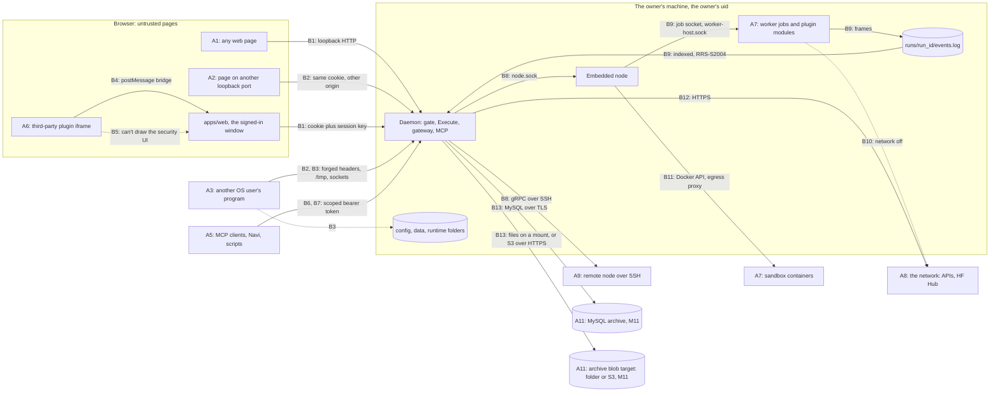

# Threat Model

**Status:** v1, 2026-10-11 (M1-56). Built on spec v5.4 §24 and §28 risk 10, `docs/architecture/contracts.md` v1.2, ADR-0007, ADR-0015, ADR-0031, ADR-0034, ADR-0035 and ADR-0037, and on the code on `main` when this file landed. Every mitigation was checked against the merged code where it exists and against the layout doc its task is built from where it doesn't (review round 3, 2026-10-12). Every name comes from contracts.md. Reviewed again with M8-E03 (the iframe rows), in M9-E02 (every daemon↔node row, once the SSH boundary exists) and with M11 (the archive rows); plan 7.3, "Threat model reviewed".

Spec §24 says "we own our security now": the in-house protocols (the gateway's auth, MCP, the node protocol) get a threat model, fuzzing and review, and crypto, TLS and SSH are never written in-house. This file is that threat model. For each trust boundary it names the attacker, the mitigations, and the test that proves each mitigation, or the task or epic that will add the test.

## Contents

1. [Conventions](#1-conventions)
2. [Scope and assumptions](#2-scope-and-assumptions)
3. [Assets](#3-assets)
4. [Attackers](#4-attackers)
5. [Trust boundaries](#5-trust-boundaries)
6. [Boundaries, one by one](#6-boundaries-one-by-one): B1 UI↔daemon, B2 other local origins↔daemon, B3 other OS users↔the daemon's files and sockets, B4 plugin iframe↔host bridge, B5 themes and plugin UIs↔the security UI, B6 MCP client↔daemon, B7 scripts and Navi↔gateway, B8 daemon↔node, B9 worker↔node and the run log, B10 plugin module↔network, B11 sandbox↔node, B12 outbound calls, B13 daemon↔archive (M11)
7. [In-house parsers of untrusted input and their fuzz targets](#7-in-house-parsers-of-untrusted-input-and-their-fuzz-targets)
8. [Open risks and their owners](#8-open-risks-and-their-owners)
9. [Keeping this file true](#9-keeping-this-file-true)
10. [Open questions](#open-questions)

---

## 1. Conventions

- **A test on `main`** is written as its file path from the repo root and then its test function, for example `crates/rastai-server/tests/gate.rs` `a_cookie_post_needs_the_session_key`. Every test written that way exists on `main` and passes in `just check` (the PR that adds or changes this file checks it, section 9).
- **A test not built yet** is written as its file or spec name without a folder, with the task or epic that adds it: `mcp_endpoint.rs` (M1-30), `theme.spec.js` (M1-54). A mitigation with no named test names the epic that builds it and its exit test from the plan.
- **Status** is one or more of: "main" (built, with its test on `main`); the id of the task or epic that builds it; "accepted (Rn)" for a risk section 8 accepts; "Phase 2" for a mitigation the prototype doesn't build. "(Rn)" after a task id names the open risk that task closes. When a row has several, a parenthesis or a clause after a semicolon says which part each covers.
- **What counts as a mitigation:** the merged code where it exists; otherwise what the layout doc a task is built from says. A step that only a flow doc or an ADR describes, and that the layout leaves out or contradicts, is not claimed here: the row says what each doc says, and the gap is an open risk in section 8.
- **Codes** like `RRS-C1004` are catalog codes from contracts §10.3. Attackers are A1–A11 (section 4), boundaries B1–B13 (section 6), open risks R1–R28 (section 8).
- **Paths** use the placeholders of contracts §8.1: `<config>`, `<data>`, `<cache>`, `<state>`, `<runtime>`.

## 2. Scope and assumptions

**In scope:** the single-user, local-first product of the prototype: the daemon (`rastai serve`), the embedded and standalone nodes, Python worker jobs and plugin modules, the web app in a browser or the Tauri window, the CLI, the MCP bridge, the gateway's `/v1` endpoints, sandbox containers, and the optional long-term archive (M11).

**What we defend against:** web pages in the user's browser, programs of other OS users on the same machine, the network between the daemon and a remote node or the archive, a remote box that is no longer trustworthy, third-party plugin UIs and themes, MCP clients and scripts holding a scoped token, model-written code in sandboxes, and hostile files and model output fed to our parsers.

**Assumptions** (outside this model; each one that leaves a gap is an open risk in section 8):

1. **The OS user is the unit of trust.** Any process running as the owner's uid can read `owner.token` (it is the owner's file) and drive the daemon. Checks between same-user processes (the job token, the worker socket permissions, the run-log rules) catch bugs, confused deputies and a faulty job; they don't stop a hostile process of the same user (R2).
2. **Plugin Python modules are trusted code** (ADR-0015). Network-off is a guardrail, not a sandbox, and the trust prompt says so. Only third-party plugin **UIs** are untrusted, and they run in sandboxed iframes.
3. **root, the kernel, the browser and the OS keychain are trusted.** Origin and Fetch Metadata are enforced by browsers, so every rule that relies on them is paired with one a non-browser process can't forge (ADR-0034 decision 10).
4. **Crypto, TLS and SSH are borrowed, never written:** rustls, ed25519-dalek and blake3 behind their one wrapper file each (contracts §2.5), and OpenSSH as a child process. This model covers how we use them, not their internals.
5. **The supply chain** (crates, wheels, npm packages, engines) is governed by spec §27, `check-deps`, `cargo deny` and hash-pinned locks, not by this file. No package is installed at runtime (`check-no-pickle` and the cleared job environment, B9).
6. **Tier 1 is Linux.** macOS and Windows are tier 2; their file-mode and socket checks are designed but not built (R7).

## 3. Assets

| Asset | Where it lives | Why it matters | Main protection |
|---|---|---|---|
| `owner.token` | `<config>/auth/owner.token`, mode 0600, 64 lowercase hex characters; the daemon keeps only its BLAKE3 hash | full control of the daemon as the owner | exact mode 0600 or no start (`RRS-C1008`); only a well-formed token is accepted (`RRS-C1010`); never rewritten (B3) |
| Login codes, session cookies and session keys | daemon memory only (hashes); the cookie in the browser (HttpOnly); the key in the web app's memory | a session is the owner | single use, 60 s, sessions bound to the redeeming origin, a request key for every non-GET, 24 h idle expiry (B1, B2) |
| Scoped tokens | `tokens` table in `rastai.db`, BLAKE3 hashes only | least privilege for Navi, scripts and MCP clients | hash lookup, revocation, scope checks per command (B6, B7; M1-27) |
| Identity keys and pins | `<data>/identity/daemon.key`, `<data>/identity/node.key`, `<data>/node/paired_daemons.json`, `<data>/node/ssh_known_hosts` | who may drive a node; who a node is | 0600 key files never replaced, refusal of open modes (`RRS-N0006`), pinned daemon keys (`RRS-N0002`), pinned host keys (B8) |
| Job tokens, node session tokens, the llama-server key | memory; only BLAKE3 of a job token in `job.json`; the llama-server `api_key` in its 0600 `job.json` and, as designed today, in llama-server's process arguments (R19) | a worker's identity and permissions; who may use the loaded Fast-runtime model | hash on disk, 0600 `job.json`, Register before Hello (B9); the llama-server key kept out of process arguments (B7, R19) |
| Conversations and gateway logs | `vault.db` (plaintext until SQLCipher, Phase 2) | the user's private text and token IDs | incognito chats never stored, retention, the data policy, the archive only by opt-in: rows into tables encrypted at rest on the server's disk, vault-class blobs unencrypted in the blob target (B7, B13; R3, R13, R21) |
| Secrets | OS keychain (`hf_token`, `adapter.<adapter_name>.api_key`, `archive.mysql`, `archive.objects`, `mysql.<connection_name>`); headless fallback to the kernel keyring or `<config>/auth/secrets.enc`, whose encryption is not designed yet (R25) | money (`gateway.spend`), gated weights, the archive | never in `.rrsproj`, logs, events, the journal or the archive; nodes get short-lived values by purpose (B8, B12) |
| Weights, run folders and the blob store | the HF cache, `<data>/runs/<run_id>/`, `<data>/blobs/` | the user's work; `rastai.db` is rebuilt from them | BLAKE3 names, CRC-framed logs, one writer per log, run-log rules (`RRS-S2004`), no pickle (B9, section 7) |
| The index | `<data>/rastai.db` | every list and status the user sees | one writer thread; a run's log can't change another run's rows (B9) |
| The GPU box itself | the owner's machine and its remote nodes | compute, the user's account, the network it can reach | loopback only by default, no inbound port on nodes, network-off plugin modules and sandboxes (B1, B8, B10, B11) |
| The security UI | the shell's `EgressBadge`, `TrustPrompt`, `PermissionList`, `SignedOutScreen` and severity colors | the user's view of what leaves the machine and what a plugin may do | locked tokens, shell-only components, clipped iframes (B5) |

## 4. Attackers

| Id | Attacker | What it can do | Boundaries |
|---|---|---|---|
| A1 | A web page in the user's browser (any site) | send requests to `127.0.0.1` from the browser, with the user's cookies when the browser attaches them; DNS rebinding (`attacker.test` resolving to 127.0.0.1) | B1 |
| A2 | Another local origin: a page served by another program on another loopback port (a dev server, a notebook, a tunnel to a second daemon) | everything A1 can, plus the daemon's cookie, because browsers send loopback cookies to every port; it may forward requests to the daemon so Host and Origin both name its own port | B2 |
| A3 | A program of another OS user on the same machine | listen on a loopback port the browser visits (and so receive the cookie in request headers), forge any header outside a browser, read other users' process arguments, create files in `/tmp` before we do, connect to sockets and loopback ports it can reach | B1, B2, B3, B7, B8, B9 |
| A4 | A hostile process of the same OS user | read `owner.token` and everything else the user owns | out of scope (assumption 1, R2) |
| A5 | An MCP client, script or agent holding a scoped token, possibly steered by prompt injection | call any command its scopes allow, as often as it likes | B6, B7 |
| A6 | A third-party plugin: its iframe UI, its theme files, its manifest | run script in a sandboxed iframe, send any JSON-RPC message over `postMessage`, ship any theme file, ship a plugin module that tries the network | B4, B5, B10 |
| A7 | A faulty or hostile job: worker code, a plugin module, model-written code in a sandbox | write any bytes to its run's `events.log`, call `WorkerHostService` with its token, try the network, try to escape its container | B9, B10, B11 |
| A8 | A network attacker between the daemon and a remote node, an API provider, the HF Hub or the archive (MySQL, an NFS or SMB blob target, an S3 endpoint) | read and change traffic on the wire, including blob files an NFS or SMB mount carries in clear | B8, B12, B13 |
| A9 | A remote node that is no longer trustworthy (a shared or compromised box the user paired) | send any gRPC message the node side may send, any run-log bytes, any transfer | B8, B9 |
| A10 | Hostile files and model output: model repos, documents, conversation exports, zips, safetensors, GGUF, tool calls in generated text | feed arbitrary bytes to every parser | B6, B7, B12, section 7 |
| A11 | A compromised archive server or blob target, anyone else who can read or write the target folder or S3 bucket, or another of the owner's daemons writing to it (M11) | return any rows, frames and blobs on restore; read what it stores, blob files included; replace or delete blob files after they were verified | B13 |

## 5. Trust boundaries

- Solid arrows carry requests across a boundary; dotted arrows are paths a mitigation closes (an iframe drawing over the shell, a plugin module reaching the network, another user reaching our files).
- The daemon is the only process that holds `owner.token`'s hash, scoped-token hashes, sessions and the keychain. Nodes never hold archive credentials or cloud API keys; they get short-lived values by purpose (B8).
- Nothing listens on a non-loopback interface by default. A remote node opens no port: the daemon starts OpenSSH, which forwards `node.sock` one way and `node-hub-<session_id>.sock` the other (B8).

## 6. Boundaries, one by one

### B1. UI ↔ daemon (loopback HTTP and `daemon.sock`)

**Attackers:** A1 (web pages, DNS rebinding); A3 for the socket.
**What crosses:** Connect calls and blob GETs from the web app over `127.0.0.1:47820` (or the next free port in 47820–47829); CLI calls over `<runtime>/daemon.sock`.
**Design:** ADR-0034, ADR-0007 decisions 1, 2 and 5–10, platform flow 4.1–4.2, contracts §3.2.

| Threat | Mitigation | Proof | Status |
|---|---|---|---|
| The API is reachable from the network | Listeners bind loopback only. `daemon.listen` set to something that isn't an IP address falls back to loopback, never to every interface; a non-loopback address is used only when the owner sets one, with a warning at every start (R4) | `crates/rastai-server/src/daemon.rs` `a_bad_listen_address_falls_back_to_loopback` | main |
| DNS rebinding: `attacker.test` resolves to 127.0.0.1 | Host must be `127.0.0.1`, `localhost` or `[::1]` on any port, else `RRS-C1003`, on every path including unknown ones | `crates/rastai-server/tests/gate.rs` `a_foreign_host_is_refused_whatever_else_the_request_carries`, `dns_rebinding_is_refused_on_every_path`, `the_host_rule_accepts_every_loopback_name`; `crates/rastai-server/src/http/gate.rs` `other_hosts_and_bad_ports_are_refused` | main |
| A cross-site request (CSRF) | Origin, when present, must be `http://` plus Host, else `RRS-C1004`; `null` is refused. The cookie is SameSite=Strict. Every action is a POST to `Execute`, and GET endpoints never change state; the routes are `GET /api/health`, `POST /api/login` and the `CommandService` POSTs (`Execute`, `ListCommands`), whose cookie requests also need the session key | `crates/rastai-server/tests/gate.rs` `an_origin_that_is_not_http_plus_host_is_refused`, `origin_null_is_refused`, `the_cookie_works_only_from_its_origin_and_with_its_key` | main |
| A request with no credential, or a made-up one | No credential, an unknown cookie or an unknown bearer token is `RRS-C1002`. A bearer token is the owner token or a scoped token from `token.create`, both compared by BLAKE3 hash; a scoped token carries only its own scopes, and a revoked one is `RRS-C1006` | `crates/rastai-server/tests/gate.rs` `no_credential_is_refused`, `an_unknown_cookie_is_refused`, `an_unknown_bearer_token_is_refused`, `the_owner_token_works_without_origin_and_with_the_right_one`, `a_scoped_token_carries_its_own_scopes_until_it_is_revoked` | main |
| A header read two ways (smuggling a second Host, Origin or cookie) | A malformed header (not visible ASCII) or one sent twice where only one is allowed is refused with the code of the rule it feeds; two different session cookies are refused | `crates/rastai-server/tests/gate.rs` `a_header_sent_twice_is_refused_with_its_rule`, `a_header_that_is_not_visible_text_is_refused`, `two_different_session_cookies_are_refused_and_a_repeat_is_not`; the `request_gate` fuzz target | main |
| A public path that reaches the API (`/plugins/../api/...`) | Only `/api/health`, plugin UI assets and the web app are public; a path with `..`, `//`, `%` or `\` is never public | `crates/rastai-server/src/http/gate.rs` `public_paths` | main |
| A stolen or guessed login code | 32 random bytes, single use, 60 s, only its hash kept. It is designed to travel in the URL fragment, which browsers never send to servers or put in Referer; no code on `main` builds that URL yet | `crates/rastai-server/src/http/sessions.rs` `a_code_works_once`, `a_code_61_seconds_old_is_refused_and_gone`, `an_unknown_code_is_refused`, `only_hashes_are_kept` | main (the code); M1-31 (the URL; R5 for the code in a browser launcher's arguments), M1-53 (the web app reads the fragment) |
| Script in a page reads the session | The cookie is HttpOnly, SameSite=Strict, Path=/; the session key lives only in the web app's memory, never in a cookie, `localStorage` or `sessionStorage` | `crates/rastai-server/tests/gate.rs` `sign_in_sets_an_http_only_strict_cookie_and_returns_the_key`; `crates/rastai-server/src/http/sessions.rs` `the_cookie_is_http_only_strict_and_named_for_the_daemon`; the web app's boot keeps the key in memory (M1-53) | main (daemon), M1-53 (web app) |
| A session lives forever | Sessions are memory only, dropped after 24 h idle and by any daemon restart (`RRS-U0003` in the UI) | `crates/rastai-server/src/http/sessions.rs` `a_session_idle_for_24_hours_is_gone`, `touching_a_session_keeps_it_alive` | main |
| Script injection into the web app (XSS), which would hold the key | The daemon serves `/` with a CSP header and `index.html` as no-store; model output renders through the in-house Markdown subset, where `<script>` and `javascript:` links are text; plugin UIs never run in the app's origin (B4) | the daemon-serves-`/` CSP test (M1-53); `parse-markdown.test.js` (M3-E09) | M1-53, M3-E09 (R14) |
| The desktop shell leaks the owner token | The shell only runs `rastai open --print-url`; it never reads `owner.token`, makes no HTTP request and does no crypto; it refuses navigation outside the daemon origin | the launch-line and navigation tests and the grep check of ADR-0034 (M1-55) | M1-55 |
| A scoped token or plugin holding `system.admin` becomes the owner: it asks for a login code, redeems it at `POST /api/login`, gets a session (sessions run as the owner) and then creates tokens with any scope | `token.login_code.create` is owner-only: any other principal, dry runs and the owner narrowed to a plugin UI included, is `RRS-C1005` (platform flow 4.1), so no code and no session ever exist for it. `token.create` from anyone but the owner grants only scopes the creator holds. No other command or route on `main` makes a session, a code or a token | `crates/rastai-server/tests/execute_paths.rs` `a_system_admin_token_never_becomes_the_owner_through_a_login_code`, `a_token_hands_out_only_the_scopes_it_holds`; `crates/rastai-server/src/commands/handlers/token.rs` `only_the_owner_may_ask_for_a_login_code`, `only_the_owner_grants_scopes_it_was_not_given` | main |
| An idempotency key replays the answer of another request: the same key with a different secret argument redacts to the same journal text | Requests under a key are compared by `command_journal.arguments_hash`, BLAKE3 of the canonical, unredacted arguments keyed with the owner token's hash (never on disk, so the hash can't be used to test guesses of a secret); a different hash, or a row without one, is `RRS-C0004` | `crates/rastai-server/tests/execute_paths.rs` `the_same_key_with_another_secret_is_c0004_not_a_replay`, `a_keyed_row_stores_a_hash_and_never_the_arguments_it_was_made_from`; `crates/rastai-server/src/commands/journal.rs` `two_secrets_that_redact_alike_are_different_requests` | main |
| A command runs beyond its principal's rights | Every caller ends in `execute_command`: scope check (`RRS-C1005`) before the arguments are read, argument check, journal with secret and content fields redacted | `crates/rastai-server/tests/execute_paths.rs`, one test per branch of platform flow 3.2 (`a_missing_scope_is_c1005_before_the_arguments_are_read` among them); `crates/rastai-server/tests/l0_floor.rs` (every command, as a principal with no scope too) | main |
| `daemon.sock` used by another user | The socket's folder is 0700 and the peer's uid must equal the daemon's, else the connection is closed | `crates/rastai-server/tests/gate.rs` `the_socket_owner_passes_and_another_user_is_refused`, `the_owner_token_and_the_socket_peer_are_credentials`; B3's socket-folder rows | main |
| A browser or tool learns that Rastai runs (fingerprinting) | `/api/health` is public and names versions. Accepted: it holds no secret, and a cross-site `fetch` of it is refused for its Origin | `crates/rastai-server/tests/gate.rs` `health_answers_on_both_listeners_with_the_versions` | main, accepted (R17) |

### B2. Other local origins ↔ daemon (the cross-origin row)

**Attackers:** A2 (a page on another loopback port, in the user's browser), A3 (a non-browser program of another user that receives the cookie).
**Why it is its own boundary:** browsers don't isolate cookies by port. The Host rule must accept any loopback port, because an SSH tunnel forwards a different local port, so "Origin equals `http://` plus Host" alone can't tell the page that signed in from another loopback page whose requests reach the daemon through a forwarder (ADR-0034, Context).

| Threat | Mitigation | Proof | Status |
|---|---|---|---|
| A page on `127.0.0.1:9000` forwards requests to the daemon with the user's cookie; Host and Origin both say 9000 | **Sessions are bound to the origin that redeemed the login code.** `POST /api/login` must carry Origin, and the session records it; a cookie request with any other Origin is `RRS-C1004`, whatever its Host | `crates/rastai-server/tests/gate.rs` `a_cookie_redeemed_at_47820_is_refused_from_another_port`, `the_cookie_works_only_from_its_origin_and_with_its_key` | main |
| The same, through an SSH tunnel the user opened on purpose | A login through the tunnel binds the session to the tunnel's origin, so the remote UI works on any free local port | `crates/rastai-server/tests/gate.rs` `a_tunnel_on_another_local_port_signs_in_there`, `a_session_works_on_any_loopback_port_it_was_redeemed_on` | main |
| A login without Origin binds a session to nothing | `POST /api/login` without Origin is `RRS-C1004`, and the code still works afterwards | `crates/rastai-server/tests/gate.rs` `a_login_without_origin_is_refused_and_its_code_still_works`, `a_login_without_origin_is_refused_and_the_code_still_works`, `a_login_with_its_origin_passes_the_gate_with_no_principal` | main |
| `` on another loopback port sends a cookie GET with no Origin | A cookie request without Origin passes only for GET or HEAD with `Sec-Fetch-Site` `same-origin` or `none`; `same-site`, `cross-site` or none at all is `RRS-C1004`; any other method without Origin is `RRS-C1004` | `crates/rastai-server/tests/gate.rs` `a_cookie_get_without_origin_passes_only_from_the_same_origin_or_a_typed_url`, `a_cookie_post_without_origin_is_refused` | main |
| A non-browser program of another user receives the cookie (it listens on a port the browser visits) and replays it with a forged Origin and `Sec-Fetch-Site` | **Every cookie request other than GET or HEAD needs `Rastai-Session-Key`**, 32 random bytes returned only in the login response body and kept only in the web app's memory; missing or wrong is `RRS-C1002`. The program never sees the key | `crates/rastai-server/tests/gate.rs` `a_cookie_post_needs_the_session_key` | main |
| The same program fetches a blob by cookie alone | Allowed by design: blob and static-file GETs need the cookie only. A blob hash is 256 bits and can't be guessed; the program could fetch only a blob whose hash it already knows. Bounded by the 24 h idle expiry and any restart | `crates/rastai-server/tests/gate.rs` `a_cookie_get_of_a_blob_needs_no_key` (the allowed side) | main, accepted (R1) |
| A page on another origin calls `Execute` in a real browser | As above, end to end | Playwright: a page on another origin can't call `Execute` (M1-54) | M1-54 |
| A webview that sends no Fetch Metadata | Fails closed (`RRS-C1004` on cookie GETs without Origin); the desktop smoke test checks that the Tauri webview sends `Sec-Fetch-Site` | the desktop smoke test (M1-55; a manual check on WebKitGTK) | M1-55 |
| Cross-origin browser clients (third-party web UIs) | Refused in v1: no CORS, no origin allowlist. The two Phase 2 routes (daemon-hosted UIs on the daemon's origin, an origin allowlist with pairing) are not built | the rows above | main |

### B3. Other OS users ↔ the daemon's files and sockets

**Attackers:** A3 (another user's program on the same machine).
**What crosses:** the files in `<config>`, `<data>` and `<runtime>`, and the Unix sockets in `<runtime>`. Without `XDG_RUNTIME_DIR` the runtime folder is `/tmp/rastai-<uid>`, in a folder every user can write to.

| Threat | Mitigation | Proof | Status |
|---|---|---|---|
| Another user reads or replaces `owner.token` | Any mode other than exactly 0600 stops the start with `RRS-C1008` and the fix `chmod 600 <path>`, before a database opens or a listener binds; the daemon never rotates or rewrites the file, so a replaced token is noticed, not hidden. The mode is read from the opened file, not the path | `crates/rastai-server/tests/startup.rs` `a_token_others_can_read_refuses_the_start_until_it_is_deleted`, `a_group_writable_token_refuses_the_start_too`; `crates/rastai-server/src/auth_files.rs` `any_mode_but_0600_is_rrs_c1008` | main |
| A weak or planted token (empty, short, hand-edited) | Only 64 lowercase hex characters with at most one newline are a token; anything else, an unreadable file or a folder at the path is `RRS-C1010`, and no listener binds | `crates/rastai-server/src/auth_files.rs` `only_64_lowercase_hex_characters_and_one_newline_are_a_token`; `crates/rastai-server/tests/startup.rs` `a_token_that_cant_be_read_refuses_the_start` | main |
| The first write of the token is readable for a moment, or a planted link redirects it | The new token goes to a temporary file created 0600 with `create_new` (a file or link already there is refused), then synced and renamed; a leftover temporary file is removed, never reused; the `auth` folder is created 0700 | `crates/rastai-server/src/auth_files.rs` `the_temporary_file_is_private_from_the_moment_it_exists`, `the_first_write_is_atomic_private_and_leaves_no_temporary_file`, `a_temporary_file_left_by_a_crash_is_replaced_not_reused`; `crates/rastai-server/tests/startup.rs` `the_first_start_writes_a_private_token_and_daemon_port_and_is_healthy_within_a_second` | main |
| Another user creates `/tmp/rastai-<uid>` first, or plants a link at `daemon.lock` | The runtime folder is created 0700 and refused unless it is a real folder owned by this user and closed to group and others; `daemon.lock` must be a regular file, never a link (`RRS-S0007`, nothing written) | `crates/rastai-store/src/data_dir_lock.rs` `the_runtime_folder_is_created_private`, `a_runtime_folder_open_to_others_is_refused`, `a_symlinked_runtime_folder_is_refused`, `a_runtime_folder_of_another_user_is_refused`, `a_symlinked_daemon_lock_is_refused_and_its_target_left_untouched` | main |
| A second daemon on the same data | The daemon lock is an exclusive OS lock held for the daemon's life (`RRS-S0001`) | `crates/rastai-server/tests/startup.rs` `a_second_daemon_on_the_same_folders_is_refused_and_the_lock_is_freed_by_a_clean_stop` | main |
| A planted socket folder catches our sockets, or another user connects | `bind_local_socket` and `connect_local_socket` refuse a socket folder that another user owns, that group or others can use, or that is a link or a file (`RRS-N2005`); both ends check that the peer is the same user, root included; a live socket is never taken over and a file that isn't a socket is never deleted | `crates/rastai-transport/tests/local_socket.rs` `a_socket_folder_others_can_enter_is_refused_on_both_ends`, `a_symbolic_link_to_a_private_folder_is_refused_on_both_ends`, `a_live_socket_is_not_taken_over`, `a_file_that_isnt_a_socket_is_never_deleted`; `crates/rastai-transport/src/local_socket.rs` `accepting_refuses_a_client_of_another_user_and_closes_it`, `connecting_refuses_a_server_of_another_user_and_closes_it`; `crates/rastai-transport/src/peer.rs` `a_peer_of_another_user_is_refused_with_both_ids`, `root_is_another_user_too`; `crates/rastai-transport/tests/grpc_local.rs` `a_socket_folder_others_can_enter_is_refused_before_connecting` | main |
| Another user reads or replaces a node or daemon key, or edits `paired_daemons.json` | Key files hold a 32-byte seed, mode 0600, created through a private temporary file and a hard link that fails if a key exists; a key that is open to group or others, the wrong size or unreadable is `RRS-N0006` and is never replaced (a new key is a new node id); `paired_daemons.json` that others can write is refused | `crates/rastai-node/src/identity.rs` `a_key_others_can_read_is_refused`, `a_key_of_the_wrong_size_is_refused_and_left_alone`, `a_new_key_is_saved_private_and_loads_back_the_same`, `creators_racing_for_one_key_all_get_the_key_on_disk`; `crates/rastai-node/src/handshake.rs` `a_pin_file_others_can_change_is_refused` | main; `daemon.key` itself is loaded from M1-47 |
| Another user reads a job's token or the llama-server key from disk | Only BLAKE3 of the job token is on disk; `job.json` (which holds a `serve_fast` job's `api_key`) is written 0600 through a temporary file and a rename | the job supervisor tests (M1-43) | M1-43 |
| Another user reads the llama-server key from process arguments | Not mitigated by the current design: contracts §3.1 and §3.2 and node layout 7.8 pass the key as `--api-key <key>`, which any user can read in `/proc/<pid>/cmdline` while the server runs, so the 0600 `job.json` doesn't protect it. The fix is B7's argument row | B7 (M3-E05) | M3-E05 (R19) |
| Another user reads the secrets fallback file | Not designed yet. `<config>/auth/secrets.enc` is used only on headless Linux without a keychain service or kernel keyring (`RRS-S4001`), and contracts §8.5 and platform flow 1.4 call it "an encrypted file", but no doc names its key, its cipher, the borrowed crate that encrypts it or its file mode. A key the daemon reads without the user is readable by the same user (assumption 1), so against other users the protection would be the file mode, which no doc sets | the secrets tests (M2-18) | M2-18 (R25) |
| Another user reads a login code from process arguments | Not mitigated yet: the code is single use and lives 60 s, but `rastai open` hands it to the browser launcher's arguments (R5) | none yet; M1-31 builds `rastai open` and decides (open question 3) | M1-31 (R5) |

### B4. Plugin iframe ↔ host bridge

**Attackers:** A6 (a third-party plugin's UI, running script in its iframe).
**What crosses:** JSON-RPC 2.0 over `postMessage` (contracts §4.8), MCP Apps method names. First-party UI runs in-process and is trusted.
**Design:** ADR-0015, frontend layout 10.5, contracts §3.1 (plugin UI iframe row).

| Threat | Mitigation | Proof | Status |
|---|---|---|---|
| The iframe calls the daemon directly with the owner's cookie | `<iframe sandbox="allow-scripts">` with no `allow-same-origin`: an opaque origin with no cookies; the daemon refuses Origin `null` | `crates/rastai-server/tests/gate.rs` `origin_null_is_refused`; `plugin-iframe.spec.js`: no cookies, no network from the iframe (M8-E03) | main (gate), M8-E03 |
| A plugin page opened top-level (a link in model output, `ui/open-link`) runs with the daemon's origin and scripts the app | Every `/plugins/*/ui/*` response carries `Content-Security-Policy: sandbox allow-scripts; default-src 'none'; ...; connect-src 'none'` and `Cross-Origin-Opener-Policy: same-origin`, so the document is opaque even top-level | `plugin-iframe.spec.js`, including the top-level case (M8-E03) | M8-E03 |
| The iframe calls commands outside its grant | The bridge host checks the command's scope against the plugin's `commands:[scopes]` (`RRS-P2004`), then sends `ExecuteRequest.acting_plugin_id`, which only narrows the owner's principal to the grant; the daemon checks again and journals the plugin principal | `plugin-iframe.spec.js` allowed and refused calls (M8-E03); `crates/rastai-server/tests/execute_paths.rs` `an_acting_plugin_narrows_even_the_owner` | main (the daemon's narrowing); M8-E03 |
| Another window or frame posts as the plugin | Only messages whose `event.source` is this iframe's `contentWindow` are read; replies go only to that window | `plugin-iframe.spec.js` (M8-E03) | M8-E03 |
| Malformed or flooding messages | Messages up to 1 MiB (`RRS-P4103`), at most 32 calls in flight (`RRS-P4102`), `ui/initialize` within 10 s (`RRS-P4104`), malformed JSON-RPC is `RRS-P4101` | the bridge host's seeded mutation test in vitest (section 7; M8-E03) | M8-E03 |
| Subscribing to events it may not see | `rastai/subscribe` only for event types its permissions allow; content-bearing events (`chat.token`, `conversation.changed`, `psychology.packet`, `gym.peek_step`) need `conversations.read` | `plugin-iframe.spec.js` (M8-E03) | M8-E03 |
| A link that phishes | `ui/open-link` shows a confirmation with the full URL; the shell's navigation guard opens it outside the app | `plugin-iframe.spec.js` (M8-E03); the navigation test (M1-55) | M1-55, M8-E03 |
| A plugin asks for more after install | Any network or data permission shows the trust prompt; an archive changed after the prompt is refused (`RRS-P2003`); an update that adds permissions asks again | the install pipeline tests (M8-E02) | M8-E02 |
| Before M8, a plugin contributes something the host can't contain yet | Capabilities the host doesn't provide (`ui.theme@1`, `ui.icon_set@1`, `ui.macro@1` and `inference.chat_template@1` before M8, `ui.locale@1` and `assistant.skill@1` until Phase 2) are refused with `RRS-P1002`, and a contribution without its capability with `RRS-P0006` | `crates/rastai-server/tests/plugin_host.rs` `negotiation_table`, `a_theme_is_refused_by_name_until_m8`, `each_fixture_ends_in_its_state_and_the_daemon_keeps_running` (`fixtures/plugins/theme/`) | main |

### B5. Themes and plugin UIs ↔ the security UI (owner decision N7)

**Attackers:** A6 (a theme file, a theme plugin, a plugin UI), and anything that would restyle or imitate the shell.
**What is protected:** the egress badge, the trust prompt, the permission list, the signed-out screen and the error severity colors. A theme or plugin UI that could hide the egress badge, recolor an error as success, or draw a fake trust prompt would defeat spec §24's promises.
**Design:** contracts §5.6 (locked security-UI tokens), frontend layout 2.10 and 10.5, spec §7 and §24.

| Threat | Mitigation | Proof | Status |
|---|---|---|---|
| A theme sets a locked color (makes the egress badge invisible, an error green) | Locked tokens (`--rr-locked-severity-error`, `--rr-locked-severity-warning`, `--rr-locked-severity-info`, `--rr-locked-egress`, `--rr-locked-egress-text`, `--rr-locked-security-surface`, `--rr-locked-security-text`, `--rr-locked-security-danger`) are not theme keys: a `rastai.theme/1` file that names one anywhere fails validation with `RRS-E1003` (unknown field); color roles are struct fields, so no free map can carry one | `crates/rastai-formats/tests/theme_tokens.rs` `every_locked_token_as_a_color_is_an_unknown_field`, `a_locked_token_anywhere_else_is_an_unknown_field_too`, `a_css_variable_name_or_a_misspelled_role_is_not_a_role` | main |
| A theme object reaching `applyThemeTokens` carries locked names anyway | `applyThemeTokens` always sets the `--rr-locked-*` variables last, from `LOCKED_TOKENS` (`@rastai/ui/src/tokens/locked.js`), never from the theme | `tokens.test.js`: a theme object carrying locked names leaves the locked variables unchanged (M1-51); `security.test.jsx`: screenshots of the four security components under both built-in themes and a hostile theme that sets every role to one color don't change (M1-51, frontend layout 4.5); `theme.spec.js`: light, dark, `system` and compact density restyle the shell and no `--rr-locked-*` variable changes (M1-54) | M1-51, M1-54 |
| A component hard-codes a color that bypasses the tokens | No color literal in frontend source outside `packages/ui/src/tokens/` (`check-colors`) | `tools/checks/tests/test_check_colors.py` `test_every_kind_of_color_literal_fails`, `test_the_same_color_in_the_token_folder_passes`, `test_the_real_repository_passes` | main |
| A plugin UI renders a fake `TrustPrompt` or `EgressBadge` | The security components are exported only from `@rastai/ui/security`, which `check-imports` allows only under `apps/web/src/`; `rastai plugin lint` refuses the import in a plugin | `tools/checks/tests/test_check_imports.py` `test_each_javascript_rule_fails` (the `plugins/psychology/ui/src/Live.jsx` case importing `TrustPrompt`); `rastai plugin lint` (M8-E04) | main, M8-E04 |
| A third-party UI built without our packages imitates the security UI | Third-party UIs run only in iframes clipped to their panel; the egress badge sits in the status bar outside every panel and the trust prompt is a modal the shell renders above all panels, so an iframe can neither cover nor stand in for them | `plugin-iframe.spec.js`: a plugin UI can't render or cover the security UI (M8-E03) | M8-E03 |
| A plugin UI learns the locked values to copy them exactly | `ui/initialize` and `rastai/theme_changed` carry the resolved tokens without any `--rr-locked-*` value | `plugin-iframe.spec.js` (M8-E03) | M8-E03 |
| A theme plugin is unreadable (low contrast hides text) | From M8 the daemon runs the accessibility check (WCAG 2.2 AA) on a theme plugin before the picker offers it; until then plugin themes are refused (`RRS-P1002`) | `crates/rastai-server/tests/plugin_host.rs` `negotiation_table`; the theme plugin tests (M8-E06) | main (refused); M8-E06 |
| A user stylesheet restyles the security UI | No user stylesheet in the prototype; Phase 2 adds an unsupported one with the security UI in closed shadow roots | none until Phase 2 | Phase 2 |

### B6. MCP client ↔ daemon

**Attackers:** A5 (an MCP client or agent with a scoped token, possibly steered by prompt injection), A10 (bytes from a misbehaving client).
**What crosses:** newline-delimited JSON-RPC on the `rastai mcp` bridge's stdin, forwarded as `POST /mcp` over `daemon.sock`; or MCP Streamable HTTP on `/mcp` directly.
**Design:** platform flow 4.3, control-plane layout §7.

| Threat | Mitigation | Proof | Status |
|---|---|---|---|
| An agent gets the owner's rights by default | `rastai mcp` without `RASTAI_TOKEN` answers every request with `RRS-C3002` and never contacts the daemon; it never falls back to the owner token | `crates/rastai-mcp/tests/bridge.rs` `without_a_token_every_request_gets_rrs_c3002_and_the_daemon_is_never_contacted` | main |
| A malformed or ambiguous message reaches the daemon | `parse_message` is strict: text over 4 MiB is refused before parsing; the strict JSON reader (no duplicate keys, depth and value caps); no batch arrays; `jsonrpc` must be `"2.0"`; ids are integers or strings; `params` is an object; unknown members are refused. Every refusal is `RRS-C3001`. The bridge parses every line first, so the daemon sees only whole, re-written messages | `crates/rastai-mcp/src/jsonrpc.rs` `oversize_text_is_refused_before_parsing`, `batch_arrays_are_refused`, `wrong_members_are_refused_with_the_id_when_it_was_read`, `ids_that_are_not_whole_numbers_or_strings_are_refused`; `crates/rastai-mcp/tests/bridge.rs` `malformed_lines_are_answered_by_the_bridge_with_rrs_c3001`; `crates/rastai-mcp/src/bridge.rs` `a_line_over_the_limit_is_skipped_and_the_next_one_read`; the `jsonrpc_decode` fuzz target | main |
| An agent sees or calls tools beyond its scopes | `tools/list` shows only the commands the principal may run; tools work only after `initialize`. `rastai-mcp` never runs a command: `tools/call` comes back to the daemon, which is designed to run it through `execute_command` as the token principal, where the scope check and the journal apply; `execute_command` is on `main`, but the `/mcp` endpoint that hands calls to it lands with M1-30, so the transcript test replays its refusal from a fixture | `crates/rastai-mcp/src/server/tools.rs` `tools_are_the_commands_the_principal_may_run`; `crates/rastai-mcp/tests/server_transcripts.rs` `tools_list_shows_what_mcp_default_may_run`, `a_call_outside_the_scopes_gets_the_refusal_of_execute_command`; `crates/rastai-mcp/src/server/handle.rs` `ping_works_before_initialize_and_tools_do_not`, `call_arguments_must_be_an_object`; `crates/rastai-server/tests/execute_paths.rs` and `mcp_endpoint.rs` (M1-30) | main (the tool list, the hand-off, the scope check and the journal); M1-30 (the HTTP glue) |
| `/mcp` without the request gate | `/mcp` goes through the same gate as every path (Host, Origin, credential) before `rastai-mcp` sees it; a gate refusal keeps its code through the bridge | `crates/rastai-mcp/tests/bridge.rs` `a_refusal_from_the_request_gate_keeps_its_code`; `mcp_endpoint.rs`: tools filtered by the token's scopes, a call journaled with the token principal (M1-30) | main (gate), M1-30 |
| A guessed MCP session | `Mcp-Session-Id` is random; a lost session after a restart answers 404 and the bridge replays `initialize` once | `crates/rastai-mcp/src/server/session.rs` `a_new_session_has_a_random_id_and_no_revision`; `crates/rastai-mcp/tests/bridge.rs` `a_lost_session_after_a_daemon_restart_replays_initialize_once_and_retries` | main |
| A token is pasted into a shared config | "Copy as MCP" writes the client config with a placeholder, never a real token; tokens are shown once at `token.create`, stored as BLAKE3 hashes, and revocable (`RRS-C1006` on the next request, open streams closed) | the copy-as golden (M1-54); `crates/rastai-server/tests/execute_paths.rs` `a_new_token_never_reaches_rastai_db`, `a_revoked_token_is_refused_and_listed_only_when_asked`, `tokens_still_work_after_a_restart` | main (shown once, hashed, revocable); M1-28 (open streams closed); M1-54 (copy-as) |
| A prompt-injected agent misuses the scopes it was given | Presets leave out `gateway.spend` and `conversations.read`; every call is journaled with its principal; the owner revokes. Beyond that, an agent's own judgement is outside Rastai's control | the three-surfaces test (M1-49) | M1-49, accepted (R16) |

### B7. Scripts and Navi ↔ gateway (`/v1`)

**Attackers:** A5 (a client with a `chat-only` or custom token), A10 (model output, provider responses), A3 (another user's program that reads llama-server's key and calls its loopback port directly, past the gateway).
**Design:** platform flow 4.3, node layout §6, inference flows.

| Threat | Mitigation | Proof | Status |
|---|---|---|---|
| A chat client spends money or reads stored conversations | `/v1/*` goes through the gate, then the gateway checks `chat`, plus `gateway.spend` for a paid API adapter (`RRS-C1005`); `conversations.read` is never in a preset | `navi_chat.rs`; a `chat-only` token gets `RRS-C1005` on `train.start` (M3-E07) | M3-E07 |
| A revoked token keeps streaming | Revocation applies on the next request and closes the token's open streams with `RRS-C1006` | the revoke-mid-stream e2e test (M3-E07) | M3-E07 |
| An incognito chat is stored | Incognito conversations never reach any table | `chat.spec.js`: incognito never stored (M3-E09) | M3-E09 |
| Data leaves the machine silently | The project data policy (`local-only` by default) refuses API chats with `RRS-C1009`; the egress badge shows every outbound transfer in locked colors | the `RRS-C1009` refusal (M3-E08); `chat.spec.js` badge on and off (M3-E09) | M3-E08, M3-E09 |
| Model output parsed as tool calls, or a provider's SSE stream, breaks the parser | In-house parsers with fuzz targets (`tool_call_parse`, `sse_reader`, section 7) | section 7 | M3-E06, M3-E08 |
| llama-server is reachable by other local processes | Loopback only, a random port and a random key per launch, kept in memory and in the 0600 `job.json`; a call without the key is refused, so only the node reaches the model and the gateway's checks can't be skipped (but see the next row) | `fast_runtime.rs` (M3-E05) | M3-E05 |
| Another OS user reads the llama-server key from `/proc/<pid>/cmdline` and calls the server directly (no scopes, no journal, no data policy) | The key never goes in process arguments: the node passes it through a 0600 file (llama-server's `--api-key-file`) or the child's environment, which only the same user can read in `/proc/<pid>/environ`. Contracts §3.1 and §3.2 and node layout 7.8 still say `--api-key`; that wording changes first (open question 5) | `fast_runtime.rs`: llama-server's command line holds no key, and a call without the key is refused (M3-E05) | M3-E05 (R19) |

### B8. Daemon ↔ node (embedded over `node.sock`, remote over SSH)

**Attackers:** A3 (another user reaching a socket), A8 (the network between the daemon and a remote box), A9 (a remote node that is no longer trustworthy).
**What crosses:** gRPC `NodeService` and `SandboxService` (daemon to node), `NodeHubService` (node to daemon), run-log records mirrored from a remote node, transfers.
**Design:** ADR-0011, node layout §4.3 and §7.9, designer-gym-remote flows C1–C7.

| Threat | Mitigation | Proof | Status |
|---|---|---|---|
| A process of another user drives the embedded node | `node.sock` lives in the 0700 runtime folder and both ends check the peer is the same user (B3) | B3's socket rows | main |
| An unpaired or forged daemon drives a node | The node accepts only daemon keys pinned in `paired_daemons.json` (`RRS-N0002`). The daemon signs, with Ed25519, a domain-separated, length-prefixed list of the node's id, a nonce of its own (at least 16 bytes), the time and the hub socket path; the node sends no challenge of its own, so freshness rests on the next row's clock and nonce checks | `crates/rastai-node/src/handshake.rs` `an_unpinned_or_forged_daemon_is_refused`, `field_boundaries_change_the_signed_bytes`; `crates/rastai-node/src/identity.rs` `a_signature_verifies_only_for_its_key_and_challenge`; `crates/rastai-node/tests/handshake.rs` `a_pinned_daemon_gets_a_signed_session_and_the_hardware` | main |
| A recorded handshake is replayed | `sent_unix_ms` more than 5 minutes off, or a `daemon_nonce` seen before, is `RRS-N0007`; nonces are checked last, so an unpaired caller can't fill the node's memory of them (10 minutes, at most 4096) | `crates/rastai-node/src/handshake.rs` `a_replayed_or_late_handshake_is_refused`, `a_time_at_either_end_of_the_range_is_stale` | main |
| An incompatible daemon or node | A protocol version the node can't speak is `RRS-N0001`, naming both versions; the daemon offers `node.update` | `crates/rastai-node/src/handshake.rs` `another_protocol_version_is_refused_with_both_versions` | main |
| A caller skips the handshake and uses later calls | The node returns a session token that later calls carry in gRPC metadata. **Not checked yet**: its metadata key is a wire name that lands with the daemon's node link | the daemon's node link (M1-47); checked before any remote node exists (M9-E02) | M1-47 (R6) |
| A network attacker reads or changes node traffic, or impersonates the box | Only OpenSSH crosses the network: `StrictHostKeyChecking=yes` with our own `ssh_known_hosts`, the host key pinned at pairing and never auto-accepted; the Ed25519 handshake proves the node and the daemon on top; the node opens no port | `ssh_loopback.rs` against an sshd container, and a changed host key is refused (M9-E02) | M9-E02 |
| A remote node rewrites another run's history through its mirrored log | A remote run's log is untrusted: the indexer refuses any record that names another run, carries a daemon-only event, takes over another run's checkpoint or rewrites an existing artifact (`RRS-S2004`, B9) | B9's run-log rows | main |
| A remote node writes outside its folders through a transfer | Destinations are limited to `<data>/runs/<run_id>/`, `<data>/blobs/.incoming/`, `<cache>/uploads/` and `<cache>/tokenizers/plugins/`; `..`, absolute paths and paths resolving outside a root are `RRS-N3001`; a hash mismatch deletes the partial file (`RRS-N3003`) | `transfer_resume.rs` (M9-E04) | M9-E04 |
| A node gets cloud or archive credentials | Credentials never leave the daemon; a node gets short-lived values by purpose from `NodeHubService.GetSecret` (`hf_download`, `hf_upload`, `adapter:<name>`, `mysql:<connection_name>`), never archive credentials; the daemon refuses a purpose the job's permissions and `network_hosts` don't match | `secrets.rs`: GetSecret refuses unknown purposes (M2-18); the MySQL reader's credential tests (M5-E07) | M2-18, M5-E07 |
| A local-only project's data reaches a remote box | The one data-policy check refuses remote nodes and transfers for `local-only` projects (`RRS-C1009`) before anything starts | the `RRS-C1009` refusal (M3-E08 builds the check); its remote-node and transfer cases (M9-E04, R18) | M3-E08, M9-E04 |
| A tampered node binary is installed by an update | `UpdateNode` checks an Ed25519 signature by the release key over the binary's BLAKE3; a bad signature is `RRS-N4001` and nothing changes | the update tests (M9-E06) | M9-E06 |
| The handshake parser on bytes from the network | The `handshake` fuzz target: arbitrary requests and signatures never panic and never pair an unknown key | section 7 | M9-E02 |

### B9. Worker ↔ node (job socket, `worker-host.sock`) and the run log

**Attackers:** A7 (a faulty or hostile job: worker code, plugin code, a remote run's log), A9 (a remote node that is no longer trustworthy, whose run logs the daemon indexes), A3 (another user, through B3).
**What crosses:** `WorkerService` on `jobs/<job_id>.sock` (the worker serves), `WorkerHostService` on `worker-host.sock` (the node serves), and the frames a job appends to `runs/<run_id>/events.log`, which the node tails and the daemon indexes.

| Threat | Mitigation | Proof | Status |
|---|---|---|---|
| A process pretends to be a job's worker | `RASTAI_JOB_TOKEN` (32 random bytes) travels only in the environment and gRPC metadata; only its BLAKE3 hash is in `job.json`; the node maps token → job → permissions | the job supervisor tests (M1-43) | M1-43 |
| After a node restart, the node talks to the wrong process (pid reuse) | Register before Hello: the node waits for `WorkerHostService.Register`, checks BLAKE3(token) against `job_token_hash` with the pid, `boot_id` and `process_start_ticks`, and only then calls `Hello`; no Register within 300 s is `lost → failed` (`RRS-J3003`); a group signal re-checks the pid first | `reattach.rs`: a `job.json` pointing at an unrelated live pid is never signaled and ends failed (M1-45); kill -9 rows 1 and 13: a worker with a wrong token is refused (M1-48) | M1-45, M1-48 |
| A job downloads or installs code at run time | The job's environment is cleared and rebuilt: `HF_HUB_OFFLINE=1`, `UV_OFFLINE=1`, `PIP_NO_INDEX=1`, only its leased GPUs visible, `HSA_OVERRIDE_GFX_VERSION` removed; no runtime installs, no pickle | the spawn environment test (M1-43); `check-no-pickle` in `just check` | M1-43, main |
| Two writers interleave one log | The writer holds an exclusive `flock` on the log; a second writer is refused | `python/rastai_worker/tests/test_event_log.py` `test_flock_blocks_a_second_writer`, `test_flock_blocks_a_writer_in_another_process` | main |
| Damaged or crafted frames make the reader panic, read past a frame, or spin | One frame parser (`read_next_frame`); a bad frame before the end is `RRS-S2002`, a gap `RRS-S2003`, a torn tail only ever truncated by the writer; the later-frame search is bounded to 1 MiB of memory and 4 MiB of CRC work | `crates/rastai-store/tests/event_log_fixtures.rs` `appending_to_a_corrupt_or_gapped_log_is_refused_and_changes_nothing`, `a_crafted_tail_cannot_make_the_later_frame_search_slow`, `a_frame_quoted_inside_a_torn_record_is_not_proof`; `python/rastai_worker/tests/test_event_log.py` `test_a_crafted_tail_cannot_make_the_open_slow`, `test_mutated_logs_open_or_fail_with_a_log_code`; the `event_frame` fuzz target | main |
| A job's log changes another run's rows or the daemon's own tables | A run's log is untrusted (contracts §7.1). The indexer checks every record before it writes: it must name the log's run; its payload must be one a run's log may carry; a checkpoint id may not be another run's; an existing artifact may only be repeated exactly; a parent's relation must be one whose child is an artifact. A record that breaks a rule is `RRS-S2004`: nothing of its batch commits, the ack stays before it, and the log counts as damaged there | `crates/rastai-store/tests/indexer_idempotent.rs` `a_run_log_record_of_another_run_changes_nothing`, `a_run_log_carrying_a_daemon_only_event_changes_nothing`, `a_run_log_can_not_take_another_runs_checkpoint`, `a_run_log_can_not_rewrite_an_existing_artifact`, `a_run_log_can_not_give_a_parent_a_relation_outside_its_own`, `a_run_log_can_not_name_another_kind_of_id`, `a_batch_for_a_run_without_a_row_is_refused` | main |
| The live tail skips a refused record and goes on | The tail stops reading that log at the refused record and reports `RRS-S2004` (again after a restart); the rebuild ends that log there and goes on with the next run | the run-tail tests (M1-28; no case named yet, R18); the rebuild report (M1-33) | M1-28, M1-33 |
| A job that never registers lingers, or a second job starts on a run that already has a live one | Register within 60 s or `RRS-J0002` and the group is killed; one live job per run, checked before anything is written into the run folder (`RRS-J3006`) | the job supervisor tests (M1-43) | M1-43 |

### B10. Plugin module ↔ network

**Attackers:** A7 (a plugin module, which is trusted code but should not reach the network without a declared permission), A6 (a third-party plugin's module).
**Design:** contracts §8.8, node layout §7.9 "Plugin modules", ADR-0015.

| Threat | Mitigation | Proof | Status |
|---|---|---|---|
| A module without network permission opens a socket | The node starts it under `unshare --user --map-current-user --net`, a new user and network namespace with no interfaces; its job socket is a file, so it still works | a fixture module with network off can't open a TCP socket (M4-E02) | M4-E02 |
| Ubuntu 23.10+ restricts unprivileged user namespaces | The `.deb` installs the AppArmor profile `tools/release/apparmor/rastai` as `/etc/apparmor.d/rastai`, granting `userns` to the installed `rastai` binary and an inherited exec rule for `unshare` | the release test on a clean Ubuntu 24.04 install starts a module with no network permission (M6-E05) | M6-E05 |
| No namespaces at all (AppImage, other distributions, a removed profile) | `user_namespaces_available` probes before each start. A trusted, preinstalled first-party module (its archive's hash matches the signed `release.json`) runs without the namespace with the warning `RRS-P2005`; a third-party module without network permission is refused with `RRS-P2001` and the fix text, and never runs unisolated | the `RRS-P2005` and `RRS-P2001` cases (M4-E02) | M4-E02, accepted (R10) |
| A module claims to be first party | `is_trusted_first_party` needs the archive in `<install prefix>/share/rastai/plugins/` and its content hash in `release.json`, checked with `RELEASE_PUBLIC_KEY`; a node without the archive treats the module as third party | the preinstalled-archive case (M4-E02) | M4-E02 |
| A module with network permission goes anywhere | It is granted at install by the trust prompt; ordinary worker jobs have no packet filter, so a host list is a permission, not a sandbox | the install pipeline (M8-E02) | M8-E02, accepted (R11) |
| A crash loop | Restarts after 1 s, 5 s, 30 s; a fourth crash within 5 minutes disables the plugin (`RRS-P4003`) | M4-E02 exit test | M4-E02 |

### B11. Sandbox ↔ node

**Attackers:** A7 (model-written code in Agent Gym rollouts and Pass@k samples).
**Design:** ADR-0031, node layout §5.3–5.4.

| Threat | Mitigation | Proof | Status |
|---|---|---|---|
| Sandboxed code reaches the network | `NetworkMode` `none`; with `network_hosts`, only the run's internal network `rastai-egress-<run_id>` (no route out) and the in-house CONNECT proxy, which allows an exact listed host on an allowed port and refuses plain HTTP; if the proxy can't bind, sandbox creation fails with `RRS-R1010` and never falls back to an open network | a container without hosts can't resolve or connect (M5-E10); a sandbox with `network_hosts` reaches a listed host through the proxy and nothing else (M7-E02) | M5-E10, M7-E02 |
| Crafted bytes against the proxy or the exec stream | `connect_request` and `exec_stream` fuzz targets (section 7); the proxy never accepts a host `host_allowed` refuses | section 7 | M5-E10, M7-E02 |
| Resource exhaustion or privilege | CPU, memory (no swap) and pids caps; `CapDrop ALL`, `no-new-privileges`, an init process; the per-node cap (`RRS-R1009`, `RRS-R1001`) and a RAM reserve | create, exec, caps and the cap refusal against Podman (M5-E10) | M5-E10 |
| Sandboxed code reaches Rastai | Containers never see a Rastai socket; workers reach sandboxes only through the node (`WorkerHostService.ExecInSandbox`), exec streams proxied | M5-E10 exit test | M5-E10 |
| Kernel escape | Containers share the host kernel. Accepted on the owner's own box with the network off; a microVM comes later | none: an accepted risk until a microVM (Phase 2+) | accepted (R12) |
| Orphaned sandboxes after a crash | Labels on every container; the orphan sweep removes labeled containers and networks with no live owner | a node killed with sandboxes adopts and sweeps them (M5-E10, M7-E06) | M5-E10, M7-E06 |

### B12. Outbound calls: API providers, the HF Hub

**Attackers:** A8 (the network), A10 (provider responses and downloaded files).

| Threat | Mitigation | Proof | Status |
|---|---|---|---|
| Traffic is read or changed | HTTPS through rustls only (`rastai-transport`); no in-house TLS | the HTTPS client tests (M2-14); adapters against a mock API over local TLS (M3-E08) | M2-14, M3-E08 |
| An API key leaks | Read from the keychain per request, never written to logs, events, the journal or `.rrsproj` | secret fields redacted in the journal (`crates/rastai-server/src/commands/journal.rs` tests, `execute_paths.rs` `a_new_token_never_reaches_rastai_db`); a missing key is `RRS-G2001` (M3-E08) | main (the journal); M3-E08 |
| A downloaded weight file is swapped or hostile | LFS files are checked against their SHA-256; weights are safetensors only, the header checked by `read_safetensors_header_length` and `check_safetensors_header` before any tensor byte is read; no pickle (`check-no-pickle`); the compat runtime passes `trust_remote_code=False` and `use_safetensors=True` | `downloads.rs` (M2-17); the 33-file safetensors corpus (M1-34); the compat runtime tests (M6-E12) | main (`check-no-pickle`, M1-34), M2-17, M6-E12 |
| A download leaks a gated-model token | The HF token comes from `GetSecret` (`hf_download`) for that job only and is never written down | `downloads.rs` (M2-17) | M2-17 |

### B13. Daemon ↔ archive (M11)

**Attackers:** A8 (the LAN between the daemon and MySQL or the blob target), A11 (a compromised archive server or blob target, anyone else with access to the target folder or bucket, or another daemon writing to it).
**What crosses:** rows over the MySQL protocol (`mysql.rs`, `mysql_async`'s own TLS socket); blob files written to a mounted folder (NAS, USB, NFS, SMB), and later S3 requests over `rastai-transport` HTTPS (contracts §3.2, the archive blob target row).
**Design:** ADR-0035 decision 5, contracts §8.7, platform flow 8.5–8.12, Rust control plane layout 14.4–14.9. Where the flow and the layout disagree, the layout is what M11-E04 and M11-E05 are built from, so only it counts as a mitigation here (section 1).

| Threat | Mitigation | Proof | Status |
|---|---|---|---|
| Archive traffic is read or changed | TLS off loopback and Unix sockets: `tls.mode` `disabled` is refused for any other host (`RRS-S5003`). That stops reading on the wire, not an attacker who stands in for the server: `MysqlConnection.tls.mode` is `required`, `verify_identity` or `disabled` (contracts §5.2), and no doc says which is the default or whether `required` checks the server's certificate, which in MySQL's own terms it doesn't (R24) | `refusals.rs`: no TLS off loopback is `RRS-S5003` (M11-E02); `mysql_connection.rs`'s `disabled` table (M5-E07) | M5-E07, M11-E02; checking who answers open (R24) |
| Conversation rows end up in the archive unprotected | Off by default; per project with `archive.include_conversations`; never for `local-only` projects; only into tables that report encryption (`RRS-S5004`). That encryption is at rest on the server's disk: any MySQL user with `SELECT` on the archive reads the rows, every daemon's own user included (R13). This covers the rows only; vault-class blobs are the next row | conversations go only for opted-in projects, and a table without encryption is `RRS-S5004` (M11-E03) | M11-E03 |
| Vault-class blobs (snapshots derived from conversations) sit in plaintext on the blob target | The same opt-in as conversation rows (`archive.include_conversations`, never for `local-only` projects); stored apart under `vault/<source_id>/ab/<hash>` and listed in `vault_blob_links`, so `conversation.delete` and `archive.purge` find them. Nothing encrypts them: the folder target is meant to be readable without Rastai, and no encryption check like `RRS-S5004` applies to it | `folder_target.rs`: vault-class objects land under `vault/<source_id>/` (M11-E04); `delete_propagation.rs`: after `archive.purge` the objects are gone (M11-E03) | M11-E03, M11-E04; plaintext at rest open (R21) |
| Someone else reads or rewrites the folder target, or reads it on the wire | Folder permissions are the only access control, and NFS or SMB usually crosses the LAN in clear; `RRS-S5003` is about MySQL only. Integrity on write: platform flow 8.8 and the control plane layout 14.7, which M11-E04 is built from, now agree (R23). Every object is reopened and hashed with BLAKE3 after the rename, and an object already on the target is read back and hashed, before its `blob_objects` row is written; a mismatch deletes the object with `RRS-S5007` and writes no row, so wrong bytes at `ab/<hash>` (planted, damaged, or left by another writer) never get a verified row. Both docs still skip the upload when a verified `blob_objects` row already exists, without looking at the object (R23). A restore checks BLAKE3 before it uses a byte (`RRS-S5007`), so bad bytes are never used, only lost. `archive.verify` re-hashes objects later, and a mismatch clears the row's `verified_unix_ms` (layout 14.8), so prune stops counting on that object. Confidentiality and availability after a prune are the share's | `restore.rs`: a flipped blob byte is `RRS-S5007` (M11-E05); `folder_target.rs`: object before row, a target that flips a byte on write, and an object already on the target with wrong bytes (M11-E04); `prune.rs`: `archive.verify` after a byte flip on the target (M11-E05) | M11-E04 (integrity on write); M11-E05 (the restore check and `archive.verify`); the verified-row skip: open question 8, with M11-E05 (R23); reading the share and deleting objects after a prune open (R22) |
| An S3 target's traffic or keys leak, or a request is forged | HTTPS through rustls only (`rastai-transport`, egress tag `archive`); requests signed with in-house SigV4 (`objects/sigv4.rs`) using the HMAC-SHA256 `rastai-transport` exposes from the rustls crypto provider (no in-house crypto primitive, no new crate); the access key and secret live only in the keychain account `archive.objects`. How they get there differs by doc: contracts §6.5 has `archive.configure` take them as `secret` arguments, while platform flow 8.5 says they go in through `secret.set` like the MySQL password and never pass through `archive.configure`; either way the journal row holds `<redacted>` | `s3_target.rs`: SigV4 matches AWS's published test vectors, and objects round-trip through MinIO (M11-E04) | M11-E04 |
| A lost machine's credentials read or damage the archive | Each daemon has its own revocable MySQL user (password in the keychain account `archive.mysql`) with no `DELETE` on the run tables. Its grants (platform flow 8.5: select, insert, update, create and alter, and delete on the conversation tables and `blob_objects`) still let it read every source's rows, conversations included; overwrite rows through upserts; delete conversation rows and `blob_objects` rows; and write rows under any `source_id`, which the writing daemon sets, so the column shows what an honest daemon wrote and audits nothing against a hostile one. A lost machine's user must be revoked at once | the `GRANT` lines the configure plan shows (platform flow 8.5; no test named yet, R18) | M11-E02; accepted for the writes, reading other sources' rows open (R13) |
| Purge rights are kept around | `archive.purge` takes MySQL admin credentials as a `secret` argument for that one call, never stored or journaled (`RRS-S5010` without them) | `delete_propagation.rs`: purge without admin credentials is `RRS-S5010` (M11-E03); the archive page asks for them each time and never stores them (M11-E06) | M11-E03, M11-E06 |
| A compromised archive feeds back crafted frames, blobs or rows on restore | Restored frames are indexed through `ApplyRunEvents`, the live path, so B9's run-log rules keep each one inside its own run; the `archived_frame` fuzz target covers the frame reader. Every frame's CRC-32 is checked (`RRS-S5008`), which catches damage, not a crafted frame with a matching CRC. Every restored blob is checked against its BLAKE3 (`RRS-S5007`), which detects tampering when the hash comes from the local index (a pruned run's stub), not when it comes from the archive (restoring everything one `source_id` archived onto a new machine). `run.json` passes `read_document` before it is written, and the stub rows of the rebuild's last step (`RestoreRequest::PrunedRunRows`) pass the id-kind and own-run checks `ApplyRunEvents` applies (layout 14.8); restored conversations and archive-sourced hashes are taken as the archive gives them (R26) | `restore.rs`: a flipped frame byte is `RRS-S5008`, a flipped blob byte `RRS-S5007`, a crafted `run.json` and a stub row naming another run's id are refused (M11-E05) | M11-E05; trusted rows open (R26) |
| Nodes reach the archive | Only the daemon talks to the archive; nodes never get archive credentials (`archive.mysql` and `archive.objects` are never a GetSecret purpose) | `secrets.rs`: GetSecret refuses unknown purposes (M2-18) | M2-18 |
| Data leaves the machine silently | The data policy applies to the archive (`RRS-C1009`); the egress badge shows `egress.active` (purpose `archive`) during a sync | `refusals.rs`: a local-only project is skipped with `RRS-C1009`; the badge shows during a sync (M11-E02 exit test) | M11-E02 |

## 7. In-house parsers of untrusted input and their fuzz targets

Every in-house parser of bytes that cross a boundary has a fuzz target, or a row saying which task or epic adds it (contracts §12.5, ADR-0037). Rust targets are cargo-fuzz targets in `crates/<crate>/fuzz/fuzz_targets/`, run by `just fuzz <crate> <target>` and by `nightly.yml` for 10 minutes each. Python and JavaScript parsers have seeded mutation tests instead (no fuzzing dependency): pytest tests marked `fuzz`, and vitest tests.

| Parser | Owner | Reads bytes from | Fuzz target or mutation test | Status |
|---|---|---|---|---|
| Strict JSON reader `read_json` | `rastai-formats` | every document, MCP message, Connect JSON body, theme file (A6, A10) | `json_reader` | main (M1-14) |
| `read_document` (layers 1–3) | `rastai-formats` | user and plugin documents (A6, A10) | `read_document` | main (M1-15) |
| `decode_base32` | `rastai-core` | ids and node ids in files and requests | `base32_decode` | main (M1-20) |
| `parse_rfc3339` | `rastai-core` | timestamps in user files | `rfc3339_parse` | main (M1-20) |
| `read_next_frame`, with its in-house walk of a cut-off record's protobuf fields (`event_log/frame.rs`) | `rastai-store` | run logs written by jobs and mirrored from remote nodes (A7, A9) | `event_frame` | main (M1-24) |
| Event-log open for append | `rastai_worker` (Python) | a log left by a crashed or hostile writer (A7) | `python/rastai_worker/tests/test_event_log.py` `test_mutated_logs_open_or_fail_with_a_log_code` | main (M1-39) |
| CSV and JSONL readers | `rastai_data` (Python) | dataset files (A10) | `python/rastai_data/tests/test_reader_mutations.py` `test_mutated_fixtures_give_rows_or_data_error` | main (M1-36) |
| `read_request_head` and `check_request_gate` | `rastai-server` | any process or page reaching the loopback port (A1, A2, A3) | `request_gate` | main (M1-26) |
| Connect JSON codec (`http/connect_json.rs`) | `rastai-server` | Connect JSON request bodies over HTTP (A1–A5) | `connect_json` (which also runs `check_arguments` on every `arguments_json` it decodes) | main (M1-26 part 2; the `Execute` and `ListCommands` endpoints read bodies with it since M1-27) |
| `parse_message` (JSON-RPC) | `rastai-mcp` | MCP clients (A5) | `jsonrpc_decode` | main (M1-29) |
| In-house semver `parse_version` and `version_matches` (`semver.rs`) | `rastai-formats` | plugin versions, `engines.rastai` and `dependencies` in plugin manifests, which the plugin host reads at every load, and the shared header's `requires` (A6, A10) | `semver` | main (M1-32) |
| `read_safetensors_header_length` and `check_safetensors_header` (`safetensors/header_check.rs`; Python calls both through the wheel) | `rastai-formats` | weight files from model repos (A10) | `safetensors_header` | main (M1-34) |
| Zip container | `rastai-formats` | `.rrsproj`, `.rrsplugin` and other archives (A6, A10) | `zip_reader` | M2-22 |
| DEFLATE (borrowed `miniz_oxide`, behind `inflate.rs`) | `rastai-formats` | compressed zip entries (A10) | `inflate` | M2-22 |
| GGUF header | `rastai-formats` | GGUF files for the Fast runtime (A10) | `gguf_header` | M3-E01 |
| Conversation import | `rastai-formats` | ChatGPT, Claude, OpenAI JSONL and ShareGPT exports (A10) | `conversation_import` | M3-E02 |
| Tool-call parsing | `rastai-gateway` | model output (A10) | `tool_call_parse` | M3-E06 |
| Server-sent events reader | `rastai-transport` | API provider streams (A8, A10) | `sse_reader` | M3-E08 |
| Markdown subset `parse-markdown.js` | `@rastai/ui` | model output rendered in the UI (A10) | vitest seeded mutation test | M3-E09 (see open questions) |
| Docker multiplexed exec frames | `rastai-sandbox` | sandboxed code's output (A7) | `exec_stream` | M5-E10 |
| Run-log readers (TensorBoard, W&B, Trackio, spool) | `rastai_train` (Python) | imported experiment logs (A10) | pytest `fuzz` tests | M5-E12 |
| `yaml_subset.py` | `rastai_eval` (Python) | lm-eval-harness task files (A10) | pytest `fuzz` test | M5-E11 |
| CONNECT request line of the egress proxy | `rastai-sandbox` | sandboxed code (A7) | `connect_request` | M7-E02 |
| Bridge host message validation | `@rastai/plugin` | third-party plugin iframes (A6) | vitest seeded mutation test (`RRS-P4101`–`P4103`) | M8-E03 |
| Node handshake | `rastai-node` | a daemon over SSH (A8, A9) | `handshake` | M9-E02 |
| Archived frames on restore | `rastai-archive` | the archive database (A11) | `archived_frame` | M11-E05 |

Not in-house, so not fuzzed by us: protobuf decoding (prost, grpcio, protobuf-es), HTTP framing (hyper), TLS (rustls), SSH (OpenSSH), SQLite, general JSON through serde_json where the strict reader isn't used (the `POST /api/login` body from A1–A3, read by `read_login_code` in the server's `http/router.rs`), image decoding (`torchvision.io.decode_image` behind `rastai_data/image_decode.py`, checked against the `fixtures/images/` corpus in M6-E07). Each is on spec §27 with a reason and a replacement path.

Not across a boundary, so no fuzz target: the node's hardware and telemetry parsers in `rastai-node` (`hardware.rs`, `telemetry.rs`) read `nvidia-smi` and `rocm-smi` output and sysfs files, which root and the kernel produce; they are trusted (assumption 3).

## 8. Open risks and their owners

"Owner" is the task or epic that closes or revisits the risk, or the owner's decision where one is needed. An accepted risk stays here so a later change can't quietly widen it.

| Id | Risk | Why it is open | Owner | Default until then |
|---|---|---|---|---|
| R1 | A non-browser program of another OS user, listening on a loopback port the browser visits, receives the session cookie and can `GET` a blob whose hash it already knows (ADR-0034 residual risk) | blob and static-file GETs need the cookie alone, so `` and downloads work | accepted in ADR-0034; revisited with the Phase 2 custom-frontend routes | hashes are 256 bits; the 24 h idle expiry and any restart bound it |
| R2 | Same-user processes are inside the trust boundary: they can read `owner.token`, and plugin Python modules are trusted code | spec §24 and ADR-0015; a per-process boundary inside one uid needs OS sandboxing the prototype doesn't have | Phase 2 (Sigstore signing, verified publishers, scanning) | the trust prompt says modules are trusted code; network-off by default |
| R3 | `vault.db` is plaintext at rest | SQLCipher is Phase 2 (spec §24) | Phase 2 | full-disk encryption is the user's; retention and incognito limit what is stored |
| R4 | `daemon.listen` set to a non-loopback address serves plain HTTP to the network; cookies, session keys and bearer tokens cross it in clear, and a network client can send a loopback Host header | an explicit owner setting, kept for unusual setups | owner decision (open question 1) | a warning at every start; the remote UI goes through `rastai tunnel` |
| R5 | `rastai open` without `--print-url` hands the login URL (with the code in its fragment) to the browser launcher's arguments, which other users can read in `/proc/<pid>/cmdline` for up to 60 s; a program that redeems it first with a forged Origin gets a session and its key | browsers take URLs as arguments; the desktop shell reads the line from a pipe instead | M1-31 (`rastai open`) | single use, 60 s; the user's own tab then shows `RRS-C1007`, which makes a race visible; `hidepid=2` on `/proc` closes it |
| R6 | The node session token is not checked on later `NodeService` calls | its metadata key is a wire name that lands with the daemon's node link | M1-47 (contract PR first); must be checked before M9-E02 | every caller of `node.sock` has already passed the same-user check (B3) |
| R7 | No file-mode or ACL checks on Windows and macOS for `owner.token`, key files and sockets | tier 2 (spec §28 risk 13) | the Windows and macOS builds (Phase 2+) | tier 1 is Linux |
| R8 | Closed: the `connect_json` fuzz target landed on `main` with the Connect JSON codec (M1-26 part 2) | kept so the number isn't reused | M1-26 part 2 (done) | the codec and its fuzz target are on `main` |
| R9 | Nightly fuzzing doesn't run every night while GitHub Actions is manual-only (PROC-01) | the private repository's free minutes ran out | the owner (CI returns or a self-hosted runner takes the jobs) | none decided: a target runs only when someone runs `just fuzz` by hand; open question 4 proposes a local run at each milestone exit |
| R10 | Where user namespaces are unavailable, trusted first-party modules run with the network (`RRS-P2005`) | AppImage and other distributions have no profile to install | accepted; M4-E02 and M6-E05 | the warning is shown; third-party modules are refused |
| R11 | Ordinary worker jobs and modules with a network permission have no packet filter; `network_hosts` is a permission | no firewall without root | accepted; M5-E07 | the daemon releases a credential only for a listed host |
| R12 | Sandbox containers share the host kernel | ADR-0031 | Phase 2+ (a microVM) | network off, caps, `no-new-privileges`, `CapDrop ALL` |
| R13 | A lost machine's archive user can read every source's rows, conversations included (their tables are encrypted at rest only); overwrite rows through upserts; delete conversation rows and `blob_objects` rows; and write rows under any `source_id` | upserts need write rights, and the grants of platform flow 8.5 give `SELECT` on the whole archive database; MySQL has no per-row grant | the writes: accepted, and M11-E02 and M11-E06 document the revocation; reading other sources' rows: the owner, before M11-E01's schema (open question 7) | no `DELETE` on run tables; revoke the user at once; `source_id` shows what an honest daemon wrote, not what a hostile one did |
| R14 | Script injected into the web app holds the session key and the cookie together | the key must live in the page to be sent | M1-53 (CSP), M3-E09 (Markdown) | no third-party script in the app's origin; plugin UIs are sandboxed |
| R15 | An install-time or update-time supply-chain attack | outside this file (assumption 5) | spec §27 register, `cargo deny`, hash-pinned locks; Phase 2 signing | no runtime installs |
| R16 | A prompt-injected agent misuses the scopes the owner gave it | an agent's judgement is outside Rastai | accepted | narrow presets, journaling, revocation |
| R17 | `/api/health` tells any page that Rastai runs and its versions | it is the liveness check every client uses | accepted | it carries no secret |
| R18 | Some planned proofs are named only in flow docs, not in their task's test list: the sign-in Playwright spec (valid, reused and 61 s codes, restart, reload), the Markdown parser's mutation test, the run tail stopping at `RRS-S2004`, and the remote-node and transfer cases of `RRS-C1009`. The archive user's grants and the blob target's byte-flip cases (on write, and under `archive.verify`) are now in the plan's M11-E02, M11-E04 and M11-E05 rows | the plan's task rows don't list them | M1-54, M3-E09, M1-28, M9-E04 (open question 2) | the daemon-side table tests of B1, B2 and B9 cover the rules that exist now |
| R19 | The llama-server key is designed to travel as `--api-key <key>` (contracts §3.1 and §3.2, node layout 7.8), so another OS user can read it in `/proc/<pid>/cmdline` for as long as the server runs and call the model directly, past the gateway's scopes, journal and data policy; the layout's "another local user's process can't use our server" doesn't hold | the design predates this model | M3-E05 (the contracts and layout wording first, open question 5) | the key goes through `--api-key-file` with a 0600 file or through the child's environment, never in process arguments; `hidepid=2` on `/proc` also closes it |
| R20 | Closed: the in-house semver reader has its fuzz target, `semver`, which landed with its first caller on untrusted input, the plugin host (M1-32) | kept so the number isn't reused | M1-32 (done) | the target is in contracts §12.5 and `nightly.yml` |
| R21 | Vault-class blobs (dataset snapshots and other blobs whose lineage reaches a conversation) are stored unencrypted on the blob target, while conversation rows may go only into tables that report encryption (`RRS-S5004`) | the folder target is meant to be readable without Rastai (ADR-0035 decision 5, platform flow 8.8), and no design encrypts objects or checks the target's volume | M11-E03 (the vault opt-in) with M11-E04 (the targets); open question 6 | vault-class blobs go only under `archive.include_conversations`, which is off by default and never applies to `local-only` projects; the owner should pick a target on an encrypted volume or share |
| R22 | A folder target's only access control is its permissions: anyone who can read the share reads every archived blob, an NFS or SMB mount usually carries the bytes across the LAN in clear (`RRS-S5003` covers MySQL only), and anyone who can write it can replace or delete an object after it was verified, after which a prune may have removed the last local copy | folder permissions and the share's transport are outside Rastai | M11-E04 (the folder target); M11-E05 (`archive.verify` and prune) | a restore checks BLAKE3 before it uses a byte (`RRS-S5007`), so a changed object is never used, but it is found only when it is needed, after a prune may have removed the local copy; the write-time read-back is designed (layout 14.7) and built in M11-E04 (R23), and `archive.verify` re-hashes objects only when it runs; prune needs a verified row; the owner keeps the share private, on a signed or encrypted transport (NFS with Kerberos, SMB 3 encryption), or uses the S3 target over HTTPS |
| R23 | Wrong bytes on the blob target must never get a verified `blob_objects` row, because prune counts on it and can then delete the last good copy. The docs are reconciled: layout 14.7, 14.8 and 14.9 now follow platform flow 8.8 (read back and hash an object already on the target, reopen and hash every object after the rename, write the row only from that read, delete a mismatch with `RRS-S5007`; `archive.verify` clears `verified_unix_ms` on a mismatch), and the plan's M11-E04 and M11-E05 rows test it. Still open: the code, and the skip when a verified `blob_objects` row already exists, which any archive MySQL user can write (R13); open question 8 holds that one | nothing is archived before M11 | docs reconciled; code M11-E04 (`folder_target.rs`) and M11-E05 (`archive.verify`); the verified-row skip: the owner, with M11-E05 (open question 8) | before a prune deletes the last local copy, trust only a check this daemon made, not a row another writer left; until M11-E04 lands, keep prune off (`archive.prune_after_days` unset, the default) for a folder target anyone else can write |
| R24 | `MysqlConnection.tls.mode` is `required`, `verify_identity` or `disabled` (contracts §5.2), and no doc says which is the default or whether `required` checks the server's certificate; in MySQL's own terms it doesn't. A network attacker (A8) who stands in for the server then gets the daemon's MySQL password, every row sent and, on restore, the rows returned. `RRS-S5003` refuses only `disabled` | the TLS rule was written against reading on the wire | M5-E07 (`check_connection_tls` and the MySQL dataset reader) and M11-E02 (the archive connection) | recommended resolution: `verify_identity` is the default, `required` still checks the certificate chain (with `ca_file` for a private CA), and the configure plan warns when the server's name isn't checked |
| R25 | `<config>/auth/secrets.enc` is designed only as "an encrypted file" (contracts §8.5, platform flow 1.4). Only contracts open question 7 drafts a cipher and a key (the AEAD rustls's crypto provider ships, a key derived from a 0600 file in `<config>/auth/`), and no ADR or layout confirms it or gives `secrets.enc` itself a file mode. A key the daemon reads without the user is readable by the same user (assumption 1), so against other users the file mode is the protection, and nothing sets it | M2-18 builds the secrets fallbacks | M2-18 (its test row now names the 0600 writes and the refusals) | recommended resolution: write it like `owner.token` (0600 through a private temporary file, refused when open to group or others), and name the key's source and the cipher in the layout before this file calls it encrypted; the kernel keyring comes first in the fallback order, so the file is used only where neither a keychain service nor the kernel keyring exists |
| R26 | A restore takes more than frames from the archive on trust. Layout 14.8 now checks `run.json` with `read_document` and each `PrunedRunRows` stub row with the id-kind and own-run checks of `ApplyRunEvents` (M11-E05 tests both), but restored conversations are the archive's text, and restoring everything one `source_id` archived onto a new machine takes each blob's hash from the archive, so the BLAKE3 check there proves only that the bytes match the archive's own rows. A frame's CRC-32 catches damage, not a crafted frame | a restore is meant to bring back what the archive holds; conversations and hashes from the archive have nothing local to check against | M11-E05 | the archive is the owner's own server; a restore runs only on `archive.restore` or in the rebuild's last step; restored frames still stay inside their run (B9) |
| R27 | Closed: `nodes.ssh_binary`, `plugins.dev_paths`, `sandbox.engine_socket`, `storage.data_dir`, `hf.cache_dir` and `daemon.listen` become code execution or exposure later, so they are owner-only (contracts 11.1): `settings.set` refuses them, and any key under them, to every principal but the owner with `RRS-C1005`, at either level and in a dry run, as `token.login_code.create` does. Tested by `crates/rastai-server/tests/plugin_host.rs` `owner_only_settings_keys_refuse_a_system_admin_token_and_a_plugin` and `crates/rastai-server/src/commands/handlers/settings.rs` `owner_only_keys_are_refused_to_everyone_but_the_owner` | kept so the number isn't reused | M1-32 (done) | `settings.get` shows which layer set each key, and `command_journal` records every `settings.set` with its principal |
| R28 | Closed: a token or plugin holding `system.admin` could make another `system.admin` token before it was revoked, and revoking it left that successor live. Every token now records its creator (`tokens.created_by`, migration `0003`, which fills it from the journal and revokes successors already orphaned), and revocation follows it (contracts 8.2 "Token creators and revocation"): `token.revoke` revokes the whole chain under the token in one write; disabling a plugin, or starting without it, revokes what the plugin made; a create after or racing its creator's revoke is refused (`RRS-C1006`, or `RRS-C1005` for a plugin no longer enabled); and only the owner may set `ExecuteRequest.acting_plugin_id` (`RRS-C1005`), so a token can't make a token recorded as a plugin's. Tested by `crates/rastai-server/tests/token_creators.rs` `revoking_a_token_revokes_the_tokens_it_made_and_theirs`, `revoking_a_made_token_leaves_its_creator_and_siblings_live`, `a_token_created_after_its_creator_is_revoked_is_refused`, `a_create_racing_its_creators_revoke_never_leaves_a_live_token`, `a_token_that_sets_acting_plugin_id_is_refused_and_makes_no_token`, `a_dev_plugins_tokens_die_when_it_is_disabled`, `an_installed_plugins_tokens_die_when_it_is_disabled` and `starting_without_a_dev_plugin_revokes_the_tokens_it_made` (over HTTP and `/mcp`), `crates/rastai-store/tests/token_creators.rs`, and `crates/rastai-store/src/store.rs` `migration_0003_fills_created_by_from_the_journal_and_revokes_orphaned_successors`. One residual stays: before SEC-01 a token narrowed to plugin X was journaled as `plugin:X`, which the journal can't tell from the owner narrowed by X's UI, so migration `0003` takes that label at face value; such a token is revoked when X is disabled, uninstalled or gone, or when it is named itself, not when the narrowing token is revoked, and `token.list` shows its creator as `plugin:X` | kept so the number isn't reused | SEC-01 (#230, done) | `token.list` shows each token's creator; the journal names the principal of each `token.create` |

## 9. Keeping this file true

- **A new boundary, protocol or parser** updates this file in the same PR: its row, its attacker, its mitigation and its test or the epic that adds one. A new in-house parser of untrusted input lands with its fuzz target (ADR-0037) and its row in section 7.
- **A PR that builds a planned mitigation** moves its row's status to "main" and replaces the planned test name with the real file and test function, so every test this file calls existing stays on `main`.
- **Reviews.** v1 is M1-56. The iframe rows (B4, B5) are reviewed with M8-E03, every daemon↔node row (B8) in M9-E02, which must leave each of them naming a passing test, and the archive rows (B13) with M11. A milestone exit review re-reads section 8.
- **How a reviewer checks the tests named here:** every backticked repo path followed by a backticked test name must exist on `main` and pass in `just check`; the M1-56 PR records that check.

## Open questions

Each has a default the docs follow until the owner decides.

1. **Should a non-loopback `daemon.listen` be refused unless the owner also sets a TLS setting?** Default: no; keep the warning at every start (R4), since the remote UI is meant to go through `rastai tunnel`.
2. **Which tasks own the proofs that only the flow docs name (R18)?** Default: the sign-in Playwright spec with M1-54 (it brings up Playwright); the Markdown parser and its mutation test with M3-E09 (the first UI that renders model output); the tail stopping at `RRS-S2004` with M1-28; the remote-node and transfer cases of `RRS-C1009` with M9-E04; a test of the archive user's grants with M11-E02; a blob target that flips a byte on write with M11-E04 (`folder_target.rs`); `archive.verify` after a byte flip with M11-E05 (it builds `verify.rs`). The three archive proofs are now in those epics' plan rows. Each of those tasks' reviewers checks its row here.
3. **Should `rastai open` pass the login URL without exposing it in process arguments** (for example through a short-lived local file the browser opens)? Default: keep the argument, since the code is single use and short-lived, and say in the docs that `hidepid=2` closes it (R5).
4. **While nightly fuzzing is off (R9), should each milestone exit run every fuzz target locally?** Proposed default, for the owner to decide: yes, `just fuzz <crate> <target> 600` for every target on `main`, recorded in the milestone's exit review; if accepted, the plan's milestone exit criteria and 8.7 say so. Until then nothing runs the targets on a schedule.
5. **Should contracts §3.1 and §3.2 and node layout 7.8 stop passing the llama-server key as `--api-key` (R19)?** Default: yes. The contracts wording changes in its own contract PR before M3-E05 builds the launch, naming `--api-key-file` with a 0600 file (or the child's environment) instead; the layout's claim that another local user's process can't use the server is corrected in the same PR.
6. **Should vault-class blobs require an encrypted blob target, or be encrypted before they leave (R21)?** Proposed default, for the owner to decide with M11-E03: `archive.configure` with `archive.include_conversations` set on any project warns that the folder target stores vault-class blobs unencrypted, and the docs tell the owner to use an encrypted volume or share; encrypting objects in-house would need a key-management design (and a keychain account) that no doc has yet.
7. **Should one daemon's archive user be kept from reading other sources' rows (R13)?** Default: no; the docs say plainly that any daemon's archive user can read every source's rows, conversations included, and the owner revokes a lost machine's user at once. Keeping sources apart (a database or views per source) would change `tables.rs`, so the owner decides before M11-E01's schema contract PR, and M11-E02 checks the decision is recorded in ADR-0035 or here.
8. **Should prune trust a verified `blob_objects` row that this daemon did not write (R23)?** The upload skips a blob whose verified row already exists (flows/platform.md 8.8, layout 14.7), and any archive MySQL user can write that row (R13), so a hostile or broken writer can leave a verified row for bytes that are not on the target. Proposed default, for the owner to decide with M11-E05: the upload skip stays, since it only saves a copy, but before a prune deletes the last local copy of a blob it reads the object back from the target and hashes it with BLAKE3; a mismatch or a missing object is `RRS-S5007`, clears the row's `verified_unix_ms` and prunes nothing. If accepted, M11-E05's `prune.rs` tests a verified row with no matching object behind it. Until then, keep prune off for a target anyone else can write (R23).
